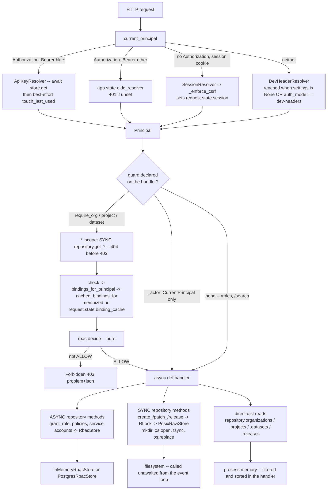
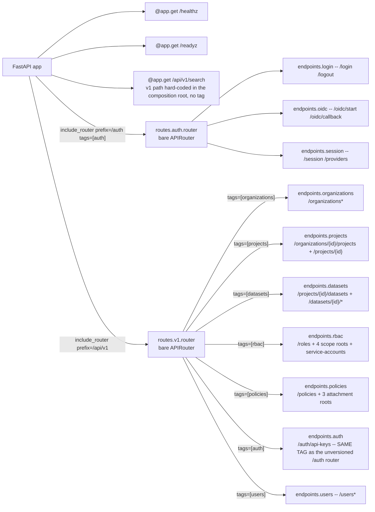
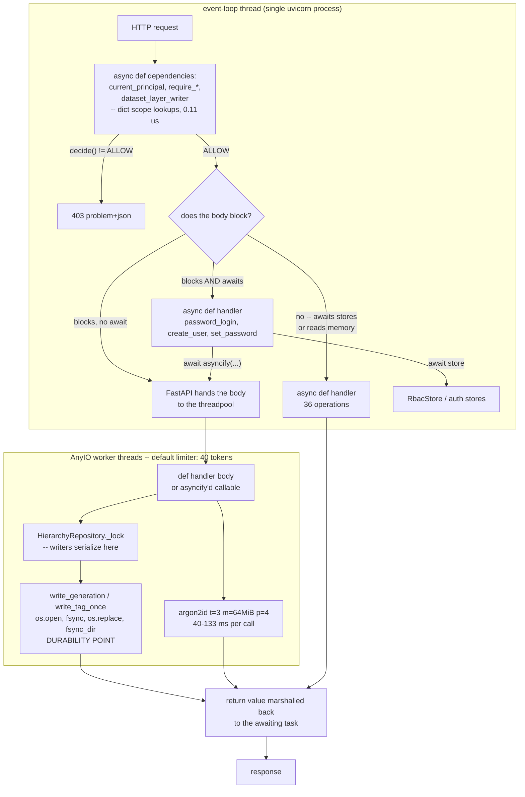
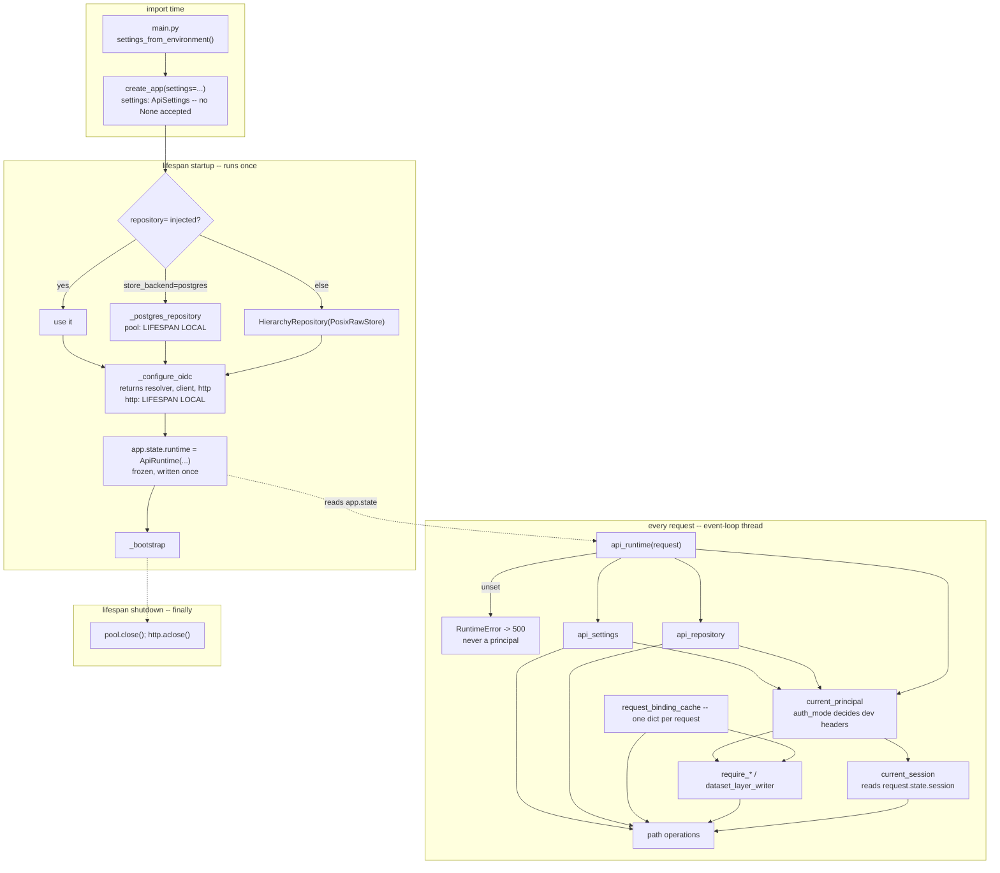
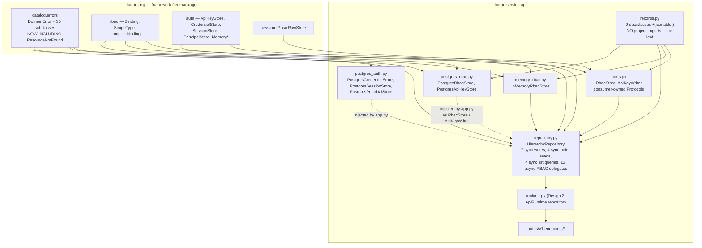
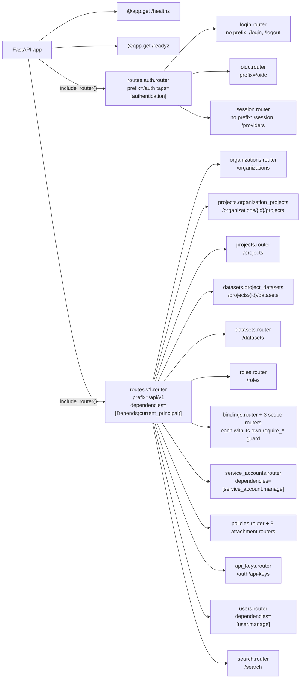
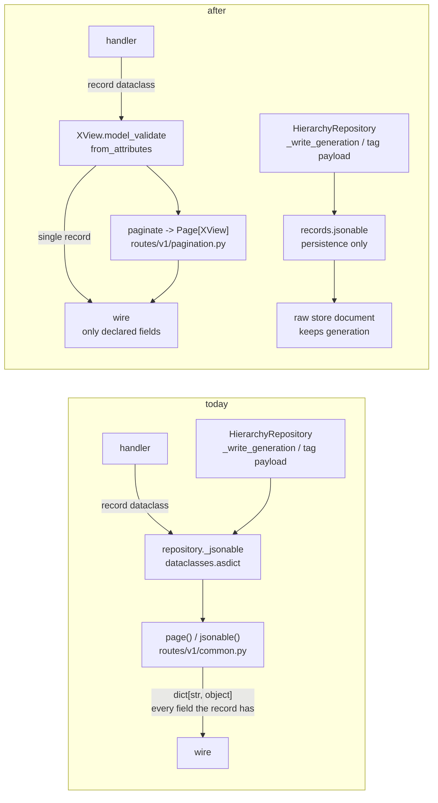
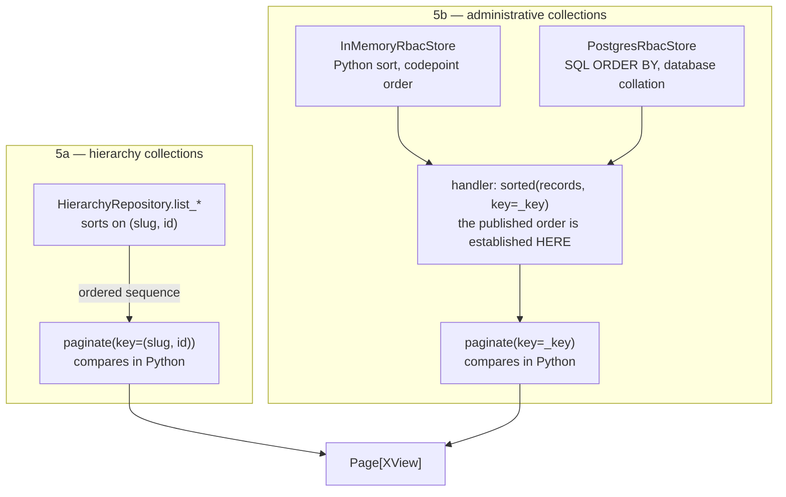
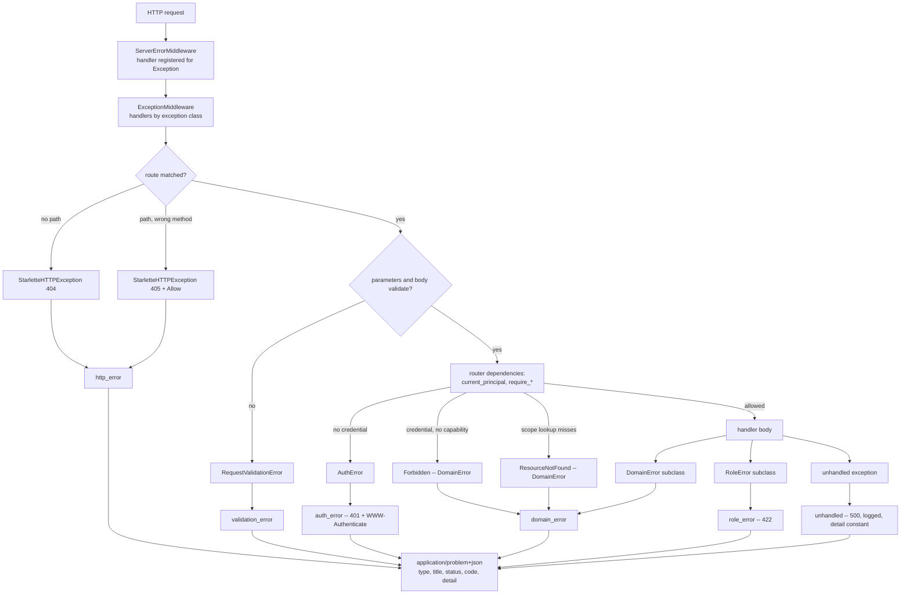
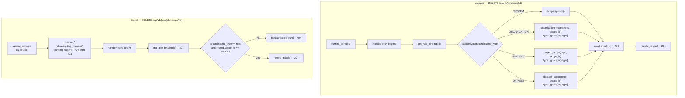

# Huron — API Design Record (`src/huron/service/api/`)

This is the design record for the clean sweep of `src/huron/service/api/` — the FastAPI service
tier: the HTTP surface, its routers, request/response contracts, authentication and authorization
wiring on routes, error mapping, and how the service is run. It is produced by `/design-plan` and
is the companion to `API_IMPLEMENTATION_PLAN.md`, which sequences the work this document decides.
Phase 0 (this section and `## Roadmap Drift`) is a documentation grill only: it records where the
project's own documents make claims about the API tier that are not true of the code, and it
edits none of them. Later phases append the current-state map and the target design.

**Authority order, established before any claim was extracted.**

1. **`design/`** — authoritative on intent. `README.md`: "Design record — authoritative …
   Where code and design disagree, the design wins." `docs/index.md`: design/ is "the complete
   and only authoritative record of what Huron is and why." Within it, `design/api.html` decides
   the HTTP surface and the error-code contract, `design/auth.html` the authentication wiring and
   the versioned/unversioned route split, `design/rbac.html` the authorization rules routes
   enforce.
2. **`design/roadmap.html`** — inside `design/`, but uniquely carries **status as well as
   intent**. `CLAUDE.md` calls it "the living, cross-phase roadmap"; roadmap §2 says "Status is
   tracked here, on the plan itself: landing work updates its tag in the same change." It is
   therefore the document that decides *what has shipped*; api/auth/rbac decide *what should
   exist*. Its `done` / `partial` / `todo` tags and its per-milestone "Built:" sentences are the
   falsifiable present-tense claims in this repo, and were checked item by item.
3. **Root execution plans** — `IMPLEMENTATION_PLAN.md` (A1–A13, authentication) and
   `RBAC_IMPLEMENTATION_PLAN.md` (R1–R13, authorization). Both state "`design/` remains
   authoritative", so they are **derived** on intent — but both carry per-step status markers
   (`✅ implemented`, "Nothing here is implemented yet"), so on status they make first-order
   claims and were checked as such.
4. **`README.md`, `docs/`** — derived and deliberately thin. `docs/index.md` states it "does not
   describe the architecture" and defers to `design/`; `design/roadmap.html` §2 states
   `docs/backend-design.md` "defers to this page rather than keeping a second copy." Nothing in
   them can contradict a higher tier without the higher tier being the finding.
5. **`CONTROL_PLANE_PLAN.md`** — **retired in substance, not in form.** `design/roadmap.html` §1
   retires it by class ("Prototype endpoints, schemas, and plans are retired outright … Nothing
   here amends or extends any earlier plan — this is the plan"), and neither `README.md`,
   `CLAUDE.md`, nor `docs/index.md` lists it. But the document itself still reads
   `| Status | Ratified design, ready to implement |` and carries a live REST section. Treated as
   retired here; the mismatch is recorded as Drift 7.
6. **`api_skill_audit.md`** — the escalation seed for this run. Its findings F1–F9 are established
   context, not re-derived. They appear below only where a document asserts something one of them
   contradicts.

Evidence rank per `.claude/skills/grill-with-docs/SKILL.md`: every claim below was settled by
running the application (rank 1) or by the code that would run (rank 2). The single check that
settled the largest number of them was building the real route table from the constructed app —
36 paths, 47 operations — and exercising them through `TestClient`. No finding rests on one
document agreeing with another.

---

## Roadmap Drift

### Drift 1 — `/api/v1` is not uniformly authenticated

**Claim.** `design/auth.html` §5 (Route surface: unversioned `/auth`): "`/auth/login`,
`/auth/oidc/start`, `/auth/oidc/callback`, and `/auth/providers` (which the login page reads to
know what to render, before any credential exists) **are the only unauthenticated routes in the
service** besides `/healthz` and `/readyz`." The same claim is restated as a comment at
`src/huron/service/api/app.py:189-191`.

**Reality.** Two `/api/v1` routes answer with no credential at all. Receipt — `TestClient` against
the constructed app, no `Authorization` header, no cookie, no dev headers:

```
GET   /api/v1/roles          -> 200 application/json  {"items":[{"code":"reader","title":"Reader",...
GET   /api/v1/search         -> 503 application/problem+json  {"code":"PROJECTION_UNAVAILABLE",...
GET   /api/v1/organizations  -> 401 application/problem+json  {"code":"INVALID_CREDENTIAL",...
```

`list_roles` (`src/huron/service/api/routes/v1/endpoints/rbac.py:41`) declares no
`CurrentPrincipal` and no `require_*` guard; `search_unavailable` (`app.py:185-187`) takes no
parameters. This is the documentary claim that established finding F3 contradicts.

**Class.** Code has diverged. `design/` is authoritative on intent and no roadmap row marks the
role catalog as deliberately public.

**Consequence.** A design that puts the shared authentication guard on the `APIRouter` (which F4
recommends and which this clean sweep will almost certainly do) would change the behavior of two
live endpoints without anyone realizing a behavior change was in scope — and a security review
reading `auth.html` would conclude the versioned surface is closed when it is not.

### Drift 2 — `IMPLEMENTATION_PLAN.md` declares itself unimplemented; twelve of its thirteen steps have shipped

**Claim.** `IMPLEMENTATION_PLAN.md:12`: "**Nothing here is implemented yet.** Steps A1–A13 are
ordered so every step leaves the tree green … code blocks are the intended implementation, written
against the tree as of 2026-08-30, and may be lifted verbatim."

**Reality.** The tree contains the artifact each step names:

| Step | Names | Present |
|---|---|---|
| A1 | absorb `pkg/identity` into `pkg/auth` | `src/huron/pkg/auth/` exists; no `pkg/identity` |
| A2 | `pkg/auth/password.py` | present |
| A3 | `pkg/auth/sessions.py` | present (`IDLE_TTL=12h`, `ABSOLUTE_TTL=7d`, `TOUCH_INTERVAL=5m`) |
| A4 | `pkg/auth/oidc.py` with real JWKS verify | present; `JwksVerifier` wired at `app.py:89-95` |
| A5 | migration `0005_auth` | `migrations/versions/0005_auth.py` |
| A7 | `current_principal` learns cookies; CSRF | `authorization.py:117-121, 144-160` |
| A8 | unversioned `routes/auth/` | `src/huron/service/api/routes/auth/`; 6 live routes under `/auth` |
| A9 | admin user management (v1, guarded) | `routes/v1/endpoints/users.py`; 3 live routes |
| A10 | split `routes/v1/schemas.py` into `routes/v1/schema/*` | 7 schema modules, one per endpoints module |
| A11 | run the application under Podman/Docker | `Containerfile`, `docker-compose.yml` (135 lines) |
| A12 | tests | `tests/unit/test_api_login.py`, `test_auth_sessions.py`, `test_auth_password.py`, … |
| A13 | design record updated | `design/auth.html` documents sessions, CSRF and the `/auth` split |

Receipt: `git log --oneline -1` → `f214114 Implement RBAC simplification and auth prototype`;
`ls migrations/versions/` → `0001…0007`; the app builds and serves `/auth/login`, `/auth/logout`,
`/auth/oidc/start`, `/auth/oidc/callback`, `/auth/session`, `/auth/providers`.

**Class.** Documentation is wrong.

**Consequence.** The single most misleading sentence in the repo for this design phase. A designer
who trusts it treats the entire authentication surface — sessions, CSRF, the `/auth` router, admin
user provisioning, the `routes/v1/schema/` layout the clean sweep must preserve — as unbuilt, and
plans to build what already exists. It also means the A-plan cannot be used as a status source:
only `design/roadmap.html` can.

### Drift 3 — binding administration is documented at a path that does not exist

**Claim.** `design/api.html` §6 (Search and admin): "`GET/POST` `/admin/role-bindings` — binding
administration (scoped: org admins within their org, owners within their project)."

**Reality.** No `/admin/*` route exists in the application. Receipt — the built route table
(`app.openapi()["paths"]`) contains binding administration at five different paths:

```
POST   /api/v1/bindings
DELETE /api/v1/bindings/{binding_id}
GET    /api/v1/organizations/{organization_id}/bindings
POST   /api/v1/organizations/{organization_id}/bindings
GET    /api/v1/projects/{project_id}/bindings
POST   /api/v1/projects/{project_id}/bindings
POST   /api/v1/datasets/{dataset_id}/bindings
```

`RBAC_IMPLEMENTATION_PLAN.md` R6 (marked `✅ implemented`) describes this scope-rooted shape and
never mentions `/admin/role-bindings`, so the divergence was introduced knowingly and never
written back to the authoritative document.

**Class.** Code has diverged (`design/api.html` is authoritative and `README.md` gives it the
tiebreak), with the practical resolution likely being that the design should adopt the shipped
shape — but that is a decision for `## Design Tasks`, not a documentation edit.

**Consequence.** A designer working the RBAC surface from `design/api.html` alone would design one
admin collection and miss seven live routes, seven guard sites, and the scope-rederivation rule
`DELETE /bindings/{id}` implements.

### Drift 4 — "`POST+GET /{scope}/bindings` at all four scope levels" — `GET` exists at two

**Claim.** `RBAC_IMPLEMENTATION_PLAN.md` R6, headed "**✅ implemented**": "`POST+GET
/{scope}/bindings` at all four scope levels, each guarded by `rbac.binding_manage` *at that
scope*." Restated as shipped by `design/roadmap.html` T3 milestone 12: "**Built:** … bindings CRUD
at all scopes".

**Reality.** Checked scope by scope against the built route table, and confirmed live:

| Scope | POST | GET (list) | Update |
|---|---|---|---|
| SYSTEM (`/api/v1/bindings`) | yes | **absent** | absent |
| organization | yes | yes | absent |
| project | yes | yes | absent |
| dataset | yes | **absent** | absent |

Receipt: `GET /api/v1/datasets/x/bindings` → `405 Method Not Allowed`
(`{"detail":"Method Not Allowed"}`), i.e. the path exists for `POST` only; no `GET /api/v1/bindings`
appears among the 36 paths. No `PATCH` or `PUT` on any binding path, so "CRUD" is
create-read-delete at best and create-delete at two of four scopes.

**Class.** Claimed done, not done.

**Consequence.** A dataset-scope or SYSTEM-scope binding can be created and never enumerated —
including by the UI milestone that is supposed to show "inherited-vs-direct" grants. Any design
that assumes a uniform per-scope binding collection (the natural target of the router-prefix
rework F5 proposes) is designing two new endpoints while believing it is only refactoring.

### Drift 5 — the error-code bijection test and the error-table doc do not exist

**Claim.** `design/api.html` §7 (Error codes): "Every code gets a `DomainError` subclass and a row
in the **error-table doc**, enforced by the **existing bijection test** — the mechanism that keeps
the table honest carries forward unchanged."

**Reality.** Neither artifact exists.

- `grep -rn -i "bijection"` over the repository returns exactly one hit outside the vendored
  virtualenv: `design/api.html:228` — the sentence making the claim. There is no such test in
  `tests/unit`, `tests/contract`, `tests/integration`, or `tests/acceptance`.
- There is no error-table document. `grep -rln "TAG_EXISTS" --include=*.md --include=*.html`
  returns only `design/api.html` (the §7 list itself) and `design/roadmap.html` (a P1 gate
  sentence).
- The mapping has already drifted in the direction the claimed test would have caught. Counted by
  importing `huron.pkg.catalog.errors` and comparing to the §7 list: **32 codes documented, 34
  `DomainError` subclasses**; every documented code has a subclass, and two subclasses are absent
  from §7 — `ILLEGAL_INGEST_TRANSITION` and `PATH_RULE_VIOLATION`.

**Class.** Claimed done, not done.

**Consequence.** `design/api.html` §7 is presented as a mechanically maintained contract and is in
fact a hand-written list that is already two entries behind. A clean sweep that adds error codes —
which a response-model pass (F2) will — inherits a contract with no enforcement, and the design
phase must decide whether to build the test or drop the claim.

### Drift 6 — `/readyz` performs one of the three documented dependency checks

**Claim.** `design/api.html` §6: "`GET /healthz · /readyz · /metrics` — **`/readyz` checks PG + NFS
+ object store**, never LanceDB or Polaris."

**Reality.** `src/huron/service/api/app.py:178-183` is the whole handler: it reads
`repository.raw_store.root.exists()` and nothing else. There is no PostgreSQL probe (the pool at
`app.state.database_pool` is never touched) and no object-store probe (no object-store client is
constructed anywhere in the service). Receipts:

```
GET /readyz                    -> 200 {"status":"ready"}          # raw root present
GET /readyz (raw root deleted) -> 400 {"code":"DOMAIN_ERROR","detail":"raw root is unavailable"}
```

The failure path also answers `400`, not a 5xx, because `readyz` raises a bare `DomainError` whose
class default is `status_code = 400` (`src/huron/pkg/catalog/errors.py:15`).

**Class.** Code has diverged.

**Consequence.** The probe reports ready while PostgreSQL is unreachable, so an orchestrator sends
traffic to an instance that will 500 on the first authenticated request; and because the one check
it does perform answers `400`, a readiness probe configured for 5xx failures never trips at all.
Note this is also the `readyz` filesystem `stat` that established finding F1 puts on the event loop.

### Drift 7 — `CONTROL_PLANE_PLAN.md` still advertises itself as ratified and ready to implement

**Claim.** `CONTROL_PLANE_PLAN.md:5-9` header table: "`| Status | Ratified design, ready to
implement |`", dated 2026-08-16, with "`| Supersedes | The zip-and-store prototype endpoints |`";
§0 announces "Sections 10–14 are implementation surfaces (PostgreSQL, LanceDB, **REST**,
authorization)."

**Reality.** It is retired only by class and only in one place: `design/roadmap.html` §1 —
"Prototype endpoints, schemas, and plans are retired outright. No dual-running, no compatibility
shims" and "Nothing here amends or extends any earlier plan — this is the plan." No document names
`CONTROL_PLANE_PLAN.md`. `README.md` lists the build order as `IMPLEMENTATION_PLAN.md` and
`RBAC_IMPLEMENTATION_PLAN.md` only; `docs/index.md`'s "where to look for what" table does not
mention it; `CLAUDE.md` does not mention it. Grepping it for retirement markers returns only
unrelated `SUPERSEDED` lifecycle-state DDL (lines 184, 715, 728). It is 71 KB of ratified-looking
REST specification with no retirement stamp on it.

**Class.** Documentation is wrong.

**Consequence.** The largest single specification of a Huron REST surface in the repository reads
as current and describes an API the project has deliberately abandoned. Any grill, design pass, or
new contributor that finds it by size or filename will extract claims from a dead document — which
is precisely the failure the authority order exists to prevent.

### Drift 8 — `GET /auth/session` does not return effective roles per scope

**Claim.** `design/api.html` §1 (Authentication surface): "`GET /auth/session` — Principal,
**groups, effective roles per scope**, session expiry and CSRF token — the client's sanity check."

**Reality.** The response model is complete and has six fields, none of them roles
(`src/huron/service/api/routes/auth/schema/session.py:10-21`): `subject`, `kind`, `groups`,
`authentication_method`, `csrf_token`, `expires_at`. Confirmed from the built OpenAPI document,
where `/auth/session` is one of only two routes in the whole service with a real `200` schema
(`$ref: '#/components/schemas/SessionInfo'`). The handler
(`routes/auth/endpoints/session.py:17-27`) resolves no bindings.

**Class.** Code has diverged, with a counter-reading recorded: `design/roadmap.html` T0 milestone 2
lists "authorization-aware navigation driven by the session's effective-access summary" under
`Adds`, i.e. `todo`. The consumer is deferred; `design/api.html` states the field as part of a
shipped route's contract. The design phase should settle which reading wins rather than assume.

**Consequence.** Modest. A frontend built from `design/api.html` would expect a roles map and
receive none — but the roadmap already tells that frontend milestone it is unbuilt.

### Drift 9 — `GET /metrics` is documented as a live endpoint and does not exist

**Claim.** `design/api.html` §6: "`GET /healthz · /readyz · /metrics`". Supporting it,
`design/roadmap.html` §1 lists `pkg/telemetry/` — "structlog and Prometheus wiring" — in the
package tree, where `metastore/` is the **only** package annotated "planned, not built".

**Reality.** `GET /metrics` → `404 {"detail":"Not Found"}` against the running app; it is not among
the 36 paths. `ls src/huron/pkg/` returns four packages — `auth`, `catalog`, `rawstore`, `rbac` —
so `telemetry/` does not exist either, despite carrying no "planned" annotation while a sibling
does.

**Class.** Documentation is wrong. (Not "claimed done, not done": `design/roadmap.html` §4 puts
instrumentation in "Cross-cutting, never a phase … ships with the code that emits it", so no
roadmap row asserts it shipped. The defect is that §1's selective annotation reads as an inventory
of what exists.)

**Consequence.** Low for correctness, real for planning: the package tree in roadmap §1 cannot be
used as a map of the current tree, only of the intended one, and `design/api.html` §6 mixes shipped
and unshipped endpoints in one unmarked table.

### Drift 10 — roadmap phase P1 is `partial` with no per-item status, so its API deliverables cannot be checked

**Claim.** `design/roadmap.html` §2, P1 — Foundations, tagged **`partial`** — lists as one
undifferentiated deliverable string: "… org/project/dataset CRUD with generation documents; release
tags; browse with keyset pagination; **OpenAPI published, TS + Python client cores generated**."
The row carries exactly one per-item status annotation (the withdrawn `audit_events` partitioning);
every other item is unmarked.

**Reality.** The items are in different states and the row cannot distinguish them. Org/project/
dataset CRUD and release tags are live (verified in the route table: `GET/POST /organizations`,
`GET/PATCH /organizations/{id}`, `GET/POST /organizations/{id}/projects`, `GET/PATCH /projects/{id}`,
`GET/POST /projects/{id}/datasets`, `GET/PATCH /datasets/{id}`, `GET/POST
/datasets/{id}/releases`, `GET /datasets/{id}/releases/{tag}` — all present, all matching
`design/api.html` §2). Keyset pagination is not: `page()` returns `"next_cursor": None`
unconditionally (`routes/v1/common.py:19-25`). The client cores do not exist, and T0 milestone 1
independently marks both `openapi/v1.json` and the generated TypeScript client as `todo`.

**Class.** Documentation is ambiguous (not incorrect). The `partial` tag is honest; the row's shape
defeats item-by-item verification, which is the method roadmap §2 promises when it says status is
tracked on the plan itself.

**Consequence.** P1 is the phase that owns the entire hierarchy HTTP surface this design touches,
and it is the one phase whose completion claims cannot be audited. Wherever this document says a
P1 item is unbuilt, the evidence is the code, never the tag.

---

### Checked, no drift found

Named so later phases do not re-check them.

- **`design/api.html` §2 (Hierarchy)** — all ten documented method/path pairs exist at
  `/api/v1` with the documented methods, verified against the built route table. Clean.
- **`design/auth.html` §1–§3 (resolution order, sessions, CSRF)** — checked line by line and
  clean: bearer-before-cookie-before-dev-headers precedence (`authorization.py:102-125`);
  `IDLE_TTL = 12h`, `ABSOLUTE_TTL = 7d`, `TOUCH_INTERVAL = 5m` exactly as §2 states
  (`pkg/auth/sessions.py:35-37`); the CSRF rule of §3 — non-`GET/HEAD/OPTIONS`
  cookie-authenticated requests must echo `X-Huron-CSRF`, constant-time compared, 401 on mismatch
  — implemented at `authorization.py:144-160` and reached from the cookie branch at line 119, with
  `SameSite=Lax`/`HttpOnly`/`Secure`-outside-development on the cookie (`authorization.py:167-177`).
  §7's two open items (no login-CSRF defense, re-login does not revoke the prior session) are
  documented as open and are still open — correctly labeled, not drift.
- **`design/auth.html` §5 (the versioned/unversioned split)** — `/auth/login`, `/auth/logout`,
  `/auth/oidc/start`, `/auth/oidc/callback`, `/auth/session`, `/auth/providers` are all mounted
  unversioned; `POST /api/v1/auth/api-keys` is versioned. Exactly as documented. (The "only
  unauthenticated routes" sentence in the same section is Drift 1; the split itself is clean.)
- **`design/rbac.html`** — "Role bindings are never cached beyond the request" holds: the cache is
  per-request state on the `Request` object (`authorization.py:225-280`, and established finding
  F6 describes the same seam). No drift found in this document.
- **`design/roadmap.html` §1 (service layout)** — "`routes/v1/` … with `routes/v1/schema/` — one
  schema file per endpoints module" is exactly true: seven endpoint modules (`auth`, `datasets`,
  `organizations`, `policies`, `projects`, `rbac`, `users`) and seven identically named schema
  modules.
- **`README.md`, `docs/index.md`, `docs/backend-design.md`** — no independent claims about the API
  tier; both defer explicitly, as their own text says they must. Clean.
- **Explicitly ruled NOT drift** (documented as future work, code correctly absent — do not report
  these as findings): the ingest-session and transfer surface of `design/api.html` §3 (roadmap
  milestone 8, `todo`, backend P2); layers/snapshots/products of §4 (milestones 10, 23, 24,
  `todo`); data-access grants of §5 (milestone 23, `todo`, backend P8); the schema registry,
  purge/retention/audit admin routes of §6 (milestones 19, 21, 25, `todo`); `POST
  /polaris/credentials` (P10, `todo`); `GET /api/v1/auth/api-keys` and `POST
  /api/v1/auth/api-keys/{id}:revoke` (milestone 17 lists listing and revocation under `Adds`;
  live receipts `405` and `404` confirm absence, correctly); `POST /datasets/{id}:retire`
  (milestone 4, `Adds`); the API conventions of `design/api.html`'s preamble — opaque keyset
  cursors, `ETag`/`If-Match` on every mutation, `Idempotency-Key` on every creating POST,
  uniform `application/problem+json`, `openapi/v1.json` with a CI drift check (all milestone 1,
  `todo`; partially present already — `IdempotencyHeader`/`IfMatchHeader` at
  `routes/v1/common.py:15-16`, problem+json on the three registered handlers only, so FastAPI's
  own 404/405/422 still answer `application/json`); the 404-not-403 discoverability rule and the
  filter-before-paginate rule of `design/rbac.html` (milestone 3, `todo` — `page()` has no
  authorization predicate and `next_cursor` is always `None`, which is the documented state of an
  unbuilt visibility layer, not a divergence).
- **Not reached.** `design/architecture.html` and `design/index.html` were not extracted claim by
  claim; the API-tier claims they carry are believed to be restatements of `design/api.html` and
  `design/auth.html`, but that belief is rank-4 evidence and is recorded as unchecked, not as
  clean. `design/frontend.html` and `design/python-client.html` were out of scope by assignment
  (they claim about consumers, not about `src/huron/service/api/`).

---

## Current State

Phase 1 discovery over `src/huron/service/api/` — 35 Python modules, 3628 lines (re-derived by
`wc -l`; the audit's "3640" counts the two `__pycache__`-free trees the same way and is within
rounding of the same set). `src/huron/schema` and `migrations/` were deliberately skipped: they are
out of scope by assignment and are changing concurrently. `pkg/` was skimmed at the boundary only —
enough to place the seams — and `web/` was inspected for exactly one fact (its Svelte adapter).

### The tier, by module

| Module | Lines | What it owns |
|---|---|---|
| `app.py` | 222 | Composition root: lifespan, `app.state`, three exception handlers, four app-level routes, two `include_router` calls |
| `settings.py` | 81 | `ApiSettings` + `OidcSettings` + `ClassificationValue`, and the deploy-time refusals |
| `authorization.py` | 426 | Credential resolution, CSRF, cookies, the per-request binding cache, the four `require_*` guard factories, the layer-write guard |
| `repository.py` | 872 | Record dataclasses, two Protocols, `InMemoryRbacStore`, `HierarchyRepository`, JSON coercion |
| `postgres_rbac.py` | 465 | `PostgresRbacStore`, `PostgresApiKeyStore` |
| `postgres_auth.py` | 256 | `PostgresCredentialStore`, `PostgresSessionStore`, `PostgresPrincipalStore` |
| `routes/v1/` | 828 | 7 endpoint modules, 7 schema modules, `common.py`, the aggregating router |
| `routes/auth/` | 232 | 3 endpoint modules, 2 schema modules, the aggregating router |

**Route table, re-derived from the constructed app**: 36 paths, 47 operations. This confirms Phase
0's count; it is not inherited.

### Request flow and the dependency chain



The bottom three branches are the tier's central structural fact: one handler can reach an awaited
store, a lock-taking blocking filesystem write, and a raw process-memory dict, in the same function,
with no seam between them.

### Router composition tree



Every one of the ten routers is a bare `APIRouter()`. Tags are attached at `include_router`; full
paths are repeated on each decorator. Four modules span more than one path root, so no single
`prefix=` fits them as they stand. The `auth` tag is used twice, for two different surfaces.

### Conventions the codebase already follows

A design that fights one of these needs to say why.

- **Module docstrings, everywhere.** 35 of 35 modules carry one. The style is a one-line statement
  of the module's job, then — only where a rule needs justifying — prose explaining the *reason*
  for a choice (`authorization.current_principal`, `login.password_login`, `app._postgres_repository`).
  Double-backtick reST for symbol references; `#:` attribute comments on settings and dataclass
  fields.
- **`_actor` for a guard-only parameter, `actor` when the value is read.** Applied consistently
  across all seven v1 endpoint modules. `del request` appears exactly once (`rbac.py:43`).
- **One schema module per endpoint module, same basename**, docstring "Request bodies owned by
  ``endpoints/X.py``". Seven/seven in v1, two of three in `routes/auth/` (`oidc.py` needs no body).
  Exactly one cross-module schema import exists and its docstring names itself as the exception
  (`schema/auth.py` → `endpoints/rbac.py`).
- **`__all__` only where the module is a public surface**: `api/__init__.py`, `authorization.py`,
  and the two router `__init__.py`s. Endpoint and schema modules have none, deliberately.
- **Consumer-owned Protocols, structurally satisfied.** `RbacStore` and `ApiKeyWriter` are declared
  in `repository.py` (the consumer) and neither implementation imports them, following
  `pkg/catalog/ports.py`. `ApiKeyWriter` extends `pkg.auth.ApiKeyStore` rather than redeclaring it.
- **Guard factories over guard classes**: `require_*(capability)` returns a closure dependency;
  `dataset_layer_writer` is a plain function returning a frozen dataclass. No class dependencies
  exist in the tier — already the pattern `references/dependencies.md` prescribes.
- **Errors as `DomainError` subclasses with a class-level `code, status_code` tuple assignment**
  (`Forbidden`, `ResourceNotFound`), with `N818` disabled per-file because the names mirror stable
  API codes. Three `@app.exception_handler` registrations map `DomainError`, `AuthError` and
  `RoleError` to `application/problem+json`.
- **`from __future__ import annotations` in every module**, but **`TC001`/`TC002`/`TC003` are
  disabled for `src/huron/service/api/**`** with the reason given in `pyproject.toml:86-88`:
  FastAPI resolves annotations at runtime. Any design that pushes API-tier imports into
  `TYPE_CHECKING` blocks contradicts an explicit, reasoned config.
- **Typing gates do not cover this tier.** `[tool.mypy].files` and `[tool.ty.src].include` are both
  `["src/huron/pkg", "src/huron/schema"]`. The `type: ignore` comments here are therefore checked by
  nothing today.
- **`type: ignore` budget — re-derived: five, not three.** `app.py:107` (`call-arg`),
  `repository.py:845` (`arg-type`), and `rbac.py:172,174,176` (`arg-type`, all three on the
  `DELETE /bindings/{id}` scope re-derivation). Three of the five sit on one untested route.
- Ruff `select = ["E","F","I","N","UP","B","SIM","TCH","RUF"]`, line length 100. The FastAPI rule
  set (`FAST`) is **not** enabled. Coverage floor `fail_under = 75`; `pytest` defaults to `-m unit`.

### Emptiness checks

Stated in full, including the ones that came back **not** empty.

**Empty — something with no counterpart:**

1. `local_repository()` (`repository.py:871`) — no importer anywhere in `src/`, `tests/`, or
   `migrations/`. Dead.
2. `entity_ref()` (`repository.py:867`) — no caller anywhere. Dead.
3. `register_revision()` (`repository.py:654`), `RevisionSeed` (`:104`) and the
   `HierarchyRepository.revisions` dict (`:433`) — the dict is written only by `register_revision`,
   which nothing calls, and read by nothing. A store with neither a writer nor a reader.
4. **`ApiSettings.classification_vocabulary` has no enforcer.** It is validated for uniqueness and
   non-emptiness in `settings.py:73-80` and read by nothing else in the repository.
   `CreateProject.data_classification` (`schema/projects.py:12`) is a bare `str` and
   `create_project` stores it verbatim, so a configured vocabulary constrains no request.
5. `app.state.database_pool` — written by the lifespan, read only by the lifespan's own close and by
   `tests/unit/test_api_app.py:117`. No route or dependency reads it, which is the same fact
   Drift 6 records from the other side: `/readyz` never probes PostgreSQL.
6. **`app.state.settings` can be `None`, and `get_settings`'s docstring says it cannot.** The eager
   fallback assigns the parameter unconditionally (`app.py:134`), so `create_app(repository=r)`
   with no `settings=` leaves it `None`. Proven against the constructed app:
   `app.state.settings is None`; `GET /auth/providers` → **500**, `AttributeError: 'NoneType' object
   has no attribute 'password_login_enabled'`; and `GET /api/v1/organizations` with
   `X-Huron-Subject: alice` → **200**, because `current_principal:122-123` reads a `None` settings
   as "no objection" and falls through to `DevHeaderResolver("development")`. The docstring at
   `authorization.py:85-88` asserts the opposite in as many words.
7. **`Release.withdrawn_at` / `withdrawn_reason` have a reader and no writer.** `resolve_release`
   raises `TagWithdrawn` on them (`repository.py:650`); no route and no repository method ever sets
   them. (Distinct from Phase 0's cleared list: withdrawal is not documented as future work
   anywhere — the field simply exists unreachable.)
8. **Policy attachments have a writer and no reader.** Three `POST /*/policy-attachments` routes
   write them through both stores; no route, and no repository method, ever lists or resolves an
   attachment. `InMemoryRbacStore._policy_attachments` is append-only.
9. **The one `DELETE` in the service is untested.** `DELETE /api/v1/bindings/{binding_id}` is the
   only delete operation in all 47, no test in the repository issues a `DELETE` request at all, and
   it is the site of three of the tier's five `type: ignore`s.
10. **Fourteen of 47 operations have no test that names their path**: `/readyz`;
    `GET /api/v1/roles`; `GET /api/v1/search`; `POST /api/v1/bindings`;
    `DELETE /api/v1/bindings/{binding_id}`; `GET` and `PATCH /api/v1/datasets/{dataset_id}`;
    `POST /api/v1/datasets/{dataset_id}/bindings`; `GET /api/v1/datasets/{dataset_id}/layers`;
    `POST /api/v1/datasets/{dataset_id}/policy-attachments`;
    `POST /api/v1/projects/{project_id}/policy-attachments`; and all three release routes
    (`POST` and `GET .../releases`, `GET .../releases/{tag}`). The whole release surface — which
    Phase 0 verified as live and matching `design/api.html` §2 — is pinned by nothing.
11. `structlog` and `prometheus-client` are declared project dependencies and imported by no module
    in `src/` or `migrations/`; so are `aiobotocore` and `greenlet`. `sqlalchemy` and `alembic` are
    imported only by `migrations/env.py`, `migrations/_ddl.py` and the Alembic template.

**Not empty — checked, and a real result:**

- Every one of the nine schema modules has at least one importer; none is orphaned.
- Every one of the 25 names in `authorization.__all__` has a consumer in `src/` or `tests/`. None
  is dead. (`DEFAULT_SESSION_COOKIE_NAME` is consumed by tests plus `_cookie_name` internally,
  which is the weakest case and still a real one.)
- `RbacStore` has two implementations (`InMemoryRbacStore`, `PostgresRbacStore`); `ApiKeyWriter`
  has two (`MemoryApiKeyStore`, `PostgresApiKeyStore`). Neither Protocol is speculative.
- `app.state.oidc_client` is read at `routes/auth/endpoints/oidc.py:32`; `app.state.oidc_resolver`
  at `authorization.py:110`; `app.state.http_client` by the lifespan close. All three are live.
- `IdempotencyHeader` and `IfMatchHeader` each have three consumers; `expected_version` three.
- `HierarchyRepository._require_scope` is called from `grant_role` and `attach_policy`.
- `web/build` exists and is populated — but it is an **`@sveltejs/adapter-node`** build
  (`handler.js`, `index.js`, `server/`, `client/`), a Node SSR server, not a static SPA directory.
  `web/svelte.config.js` states the SSR choice and cites `design/frontend.html` §1. This is the
  decisive fact for the `app.frontend()` question in F9 and it is not visible from the audit alone.
- `fastapi-cli` is confirmed absent: no `[tool.fastapi]` table, no `fastapi dev`/`fastapi run` in
  `Makefile`, `Containerfile`, or `docker-compose.yml`; `make api` runs
  `uvicorn huron.service.api.app:app --reload --port 8080` and the image `CMD` runs plain uvicorn.

### Observations that shape the design

- **There is no persistent hierarchy store.** `HierarchyRepository` holds organizations, projects,
  datasets, revisions and releases in process dicts; `store_backend="postgres"` swaps only the RBAC
  and auth stores, and `app._postgres_repository`'s own docstring says the hierarchy "stays
  in-memory until it gets its own store". Consequently three handlers do query work directly over
  those dicts — `projects.py:56`, `datasets.py:69`, `datasets.py:127`, plus
  `organizations.py:51` — filtering and sorting in the HTTP layer. This is why `page()` can return
  `next_cursor: None` unconditionally and why the response-model pass will be modeling dataclasses,
  not rows.
- **The Postgres adapters depend on the application-service module.** `postgres_rbac.py` imports
  `Policy`, `PolicyAttachment`, `ResourceNotFound`, `RoleBindingRecord` and `ServiceAccount` from
  `repository.py`; `postgres_auth.py` imports `ResourceNotFound` from it. `repository.py` is
  simultaneously the record-type module, the Protocol module, the in-memory implementation, and the
  hierarchy application service — four concerns in 872 lines, with the adapters pointing back at it.
- **`/api/v1/search` is defined in the composition root** with its version prefix hard-coded
  (`app.py:185`), outside `routes/v1/`, untagged, and taking no parameters — the only v1 operation
  that does not live in the v1 router.
- **Only two operations of 47 have a real `200` schema** in the built OpenAPI document:
  `GET /auth/session` (`SessionInfo`) and `GET /auth/providers` (`ProviderInfo`). Every other
  success response documents as bare `{"type": "object"}`.
- **`limit` clamping is silent, proven.** `GET /api/v1/organizations?limit=5000` → 200 and
  `?limit=-3` → 200, both served through `max(1, min(limit, 200))`; only a non-integer reaches a
  422. Nothing in the response or the schema tells the caller the bound was applied.
- **FastAPI's own errors are not problem+json, proven.** A 404 on an unrouted path and a 405 on
  `DELETE /healthz` both answer `application/json` with a `{"detail": ...}` body; so does a
  validation 422. Only the three registered handlers produce `application/problem+json`.
- **`POST /api/v1/policies` requires authentication but no capability** — any authenticated
  principal may create a policy. The handler's docstring states this is intentional ("Creating a
  policy grants nothing - attachment is the guarded act"), so it is a recorded decision to confirm,
  not an oversight to fix silently.

### Test surface for the tier

Eight unit modules pin this tier: `test_api_app.py` (120, lifespan and OIDC discovery),
`test_api_authorization.py` (230, the cookie/CSRF/priority half of `current_principal`),
`test_api_login.py` (252), `test_api_oidc.py` (250), `test_api_rbac.py` (299, the end-to-end
credential → binding → capability → route chain), `test_api_users.py` (211),
`test_api_settings.py` (109, every deploy-time refusal once), `test_api_postgres_auth_mapping.py`
(85, pure row mappers). `test_repository_rbac.py` (408) pins `InMemoryRbacStore`, the repository
delegation and the per-request binding cache. Two contract suites — `tests/contract/test_auth_store.py`
(419) and `test_rbac_store.py` (447) — pin the Postgres adapters against a real database and are
**not** run by the default `-m unit` selection. `tests/integration/` and `tests/acceptance/` contain
only empty `__init__.py` files. The strongest constraint on any restructuring is `test_api_rbac.py`:
it drives real HTTP through the whole guard chain and will break on any change to guard placement,
status codes, or response body shape.

---

## Design Tasks

Eight areas. Each is sized for one subagent at 30k–50k tokens. Decisions flow downward: an earlier
task's output is an input to the later ones that name it.

### 1. Execution model: blocking I/O off the event loop

**Intent.** Decide, once and for the whole tier, how blocking work is kept off the event loop, and
apply that decision uniformly to every path operation and dependency.

**Acceptance criteria.**
- A stated rule with a reason: `def` path operations in the threadpool, or `async def` with
  `asyncer.asyncify()` at the blocking call, or a split by handler. The rule must cover handlers
  that touch *both* an awaited store and a blocking write in one body — `create_release`,
  `create_dataset` — which is the case that makes a blanket answer wrong.
- The concrete `def`/`async def` disposition for all 47 operations, as a table.
- The disposition for the blocking sites outside handlers: `readyz`'s `root.exists()` stat
  (`app.py:181`), `HierarchyRepository.__init__`'s `raw_store.initialize()` (`repository.py:429`,
  which runs inside the async lifespan), and the `require_*` guards' synchronous
  `repository.get_*` scope lookups.
- A yes/no on adding `asyncer` to `[project.dependencies]`, with the reason. If yes, the exact
  `uv add` line and the call form.
- The effect on `authorization.py`'s dependencies stated explicitly, since a `def` handler with an
  `async def` dependency is legal and a `def` dependency is run in the threadpool too.
- Deletions section, even if "none".

**Files/symbols.** `repository.py:459,481,522,572,600,676,702` and `_write_generation`;
`pkg/rawstore/store.py:76-114`; `pkg/rawstore/commit.py:17-38`; `app.py:178-183`;
every `async def` in `routes/v1/endpoints/`; `authorization.py` guard factories.

**Settleable from artifacts alone?** No. Needs application code read, plus
`.claude/skills/fastapi/references/other-tools.md`. A cheap proof is available and should be taken:
time a `create_organization` call against a temp root to size the stall.

**Ownership.** **Owns** the sync/async disposition of every handler signature. Tasks 2, 3, 4 and 5
all edit those same signatures and must **follow** this decision rather than restate it. This task
does not touch parameter *lists* — that is task 3's.

### 2. Composition root, `app.state`, and injected dependencies

**Intent.** Make the composition root's wiring total and typed, and replace `Request`-threading with
declared dependencies.

**Acceptance criteria.**
- A resolution of the `create_app` eager-fallback defect (emptiness finding 6): concrete
  `create_app` signature and body such that `app.state.settings` is never `None`, or an explicit
  decision to delete the eager branch and require `TestClient` context-manager use — with the
  consequence for the eight test modules that construct apps stated either way. The false docstring
  at `authorization.py:85-88` is deleted or made true; it may not survive as written.
- Named `Annotated[..., Depends(...)]` aliases replacing `get_repository(request)` /
  `get_settings(request)` at their 48 and 8 call sites, with the alias names fixed here (F6). The
  three sites that legitimately keep `Request` — `login.py:64`, `session.py:19`,
  `authorization.py:225-280` — are enumerated and justified.
- A decision on each `app.state` attribute: `settings`, `repository`, `database_pool`,
  `oidc_resolver`, `oidc_client`, `http_client` — keep on `app.state`, move behind a dependency, or
  delete. `database_pool` has no reader outside the lifespan (finding 5) and must be settled.
- A decision on the four app-level routes: `/healthz`, `/readyz`, `/api/v1/search`. `/api/v1/search`
  hard-codes a version prefix in the composition root and belongs to task 4's router tree; say so
  and hand it over.
- `/readyz`'s dependency probes are **out of scope here** — task 6 owns that (it is an error-contract
  question, Drift 6). This task decides only where the handler lives and what it is injected.
- Deletions section.

**Files/symbols.** `app.py` in full; `authorization.py:79-91`; `settings.py`; every
`request: Request` parameter in `routes/`; `tests/unit/test_api_app.py`.

**Settleable from artifacts alone?** No. Application code plus the eight test modules that build
apps, since the fallback exists for them.

**Ownership.** **Owns** the dependency-alias names and the `app.state` inventory. Tasks 4 and 5
write those aliases into signatures and must **follow**. Follows task 1 on `def`/`async def`.

### 3. `repository.py` decomposition and query ownership

**Intent.** Split the four concerns fused in `repository.py`, and decide where list-query logic
lives now that handlers do it over process dicts.

**Acceptance criteria.**
- A concrete module layout for the record dataclasses, the `RbacStore`/`ApiKeyWriter` Protocols, the
  in-memory RBAC store, and `HierarchyRepository` — with the import direction fixed so
  `postgres_rbac.py` and `postgres_auth.py` no longer import from the application-service module.
  Actual module paths and the actual import lines, not a description of them.
- A decision on the four handler-side dict comprehensions (`organizations.py:51`,
  `projects.py:56`, `datasets.py:69`, `datasets.py:127`): repository query methods with concrete
  signatures, or a stated reason they stay in the handler. If they move, the method signatures are
  the deliverable.
- Disposition of the four dead symbols — `local_repository`, `entity_ref`, `register_revision`,
  `RevisionSeed`/`revisions` — and of `Release.withdrawn_at`/`withdrawn_reason` (reader, no writer)
  and the unreadable policy attachments (writer, no reader). Delete or specify the missing half;
  "keep as is" needs a reason.
- The `classification_vocabulary` enforcement gap (finding 4): where `data_classification` is
  validated against the configured vocabulary, or an explicit decision that it is not, and why.
- No design here may require a migration. `PostgresRbacStore`'s and `PostgresAuthStore`'s SQL is
  fixed; only the Python module boundary moves.
- Deletions section — this task is expected to produce the largest one.

**Files/symbols.** `repository.py` in full; `postgres_rbac.py:20-32`; `postgres_auth.py:14-20`;
`routes/v1/common.py`; `tests/unit/test_repository_rbac.py`; `tests/contract/test_rbac_store.py`.

**Settleable from artifacts alone?** No. This is the deepest code read in the set — 872 + 465 + 256
lines plus the two contract suites. If the design subagent finds the record-type relocation and the
query-ownership question cannot both be settled inside budget, **split it there**: relocation first
(mechanical, contract-preserving), query methods second (they depend on task 5's pagination
envelope anyway).

**Ownership.** **Owns** where the record dataclasses live and what `HierarchyRepository`'s public
methods are. Task 5's response models are built from those dataclasses and must **follow** this
task's final names and module paths. Follows task 1 on sync/async.

### 4. Router composition and the authenticated surface

**Intent.** Rebuild the ten routers so prefix, tags and shared dependencies are declared on the
`APIRouter`, and settle in the same pass which routes are reachable without a credential.

Two coupled sub-questions, deliberately in one task because both are answered by the same
`APIRouter(...)` call:

- *Policy*: which routes require a credential, and which require a capability.
- *Mechanism*: what the router tree looks like once prefixes and shared dependencies move onto it.

**Acceptance criteria.**
- A per-route table over all 47 operations: credential required (yes/no), capability required, and
  whether the guard is declared on the router or the operation.
- An explicit decision on `GET /api/v1/roles` and `GET /api/v1/search` (F3, Drift 1). Drift 1
  establishes that `design/auth.html` §5's "only unauthenticated routes" claim is already false;
  this task decides whether the code changes, the document changes, or both. It must also settle
  `POST /api/v1/policies`, whose docstring records an intentional no-capability rule, and the
  comment at `app.py:189-191` that restates the false claim.
- The concrete `APIRouter(prefix=..., tags=[...], dependencies=[...])` construction for every
  router, and the resulting `include_router` calls. Where a module spans two path roots
  (`endpoints/datasets.py`, `endpoints/projects.py`, `endpoints/policies.py`, `endpoints/rbac.py` —
  F5 names two; the enumeration here is four), either a module split with the new file names and
  their contents' boundaries, or a stated reason a bare router remains. "Tags carry no such
  constraint" is not a resolution of the prefix question.
- The `auth` tag collision resolved: `endpoints/auth.py` (versioned API keys) and the unversioned
  `/auth` router currently share it.
- Deletion of the `_actor: CurrentPrincipal` parameter at its nine read-route sites and of
  `del request` (`rbac.py:41-43`, F8), as a consequence of moving the guard to the router.
- `/api/v1/search` relocated out of `app.py` into this tree, or a stated reason it stays.
- Deletions section.

**Files/symbols.** `routes/v1/__init__.py`; `routes/auth/__init__.py`; `app.py:185-193`; the
`router = APIRouter()` line and every decorator in all ten endpoint modules; `authorization.py:218`,
`:328-374`; `tests/unit/test_api_rbac.py` (it drives the guard chain over HTTP and will break).

**Settleable from artifacts alone?** No. Needs the endpoint modules, `authorization.py`, and
`design/auth.html` §5 plus `design/rbac.html` for the policy half.

**Ownership.** **Owns** the router files, their prefixes, tags, shared dependencies, and any module
split. Tasks 5, 6 and 7 all add code to these files and must **follow** the layout this task fixes —
in particular, task 7's two new binding routes go into whatever module this task decides owns the
binding surface. Follows task 1 on `def`/`async def` and task 2 on dependency-alias names.

### 5. Response models and the pagination envelope

**Intent.** Give every operation a declared response type, and replace the untyped
`jsonable()`/`page()` envelope with a documented one.

**Acceptance criteria.**
- A concrete Pydantic model, or a concrete non-model return type, for each of the 45 operations that
  lack one — written out, in the one-schema-module-per-endpoint-module layout the tier already uses,
  with `SessionInfo`/`ProviderInfo` as the in-tree precedent. Where the return type differs from the
  public schema, `response_model` with the reason (`references/responses.md`).
- The paginated envelope as a concrete generic or per-resource model, replacing
  `common.page()`. It must state what `next_cursor` means while keyset pagination is unbuilt — a
  field that is structurally always `null` is a contract, and the design says which one.
- The two secret-bearing responses handled explicitly: `issue_api_key` (`endpoints/auth.py:43-49`)
  and `issue_service_account_key` (`endpoints/rbac.py:230-236`) return a plaintext `secret`. A
  response model makes the show-once rule visible in the schema; the design says how, and how the
  model prevents the secret leaking into any *other* response.
- `limit` declared as `Annotated[int, Query(ge=1, le=200)]` or equivalent, replacing the silent
  clamp in `page()` (F7). Whether an out-of-range `limit` now 422s is a contract change and must be
  stated as one.
- Disposition of `common.jsonable`, `common.page` and `repository._jsonable` — with the
  `# type: ignore[arg-type]` at `repository.py:845` resolved, not inherited.
- `GET /auth/session`'s `SessionInfo` and Drift 8: `design/api.html` §1 promises effective roles per
  scope; `design/roadmap.html` T0 milestone 2 marks the consumer `todo`. This task settles which
  reading wins and either adds the field with its concrete type or records the document change.
- Deletions section.

**Files/symbols.** All ten endpoint modules; all nine schema modules; `routes/v1/common.py`;
`repository.py` record dataclasses; `routes/auth/schema/session.py`.

**Settleable from artifacts alone?** No. Needs every endpoint module and the record dataclasses.
This is the widest surface in the set — 47 operations. It stays one task because a split guarantees
two incompatible envelopes; if the subagent overruns, the honest split is **v1 resource models**
(organizations/projects/datasets/releases/layers) versus **v1 administrative models**
(rbac/policies/users/api-keys), with the envelope and the `limit` decision made in the first and
inherited by the second.

**Ownership.** **Owns** the DTO layer and the pagination envelope. Task 6 adds error `responses={}`
entries to the models this task defines and must **follow**. Task 7's new routes use this task's
envelope. Follows task 3 on record-type names and task 4 on which module each route lives in.

### 6. Error contract and `problem+json` coverage

**Intent.** Make the error surface uniform and mechanically checkable, and fix `/readyz`.

**Acceptance criteria.**
- A decision on `application/problem+json` coverage: FastAPI's own 404, 405 and 422 currently answer
  `application/json` (proven). Either handlers for `StarletteHTTPException` and
  `RequestValidationError` with their concrete bodies, or a stated reason the surface stays mixed.
  `design/api.html`'s preamble claims uniform problem+json; Phase 0 already recorded the claim as
  partially met.
- A decision on Drift 5: build the error-table document and the bijection test, or delete the claim
  from `design/api.html` §7. If built — concrete test file path, what it asserts, and how the two
  undocumented codes (`ILLEGAL_INGEST_TRANSITION`, `PATH_RULE_VIOLATION`) enter the table. If
  dropped — the exact sentence to remove. Do not re-derive the 32-vs-34 count; Phase 0 established it.
- `/readyz` (Drift 6): which dependencies it probes, what status code a failure returns, and the
  fix for the bare `DomainError` that answers 400 today so a 5xx-configured probe never trips. Task
  1 owns whether its filesystem stat blocks; this task owns what it checks and what it returns.
- `responses={}` declarations on the operations whose documented error codes are part of the
  contract, expressed against task 5's models.
- Deletions section.

**Files/symbols.** `app.py:138-172,178-183`; `pkg/catalog/errors.py`; `authorization.py:75-76`;
`repository.py:56-57`; `design/api.html` §7; `tests/unit/`.

**Settleable from artifacts alone?** Partly. The problem+json and `/readyz` halves need code; the
bijection-test half needs `design/api.html` §7 and `pkg/catalog/errors.py` read together. Phase 0's
receipts cover the counting.

**Ownership.** **Owns** every non-2xx response body and media type in the tier. Task 5 owns 2xx
bodies. Both touch every endpoint module; task 5 goes first and task 6 annotates.

### 7. Binding surface completion

**Intent.** Close the two missing binding collections, settle the scope-rooted shape against the
authoritative document, and remove the `type: ignore` cluster on the delete path.

**Acceptance criteria.**
- `GET /api/v1/bindings` (SYSTEM scope) and `GET /api/v1/datasets/{dataset_id}/bindings` designed
  concretely — path, guard, response model, and the repository call each makes. Drift 4 establishes
  both are absent and that `RBAC_IMPLEMENTATION_PLAN.md` R6 claims otherwise; do not re-derive.
  `repository.bindings_at` already exists and takes a `ScopeType`/`scope_id` pair, so this is four
  handlers' worth of symmetry, not new storage.
- A decision on Drift 3: `design/api.html` §6 documents `GET/POST /admin/role-bindings`, which does
  not exist. Either the shipped scope-rooted shape is adopted and the document sentence is rewritten
  (state the replacement text), or the `/admin` collection is designed. One or the other, with the
  reason.
- A decision on binding *update*: Drift 4 records no `PATCH`/`PUT` at any scope, so "bindings CRUD"
  is create-read-delete at best. Say whether update exists at all; a binding whose only mutation is
  revoke-and-regrant is a legitimate design if stated as one.
- `DELETE /api/v1/bindings/{binding_id}`'s scope re-derivation (`rbac.py:163-178`) redesigned so the
  three `# type: ignore[arg-type]` comments are unnecessary — the ignores exist because
  `RoleBindingRecord.scope_id` is `UUID | None` while the three `*_scope` helpers take `UUID`. A
  narrowing that the type system accepts, written out.
- Tests for the delete path and the two new collections named — no `DELETE` request is issued
  anywhere in the suite today (finding 9).
- No migration. `bindings_at` and `get_role_binding` are existing store methods on both backends.
- Deletions section.

**Files/symbols.** `routes/v1/endpoints/rbac.py`; `routes/v1/schema/rbac.py`;
`repository.py:764-768` (`bindings_at`), `:758` (`get_role_binding`); `authorization.py:301-325`;
`design/api.html` §6; `tests/unit/test_api_rbac.py`.

**Settleable from artifacts alone?** No — needs `endpoints/rbac.py`, the repository binding methods,
and `design/api.html` §6.

**Ownership.** **Owns** the binding route set. Follows task 4 for which module and router the new
routes join, and task 5 for their response models. It may not re-open task 4's guard placement.

### 8. Deliberate deviations: entrypoint, ORM, and frontend serving

**Intent.** Settle F9's three recorded deviations as decisions with reasons, so no later reader
re-opens them as oversights.

**Acceptance criteria.**
- **Entrypoint.** Adopt `fastapi-cli` with `[tool.fastapi] entrypoint = "huron.service.api.app:app"`
  and rewrite `make api` and the `Containerfile` `CMD`, or keep uvicorn. The Containerfile comment
  claims the choice is deliberate but gives no reason beyond "development-only convenience lives on
  the host"; the decision must supply the real one either way, and must say what happens to the
  `uvicorn[standard]` dependency.
- **ORM.** `references/other-tools.md` prefers SQLModel over SQLAlchemy. Huron uses asyncpg directly
  behind consumer-owned Protocols, and two import-linter contracts (`catalog and rbac are
  framework-free`, `auth is web-framework-free`) forbid a driver or a web framework in `pkg`. The
  decision states whether SQLModel is adopted anywhere in the API tier, and if not, why the skill's
  preference is overridden — naming the contracts as the reason. Note that `sqlalchemy` is already a
  declared dependency used only by `migrations/`; say whether that stays.
- **Frontend.** `app.frontend()` versus the status quo. The decisive fact, established here and not
  in the audit: `web/` builds with `@sveltejs/adapter-node` and produces a Node SSR server
  (`web/build/handler.js`, `index.js`, `server/`), not a static SPA directory —
  `web/svelte.config.js` cites `design/frontend.html` §1 for the SSR choice. `app.frontend()` serves
  built static assets. The decision must engage with that mismatch rather than recommend the skill's
  default, and must say whether `web/build/client` alone is a candidate.
- Each of the three gets a one-line rejected-alternative entry so the reason survives.
- Deletions section — "none" is a legitimate answer here and must be stated.

**Files/symbols.** `pyproject.toml` (`[project.dependencies]`, `[tool.importlinter]`,
`[tool.ruff.lint]`); `Makefile:29-30`; `Containerfile`; `docker-compose.yml:103-115`;
`web/svelte.config.js`; `web/build/`; `.claude/skills/fastapi/references/other-tools.md`.

**Settleable from artifacts alone?** **Yes** — configuration files, the skill references, and the
build-output listing already recorded above. This is the cheapest task in the set and the only one
that reads no application code.

**Ownership.** Independent of tasks 1–7 and may be settled in any order relative to them. One
overlap to name: if task 1 adopts `asyncer`, both tasks edit `[project.dependencies]` — **task 1
owns the `asyncer` line**, this task owns `fastapi-cli`, `uvicorn` and `sqlalchemy`.

### Ordering

1 → 2 → 3 → 4 → 5 → 6 → 7, with 8 free-floating. The chain is real: 1 fixes every handler's
`def`/`async def`, 2 fixes what is in their parameter lists, 3 fixes what the record types are
called, 4 fixes which file each handler lives in, 5 builds models from 3's types in 4's files, 6
annotates 5's operations, and 7 adds routes that need all six decisions already made.

---

## Design 1 — Execution model: blocking I/O off the event loop

**Recommendation, in one sentence:** declare the eight path operations whose bodies block and never
`await` as plain `def` so FastAPI runs them in its worker threadpool, add `asyncer` and wrap the
blocking call with `await asyncify(...)` in the three that must both `await` and block, and leave
the other thirty-six `async def` untouched.

The audit's F1 names the filesystem writes. It misses the larger stall: **`/auth/login` runs Argon2id
(t=3, m=64 MiB, p=4) on the event loop, and it is unauthenticated.** Six concurrent bad-password
attempts move `/healthz` from a 5.3 ms p99 to a **312.5 ms p99 and a 686 ms worst case** (Receipt 3).
That is a denial-of-service surface reachable by anyone who can open a socket, and it is the case
that decides the rule, because `password_login` awaits three store calls in the same body and
therefore cannot simply become `def`.

### Target design

#### The rule

> A path operation is `async def` **if and only if its body must `await`**. Any call inside an
> `async def` body that can block for longer than a request may wait — a filesystem write, an
> `fsync`, a password hash — is wrapped in `await asyncify(callable)(...)`. A body that blocks and
> awaits nothing is declared `def`; FastAPI runs it in the threadpool. Bodies that are pure in-memory
> computation stay `async def`: a thread hop costs more than the work.

Three consequences a future handler author needs and can apply without asking:

1. Adding an `await` to one of the eight `def` bodies is a signature change. Convert the handler to
   `async def` and wrap the blocking call in `asyncify` in the same edit; do not leave a `def` body
   with a `syncify` call in it (see Rejected alternatives).
2. Dependencies follow the same rule and are already all `async def` (`current_principal`, the four
   `require_*` closures, `dataset_layer_writer`). They keep running on the event loop regardless of
   how the handler they guard is declared — proven in Receipt 4.
3. `def` is not a hedge. It is a claim that the body blocks. A handler that neither awaits nor blocks
   declared `def` is wrong under this rule and costs a thread hop per request (Receipt 5).

#### Signatures — the eight that become `def`

Only the `def`/`async def` keyword changes; the parameter lists shown are today's and are owned by
tasks 2 and 3.

```python
# routes/v1/endpoints/organizations.py
@router.post("/organizations", status_code=201)
def create_organization(
    request: Request,
    body: CreateOrganization,
    idempotency_key: IdempotencyHeader,
    _actor: Annotated[Principal, Depends(require_system("organization.create"))],
) -> dict[str, object]:
    """Persist one organization; the durable write runs in the threadpool.

    The repository takes a process-wide lock and fsyncs a generation file and
    its parent directory before returning, so this must not run on the event
    loop: every concurrent request would wait on the fsync.
    """

@router.patch("/organizations/{organization_id}")
def patch_organization(
    request: Request,
    organization_id: UUID,
    body: PatchOrganization,
    if_match: IfMatchHeader,
    _actor: Annotated[Principal, Depends(require_organization("organization.update"))],
) -> dict[str, object]: ...

# routes/v1/endpoints/projects.py
def create_project(...) -> dict[str, object]: ...
def patch_project(...) -> dict[str, object]: ...

# routes/v1/endpoints/datasets.py
def create_dataset(...) -> dict[str, object]: ...
def patch_dataset(...) -> dict[str, object]: ...
def create_release(...) -> dict[str, object]: ...

# app.py
@app.get("/readyz")
def readyz(request: Request) -> dict[str, str]: ...
```

The docstring above is the pattern for the other six: one sentence naming the durable write as the
reason the handler is synchronous. `readyz` gets its own reason — it stats a filesystem root
precisely in order to detect that the filesystem is unhealthy, and a stat on a hung mount blocks
without bound. On a healthy mount the stat costs **1.0 µs** (Receipt 5); the cost of being wrong is
a total loop stall at exactly the moment the readiness probe is the only thing that still needs to
answer. Task 6 owns what `readyz` probes and what it returns; this task owns only the keyword.

#### Signatures — the three that stay `async def` and wrap

```python
# routes/auth/endpoints/login.py
from asyncer import asyncify

@router.post("/login")
async def password_login(
    request: Request, response: Response, body: PasswordLogin
) -> dict[str, object]:
    ...
    principal_row = await repository.principals.get_user_by_subject(body.username)
    credential = (
        await repository.credentials.get(principal_row.id) if principal_row is not None else None
    )
    if not await asyncify(verify_password)(credential, body.password) or principal_row is None:
        raise AuthError("invalid username or password")
    ...

# routes/v1/endpoints/users.py
@router.post("/users", status_code=201)
async def create_user(request: Request, body: CreateUser, actor: _Actor) -> dict[str, object]:
    ...
    credential = await asyncify(make_credential)(
        principal.id, body.password, updated_by=actor.subject
    )
    await repository.credentials.upsert(credential)

@router.put("/users/{principal_id}/password")
async def set_password(
    request: Request, principal_id: UUID, body: SetPassword, actor: _Actor
) -> dict[str, str]:
    ...
    credential = await asyncify(make_credential)(
        principal_id, body.password, updated_by=actor.subject
    )
```

`asyncify` is applied at the API-tier call site, not inside `pkg/auth/password.py`. `hash_password`,
`verify_password` and `make_credential` stay pure synchronous functions: they are called from tests
and from any future non-HTTP caller, and making them awaitable would push an execution-model
decision that belongs to the web tier down into a package two import-linter contracts keep
framework-free.

#### Dependency: `asyncer`, yes

```bash
uv add asyncer
```

Adding it is justified by three existing handlers, not by a hypothetical. Rejecting it would mean
either writing `await anyio.to_thread.run_sync(lambda: verify_password(credential, body.password))`
— a lambda that erases the callable's types and cannot pass keyword arguments — or making the
`pkg/auth` password functions async. `references/other-tools.md` names Asyncer as the tool for this
exact case and prefers it over AnyIO and asyncio. `asyncify` also takes a `limiter=` argument, which
is how Open question 1 is answered if it is answered yes.

Task 8 owns `fastapi-cli`, `uvicorn` and `sqlalchemy` in `[project.dependencies]`; **this task owns
the `asyncer` line**, as `## Design Tasks` §8 records.

#### Disposition of all 47 operations

| Path | Method | Function | Disposition |
|---|---|---|---|
| `/healthz` | GET | `app.healthz` | `async def` — unchanged |
| `/readyz` | GET | `app.readyz` | **→ `def`** (stats the raw root) |
| `/api/v1/search` | GET | `app.search_unavailable` | `async def` — unchanged (raises immediately) |
| `/auth/login` | POST | `login.password_login` | `async def` + **`asyncify(verify_password)`** |
| `/auth/logout` | POST | `login.logout` | `async def` — unchanged |
| `/auth/oidc/start` | GET | `oidc.oidc_start` | `async def` — unchanged |
| `/auth/oidc/callback` | GET | `oidc.oidc_callback` | `async def` — unchanged |
| `/auth/session` | GET | `session.session_info` | `async def` — unchanged |
| `/auth/providers` | GET | `session.providers` | `async def` — unchanged |
| `/api/v1/organizations` | POST | `organizations.create_organization` | **→ `def`** |
| `/api/v1/organizations` | GET | `organizations.list_organizations` | `async def` — unchanged |
| `/api/v1/organizations/{organization_id}` | GET | `organizations.get_organization` | `async def` — unchanged |
| `/api/v1/organizations/{organization_id}` | PATCH | `organizations.patch_organization` | **→ `def`** |
| `/api/v1/organizations/{organization_id}/projects` | POST | `projects.create_project` | **→ `def`** |
| `/api/v1/organizations/{organization_id}/projects` | GET | `projects.list_projects` | `async def` — unchanged |
| `/api/v1/projects/{project_id}` | GET | `projects.get_project` | `async def` — unchanged |
| `/api/v1/projects/{project_id}` | PATCH | `projects.patch_project` | **→ `def`** |
| `/api/v1/projects/{project_id}/datasets` | POST | `datasets.create_dataset` | **→ `def`** |
| `/api/v1/projects/{project_id}/datasets` | GET | `datasets.list_datasets` | `async def` — unchanged |
| `/api/v1/datasets/{dataset_id}` | GET | `datasets.get_dataset` | `async def` — unchanged |
| `/api/v1/datasets/{dataset_id}` | PATCH | `datasets.patch_dataset` | **→ `def`** |
| `/api/v1/datasets/{dataset_id}/releases` | POST | `datasets.create_release` | **→ `def`** |
| `/api/v1/datasets/{dataset_id}/releases` | GET | `datasets.list_releases` | `async def` — unchanged |
| `/api/v1/datasets/{dataset_id}/releases/{tag}` | GET | `datasets.resolve_release` | `async def` — unchanged |
| `/api/v1/datasets/{dataset_id}/layers` | GET | `datasets.list_layers` | `async def` — unchanged |
| `/api/v1/datasets/{dataset_id}/layers/{layer}/write-intents` | POST | `datasets.create_write_intent` | `async def` — unchanged |
| `/api/v1/roles` | GET | `rbac.list_roles` | `async def` — unchanged |
| `/api/v1/bindings` | POST | `rbac.create_system_binding` | `async def` — unchanged |
| `/api/v1/bindings/{binding_id}` | DELETE | `rbac.revoke_binding` | `async def` — unchanged |
| `/api/v1/organizations/{organization_id}/bindings` | POST | `rbac.create_organization_binding` | `async def` — unchanged |
| `/api/v1/organizations/{organization_id}/bindings` | GET | `rbac.list_organization_bindings` | `async def` — unchanged |
| `/api/v1/projects/{project_id}/bindings` | POST | `rbac.create_project_binding` | `async def` — unchanged |
| `/api/v1/projects/{project_id}/bindings` | GET | `rbac.list_project_bindings` | `async def` — unchanged |
| `/api/v1/datasets/{dataset_id}/bindings` | POST | `rbac.create_dataset_binding` | `async def` — unchanged |
| `/api/v1/organizations/{organization_id}/service-accounts` | POST | `rbac.create_service_account` | `async def` — unchanged |
| `/api/v1/organizations/{organization_id}/service-accounts` | GET | `rbac.list_service_accounts` | `async def` — unchanged |
| `/api/v1/organizations/{organization_id}/service-accounts/{principal_id}/api-keys` | POST | `rbac.issue_service_account_key` | `async def` — unchanged |
| `/api/v1/organizations/{organization_id}/service-accounts/{principal_id}/disable` | POST | `rbac.disable_service_account` | `async def` — unchanged |
| `/api/v1/policies` | POST | `policies.create_policy` | `async def` — unchanged |
| `/api/v1/policies` | GET | `policies.list_policies` | `async def` — unchanged |
| `/api/v1/organizations/{organization_id}/policy-attachments` | POST | `policies.attach_to_organization` | `async def` — unchanged |
| `/api/v1/projects/{project_id}/policy-attachments` | POST | `policies.attach_to_project` | `async def` — unchanged |
| `/api/v1/datasets/{dataset_id}/policy-attachments` | POST | `policies.attach_to_dataset` | `async def` — unchanged |
| `/api/v1/auth/api-keys` | POST | `auth.issue_api_key` | `async def` — unchanged |
| `/api/v1/users` | POST | `users.create_user` | `async def` + **`asyncify(make_credential)`** |
| `/api/v1/users/{principal_id}/password` | PUT | `users.set_password` | `async def` + **`asyncify(make_credential)`** |
| `/api/v1/users/{principal_id}/disable` | POST | `users.disable_user` | `async def` — unchanged |

Eight become `def`; three keep `async def` and wrap a blocking call; thirty-six are untouched.
47 total, re-derived from the constructed app (Receipt 1), not inherited.

#### Blocking sites outside handlers

| Site | Cost, measured | Disposition |
|---|---|---|
| `app.py:181` `readyz` → `raw_store.root.exists()` | 1.0 µs per stat, healthy mount | Handler becomes `def`; the stat is unchanged |
| `repository.py:429` `HierarchyRepository.__init__` → `raw_store.initialize()`, called from the async lifespan | 26 µs (mkdir ×2 + `assert_same_filesystem`) | **No change.** Startup runs before the server accepts connections; there is no concurrent request for it to stall. The contract this relies on is stated below |
| `authorization.py:301-325` `organization_scope` / `project_scope` / `dataset_scope` → `repository.get_*` | 0.11 µs per lookup | **No change.** Process-dict reads, not I/O. They stay inside `async def` guard dependencies |
| `authorization.py:79,84` `get_repository` / `get_settings` | attribute reads | **No change** as plain functions, but see the constraint on task 2 below |

### Explicit contracts

**`HierarchyRepository._lock` (`repository.py:453`) — kept, and it starts mattering.**
Today it can never contend: every method that takes it is synchronous, called unawaited from a
single-threaded event loop, and contains no `await`, so no second coroutine can enter the critical
section. It is decorative. Under this design the seven write methods are entered from *concurrent
AnyIO worker threads*, and the lock becomes the only thing that makes read-check-write atomic —
the idempotency replay (`_replay`/`_remember`), the slug-uniqueness scan, the optimistic-version
check, and the generation increment are all inside it. Invariant: **every mutating method of
`HierarchyRepository` holds `_lock` for the whole read-check-write sequence, and no `await` may ever
appear inside that critical section.** Concurrent writers therefore serialize; concurrent readers of
the same dicts do not take the lock and may observe a write in progress, which is unchanged from
today and is a property of the in-memory hierarchy, not of this design.

**`InMemoryRbacStore._lock` (`repository.py:255`) — kept, unchanged, and never entered from a worker
thread.** Its methods are `async def` and are awaited only from `async def` handlers and guards, all
on the event-loop thread. None of the three `asyncify` call sites and none of the eight `def`
handlers reach it. If a future `def` handler needs an RBAC store call, the rule above already
forbids it: that body would have to `await`, so it must be `async def`.

**Threadpool and request concurrency.** FastAPI runs `def` path operations and `asyncify` calls on
the *same* AnyIO default thread limiter — measured at **40 tokens** (Receipt 4). That is the tier's
ceiling on simultaneous blocking work; the 41st blocking request waits for a token, and while it
waits it holds no event-loop time. Deployment is a single uvicorn process with no `--workers`
(`Makefile:30`, `Containerfile:27`), so 40 is the whole service. Argon2id at 64 MiB is the sizing
constraint, not the fsyncs: 40 concurrent hashes reserve ~2.5 GiB — see Open question 1.

**Dependencies are unaffected by the handler's declaration.** A `def` path operation with `async def`
dependencies is fully supported: dependencies resolve on the event loop, then the handler body runs
in a worker thread. Proven end to end against the real guard chain — `201` for the bootstrap owner,
`403 application/problem+json` for an unbound subject, `401 application/problem+json` with no
credential, `422` for a missing `Idempotency-Key` (Receipt 4). No guard, error handler, or status
code changes.

**Exception propagation is unchanged.** `DomainError`, `AuthError` and `RoleError` raised inside a
`def` body or inside an `asyncify`'d callable propagate to the registered `@app.exception_handler`s
exactly as today; the threadpool re-raises in the awaiting task. The `403`/`401` receipts above are
raised from an `async def` dependency guarding a `def` handler and arrive as `problem+json`.

**Cancellation.** Neither a `def` handler nor an `asyncify` call is cancellable: if the client
disconnects mid-write, the thread runs to completion. This is correct here and is a contract, not a
gap — the rawstore write must not be abandoned between `os.open` and `fsync_dir`. Do not pass
`cancellable=True` to `asyncify` at any of the three call sites.

**Lifespan.** `raw_store.initialize()` stays synchronous inside the async lifespan. The contract it
relies on: **nothing in `create_app`'s lifespan startup may block for longer than the deployment's
startup budget, because a stall there delays readiness rather than degrading a live service.** A
future hierarchy store whose `__init__` performs network I/O breaks that and must be constructed
with an awaited factory, not in `__init__`.

**Timing equalization survives.** `verify_password` still runs its dummy-hash comparison on every
call; moving it to a worker thread changes where it runs, not whether it runs, so the
unknown-user / wrong-password wall-clock equality that `login.py:29-30` documents is preserved.

### Constraint imposed on tasks 2 and 3

Stated explicitly, because both tasks edit the same signatures.

**Task 2 (composition root and injected dependencies).** The `Annotated[..., Depends(...)]` providers
that replace `get_repository(request)` and `get_settings(request)` **must be declared `async def`**.
A `def` dependency is run in the threadpool — measured: a `def` dependency executes on `AnyIO worker
thread` while an `async def` one executes on the loop thread (Receipt 5). Declaring these two `def`
would spend a thread hop and one of the 40 limiter tokens on an `app.state` attribute read, on every
one of 47 operations. Task 2 may not "keep them as plain functions" and pass them to `Depends`
unchanged.

**Task 3 (`repository.py` decomposition).** `HierarchyRepository`'s seven mutating methods stay
**synchronous** after decomposition, and any list-query methods extracted from the four handler-side
dict comprehensions stay **synchronous** too — they read process dicts. Task 3 may not make the
hierarchy surface uniformly `async` for symmetry with `RbacStore`: that would force all eight `def`
handlers back to `async def` with an `asyncify` wrapper each, buying nothing while the hierarchy is
in-process memory. If and when the hierarchy gets a real store, those methods become `async def`,
their eight handlers become `async def` in the same change, and the wrapper disappears — the rule
above tells that future author exactly what to do.

**Tasks 4 and 5** inherit the disposition table verbatim; a route that moves modules keeps its
keyword.

### Deletions

**None.** There is no compatibility shim, no duplicate execution path, and no threading helper in
the tier to remove: today's model is "everything is `async def`", so this design changes keywords
and adds three wrappers rather than retiring an abstraction. Both `RLock`s are load-bearing under
the new model and are kept deliberately (contracts above). The largest deletion adjacent to this
work — the dead repository symbols — belongs to task 3.

### Data flow



The diagram's point is the boundary: the guard chain and every `await` stay on the loop, and the
lock and the durability point sit entirely inside the threadpool. Nothing that can stall crosses back.

### Rejected alternatives

- **Everything `async def` + `asyncify` at every blocking call, no `def` handlers.** Uniform, but it
  spends a closure and a wrapper on eight bodies whose entire content is one blocking call, and it
  hides the blocking nature of the handler behind a helper the reader has to follow; `def` states it
  in the signature. The skill's default is `def`.
- **Everything `def`, using `syncify()` for the awaited store calls.** `asyncer.syncify` requires a
  running blocking portal and would need one started per request; it inverts the framework's
  threading model, makes every RBAC lookup a cross-thread round trip, and would move
  `InMemoryRbacStore`'s `RLock` into worker threads for no gain.
- **Make `HierarchyRepository`'s write methods `async def` and `asyncify` inside them,** so the
  repository surface is uniformly awaitable and no handler ever declares `def`. This is the
  speculative-abstraction case priced explicitly: it buys signature stability against a hierarchy
  store that does not exist, at the cost of an async lie over a synchronous in-memory object, a
  thread hop on reads that need none, and a repository whose contract no longer matches what it does.
- **Async filesystem I/O (`aiofiles` or `anyio.Path`).** Rejected on mechanism: `fsync` and
  `os.replace` have no non-blocking POSIX form, so these libraries run them in a threadpool anyway —
  the same threadpool, with a new dependency and a rewritten `pkg/rawstore` on top.
- **Raise the AnyIO thread limiter instead of declaring handlers `def`.** Does not address the
  problem: the stall is the event loop being occupied, not thread starvation.

### Open questions

**1. Should password hashing get its own capacity limiter, separate from the shared 40?**
*Recommended: yes, sized to the CPU allotment, default 4.* Argon2id at `parallelism=4` and 64 MiB is
tuned for human-frequency logins ("revisit only with measurements in hand",
`pkg/auth/password.py:23-24`). Under the default limiter, 40 simultaneous login attempts reserve
~2.5 GiB and 160 threads' worth of CPU demand, and — proven — hashing remains a CPU amplification
vector even off the loop: 30 threaded logins at concurrency 6 still took 1.45 s of wall time
(Receipt 6). A dedicated limiter passed as `asyncify(verify_password, limiter=...)` bounds the blast
radius to a queue on `/auth/login` instead of a memory spike that touches every route. The
implementer must confirm `asyncer.asyncify`'s `limiter=` parameter against the installed version
before relying on it; `anyio.to_thread.run_sync(..., limiter=...)` is the fallback mechanism. This
needs a human because the number is a capacity decision about the deployment, not about the code.

**2. Does `/auth/login` need a rate limit, given that it is unauthenticated and CPU-amplifying?**
*Recommended: yes, but not here.* This design removes the event-loop stall; it does not remove the
amplification — an unauthenticated caller still buys ~45 ms of CPU per request. That is a policy
surface (per-IP or per-subject throttling, and what it returns), and belongs with task 6, which owns
non-2xx bodies, or with a deployment-tier decision. Flagged rather than solved so it is not lost.

**3. Should a lint rule pin the disposition once it is set?** *Recommended: no, not now.* Ruff's
`FAST` rule set is not enabled (`## Current State`) and enabling it is a wider change than this task;
no `FAST` rule checks sync-vs-async body content anyway. The per-handler docstring sentence carries
the reason instead. Task 8 owns the Ruff configuration if it wants to revisit `FAST`.

### Receipts

Environment: fastapi 0.141.1, starlette 1.6.0, uvicorn 0.52.3, Python 3.12. All measurements against
the real `create_app(settings=ApiSettings(), repository=HierarchyRepository(PosixRawStore(tmp)))`
served by uvicorn on loopback, with the data root on ext4 (`/sessions`, `df -T`), never on the fuse
mount. `/healthz` is the probe: it is `async def` and does no work, so its latency *is* event-loop
availability.

**Receipt 1 — the route table is 47 operations, all `async def` today.** Walked the constructed app's
router tree (FastAPI 0.141's `_IncludedRouter` defers inclusion, so `app.routes` alone shows 7):
51 rows less the 4 documentation routes (`/docs`, `/docs/oauth2-redirect`, `/openapi.json`,
`/redoc`) = **47**, `inspect.iscoroutinefunction` true for every one.

**Receipt 2 — the filesystem write stalls the loop.**
```
PROBE A create_organization ms: n=20 p50=5.54 p95=12.09 max=17.59 mean=6.80
PROBE D idle              /healthz: p50=1.7ms p95=3.0ms p99=4.2ms  max=4.3ms
PROBE D async def (today) /healthz: p50=1.3ms p95=64.4ms p99=106.8ms max=109.9ms load_wall=2.10s
PROBE D def + threadpool  /healthz: p50=0.5ms p95=1.5ms  p99=11.2ms  max=48.0ms load_wall=1.24s
```
Load in both rows: 12 concurrent clients × 10 `POST /api/v1/organizations` (real handler, real guard
chain, `X-Huron-Subject: alice` as bootstrap platform owner), zero errors. `def` cuts p99 by 9.5×
and finishes the load 1.7× faster. Honest caveat: the 48 ms `def` maximum is a real outlier — the
threadpool bounds the stall, it does not erase tail latency, and writers still serialize on `_lock`.

**Receipt 3 — Argon2 on `/auth/login` is the larger stall, and it is unauthenticated.**
```
PROBE E argon2 hash_password = 45.4 ms; verify_password n=5 min=40.6 max=133.0 ms
PROBE E idle                          /healthz: p50=1.7ms p95=3.3ms   p99=5.3ms   max=5.9ms
PROBE E async def /auth/login (today) /healthz: p50=1.7ms p95=119.9ms p99=312.5ms max=686.1ms
PROBE E def + threadpool              /healthz: p50=2.1ms p95=11.4ms  p99=17.0ms  max=33.0ms
```
Load: 6 concurrent clients × 5 `POST /auth/login` with unknown usernames — all `401`, all doing the
full dummy-hash comparison, no credential required to issue them.

**Receipt 4 — a `def` path operation keeps its async guard chain intact, and the limiter is 40.**
A probe route declared `def` with `Depends(require_system("organization.create"))`:
```
limiter: {'total_tokens': 40, 'thread': 'Thread-1 (run)'}
def handler runs on: {'thread': 'AnyIO worker thread'}
def+guard as bootstrap owner  -> 201 {'id': '01a05a86-...', 'slug': 'guarded-ok', 'version': 1, ...}
def+guard as unbound subject  -> 403 application/problem+json {"code":"FORBIDDEN","detail":"organization.create denied for bob at SYSTEM scope"}
def+guard with no credential  -> 401 application/problem+json {"code":"INVALID_CREDENTIAL",...}
def+guard missing Idempotency-Key -> 422 {"detail":[{"type":"missing","loc":["header","Idempotency-Key"],...}]}
```

**Receipt 5 — dependency placement, and the non-handler sites are not stalls.**
```
PROBE F dependency threads: {'sync_dep_thread': 'AnyIO worker thread',
                             'async_dep_thread': 'Thread-1 (run)',
                             'handler_thread':   'Thread-1 (run)'}
PROBE C readyz root.exists()            x1000  = 1.03 ms total  (1.0 us each)
PROBE C raw_store.initialize()          x20    = 0.53 ms total  (26 us each)
PROBE C repository.get_organization()   x10000 = 1.09 ms total  (0.11 us each)
```

**Receipt 6 — the `asyncify` shape fixes the login stall while keeping the awaits.** An `async def`
handler that awaits a store call and then runs `verify_password` via `anyio.to_thread.run_sync`
(the mechanism `asyncer.asyncify` wraps), under the same 6 × 5 load:
```
PROBE F idle                                        /healthz: p50=1.8ms p95=2.9ms p99=3.1ms  max=7.1ms
PROBE F async def + blocking call in thread         /healthz: p50=1.8ms p95=9.9ms p99=14.7ms max=15.5ms load_wall=1.45s
```
p99 312.5 ms → 14.7 ms. Measured with `anyio.to_thread.run_sync` because `asyncer` is not yet a
dependency (`grep 'name = "asyncer"' uv.lock` → absent); `asyncify` is a typed wrapper over that same
call, so the latency result transfers but the `asyncify` call form itself is unverified until the
dependency lands.

**Not proven.** That no handler body combines an `await` with a blocking rawstore call is established
by reading all ten endpoint modules, not by measurement: the only `await` inside a body that also
touches `HierarchyRepository` is `bindings_for_principal` in `list_layers`, whose repository calls
are process-dict reads. The Argon2 numbers are from this container's CPU and will differ on the
deployment target; the *shape* of the result will not.

---

## Design 2 — Composition root, `app.state`, and injected dependencies

**Recommendation, in one sentence:** make `settings` a required parameter of `create_app`, collapse
the six `app.state` attributes into one frozen `ApiRuntime` written exactly once by the lifespan,
reach it through three `async def` providers in a new `runtime.py`, and delete the eager fallback
block outright — no test depends on it (Receipt 2).

The `settings is None` hole is not one defect but two. The first is optionality: `create_app`
accepts `settings=None` and the eager block assigns it verbatim (`app.py:134`). The second, and the
one that makes it a security defect rather than a 500, is that `current_principal` reads missing
settings **fail-open** — `getattr(request.app.state, "settings", None)` followed by
`if settings is not None and settings.auth_mode != "dev-headers"` treats "no settings" as "no
objection" and enables `X-Huron-*` dev-header authentication (Receipt 1). Closing only the first
would leave the second: any future state that is unset for any reason still authenticates strangers.
This design closes both — the parameter loses its `None`, and every `getattr(app.state, …, None)`
in the tier is deleted.

### Target design

#### New module: `src/huron/service/api/runtime.py`

```python
"""What the composition root wired, and how a request reaches it.

``create_app`` builds an :class:`ApiRuntime` once, in the lifespan, and
publishes it as the application's only piece of mutable state. Path
operations and guards declare ``Repository``/``Settings`` rather than a
``Request``: the one function in the tier that reads ``request.app`` is
``api_runtime`` below.
"""

from __future__ import annotations

from dataclasses import dataclass
from typing import Annotated

from fastapi import Depends, Request

from huron.pkg.auth import OidcClient, OidcResolver

from .repository import HierarchyRepository
from .settings import ApiSettings


@dataclass(frozen=True, slots=True)
class ApiRuntime:
    """Everything a request may need that outlives the request.

    Frozen because a handler must never re-wire the service, and
    ``settings`` is non-optional because a service with no configuration
    must not answer requests at all.
    """

    settings: ApiSettings
    repository: HierarchyRepository
    oidc_resolver: OidcResolver | None
    oidc_client: OidcClient | None


async def api_runtime(request: Request) -> ApiRuntime:
    """The wiring the lifespan published, or a refusal to serve.

    An application whose lifespan never started has no runtime, and every
    injected route fails here rather than falling through to a default:
    the cost of guessing at wiring is an unauthenticated request answered
    as though it were authenticated.
    """
    runtime: ApiRuntime | None = getattr(request.app.state, "runtime", None)
    if runtime is None:
        raise RuntimeError(
            "the application lifespan has not started: app.state.runtime is unset"
        )
    return runtime


Runtime = Annotated[ApiRuntime, Depends(api_runtime)]


async def api_repository(runtime: Runtime) -> HierarchyRepository:
    return runtime.repository


async def api_settings(runtime: Runtime) -> ApiSettings:
    return runtime.settings


Repository = Annotated[HierarchyRepository, Depends(api_repository)]
Settings = Annotated[ApiSettings, Depends(api_settings)]

__all__ = [
    "ApiRuntime",
    "Repository",
    "Runtime",
    "Settings",
    "api_repository",
    "api_runtime",
    "api_settings",
]
```

All three providers are `async def`, as Design 1's constraint on this task requires: they read an
attribute, and a `def` dependency would spend a thread hop and one of the 40 AnyIO limiter tokens on
it, on every operation. Proven in Receipt 3 — all three run on the loop thread — and Design 1's
Receipt 5 measured the `def` alternative landing on `AnyIO worker thread`.

`Runtime` is a sub-dependency of the other two, so FastAPI's default `use_cache=True` resolves
`api_runtime` **once per request** no matter how many of the three a signature declares. Proven in
Receipt 3: one `runtime:` invocation for a handler declaring all three.

#### `create_app`

```python
def create_app(
    *,
    settings: ApiSettings,
    repository: HierarchyRepository | None = None,
    oidc_verify: Callable[[str], Mapping[str, object]] | None = None,
) -> FastAPI:
    @asynccontextmanager
    async def lifespan(app: FastAPI) -> AsyncIterator[None]:
        pool: asyncpg.Pool | None = None
        if repository is not None:
            wired = repository
        elif settings.store_backend == "postgres":
            wired, pool = await _postgres_repository(settings)
        else:
            wired = HierarchyRepository(PosixRawStore(settings.data_root))
        oidc_resolver, oidc_client, http = await _configure_oidc(settings, oidc_verify)
        app.state.runtime = ApiRuntime(
            settings=settings,
            repository=wired,
            oidc_resolver=oidc_resolver,
            oidc_client=oidc_client,
        )
        try:
            await _bootstrap(wired, settings)
            yield
        finally:
            if pool is not None:
                await pool.close()
            if http is not None:
                await http.aclose()

    app = FastAPI(title="Huron API", version="1.0.0", lifespan=lifespan)
    ...  # the three exception handlers, unchanged

    @app.get("/healthz")
    async def healthz() -> dict[str, str]:
        return {"status": "ok"}

    @app.get("/readyz")
    def readyz(repository: Repository) -> dict[str, str]:
        """..."""  # Design 1 owns the ``def``; task 6 owns what this probes

    @app.get("/api/v1/search")
    async def search_unavailable() -> dict[str, object]:
        raise ProjectionUnavailable("search projection is not configured")

    app.include_router(auth_routes.router, prefix="/auth", tags=["auth"])
    app.include_router(v1.router, prefix="/api/v1")
    return app
```

`_configure_oidc` loses its `app` parameter and writes no state:

```python
async def _configure_oidc(
    settings: ApiSettings,
    oidc_verify: Callable[[str], Mapping[str, object]] | None,
) -> tuple[OidcResolver | None, OidcClient | None, httpx.AsyncClient | None]:
    """Resolver, client, and the HTTP client the caller must close."""
```

Its three existing branches (injected verifier wins; no provider configured; real discovery) are
unchanged in behavior — only the returns move from `app.state` to the tuple, and the
close-on-discovery-failure path stays exactly as it is.

#### New module: `src/huron/service/api/main.py`

```python
"""The ASGI entrypoint: read the environment once, then build the app."""

from __future__ import annotations

from .app import create_app
from .settings import settings_from_environment

app = create_app(settings=settings_from_environment())
```

and in `settings.py`:

```python
def settings_from_environment() -> ApiSettings:
    """Populate every field from ``HURON_*``.

    The call reads argument-less to a type checker, which cannot see that
    pydantic-settings supplies the required fields from the environment.
    """
    return ApiSettings()  # type: ignore[call-arg]
```

This module exists because `settings` is now required and `app.py` therefore cannot hold a
module-level `app`: building one there would read and validate the environment at **import** time,
and the unit suite imports `create_app` with zero `HURON_*` variables set (Receipt 4). Splitting the
factory from the entrypoint keeps `import huron.service.api.app` environment-free and puts the one
environment read in a two-line module whose only job is to perform it.

`Makefile:30` and `Containerfile:27` change `huron.service.api.app:app` to
`huron.service.api.main:app`; those are the only two places in the repository that name the path
(`docker-compose.yml`'s `api` service has no `command:` and inherits the image `CMD`). Task 8 owns
*which runner* is invoked; this task owns *what module path it is pointed at*.

#### `authorization.py` — the injected shape

```python
BindingCacheMap = dict[frozenset[str], tuple[Binding, ...]]


async def request_binding_cache() -> BindingCacheMap:
    """One binding cache per request, and never wider.

    FastAPI resolves a cached dependency once per request, so every guard
    and handler in one request shares this dict and none of them shares it
    with another request. A mid-request role change must not apply
    retroactively to bindings already fetched, and no cache may outlive the
    principal it was built for.
    """
    return {}


BindingCache = Annotated[BindingCacheMap, Depends(request_binding_cache)]


async def current_principal(request: Request, runtime: Runtime) -> Principal:
    """Resolve the request credential to a principal, or 401. ..."""
    authorization = request.headers.get("authorization")
    if authorization:
        token = authorization.removeprefix("Bearer ").strip()
        if token.startswith("hk_"):
            store = runtime.repository.api_keys
            principal = await ApiKeyResolver(store).resolve(token)
            await _touch_api_key(store, token)
            return principal
        if runtime.oidc_resolver is None:
            raise AuthError("bearer JWTs are not accepted: no OIDC verifier configured")
        return await runtime.oidc_resolver.resolve(token)
    token = request.cookies.get(runtime.settings.session_cookie_name)
    if token:
        resolver = SessionResolver(runtime.repository.sessions)
        principal, session = await resolver.resolve(token)
        _enforce_csrf(request, session)
        request.state.session = session
        return principal
    if runtime.settings.auth_mode != "dev-headers":
        raise AuthError("a bearer credential is required")
    return DevHeaderResolver("development").resolve_headers(request.headers)


CurrentPrincipal = Annotated[Principal, Depends(current_principal)]


async def current_session(request: Request, _actor: CurrentPrincipal) -> SessionRecord | None:
    """The session behind this request, if the caller authenticated with one.

    Set by ``current_principal``'s cookie branch, which is why this depends
    on it: a bearer caller has no session and correctly gets ``None``.
    """
    session: SessionRecord | None = getattr(request.state, "session", None)
    return session


CurrentSession = Annotated[SessionRecord | None, Depends(current_session)]


async def cached_bindings_for(
    cache: BindingCacheMap, repository: HierarchyRepository, identifiers: frozenset[str]
) -> tuple[Binding, ...]:
    if identifiers not in cache:
        cache[identifiers] = await repository.bindings_for(identifiers)
    return cache[identifiers]


async def bindings_for_principal(
    cache: BindingCacheMap, repository: HierarchyRepository, actor: RbacPrincipal
) -> tuple[Binding, ...]: ...


async def check(
    cache: BindingCacheMap,
    repository: HierarchyRepository,
    principal: Principal,
    capability: str,
    scope: Scope,
    *,
    layer: str | None = None,
) -> None: ...


def require_organization(capability: str) -> Callable[..., Awaitable[Principal]]:
    async def dependency(
        organization_id: UUID,
        principal: CurrentPrincipal,
        repository: Repository,
        cache: BindingCache,
    ) -> Principal:
        scope = organization_scope(repository, organization_id)
        await check(cache, repository, principal, capability, scope)
        return principal

    return dependency
```

`require_system`, `require_project`, `require_dataset` and `dataset_layer_writer` take the same two
new parameters and lose `request` identically. `organization_scope` / `project_scope` /
`dataset_scope` are unchanged: they already take the repository as an argument.

The per-request binding cache is the one piece of `request.state` that becomes a dependency rather
than staying a `Request` read. `request.state.binding_cache`'s whole contract is "one dict, created
on first use, discarded with the request" — which is precisely what a cached `Depends` provides, in
the framework's own mechanism instead of an ad-hoc attribute with two copies of a create-if-missing
block (`authorization.py:239-243` and `:264-268`). Proven in Receipt 5: one dict shared by two
distinct guard dependencies and the handler, one store query per identifier set, a fresh dict on the
next request. `design/rbac.html`'s "role bindings are never cached beyond the request" continues to
hold, and holds for a structural reason rather than by inspection.

#### Handler signatures — the shape every endpoint module takes

```python
# routes/v1/endpoints/organizations.py  (keyword per Design 1)
@router.post("/organizations", status_code=201)
def create_organization(
    body: CreateOrganization,
    idempotency_key: IdempotencyHeader,
    repository: Repository,
    _actor: Annotated[Principal, Depends(require_system("organization.create"))],
) -> dict[str, object]: ...

# routes/v1/endpoints/rbac.py
@router.delete("/bindings/{binding_id}", status_code=204)
async def revoke_binding(
    binding_id: UUID,
    actor: CurrentPrincipal,
    repository: Repository,
    cache: BindingCache,
) -> None:
    ...
    await check(cache, repository, actor, "rbac.binding_manage", scope)

# routes/v1/endpoints/datasets.py
@router.get("/datasets/{dataset_id}/layers")
async def list_layers(
    dataset_id: UUID, actor: CurrentPrincipal, repository: Repository, cache: BindingCache
) -> dict[str, object]:
    ...
    bindings = await bindings_for_principal(cache, repository, rbac_actor)

# routes/auth/endpoints/login.py
@router.post("/login")
async def password_login(
    response: Response, body: PasswordLogin, settings: Settings, repository: Repository
) -> dict[str, object]: ...

@router.post("/logout")
async def logout(
    response: Response,
    settings: Settings,
    repository: Repository,
    session: CurrentSession,
    _actor: CurrentPrincipal,
) -> dict[str, str]: ...

# routes/auth/endpoints/session.py
@router.get("/session")
async def session_info(actor: CurrentPrincipal, session: CurrentSession) -> SessionInfo: ...

@router.get("/providers")
async def providers(settings: Settings) -> ProviderInfo: ...

# routes/auth/endpoints/oidc.py
async def _configured_oidc_client(runtime: Runtime) -> OidcClient:
    if runtime.oidc_client is None:
        raise HTTPException(status_code=404, detail="OIDC is not configured")
    return runtime.oidc_client


_Client = Annotated[OidcClient, Depends(_configured_oidc_client)]


@router.get("/oidc/start")
async def oidc_start(client: _Client, settings: Settings, return_to: str = "/") -> RedirectResponse: ...


@router.get("/oidc/callback")
async def oidc_callback(
    code: str,
    state: str,
    client: _Client,
    settings: Settings,
    repository: Repository,
    flow_cookie: Annotated[str, Cookie(alias=LOGIN_FLOW_COOKIE_NAME)] = "",
) -> RedirectResponse: ...
```

`_Client` follows the module-local alias precedent `_Actor` already sets
(`routes/v1/endpoints/users.py:36`). `oidc_callback`'s pending-login cookie becomes a declared
`Cookie` parameter with the same `""` default `request.cookies.get(..., "")` produced, so
`LoginFlow.decode`'s input is byte-for-byte what it is today and the cookie now appears in the
OpenAPI document.

#### `app.state` inventory — the decision on each of the six

| Attribute | Written by | Read by, today | Decision |
|---|---|---|---|
| `settings` | lifespan + eager block | `get_settings`, `current_principal`, `_cookie_name` | **Moves** into `ApiRuntime.settings`; reached as `Settings` |
| `repository` | lifespan + eager block | `get_repository` (46 call sites), `readyz` | **Moves** into `ApiRuntime.repository`; reached as `Repository` |
| `oidc_resolver` | lifespan + eager block | `current_principal:110` | **Moves** into `ApiRuntime.oidc_resolver` |
| `oidc_client` | lifespan + eager block | `oidc.py:_oidc_client:32` | **Moves** into `ApiRuntime.oidc_client` |
| `database_pool` | lifespan only | lifespan close; `test_api_app.py:117` | **Deleted.** Lifespan-local `pool` |
| `http_client` | lifespan only | lifespan close; `test_api_app.py:65,67,100,119` | **Deleted.** Lifespan-local `http` |

`app.state` then holds exactly one attribute — `runtime` — written exactly once.

Re-derived counts, not inherited: `get_repository` has **46** call sites (39 in `routes/`, 7 in
`authorization.py`), `get_settings` has **5** (all in `routes/auth/endpoints/`). The `## Design
Tasks` entry says 48 and 8; both are high. `request: Request` is declared **61** times in the tier;
after this design it is declared **6** — three framework-mandated `_request: Request` exception-handler
parameters in `app.py`, plus `api_runtime`, `current_principal` and `current_session`. No path
operation in the tier declares `Request`.

#### The four app-level routes

- `/healthz` — unchanged. It injects nothing deliberately: a liveness probe must answer while the
  service is unwired, and it makes no claim about readiness.
- `/readyz` — `def readyz(repository: Repository)`. Design 1 owns the `def`; task 6 owns what it
  probes and what it returns. The only change here is that it stops reaching through
  `request.app.state`.
- `/api/v1/search` — unchanged here, and **handed to task 4**: it hard-codes `/api/v1` in the
  composition root and belongs in the v1 router tree. Nothing in this design depends on where it
  ends up; it injects nothing either way.

### Explicit contracts

**Settings are never `None`, by type.** `create_app(*, settings: ApiSettings, …)` has no `None` to
accept and no default to fall back to; `ApiRuntime.settings` is a non-optional field of a frozen
dataclass; `Settings` resolves from it. There is no `getattr(..., "settings", None)` left in the
tier. A caller who omits `settings=` gets a `TypeError` at `create_app` — at construction, in the
test that made the mistake, not as a 200 for `X-Huron-Subject: alice` in production.

**Authentication fails closed everywhere.** `current_principal` reaches `DevHeaderResolver` only
when `runtime.settings.auth_mode == "dev-headers"`, which `ApiSettings.refuse_unsafe_combinations`
(`settings.py:67-68`) already refuses outside `env="development"`. No missing-state path exists that
could enable it. The bearer-JWT branch keeps its explicit `oidc_resolver is None` → `AuthError`
refusal, and `oidc.py` keeps its `oidc_client is None` → 404; both were already fail-closed and both
now read a declared optional field instead of a `getattr` default.

**`app.state.runtime` is written exactly once, in lifespan startup, before `_bootstrap` and before
the first request, and is never mutated.** `ApiRuntime` is `frozen=True, slots=True`, so a handler
cannot re-wire the service and cannot add a field to it.

**An application whose lifespan has not started serves no injected route.** `api_runtime` raises
`RuntimeError`, which surfaces as a 500 — never a 200, never a principal. `/healthz` (injects
nothing) and `/api/v1/search` (raises unconditionally) still answer, correctly. Proven in Receipt 3.

**Lifespan owns the pool and the HTTP client for their whole lives.** Both are locals, both are
closed in a `finally`, and neither is reachable at request time — today's close path runs after a
bare `yield`, so a failure during serving skips it. A future resource that must be reachable from a
handler enters `ApiRuntime`; a resource that only needs opening and closing does not.

**Bootstrap ordering.** `app.state.runtime` is published *before* `_bootstrap` runs, so a bootstrap
failure leaves a wired-but-unbootstrapped app rather than an unwired one; the exception still
propagates out of the lifespan and the server does not start. Unchanged from today's ordering.

**One binding cache per request.** `request_binding_cache` returns a fresh dict that FastAPI's
dependency cache shares across every guard and handler in that request and across no other request.
`cached_bindings_for` and `bindings_for_principal` take that dict; they no longer create it, so
there is exactly one creation site.

**Exactly one function reads `request.app`.** `api_runtime`. Anything else needing composition-root
state declares `Runtime`, `Repository` or `Settings`.

**What a test author must now do.**

1. Pass `settings=` to `create_app`. All 14 existing `create_app` calls in `tests/` already do
   (Receipt 4) — this is a no-op for the suite and a compile-time refusal for the next author.
2. Enter the app's lifespan before issuing a request: `with TestClient(app) as client`. Every test
   fixture in the suite already does. A second bare `TestClient(app)` alongside an entered one stays
   valid (`test_api_users.py:166,192`) because the runtime lives on the app, not on the client.
3. Call `current_principal` directly by constructing an `ApiRuntime(settings=…, repository=…,
   oidc_resolver=None, oidc_client=None)` and passing it, instead of faking `app.state` with the
   `_App`/`_State` doubles at `tests/unit/test_api_authorization.py:33-40`. Those two doubles are
   deleted, and `Request` scopes in that module no longer need an `"app"` key.
4. Call `cached_bindings_for` with a plain `{}` instead of a fake request
   (`tests/unit/test_repository_rbac.py:371-389`, and its `_fake_request` helper).

**Existing tests that must change** — the full list, so the plan can size it:

| File | Change |
|---|---|
| `tests/unit/test_api_app.py:63-67,98-100,116-119` | `app.state.oidc_client`/`oidc_resolver` → `app.state.runtime.oidc_client`/`.oidc_resolver`; `app.state.repository` → `app.state.runtime.repository`; the four `app.state.http_client` and one `app.state.database_pool` assertions are deleted. The client-closed assertion at `:67` is re-expressed with the `_TrackingAsyncClient` monkeypatch the same module already uses at `:77-89`, which proves closure without app state |
| `tests/unit/test_api_authorization.py:18-24,33-40,94-105,176-235` | drop the `DEFAULT_SESSION_COOKIE_NAME`/`_cookie_name` imports and the two `_cookie_name` tests (the symbol is deleted); delete `_App`/`_State`; pass an `ApiRuntime` to the four `current_principal` calls |
| `tests/unit/test_repository_rbac.py:25,371-389` | `cached_bindings_for(cache_dict, repository, identifiers)`; `_fake_request` deleted |
| `tests/unit/test_api_login.py`, `test_api_oidc.py`, `test_api_rbac.py`, `test_api_users.py` | no change — they drive HTTP and already pass `settings=` and use `with` |

Nothing in the suite depends on the eager fallback: with its four assignments stripped at runtime,
all 212 unit tests pass (Receipt 2).

### Deletions

**`src/huron/service/api/app.py`**
- `create_app`'s eager fallback block, lines **127-136** — the `if repository is not None:` branch,
  its four `app.state` assignments and its explanatory comment.
- `resolved_settings = settings or ApiSettings()` and its `# type: ignore[call-arg]` (line **107**);
  the ignore reappears once, inside `settings_from_environment`.
- `settings: ApiSettings | None = None` → `settings: ApiSettings` (line **101**).
- `app.state.database_pool` (lines **109, 113, 121-122**) and `app.state.http_client` (lines
  **118, 123-124**).
- `_configure_oidc`'s `app: FastAPI` parameter and its six `app.state.*` writes (lines **57-58,
  67-68, 71-72, 94-95**).
- `readyz`'s `request.app.state.repository` read (lines **179-180**).
- the module-level `app = create_app()` (line **222**) — relocated to `main.py`.

**`src/huron/service/api/authorization.py`**
- `get_repository` (**79-81**) and `get_settings` (**83-90**) — with them, the docstring at
  **85-88** whose claim Phase 1 disproved. It does not survive in any form; the guarantee it
  asserted is now carried by the type of `create_app`'s parameter.
- `_cookie_name` (**138-141**) and `DEFAULT_SESSION_COOKIE_NAME` (**64**), including its `#:`
  comment — the fallback exists only for "a request that carries no settings at all", which no
  longer occurs.
- the two `request.state.binding_cache` create-if-missing blocks (**239-243**, **264-268**).
- three `__all__` entries: `DEFAULT_SESSION_COOKIE_NAME`, `get_repository`, `get_settings`.

**`src/huron/service/api/__init__.py`** — `app` from the `from .app import app, create_app` line and
from `__all__` (**12, 15**). Importing the package no longer builds an application.

**`src/huron/service/api/routes/`** — all **44** `request: Request` path-operation parameters (37 in
`routes/v1/endpoints/`, 7 in `routes/auth/endpoints/`), the `del request` at
`routes/v1/endpoints/rbac.py:43` (F8's dead parameter; task 4 owns the `_actor` half of that
route's cleanup), the `_oidc_client` helper at `routes/auth/endpoints/oidc.py:31-35`, and every
`get_repository(request)` / `get_settings(request)` call.

**Tests** — `_App`/`_State` (`test_api_authorization.py:33-40`), its two `_cookie_name` tests, its
`DEFAULT_SESSION_COOKIE_NAME` import, `_fake_request` (`test_repository_rbac.py`), and five
`app.state.http_client` / `app.state.database_pool` assertions in `test_api_app.py`.

**Not deleted, deliberately:** `create_app`'s `repository=` and `oidc_verify=` parameters (Open
question 3), `_bootstrap`, `_postgres_repository`, and both `RLock`s (Design 1 keeps them).

### Data flow



The diagram's point is the two one-way arrows into the request half: the runtime is published once
and read many times, and there is exactly one place — `api_runtime` — where a request can discover
that it was never published. That is the seam the security defect lived in, and it now refuses
instead of guessing.

### Rejected alternatives

- **Keep `settings: ApiSettings | None = None` and resolve it eagerly at the top of `create_app`.**
  Closes the hole without new modules, but leaves an optional parameter that is never legitimately
  `None` and makes `import huron.service.api.app` read the environment — which breaks all 212 unit
  tests (Receipt 4). Optionality that is immediately collapsed is the defect, not the fix.
- **Keep the six `app.state` attributes and add one `async def` provider per attribute.** The
  smallest change that satisfies F6, and it preserves the failure this design exists to remove: six
  independently-settable attributes means a partially-wired app is still representable, and the next
  `getattr(state, "x", None)` reintroduces fail-open. One frozen object is all-or-nothing.
- **Let the missing runtime surface as a bare `AttributeError` instead of a `RuntimeError` with a
  message.** Equally fail-closed and three lines shorter, but the error a future test author sees is
  `'State' object has no attribute 'runtime'`, which names neither the cause (the lifespan did not
  start) nor the fix (`with TestClient(app)`).
- **Keep `request.state.binding_cache` and pass `Request` to the guards.** Preserves today's
  signatures, but keeps `Request` in two v1 handlers (`revoke_binding`, `list_layers`) purely to
  carry a dict FastAPI will already carry, and keeps two copies of the create-if-missing block.
- **Name the aliases `RepositoryDep` / `SettingsDep`.** Rejected for consistency: the tier's existing
  aliases (`CurrentPrincipal`, `IdempotencyHeader`, `IfMatchHeader`, `_Actor`) name the value, not
  the mechanism.

### Open questions

**1. Is `huron.service.api.app:app` named by any deployment artifact outside this repository?**
*Recommended: adopt `huron.service.api.main:app` and change the two in-repo references.* Inside the
repo the path appears exactly twice — `Makefile:30` and `Containerfile:27`; `docker-compose.yml`'s
`api` service carries no `command:` and inherits the image `CMD`, so it needs no edit. A Kubernetes
manifest, Helm chart or process supervisor living elsewhere would. This needs a human because the
evidence for "nowhere else" cannot come from this repository. Task 8 owns whether the runner stays
uvicorn; the module path is this task's either way.

**2. Should `database_pool` enter `ApiRuntime` now, for task 6's `/readyz` PostgreSQL probe?**
*Recommended: no — delete it now and let task 6 add it in the same change as the probe.* Drift 6
establishes that `/readyz` performs one of three documented checks and never touches the pool, and
task 6 owns what it probes. Adding a field with no reader in anticipation is the speculative
abstraction this repo's conventions price explicitly. The seam is named so the gap is not silent:
when task 6 adds the probe it adds `database_pool: asyncpg.Pool | None` to `ApiRuntime`, assigns it
from the lifespan local, and reads it through `Runtime` — no other structure changes.

**3. Should the `repository=` / `oidc_verify=` constructor seams be replaced by
`app.dependency_overrides[api_runtime]`, FastAPI's canonical test seam?**
*Recommended: no, keep both parameters.* `dependency_overrides` affects only request-time dependency
resolution — it cannot influence the lifespan, and the lifespan is where `_bootstrap` grants the
bootstrap platform-owner binding against the repository the test then asserts on. An override would
leave the lifespan building and bootstrapping a *different* repository from the one the routes see,
which is a worse failure than the one being fixed. Flagged rather than assumed because the skill's
own testing guidance points the other way and a later reader will ask.

### Receipts

Environment: fastapi 0.141.1, Python 3.12, `uv run` against the repository's own tree. Scratch files
were written outside the repository and removed.

**Receipt 1 — the hole, reproduced independently of Phase 1.**
```
$ python - <<'PY'   # create_app(repository=r) with no settings=, TestClient not entered
app.state.settings is None -> True
GET /auth/providers -> 500
GET /api/v1/organizations with X-Huron-Subject: alice -> 200 {"items":[],"next_cursor":null,"count":0}
GET /api/v1/organizations with no credential -> 401 {"type":"urn:huron:error:invalid_credential",...
```
The 200 is the defect: dev-header authentication is enabled by settings being absent, not by
`auth_mode`.

**Receipt 2 — no test depends on the eager fallback.** A pytest plugin wrapped `create_app` and
popped `repository`, `settings`, `oidc_resolver` and `oidc_client` off `app.state` immediately after
construction, leaving only what the lifespan sets:
```
$ uv run pytest tests/unit -q -p noeager
............................................................................ [100%]
212 passed, 1 warning in 2.78s
```
The block at `app.py:127-136` can be deleted with no test rewritten for its absence.

**Receipt 3 — the provider shape works, is resolved once per request, and refuses an unwired app.**
A prototype using the real `ApiSettings` and `HierarchyRepository`, one handler declaring all three
aliases and one `def` handler declaring `Repository`:
```
GET /three -> {'cookie': 'huron_session', 'same': True, 'thread': 'asyncio-portal-...'}
provider invocations for one request: ['runtime:asyncio-portal-...', 'settings:asyncio-portal-...',
                                       'repository:asyncio-portal-...']
GET /sync  -> {'orgs': 0, 'thread': 'AnyIO worker thread'}
unwired /three -> 500     unwired /sync -> 500     no-lifespan /three -> 500
openapi builds -> True
```
One `runtime:` entry for three dependents (the sub-dependency cache); all three providers on the
loop thread, never a worker thread; the `def` handler's body on a worker thread with its `async def`
dependencies still resolved on the loop, as Design 1 requires; every unwired route 500, none 200;
and `HierarchyRepository`/`ApiRuntime` in signatures do not break OpenAPI generation.

**Receipt 4 — why `main.py` exists.**
```
HURON_ vars in the shell that ran the 212-test suite: 0
ApiSettings() -> ValidationError: 4 validation errors
missing fields: ['auth_mode', 'classification_vocabulary', 'database_url', 'env']
```
`huron/service/api/__init__.py:12` re-exports `app`, so importing anything under
`huron.service.api` executes `create_app()`. Today that is safe because settings are resolved in the
lifespan; with settings required, an `app = create_app(settings=settings_from_environment())` in
`app.py` would raise at import for every test. Separately re-derived: all **14** `create_app` calls
in `tests/` already pass `settings=`.

**Receipt 5 — a `Depends`-cached dict has exactly `request.state.binding_cache`'s lifetime.** Two
distinct guard dependencies and the handler each declared the same `BindingCache` alias:
```
request 1: {'guard': 'organization.read', 'queries': ['cache-created', 'store-query:alice']}
request 2: {'guard': 'organization.read', 'queries': ['cache-created', 'store-query:alice']}
```
One creation and one store query per request, shared by all three dependents; a fresh dict and a
fresh query on the next request, so nothing leaks across requests. (`id()` was equal across the two
requests only because the allocator reused the freed address — the re-run `cache-created` and
`store-query` entries are what prove freshness.) Separately confirmed that
`Annotated[dict[frozenset[str], tuple[Binding, ...]], Depends(...)]` and
`Annotated[SessionRecord | None, Depends(...)]` both resolve and contribute no OpenAPI parameters.

**Re-derived counts** (`## Design Tasks` §2 says 48 and 8; both are high): `get_repository` — 46
call sites, `grep -rn "get_repository(" src/ | grep -v "def "`, of which 39 in `routes/` and 7 in
`authorization.py`. `get_settings` — 5, all in `routes/auth/endpoints/`. `request: Request` — 61
declarations across the tier, 44 of them path-operation parameters that this design deletes.

**Not proven.** That the full suite still passes *after* the change — this is a design, and no
application code was edited. The two claims that rest on reading rather than execution: that no v1
handler reads `request` for anything but `get_repository`, `check` or `bindings_for_principal`
(established by grepping every `request` occurrence in `routes/v1/endpoints/`, which returns exactly
those three plus `del request`), and that no deployment artifact outside this repository names
`huron.service.api.app:app` (Open question 1).

---

## Design 3 — `repository.py` decomposition and query ownership

**Recommendation, in one sentence:** split `repository.py` into a leaf record module, a `ports.py`
holding the two Protocols, a `memory_rbac.py` holding the in-memory store, and a `repository.py`
that is only `HierarchyRepository`; move `ResourceNotFound` to `huron.pkg.catalog.errors` so
`postgres_auth.py` imports nothing from the API tier at all; and pull the four handler-side dict
comprehensions onto the repository as four synchronous query methods that snapshot before they
filter.

**The split offered in `## Design Tasks` §3 was not taken, and the reason is a receipt.** The two
halves are not independent the way the task entry assumed: under Design 1 the seven mutating methods
run in AnyIO worker threads while the four list handlers keep running on the event loop, and a
Python-level comprehension over a dict another thread is inserting into raises
`RuntimeError: dictionary changed size during iteration` — **1999 times in 2000 attempts** under
load (Receipt 5). The four comprehensions are therefore not a cosmetic relocation that can wait for
task 5's envelope; they are the place Design 1's threading change lands, and the fix (snapshot with
one atomic `list(...)` call) needs exactly one home. What genuinely depends on task 5 is a single
parameter — whether `limit`/`after` descend into these four methods — and that is isolated as Open
question 1 rather than used to defer the whole half.

### Target design

#### Module layout

`repository.py`'s four fused concerns become four modules. Blocks are named by today's line ranges
so the move is mechanical.

| Module | Holds | Source today | Project imports |
|---|---|---|---|
| `records.py` | `Organization`, `Project`, `Dataset`, `RevisionSeed`, `Release`, `RoleBindingRecord`, `ServiceAccount`, `Policy`, `PolicyAttachment`, `jsonable()` | `repository.py:60-165`, `:843-855` | **none** — stdlib only |
| `ports.py` | `RbacStore`, `ApiKeyWriter` | `repository.py:167-238` | `records`, `huron.pkg.auth`, `huron.pkg.rbac` |
| `memory_rbac.py` | `InMemoryRbacStore` | `repository.py:241-410` | `records`, `huron.pkg.catalog.*`, `huron.pkg.rbac` |
| `repository.py` | `HierarchyRepository` and its private helpers | the remainder | `records`, `ports`, `memory_rbac`, `huron.pkg.*` |

`records.py` having **no project imports at all** is the property that fixes the import direction,
and it is available for free: every field of all nine dataclasses is a `UUID`, `str`, `int`,
`datetime`, `dict[str, object]` or `None` (Receipt 2). A leaf with no edges cannot be one end of a
cycle, so no adapter can reach the application service through it.

`ports.py` follows the house precedent `huron/pkg/catalog/ports.py` exactly: the Protocols are still
consumer-owned — `HierarchyRepository` is the only consumer, and its docstrings say so — and neither
implementation imports them. `memory_rbac.py` is named to pair with `postgres_rbac.py`, the two
structural conformers of the same Protocol.

#### `ResourceNotFound` moves to `huron.pkg.catalog.errors`

```python
# src/huron/pkg/catalog/errors.py, alongside the other 34 subclasses
class ResourceNotFound(DomainError):
    code, status_code = "NOT_FOUND", 404
```

It is a `DomainError` subclass with a stable public code, and every other one of the 34 lives there
(Receipt 3). Its accidental residence in the API tier is the whole of `postgres_auth.py`'s
dependency on the application-service module: after the move that adapter imports nothing from
`huron.service.api` whatsoever. `errors.py` has no runtime imports, so nothing is added to the leaf.

Task 6 owns the error contract and inherits one fact from this move: **`NOT_FOUND` is not among the
codes `design/api.html` §7 documents** (Receipt 3), so relocating the class makes it the 35th
subclass and the third undocumented one, joining `ILLEGAL_INGEST_TRANSITION` and
`PATH_RULE_VIOLATION` from Drift 5. This design does not add the row; it names the gap.

#### The import lines that change

```python
# src/huron/service/api/postgres_rbac.py  (replaces :25-31)
from huron.pkg.catalog.errors import DomainError, ResourceNotFound
from huron.service.api.records import Policy, PolicyAttachment, RoleBindingRecord, ServiceAccount

# src/huron/service/api/postgres_auth.py  (replaces :18)
from huron.pkg.catalog.errors import ResourceNotFound

# src/huron/service/api/authorization.py  (replaces :57, still under TYPE_CHECKING)
from .ports import ApiKeyWriter
from .repository import HierarchyRepository

# src/huron/service/api/routes/v1/common.py  (replaces :10)
from huron.service.api.records import jsonable

# src/huron/service/api/routes/v1/endpoints/{organizations,projects,datasets,users}.py
from huron.pkg.catalog.errors import DomainError, ResourceNotFound   # users.py only; merges two lines
from huron.service.api.records import jsonable

# tests/contract/test_rbac_store.py:55, tests/contract/test_auth_store.py:53
from huron.pkg.catalog.errors import ResourceNotFound

# tests/unit/test_repository_rbac.py  (replaces :26-30)
from huron.pkg.catalog.errors import ResourceNotFound
from huron.service.api.memory_rbac import InMemoryRbacStore
from huron.service.api.repository import HierarchyRepository
```

`from .repository import HierarchyRepository` is unchanged in `app.py:27`, in Design 2's `runtime.py`,
in `users.py:32` and in the five test modules that construct one: the application service keeps both
its name and its module, and only the three other concerns move out.

#### `records.py`, in full at the parts that change

```python
"""The record types the API tier stores and serializes.

Nine dataclasses with no behavior and no project imports. This module is the
leaf the rest of the tier depends on: a storage adapter needs a record type,
not the application service that happens to have declared it, and keeping
the records here is what lets ``postgres_rbac`` say so in its imports.
"""

from __future__ import annotations

from dataclasses import asdict, dataclass
from datetime import datetime
from typing import TYPE_CHECKING
from uuid import UUID

if TYPE_CHECKING:
    from _typeshed import DataclassInstance

# ... Organization, Project, Dataset, RevisionSeed, RoleBindingRecord,
# ... ServiceAccount, Policy, PolicyAttachment — moved verbatim


@dataclass(slots=True)
class Release:
    id: UUID
    dataset_id: UUID
    tag: str
    revision_id: UUID
    revision_number: int
    title: str | None
    created_by: str
    created_at: datetime


def jsonable(item: DataclassInstance) -> dict[str, object]:
    """Render one record as the JSON-ready mapping the API writes and returns."""
    result: dict[str, object] = {}
    for key, value in asdict(item).items():
        if isinstance(value, UUID):
            result[key] = str(value)
        elif isinstance(value, datetime):
            result[key] = value.isoformat().replace("+00:00", "Z")
        else:
            result[key] = value
    return result
```

Three changes ride along with the move. `_jsonable` loses its underscore, because
`routes/v1/common.py:10` already imports the private name across a module boundary — the name was
public in fact and private in spelling. It loses its `# type: ignore[arg-type]`
(`repository.py:845`, one of the tier's five): annotating the parameter `DataclassInstance` type-checks
clean under `mypy --strict` (Receipt 4). And `Release` loses `withdrawn_at`/`withdrawn_reason` — see
Deletions.

#### `HierarchyRepository`'s public surface

Unchanged except where marked. Synchronous throughout for the hierarchy, per Design 1's constraint.

```python
class HierarchyRepository:
    def __init__(
        self,
        raw_store: PosixRawStore,
        *,
        classification_vocabulary: tuple[str, ...],          # NEW, required
        rbac_store: RbacStore | None = None,
        api_key_store: ApiKeyWriter | None = None,
        credential_store: CredentialStore | None = None,
        session_store: SessionStore | None = None,
        principal_store: PrincipalStore | None = None,
    ): ...

    # hierarchy state, read directly by nothing outside this class after this change
    raw_store: PosixRawStore
    organizations: dict[UUID, Organization]
    projects: dict[UUID, Project]
    datasets: dict[UUID, Dataset]
    revisions: dict[tuple[UUID, int], RevisionSeed]
    releases: dict[tuple[UUID, str], Release]

    # the four auth stores endpoints legitimately reach through
    api_keys: ApiKeyWriter
    credentials: CredentialStore
    sessions: SessionStore
    principals: PrincipalStore

    _rbac_store: RbacStore                                    # RENAMED from ``rbac_store``

    @property
    def data_root(self) -> PurePosixPath: ...

    # -- writes: synchronous, whole body under ``_lock`` (Design 1) --------
    def create_organization(self, *, slug, title, description, idempotency_key) -> Organization: ...
    def patch_organization(self, organization_id, *, expected_version, slug, title, description) -> Organization: ...
    def create_project(self, organization_id, *, slug, title, description, data_classification, idempotency_key) -> Project: ...
    def patch_project(self, project_id, *, expected_version, slug, title, description) -> Project: ...
    def create_dataset(self, project_id, *, slug, title, description, profile_name, profile_version, entry_layer=Layer.RAW.value, idempotency_key) -> Dataset: ...
    def patch_dataset(self, dataset_id, *, expected_version, slug, title, description) -> Dataset: ...
    def create_release(self, dataset_id, *, tag, revision_number, title, created_by, idempotency_key) -> Release: ...
    def register_revision(self, revision: RevisionSeed) -> None: ...

    # -- point reads: synchronous, single ``dict`` lookup, no lock ---------
    def get_organization(self, item_id: UUID) -> Organization: ...
    def get_project(self, item_id: UUID) -> Project: ...
    def get_dataset(self, item_id: UUID) -> Dataset: ...
    def resolve_release(self, dataset_id: UUID, tag: str) -> Release: ...

    # -- list queries: NEW, synchronous, snapshot-then-filter --------------
    def list_organizations(self) -> list[Organization]: ...
    def list_projects(self, organization_id: UUID) -> list[Project]: ...
    def list_datasets(self, project_id: UUID) -> list[Dataset]: ...
    def list_releases(self, dataset_id: UUID) -> list[Release]: ...

    # -- RBAC: async, delegating to ``_rbac_store``; unchanged -------------
    #    grant_role, revoke_role, get_role_binding, bindings_for, bindings_at,
    #    create_service_account, get_service_account, service_account_by_subject,
    #    list_service_accounts, disable_service_account, create_policy,
    #    attach_policy, list_policies
```

#### The four query methods

```python
    def list_organizations(self) -> list[Organization]:
        """Every organization, ordered by ``(slug, id)``."""
        return sorted(list(self.organizations.values()), key=lambda item: (item.slug, item.id))

    def list_projects(self, organization_id: UUID) -> list[Project]:
        """Every project of one organization, ordered by ``(slug, id)``.

        Raises ``ResourceNotFound`` when the organization does not exist, so a
        caller cannot read an empty list as "no projects" when it means "no
        such organization".
        """
        self.get_organization(organization_id)
        return sorted(
            (item for item in list(self.projects.values()) if item.organization_id == organization_id),
            key=lambda item: (item.slug, item.id),
        )

    def list_datasets(self, project_id: UUID) -> list[Dataset]:
        """Every dataset of one project, ordered by ``(slug, id)``."""
        self.get_project(project_id)
        return sorted(
            (item for item in list(self.datasets.values()) if item.project_id == project_id),
            key=lambda item: (item.slug, item.id),
        )

    def list_releases(self, dataset_id: UUID) -> list[Release]:
        """Every release of one dataset, ordered by tag."""
        self.get_dataset(dataset_id)
        return sorted(
            (item for (item_dataset_id, _), item in list(self.releases.items()) if item_dataset_id == dataset_id),
            key=lambda item: item.tag,
        )
```

The `list(...)` around each view is the load-bearing part, not a style choice: it is a single C-level
copy that cannot observe a concurrent insert, where the Python-level comprehension it replaces can and
does (Receipt 5). Ordering, the parent-existence check and the returned type are today's behavior
exactly; `limit` deliberately does not appear (Open question 1).

The four handlers become:

```python
# routes/v1/endpoints/organizations.py
@router.get("/organizations")
async def list_organizations(repository: Repository, _actor: CurrentPrincipal, limit: int = 50) -> dict[str, object]:
    return page(repository.list_organizations(), limit)

# routes/v1/endpoints/projects.py
@router.get("/organizations/{organization_id}/projects")
async def list_projects(repository: Repository, organization_id: UUID, _actor: CurrentPrincipal, limit: int = 50) -> dict[str, object]:
    return page(repository.list_projects(organization_id), limit)

# routes/v1/endpoints/datasets.py
@router.get("/projects/{project_id}/datasets")
async def list_datasets(repository: Repository, project_id: UUID, _actor: CurrentPrincipal, limit: int = 50) -> dict[str, object]:
    return page(repository.list_datasets(project_id), limit)

@router.get("/datasets/{dataset_id}/releases")
async def list_releases(repository: Repository, dataset_id: UUID, _actor: CurrentPrincipal) -> dict[str, object]:
    return {"items": [jsonable(item) for item in repository.list_releases(dataset_id)]}
```

`Repository` is Design 2's alias; `async def` is Design 1's disposition for all four, unchanged.
`list_releases`'s handler keeps its envelope-free body because task 5 owns whether it grows one.

#### `classification_vocabulary` is enforced in `create_project`

```python
    def create_project(self, organization_id: UUID, *, slug, title, description,
                       data_classification: str, idempotency_key: str) -> Project:
        validate_slug(slug, 62)
        if data_classification not in self._classification_vocabulary:
            raise DomainError(f"unknown data classification: {data_classification}")
        organization = self.get_organization(organization_id)
        ...
```

with `self._classification_vocabulary = frozenset(classification_vocabulary)` set in `__init__` from
the new required keyword. The composition root supplies it — Design 2's lifespan line becomes

```python
wired = HierarchyRepository(
    PosixRawStore(settings.data_root),
    classification_vocabulary=tuple(value.code for value in settings.classification_vocabulary),
)
```

and `_postgres_repository` passes the same tuple. The keyword is **required and has no default**, so
no construction path can silently skip the vocabulary; the five test modules and
`test_repository_rbac._repository` pass an explicit one-element tuple.

Codes only, not `ClassificationValue` objects: `order` and `discoverable` belong to the data-access
grant rules of P8 (`CLASSIFICATION_EXCEEDED`, milestone 23, `todo`), and passing the pydantic model
would make the application service import `settings.py`. The error is a bare `DomainError` (400),
matching `create_organization`'s duplicate-slug raise; whether it earns a stable code is task 6's,
and §7 has none today.

### Explicit contracts

**Import direction (the invariant this decomposition exists for).** `records.py` imports nothing from
`huron`. `ports.py` and `memory_rbac.py` import `records` and packages, never `repository`.
`repository.py` imports all three. `postgres_rbac.py` may import from `huron.service.api.records` and
from `huron.pkg.*`, and from nothing else in the tier; `postgres_auth.py` may import from
`huron.pkg.*` only. **No module in the tier may import `repository` except `app.py`, `runtime.py`,
`authorization.py` (type-checking only) and the route modules** — the adapters are storage, and
storage does not depend on the service that calls it.

**Threading, inherited from Design 1 and extended to the new methods.** Every method listed under
"writes" is synchronous and holds `_lock` for its whole read-check-write sequence; no `await` appears
inside it. The four query methods and the four point reads are synchronous, run on the **event-loop
thread** (their handlers are `async def`), and **must not acquire `_lock`** — a writer holds it across
an `fsync` in a worker thread, so acquiring it from the loop would reintroduce exactly the stall
Design 1 removes. They are safe without it because every dict access they make is one atomic C-level
operation: `dict.get`, `dict.__getitem__`, or `list(view)`. **A future query that filters a view
directly, without the `list(...)` copy, is a defect** — it can raise `RuntimeError` in production and
in nothing else (Receipt 5).

**Snapshot semantics.** A list query may include or omit a write that commits while it runs. It never
returns a torn record: records are only mutated field-by-field under `_lock` by `patch_*`, and a
concurrent reader may observe a half-applied patch (`title` new, `version` old) — unchanged from
today, and a property of holding mutable dataclasses in memory rather than of this design. It goes
away with the persistent store, not before.

**`_rbac_store` is private, and that is an invariant, not a style rule.** `grant_role`,
`attach_policy` and `create_service_account` on `HierarchyRepository` do work the store cannot:
`_require_scope` proves the organization/project/dataset actually exists, and the service-account
subject is derived from the organization slug. A caller reaching the store directly bypasses all
three. One caller does today — `tests/unit/test_repository_rbac.py:302` — and it moves to the public
`grant_role` at SYSTEM scope, which proves the same store-isolation property it was written for. The
four auth stores stay public deliberately: `api_keys`, `credentials`, `sessions` and `principals`
carry no hierarchy invariant, and `users.py`, `login.py`, `oidc.py` and `rbac.py` reach them directly
today with nothing to bypass.

**`RbacStore` and `ApiKeyWriter` conformance.** Structural, never nominal: no implementation imports
`ports.py`, and the contract suites (`tests/contract/test_rbac_store.py`, `test_auth_store.py`) stay
the only thing that proves `PostgresRbacStore` and `PostgresApiKeyStore` still satisfy them. Adding a
method to either Protocol without adding it to both implementations is caught by those suites and by
nothing in the default `-m unit` run.

**`jsonable` accepts any dataclass instance and returns a mapping with no nested records.** It
flattens one level (`asdict` recurses into nested dataclasses, of which the nine records have none),
renders `UUID` as `str` and `datetime` as RFC 3339 with `Z`. Its callers are the API envelope and
`_write_generation`, so **its output shape is the on-disk generation/tag document shape as well as
the wire shape** — a change to it is a change to both. Task 5 may replace its use on the wire with
response models; the durable-document caller stays.

**Lifecycle.** `HierarchyRepository.__init__` still calls `raw_store.initialize()` synchronously and
is still constructed inside the async lifespan, unchanged and under Design 1's stated startup-budget
contract. `classification_vocabulary` is read once at construction; changing the setting requires a
restart, which is true of every other `ApiSettings` field.

**No migration.** Nothing here changes SQL. `PostgresRbacStore` and `PostgresAuthStore` keep every
statement they have; only their `import` lines move. The one durable-format change is the release tag
document losing two always-`null` keys (Deletions), which is a filesystem document with no reader
outside this class.

### Deletions

**`src/huron/service/api/repository.py`**

- `local_repository()` (**:871-872**) — emptiness finding 1, no importer in `src/`, `tests/` or
  `migrations/` (Receipt 1). **Deleted.** With it, the module docstring's claim to "provide a local
  API mode" goes: that mode was this function, and the docstring is rewritten to describe the
  hierarchy application service it now solely contains.
- `entity_ref()` (**:867-868**) — emptiness finding 2, no caller (Receipt 1). **Deleted**, and with
  it `from huron.pkg.catalog.models import EntityRef` (**:41**), the tier's only use of `EntityRef`.
- `Release.withdrawn_at` and `Release.withdrawn_reason` (**:122-123**) — emptiness finding 7, a
  reader with no writer. **Deleted**, together with the `if item.withdrawn_at is not None: raise
  TagWithdrawn(...)` branch in `resolve_release` (**:649-650**). Nothing in the repository, in any
  route, or in `design/` describes how a release is withdrawn, so the alternative — specifying the
  missing half — would be inventing an endpoint no document asks for. Two consequences, both stated
  rather than hidden: the release tag document loses two keys that are always `null`, and
  `TAG_WITHDRAWN` (a `design/api.html` §7 code, `huron.pkg.catalog.errors.TagWithdrawn`) loses its
  only raiser in this tier. The class stays in `pkg` — it is not the API tier's to delete — and task 6
  inherits whether a code with no raiser stays in the table.
- `# type: ignore[arg-type]` (**:845**) — removed with the move of `_jsonable`, which becomes
  `records.jsonable` with a `DataclassInstance` parameter that type-checks clean (Receipt 4). The
  tier's `type: ignore` budget goes from five to four.
- `rbac_store` as a public attribute name (**:445**) — renamed `_rbac_store`. The `rbac_store=`
  constructor keyword is unchanged.

**`src/huron/service/api/routes/v1/common.py`**

- `def jsonable(item)` (**:31-32**) — a one-line alias for `repository._jsonable` that exists only to
  launder a private name across a module boundary. **Deleted**; its five importers import
  `jsonable` from `records` directly. No re-export is left behind.

**`src/huron/service/api/routes/v1/endpoints/{organizations,projects,datasets}.py`**

- The four dict comprehensions and their `sorted(...)` calls — `organizations.py:50-52`,
  `projects.py:54-58`, `datasets.py:68-70`, `datasets.py:124-129` — and the three redundant
  `repository.get_*(...)` existence calls that precede them, now inside the query methods.

**`src/huron/pkg/catalog/errors.py`** — nothing deleted; `ResourceNotFound` is **added** here and
deleted from `repository.py:56-57`.

**`tests/unit/test_repository_rbac.py`** — the `first.rbac_store.grant_role(...)` call (**:302**)
becomes `first.grant_role(...)`; the `ResourceNotFound` and `InMemoryRbacStore` imports move.

**Kept deliberately, with reasons.**

- **`register_revision`, `RevisionSeed`, and `self.revisions`** (emptiness finding 3) — **kept.**
  The task brief's caution was right and the check changes the disposition: `.revisions` *is* read,
  by `create_release:623`. The consequence is worse than dead code and is now proven — because
  nothing ever calls `register_revision`, `POST /api/v1/datasets/{id}/releases` **cannot succeed**:
  it answers `404 NOT_FOUND "revision 1 does not exist"` for every input (Receipt 1). That is why the
  whole release surface is pinned by no test (emptiness finding 10) while `design/api.html` §2 and
  roadmap P1 both call it built. Deleting the seam means deleting `create_release`, `resolve_release`,
  `Release` and three live routes that two authoritative documents describe — far outside this task.
  So it stays as **a specified contract for a future writer**: the ingest/commit surface (roadmap
  milestone 8, backend P2, `todo`) calls `register_revision(RevisionSeed(...))` once per committed
  revision, and until it exists the only legitimate caller is the test that pins `create_release`.
  This is recorded as Open question 2 because "a documented, live, guarded route that can only 404"
  deserves a human decision, not a silent one.
- **Policy attachments** (emptiness finding 8) — **kept, no reader added.** `attach_policy` has two
  real implementations and a Postgres table; the missing half is policy *evaluation*, which is the
  data-access grant work of milestone 23 / backend P8, explicitly cleared as documented future work
  in Phase 0's "Checked, no drift" list. Adding `list_attachments_at(...)` now would be a method with
  no caller — the speculative abstraction this repo prices explicitly — and deleting the write path
  would need a migration this task is forbidden. `PolicyAttachment` moves to `records.py` with the
  rest.

### Data flow



Solid edges are imports and every one runs downward; the two dotted edges are the only relationship
the adapters have with the application service, and it is injection at composition time, not an
import. Today both dotted edges are also solid ones pointing the wrong way, which is the defect.

### Rejected alternatives

- **Split the records by domain — `hierarchy_records.py` plus `rbac_records.py`.** Two modules of 60
  and 40 lines, a homeless `jsonable` that applies to all nine, and two import lines in
  `postgres_rbac.py` instead of one; the cohesion that matters here is "record types with no imports",
  not the domain, because the domain split is what the *repository* boundary already expresses.
- **Move only the record types and leave `ResourceNotFound` in the API tier.** Fixes `postgres_rbac.py`
  and leaves `postgres_auth.py` importing the application-service module for one exception class —
  a cycle kept alive by a single symbol that belongs with its 34 siblings anyway.
- **Delete the ten pure-passthrough RBAC delegates and let endpoints call `repository.rbac_store.*`
  directly.** It removes real indirection, but three of the thirteen are not passthroughs — they run
  `_require_scope` or derive the service-account subject — so the result is a surface where the caller
  must know which methods carry the hierarchy check. Making the store private buys the same clarity
  with the invariant intact.
- **Have the query methods take `_lock` for a consistent read.** Correct in isolation and wrong in
  context: they run on the event loop and a writer holds `_lock` across an `fsync` in a worker thread,
  so this reintroduces Design 1's stall on the read path. The atomic `list(...)` copy gives the same
  safety at no scheduling cost.

### Open questions

**1. Do `limit` and a keyset cursor descend into the four query methods, and when?**
*Recommended: not now — task 5 adds them in the same change that fixes the envelope, and the
persistent-store change adds the SQL that honors them.* Today the parameter would only be passed down
to be ignored: the repository holds process dicts, `page()` already clamps to `max(1, min(limit, 200))`
silently, and `next_cursor` is unconditionally `None` (Drift 10). Returning the ordered sequence and
letting the envelope slice it is honest about that. It stops being honest the moment there is a real
store — an unbounded `SELECT` is not a design — which is why this is flagged rather than settled:
whoever adds the persistent hierarchy store must add `limit`/`after` to these four signatures in the
same change, and the ordering keys are already the cursor shape (`(slug, id)`, and `tag` for releases).

**2. `POST /api/v1/datasets/{id}/releases` cannot succeed. Is that accepted until P2 ingest lands?**
*Recommended: yes, accept it and pin it — keep the `register_revision` seam, and have the release
tests call it directly to drive `create_release` end to end.* The alternative is deleting a route that
`design/api.html` §2 and roadmap P1 both describe as built, which no design task in this run is
scoped to do. What must not survive is the *silence*: a guarded, documented, 201-declaring route that
returns 404 for every input is currently invisible because no test names its path (emptiness finding
10). This needs a human because it is a roadmap-status question — P1's "release tags" claim is false
in the only way that matters — not a module-boundary one.

**3. Should the four auth stores (`api_keys`, `credentials`, `sessions`, `principals`) stay on
`HierarchyRepository` at all?** *Recommended: yes for now; they move to Design 2's `ApiRuntime` in the
change that gives the hierarchy a persistent store.* They hang off the repository because it was the
single injected object, and Design 2 has just created the thing that should hold them instead. Moving
them now touches `login.py`, `oidc.py`, `users.py`, `rbac.py`, `authorization.py` and six test modules
for no behavioral gain, and the persistent-store change must revisit the composition anyway — at which
point "the hierarchy repository owns the session store" stops being merely odd and becomes wrong.
Flagged because a reader of the new `records`/`ports`/`memory_rbac`/`repository` split will ask why the
fifth concern stayed.

**4. Does `ResourceNotFound` moving into `huron.pkg.catalog.errors` need a `design/api.html` §7 row
first?** *Recommended: no — make the move, and hand task 6 the fact.* `NOT_FOUND` is the tier's
most-returned code and has never been in §7 (Receipt 3); the move does not create that gap, it makes
it visible in the module where §7's other 34 codes live. Task 6 owns §7 and Drift 5's missing
bijection test; this task should not add a documentation row that a task with the whole error contract
in view will write differently.

### Receipts

Environment: `UV_PROJECT_ENVIRONMENT=$HOME/gatevenv uv run`, Python 3.12, the repository's own tree.
Scratch files were written outside the repository and left there; nothing under `src/` or `tests/` was
edited by this phase.

**Receipt 1 — the dead symbols, and the release route that cannot succeed.**

```
$ grep -rn "register_revision\|RevisionSeed\|entity_ref\|local_repository\|\.revisions" --include=*.py src tests migrations
src/huron/service/api/repository.py:104:class RevisionSeed:
src/huron/service/api/repository.py:433:        self.revisions: dict[tuple[UUID, int], RevisionSeed] = {}
src/huron/service/api/repository.py:623:            revision = self.revisions.get((dataset_id, revision_number))
src/huron/service/api/repository.py:654:    def register_revision(self, revision: RevisionSeed) -> None:
src/huron/service/api/repository.py:656:            self.revisions[(revision.dataset_id, revision.number)] = revision
src/huron/service/api/repository.py:867:def entity_ref(item: Organization | Project | Dataset) -> EntityRef:
src/huron/service/api/repository.py:871:def local_repository(data_root: str | Path) -> HierarchyRepository:
```

`local_repository` and `entity_ref` have no line but their own definition. `register_revision` has no
caller; `.revisions` has one reader. Driving the real repository:

```
$ uv run python  # create org -> project -> dataset -> release, temp raw root
project.data_classification stored verbatim: 'anything-at-all'
revisions dict: {}
create_release -> ResourceNotFound NOT_FOUND 404 | revision 1 does not exist
```

The same run is the receipt for the `classification_vocabulary` gap: a project was created with
`data_classification="anything-at-all"` and stored verbatim.

**Receipt 2 — `records.py` can be a leaf.** Every field of all nine dataclasses
(`repository.py:60-165`) is `UUID`, `str`, `int`, `datetime`, `dict[str, object]`, `str | None`,
`datetime | None` or `UUID | None`. `RoleBindingRecord.scope_type` and `PolicyAttachment.scope_type`
are `str`, not `ScopeType`, so not even `huron.pkg.rbac` is needed. The only non-stdlib name in the
block today is `EntityRef`, used by `entity_ref()` alone, which this design deletes.

**Receipt 3 — `ResourceNotFound` belongs with the others, and `NOT_FOUND` is undocumented.**

```
DomainError subclasses in pkg.catalog.errors: 34
ResourceNotFound in pkg.catalog.errors: False
$ grep -o "\b[A-Z][A-Z_]\{4,\}\b" design/api.html | sort -u   # §7's codes
... IDEMPOTENCY_KEY_REUSED ... PRECONDITION_FAILED ... SLUG_IMMUTABLE TAG_EXISTS TAG_WITHDRAWN ...
```

No `NOT_FOUND` among them. `TAG_WITHDRAWN` appears exactly once in `design/api.html` — the §7 row —
which is why deleting its only raiser is task 6's to reconcile.

**Receipt 4 — `jsonable` type-checks without the `type: ignore`.** The proposed body, with the
parameter annotated `DataclassInstance` (imported under `TYPE_CHECKING` from `_typeshed`), and a call
site passing a real dataclass:

```
$ uv run mypy --strict ~/scratch_t3/jsonable_probe.py
Success: no issues found in 1 source file
```

**Receipt 5 — the concurrency hazard the query methods must close.** A writer thread inserting into a
dict while the main thread reads it 2000 times each way, `sys.setswitchinterval(1e-6)`:

```
comprehension: 1999/2000 RuntimeError   |   list() snapshot: 0/2000 RuntimeError   | final size 8382463
```

The harness's write rate is far above production's, so the number is a mechanism proof, not a rate
estimate: the Python-level comprehension over `.values()` — what all four handlers do today — can
raise `RuntimeError: dictionary changed size during iteration`, and the single `list(...)` copy
cannot. This is unreachable today (writers are synchronous on the single-threaded loop) and becomes
reachable the moment Design 1 moves the seven mutating methods into AnyIO worker threads.

**Receipt 6 — the import contracts hold, before and after.**

```
$ uv run lint-imports
Analyzed 97 files, 357 dependencies.
service depends on pkg depends on schema, never the reverse KEPT
Packages are independent of one another KEPT
Services are independent of one another KEPT
catalog and rbac are framework-free KEPT
auth is web-framework-free KEPT
Contracts: 5 kept, 0 broken.
```

Green today, and green by construction after: all four contracts operate at package granularity
(`huron.service`, `huron.pkg.*`, `huron.service.api`), and every module this design adds lives inside
`huron.service.api`, so no contract can see the split. The one edge that crosses a boundary —
`postgres_auth.py` → `huron.pkg.catalog.errors` — is `huron.service` → `huron.pkg`,
the permitted direction, and already exists from `repository.py:29-36`. `errors.py` gains a class and
no import: it has no runtime imports at all. Import-linter cannot prove the *intra*-package direction
this design fixes, which is why the rule is written as a contract above rather than left to CI.

---

## Design 4 — Router composition and the authenticated surface

**Recommendation, in one sentence:** declare `dependencies=[Depends(current_principal)]` once, on the
`/api/v1` router, so every versioned operation requires a credential structurally rather than by a
parameter each author must remember; give every router a real `prefix=` by letting a module declare
**one router per path root** instead of splitting modules that own one resource across two roots; and
move `GET /api/v1/search` out of the composition root into the v1 tree, which is what makes the
router-level guard reach it.

The prefix constraint and the authentication hole have the same cause and the same fix. Today a
route is authenticated because its author wrote `_actor: CurrentPrincipal` in the parameter list —
an unused parameter whose omission is invisible, and which was in fact omitted once
(`list_roles`, F3). Moving the credential requirement onto the router removes the parameter *and*
removes the class of defect: under this design there is no way to declare a `/api/v1` operation
that answers without a credential, because the operation never declares the requirement at all.

### Target design

#### The rule for where a guard is declared

> **Authentication is declared on the router. Authorization is declared at the narrowest level at
> which it is true of every operation beneath it. A dependency whose value the body reads is a named
> parameter; a dependency whose value the body does not read is an entry in `dependencies=[...]`.**

Four consequences a future handler author needs and can apply without asking:

1. **No path operation declares authentication.** `Depends(current_principal)` appears exactly once
   in the v1 tree — on the aggregating router — and once per unversioned route that needs it.
   Handlers that *read* the principal still declare `actor: CurrentPrincipal`; FastAPI's dependency
   cache resolves it once per request, so the parameter reads a value the router already required
   (Receipt 5).
2. **No parameter on a path operation begins with an underscore.** The `_actor` convention existed
   because a parameter list was the only place a value-free dependency could be declared;
   `dependencies=[...]` is the framework's own way to say the same thing. A leading-underscore
   parameter is now a mechanical error a reviewer can spot without knowing the domain.
3. **A capability guard that appears both on a router (or decorator) and as a parameter must name
   one bound closure.** `require_organization("service_account.manage")` returns a *new* function
   each call, and `Depends` caches per callable object: two calls to the factory mean two
   authorization checks per request, one bound closure means one (Receipt 5). Modules that need
   both bind the closure at module level: `_manage_service_accounts = require_organization(...)`.
4. **A new path root is a new router, not a longer decorator path.** The router carries the prefix;
   the decorator carries what is left.

#### The multi-root prefix constraint, resolved

`endpoints/datasets.py`, `projects.py`, `policies.py` and `rbac.py` span more than one path root, so
one `prefix=` per module does not fit. Neither offered resolution is taken. Instead: **a module
declares one `APIRouter` per path root it owns.** Every router then has a genuine prefix, no module
is split for a mechanical reason, the one-schema-module-per-endpoint-module convention survives, and
the composition file becomes a readable path table — 18 `include_router` lines that *are* the v1
surface.

Naming: `router` is the module's own resource root; an additional root is named for the parent it
hangs under (`organization_projects`, `project_datasets`, `organization_attachments`).

One module *is* split, for a reason that is not the prefix. `endpoints/rbac.py` fuses three
unrelated resources — the static role catalog, role bindings, and service accounts — and is the only
module in the tier that owns more than one. It becomes `roles.py`, `bindings.py` and
`service_accounts.py`, which also restores the one-schema-module-per-endpoint-module convention
(`schema/rbac.py` → `schema/bindings.py` + `schema/service_accounts.py`; `roles.py` has no request
body). `endpoints/auth.py` is renamed `endpoints/api_keys.py` with `schema/auth.py` →
`schema/api_keys.py`, which is what resolves the `auth` tag collision at its source: the versioned
module is no longer named for the unversioned surface. The tier's single documented cross-module
schema import survives the rename — `service_accounts.py` imports `CreateApiKey` from
`schema/api_keys.py` — and its docstring names `endpoints/api_keys.py` as its owner.

`datasets.py`, `projects.py` and `policies.py` are **not** split: each owns one resource addressed
from two directions (a collection under its parent, an instance at the top level), and their
handlers share module-private helpers and one schema module.

#### The router declarations

```python
# routes/v1/endpoints/organizations.py
router = APIRouter(prefix="/organizations", tags=["organizations"])

@router.post("", status_code=201,
             dependencies=[Depends(require_system("organization.create"))])
def create_organization(...) -> dict[str, object]: ...

@router.get("")
async def list_organizations(...) -> dict[str, object]: ...

@router.get("/{organization_id}")
async def get_organization(organization_id: UUID, ...) -> dict[str, object]: ...

@router.patch("/{organization_id}",
              dependencies=[Depends(require_organization("organization.update"))])
def patch_organization(organization_id: UUID, ...) -> dict[str, object]: ...


# routes/v1/endpoints/projects.py
organization_projects = APIRouter(
    prefix="/organizations/{organization_id}/projects", tags=["projects"]
)
router = APIRouter(prefix="/projects", tags=["projects"])


# routes/v1/endpoints/datasets.py
project_datasets = APIRouter(prefix="/projects/{project_id}/datasets", tags=["datasets"])
router = APIRouter(prefix="/datasets", tags=["datasets"])


# routes/v1/endpoints/roles.py
router = APIRouter(prefix="/roles", tags=["roles"])

@router.get("")
async def list_roles() -> dict[str, object]:
    """The role catalog: what each role can do and who may hold it."""


# routes/v1/endpoints/bindings.py
_manage_organization_bindings = require_organization("rbac.binding_manage")
_manage_project_bindings = require_project("rbac.binding_manage")

router = APIRouter(prefix="/bindings", tags=["role-bindings"])
organization_bindings = APIRouter(
    prefix="/organizations/{organization_id}/bindings", tags=["role-bindings"],
    dependencies=[Depends(_manage_organization_bindings)],
)
project_bindings = APIRouter(
    prefix="/projects/{project_id}/bindings", tags=["role-bindings"],
    dependencies=[Depends(_manage_project_bindings)],
)
dataset_bindings = APIRouter(
    prefix="/datasets/{dataset_id}/bindings", tags=["role-bindings"],
    dependencies=[Depends(require_dataset("rbac.binding_manage"))],
)


# routes/v1/endpoints/service_accounts.py
_manage = require_organization("service_account.manage")
router = APIRouter(
    prefix="/organizations/{organization_id}/service-accounts", tags=["service-accounts"],
    dependencies=[Depends(_manage)],
)

@router.post("", status_code=201)
async def create_service_account(organization_id: UUID, actor: Annotated[Principal, Depends(_manage)], ...): ...

@router.get("")
async def list_service_accounts(organization_id: UUID, ...): ...


# routes/v1/endpoints/policies.py
router = APIRouter(prefix="/policies", tags=["policies"])
organization_attachments = APIRouter(
    prefix="/organizations/{organization_id}/policy-attachments", tags=["policy-attachments"]
)
project_attachments = APIRouter(
    prefix="/projects/{project_id}/policy-attachments", tags=["policy-attachments"]
)
dataset_attachments = APIRouter(
    prefix="/datasets/{dataset_id}/policy-attachments", tags=["policy-attachments"]
)


# routes/v1/endpoints/api_keys.py
router = APIRouter(prefix="/auth/api-keys", tags=["api-keys"])


# routes/v1/endpoints/users.py
_manage_users = require_system("user.manage")
_Actor = Annotated[Principal, Depends(_manage_users)]
router = APIRouter(prefix="/users", tags=["users"], dependencies=[Depends(_manage_users)])


# routes/v1/endpoints/search.py
router = APIRouter(prefix="/search", tags=["search"])

@router.get("")
async def search_unavailable() -> dict[str, object]:
    raise ProjectionUnavailable("search projection is not configured")
```

```python
# routes/v1/__init__.py
"""The v1 router: every endpoint module aggregated under one prefix.

The credential requirement is declared here, once, rather than on each
path operation: a route reachable under ``/api/v1`` without one is not a
route an author can write by omission.
"""

from fastapi import APIRouter, Depends

from huron.service.api.authorization import current_principal

from .endpoints import (
    api_keys, bindings, datasets, organizations, policies,
    projects, roles, search, service_accounts, users,
)

router = APIRouter(prefix="/api/v1", dependencies=[Depends(current_principal)])
router.include_router(organizations.router)
router.include_router(projects.organization_projects)
router.include_router(projects.router)
router.include_router(datasets.project_datasets)
router.include_router(datasets.router)
router.include_router(roles.router)
router.include_router(bindings.router)
router.include_router(bindings.organization_bindings)
router.include_router(bindings.project_bindings)
router.include_router(bindings.dataset_bindings)
router.include_router(service_accounts.router)
router.include_router(policies.router)
router.include_router(policies.organization_attachments)
router.include_router(policies.project_attachments)
router.include_router(policies.dataset_attachments)
router.include_router(api_keys.router)
router.include_router(users.router)
router.include_router(search.router)

__all__ = ["router"]
```

```python
# routes/auth/__init__.py  (docstring unchanged)
router = APIRouter(prefix="/auth", tags=["authentication"])
router.include_router(login.router)
router.include_router(oidc.router)
router.include_router(session.router)

# routes/auth/endpoints/login.py    -- /login and /logout share no root
router = APIRouter()

@router.post("/login")
async def password_login(...) -> dict[str, object]: ...

@router.post("/logout", dependencies=[Depends(current_principal)])
async def logout(response: Response, settings: Settings, repository: Repository,
                 session: CurrentSession) -> dict[str, str]: ...

# routes/auth/endpoints/oidc.py
router = APIRouter(prefix="/oidc")     # /start, /callback

# routes/auth/endpoints/session.py  -- /session and /providers share no root
router = APIRouter()
```

```python
# app.py
app.include_router(auth_routes.router)
app.include_router(v1.router)
```

The three `/auth` sub-routers declare **no tags**: the parent's `tags=["authentication"]` reaches
their routes through `include_router`, proven two levels deep (Receipt 3). They declare a prefix only
where their operations share a root, which is `oidc.py` alone; `/login` and `/logout`, and
`/session` and `/providers`, share no prefix to hoist, and inventing `prefix="/login"` with a
`@router.post("")` beneath it would be satisfying the convention's letter against its purpose. The
seventeen v1 sub-routers declare their own tags, because they differ per router and the parent
cannot supply them.

`/healthz` and `/readyz` stay app-level: a liveness and a readiness probe must answer while the
service is unwired, and neither belongs to a version.

#### The resulting surface — all 47 operations

Path/method set proven identical to today's, 47 operations over 36 paths (Receipt 2). "Router" in
the last column means the guard is declared on the `APIRouter`; "operation" means in the decorator's
`dependencies=[...]`; "parameter" means the body reads the value.

| Path | Method | Function | Credential | Capability | Guard declared on |
|---|---|---|---|---|---|
| `/healthz` | GET | `healthz` | no | — | — |
| `/readyz` | GET | `readyz` | no | — | — |
| `/auth/login` | POST | `password_login` | no | — | — |
| `/auth/logout` | POST | `logout` | **yes** | — | operation |
| `/auth/oidc/start` | GET | `oidc_start` | no | — | — |
| `/auth/oidc/callback` | GET | `oidc_callback` | no | — | — |
| `/auth/session` | GET | `session_info` | **yes** | — | parameter |
| `/auth/providers` | GET | `providers` | no | — | — |
| `/api/v1/search` | GET | `search_unavailable` | **yes** (change) | — | router (`v1`) |
| `/api/v1/roles` | GET | `list_roles` | **yes** (change) | — | router (`v1`) |
| `/api/v1/organizations` | POST | `create_organization` | yes | `organization.create` | operation |
| `/api/v1/organizations` | GET | `list_organizations` | yes | — | router (`v1`) |
| `/api/v1/organizations/{organization_id}` | GET | `get_organization` | yes | — | router (`v1`) |
| `/api/v1/organizations/{organization_id}` | PATCH | `patch_organization` | yes | `organization.update` | operation |
| `/api/v1/organizations/{organization_id}/projects` | POST | `create_project` | yes | `project.create` | operation |
| `/api/v1/organizations/{organization_id}/projects` | GET | `list_projects` | yes | — | router (`v1`) |
| `/api/v1/projects/{project_id}` | GET | `get_project` | yes | — | router (`v1`) |
| `/api/v1/projects/{project_id}` | PATCH | `patch_project` | yes | `project.update` | operation |
| `/api/v1/projects/{project_id}/datasets` | POST | `create_dataset` | yes | `dataset.create` | operation |
| `/api/v1/projects/{project_id}/datasets` | GET | `list_datasets` | yes | — | router (`v1`) |
| `/api/v1/datasets/{dataset_id}` | GET | `get_dataset` | yes | — | router (`v1`) |
| `/api/v1/datasets/{dataset_id}` | PATCH | `patch_dataset` | yes | `dataset.update` | operation |
| `/api/v1/datasets/{dataset_id}/releases` | POST | `create_release` | yes | `release.create` | parameter |
| `/api/v1/datasets/{dataset_id}/releases` | GET | `list_releases` | yes | — | router (`v1`) |
| `/api/v1/datasets/{dataset_id}/releases/{tag}` | GET | `resolve_release` | yes | — | router (`v1`) |
| `/api/v1/datasets/{dataset_id}/layers` | GET | `list_layers` | yes | — | parameter |
| `/api/v1/datasets/{dataset_id}/layers/{layer}/write-intents` | POST | `create_write_intent` | yes | `data.write` (+ layer rule) | parameter |
| `/api/v1/bindings` | POST | `create_system_binding` | yes | `rbac.binding_manage` @ SYSTEM | parameter |
| `/api/v1/bindings/{binding_id}` | DELETE | `revoke_binding` | yes | `rbac.binding_manage` @ re-derived scope | body (`check`) |
| `/api/v1/organizations/{organization_id}/bindings` | POST | `create_organization_binding` | yes | `rbac.binding_manage` | router + parameter |
| `/api/v1/organizations/{organization_id}/bindings` | GET | `list_organization_bindings` | yes | `rbac.binding_manage` | router |
| `/api/v1/projects/{project_id}/bindings` | POST | `create_project_binding` | yes | `rbac.binding_manage` | router + parameter |
| `/api/v1/projects/{project_id}/bindings` | GET | `list_project_bindings` | yes | `rbac.binding_manage` | router |
| `/api/v1/datasets/{dataset_id}/bindings` | POST | `create_dataset_binding` | yes | `rbac.binding_manage` | router + parameter |
| `/api/v1/organizations/{organization_id}/service-accounts` | POST | `create_service_account` | yes | `service_account.manage` | router + parameter |
| `/api/v1/organizations/{organization_id}/service-accounts` | GET | `list_service_accounts` | yes | `service_account.manage` | router |
| `…/service-accounts/{principal_id}/api-keys` | POST | `issue_service_account_key` | yes | `service_account.manage` | router |
| `…/service-accounts/{principal_id}/disable` | POST | `disable_service_account` | yes | `service_account.manage` | router |
| `/api/v1/policies` | POST | `create_policy` | yes | **none, deliberately** | parameter (principal only) |
| `/api/v1/policies` | GET | `list_policies` | yes | — | router (`v1`) |
| `/api/v1/organizations/{organization_id}/policy-attachments` | POST | `attach_to_organization` | yes | `organization.policy_attach` | parameter |
| `/api/v1/projects/{project_id}/policy-attachments` | POST | `attach_to_project` | yes | `project.policy_attach` | parameter |
| `/api/v1/datasets/{dataset_id}/policy-attachments` | POST | `attach_to_dataset` | yes | `dataset.policy_attach` | parameter |
| `/api/v1/auth/api-keys` | POST | `issue_api_key` | yes | — | parameter (principal only) |
| `/api/v1/users` | POST | `create_user` | yes | `user.manage` | router + parameter |
| `/api/v1/users/{principal_id}/password` | PUT | `set_password` | yes | `user.manage` | router + parameter |
| `/api/v1/users/{principal_id}/disable` | POST | `disable_user` | yes | `user.manage` | router |

Two operations change their authentication contract; the other 45 keep exactly the status codes they
answer today. Six routes remain reachable without a credential — `/healthz`, `/readyz`,
`/auth/login`, `/auth/oidc/start`, `/auth/oidc/callback`, `/auth/providers` — which is precisely the
set `design/auth.html` §5 names. **The code changes; the design document does not.** Drift 1 is
closed by making the document true.

Tags go from seven to twelve, one per resource rather than one per module: `organizations`,
`projects`, `datasets`, `roles`, `role-bindings`, `service-accounts`, `policies`,
`policy-attachments`, `api-keys`, `users`, `search`, `authentication`. The `auth` collision is gone —
nothing is tagged `auth` any more.

### Explicit contracts

**Every `/api/v1` operation requires a credential, and no v1 path operation declares that it does.**
The requirement lives on one router. Proven end to end against the real application: with
`dependencies=[Depends(current_principal)]` on the v1 router, `GET /api/v1/roles` moves from
`200 application/json` with the full role catalog to `401 application/problem+json`, while
`/auth/providers` and `/healthz` still answer 200 and a dev-header caller still gets 200 with five
roles (Receipt 1).

**What a router-level dependency guarantees.** It resolves for every operation on that router and on
every router included beneath it, before the path operation body, and an exception it raises aborts
the request through the registered `@app.exception_handler`s. Two levels of nesting were proven, not
assumed (Receipts 1 and 2). It resolves path parameters from its own prefix: a guard declaring
`organization_id: UUID` under `prefix="/organizations/{organization_id}/bindings"` receives the
parsed UUID (Receipt 4).

**What it cannot guarantee.** Four things, each of which has bitten someone:

1. *It cannot hand its value to the handler.* A body that reads the principal must declare it; the
   value then comes from the per-request dependency cache, not from the router.
2. *It does not cover routes declared on the app.* `@app.get("/api/v1/search")` kept answering
   `503` to anonymous callers even with the guard on the v1 router, because an app-level route is
   registered first and shadows the router's (Receipt 1). This is the whole reason `/search` must
   move, and not a stylistic preference.
3. *It does not travel with the sub-router.* `endpoints/organizations.router` carries no
   authentication of its own; it is guarded because of where it is included. A future module that
   is included anywhere but `routes/v1/__init__.py` is unguarded.
4. *It cannot vary per operation.* A route under `/api/v1` that must be public cannot be expressed
   in this tree, which is deliberate: the unversioned surface is where public routes live.

**Error behavior is unchanged, including ordering.** Anonymous callers get
`401 application/problem+json` from the `AuthError` handler; an unauthorized principal gets
`403 application/problem+json`; a scope lookup that finds nothing still raises `404` before `403`.
Ordering with validation is preserved: anonymous + malformed path parameter is `401`, authenticated +
malformed path parameter is `422 application/json` — identical before and after (Receipt 6). Task 6
owns the fact that the `422` is not `problem+json`.

**A guard declared twice runs once, if and only if it is one object.** `Depends` caches per callable;
`require_*` factories mint a new closure per call. `_manage_users = require_system("user.manage")`
referenced from both `APIRouter(dependencies=...)` and a parameter resolves **once**; writing
`require_system("user.manage")` in both places resolves **twice** (Receipt 5) — two `decide()` calls
per request for the same answer. Every module that declares a capability in both places binds the
closure at module level.

**`POST /api/v1/policies` keeps its no-capability rule, and it is not an oversight.** No
`policy.create` capability exists anywhere in `pkg/rbac`'s catalog — `grep` for it returns nothing —
and `design/rbac.html` §3 makes attachment the governed act (`organization.policy_attach`,
`project.policy_attach`, `dataset.policy_attach`). An unattached policy row grants nothing and is
reachable only through `GET /policies`, which is itself authenticated. The handler's existing
docstring is the statement of this rule and stays.

**What a future author must do to add a route.**

1. Pick the module that owns the resource. Pick the router for its path root, or declare a new
   router with the new prefix and add one `include_router` line to `routes/v1/__init__.py`.
2. Write the path relative to the prefix — `""` for the root itself, which produces the prefix path
   with no trailing slash (Receipt 2).
3. Do **not** declare authentication. It is already required.
4. Declare the capability the route needs: in the decorator's `dependencies=[...]` if the body does
   not read the principal, as a named `actor` parameter if it does, and on the router if it is true
   of every operation under that router. Bind the closure once at module level if it appears twice.
5. No parameter may begin with `_`.
6. A route that must answer without a credential cannot go under `/api/v1`. It belongs on the
   unversioned surface, and `design/auth.html` §5 enumerates that surface — adding to it is a
   design change, not a routing change.

**Inherited, not re-decided.** Design 1's disposition table is carried verbatim: a route that
changes module keeps its `def`/`async def` keyword. Design 2's `Repository`, `Settings`, `Runtime`,
`BindingCache` and `CurrentSession` providers are what handlers and guards declare; no router in
this design reintroduces `get_repository(request)` and no path operation declares `Request`.
Design 3's `records`/`ports`/`memory_rbac` split changes import lines in the modules this design
renames, and the renames are mechanical against it.

### Deletions

**`src/huron/service/api/app.py`**
- `@app.get("/api/v1/search")` and `search_unavailable` (lines **185-187**) — relocated to
  `routes/v1/endpoints/search.py`. The `ProjectionUnavailable` import narrows out of line **20**;
  `DomainError` stays (used by `readyz` and its handler).
- the three-line comment at **189-191** asserting which routes are unauthenticated. The claim
  becomes true, and the router declaration is where it is now enforced; a comment restating an
  enforced property is exactly the comment that goes stale.
- the `prefix=` and `tags=` arguments on both `include_router` calls (**192-193**).

**`src/huron/service/api/routes/v1/__init__.py`** — all seven `tags=[...]` arguments.

**`src/huron/service/api/routes/v1/endpoints/` and `routes/auth/endpoints/`**
- **22 guard-only parameters**, re-derived by enumeration rather than inherited: ten
  `_actor: CurrentPrincipal` (`datasets.py:65,75,121,135`, `organizations.py:48,58`,
  `projects.py:51,63`, `policies.py:40`, `login.py:56`), eleven
  `_actor: Annotated[Principal, Depends(require_*)]` (`datasets.py:47,86`,
  `organizations.py:34,69`, `projects.py:35,74`, `rbac.py:147,157,198,213,246`), and one
  `_actor: _Actor` (`users.py:75`). The task entry and F4 say "nine"; the tenth
  `_actor: CurrentPrincipal` is `logout`, in the unversioned tree. Sixteen value-reading `actor`
  parameters stay.
- `list_roles`'s remaining parameter list. Design 2 deletes `request` and the `del request` that
  follows it (F8); this design leaves the function with **no parameters at all** — its
  authentication comes from the router, and it reads nothing else.
- the full path prefix repeated on all 47 decorators, now carried by the routers.

**Renamed, not deleted** — `endpoints/rbac.py` → `endpoints/roles.py` + `endpoints/bindings.py` +
`endpoints/service_accounts.py`; `schema/rbac.py` → `schema/bindings.py` +
`schema/service_accounts.py`; `endpoints/auth.py` → `endpoints/api_keys.py`; `schema/auth.py` →
`schema/api_keys.py`. New file: `endpoints/search.py` (no schema module — no request body).

**Tests: nothing to delete, and nothing breaks.** No test in the repository names `/api/v1/roles` or
`/api/v1/search`, and no test imports any endpoint or schema module directly (Receipt 7), so the two
contract changes and the module split touch no test file. `tests/unit/test_api_rbac.py` drives the
guard chain over paths this design leaves byte-identical.

### Data flow



The single edge that carries the authentication contract is `APP → VR`: every node below it inherits
the credential requirement, and nothing below it can opt out.

### Rejected alternatives

- **Split the four multi-root modules by path root** — the offered resolution. It would break the
  one-schema-module-per-endpoint-module convention (`datasets.py`'s two halves share one schema
  module and module-private helpers) to satisfy a rule about prefixes that multiple routers per
  module satisfies exactly.
- **Leave the four as bare `APIRouter()` with a documented exception** — the exception would cover
  four of the ten routers and every repeated path prefix in the tier, which is not an exception but
  the status quo with a note attached.
- **Keep `_actor: CurrentPrincipal` and add a test that every v1 route declares it** — a test that
  greps the route table for a convention is a lint pretending to be a guarantee; the router-level
  dependency makes the property structural, and F3 is exactly what the inspection approach already
  missed once.
- **Keep `/api/v1/search` in `app.py` and guard it individually** — it would be the only v1
  operation outside the v1 router, the second place the version prefix is written, and a route the
  next router-level decision would silently miss again.

### Open questions

**OQ1 — `GET /api/v1/roles` becomes authenticated. Contract change; flagged for a human.**
Recommended: **yes, authenticate it.** `design/auth.html` §5 is authoritative and already says the
versioned surface is closed; the catalog enumerates every capability the platform defines, which is
reconnaissance for an attacker and of no use to an anonymous client; no design document names a
`/roles` endpoint at all, and the frontend reads effective roles from `GET /auth/session`
(`design/frontend.html`, members/roles panel). No caller in `web/src` requests it, and no test names
it. **Client impact:** an anonymous `GET /api/v1/roles` moves from `200` with the catalog to
`401 application/problem+json`; an authenticated one is unchanged. The alternative — bless it as
public and edit `design/auth.html` §5 — requires an unguarded router under `/api/v1`, which
reintroduces the structure that made F3 possible.

**OQ2 — `GET /api/v1/search` becomes authenticated. Contract change; flagged for a human.**
Recommended: **yes, and relocate it.** `design/catalog-search.html` §7 states search authorization is
"doubled-up by design": resolve in the index, then re-authorize returned IDs against PostgreSQL
before serialization. That endpoint is an authorized read whose implementation does not exist yet;
leaving it public while it returns `503` to everyone means the day the projection lands, someone must
notice that a live route needs a guard it never had. **Client impact:** an anonymous
`GET /api/v1/search` moves from `503 PROJECTION_UNAVAILABLE` to `401 INVALID_CREDENTIAL`;
authenticated callers still get `503` (Receipt 1). If any external probe treats the `503` as a
liveness signal it will start seeing `401` — `/healthz` and `/readyz` are the probes, and neither
changes.

**OQ3 — twelve tags instead of seven.** Recommended: **adopt the finer set.** Tags group operations
in the OpenAPI document and name the client classes most generators emit, so `role-bindings` and
`service-accounts` as separate groups is the more useful grouping, and the collision that made
`auth` mean two things disappears. It is client-visible only in generated SDK shape, and only for
generators run against the new document; no runtime behavior depends on it.

### Receipts

**Receipt 1 — the router-level guard, against the real application.** `routes.v1.router` wrapped in
`APIRouter(dependencies=[Depends(current_principal)])` before `create_app`, real settings, real
repository, `TestClient`:

```
--- TODAY ---
  no-credential  GET /api/v1/roles         -> 200 application/json         {"items":[{"code":"reader",...
  no-credential  GET /api/v1/search        -> 503 application/problem+json
  no-credential  GET /api/v1/organizations -> 401 application/problem+json
  no-credential  GET /auth/providers       -> 200 application/json
  no-credential  GET /healthz              -> 200 application/json
  dev-header     GET /api/v1/roles         -> 200 items=5
  route table: 47 operations, 36 paths
--- ROUTER-LEVEL GUARD ---
  no-credential  GET /api/v1/roles         -> 401 application/problem+json
  no-credential  GET /api/v1/search        -> 503 application/problem+json   <-- app-level route shadows the router
  no-credential  GET /api/v1/organizations -> 401 application/problem+json
  no-credential  GET /auth/providers       -> 200 application/json
  no-credential  GET /healthz              -> 200 application/json
  dev-header     GET /api/v1/roles         -> 200 items=5
  route table: 47 operations, 36 paths
```

With the app-level `/api/v1/search` route removed and a `search.router` included under the guarded
v1 router instead:

```
/api/v1/search  no-credential -> 401 application/problem+json | dev-header -> 503 PROJECTION_UNAVAILABLE
```

**Receipt 2 — the proposed tree produces the same paths.** The full composition above, built with
stub handlers, flattened and diffed against the constructed application:

```
today: 47 ops / 36 paths     proposed: 47 ops / 36 paths
only today   : []
only proposed: []
IDENTICAL
```

`@router.get("")` under a prefix yields the prefix path exactly, with no trailing slash — every
collection root (`/organizations`, `/policies`, `/roles`, `/bindings`, `/users`, `/search`,
`/auth/api-keys`) depends on this and every one of them appears in the diff above.

**Receipt 3 — dependencies and tags propagate two levels.** In the same flattened table, all 39
`/api/v1` routes carry `Depends(current_principal)` in their effective `dependencies` — including
`/api/v1/roles` and `/api/v1/search`, which declare nothing themselves — and all six `/auth` routes
carry `tags=['authentication']` from the parent router. Note for whoever reads the route table
later: FastAPI 0.141.1 resolves `include_router` lazily into `_IncludedRouter` nodes, so `app.routes`
holds two entries, not 47; the table must be read through `effective_candidates()` or `app.openapi()`.

**Receipt 4 — a router-level guard resolves its prefix's path parameter.**

```
GET /api/v1/organizations/bf36c608-.../bindings -> 200; guard saw ('rbac.binding_manage', 'bf36c608-...') match: True
GET /api/v1/organizations/not-a-uuid/bindings   -> 422
```

**Receipt 5 — `Depends` caches per callable object, not per factory call.**

```
one bound closure, router + parameter : {'user.manage': 1}
two closures from the same factory    : {'fresh.manage': 2}
```

**Receipt 6 — ordering of 401 and 422 is unchanged.** Against the guarded application:

```
no credential   GET /api/v1/organizations/not-a-uuid          -> 401 application/problem+json
no credential   GET /api/v1/organizations/not-a-uuid/bindings -> 401 application/problem+json
platform owner  GET /api/v1/organizations/not-a-uuid          -> 422 application/json
platform owner  GET /api/v1/organizations/not-a-uuid/bindings -> 422 application/json
```

**Receipt 7 — no test is affected.** `grep -rn "v1/roles\|v1/search" tests/` returns nothing;
`grep -rn "endpoints\.\|schema\.auth\|schema\.rbac\|endpoints import" tests/` returns nothing. No
test names either changed path, and no test imports an endpoint or schema module, so the split and
the renames are invisible to the suite.

**Receipt 8 — counts re-derived, not inherited.** `grep` over `routes/`: ten
`_actor: CurrentPrincipal`, eleven `_actor: Annotated[Principal, Depends(require_*)]`, one
`_actor: _Actor` — 22 guard-only parameters deleted; sixteen value-reading `actor` parameters kept.
`grep -rn "policy.create\|policy_create" src/huron/pkg/rbac/*.py` returns nothing: no such capability
exists to require on `POST /policies`.
## Design 5 — Response models and the pagination envelope

**Recommendation, in one sentence:** give every operation a declared return type built from the
Design 3 record dataclasses by `from_attributes` validation — which is what removes `generation`
from every hierarchy response and `idp_subject` from the two user responses without a single hand-
written projection — and replace `common.page()` with a generic `Page[ItemT]` whose `next_cursor` is
computed at the HTTP boundary from the ordering key, because a validated `limit` and an
unconditionally-`null` cursor cannot both be honest.

**This task takes the pre-authorized split.** This section is **Design 5a**: the envelope, the
`limit`/`after` decision, the model conventions, the secret-bearing rule, and the 26 operations
outside the v1 administrative surface. `## Design 5b` covers the remaining 21. The split brief is the
last subsection here, and it names every operation 5b owns.

The audit's F2 says the OpenAPI document is empty. It is worse than empty: `dict[str, object]`
returned through `jsonable()` publishes whatever `dataclasses.asdict` finds, so the response body is
not a contract at all but a shadow of the storage record. Two live consequences, both proven below
(Receipt 2, Receipt 4): every organization, project and dataset response carries `generation`, an
internal raw-store counter that is `version` under another name in every state the repository can
reach; and `POST /api/v1/users` and `POST /api/v1/users/{id}/disable` return `idp_subject`, the
identity provider's opaque subject for that human, which no client is documented to read.

And F7 understates its own finding. `page()` does not merely clamp silently — it **truncates
silently while reporting that nothing was truncated**. Three organizations, `?limit=1`: the response
is one item with `next_cursor: null`, and `null` is the envelope's only "there is more" signal
(Receipt 3). Two organizations are unreachable through the API and the body says the page is
complete.

### Target design

#### Where response models live

The one-schema-module-per-endpoint-module convention **extends rather than changes**: a schema module
owns both the request bodies and the response bodies of its endpoint module, and its docstring
becomes `"""Request and response bodies owned by ``endpoints/X.py``."""`. The tier already contains
the precedent on the response side — `routes/auth/schema/session.py` says *"Response bodies owned by
``endpoints/session.py``"* and holds `SessionInfo` and `ProviderInfo` — so this unifies two halves of
one convention instead of inventing a third location. Design 4's module renames carry their schema
modules with them (`schema/rbac.py` → `schema/bindings.py` + `schema/service_accounts.py`,
`schema/auth.py` → `schema/api_keys.py`).

**Naming rule.** A response model is the resource name plus `View`: `OrganizationView`,
`ProjectView`, `DatasetView`, `ReleaseView`. The bare name belongs to the `records.py` dataclass, and
a handler module imports both, so the suffix is load-bearing rather than decorative. Models that are
not a projection of a stored record keep a descriptive name in the tree's existing style —
`SessionInfo`, `ProviderInfo`, `LoginResult`, `WriteIntent`, `IssuedApiKey`.

Two things are shared by more than one endpoint module and therefore belong to neither schema module.
`routes/v1/common.py` is **split by name into the two things it actually holds**:

| Module | Holds | Source today |
|---|---|---|
| `routes/v1/preconditions.py` | `IdempotencyHeader`, `IfMatchHeader`, `expected_version` | `common.py:15-16, 35-39` |
| `routes/v1/pagination.py` | `Page`, `PageLimit`, `PageCursor`, `paginate`, `encode_cursor`, `decode_cursor` | replaces `common.py:20-28` |

`common` named nothing; both new names say what the module decides. `preconditions.py` is exactly the
`If-Match`/`Idempotency-Key` surface, which is why the ETag question below is settled in the same
place it is parsed.

#### The pagination envelope

```python
# routes/v1/pagination.py
"""The paged-collection envelope and the keyset cursor that walks it.

A page is a window over an ordering, so the cursor is the ordering key of the
last item in the window rather than an offset: an insert between two requests
shifts an offset and does not shift a key. The window is applied here, at the
HTTP boundary, because the hierarchy lives in process dictionaries and the
query methods return the whole ordered sequence; when the hierarchy gets a
persistent store, ``limit`` and ``after`` descend into those methods and this
module becomes the encoder alone.
"""

from __future__ import annotations

from base64 import urlsafe_b64decode, urlsafe_b64encode
from collections.abc import Callable, Sequence
from typing import Annotated

from fastapi import Query
from pydantic import BaseModel

from huron.pkg.catalog.errors import InvalidCursor

#: Bumped when the meaning of an encoded key changes, so a cursor minted by an
#: older deployment is refused rather than silently misread.
CURSOR_VERSION = "v1"

_KEY_SEPARATOR = "\x1f"

PageLimit = Annotated[int, Query(ge=1, le=200)]
PageCursor = Annotated[str | None, Query(pattern=r"^v1:[A-Za-z0-9_-]+$")]


class Page[ItemT: BaseModel](BaseModel):
    """One window over an ordered collection, and the way to the next.

    ``next_cursor`` is ``null`` if and only if this window reaches the end of
    the collection. It is never a promise that the collection is small; it is
    the statement that there is nothing after ``items``.
    """

    items: list[ItemT]
    next_cursor: str | None


def encode_cursor(key: tuple[str, ...]) -> str:
    packed = urlsafe_b64encode(_KEY_SEPARATOR.join(key).encode()).decode().rstrip("=")
    return f"{CURSOR_VERSION}:{packed}"


def decode_cursor(cursor: str) -> tuple[str, ...]:
    version, _, packed = cursor.partition(":")
    if version != CURSOR_VERSION:
        raise InvalidCursor(f"unsupported cursor version: {version}")
    try:
        decoded = urlsafe_b64decode(packed + "=" * (-len(packed) % 4)).decode()
    except (ValueError, UnicodeDecodeError) as exc:
        raise InvalidCursor("cursor is not a keyset position") from exc
    return tuple(decoded.split(_KEY_SEPARATOR))


def paginate[RecordT, ViewT: BaseModel](
    records: Sequence[RecordT],
    view: type[ViewT],
    *,
    key: Callable[[RecordT], tuple[str, ...]],
    limit: int,
    after: str | None,
) -> Page[ViewT]:
    """Window ``records`` after ``after``, at most ``limit`` of them.

    ``records`` must already be ordered by ``key``; the query methods on
    ``HierarchyRepository`` are the only callers and each sorts on exactly the
    key its handler passes here.
    """
    remaining = list(records)
    if after is not None:
        cutoff = decode_cursor(after)
        remaining = [record for record in remaining if key(record) > cutoff]
    window = remaining[:limit]
    return Page(
        items=[view.model_validate(record) for record in window],
        next_cursor=encode_cursor(key(window[-1])) if len(remaining) > limit else None,
    )
```

```python
# src/huron/pkg/catalog/errors.py, alongside ResourceNotFound (Design 3) and the other 34
class InvalidCursor(DomainError):
    code, status_code = "INVALID_CURSOR", 400
```

`Query(pattern=...)` rejects a malformed cursor with FastAPI's own 422 before the handler runs and
publishes the shape in the OpenAPI document; `InvalidCursor` covers the two failures a pattern cannot
see — a payload that is not valid base64 of valid UTF-8, and a future version prefix. Task 6 owns
whether `INVALID_CURSOR` earns a row in `design/api.html` §7; this task supplies the raiser.

#### `limit`, `after`, and Design 3's Open question 1

**Decided: `limit` and `after` are declared, validated and honored at the HTTP boundary now; the four
query-method signatures do not change.** This is Design 3's recommendation carried out rather than
deferred — `list_organizations()`, `list_projects(organization_id)`, `list_datasets(project_id)` and
`list_releases(dataset_id)` keep returning the whole ordered sequence, and `paginate` slices it.

The reason the boundary can do this honestly is that it holds the entire ordered sequence: computing
"is there anything after this window" is `len(remaining) > limit`, and the cursor is the ordering key
of the last item shown. Nothing is estimated and nothing is deferred. What the boundary cannot do is
avoid materializing the collection — which is precisely the property a persistent store must remove,
and the signature it must grow is now fixed:

```python
    def list_organizations(self, *, after: tuple[str, ...] | None, limit: int) -> list[Organization]: ...
```

with the same four ordering keys used as the SQL keyset predicate. That is the whole of Design 3's
Open question 1, answered: **not into the signatures now, into these exact signatures then.**

**The `limit` contract change, stated as one.** `limit` becomes
`Annotated[int, Query(ge=1, le=200)] = 50`. `?limit=5000` and `?limit=-3` answer **200 today and 422
after this change** (Receipt 3 for the former, Receipt 5 for the latter). This is a deliberate,
breaking change to a live contract and it is the right one: the current behavior is not leniency but
misinformation — the caller receives a different page than the one it asked for, with nothing in the
body or the schema saying so. `max(1, min(limit, 200))` is deleted.

The ordering keys, per resource, are the cursor keys:

| Collection | Repository ordering (Design 3) | `key=` passed to `paginate` |
|---|---|---|
| organizations | `(slug, id)` | `(item.slug, str(item.id))` |
| projects of an organization | `(slug, id)` | `(item.slug, str(item.id))` |
| datasets of a project | `(slug, id)` | `(item.slug, str(item.id))` |
| releases of a dataset | `tag` | `(item.tag,)` |

Stringifying the UUID does not reorder anything: the canonical form is fixed-width lowercase hex with
the hyphens at fixed positions, so its lexicographic order is the integer order `UUID.__lt__`
compares. The key is a `tuple[str, ...]` so that one encoder serves both shapes and the SQL form
later needs no second encoding.

#### The rule for which collections get an envelope

> **A collection that grows returns `Page[XView]` and declares `limit` and `after`. A fixed
> enumeration returns `list[XView]` and declares neither.**

Organizations, projects, datasets and releases grow. The layer workflow is four layers, forever, and
the role catalog is the contents of `ROLES` — neither has a next page and neither ever will, so
wrapping them in an envelope would publish a `next_cursor` field that is structurally `null` for a
reason no client can distinguish from "the page ended". `GET /datasets/{id}/layers` therefore returns
a bare JSON array where it returns `{"items": [...]}` today; the `items` wrapper exists to make room
for pagination metadata, and a fixed enumeration has none to make room for.

#### The hierarchy views

```python
# routes/v1/schema/organizations.py  — CreateOrganization and PatchOrganization unchanged above
class OrganizationView(BaseModel):
    """One organization as the API publishes it.

    ``version`` is the value ``If-Match`` carries back on a PATCH; the
    raw-store ``generation`` behind it is not part of this contract.
    """

    model_config = ConfigDict(from_attributes=True)

    id: UUID
    slug: str
    title: str
    description: str
    version: int
    created_at: datetime


# routes/v1/schema/projects.py
class ProjectView(BaseModel):
    model_config = ConfigDict(from_attributes=True)

    id: UUID
    organization_id: UUID
    slug: str
    title: str
    description: str
    data_classification: str
    version: int
    created_at: datetime


# routes/v1/schema/datasets.py
class DatasetView(BaseModel):
    model_config = ConfigDict(from_attributes=True)

    id: UUID
    project_id: UUID
    slug: str
    title: str
    description: str
    profile_name: str
    profile_version: str
    entry_layer: Layer
    lifecycle_state: str
    version: int
    created_at: datetime


class ReleaseView(BaseModel):
    """One release tag, resolving to exactly one revision, forever."""

    model_config = ConfigDict(from_attributes=True)

    id: UUID
    dataset_id: UUID
    tag: str
    revision_id: UUID
    revision_number: int
    title: str | None
    created_by: str
    created_at: datetime


class LayerCapabilities(BaseModel):
    """What the calling principal may do in one layer of one dataset."""

    read: bool
    write: bool


class LayerView(BaseModel):
    layer: Layer
    derived_from: list[Layer]
    principal_writable: bool
    accepts_direct_entry: bool
    is_entry_layer: bool
    produced_by: str
    caller_may: LayerCapabilities


class WriteIntent(BaseModel):
    """An authorization to commit to one layer, granted and not yet used."""

    dataset_id: UUID
    layer: Layer
    granted_to: str
    principal_kind: str
    capability: str
```

`entry_layer` and `layer` are typed `Layer` (the `StrEnum` in `huron.pkg.catalog.layers`) rather than
`str`, which publishes the four legal values in the OpenAPI schema and costs nothing: the wire form
is the same string. `lifecycle_state` stays `str` because `"ACTIVE"` is a literal in
`repository.create_dataset` with no enum behind it anywhere in `pkg` — typing it as a two-value
`Literal` here would invent a domain vocabulary this task has no authority over.

#### The handlers

Only the return annotation, the pagination parameters and the removal of `jsonable()` change; the
rest of each parameter list is Design 2's and Design 4's.

```python
# routes/v1/endpoints/organizations.py
def _key(item: Organization) -> tuple[str, str]:
    return (item.slug, str(item.id))


@router.post("", status_code=201, dependencies=[Depends(require_system("organization.create"))])
def create_organization(
    repository: Repository, body: CreateOrganization, idempotency_key: IdempotencyHeader
) -> OrganizationView:
    return OrganizationView.model_validate(
        repository.create_organization(
            slug=body.slug, title=body.title, description=body.description,
            idempotency_key=idempotency_key,
        )
    )


@router.get("")
async def list_organizations(
    repository: Repository, limit: PageLimit = 50, after: PageCursor = None
) -> Page[OrganizationView]:
    return paginate(
        repository.list_organizations(), OrganizationView, key=_key, limit=limit, after=after
    )


@router.get("/{organization_id}")
async def get_organization(repository: Repository, organization_id: UUID) -> OrganizationView:
    return OrganizationView.model_validate(repository.get_organization(organization_id))


@router.patch("/{organization_id}", dependencies=[Depends(require_organization("organization.update"))])
def patch_organization(
    repository: Repository, organization_id: UUID, body: PatchOrganization, if_match: IfMatchHeader
) -> OrganizationView:
    return OrganizationView.model_validate(
        repository.patch_organization(
            organization_id, expected_version=expected_version(if_match),
            slug=body.slug, title=body.title, description=body.description,
        )
    )
```

`projects.py` and `datasets.py` follow the same four shapes exactly, with `ProjectView`/`DatasetView`
and their own `_key`. The release and layer handlers:

```python
# routes/v1/endpoints/datasets.py
@router.get("/{dataset_id}/releases")
async def list_releases(
    repository: Repository, dataset_id: UUID, limit: PageLimit = 50, after: PageCursor = None
) -> Page[ReleaseView]:
    return paginate(
        repository.list_releases(dataset_id), ReleaseView,
        key=lambda item: (item.tag,), limit=limit, after=after,
    )


@router.get("/{dataset_id}/releases/{tag}")
async def resolve_release(repository: Repository, dataset_id: UUID, tag: str) -> ReleaseView:
    return ReleaseView.model_validate(repository.resolve_release(dataset_id, tag))


@router.get("/{dataset_id}/layers")
async def list_layers(
    request: Request, repository: Repository, dataset_id: UUID, actor: CurrentPrincipal
) -> list[LayerView]:
    """The layer workflow, annotated with what THIS caller may do per layer."""
    dataset = repository.get_dataset(dataset_id)
    scope = dataset_scope(repository, dataset_id)
    rbac_actor = as_rbac_principal(actor)
    bindings = await bindings_for_principal(request, repository, rbac_actor)

    def may(layer: Layer, action: LayerAction) -> bool:
        capability, layer_code = required_capability(action, layer)
        return decide(bindings, rbac_actor, capability, scope, layer=layer_code) is Decision.ALLOW

    return [
        LayerView(
            layer=layer,
            derived_from=list(LAYER_SPECS[layer].derived_from),
            principal_writable=LAYER_SPECS[layer].principal_writable,
            accepts_direct_entry=LAYER_SPECS[layer].accepts_direct_entry,
            is_entry_layer=layer.value == dataset.entry_layer,
            produced_by=LAYER_SPECS[layer].produced_by,
            caller_may=LayerCapabilities(
                read=may(layer, LayerAction.READ), write=may(layer, LayerAction.WRITE)
            ),
        )
        for layer in LAYER_ORDER
    ]


@router.post("/{dataset_id}/layers/{layer}/write-intents", status_code=201)
async def create_write_intent(
    dataset_id: UUID, grant: Annotated[LayerWrite, Depends(dataset_layer_writer)]
) -> WriteIntent:
    """Authorize a commit to one layer of one dataset."""
    return WriteIntent(
        dataset_id=dataset_id,
        layer=grant.layer,
        granted_to=grant.principal.subject,
        principal_kind=grant.principal.kind,
        capability=f"data.write@{grant.layer.value}",
    )
```

The `caller_may` closure replaces the `allowed: dict[str, bool]` accumulator keyed by
`LayerAction.value`: with a model there is nowhere for a mistyped key to hide, and the two booleans
are named in the schema.

#### The unversioned surface, and Drift 8

```python
# routes/auth/schema/session.py
class ScopeRoles(BaseModel):
    """The roles this caller holds at one scope."""

    scope_type: str
    scope_id: UUID | None
    roles: list[str]


class SessionInfo(BaseModel):
    """The answer to "who am I, and how was I authenticated".

    ``effective_roles`` is resolved from the same binding set the
    authorization guards consult, so what a caller is told it may do and what
    it is actually allowed to do cannot drift apart.
    ``csrf_token``/``expires_at`` are only ever set for a cookie-authenticated
    caller; a bearer credential carries no server-side session to report.
    """

    subject: str
    kind: str
    groups: list[str]
    authentication_method: str
    effective_roles: list[ScopeRoles]
    csrf_token: str | None
    expires_at: datetime | None


class ProviderInfo(BaseModel):
    """What the login page renders from - which credential methods this
    deployment accepts, unauthenticated by design."""

    password: bool
    oidc: bool
    oidc_start_url: str | None


# routes/auth/schema/login.py  — PasswordLogin unchanged above
class LoginResult(BaseModel):
    """What a successful password login hands the browser.

    ``csrf_token`` is the double-submit token for this session and is returned
    exactly once, to the caller that just proved the password.
    """

    subject: str
    display_name: str
    csrf_token: str


class SignOut(BaseModel):
    status: Literal["signed-out"]
```

**Drift 8 is closed by adding the field, not by editing the document.** `design/api.html` §1 states
"effective roles per scope" as part of `GET /auth/session`'s contract, and `design/` is authoritative
on intent; `design/roadmap.html` T0 milestone 2 marks *the frontend that consumes it* `todo`, which
is a statement about a consumer and not about the API. Read that way the two documents do not
conflict at all, and the field is specified rather than speculative. It is also nearly free: the
handler already runs inside a request whose binding cache exists, and `bindings_for_principal` is the
one function the guards themselves call.

```python
# routes/auth/endpoints/session.py
@router.get("/session")
async def session_info(
    request: Request, repository: Repository, actor: CurrentPrincipal
) -> SessionInfo:
    bindings = await bindings_for_principal(request, repository, as_rbac_principal(actor))
    by_scope: dict[tuple[str, UUID | None], set[str]] = defaultdict(set)
    for binding in bindings:
        by_scope[(binding.scope.type.value, binding.scope.id)].add(binding.role_code)
    session = getattr(request.state, "session", None)
    return SessionInfo(
        subject=actor.subject,
        kind=actor.kind,
        groups=sorted(actor.groups),
        authentication_method=actor.authentication_method,
        effective_roles=[
            ScopeRoles(scope_type=scope_type, scope_id=scope_id, roles=sorted(roles))
            for (scope_type, scope_id), roles in sorted(
                by_scope.items(), key=lambda entry: (entry[0][0], str(entry[0][1] or ""))
            )
        ],
        csrf_token=session.csrf_token if session is not None else None,
        expires_at=session.absolute_expires_at if session is not None else None,
    )
```

The exact attribute path from a `Binding` to its scope type, scope id and role code is
`pkg/rbac`'s and must be read at implementation time; the grouping, the ordering and the model are
fixed here. A service account, which holds synthesized bindings and no rows, reports them the same
way — that is the point of using the guards' own resolver.

The remaining unversioned and app-level operations:

```python
# routes/auth/endpoints/login.py
@router.post("/login")
async def password_login(...) -> LoginResult: ...

@router.post("/logout", dependencies=[Depends(current_principal)])
async def logout(...) -> SignOut:
    ...
    return SignOut(status="signed-out")

# routes/auth/endpoints/oidc.py — declare the redirect the handlers already return
@router.get("/start", status_code=302, response_class=RedirectResponse)
async def oidc_start(...) -> RedirectResponse: ...

@router.get("/callback", status_code=302, response_class=RedirectResponse)
async def oidc_callback(...) -> RedirectResponse: ...

# routes/v1/endpoints/search.py
@router.get("", response_model=None)
async def search_unavailable() -> NoReturn:
    raise ProjectionUnavailable("search projection is not configured")

# app.py
@app.get("/healthz")
async def healthz() -> dict[str, str]: ...

@app.get("/readyz")
def readyz(request: Request) -> dict[str, str]: ...
```

Three of those need their reason recorded.

**The two OIDC routes keep `-> RedirectResponse` and gain `status_code=302`.** FastAPI builds no
response field from a `Response` subclass, so the annotation is already correct; what is wrong today
is the *document*, which advertises a `200` for a route that has only ever answered `302`. Setting
`status_code` on the decorator changes the OpenAPI document and not the runtime, because the handler
returns a `RedirectResponse` carrying its own code (Receipt 6).

**`search_unavailable` is the only operation in the tier that needs `response_model`,** and it needs
it set to `None`: the honest return annotation for a body that unconditionally raises is `NoReturn`,
and FastAPI refuses `NoReturn` as a response field with an error that names `response_model=None` as
the remedy (Receipt 5). Every other operation declares its schema through its return type, which is
what `references/responses.md` prefers. The alternative — inventing a `SearchHit` model for an
unbuilt projection — is the speculative abstraction this repository prices explicitly.

**`/healthz` and `/readyz` keep `dict[str, str]`.** A probe's contract is its status code; the body
is a courtesy to a human reading `curl` output, and `dict[str, str]` already documents as a real
schema rather than a bare object. Giving them models would mean giving `app.py` a schema module,
which is a location the convention does not have and does not need for two constant bodies. Task 6
owns what `/readyz` returns when it is *not* ready.

#### Secret-bearing responses

Three responses in the tier deliberately carry a value the server will never show again. The rule
that makes that visible rather than incidental:

> **A field whose value is a credential is declared on a model that exists for no other purpose, is
> named for the act that mints it, and is constructed field by field from the minting call's return
> value — never validated from a stored record.**

The structural guarantee falls out of the record types rather than from discipline: `create_api_key`
returns `(ApiKeyRecord, token)`, and the plaintext token **is not a field of `ApiKeyRecord`** — the
record holds `secret_sha256` (Receipt 7). So a model that could be filled by
`model_validate(record)` *cannot* contain the secret, and a model that contains the secret cannot be
filled from a record; `IssuedApiKey.model_validate(record)` fails with a missing-field error rather
than silently omitting it. There is no path by which `secret` reaches any other response, and no path
by which `secret_sha256` reaches any response at all — a view model without that field cannot emit
it, and a view model that misnames a field fails loudly at validation instead of passing the record
through (Receipt 7).

```python
# routes/v1/schema/api_keys.py  — CreateApiKey unchanged above
class IssuedApiKey(BaseModel):
    """A key at the one moment its secret exists in cleartext.

    ``secret`` is returned by this response and by nothing else in the
    service: it is never stored, never logged, and cannot be re-read. A
    caller that loses it issues another key.
    """

    id: str
    name: str
    scopes: list[str]
    expires_at: datetime
    secret: str


# routes/v1/schema/service_accounts.py
class IssuedServiceAccountKey(IssuedApiKey):
    """A key that authenticates AS the service account it names."""

    subject: str
```

The third is `LoginResult.csrf_token`, above: a per-session token handed to the caller that just
proved the password, and to no one else. It is documented in the model's docstring for the same
reason — a reader must be able to see from the schema that a secret crosses the wire here on purpose.

`IssuedServiceAccountKey` inherits rather than repeats, which also fixes a real inconsistency: today
`issue_api_key` returns `scopes` and `issue_service_account_key` does not, though both mint a key
with scopes (`endpoints/auth.py:44-49`, `endpoints/rbac.py:230-236`). Inheritance makes the two
bodies differ only by `subject`, which is the only thing that genuinely differs.

Both handlers are 5b's to write; the two models and the rule are fixed here, because a rule about
secrets that is stated in one half of a split and applied in the other is not a rule.

#### The 26 operations this section covers

| Path | Method | Return type | Note |
|---|---|---|---|
| `/healthz` | GET | `dict[str, str]` | probe; status code is the contract |
| `/readyz` | GET | `dict[str, str]` | probe; task 6 owns the not-ready body |
| `/auth/login` | POST | `LoginResult` | carries `csrf_token` deliberately |
| `/auth/logout` | POST | `SignOut` | `status` is a `Literal` |
| `/auth/oidc/start` | GET | `RedirectResponse` | `status_code=302` on the decorator |
| `/auth/oidc/callback` | GET | `RedirectResponse` | `status_code=302` on the decorator |
| `/auth/session` | GET | `SessionInfo` | gains `effective_roles` (Drift 8) |
| `/auth/providers` | GET | `ProviderInfo` | unchanged |
| `/api/v1/search` | GET | `NoReturn` | the tier's only `response_model=None` |
| `/api/v1/organizations` | POST | `OrganizationView` | 201; drops `generation` |
| `/api/v1/organizations` | GET | `Page[OrganizationView]` | `limit`, `after` |
| `/api/v1/organizations/{id}` | GET | `OrganizationView` | drops `generation` |
| `/api/v1/organizations/{id}` | PATCH | `OrganizationView` | drops `generation` |
| `/api/v1/organizations/{id}/projects` | POST | `ProjectView` | 201; drops `generation` |
| `/api/v1/organizations/{id}/projects` | GET | `Page[ProjectView]` | `limit`, `after` |
| `/api/v1/projects/{id}` | GET | `ProjectView` | drops `generation` |
| `/api/v1/projects/{id}` | PATCH | `ProjectView` | drops `generation` |
| `/api/v1/projects/{id}/datasets` | POST | `DatasetView` | 201; drops `generation` |
| `/api/v1/projects/{id}/datasets` | GET | `Page[DatasetView]` | `limit`, `after` |
| `/api/v1/datasets/{id}` | GET | `DatasetView` | drops `generation` |
| `/api/v1/datasets/{id}` | PATCH | `DatasetView` | drops `generation` |
| `/api/v1/datasets/{id}/releases` | POST | `ReleaseView` | 201; unreachable today (Design 3 OQ2) |
| `/api/v1/datasets/{id}/releases` | GET | `Page[ReleaseView]` | **gains** `limit`, `after`, `next_cursor` |
| `/api/v1/datasets/{id}/releases/{tag}` | GET | `ReleaseView` | loses the two `withdrawn_*` keys |
| `/api/v1/datasets/{id}/layers` | GET | `list[LayerView]` | **loses** the `items` wrapper |
| `/api/v1/datasets/{id}/layers/{layer}/write-intents` | POST | `WriteIntent` | 201 |

### Explicit contracts

**Every model in this tier is a projection, and the projection is the contract.** A response body
contains exactly the fields its model declares. A record dataclass may gain a field without any
response changing, and that is the property being bought: `generation`, `idp_subject` and
`secret_sha256` are all fields that reach or could reach a client today for no reason other than
that `dataclasses.asdict` is exhaustive.

**`from_attributes=True` on every `*View`, and nowhere else.** A view is validated from a record with
`model_validate`; a model that is *not* a projection of a record (`Page`, `LayerView`, `WriteIntent`,
`SessionInfo`, `LoginResult`, `IssuedApiKey`) is constructed field by field and must not carry the
config, because `from_attributes` on a secret-bearing model is what would let a future author write
`IssuedApiKey.model_validate(some_record)` and have it succeed once a record happens to grow a
matching attribute.

**What every hierarchy view omits, and why.** `generation` — the raw-store generation counter. It is
initialized to `1` beside `version` and incremented in the same statement as `version` in all three
creators and all three patchers, so no state the repository can reach distinguishes the two
(Receipt 2). One of them is the API's optimistic-concurrency token and the other is a storage
implementation detail that happens to have the same value; publishing both invites a client to depend
on the wrong one, and the day they diverge — a compaction, a rewrite, a migration that bumps a
generation without a semantic change — the client breaks for a reason no one can find. `generation`
remains in the on-disk generation document, which is where it means something.

**`version` is the `If-Match` token, and there is no `ETag` response header.** A caller reads
`version` from any response that carries the resource and sends it back as `If-Match: "3"`;
`expected_version` (`preconditions.py`) parses it, and `PreconditionFailed` (409) is the mismatch
answer. No header is emitted, and adding one would require `response: Response` in the parameter list
of every versioned handler — reintroducing exactly the per-handler obligation Design 4 removed, with
the same failure mode (an author forgets, and nothing says so). The body field is machine-readable,
appears in the OpenAPI schema, and cannot be forgotten because the model declares it. See Open
question 2 for the `design/api.html` wording.

**`Idempotency-Key` is invisible in the response, deliberately.** A replayed `POST` returns the same
`201` and the same body as the original, because `_replay` returns the stored record and the model is
the same model. That identity *is* the idempotency contract; a `"replayed": true` field would let a
client branch on something it must not branch on.

**`Page.next_cursor` is `null` if and only if the window reaches the end.** A caller that follows
cursors until `null` sees every item in the collection exactly once, in `key` order, with concurrent
inserts appearing if and only if they sort after the caller's current position. This holds today and
must keep holding: the query methods return a snapshot copy (Design 3's `list(...)`), and
`paginate` compares keys rather than counting offsets.

**A future author adding a v1 operation.** Declare the return type; never `dict[str, object]`. If it
returns one stored record, add an `XView` to the schema module beside the request bodies, give it
`from_attributes=True`, and list the fields you intend to publish rather than the fields the record
has. If it returns a growing collection, return `Page[XView]`, declare `limit: PageLimit = 50` and
`after: PageCursor = None`, and pass `paginate` the same key the repository sorted on — a key that
disagrees with the ordering silently drops items. If it returns a fixed enumeration, return
`list[XView]`. If it mints a credential, the credential's field goes on a model that has no
`from_attributes` and no other use. `response_model=` is for one case only: a return annotation
Pydantic cannot make a field from.

**Error behavior is unchanged by this task and is task 6's.** The models here describe 2xx bodies;
`ResourceNotFound` (404), `PreconditionFailed` (409), `Forbidden` (403) and the new `InvalidCursor`
(400) still travel through the three `@app.exception_handler` registrations as
`application/problem+json`. The one error this task creates is FastAPI's own 422 on an out-of-range
`limit` or a malformed `after`, which is `application/json` today — the mixed-media-type question
task 6 owns, now with two more operations behind it.

### Deletions

**`src/huron/service/api/routes/v1/common.py`** — **the module is deleted**, its three surviving
symbols moving to `preconditions.py`:

- `page()` (**:20-28**) — **deleted outright**, not moved. It is replaced by `Page` and `paginate`
  in `pagination.py`. Everything it did is either gone (the silent `max(1, min(limit, 200))` clamp,
  the `count` field) or now typed (`items`, `next_cursor`).
- `jsonable()` (**:31-32**) — already deleted by Design 3 as a private-name launderer. This task
  removes the last reason anyone would reintroduce it: **no route serializes a record any more.**
- `count` on the envelope — **deleted as a field**. It was `len(selected)` in every response ever
  produced, so it carried no information a client could not compute; and a field named `count` beside
  a paginated `items` reads as a *total*, which it never was. Removing it is a contract change and is
  stated as one.
- `IdempotencyHeader`, `IfMatchHeader`, `expected_version` — moved verbatim to
  `routes/v1/preconditions.py`; the seven importing endpoint modules change one import line.

**`src/huron/service/api/records.py`** (Design 3's new module)

- Nothing deleted. `jsonable()` **stays**, and its docstring changes: Design 3 wrote *"Render one
  record as the JSON-ready mapping the API writes and returns."* After this task the API does not
  return it. Its two callers are both persistence — `repository._write_generation:826` and the
  `canonical_bytes(_jsonable(item))` tag payload in `create_release:636` — so the docstring becomes
  *"Render one record as the JSON document the raw store persists."* It keeps its place in
  `records.py` rather than moving into `repository.py`, because a future persistent-hierarchy adapter
  is its second consumer and `records.py` is the leaf both can import without recreating the cycle
  Design 3 removed. This split — one serializer for the durable document, models for the wire — is
  the point: the on-disk generation document **must** keep `generation`, and the response **must**
  not, and one function cannot serve both contracts.

**All ten endpoint modules**

- Every `-> dict[str, object]` and `-> dict[str, str]` return annotation except the two probes.
- Every `from ...common import jsonable` / `page` import, and every `jsonable(...)` call in a
  handler — re-derived by enumeration: **28 `jsonable(...)` calls and 3 `page(...)` calls** across the
  seven endpoint modules that import `common` (datasets 6, organizations 3, policies 5, projects 3,
  rbac 9, users 2; `auth.py` imports only `IdempotencyHeader`).
- `endpoints/datasets.py:139-160` — the `items: list[dict[str, object]]` accumulator and the
  `allowed: dict[str, bool]` dict keyed by `LayerAction.value`, replaced by the `may` closure and the
  `LayerView` comprehension.
- `endpoints/datasets.py:117-128` — `list_releases`'s hand-built `{"items": [...]}` envelope.

**`src/huron/pkg/catalog/errors.py`** — nothing deleted; `InvalidCursor` is **added**, beside the
`ResourceNotFound` Design 3 moves there.

**`design/api.html`** — nothing deleted. Drift 8 is closed in the code (see Open question 1 for the
`design/api.html` §1 sentence that this makes true rather than false).

**Not deleted, deliberately.** `records.jsonable()`, above. `expected_version`, which keeps its
`If-Match` job. The `Idempotency-Key` header on the six mutating posts.

### Data flow

The response half of a request changes module, not just shape: today a handler reaches into
`repository._jsonable` — the same function the raw store's durable document goes through — and after
this change the two paths separate at the repository boundary.



The `generation` field is the fork made visible: it must survive on the left branch of the "after"
diagram and must not survive on the right, which is not expressible while one function serves both.

### Rejected alternatives

- **Keep `limit` truncating and leave `next_cursor` structurally `null`, documenting it as "keyset
  pagination is unbuilt".** Rejected: a validated `limit` that silently drops items while the body
  reports the page is complete is the defect F7 names, not a smaller version of it — proven at
  `?limit=1` over three organizations (Receipt 3). Documenting a lie does not retire it.
- **Push `limit`/`after` into the four query methods now.** Rejected: they would be parameters passed
  down to be sliced identically, since the store is a process dict with no index — Design 3's
  reasoning, unchanged. The signature they must grow is written out above so the persistent-store
  change has nothing to re-derive.
- **A single `PaginatedResponse` with `items: list[Any]` instead of a generic.** Rejected: it
  publishes one OpenAPI schema for every collection, so a generated client cannot type any of them —
  which is the whole benefit. `Page[ItemT]` produces a distinct component per item type
  (`Page_OrganizationView_`, Receipt 5) at no cost on the pinned Pydantic.
- **Emit `ETag: "<version>"` and drop `version` from the body.** Rejected: every versioned handler
  would need `response: Response` in its parameter list, restoring the forget-and-nothing-tells-you
  failure mode Design 4 just eliminated for `_actor`.
- **Hand-written `dict` projections instead of models with `from_attributes`.** Rejected: a
  projection written by hand is a second place the field list lives, and it drifts; the OpenAPI
  document stays empty either way.

### Open questions

**1. `design/api.html` §1 promises "effective roles per scope"; this design ships it. Is the shape
right?** *Recommended: ship `list[ScopeRoles]` as designed, and treat the roadmap's `todo` as
applying to the frontend alone.* The document is authoritative on intent and states the field as part
of a live route's contract; nothing needs rewriting once the field exists. The residual human
decision is size: a `platform_owner` holds one SYSTEM binding and reports one entry, but a principal
with bindings at fifty datasets reports fifty, and `SessionInfo` is fetched on every page load. If
that is judged too heavy, the honest alternative is a `?scopes=` filter rather than dropping the
field — but no measurement justifies adding one now, and the binding set is already resolved once per
request by the guard chain regardless.

**2. `design/api.html`'s preamble says "If-Match ETags"; this design has `If-Match` with no `ETag`
header.** *Recommended: rewrite the preamble phrase to "If-Match preconditions on the resource
`version`", rather than adding the header.* The phrase currently reads as a promise the service has
never kept and that this design deliberately does not keep. This is flagged rather than settled
because it edits `design/`, and because task 6 is already rewriting `design/api.html` §7 — the two
edits should land together.

**3. Does removing `count` from the envelope break a consumer?** *Recommended: remove it; the
repository contains no consumer.* `web/` reads the API through generated client cores that
`design/api.html` says are generated from OpenAPI, and OpenAPI has never described the field
(Receipt 1: the envelope documents as a bare object). Flagged because it is a visible break to
anything hand-written against the live service, and the owner may know of one this repository does
not contain.

**4. `POST /api/v1/datasets/{id}/releases` gets a `ReleaseView` and a `201` it can never return.**
*Recommended: model it as designed and pin it through `register_revision`, per Design 3's Open
question 2.* This task models the contract, not the reachability; the note is here only so the reader
of the operation table does not mistake `ReleaseView` on that row for evidence the route works.

### Receipts

Environment: `UV_PROJECT_ENVIRONMENT=$HOME/gatevenv uv run python`, Python 3.12, FastAPI 0.141.1,
Pydantic 2.13.4 — the versions `uv.lock` pins. Scratch scripts were written outside the repository;
nothing under `src/` or `tests/` was edited by this phase.

**Receipt 1 — the current 200 schema for three representative operations, and the operation count.**

    /api/v1/organizations GET  -> {"200":{...{"schema":{"type":"object","additionalProperties":true,
                                   "title":"Response List Organizations Api V1 Organizations Get"}}}}
    /api/v1/organizations POST -> {"201":{...{"schema":{"type":"object","additionalProperties":true,
                                   "title":"Response Create Organization Api V1 Organizations Post"}}}}
    /auth/session         GET  -> {"200":{...{"schema":{"$ref":"#/components/schemas/SessionInfo"}}}}
    params for GET /api/v1/organizations: []
    total paths: 36 total operations: 47

`limit` does not appear in the parameter list at all: it is undeclared, so the OpenAPI document does
not know the route takes it.

**Receipt 2 — `generation` and `version` are the same number in every reachable state.**

    after create: 1 1
    after patch : 2 2
    project     : 2 2 -> 2 2
    dataset     : 2 2 -> 2 2
    equal in every case: True

**Receipt 3 — the envelope truncates and reports that it did not.** Three organizations exist.

    no limit  : 200 count= 3 next_cursor= None
    limit=1   : 200 count= 1 next_cursor= None   -> 2 organizations unreachable
    limit=5000: 200 count= 3                     (clamped to 200, unreported)
    limit=-3  : 200 count= 1
    body keys of one item: ['created_at','description','generation','id','slug','title','version']

**Receipt 4 — what `jsonable()` publishes for a `PrincipalRecord`,** the return value of
`POST /api/v1/users` and `POST /api/v1/users/{id}/disable`:

    {"id": "...", "kind": "user", "subject": "alice", "display_name": "Alice",
     "idp_subject": "okta|00u1234567890", "disabled_at": null, "created_at": "...Z"}

**Receipt 5 — the proposed models, run.** A raw `Organization` dataclass returned under a
`-> OrganizationView` annotation; the generic envelope; `limit` validation; the resulting document.

    === a dataclass returned under a BaseModel return type ===
    200 {"id":"...0009","slug":"acme","title":"Acme","description":"D","version":3,
         "created_at":"2026-09-01T02:00:44.849414Z"}
    generation present in body: False

    === the generic envelope, and limit validation ===
    limit=2   : 200 {"items":[{...},{...}],"next_cursor":"v1:eyJzIjoib3JnLTAifQ"}
    no limit  : 200 next_cursor=None items=3
    limit=5000: 422 {"detail":[{"type":"less_than_equal","loc":["query","limit"],
                 "msg":"Input should be less than or equal to 200","input":"5000","ctx":{"le":200}}]}
    limit=-3  : 422 greater_than_equal Input should be greater than or equal to 1

    === the resulting OpenAPI ===
    "200": {"schema":{"$ref":"#/components/schemas/Page_OrganizationView_"}}
    parameters: [{"name":"limit","in":"query","required":false,
                  "schema":{"type":"integer","maximum":200,"minimum":1,"default":50}}]
    components: ['HTTPValidationError','OrganizationView','Page_OrganizationView_','ValidationError']
    Page_OrganizationView_: {"properties":{"items":{"items":{"$ref":".../OrganizationView"},
      "type":"array"},"next_cursor":{"anyOf":[{"type":"string"},{"type":"null"}]}},
      "required":["items","next_cursor"],"title":"Page[OrganizationView]"}

The before/after comparison the task asks for is Receipt 1's first line against this one: the same
operation moves from `{"type":"object","additionalProperties":true}` to a `$ref` at a named component
with a typed item schema, and `limit` moves from absent to a documented, bounded integer. Datetimes
serialize with a trailing `Z` under Pydantic exactly as `_jsonable` renders them today, so the
timestamp wire format does not change.

`PageCursor`'s pattern, and `NoReturn`:

    after param: [{"name":"after","in":"query","required":false,"schema":{"anyOf":[
      {"type":"string","pattern":"^v1:[A-Za-z0-9_-]+$"},{"type":"null"}]}}]
    bad cursor  -> 422
    good cursor -> 200

    @app.get("/search") with -> NoReturn:
      fastapi.exceptions.FastAPIError: Invalid args for response field! Hint: check that
      typing.NoReturn is a valid Pydantic field type. ... you can disable generating the response
      model from the type annotation with the path operation decorator parameter response_model=None
    with response_model=None: {"200":{"description":"Successful Response","content":
      {"application/json":{"schema":{}}}}}

**Receipt 6 — `status_code=302` on the decorator documents the redirect without changing it.**

    documented responses: {"302":{"description":"Successful Response"}, "422":{...}}
    runtime status: 302 location: https://idp.example/authorize

**Receipt 7 — the secret cannot leak, structurally.**

    ApiKeyRecord fields: ['key_id','subject','name','secret_sha256','scopes','project_id',
                          'expires_at','revoked_at','owner_kind']
    plaintext token is NOT a field of the record: True
    a view model without secret_sha256, validated from the record:
      {"key_id":"d95c...","name":"ci","scopes":["read"],"project_id":null,"expires_at":"...Z"}
      secret_sha256 in output: False
    a view whose field name does not match the record fails loudly:
      ValidationError: id / Field required
    IssuedApiKey.model_validate(record) -> ValidationError - missing 'secret'
    IssuedApiKey(..., secret=token) -> {"id":"d95c...","secret":"hk_d95c..._ayfNB6zUak3..."}

### The split — brief for Design 5b

**Design 5b owns the 21 v1 administrative operations.** Everything it needs is decided above and it
must not re-open any of it: the envelope (`Page[ItemT]`), `PageLimit`/`PageCursor`, `paginate`, the
`XView` naming rule, `from_attributes=True` on projections and nowhere else, the growing-collection
versus fixed-enumeration rule, the secret-bearing rule, and the two secret models
(`IssuedApiKey`, `IssuedServiceAccountKey`) which are already written out here. `records.jsonable()`
is persistence-only after 5a; no 5b handler may call it.

The operations, in Design 4's post-split module layout:

| Module | Operations | Models 5b writes |
|---|---|---|
| `endpoints/roles.py` | `GET /roles` | `RoleView`, `LayerGrantView` — a **fixed enumeration**, so `list[RoleView]`, no envelope. Fields from `pkg/rbac/roles.py`'s `Role`: `code`, `title`, `description`, `capabilities`, `layer_grants`, `bindable_scopes`, `allowed_principal_kinds` |
| `endpoints/bindings.py` | `POST /bindings`; `POST` and `GET /organizations/{id}/bindings`; `POST` and `GET /projects/{id}/bindings`; `POST /datasets/{id}/bindings`; `DELETE /bindings/{id}` | `RoleBindingView` from `records.RoleBindingRecord`. The two `GET`s are **growing collections**: `Page[RoleBindingView]`, keyed on `(created_at, id)` — `bindings_at` returns store order, so 5b must state the ordering it sorts on before it can key a cursor. `DELETE` is 204 and returns nothing |
| `endpoints/service_accounts.py` | `POST` and `GET /organizations/{id}/service-accounts`; `POST .../{principal_id}/api-keys`; `POST .../{principal_id}/disable` | `ServiceAccountView` from `records.ServiceAccount`; the key route returns `IssuedServiceAccountKey` **as defined above** — 5b writes the handler, not the model. `GET` is `Page[ServiceAccountView]` keyed on `(subject,)` |
| `endpoints/policies.py` | `POST` and `GET /policies`; `POST /organizations/{id}/policy-attachments`; `POST /projects/{id}/policy-attachments`; `POST /datasets/{id}/policy-attachments` | `PolicyView` (`records.Policy`; note `spec: dict[str, object]` is caller-supplied JSON and stays untyped), `PolicyAttachmentView` (`records.PolicyAttachment`). `GET /policies` is `Page[PolicyView]` keyed on `(name, id)` |
| `endpoints/users.py` | `POST /users`; `PUT /users/{id}/password`; `POST /users/{id}/disable` | `UserView` from `pkg.auth.PrincipalRecord` — **and this is where 5b must not simply mirror the record.** `jsonable(principal)` publishes `idp_subject` today (Receipt 4); `UserView` must declare `id`, `kind`, `subject`, `display_name`, `disabled_at`, `created_at` and omit it. `PUT .../password` returns `{"status": "password-reset"}` and takes a `PasswordReset` model with a `Literal`, matching `SignOut` |

Three decisions 5b must make and 5a has not:

1. **The ordering of the two binding collections and the service-account collection.** `bindings_at`
   and `list_service_accounts` are `RbacStore` calls whose ordering is the store's, and two backends
   implement each. A cursor over an unstated ordering is unsound, so 5b either sorts in the handler
   (as Design 3 does for the hierarchy) or states the ordering both stores guarantee.
2. **Whether `RoleBindingView` exposes `scope_id: UUID | None`** as the record does, or splits SYSTEM
   out. Task 7 is redesigning the same `UUID | None` narrowing on the delete path; 5b should read
   task 7's decision first and follow it rather than publish a third shape.
3. **Whether `PolicyView.spec` is returned at all on the list route.** It is arbitrary caller-supplied
   JSON of unbounded size and the list route has no `limit` on body size, only on item count.


## Design 5b — Response models for the administrative surface

**Recommendation, in one sentence:** the 21 administrative operations take the same `XView` +
`Page[ItemT]` treatment Design 5a fixed, with one difference that is forced rather than chosen — the
three administrative collections are ordered by two independent store backends rather than by the
repository, so **the HTTP boundary sorts them itself** before handing them to `paginate`, which is
the only way a cursor compared in Python can be sound against an ordering produced in SQL.

Three secondary results fall out of reading the records the way 5a read the hierarchy records:
`GET /api/v1/roles` is not a projection at all and must not become one (its `frozenset` fields
iterate in a different order in every process — Receipt 4); `PrincipalRecord.kind` is a second
over-published field on the two user routes, constant `"user"` on both by construction; and
`policies.name` carries no uniqueness anywhere, so the cursor key 5a's brief suggested for it,
`(name, id)`, is right while the ordering both stores actually produce, `name` alone, is not enough
to support it.

**The count, re-derived.** 5a's split brief enumerates 20 operations across five endpoint modules.
The 21st is `POST /api/v1/auth/api-keys` in `endpoints/api_keys.py` — 5a wrote its model
(`IssuedApiKey`) and stated "both handlers are 5b's to write", but the module is missing from the
brief's table. Enumerated from the live application: 47 operations, 21 administrative (Receipt 1).

### Target design

#### The 21 operations

| Path | Method | Return type | Change |
|---|---|---|---|
| `/api/v1/roles` | GET | `list[RoleView]` | **loses** the `items` wrapper |
| `/api/v1/bindings` | POST | `RoleBindingView` | 201 |
| `/api/v1/bindings/{binding_id}` | DELETE | `None` | 204, unchanged |
| `/api/v1/organizations/{id}/bindings` | POST | `RoleBindingView` | 201 |
| `/api/v1/organizations/{id}/bindings` | GET | `Page[RoleBindingView]` | **gains** `limit`, `after`, `next_cursor` |
| `/api/v1/projects/{id}/bindings` | POST | `RoleBindingView` | 201 |
| `/api/v1/projects/{id}/bindings` | GET | `Page[RoleBindingView]` | **gains** `limit`, `after`, `next_cursor` |
| `/api/v1/datasets/{id}/bindings` | POST | `RoleBindingView` | 201 |
| `/api/v1/organizations/{id}/service-accounts` | POST | `ServiceAccountView` | 201 |
| `/api/v1/organizations/{id}/service-accounts` | GET | `Page[ServiceAccountView]` | **gains** `limit`, `after`, `next_cursor` |
| `/api/v1/organizations/{id}/service-accounts/{principal_id}/api-keys` | POST | `IssuedServiceAccountKey` | 201; **gains** `scopes` |
| `/api/v1/organizations/{id}/service-accounts/{principal_id}/disable` | POST | `ServiceAccountView` | unchanged shape |
| `/api/v1/policies` | POST | `PolicyView` | 201 |
| `/api/v1/policies` | GET | `Page[PolicyView]` | **gains** `limit`, `after`, `next_cursor` |
| `/api/v1/organizations/{id}/policy-attachments` | POST | `PolicyAttachmentView` | 201 |
| `/api/v1/projects/{id}/policy-attachments` | POST | `PolicyAttachmentView` | 201 |
| `/api/v1/datasets/{id}/policy-attachments` | POST | `PolicyAttachmentView` | 201 |
| `/api/v1/users` | POST | `UserView` | 201; **drops** `idp_subject` and `kind` |
| `/api/v1/users/{principal_id}/password` | PUT | `PasswordReset` | `status` is a `Literal` |
| `/api/v1/users/{principal_id}/disable` | POST | `UserView` | **drops** `idp_subject` and `kind` |
| `/api/v1/auth/api-keys` | POST | `IssuedApiKey` | 201; model is 5a's |

Placement follows 5a's rule without exception: each model lives in the schema module that pairs with
its endpoint module in Design 4's post-split layout — `schema/roles.py`, `schema/bindings.py`,
`schema/service_accounts.py`, `schema/policies.py`, `schema/users.py`, `schema/api_keys.py`. Each
module's docstring becomes `"""Request and response bodies owned by ``endpoints/X.py``."""`.
`schema/roles.py` is new: `endpoints/roles.py` is a Design 4 split-out with no request bodies today,
and it gets its schema module because the convention is one per endpoint module, not one per module
that happens to parse a body.

#### Decision 1 — the ordering of the three administrative collections

**Decided: the handler sorts, and the sort key is the cursor key.** Every paged administrative
handler calls `paginate(sorted(records, key=_key), View, key=_key, ...)`.

| Collection | Key | Unique because | What both stores order by today |
|---|---|---|---|
| bindings at one scope | `(principal, role_code)` | `role_bindings_no_duplicates UNIQUE NULLS NOT DISTINCT (principal, role_code, scope_type, scope_id)` (`migrations/versions/0002_rbac.py:105`), and `bindings_at` fixes the scope pair | the same pair — `ORDER BY principal COLLATE "C", role_code COLLATE "C"` (`postgres_rbac.py:230`), `key=lambda item: (item.principal, item.role_code)` (`repository.py:333`) |
| service accounts of one organization | `(name,)` | `UNIQUE (organization_id, name)` (`0002_rbac.py:49`), and `list_service_accounts` fixes the organization | `ORDER BY sa.name` (`postgres_rbac.py:311`), `key=lambda item: item.name` (`repository.py:369`) |
| policies | `(name, str(id))` | `policies.id` is the primary key; **`name` alone is not unique — no constraint anywhere declares it so** | `ORDER BY name` (`postgres_rbac.py:384`), `key=lambda item: item.name` (`repository.py:406`) — **weaker than the key** |

Two facts make the boundary, not the store, the right owner of that order.

**The policy ordering is strictly weaker than any sound cursor key.** `paginate` advances by
`key(record) > cutoff` over a sequence it is promised is sorted by `key`. Two policies named `dup`
sort adjacently under `ORDER BY name` in an order neither store defines; a cursor minted at the first
of them either skips the second or repeats it, depending on which way the tie fell on the next
request. `(name, id)` fixes the key and the handler's `sorted` is what makes the sequence match it
(Receipt 3: a three-policy collection with a duplicate name walks at `limit=1` and yields each row
exactly once).

**SQL ordering and Python cursor comparison are only interchangeable under one collation.**
`bindings_at` says `COLLATE "C"`; `list_service_accounts` and `list_policies` do not. Under a
non-`C` database collation `ORDER BY name` is locale-aware — case- and punctuation-folding — while
`paginate`'s `>` is codepoint order, so the two disagree and the filter drops rows the ordering
placed before the cutoff. The `COLLATE "C"` on one of the three queries and not the others is the
in-tree evidence that this is a live hazard and not a hypothetical. Sorting at the boundary removes
the dependency on the collation of a database this design cannot inspect, and it makes the published
order one statement in one place rather than a promise spread over a Protocol, two backends and a
locale setting. (Not proven at runtime: no PostgreSQL instance is reachable from this environment —
`HURON_DATABASE_URL` is unset. The claim rests on the SQL text and on documented PostgreSQL
collation behavior; the Python half is proven in Receipt 2.)

The cost is one `sorted()` over a list the reference store already ordered — a no-op run for Timsort,
and proven a no-op in result (Receipt 2: the boundary's order for bindings is byte-identical to
`InMemoryRbacStore.bindings_at`'s). What it buys is that the boundary's contract does not depend on
anything below it.

**The constraint on the future author who pushes the window down into the stores.** When
`bindings_at`, `list_service_accounts` and `list_policies` grow `after`/`limit` — the change 5a fixed
for the hierarchy — the SQL must order by the same tuple **with `COLLATE "C"` on every text
component**, and `list_policies` must add the `id` tiebreak:

```sql
    ORDER BY name COLLATE "C", id           -- policies
    ORDER BY sa.name COLLATE "C"            -- service accounts of one organization
    ORDER BY principal COLLATE "C", role_code COLLATE "C"   -- bindings at one scope (already correct)
```

Until then the `ORDER BY` clauses are a convenience the boundary does not rely on.

#### `GET /api/v1/roles` — a fixed enumeration, and not a projection

The role catalog is five entries, forever, and its source is `ROLES` in `pkg/rbac/roles.py`. Under
5a's envelope rule it returns `list[RoleView]` and declares neither `limit` nor `after`, which
**removes the `items` wrapper** the handler builds today — the same change `/datasets/{id}/layers`
takes in 5a, for the same reason.

`RoleView` is built field by field and carries **no** `from_attributes`, and that is forced rather
than stylistic: three of `RoleDefinition`'s fields are `frozenset`s, and a `frozenset` of strings
iterates in a different order in every process. Two consecutive deployments of the same code would
publish the same role's capabilities in two different orders (Receipt 4). `sorted()` in the handler
is therefore load-bearing, and a `model_validate(role)` projection cannot express it. This also puts
`RoleView` on the right side of 5a's rule, which reserves `from_attributes=True` for projections of
*stored records*: `RoleDefinition` is a vocabulary object in `pkg/rbac`, exactly as `LAYER_SPECS` is,
and 5a's `LayerView` is built the same way.

Note for the reader: 5a's brief names the source class `Role`; it is `RoleDefinition`
(`pkg/rbac/roles.py:124`). The view keeps the resource name.

```python
# routes/v1/schema/roles.py
"""Response bodies owned by ``endpoints/roles.py``."""


class LayerGrantView(BaseModel):
    """A data-plane capability limited to a set of layers.

    ``layers`` is ``null`` when the grant reaches every layer, mirroring
    ``Binding.layers`` rather than expanding it — the two are different
    statements and a client that flattens them loses the distinction.
    """

    capability: str
    layers: list[Layer] | None


class RoleView(BaseModel):
    """One role in the catalog: what it can do and who may hold it.

    Every collection field is sorted, because the role model stores them as
    frozensets and a frozenset's iteration order is not stable across
    processes.
    """

    code: str
    title: str
    description: str
    capabilities: list[str]
    layer_grants: list[LayerGrantView]
    bindable_scopes: list[ScopeType]
    allowed_principal_kinds: list[str]
```

```python
# routes/v1/endpoints/roles.py
router = APIRouter(prefix="/roles", tags=["roles"])


def _role_view(role: RoleDefinition) -> RoleView:
    return RoleView(
        code=role.code,
        title=role.title,
        description=role.description,
        capabilities=sorted(role.capabilities),
        layer_grants=[
            LayerGrantView(
                capability=grant.capability,
                layers=sorted(grant.layers) if grant.layers is not None else None,
            )
            for grant in role.layer_grants
        ],
        bindable_scopes=sorted(role.bindable_scopes),
        allowed_principal_kinds=sorted(role.allowed_principal_kinds),
    )


@router.get("")
async def list_roles() -> list[RoleView]:
    """The role catalog: what each role can do and who may hold it."""
    return [_role_view(role) for role in ROLES.values()]
```

`bindable_scopes: list[ScopeType]` and `layers: list[Layer]` publish their legal values as named
enums in the OpenAPI document (Receipt 5) at no wire cost, exactly as 5a types `entry_layer`.
`capabilities` and `allowed_principal_kinds` stay `list[str]`: `CAPABILITIES` and `PRINCIPAL_KINDS`
are `frozenset[str]` with no enum behind them, and inventing one here would be a vocabulary this task
has no authority over — 5a's `lifecycle_state` reasoning, applied unchanged.

**Catalog order is `ROLES` declaration order, and that is the contract**: `reader`, `developer`,
`project_admin`, `organization_admin`, `platform_owner` — ascending privilege, which is what a
role-picker renders. Re-sorting alphabetically would scramble that into `developer`,
`organization_admin`, `platform_owner`, `project_admin`, `reader`, which is an order nothing wants.
The dict is a module-level literal, so the order is stable in a way the frozensets inside it are not.

#### Decision 2 — `RoleBindingView` and the `UUID | None` that task 7 must narrow

**Decided: one model, `scope_id: UUID | None`, with the null-iff-SYSTEM invariant stated on it — and
task 7's narrowing is an internal type refinement that may not change this shape.**

The two problems only look like one. Task 7's three `# type: ignore[arg-type]`s
(`endpoints/rbac.py:171,173,175`) exist because `RoleBindingRecord.scope_id` is `UUID | None` where
`organization_scope`/`project_scope`/`dataset_scope` take `UUID`; that is a narrowing *between the
record and a helper*, entirely inside the delete handler, and no response model can help with it.
Conversely no narrowing task 7 chooses — a match on `ScopeType`, a tagged union over the record, an
assertion helper — changes what a binding looks like on the wire, because all four scope types are
genuinely reachable: `POST /bindings` mints SYSTEM bindings with `scope_id=None` and the other three
routes mint bindings with a `scope_id`. One collection, `GET /organizations/{id}/bindings`, can even
be asked to return only ORGANIZATION rows and still shares its model with the SYSTEM create route.

**The constraint task 7 must satisfy**, stated so it can be checked mechanically: `RoleBindingView`
has exactly one shape for all four scope types; `scope_id` is `UUID | None` and is `null` if and only
if `scope_type` is `SYSTEM`; task 7 may not introduce a second binding response model, a
discriminated union over `scope_type`, or a per-scope subclass. If task 7 concludes the record itself
should split — that `RoleBindingRecord` becomes a union of a system binding and a scoped binding —
then `RoleBindingView` is validated from either arm and its published shape is unchanged, because
`from_attributes` reads attributes and both arms carry `scope_type`; that is the one record change
this contract survives, and it is the likeliest shape task 7 will want.

```python
# routes/v1/schema/bindings.py  — CreateRoleBinding unchanged, moved from schema/rbac.py
class RoleBindingView(BaseModel):
    """One grant of one role to one principal at one scope.

    ``scope_id`` is ``null`` if and only if ``scope_type`` is ``SYSTEM``;
    every other scope names the organization, project or dataset the grant
    was made at. ``expires_at`` is ``null`` for a grant that does not lapse.
    """

    model_config = ConfigDict(from_attributes=True)

    id: UUID
    principal: str
    role_code: str
    scope_type: ScopeType
    scope_id: UUID | None
    created_by: str
    created_at: datetime
    expires_at: datetime | None
```

`scope_type` is typed `ScopeType` rather than the record's `str`: the record stores
`scope_type.value` on the way in and both stores read it back as text, so the enum is the true
vocabulary and typing it publishes the four values.

#### Service accounts, and the two issued keys

```python
# routes/v1/schema/service_accounts.py  — CreateServiceAccount moved from schema/rbac.py
class ServiceAccountView(BaseModel):
    """A roleless identity owned by one organization.

    ``subject`` is the identity its API keys authenticate as; ``name`` is
    unique within the owning organization and is what the collection is
    ordered by. ``disabled_at`` set means every key it holds has been
    revoked.
    """

    model_config = ConfigDict(from_attributes=True)

    principal_id: UUID
    organization_id: UUID
    name: str
    subject: str
    created_by: str
    created_at: datetime
    disabled_at: datetime | None


class IssuedServiceAccountKey(IssuedApiKey):  # defined in Design 5a; imported, not redeclared
    """A key that authenticates AS the service account it names."""

    subject: str
```

`IssuedServiceAccountKey` is 5a's model and is repeated here only so the handler below reads
completely. `POST .../api-keys` **gains `scopes`**, which 5a's inheritance decision settles: today
`issue_api_key` returns `scopes` and `issue_service_account_key` does not, though both mint a key
from the same `CreateApiKey.scopes` (`endpoints/auth.py:44-49`, `endpoints/rbac.py:230-236`).

#### Decision 3 — `PolicyView.spec` is returned everywhere `PolicyView` is

**Decided: one `PolicyView`, `spec` included, on both `POST /policies` and `GET /policies`.**

"Detail route only" is not a choice between two existing shapes: there is no
`GET /policies/{policy_id}`, so moving `spec` off the list means either adding a route so that a
field can be hidden from a route that is already authenticated, or making policy specs unreadable
through the API entirely. The second is a functional regression on a resource this repository has
already recorded as under-read (`Emptiness checks` item 8: policy attachments have a writer and no
reader); the first grows the surface to shrink a payload.

The two arguments against it, answered:

- *Size.* `spec` is caller-supplied JSON with no bound at any layer — `spec jsonb NOT NULL` with no
  `CHECK` (`0002_rbac.py:143`), `spec: dict[str, object]` on `CreatePolicy` with no constraint. But a
  page of 200 unbounded specs is a symptom of an unbounded write, not of an unbounded read:
  withholding `spec` on the list does not stop a 10 MB policy being stored, it only stops anyone
  seeing that it was. The bound belongs on `CreatePolicy` (Open question 2), and until it exists
  `limit ≤ 200` is the only bound the envelope can offer.
- *Disclosure.* `GET /policies` is authenticated with no capability, and Design 4 settled that
  deliberately — an unattached policy grants nothing and attachment is the governed act. Making
  `spec` the single field in the tier withheld from an authenticated caller would be a secrecy rule
  no document asks for.

```python
# routes/v1/schema/policies.py  — CreatePolicy and AttachPolicy unchanged above
class PolicyView(BaseModel):
    """A policy definition. Creating one grants nothing; attaching it does.

    ``spec`` is the caller's own JSON, stored and returned verbatim: the
    service does not interpret it, so it is not typed beyond "an object".
    """

    model_config = ConfigDict(from_attributes=True)

    id: UUID
    policy_type: str
    name: str
    spec: dict[str, object]
    created_by: str
    created_at: datetime


class PolicyAttachmentView(BaseModel):
    """One policy bound to one scope. ``scope_type`` is never ``SYSTEM``:
    policies attach at an organization, a project or a dataset."""

    model_config = ConfigDict(from_attributes=True)

    policy_id: UUID
    scope_type: ScopeType
    scope_id: UUID
    attached_by: str
    attached_at: datetime
```

`PolicyAttachment` has no `id` — its identity is the composite `(policy_id, scope_type, scope_id)`,
which is its primary key (`0002_rbac.py:150`) — so the view has none either, and the three POSTs
return the tuple that identifies what they created.

#### Users, and the second over-published field

5a flagged `idp_subject`. Checking the remaining administrative records the same way — field by
field, against every route that returns them — found exactly one more, in the same record:

**`PrincipalRecord.kind` is constant `"user"` on both routes that publish it.**
`principals.create_user` sets `kind="user"` in the memory store (`pkg/auth/principals.py:92`) and
`INSERT ... VALUES ($1, 'user', ...)` in the Postgres store (`postgres_auth.py:236`); `disable_user`
reaches `principals.disable` only through `_existing_user`, which raises `DomainError` unless
`principal.kind == "user"` (`endpoints/users.py:43-45`). Neither route can return anything else, so
the field is a constant published because `dataclasses.asdict` is exhaustive — the same defect as
`generation`, one degree milder because it is not misleading, only inert. It is dropped. The caller's
own kind, which genuinely varies (a user session versus a service-account API key), is published
where it varies: `SessionInfo.kind` on `GET /auth/session`.

`idp_subject` is worse than 5a's receipt shows. On this surface it is not only the identity
provider's opaque subject for a named human — it is *always `null`*, because a password user is
created with `idp_subject=None` in the memory store and with the column unset in the Postgres INSERT,
and nothing on the `/users` routes ever sets it. Today's response therefore publishes a
privacy-bearing field that carries no information, and the field only becomes non-null for principals
these routes cannot reach (OIDC users, through `upsert_oidc_user`) — which is exactly the day the
leak would start.

```python
# routes/v1/schema/users.py  — CreateUser and SetPassword unchanged above
class UserView(BaseModel):
    """One admin-provisioned human, as the API publishes them.

    The identity provider's subject for this person is not part of this
    contract; neither is ``kind``, which every route returning this model
    has already constrained to a user.
    """

    model_config = ConfigDict(from_attributes=True)

    id: UUID
    subject: str
    display_name: str
    disabled_at: datetime | None
    created_at: datetime


class PasswordReset(BaseModel):
    """The acknowledgement of a password reset. Every session the user held
    was revoked before this was returned."""

    status: Literal["password-reset"]
```

`PasswordReset` is the administrative twin of 5a's `SignOut`, and the two are the only
`{"status": ...}` bodies outside the probes — re-derived by enumeration: `grep '"status"'` over
`src/huron/service/api/` returns six hits, of which two are `problem+json` fields inside exception
handlers (`app.py:153,167`), two are the probes 5a keeps as `dict[str, str]` (`app.py:176,183`), one
is `logout` (5a's `SignOut`) and one is this. `Literal` publishes the single legal value, so a client
can pin the acknowledgement rather than string-matching it (Receipt 5).

#### The handlers

Only the return annotation, the pagination parameters and the removal of `jsonable()` change; every
parameter list is Design 2's and every router is Design 4's. The four binding creators are one shape
with a different `ScopeType`/`scope_id` pair, so one is written out and the other three are named.

```python
# routes/v1/endpoints/bindings.py
def _key(item: RoleBindingRecord) -> tuple[str, str]:
    return (item.principal, item.role_code)


@router.post("", status_code=201, dependencies=[Depends(_manage_system_bindings)])
async def create_system_binding(
    repository: Repository,
    body: CreateRoleBinding,
    actor: Annotated[Principal, Depends(_manage_system_bindings)],
) -> RoleBindingView:
    return RoleBindingView.model_validate(
        await repository.grant_role(
            principal=body.principal, role_code=body.role,
            scope_type=ScopeType.SYSTEM, scope_id=None,
            created_by=actor.subject, expires_at=_expires(body),
        )
    )


@organization_bindings.get("")
async def list_organization_bindings(
    repository: Repository, organization_id: UUID,
    limit: PageLimit = 50, after: PageCursor = None,
) -> Page[RoleBindingView]:
    records = await repository.bindings_at(ScopeType.ORGANIZATION, organization_id)
    return paginate(
        sorted(records, key=_key), RoleBindingView, key=_key, limit=limit, after=after
    )


@router.delete("/{binding_id}", status_code=204)
async def revoke_binding(repository: Repository, binding_id: UUID, actor: CurrentPrincipal) -> None:
    """Revoking requires ``rbac.binding_manage`` at the binding's own scope."""
```

`create_organization_binding`, `create_project_binding` and `create_dataset_binding` are the same
four lines on `organization_bindings`, `project_bindings` and `dataset_bindings`, each passing its
own `ScopeType` and path parameter; `list_project_bindings` is `list_organization_bindings` with
`ScopeType.PROJECT`. `revoke_binding`'s body — the scope re-derivation and its three `type: ignore`s
— is task 7's to rewrite; it returns nothing before and after, and `-> None` with `status_code=204`
is already the correct declaration (the operation documents a bodiless 204 today, Receipt 1).

```python
# routes/v1/endpoints/service_accounts.py
def _key(item: ServiceAccount) -> tuple[str]:
    return (item.name,)


@router.get("")
async def list_service_accounts(
    repository: Repository, organization_id: UUID,
    limit: PageLimit = 50, after: PageCursor = None,
) -> Page[ServiceAccountView]:
    records = await repository.list_service_accounts(organization_id)
    return paginate(
        sorted(records, key=_key), ServiceAccountView, key=_key, limit=limit, after=after
    )


@router.post("/{principal_id}/api-keys", status_code=201)
async def issue_service_account_key(
    repository: Repository, organization_id: UUID, principal_id: UUID, body: CreateApiKey
) -> IssuedServiceAccountKey:
    """Mint a key that authenticates AS the service account."""
    account = await _account_in_organization(repository, organization_id, principal_id)
    if account.disabled_at is not None:
        raise Forbidden("service account is disabled")
    record, token = create_api_key(
        account.subject, name=body.name, scopes=frozenset(body.scopes),
        ttl=timedelta(days=body.expires_in_days), owner_kind="service_account",
    )
    await repository.api_keys.add(record)
    return IssuedServiceAccountKey(
        id=record.key_id, name=record.name, scopes=sorted(record.scopes),
        expires_at=record.expires_at, secret=token, subject=account.subject,
    )


@router.post("/{principal_id}/disable")
async def disable_service_account(
    repository: Repository, organization_id: UUID, principal_id: UUID
) -> ServiceAccountView:
    account = await _account_in_organization(repository, organization_id, principal_id)
    disabled_at = datetime.now(UTC)
    account = await repository.disable_service_account(principal_id, disabled_at=disabled_at)
    await repository.api_keys.revoke_all_for(account.subject, disabled_at)
    return ServiceAccountView.model_validate(account)
```

`_account_in_organization` is the four-line ownership check both routes repeat verbatim today
(`endpoints/rbac.py:212-216, 245-249`): fetch the account, raise `Forbidden` when
`account.organization_id != organization_id`. It is named here because both handlers move into this
module together and the duplication becomes visible; it is not a new rule.

```python
# routes/v1/endpoints/policies.py
def _key(item: Policy) -> tuple[str, str]:
    return (item.name, str(item.id))


@router.get("")
async def list_policies(
    repository: Repository, limit: PageLimit = 50, after: PageCursor = None
) -> Page[PolicyView]:
    records = await repository.list_policies()
    return paginate(sorted(records, key=_key), PolicyView, key=_key, limit=limit, after=after)


@organization_attachments.post("", status_code=201)
async def attach_to_organization(
    repository: Repository, organization_id: UUID, body: AttachPolicy,
    actor: Annotated[Principal, Depends(_attach_organization_policy)],
) -> PolicyAttachmentView:
    return PolicyAttachmentView.model_validate(
        await repository.attach_policy(
            UUID(body.policy_id), scope_type=ScopeType.ORGANIZATION,
            scope_id=organization_id, attached_by=actor.subject,
        )
    )
```

`create_policy` returns `PolicyView.model_validate(...)` of the created record; `attach_to_project`
and `attach_to_dataset` are `attach_to_organization` with their own router, `ScopeType` and path
parameter.

```python
# routes/v1/endpoints/users.py
@router.post("", status_code=201)
async def create_user(repository: Repository, body: CreateUser, actor: _Actor) -> UserView:
    try:
        principal = await repository.principals.create_user(
            subject=body.username, display_name=body.display_name
        )
    except PrincipalSubjectExists as exc:
        raise DomainError(str(exc)) from exc
    await repository.credentials.upsert(
        make_credential(principal.id, body.password, updated_by=actor.subject)
    )
    return UserView.model_validate(principal)


@router.put("/{principal_id}/password")
async def set_password(
    repository: Repository, principal_id: UUID, body: SetPassword, actor: _Actor
) -> PasswordReset:
    principal = await _existing_user(repository, principal_id)
    await repository.credentials.upsert(
        make_credential(principal_id, body.password, updated_by=actor.subject)
    )
    await repository.sessions.revoke_all_for(principal.subject, datetime.now(UTC))
    return PasswordReset(status="password-reset")


@router.post("/{principal_id}/disable")
async def disable_user(repository: Repository, principal_id: UUID) -> UserView:
    await _existing_user(repository, principal_id)
    updated = await repository.principals.disable(principal_id, disabled_at=datetime.now(UTC))
    if updated is None:
        raise ResourceNotFound(f"principal does not exist: {principal_id}")
    await repository.sessions.revoke_all_for(updated.subject, datetime.now(UTC))
    return UserView.model_validate(updated)
```

```python
# routes/v1/endpoints/api_keys.py
@router.post("", status_code=201)
async def issue_api_key(
    repository: Repository, body: CreateApiKey, actor: CurrentPrincipal,
    idempotency_key: IdempotencyHeader,
) -> IssuedApiKey:
    """Issue a key for the CALLING principal - keys never escalate."""
    record, token = create_api_key(
        actor.subject, name=body.name, scopes=frozenset(body.scopes),
        project_id=body.project_id, ttl=timedelta(days=body.expires_in_days),
        owner_kind=actor.kind,
    )
    await repository.api_keys.add(record)
    return IssuedApiKey(
        id=record.key_id, name=record.name, scopes=sorted(record.scopes),
        expires_at=record.expires_at, secret=token,
    )
```

### Explicit contracts

**`list[RoleView]` is the whole catalog, in declaration order, and it never pages.** A client may
cache it for the lifetime of a deployment: `ROLES` is a module-level literal and the response is a
pure function of it. Adding a role is a code change and a migration
(`migrations/versions/0002_rbac.py` seeds the same vocabulary, and a contract test diffs the two), so
a client that renders the catalog re-fetches on deploy, not on a timer. Every collection field inside
each entry is sorted ascending; `layer_grants` keeps `RoleDefinition`'s tuple order, which is
declaration order and stable.

**`Page[RoleBindingView]`, `Page[ServiceAccountView]` and `Page[PolicyView]` inherit 5a's cursor
contract exactly, with the ordering established one layer higher.** `next_cursor` is `null` if and
only if the window reaches the end; a caller that follows cursors to `null` sees every item exactly
once in key order. The one difference from 5a's hierarchy pages is where the order is established:
there, Design 3's repository query methods sort and the handler passes the matching key; here the
handler sorts and passes the same key, because the sequence arrives from one of two store backends.
A future author who changes a store's `ORDER BY` cannot break these pages — which is the property
being bought.

**`RoleBindingView.scope_id` is `null` if and only if `scope_type` is `SYSTEM`.** Stated again here
because it is the constraint on task 7, and because it is the only nullable identity field in the
administrative surface. Task 7 may not publish a second binding shape; see Decision 2.

**`ServiceAccountView.subject` is the identity, `name` is the handle, and neither is secret.**
`subject` is `f"{organization.slug}/{name}"` (`repository.py:774`), so within one organization the
`name` ordering and the `subject` ordering are the same ordering — 5a's brief suggested keying the
collection on `(subject,)` and that would produce an identical walk (Receipt 2). `(name,)` is chosen
because it is the column both stores order by and the column the `UNIQUE (organization_id, name)`
constraint covers; `subject` has a uniqueness constraint too, but a global one that says nothing
about this collection.

**`IssuedApiKey` and `IssuedServiceAccountKey` are constructed field by field from the minting call
and cannot be filled from a record.** 5a proved the missing-field failure; the structural guarantee
is stronger than that. Neither model declares `from_attributes`, so `model_validate` on *any*
dataclass fails at the model-type check before field resolution begins — the error is "Input should
be a valid dictionary or instance of IssuedServiceAccountKey", not a field complaint (Receipt 6). A
future author cannot reach a secret-bearing model from a record at all.

**Two deliberate omissions from the issued-key models, checked rather than inherited.**
`ApiKeyRecord.secret_sha256` — the stored hash, which no client may see. `ApiKeyRecord.project_id` —
which `CreateApiKey` accepts and `create_api_key` stores, and which neither response echoes. The
omission stands for the same reason `Idempotency-Key` is invisible in 5a: the caller supplied it
unmodified, and the value the response *does* echo, `scopes`, is echoed because the service
normalizes it (a request `set[str]` becomes a sorted list). `owner_kind`, `revoked_at` and
`owner_subject` are likewise absent: the first two are lifecycle state a key-issuing response cannot
report, and the third is `subject`, published on the service-account model where it differs from the
caller.

**`UserView` publishes five fields and the record has seven.** `idp_subject` and `kind` are the two
it omits, and both omissions are structural rather than filtering: a model without a field cannot
emit it, and no route can reintroduce it without editing the model (Receipt 3). The record may grow
an eighth field — a password-changed timestamp, a lockout counter — and no response changes.

**Error behavior is unchanged and is task 6's**, with one addition this task makes: every paged
administrative route now answers `422` to `?limit=5000`, `?limit=-3`, or a malformed `after`, from
FastAPI's own validation, in `application/json`. That is three more operations behind the
mixed-media-type question task 6 owns. `Forbidden` (403) from the service-account ownership check,
`ResourceNotFound` (404), `DomainError` (400) from `_existing_user` and `PrincipalSubjectExists`, and
the `RoleError` subclasses raised by `compile_binding` all continue through the three
`@app.exception_handler` registrations as `application/problem+json`.

**A future author adding an administrative operation** follows 5a's rule with one addition: if the
collection is served by an `RbacStore` method rather than by `HierarchyRepository`'s own query
methods, sort it in the handler with the same callable passed as `key=`. Do not rely on the store's
`ORDER BY`; two backends implement each method and only one of them is inspectable from Python.

### Deletions

Design 4 already deletes `endpoints/rbac.py` and `endpoints/auth.py` as modules, splitting them into
`endpoints/{roles,bindings,service_accounts,api_keys}.py`; the symbols below are the ones that do
**not** survive that move, cited at their current lines so the diff is checkable.

**`src/huron/service/api/routes/v1/endpoints/rbac.py`**

- **`:44-63`** — the hand-assembled role catalog: a `{"items": [...]}` literal of nested dicts, seven
  keys per role, built inline in the handler. Replaced by `_role_view` and `list[RoleView]`. This is
  the only response body in the tier that was a *schema written in dict literals*, and it is the one
  place where the deletion changes the shape rather than the type: the `items` wrapper goes.
- **`:41,43`** — `list_roles(request: Request)` and its `del request` (audit F8). Design 2 removes
  `Request` from the signature; deleting the dead parameter is the by-product, recorded here because
  F8 has no other owner.
- **`:150, :160, :201`** — the three `{"items": [jsonable(item) for item in ...]}` envelopes on the
  two binding collections and the service-account collection. Replaced by `paginate`.
- **`:230-236`** — `issue_service_account_key`'s hand-built dict, replaced by
  `IssuedServiceAccountKey(...)`. Its `expires_at` was a raw `datetime` in a `dict[str, object]`,
  serialized by FastAPI's default encoder; under the model it is a declared field.
- **`:86, :104, :122, :140, :191, :255`** — six `jsonable(record)` returns.
- Every `-> dict[str, object]` annotation in the module: eleven of them, one per operation.

**`src/huron/service/api/routes/v1/endpoints/policies.py`**

- **`:42`** — the `{"items": [...]}` envelope on `GET /policies`.
- **`:36, :58, :74, :90`** — four `jsonable(...)` returns.
- **`:40`** — the `_actor: CurrentPrincipal` parameter whose value is never read (audit F4); Design 4
  moves the requirement to the router and forbids `_`-prefixed parameters.
- Every `-> dict[str, object]` annotation: five.

**`src/huron/service/api/routes/v1/endpoints/users.py`**

- **`:59, :82`** — two `jsonable(principal)` returns, which are the `idp_subject` leak (5a's
  Receipt 4) and the `kind` over-publication.
- **`:71`** — the `{"status": "password-reset"}` dict literal, replaced by `PasswordReset`.
- Three `-> dict[str, object]` / `-> dict[str, str]` annotations.

**`src/huron/service/api/routes/v1/endpoints/auth.py`**

- **`:43-49`** — `issue_api_key`'s hand-built dict, replaced by `IssuedApiKey(...)`.
- **`:26`** — its `-> dict[str, object]` annotation.

That is **16 `jsonable(...)` calls** across the three administrative modules that import it — rbac 9,
policies 5, users 2 — re-derived by enumeration and matching 5a's per-module figures; with 5a's 12
(datasets 6, organizations 3, projects 3) the tier's 28 are all accounted for. Both `from
...common import jsonable` imports go with them, and after 5a and 5b together **no route in the tier
imports `jsonable`**, which is the precondition for its docstring becoming persistence-only.

**`src/huron/service/api/routes/v1/schema/rbac.py`** — deleted as a module by Design 4's rename;
`CreateRoleBinding` moves to `schema/bindings.py` and `CreateServiceAccount` to
`schema/service_accounts.py`, each joining the response models above. `schema/auth.py` becomes
`schema/api_keys.py` and keeps `CreateApiKey`, which `endpoints/service_accounts.py` still imports —
the tier's one cross-module schema import, unchanged and still worth its docstring note.

**Nothing deleted from `src/huron/pkg`.** `PrincipalRecord.idp_subject` stays on the record: the OIDC
login path writes it (`upsert_oidc_user`) and `postgres_auth` reads it. What changes is that no
response projects it. `RoleDefinition`'s `frozenset` fields stay frozensets; the sorting is the
boundary's job, not the vocabulary's.

**Not deleted, deliberately.** The `ORDER BY` clauses in `postgres_rbac.py` and the `sorted(...)`
calls in `InMemoryRbacStore`: the boundary no longer depends on them, but a store that returns rows
in an arbitrary order is harder to reason about at every other call site, and `bindings_for` feeds
the authorization decision. They become an internal determinism guarantee rather than an API
contract, and Decision 1 records what they must become when the window is pushed down.

### Data flow

Prose states the shape of the change; what it states poorly is *where in the stack an ordering is
established relative to where the cursor is compared*, which is the whole of Decision 1 and the one
place 5b diverges from 5a.



One repository method with one sort can hand `paginate` a sequence it is entitled to trust. Two store
backends, one of which orders under a collation this process cannot see, cannot — so the boundary
re-establishes the order it is about to key a cursor on. The diagram is also the argument for why
this is not gold-plating: the two arrows into `handler` are the reason the extra `sorted` exists.

### Rejected alternatives

- **State the ordering as an `RbacStore` Protocol contract and let the stores keep owning it.**
  Rejected: a Protocol docstring cannot be checked, and the one guarantee that matters — that
  PostgreSQL's `ORDER BY name` agrees with Python's `>` — depends on a database collation no code in
  this repository sets. Two of the three queries already lack the `COLLATE "C"` the third has.
- **Key the binding collections on `(created_at, id)`, as 5a's brief suggests.** Rejected: that is
  not the order either store returns, so the handler would have to re-sort into an order no one asked
  for, and it publishes creation time as an ordering a client can depend on. `(principal, role_code)`
  is what both stores already produce, is unique within a scope by an existing database constraint,
  and is the order a bindings table renders in.
- **Split `RoleBindingView` into a system view and a scoped view.** Rejected: it publishes two
  schemas for one resource so that a `UUID | None` can be avoided in a place no client cares about,
  and the four create routes would then return four different bodies for the same act.
- **A three-member `Literal` for `PolicyAttachmentView.scope_type` instead of `ScopeType`.**
  Rejected: it is a second scope vocabulary in the schema layer that must be kept in step with
  `ScopeType` by hand — the duplication 5a rejected hand-written projections for. The never-SYSTEM
  invariant is stated in the model's docstring instead.
- **Keep `kind` on `UserView` as a discriminator.** Rejected: both routes that return the model
  constrain it to `"user"` by construction, so it is a constant field inviting a client to branch on
  a value that has one member. The caller's own kind is published where it varies, on `SessionInfo`.

### Open questions

**1. `RoleView` is served to every authenticated caller, and the catalog names every capability in
the platform.** *Recommended: keep it as designed and leave the route inside the authenticated v1
surface where Design 4 put it.* The catalog is vocabulary, not configuration: it is identical in
every deployment, it is seeded into `roles`/`role_capabilities` by a migration anyone reading the
repository can see, and a role-picker cannot be rendered without it. Flagged only because this
section is what makes the catalog a *documented* schema for the first time, and the owner may prefer
`rbac.binding_manage` on the route. If so it is a one-line router change and no model changes.

**2. `CreatePolicy.spec` has no size bound at any layer, and `GET /policies` can now return 200 of
them in one body.** *Recommended: bound the request, not the response — a `spec` byte ceiling on
`CreatePolicy`, sized by whatever the largest legitimate policy is.* Decision 3 rests on this being a
write-side problem, and the recommendation is the other half of that argument. Flagged rather than
designed because a request-body constraint is a schema decision with a domain number in it
(`design/rbac.html` does not state one), and because it is the only request-body change either half
of task 5 would make.

**3. `IssuedApiKey` omits `project_id`, which `CreateApiKey` accepts and `ApiKeyRecord` stores.**
*Recommended: leave 5a's model exactly as written.* Recorded because the field was checked and the
omission is deliberate rather than overlooked: the caller supplied the value unmodified, the same
rule that keeps `Idempotency-Key` out of 5a's responses, and adding it would put an always-`null`
field on `IssuedServiceAccountKey`, which never passes one. This is the one place 5b touched a model
5a owns, and it is touched with a note rather than an edit.

**4. `GET /api/v1/roles` loses its `items` wrapper, and `GET /api/v1/policies`, the two binding
collections and the service-account collection all gain `limit`/`after` and lose `count`.** *Recommended:
ship all of it as one break, alongside 5a's.* These are the same visible contract changes 5a's Open
question 3 flags for the hierarchy, on five more operations; there is no consumer in this repository
for any of them, and shipping the administrative half separately would mean two breaking releases
where one will do.

### Receipts

Environment: `UV_PROJECT_ENVIRONMENT=$HOME/gatevenv uv run python`, Python 3.12, FastAPI 0.141.1,
Pydantic 2.13.4. Scratch scripts were written outside the repository and removed; nothing under
`src/` or `tests/` was edited by this phase. No PostgreSQL instance was reachable
(`HURON_DATABASE_URL` is unset), so every claim about SQL ordering is a source citation and is marked
as one.

**Receipt 1 — the operation count, and the current documented shapes.** Enumerated from
`create_app().openapi()`:

    total operations: 47
    administrative operations: 21

    GET /api/v1/roles     200 -> {"additionalProperties":true,"type":"object",
                                  "title":"Response List Roles Api V1 Roles Get"}
    GET /api/v1/policies  200 -> {"additionalProperties":true,"type":"object", ...}
    POST .../service-accounts/{principal_id}/api-keys 201 -> {"type":"object",
                                  "additionalProperties":true, ...}
    DELETE /api/v1/bindings/{binding_id} -> {"204":{"description":"Successful Response"},
                                             "422":{... HTTPValidationError}}

The 21 include `POST /api/v1/auth/api-keys`, which 5a's split table omits. The `DELETE` already
documents a bodiless 204 correctly and is the one administrative operation this task does not change.

**Receipt 2 — the three cursor keys, walked at `limit=1` against the proposed models.** Three
bindings at one organization scope, two service accounts, and the store's own order compared with the
boundary's:

    walk: [('user:alice','developer'), ('user:alice','reader'), ('user:carol','reader')]
    every binding seen exactly once: True
    store order == boundary order: True
    service accounts, limit=1: feed-a, next_cursor present: True
    name order == subject order: True

**Receipt 3 — `policies.name` is not unique, and the `(name, id)` key survives the collision.**
Three policies, two of them named `dup`:

    walk: [('aaa','3'), ('dup','1'), ('dup','2')]   # (name, last hex digit of id)
    all three seen once: True
    name-only key would collide: True

`name` carries no `UNIQUE` in `migrations/versions/0002_rbac.py:140-147` and no uniqueness check in
`InMemoryRbacStore.create_policy` (`repository.py:385-390`) — checked in both.

**Receipt 4 — a `frozenset`'s iteration order is not stable across processes,** which is why
`RoleView` is built rather than validated. The same role, three interpreter runs:

    seed=1 ['dataset.create', 'dataset.update', 'dataset.discover', 'release.create']
    seed=2 ['release.create', 'dataset.update', 'dataset.create', 'dataset.discover']
    seed=3 ['dataset.create', 'dataset.discover', 'dataset.update', 'release.create']

**Receipt 5 — the proposed models, run.** Real record dataclasses returned under the proposed
annotations, through a `TestClient`:

    GET /roles: 200, top-level type: list, len: 5      # no "items" wrapper
      {"code":"developer","title":"Developer","description":"Commit to raw and bronze; ...",
       "capabilities":["dataset.create","dataset.discover","dataset.update","release.create"],
       "layer_grants":[{"capability":"data.read","layers":null},
                       {"capability":"data.write","layers":["bronze","raw"]}], ...}

    POST /users: 201 {"id":"...","subject":"alice","display_name":"Alice",
                      "disabled_at":null,"created_at":"2026-09-01T02:15:07.613134Z"}
      idp_subject in body: False | kind in body: False
      (the source record carried idp_subject="okta|00u1234567890")
    PUT /users/{id}/password: {"status":"password-reset"}
    POST /organizations/{id}/policy-attachments:
      {"policy_id":"...0001","scope_type":"ORGANIZATION","scope_id":"...","attached_by":"root",
       "attached_at":"..."}

    components: ['HTTPValidationError','Layer','LayerGrantView','Page_PolicyView_',
      'Page_RoleBindingView_','Page_ServiceAccountView_','PasswordReset','PolicyAttachmentView',
      'PolicyView','RoleBindingView','RoleView','ScopeType','ServiceAccountView','UserView',
      'ValidationError']
    /roles 200 schema: {"items":{"$ref":"#/components/schemas/RoleView"},"type":"array"}
    RoleView.bindable_scopes: {"items":{"$ref":"#/components/schemas/ScopeType"},"type":"array"}
    RoleBindingView.scope_id: {"anyOf":[{"type":"string","format":"uuid"},{"type":"null"}]}
    PasswordReset.status:     {"type":"string","const":"password-reset"}

Three distinct `Page_*_` components, one per item type, exactly as 5a's Receipt 5 predicts; and
`Layer` and `ScopeType` appear as named enum components because the views declare them.

**Receipt 6 — a secret-bearing model cannot be filled from a record, and fails earlier than 5a
showed.** Without `from_attributes`, the failure is at the model-type check, before any field is
considered:

    IssuedServiceAccountKey.model_validate(ServiceAccount) -> ValidationError | model_type
      | Input should be a valid dictionary or instance of IssuedServiceAccountKey
    IssuedServiceAccountKey(id="k1", name="ci", scopes=["read"], expires_at=..., secret="hk_k1_xxx",
                            subject="acme/feed-a")
      -> {"id":"k1","name":"ci","scopes":["read"],"expires_at":"...Z","secret":"hk_k1_xxx",
          "subject":"acme/feed-a"}

---

## Design 6 — Error contract and `problem+json` coverage

Task 6 of `## Design Tasks`. It owns every non-2xx response body, status and media type in the tier;
Design 5a/5b own the 2xx bodies. Designs 1–5b are established and are followed, not restated: the
`def`/`async def` rule (1), the `Runtime`/`Repository`/`Settings` aliases and `ApiRuntime` (2), the
`records`/`ports`/`memory_rbac`/`repository` split and `ResourceNotFound`'s move into
`huron.pkg.catalog.errors` (3), the router tree and the router-level `current_principal` (4), and the
response models, `Page`, `InvalidCursor` and the declared `limit`/`after` (5a/5b).

**What is not `problem+json` today, proven.** Four classes of response leave the service in a shape a
caller cannot parse with the same code path as the rest (Receipt 1):

| Response | Status | Media type | Body |
|---|---|---|---|
| Unrouted path | 404 | `application/json` | `{"detail":"Not Found"}` |
| Wrong method on a real path | 405 | `application/json` | `{"detail":"Method Not Allowed"}` |
| `RequestValidationError` (query, path or body) | 422 | `application/json` | `{"detail":[{…pydantic…}]}` |
| `HTTPException` in `endpoints/oidc.py:34` | 404 | `application/json` | `{"detail":"OIDC is not configured"}` |
| Any unhandled exception | 500 | **`text/plain; charset=utf-8`** | `Internal Server Error` |

The 500 is the worst of the five and was not in the task brief's list: it is not JSON at all. So the
answer to the brief's first question is not a preference. `design/api.html`'s preamble promises
"`application/problem+json` errors with stable codes" as a convention "uniform across the surface",
and Phase 0 ruled that claim not-drift only because the surfaces §3–§6 describe are `todo`. For the
surfaces that **do** exist it is false on five paths, three of which (404, 405, 422) are reachable on
every one of the 47 operations. **Uniform `problem+json` is the contract**, and this design makes it
true by construction rather than by inspection.

### Target design

#### The rule

> **Every response with a status of 400 or above is `application/problem+json`, carries the five keys
> `type`, `title`, `status`, `code`, `detail`, and its `code` is a row in `design/api.html` §7. There
> is no path out of the application that produces any other error shape, because the outermost
> handler is registered for `Exception`.**

Two corollaries a future author needs and can apply without asking:

1. **A new failure mode is a new `DomainError` subclass with a stable code, or it is a 500.** There
   is no third option: `DomainError` becomes abstract (below), so "raise the base class with a
   message" stops being expressible.
2. **No path operation raises `HTTPException`.** It is the one way to emit a status without a code,
   and the tier's single use of it is deleted here.

#### New module: `src/huron/service/api/errors.py`

The service tier's own stable errors. Pure — it imports `huron.pkg.catalog.errors` and nothing else,
so `records.py` and `repository.py` may import it without acquiring FastAPI.

```python
"""Stable errors the service tier raises, with the codes clients switch on.

Every class here is a ``DomainError`` subclass with a code that is a row in
``design/api.html`` §7. The tier raises no untyped failure: a condition
without a code is a bug, and a bug is a 500.
"""

from __future__ import annotations

from huron.pkg.catalog.errors import DomainError


class Forbidden(DomainError):
    code, status_code = "FORBIDDEN", 403


class SlugExists(DomainError):
    code, status_code = "SLUG_EXISTS", 409


class BindingExists(DomainError):
    code, status_code = "BINDING_EXISTS", 409


class ServiceAccountExists(DomainError):
    code, status_code = "SERVICE_ACCOUNT_EXISTS", 409


class AttachmentExists(DomainError):
    code, status_code = "ATTACHMENT_EXISTS", 409


class UsernameTaken(DomainError):
    code, status_code = "USERNAME_TAKEN", 409


class PrincipalKindMismatch(DomainError):
    code, status_code = "PRINCIPAL_KIND_MISMATCH", 409


class ClassificationUnknown(DomainError):
    code, status_code = "CLASSIFICATION_UNKNOWN", 400


class OidcNotConfigured(DomainError):
    code, status_code = "OIDC_NOT_CONFIGURED", 404


class DependencyUnavailable(DomainError):
    code, status_code = "DEPENDENCY_UNAVAILABLE", 503


__all__ = [
    "AttachmentExists", "BindingExists", "ClassificationUnknown",
    "DependencyUnavailable", "Forbidden", "OidcNotConfigured",
    "PrincipalKindMismatch", "ServiceAccountExists", "SlugExists",
    "UsernameTaken",
]
```

`Forbidden` moves here verbatim from `authorization.py:75-76`; the other nine are new, and eight of
them exist to retire a bare `raise DomainError(...)` (the table under **Deletions**).

#### `DomainError` becomes abstract, and `DOMAIN_ERROR` stops being a wire code

`DOMAIN_ERROR` is emitted today on the live surface — a duplicate organization slug answers
`400 {"code":"DOMAIN_ERROR","detail":"organization slug already exists: astro"}` (Receipt 1). It is
not in §7, it has no meaning a client can branch on, and it is the escape hatch that let fourteen
distinct failures ship without codes. Removing the default and refusing instantiation of the base is
what makes "every error has a code" mechanical rather than aspirational:

```python
# src/huron/pkg/catalog/errors.py  (replaces :11-31)
class DomainError(Exception):
    """A failure whose stable code is part of Huron's public contract.

    Abstract: a subclass supplies ``code`` and ``status_code``, and the
    pair is one row of the error table. Raising this class directly would
    put a status on the wire with no code for a client to switch on.
    """

    code: ClassVar[str]
    status_code: ClassVar[int]

    def __init__(self, detail: str | None = None, *, context: dict[str, object] | None = None):
        if type(self) is DomainError:
            raise TypeError("DomainError is abstract; raise a subclass with a stable code")
        self.detail = detail or self.code.replace("_", " ").lower()
        self.context = context or {}
        super().__init__(self.detail)

    def as_problem(self) -> dict[str, object]:
        """Return the RFC 9457 body the API serializes, unchanged."""
        return {
            "type": f"urn:huron:error:{self.code.lower()}",
            "title": self.code.replace("_", " ").title(),
            "status": self.status_code,
            "code": self.code,
            "detail": self.detail,
            **({"context": self.context} if self.context else {}),
        }
```

`ClassVar` without a value means `mypy --strict` — which covers `src/huron/pkg` — reports any
subclass that forgets either attribute. All 38 existing subclasses assign both (Receipt 2), so this
is enforcement of an invariant that already holds, not a migration.

`RoleError.code = "ROLE_VIOLATION"` (`pkg/rbac/roles.py:91`) goes the same way and for the same
reason: the base is the handler's dispatch type, it has never been raised (Receipt 2), and a code
with no raiser is exactly what §7 must stop containing. Its three subclasses carry the contract.
`AuthError.code = "INVALID_CREDENTIAL"` **stays**: the base is raised 24 times and deliberately
non-specific — an authentication failure that names its cause is an oracle.

#### New module: `src/huron/service/api/problems.py`

Everything that knows about HTTP. This is the only module in the tier that imports Starlette.

```python
"""One error shape for the whole service, and the handlers that produce it.

``install_error_handlers`` registers six handlers, and the last is
registered for ``Exception``: every request that does not return a
response leaves through one of them, so there is no status at or above
400 that answers in a shape other than ``application/problem+json``.
"""

from __future__ import annotations

from http import HTTPStatus
from typing import TYPE_CHECKING

from fastapi import FastAPI, Request
from fastapi.encoders import jsonable_encoder
from fastapi.exceptions import RequestValidationError
from fastapi.responses import JSONResponse
from pydantic import BaseModel
from starlette.exceptions import HTTPException as StarletteHTTPException

from huron.pkg.auth import AuthError
from huron.pkg.catalog.errors import DomainError
from huron.pkg.rbac.roles import RoleError

PROBLEM_MEDIA_TYPE = "application/problem+json"

#: Codes the framework produces that belong to no exception class: derived
#: from the status so a status the router starts answering cannot arrive
#: without a code. 404 and 405 are the two Starlette's router raises; 400 is
#: malformed form data.
FRAMEWORK_STATUSES = (400, 404, 405)

#: Raised by no class either: FastAPI's own body/query/path validation, and
#: the outermost handler.
VALIDATION_CODE = "REQUEST_INVALID"
INTERNAL_CODE = "INTERNAL_ERROR"


class Problem(BaseModel):
    """The body of every response at or above 400 (RFC 9457)."""

    type: str
    title: str
    status: int
    code: str
    detail: str
    context: dict[str, object] | None = None


def problem(status: int, code: str, detail: str, **context: object) -> JSONResponse:
    body: dict[str, object] = {
        "type": f"urn:huron:error:{code.lower()}",
        "title": code.replace("_", " ").title(),
        "status": status,
        "code": code,
        "detail": detail,
    }
    if context:
        body["context"] = context
    return JSONResponse(status_code=status, content=body, media_type=PROBLEM_MEDIA_TYPE)


def install_error_handlers(app: FastAPI) -> None:
    @app.exception_handler(DomainError)
    async def domain_error(_request: Request, exc: DomainError) -> JSONResponse:
        return JSONResponse(
            status_code=exc.status_code,
            content=exc.as_problem(),
            media_type=PROBLEM_MEDIA_TYPE,
        )

    @app.exception_handler(AuthError)
    async def auth_error(_request: Request, exc: AuthError) -> JSONResponse:
        response = problem(401, exc.code, str(exc))
        response.headers["WWW-Authenticate"] = "Bearer"
        return response

    @app.exception_handler(RoleError)
    async def role_error(_request: Request, exc: RoleError) -> JSONResponse:
        return problem(422, exc.code, str(exc))

    @app.exception_handler(StarletteHTTPException)
    async def http_error(_request: Request, exc: StarletteHTTPException) -> JSONResponse:
        response = problem(exc.status_code, HTTPStatus(exc.status_code).name, str(exc.detail))
        if exc.headers:
            response.headers.update(exc.headers)
        return response

    @app.exception_handler(RequestValidationError)
    async def validation_error(_request: Request, exc: RequestValidationError) -> JSONResponse:
        return problem(
            422,
            VALIDATION_CODE,
            "the request did not satisfy the declared schema",
            errors=jsonable_encoder(exc.errors()),
        )

    @app.exception_handler(Exception)
    async def unhandled(_request: Request, exc: Exception) -> JSONResponse:
        logger.exception("unhandled error serving the request")
        return problem(500, INTERNAL_CODE, "the request could not be completed")
```

Five facts about this block, each proven rather than assumed (Receipt 3):

- **`StarletteHTTPException` catches FastAPI's `HTTPException` too** — it is a subclass — and it
  catches the router's own 404 and 405. Copying `exc.headers` is not decoration: Starlette's 405
  carries `Allow`, and dropping it would break conditional-request clients. Proven: `Allow: GET`
  survives.
- **`HTTPStatus(status).name` is the code**, so `404 → NOT_FOUND` and `405 → METHOD_NOT_ALLOWED`
  with no hand-maintained map, and a status the router starts producing cannot arrive without a
  code. `NOT_FOUND` deliberately collides with `ResourceNotFound`'s code: "no such route" and "no
  such organization" are the same answer to a client, and Design 3 already hands this design the
  fact that `NOT_FOUND` has never been in §7.
- **`jsonable_encoder` around `exc.errors()` is required, not stylistic.** A field validator that
  raises `ValueError` puts a `ValueError` *object* in `ctx`, and `JSONResponse(content=exc.errors())`
  dies with `TypeError: Object of type ValueError is not JSON serializable` — a 500 in the handler
  for a 422. Proven both ways in Receipt 3.
- **Registering a handler for `Exception` does not swallow it in tests.** Starlette's
  `ServerErrorMiddleware` re-raises after the response is sent, so the eight test modules that build
  apps with a default `TestClient` still see the original exception. Proven.
- **`logger.exception` in the `Exception` handler is the only place the tier logs a stack.** The
  detail on the wire is constant and carries nothing about the failure: an unhandled exception is by
  definition one whose message was never written for a client.

#### `create_app` and `/readyz`

```python
# app.py — replaces :138-172 and :178-183
    app = FastAPI(title="Huron API", version="1.0.0", lifespan=lifespan)
    install_error_handlers(app)

    @app.get("/readyz")
    async def readyz(runtime: Runtime) -> dict[str, str]:
        """Refuse traffic unless every dependency this instance needs answers.

        A readiness probe that reports the process rather than its
        dependencies sends traffic to an instance whose first authenticated
        request will fail, so the failure is a 503 - the status an
        orchestrator is configured to act on - and never a 4xx.
        """
        failed = {name: reason for name, reason in await _dependency_checks(runtime) if reason}
        if failed:
            raise DependencyUnavailable("a dependency is unavailable", context={"checks": failed})
        return {"status": "ready"}


async def _dependency_checks(runtime: ApiRuntime) -> list[tuple[str, str | None]]:
    checks = [("raw_store", await asyncify(_raw_store_failure)(runtime.repository))]
    if runtime.database_pool is not None:
        checks.append(("database", await _database_failure(runtime.database_pool)))
    return checks


def _raw_store_failure(repository: HierarchyRepository) -> str | None:
    return None if repository.raw_store.root.exists() else "root is unavailable"


async def _database_failure(pool: asyncpg.Pool) -> str | None:
    try:
        async with asyncio.timeout(READINESS_TIMEOUT_SECONDS):
            await pool.fetchval("SELECT 1")
    except (OSError, asyncpg.PostgresError, TimeoutError) as exc:
        return f"{type(exc).__name__}: {exc}"
    return None


#: A readiness probe that waits longer than the orchestrator's own probe
#: timeout reports nothing; two seconds is well inside the usual five.
READINESS_TIMEOUT_SECONDS = 2.0
```

This takes the seam Design 2's Open question 2 named: `database_pool: asyncpg.Pool | None` is added
to `ApiRuntime`, assigned from the lifespan local, and read through `Runtime`. It is read by exactly
one function, which is why Design 2 declined to add it in advance.

**Three decisions inside `/readyz`, stated rather than implied:**

1. **What it probes: the raw store and PostgreSQL. Not the object store.** Drift 6 records
   `design/api.html` §6's "PG + NFS + object store". Two of the three are real dependencies of this
   service and are probed. The third is not a dependency at all: no object-store client is
   constructed anywhere in `src/`, no setting configures one, and `aiobotocore` is a declared package
   that no module imports (Phase 1, emptiness finding 11). Probing a dependency the service does not
   have is not possible; claiming to is the documentation defect, and the §6 rewrite is handed to
   Phase 5.
2. **`store_backend="memory"` leaves `database_pool` `None` and the database check is skipped**,
   because in that configuration PostgreSQL is not a dependency. Readiness answers about the
   instance's own wiring, not about a database some other configuration would use.
3. **`async def`, against Design 1's `def readyz(repository)`.** Design 1 chose `def` for a handler
   whose only work was one blocking `stat`; adding an awaited PostgreSQL probe makes that
   impossible. The rule Design 1 set is kept exactly — the blocking `stat` goes through
   `asyncify(_raw_store_failure)` — and only the disposition of this one operation changes, because
   the reason for it did. Task 6 owns what `/readyz` checks; the check is what forces the shape.

#### The full code table, after reconciliation

Columns: **code**, the HTTP status it answers with, what it means, and the class that raises it.
**Live** rows have at least one raise site in `src/` today; **reserved** rows are classes for
surfaces `design/` documents and the roadmap marks `todo` (§3 ingest, §4 layers/snapshots/products,
§5 data-access grants, §6 retention/schema admin) — they keep their row because §7 is the contract
for the whole documented API, not an inventory of what shipped. Every row is enforced by the
bijection test below, in both directions.

**Catalog domain — `huron.pkg.catalog.errors` (live)**

| Code | Status | Meaning | Raiser |
|---|---|---|---|
| `EMPTY_REVISION` | 400 | manifest declares no files | `pkg/catalog/manifest.py:117` |
| `PATH_RULE_VIOLATION` | 400 | a slug or path breaks the storage-layout rules | `pkg/catalog/paths.py` (11 sites), `manifest.py` (6) |
| `AMENDMENT_FIELD_FORBIDDEN` | 400 | an amendment touched an immutable field | `pkg/catalog/amendments.py:36,38` |
| `IDEMPOTENCY_KEY_REUSED` | 409 | same key, different request body | `repository.py:837` |
| `SLUG_IMMUTABLE` | 409 | `PATCH` tried to change a slug | `repository.py:584,688,714` |
| `TAG_EXISTS` | 409 | release tag already resolves | `repository.py:622,641` |
| `PATH_COLLISION` | 409 | two manifest entries claim one path | `pkg/catalog/manifest.py:134` |
| `ILLEGAL_INGEST_TRANSITION` | 409 | ingest session state machine refused | `pkg/catalog/ingest.py:79` |
| `LAYER_WORKFLOW_VIOLATION` | 409 | unknown layer, or a derivation the workflow forbids | `pkg/catalog/layers.py:127,167,185,187` |
| `LAYER_WRITE_FORBIDDEN` | 403 | this principal kind may never write this layer | `pkg/catalog/layers.py:148` |
| `PRECONDITION_FAILED` | 412 | `If-Match` version did not match | `repository.py:586,690,716`, `preconditions.py` |
| `FILE_TOO_LARGE` | 413 | one file exceeds the limit | `pkg/catalog/manifest.py:129` |
| `TOO_MANY_FILES` | 413 | revision exceeds the file-count limit | `pkg/catalog/manifest.py:119` |
| `REVISION_TOO_LARGE` | 413 | revision exceeds the byte limit | `pkg/catalog/manifest.py:141` |
| `PROJECTION_UNAVAILABLE` | 503 | the search projection is not configured or is down | `endpoints/search.py` |

**Catalog domain — reserved for documented, unbuilt surfaces (18)**

| Code | Status | Surface it belongs to |
|---|---|---|
| `MANIFEST_MISMATCH` | 400 | §3 ingest |
| `PROFILE_UNKNOWN` | 400 | §2 dataset profiles |
| `INGEST_SESSION_EXPIRED` | 409 | §3 ingest (renamed — see below) |
| `DATASET_LOCKED` | 409 | §3 ingest |
| `DUPLICATE_CONTENT` | 409 | §3 ingest |
| `LAYER_NOT_MATERIALIZED` | 409 | §4 layers |
| `SNAPSHOT_NOT_PUBLISHED` | 409 | §4 snapshots |
| `PRODUCT_VERSION_EXISTS` | 409 | §4 products |
| `PRODUCT_STALE_INPUT` | 409 | §4 products |
| `VALIDATION_REQUIRED` | 409 | §4 validation |
| `CONTRACT_MISMATCH` | 409 | §6 schema registry |
| `RETENTION_HOLD_PRESENT` | 409 | §6 retention |
| `TAG_WITHDRAWN` | 410 | §2 `POST /datasets/{id}/releases/{tag}:withdraw` |
| `VALIDATION_FAILED` | 422 | §4 validation |
| `GRANT_EXPIRED` | 401 | §5 data-access grants |
| `GRANT_SCOPE_EXCEEDED` | 403 | §5 data-access grants |
| `INPUT_NOT_READABLE` | 403 | §5 data-access grants |
| `CLASSIFICATION_EXCEEDED` | 403 | §5 data-access grants |
| `QUOTA_EXCEEDED` | 413 | §2 project quota |

**Service tier — `huron.service.api.errors` and `huron.pkg.catalog.errors` (all live, all new rows)**

| Code | Status | Meaning | Raiser |
|---|---|---|---|
| `CLASSIFICATION_UNKNOWN` | 400 | `data_classification` outside the configured vocabulary | `repository.create_project` (Design 3) |
| `INVALID_CURSOR` | 400 | `after` is not a decodable keyset cursor | `pagination.decode_cursor` (Design 5a) |
| `FORBIDDEN` | 403 | role bindings do not allow this capability here | `authorization.check`, `endpoints/service_accounts.py` |
| `NOT_FOUND` | 404 | no such resource, or no such route | `ResourceNotFound` (22 sites); `StarletteHTTPException` |
| `OIDC_NOT_CONFIGURED` | 404 | the OIDC routes are mounted but no provider is wired | `endpoints/oidc.py` |
| `METHOD_NOT_ALLOWED` | 405 | path exists, method does not | Starlette's router |
| `SLUG_EXISTS` | 409 | an organization/project/dataset already holds this slug | `repository.py:474,502,549` |
| `BINDING_EXISTS` | 409 | an identical role binding already exists | `repository.py:290`, `postgres_rbac.py:127` |
| `SERVICE_ACCOUNT_EXISTS` | 409 | that service-account name is taken in this organization | `repository.py:348`, `postgres_rbac.py:273` |
| `ATTACHMENT_EXISTS` | 409 | the policy is already attached at this scope | `repository.py:406`, `postgres_rbac.py:379` |
| `USERNAME_TAKEN` | 409 | some principal already holds that subject | `endpoints/users.py` |
| `PRINCIPAL_KIND_MISMATCH` | 409 | the addressed principal is not a user | `endpoints/users.py` |
| `REQUEST_INVALID` | 422 | the request did not satisfy the declared schema | `RequestValidationError` |
| `INTERNAL_ERROR` | 500 | an unhandled failure; nothing about it is on the wire | the `Exception` handler |
| `DEPENDENCY_UNAVAILABLE` | 503 | `/readyz`: a probed dependency did not answer | `app.readyz` |

**Authentication — `huron.pkg.auth`, every one 401 (live)**

| Code | Meaning | Raiser |
|---|---|---|
| `INVALID_CREDENTIAL` | no usable credential, deliberately non-specific | `AuthError`, 24 sites |
| `PASSWORD_REJECTED` | password verification failed | `pkg/auth/password.py:65` |
| `SESSION_EXPIRED` | the login session passed its idle or absolute TTL | `pkg/auth/sessions.py:169` |
| `SESSION_REVOKED` | the login session was revoked | `pkg/auth/sessions.py:167` |
| `APIKEY_EXPIRED` | the API key passed its expiry | `pkg/auth/apikeys.py:108` |
| `APIKEY_REVOKED` | the API key was revoked | `pkg/auth/apikeys.py:106` |

**Role model — `huron.pkg.rbac.roles`, every one 422 (live)**

| Code | Meaning | Raiser |
|---|---|---|
| `UNKNOWN_ROLE` | no such role code | `pkg/rbac/roles.py:246` |
| `SCOPE_NOT_BINDABLE` | the role cannot be bound at that scope level | `pkg/rbac/roles.py:263` |
| `PRINCIPAL_KIND_NOT_ALLOWED` | that kind of principal may not hold that role | `pkg/rbac/roles.py:253,255,259` |

Total: **57 codes** — 15 live catalog + 18 reserved catalog + 15 service tier + 6 auth + 3 role.
§7 documents 32 today.

#### The reconciliation, both directions

Re-derived by enumeration (Receipt 2), not inherited. Phase 0's "32 documented, 34 subclasses" is
correct **for `huron.pkg.catalog.errors` alone**; the tier's error surface is wider than that module,
and the wider count is the one the contract has to cover:

- **38** `DomainError` subclasses exist once every owning module is imported: 34 in
  `pkg/catalog/errors.py`, 2 in `pkg/catalog/layers.py` (`LayerWorkflowError`, `LayerWriteForbidden`),
  `Forbidden` in `authorization.py`, `ResourceNotFound` in `repository.py`. Design 3 moves the last
  into `pkg/catalog/errors.py` and this design moves `Forbidden` into `service/api/errors.py`; the
  total is unchanged.
- Adding the base classes and the two other families: **49 exception classes, 46 distinct codes.**

**Direction A — documented in §7, raised by nothing (17 of 32).** `CLASSIFICATION_EXCEEDED`,
`CONTRACT_MISMATCH`, `DATASET_LOCKED`, `DUPLICATE_CONTENT`, `GRANT_EXPIRED`, `GRANT_SCOPE_EXCEEDED`,
`INPUT_NOT_READABLE`, `LAYER_NOT_MATERIALIZED`, `MANIFEST_MISMATCH`, `PRODUCT_STALE_INPUT`,
`PRODUCT_VERSION_EXISTS`, `PROFILE_UNKNOWN`, `QUOTA_EXCEEDED`, `RETENTION_HOLD_PRESENT`,
`SNAPSHOT_NOT_PUBLISHED`, `VALIDATION_FAILED`, `VALIDATION_REQUIRED`. Every one belongs to a surface
`design/` documents and Phase 0 explicitly cleared as future work. **All 17 stay**, marked reserved.

`TAG_WITHDRAWN` joins them as the 18th. Design 3 deletes its only raiser and hands this design "whether
a code with no raiser stays in the table". It stays, and Design 3's stated reason for deleting the
raiser needs one correction: `design/api.html` §2 **does** describe how a release is withdrawn —
`POST /datasets/{id}/releases/{tag}:withdraw`, "project_admin; tombstone with reason. Tags are never
repointed". So `TAG_WITHDRAWN` is not an orphan code; it is a reserved code for a documented,
unbuilt route, exactly like the other 17. Design 3's deletion of the unreachable
`withdrawn_at`/`withdrawn_reason` fields is still right — a reader with no writer is dead either way
— but the code is not collateral.

**Direction B — a class exists, no §7 row (14 codes, 13 of them raised today).** `DOMAIN_ERROR`,
`FORBIDDEN`, `NOT_FOUND`, `PATH_RULE_VIOLATION`, `ILLEGAL_INGEST_TRANSITION`,
`LAYER_WORKFLOW_VIOLATION`, `LAYER_WRITE_FORBIDDEN`, `INVALID_CREDENTIAL`, `PASSWORD_REJECTED`,
`SESSION_REVOKED`, `UNKNOWN_ROLE`, `SCOPE_NOT_BINDABLE`, `PRINCIPAL_KIND_NOT_ALLOWED`,
`ROLE_VIOLATION`. Plus `INVALID_CURSOR`, which Design 5a adds and hands here. Disposition:
`DOMAIN_ERROR` and `ROLE_VIOLATION` are **deleted** (above); the other 13 **gain rows**.
`LAYER_WORKFLOW_VIOLATION` and `LAYER_WRITE_FORBIDDEN` deserve a note: they are not future-surface
codes, they are reachable right now through `POST /datasets/{id}/layers/{layer}/write-intents` —
proven at 409 and 403 respectively in Receipt 1 — and neither Drift 5 nor the audit found them,
because both looked only at `pkg/catalog/errors.py`.

**Three codes are defined twice, in two families, with different statuses.** `SESSION_EXPIRED`,
`APIKEY_EXPIRED` and `APIKEY_REVOKED` each have a `DomainError` subclass in `pkg/catalog/errors.py`
*and* an `AuthError` subclass in `pkg/auth`. Only the `AuthError` ones are ever raised (Receipt 2).
Resolution:

- `ApiKeyExpired` and `ApiKeyRevoked` in `pkg/catalog/errors.py` are **deleted**. The codes stay in
  §7 and stay live; they are raised by `pkg/auth`, where the API-key lifecycle actually lives, and
  the 401 the `AuthError` handler emits matches the 401 the deleted classes declared.
- `SessionExpired` is a **genuine collision of two different failures**: `pkg/auth`'s is a login
  session past its TTL (401, live, reachable on every authenticated route), `pkg/catalog`'s is an
  *ingest* session past its TTL (409, raised by `pkg/catalog/ingest.py:77,87`, on the unbuilt §3
  surface). One wire code cannot mean both. The unbuilt one is renamed —
  `IngestSessionExpired`, code `INGEST_SESSION_EXPIRED`, 409 — because renaming the live one would
  break a client that exists, and the ingest surface has none. §7's row moves with it.

**§7's own machinery is deleted too.** `all_domain_error_types()` and `_DOMAIN_ERROR_TYPES`
(`errors.py:143-176,219-222`) claim to "return exactly the error types documented in
`design/api.html`" and no longer do: they list `ApiKeyExpired` and `ApiKeyRevoked`, which this design
deletes, and omit `PathRuleViolation` and `IllegalIngestTransition`, which §7 will now document. A
hand-maintained tuple that mirrors a hand-maintained document is two things that drift instead of
one. `error_codes()` is deleted with it — grep confirms neither has a caller anywhere in `src/`,
`tests/` or `migrations/` (Receipt 2). The replacement walks the class tree, so it cannot fall behind:

```python
# problems.py
def wire_error_codes() -> frozenset[str]:
    """Every code this service can put on the wire.

    Walks the three exception families rather than reading a list, so a
    subclass added anywhere is in the set the error-table test compares
    against ``design/api.html`` §7 without anyone remembering to say so.
    """
    codes = {HTTPStatus(status).name for status in FRAMEWORK_STATUSES}
    codes.update({VALIDATION_CODE, INTERNAL_CODE})
    for base in (DomainError, AuthError, RoleError):
        codes.update(_descendant_codes(base))
    return frozenset(codes)
```

`_descendant_codes` walks `__subclasses__()` transitively and skips a base that declares no `code`
(`DomainError`, `RoleError`), which is what makes their abstractness visible to the test rather than
only to a reader.

#### The bijection test

`tests/unit/test_error_contract.py`, marked `unit`, four assertions:

1. **Bijection.** The code set parsed from `design/api.html` §7 equals `wire_error_codes()`. Failing
   either way names the offending codes — a class with no row, and a row with no class.
2. **Status parity.** For every §7 row whose class is a `DomainError` subclass, the documented status
   equals `class.status_code`. Every `AuthError` descendant's row says 401; every `RoleError`
   descendant's says 422.
3. **Uniform shape.** A `TestClient` provokes one response from each of the six handlers —
   `ResourceNotFound`, `AuthError`, `RoleError`, an unrouted path, a validation failure, and a route
   that raises — and asserts each is `application/problem+json` with the five required keys and a
   `code` in `wire_error_codes()`.
4. **The base is abstract.** `DomainError("x")` raises `TypeError`. This is what keeps assertion 1
   honest: without it a bare raise reintroduces an undocumented code at runtime that no static set
   can see.

Assertion 1 requires §7 to be machine-readable. The block becomes a table whose first column is the
code, wrapped in `<table id="error-codes">`; the test reads the first `<td>` of each row. No second
"error-table doc" is created — §7 **is** the table, and a second document is a second thing to drift.
This is the resolution of Drift 5: the claimed test is built, and the claimed separate document is
not, because the claim that there were two artifacts was itself the error.

#### `responses={}` declarations

Declared on routers, not on 47 decorators. Proven: `responses=` on an `APIRouter` merges into every
operation beneath it, through two levels of `include_router`, and a per-operation entry adds to the
inherited set rather than replacing it (Receipt 4).

```python
# problems.py
PROBLEM_SCHEMA = {"$ref": "#/components/schemas/Problem"}


def problem_response(description: str) -> dict[str, object]:
    return {"description": description,
            "content": {PROBLEM_MEDIA_TYPE: {"schema": PROBLEM_SCHEMA}}}


#: Every operation can answer these three, so they are declared once, on the
#: routers, and never repeated on an operation.
UNIVERSAL_ERRORS: dict[int | str, dict[str, object]] = {
    422: problem_response("the request did not satisfy the declared schema"),
    500: problem_response("an unhandled failure"),
}

#: Adds what a credential-requiring surface can answer.
AUTHENTICATED_ERRORS: dict[int | str, dict[str, object]] = {
    **UNIVERSAL_ERRORS,
    401: problem_response("no usable credential"),
    403: problem_response("the principal's role bindings do not allow this"),
}
```

Placement, three lines total:

```python
# routes/v1/__init__.py
router = APIRouter(prefix="/api/v1", dependencies=[Depends(current_principal)],
                   responses=AUTHENTICATED_ERRORS)

# routes/auth/__init__.py
router = APIRouter(prefix="/auth", tags=["authentication"], responses=UNIVERSAL_ERRORS)
```

Per-operation entries are then only for what is specific to one operation: `404` on every route with
a resource id in its path, `409` where a uniqueness rule can refuse, `412` on the three `PATCH`es,
`400` on the paged collections (`INVALID_CURSOR`), `503` on `/readyz` and `/api/v1/search`. Each is
one `responses={404: problem_response("no such dataset")}` in the decorator.

Two mechanics that are not obvious and were proven rather than reasoned about (Receipt 4):

- **Declaring `422` in the shared set is what removes FastAPI's own `422 HTTPValidationError`
  entry**, which is `application/json` and describes a body this service no longer emits. Leaving
  the shared 422 out leaves that entry in the document on every operation with a parameter.
- **`{"model": Problem, ...}` documents *two* media types** — FastAPI adds the operation's default
  `application/json` alongside any `content` override — which would publish a shape the service never
  sends. The `$ref` form documents exactly one. It costs a component registration, which is six lines
  in `create_app` using FastAPI's documented `app.openapi()` extension point, injecting
  `Problem.model_json_schema()` into `components.schemas`.

### Explicit contracts

**What every error response guarantees, per class.**

| Class of failure | Status | Media type | Body | Extra headers |
|---|---|---|---|---|
| `DomainError` subclass | `exc.status_code` | `application/problem+json` | `as_problem()`: five keys, plus `context` when the raiser supplied one | none |
| `AuthError` and descendants | 401 always | `application/problem+json` | five keys; `code` is the subclass's | `WWW-Authenticate: Bearer` |
| `RoleError` descendants | 422 always | `application/problem+json` | five keys; `code` is the subclass's | none |
| `StarletteHTTPException` | `exc.status_code` | `application/problem+json` | five keys; `code` = `HTTPStatus(status).name` | the exception's own, `Allow` included |
| `RequestValidationError` | 422 | `application/problem+json` | five keys + `context.errors`, the encoded pydantic error list | none |
| anything else | 500 | `application/problem+json` | five keys, all constant; nothing about the failure | none |

`context` is the one optional key. It is present when a raiser passed one, and its shape is per-code:
`{"path": …}` for `PATH_RULE_VIOLATION`, `{"checks": {…}}` for `DEPENDENCY_UNAVAILABLE`,
`{"errors": [...]}` for `REQUEST_INVALID`. `Problem.context` is typed `dict[str, object] | None` for
that reason; a client that branches on `code` never has to read it.

**What a future author does to add an error.** Four steps, and the test fails on any three of them:

1. Add a `DomainError` subclass with `code, status_code = "…", …` — in
   `huron/pkg/catalog/errors.py` if the failure is a catalog-domain rule, in
   `huron/service/api/errors.py` if it is the service's own. Nowhere else: those are the two modules
   the walker reaches, and a class defined in an endpoint module is invisible to it until something
   imports it.
2. Add the row to `design/api.html` §7 with the same status.
3. Add `responses={<status>: problem_response("…")}` to the operations that can raise it, unless the
   status is already in the router's shared set.
4. Raise it. There is no step for registering a handler: the `DomainError` handler already covers
   every subclass, and the `Exception` handler covers the case where step 1 was skipped — as a 500,
   which is the correct answer for a failure nobody gave a contract.

**Status choice is the raiser's, not the handler's.** The three families differ deliberately:
`DomainError` carries `status_code` per subclass because catalog failures span 400/403/404/409/412/
413/422/503; `AuthError` and `RoleError` carry none, because every member of each family has exactly
one honest status. That asymmetry is the reason the status mapping lives in `problems.py` and not in
the packages.

**The `pkg`-must-not-import-FastAPI constraint, and how it holds.** `pyproject.toml` carries two
`forbidden` contracts: *"catalog and rbac are framework-free"* forbids `fastapi`, `starlette`,
`uvicorn` (and drivers) in `huron.pkg.catalog` and `huron.pkg.rbac`; *"auth is web-framework-free"*
forbids `fastapi`, `starlette`, `uvicorn`, `sqlalchemy`, `asyncpg`, `alembic` in `huron.pkg.auth`. A
third, the `service → pkg → schema` layers contract, forbids the reverse import. This design adds
**no import to any `pkg` module**:

- `huron/pkg/catalog/errors.py` changes are subtractive plus a `typing.ClassVar` import — stdlib,
  and `typing` is already imported there.
- `huron/pkg/rbac/roles.py` loses an attribute assignment and imports nothing.
- `huron/pkg/auth` is untouched.
- `DomainError.as_problem()` already builds a plain `dict` and is kept exactly as it is. It is not a
  framework dependency: the service serializes the dict, the package never sees a `Response`.
- Everything that imports `fastapi` or `starlette` — `Problem`, `problem()`, the six handlers, the
  `responses` builders, the walker — is in `huron/service/api/problems.py`, on the service side of
  the layers contract.
- `huron/service/api/errors.py` imports only `huron.pkg.catalog.errors`, so `records.py` and
  `repository.py` can import it without acquiring FastAPI, preserving Design 3's import direction.

The alternative that would have broken a contract is giving `AuthError` and `RoleError` a
`status_code` and an `as_problem()` in `pkg`. It is rejected below.

**What the tier gives up.** A client can no longer distinguish "this path does not exist" from "this
organization does not exist": both are `404 NOT_FOUND`. That is deliberate and matches
`design/rbac.html`'s 404-not-403 discoverability rule, which requires exactly this indistinguishability
for the resources a principal may not see.

### Deletions

**`src/huron/pkg/catalog/errors.py`**

- `DomainError.code = "DOMAIN_ERROR"` and `DomainError.status_code = 400` (**:15-16**) — the class
  defaults that made the base raisable. Replaced by unvalued `ClassVar` annotations plus the
  `TypeError` in `__init__`.
- `class ApiKeyExpired` (**:130-131**) and `class ApiKeyRevoked` (**:134-135**) — duplicates of the
  `pkg/auth` classes that hold the same codes and are the ones actually raised. Their entries in
  `_DOMAIN_ERROR_TYPES` and `__all__` go with them.
- `_DOMAIN_ERROR_TYPES` (**:143-176**), `all_domain_error_types()` (**:219-222**) and
  `error_codes()` (**:224-225**) — a hand-maintained mirror of a hand-maintained document, already
  wrong in both directions, with no caller anywhere in `src/`, `tests/` or `migrations/`. Their
  `__all__` entries go too. Replaced by `problems.wire_error_codes()`.
- `class SessionExpired` (**:38-39**) — **renamed**, not deleted: `IngestSessionExpired`, code
  `INGEST_SESSION_EXPIRED`, status unchanged at 409. Its two raise sites (`pkg/catalog/ingest.py:77,87`)
  and its `__all__` entry move with the name.

**`src/huron/pkg/rbac/roles.py`**

- `RoleError.code = "ROLE_VIOLATION"` (**:91**) — a code with no raiser on a base class that exists
  to be caught, not raised.

**`src/huron/service/api/app.py`**

- The three inline `@app.exception_handler` bodies (**:138-172**) — replaced by one
  `install_error_handlers(app)` call. The `JSONResponse` import (**:17**) goes with them; `Request`
  stays only if the lifespan still needs it.
- The `/readyz` body (**:178-183**) — replaced above. The bare `raise DomainError("raw root is
  unavailable")` (**:182**) is the site that answers 400 to a readiness probe.

**`src/huron/service/api/authorization.py`**

- `class Forbidden` (**:75-76**) and its `__all__` entry (**:400**) — moved to
  `service/api/errors.py`. Its four raise sites import it from the new module.

**`src/huron/service/api/routes/auth/endpoints/oidc.py`**

- `from fastapi import ... HTTPException` (**:12**) and `raise HTTPException(status_code=404,
  detail="OIDC is not configured")` (**:34**) — the tier's only `HTTPException`. Replaced by
  `raise OidcNotConfigured("no identity provider is configured")`, which is a 404 with a code.

**The fourteen bare `raise DomainError(...)` sites.** Each becomes a named subclass; this is the work
that retires `DOMAIN_ERROR`:

| Site | Becomes |
|---|---|
| `repository.py:474`, `:502`, `:549` | `SlugExists` |
| `repository.py:290`, `postgres_rbac.py:127` | `BindingExists` |
| `repository.py:348`, `postgres_rbac.py:273` | `ServiceAccountExists` |
| `repository.py:406`, `postgres_rbac.py:379` | `AttachmentExists` |
| `endpoints/users.py:44` | `PrincipalKindMismatch` |
| `endpoints/users.py:56` | `UsernameTaken` (the `PrincipalSubjectExists` wrap) |
| `app.py:182` | `DependencyUnavailable` |
| `repository.py:814`, `:817` (`_require_scope`) | **`ValueError`** — see below |
| Design 3's classification refusal | `ClassificationUnknown` |

`_require_scope`'s two raises are the only ones that do not become a `DomainError`. They fire when a
`ScopeType`/`scope_id` pair is internally inconsistent — SYSTEM with an id, or a narrower scope
without one — and no caller can produce that: each binding route passes the pair its own path
supplies, and the SYSTEM route passes `None` literally. A condition a request cannot reach is not a
client contract; it is a bug, and a bug's honest answer is the 500 the `Exception` handler now
produces in `problem+json`. Making it a `DomainError` would have put a code in §7 that no client can
ever see — the disease this design is curing.

**`pyproject.toml`**

- `"src/huron/service/api/authorization.py" = ["N818"]` — its only exception class was `Forbidden`.
  The ignore moves to `"src/huron/service/api/errors.py"`, whose ten class names mirror stable API
  codes for the same reason. `"src/huron/service/api/repository.py" = ["N818"]` also goes, one design
  earlier: Design 3 moves `ResourceNotFound` out and leaves no exception class behind.

**Not deleted, deliberately.** The 18 reserved codes and their classes, for the reason stated in the
reconciliation. `DomainError.as_problem()`, which is already the right shape and the right layer.

### Data flow

The mechanism worth drawing is where a response acquires its media type, because today the answer
depends on which of two dispatchers reaches it first and only one of them was ever wired.



Two things the diagram makes visible that the prose does not. `ExceptionMiddleware` sits **inside**
`ServerErrorMiddleware`, so a handler that itself fails — the `jsonable_encoder` case — still leaves
as a 500 in the right shape rather than as a bare ASGI error. And the four leftmost branches
(`SH`, `SH2`, `RVE`, and `BUG`) are the ones with no handler today; they are the whole of the mixed
media type, and every one of them is reachable on all 47 operations.

### Rejected alternatives

- **Give `AuthError` and `RoleError` a `status_code` and an `as_problem()`, mirroring `DomainError`,
  and register one handler for all three** — it puts HTTP status semantics in `huron.pkg.auth` and
  `huron.pkg.rbac`, which the "auth is web-framework-free" and "catalog and rbac are framework-free"
  contracts exist to prevent in spirit even though a plain integer would pass them mechanically;
  and it buys nothing, because each family has exactly one status.
- **Keep a separate error-table document, as `design/api.html` §7's note claims exists** — two
  hand-maintained lists drift against each other as readily as one drifts against the code, and this
  repository has the receipt: `_DOMAIN_ERROR_TYPES` is precisely that second list, and it is already
  wrong in both directions.
- **Map FastAPI's 404/405/422 into `problem+json` with a middleware that rewrites the response body**
  — it would have to parse and re-serialize every error response, including ones already correct, and
  it cannot see the exception that caused them, so `code` would have to be guessed from the status
  for *all* errors rather than only for the framework's own.
- **Leave FastAPI's `{"detail": …}` shape and document two error contracts** — the generated
  TypeScript and Python client cores would need two error paths, and every caller would need to
  branch on media type before it can branch on code. `design/api.html`'s preamble already promises
  otherwise.
- **Register the `Exception` handler only outside development** — a shape that changes with the
  environment is not a contract, and the constant `detail` already leaks nothing; the stack goes to
  the log, where `logger.exception` puts it.

### Open questions

**1. Does `/auth/login` belong to this design's error surface, or to the deployment tier?**
*Recommended: the deployment tier — this design deliberately adds no `RATE_LIMITED` code.* Design 1's
Open question 2 handed the decision here, and the answer is that in-process rate limiting would be
the wrong mechanism in this deployment: the service holds no shared counter (the hierarchy is process
dicts, and PostgreSQL is optional per `store_backend`), so a per-process limiter bounds nothing once
a second replica exists, and the CPU amplification Design 1 measured is per-host anyway. Throttling
belongs at the ingress that already terminates TLS and sees the client address, and it answers its
own `429` before the request reaches the application — outside this contract, which is the honest
description. Reserving `RATE_LIMITED` "for later" would create the nineteenth code with no raiser on
the day this design removes that class of defect. **If** a human decides the limiter must live
in-process, it enters here as `RateLimited`, `RATE_LIMITED`, 429, with a `Retry-After` header, and
the four-step "how to add an error" recipe covers it with no structural change. This needs a human
because it is a deployment-topology decision, not a code decision.

**2. Should the 18 reserved codes stay in §7 at all, or move to a clearly-marked "planned" block?**
*Recommended: stay in §7, in the same table, with a `reserved` status column.* §7 is the contract for
the documented API, not an inventory of the shipped one, and the roadmap already carries shipped-ness
per milestone; splitting the table would put the same code in two places the moment a surface lands.
The column is what stops a reader mistaking `QUOTA_EXCEEDED` for something the service emits today.
Flagged because it changes how §7 reads for every consumer of the document, and because a reader who
wants "codes I can receive right now" is a legitimate reader this design serves with a column rather
than a second table.

**3. Is `NOT_FOUND` for an unrouted path the right call, given it collides with `ResourceNotFound`?**
*Recommended: yes, keep the collision.* A client cannot act differently on the two, `design/rbac.html`'s
404-not-403 rule requires that a hidden resource be indistinguishable from a missing one, and deriving
the code from `HTTPStatus` is what makes every future framework status arrive with a code instead of
none. Flagged because it is the one place this design deliberately makes two causes share a code,
having just spent the reconciliation separating `SESSION_EXPIRED` for the opposite reason — the
difference is that those two had different statuses and different remedies, and these have neither.

**4. Does renaming `SESSION_EXPIRED` → `INGEST_SESSION_EXPIRED` need the owner's assent?**
*Recommended: rename, and land it with the §7 rewrite.* It is a documented code for an unbuilt
surface, so nothing can be relying on it, and leaving it means shipping a contract in which one code
means two things at two statuses. Flagged only because §7 is authoritative and this is the one row
whose *text* this design changes rather than adds.

**Documentation edits handed to Phase 5 (roadmap reconciliation).** This design edits no
documentation. Six edits, all in `design/api.html`:

1. **§7 — replace the 32-code `<pre>` with `<table id="error-codes">`**, four columns (code, HTTP
   status, live/reserved, meaning), 57 rows, exactly as tabulated above. The `id` is load-bearing:
   `tests/unit/test_error_contract.py` parses it.
2. **§7 — rewrite the note.** It currently reads "Every code gets a `DomainError` subclass and a row
   in the error-table doc, enforced by the existing bijection test — the mechanism that keeps the
   table honest carries forward unchanged." Drift 5 established that neither artifact exists.
   Replacement: *"Every code in this table has exactly one exception class, and every exception class
   the service can raise has exactly one row here. `tests/unit/test_error_contract.py` asserts the
   bijection and the status column in both directions; a code added to either side without the other
   fails CI."*
3. **§7 — the `SESSION_EXPIRED` row becomes `INGEST_SESSION_EXPIRED`** (409, reserved), and a new
   `SESSION_EXPIRED` row (401, live) is added for the login session.
4. **§6 — the `/readyz` sentence.** "`/readyz` checks PG + NFS + object store, never LanceDB or
   Polaris" becomes "`/readyz` checks PostgreSQL and the raw store, never LanceDB or Polaris; the
   object store is not a dependency of this service" — the resolution of Drift 6, which this design
   owns on the code side and cannot close on the document side.
5. **Preamble — "`If-Match` ETags".** Design 5a's Open question 2 held this edit for the pass that
   rewrites §7 so the two land together. Replacement phrase: "`If-Match` preconditions on the
   resource `version`". Recorded here as agreed; Design 5a's reasoning stands unchanged.
6. **Preamble — "`application/problem+json` errors with stable codes"** needs **no** edit. Phase 0
   ruled the claim not-drift; this design makes it true of every surface that exists, which is the
   only reading under which it was ever going to become true.

Two adjacent documentation defects are **not** handed over here because they belong to other owners:
`design/api.html` §6's `GET /metrics` (Drift 9 — no design task owns it; `pkg/telemetry/` does not
exist) and `design/auth.html` §5's "only unauthenticated routes" sentence (Drift 1, Design 4's).

### Receipts

Environment: `UV_PROJECT_ENVIRONMENT=$HOME/gatevenv uv run python`, Python 3.12, FastAPI 0.141.1,
Starlette 1.6.0 — the versions `uv.lock` pins. Every error below was provoked through a `TestClient`
against the real `create_app(settings=ApiSettings(...), repository=HierarchyRepository(PosixRawStore(tmp)))`,
entered as a context manager so the lifespan and its bootstrap grant run, with
`raise_server_exceptions=False` so the 500 path returns a response instead of propagating. Scratch
scripts were written outside the repository and removed; nothing under `src/`, `tests/` or `design/`
was edited by this phase.

**Receipt 1 — what each error class actually answers today.** Status, media type and body, one
request each. The first group is the surface that is not `problem+json`:

```
GET /no/such/path                      -> 404 'application/json' {"detail":"Not Found"}
DELETE /healthz                        -> 405 'application/json' {"detail":"Method Not Allowed"}
GET /api/v1/organizations?limit=abc    -> 422 'application/json' {"detail":[{"type":"int_parsing","loc":["query","limit"],...
GET /api/v1/datasets/not-a-uuid        -> 422 'application/json' {"detail":[{"type":"uuid_parsing","loc":["path","dataset_id"],...
POST /api/v1/organizations {}          -> 422 'application/json' {"detail":[{"type":"missing","loc":["body","slug"],...
GET /auth/oidc/start                   -> 404 'application/json' {"detail":"OIDC is not configured"}
GET /boom  (unhandled RuntimeError)    -> 500 'text/plain; charset=utf-8' Internal Server Error
```

The second group is what the three registered handlers already produce correctly:

```
GET /api/v1/organizations (anonymous)  -> 401 'application/problem+json' {"code":"INVALID_CREDENTIAL","detail":"X-Huron-Subject is required",...
GET /api/v1/search                     -> 503 'application/problem+json' {"code":"PROJECTION_UNAVAILABLE",...
POST /api/v1/organizations (unbound)   -> 403 'application/problem+json' {"code":"FORBIDDEN","detail":"organization.create denied for alice at SYSTEM scope"}
GET /api/v1/organizations/<uuid>       -> 404 'application/problem+json' {"code":"NOT_FOUND","detail":"organization does not exist: ..."}
POST /api/v1/organizations (dup slug)  -> 400 'application/problem+json' {"code":"DOMAIN_ERROR","detail":"organization slug already exists: astro"}
POST /api/v1/organizations (bad slug)  -> 400 'application/problem+json' {"code":"PATH_RULE_VIOLATION","detail":"invalid slug: 'Bad Slug!!'"}
PATCH /api/v1/organizations/<id> (If-Match: 99) -> 412 'application/problem+json' {"code":"PRECONDITION_FAILED",...
PATCH /api/v1/organizations/<id> {"slug":…}     -> 409 'application/problem+json' {"code":"SLUG_IMMUTABLE",...
POST /api/v1/organizations (Idempotency-Key reused) -> 409 'application/problem+json' {"code":"IDEMPOTENCY_KEY_REUSED",...
POST /api/v1/bindings {"role":"nope"}  -> 422 'application/problem+json' {"code":"UNKNOWN_ROLE","title":"Role model violation",...
POST /api/v1/organizations/<id>/bindings {"role":"platform_owner"} -> 422 'application/problem+json' {"code":"SCOPE_NOT_BINDABLE",...
POST /api/v1/bindings {"principal":"sa:bot"}    -> 422 'application/problem+json' {"code":"PRINCIPAL_KIND_NOT_ALLOWED",...
GET /readyz (raw root deleted)         -> 400 'application/problem+json' {"code":"DOMAIN_ERROR","detail":"raw root is unavailable"}
```

And the two codes neither Drift 5 nor the audit found, both reachable on the live surface through
`POST /api/v1/datasets/{id}/layers/{layer}/write-intents`:

```
.../layers/bogus/write-intents         -> 409 'application/problem+json' {"code":"LAYER_WORKFLOW_VIOLATION","detail":"unknown layer: bogus"}
.../layers/silver/write-intents        -> 403 'application/problem+json' {"code":"LAYER_WRITE_FORBIDDEN","detail":"user principals may not write the silver layer"}
.../layers/raw/write-intents           -> 403 'application/problem+json' {"code":"FORBIDDEN","detail":"data.write on layer raw denied for root at DATASET scope"}
```

Note the last line of the second group: the readiness failure is the `400 DOMAIN_ERROR` Drift 6
predicted, confirmed live. And `LAYER_WORKFLOW_VIOLATION` is *not* reachable through
`POST /projects/{id}/datasets`, because `CreateDataset.entry_layer` is
`Literal["raw","bronze","silver"]` and a `gold` or unknown value is a 422 before `parse_entry_layer`
runs — checked, and the reason the write-intents route is the one that proves the code.

**Receipt 2 — the reconciliation, by enumeration.** Every module that defines an exception was
imported, then `__subclasses__()` was walked transitively from each of the three bases and each class
name grepped for a `raise` site across `src/`:

```
DomainError subclasses: 38
  huron.pkg.catalog.errors  34   (32 in _DOMAIN_ERROR_TYPES + PathRuleViolation + IllegalIngestTransition)
  huron.pkg.catalog.layers   2   LayerWorkflowError, LayerWriteForbidden
  huron.service.api.authorization 1   Forbidden
  huron.service.api.repository    1   ResourceNotFound
AuthError subclasses: 5    RoleError subclasses: 3
distinct wire codes across the three families: 46
codes with more than one class: SESSION_EXPIRED, APIKEY_EXPIRED, APIKEY_REVOKED
all_domain_error_types() -> 32     documented codes parsed from design/api.html §7 -> 32

A. documented in §7, no raiser anywhere in src (17):
   CLASSIFICATION_EXCEEDED CONTRACT_MISMATCH DATASET_LOCKED DUPLICATE_CONTENT GRANT_EXPIRED
   GRANT_SCOPE_EXCEEDED INPUT_NOT_READABLE LAYER_NOT_MATERIALIZED MANIFEST_MISMATCH
   PRODUCT_STALE_INPUT PRODUCT_VERSION_EXISTS PROFILE_UNKNOWN QUOTA_EXCEEDED
   RETENTION_HOLD_PRESENT SNAPSHOT_NOT_PUBLISHED VALIDATION_FAILED VALIDATION_REQUIRED

B. class exists, code not in §7 (14; 13 of them raised):
   DOMAIN_ERROR(raised) FORBIDDEN(raised) ILLEGAL_INGEST_TRANSITION(raised) INVALID_CREDENTIAL(raised)
   LAYER_WORKFLOW_VIOLATION(raised) LAYER_WRITE_FORBIDDEN(raised) NOT_FOUND(raised)
   PASSWORD_REJECTED(raised) PATH_RULE_VIOLATION(raised) PRINCIPAL_KIND_NOT_ALLOWED(raised)
   ROLE_VIOLATION(unraised) SCOPE_NOT_BINDABLE(raised) SESSION_REVOKED(raised) UNKNOWN_ROLE(raised)
```

The same run confirms the deletions: `ApiKeyExpired`/`ApiKeyRevoked` in `pkg/catalog/errors.py` have
zero raise sites while their `pkg/auth` namesakes have one each (`pkg/auth/apikeys.py:106,108`);
`RoleError` itself has none; every one of the 38 `DomainError` subclasses assigns both `code` and
`status_code`, so the unvalued-`ClassVar` change breaks nothing. And:

```
$ grep -rn "all_domain_error_types\|error_codes(" --include=*.py src tests migrations
src/huron/pkg/catalog/errors.py:219  (definition)
src/huron/pkg/catalog/errors.py:224  (definition)
src/huron/pkg/catalog/errors.py:225  (self-call)
src/huron/pkg/catalog/errors.py:264  (__all__)
$ grep -rn "WWW-Authenticate" --include=*.py src tests
(no output)
```

No caller outside the module, and no 401 in the tier carries `WWW-Authenticate` today.

**Receipt 3 — the six handlers, on a prototype app.** All five claims about the new handlers were
executed, not reasoned about:

```
404 unrouted      404 'application/problem+json' {"code":"NOT_FOUND","detail":"Not Found",...
405               405 'application/problem+json' {"code":"METHOD_NOT_ALLOWED",...   Allow header preserved: "GET"
422 query         422 'application/problem+json' {"code":"REQUEST_INVALID","context":{"errors":[{"type":"int_parsing",...
HTTPException 404 404 'application/problem+json' {"code":"NOT_FOUND","detail":"OIDC is not configured",...
500 unhandled     500 'application/problem+json' {"code":"INTERNAL_ERROR","detail":"the request could not be completed"}

with raise_server_exceptions=True (the default the eight test modules use):
    GET /boom -> raised RuntimeError: kaboom      # ServerErrorMiddleware re-raises after responding
```

The `jsonable_encoder` claim, on a model whose field validator raises `ValueError`:

```
JSONResponse(content=exc.errors())        -> TypeError: Object of type ValueError is not JSON serializable
JSONResponse(content=jsonable_encoder(...)) -> 422 'application/problem+json'
   {"code":"REQUEST_INVALID","context":{"errors":[{"type":"value_error","loc":["body","slug"],
    "msg":"Value error, no spaces","input":"a b","ctx":{"error":{}}}]}}
```

`HTTPStatus(...).name` for the statuses Starlette's router can raise: `400 BAD_REQUEST`,
`404 NOT_FOUND`, `405 METHOD_NOT_ALLOWED`.

**Receipt 4 — `responses=` on a router, and the media-type trap.** Router-level `responses` merged
through `APIRouter(prefix="/api/v1", responses=SHARED)` → `include_router(inner)` →
`@inner.get(..., responses={404: …})`:

```
status codes on the operation: ['200', '401', '403', '404', '422', '500']
```

— the shared 401/422/500 from the outer router, the 403 from the inner router, the 404 from the
decorator, all present on one operation. The form matters:

```
{"model": Problem, "content": {"application/problem+json": {...}}}
  401 -> {'application/problem+json': {'$ref': .../Problem'}, 'application/json': {'$ref': .../Problem'}}
{"content": {"application/problem+json": {"schema": {"$ref": "#/components/schemas/Problem"}}}}
  401 -> {'application/problem+json': {'$ref': '#/components/schemas/Problem'}}
```

The `model` form always adds the operation's default media type; the `$ref` form does not. With the
`$ref` form and no 422 entry, FastAPI's own `422 HTTPValidationError` (`application/json`) remains on
every operation with a parameter — declaring 422 in the shared set is what removes it. Component
registration through the documented `app.openapi()` extension point:

```
Problem registered: True
component: {"properties": {"type": {...}, "title": {...}, "status": {...}, "code": {...}, ...}}
Problem.model_json_schema() is self-contained (no $defs): True
```

**Not proven, and named as such.** The claim that `_require_scope`'s two raises are unreachable from
any route rests on reading the four binding routes and the `_bootstrap` call, not on an executed
proof — a fuzz over `(scope_type, scope_id)` pairs would settle it, and the implementer should run
one before converting those raises to `ValueError`. Everything else in this section was executed.

## Design 7 — Binding surface completion

**Recommendation, in one sentence:** the binding surface becomes four scope roots each carrying the
same three operations — `POST`, `GET`, `DELETE /{binding_id}` — which closes Drift 4's two holes,
gives the delete path a declarative guard for the first time, and removes all three
`# type: ignore[arg-type]`s structurally rather than by a narrowing, because the redesigned handler
never narrows anything.

Two secondary results fall out of proving the guards rather than reading them. `rbac.binding_manage`
is carried by no role that is bindable at `DATASET` scope (`project_admin` and `organization_admin`
are bindable at `ORGANIZATION`/`PROJECT` only, `platform_owner` at `SYSTEM` only), so the dataset
binding collection is administered exclusively by inheritance from the parent project or
organization — proven, not inferred (Receipt 4). And `bindings_at` applies no expiry predicate on
either backend, so both new collections list lapsed grants alongside live ones; that is a contract,
and Open question 4 states it as one.

### Target design

Twelve operations, four roots, one shape. **New** marks what does not exist today.

| Root (`ScopeType`) | `POST` | `GET` | `DELETE /{binding_id}` |
|---|---|---|---|
| `/api/v1/bindings` (`SYSTEM`) | live | **new** | live, **narrowed to `SYSTEM`** |
| `/api/v1/organizations/{organization_id}/bindings` | live | live | **new** |
| `/api/v1/projects/{project_id}/bindings` | live | live | **new** |
| `/api/v1/datasets/{dataset_id}/bindings` | live | **new** | **new** |

Five new operations, one changed. The `/bindings` root **is** the SYSTEM scope root — that is why
`POST /bindings` already creates a SYSTEM grant and why `GET /bindings` lists SYSTEM grants and
`DELETE /bindings/{id}` revokes one. The flat any-scope delete disappears into that reading.

```python
# routes/v1/endpoints/bindings.py
"""Role bindings, rooted at the scope they grant.

A binding is created, listed and revoked through the scope it applies to, so
the capability that governs it is the capability at that scope and the router
is what declares it. The revoke route therefore carries no authorization
logic of its own: the guard has already run, and the handler's only remaining
question is whether the named binding is a member of this collection.
"""

_manage_system_bindings = require_system("rbac.binding_manage")
_manage_organization_bindings = require_organization("rbac.binding_manage")
_manage_project_bindings = require_project("rbac.binding_manage")
_manage_dataset_bindings = require_dataset("rbac.binding_manage")

router = APIRouter(
    prefix="/bindings", tags=["role-bindings"],
    dependencies=[Depends(_manage_system_bindings)],
)
organization_bindings = APIRouter(
    prefix="/organizations/{organization_id}/bindings", tags=["role-bindings"],
    dependencies=[Depends(_manage_organization_bindings)],
)
project_bindings = APIRouter(
    prefix="/projects/{project_id}/bindings", tags=["role-bindings"],
    dependencies=[Depends(_manage_project_bindings)],
)
dataset_bindings = APIRouter(
    prefix="/datasets/{dataset_id}/bindings", tags=["role-bindings"],
    dependencies=[Depends(_manage_dataset_bindings)],
)


def _key(item: RoleBindingRecord) -> tuple[str, str]:
    return (item.principal, item.role_code)


def _member(record: RoleBindingRecord, scope_type: ScopeType, scope_id: UUID | None) -> None:
    """Refuse a binding that is not in this collection, as if it did not exist.

    The guard proved the caller may administer bindings *here*; it proved
    nothing about a binding granted somewhere else, and naming one from the
    wrong root must not confirm that it exists.
    """
    if record.scope_type != scope_type.value or record.scope_id != scope_id:
        raise ResourceNotFound(f"role binding does not exist: {record.id}")


@router.get("")
async def list_system_bindings(
    repository: Repository, limit: PageLimit = 50, after: PageCursor = None
) -> Page[RoleBindingView]:
    """Every platform-wide grant: the roster of principals bound at SYSTEM."""
    records = await repository.bindings_at(ScopeType.SYSTEM, None)
    return paginate(sorted(records, key=_key), RoleBindingView, key=_key, limit=limit, after=after)


@dataset_bindings.get("")
async def list_dataset_bindings(
    repository: Repository, dataset_id: UUID, limit: PageLimit = 50, after: PageCursor = None
) -> Page[RoleBindingView]:
    records = await repository.bindings_at(ScopeType.DATASET, dataset_id)
    return paginate(sorted(records, key=_key), RoleBindingView, key=_key, limit=limit, after=after)


@router.delete("/{binding_id}", status_code=204)
async def revoke_system_binding(repository: Repository, binding_id: UUID) -> None:
    _member(await repository.get_role_binding(binding_id), ScopeType.SYSTEM, None)
    await repository.revoke_role(binding_id)


@organization_bindings.delete("/{binding_id}", status_code=204)
async def revoke_organization_binding(
    repository: Repository, organization_id: UUID, binding_id: UUID
) -> None:
    record = await repository.get_role_binding(binding_id)
    _member(record, ScopeType.ORGANIZATION, organization_id)
    await repository.revoke_role(binding_id)
```

`list_organization_bindings` and `list_project_bindings` are unchanged from Design 5b.
`revoke_project_binding` and `revoke_dataset_binding` are `revoke_organization_binding` with their
own `ScopeType` and path parameter, on `project_bindings` and `dataset_bindings`. No new schema
model: `RoleBindingView` (Design 5b) serves all six read operations, `Page[ItemT]`, `PageLimit`,
`PageCursor` and `paginate` are Design 5a's, and `Repository` is Design 2's provider.

`routes/v1/__init__.py` is unchanged: Design 4 already includes all four binding routers, and every
new operation lands on a router that is already composed.

**Design 5b's constraint is honored, not diverged from.** One `RoleBindingView` with
`scope_id: UUID | None`, no second binding model, no discriminated union, no per-scope subclass. The
four roots differ in path and guard, never in wire shape; a client that can parse an organization
binding can parse a SYSTEM one.

### Explicit contracts

**Guards, one per root, declared on the router.** Every operation under a root requires
`rbac.binding_manage` at that root's scope, so by Design 4's own placement rule — *the narrowest
level at which it is true of every operation beneath it* — the guard belongs on the router. This
moves `_manage_system_bindings` from the `POST /bindings` decorator (where Design 4 put it, when
`POST` was the only operation on that router) onto the router itself. That is an application of
Design 4's rule to a changed operation set, not a re-opening of its guard placement.
`create_system_binding` keeps `actor: Annotated[Principal, Depends(_manage_system_bindings)]` as a
named parameter because it reads `actor.subject`; the closure is bound once at module level, so the
check resolves once per request (Design 4, consequence 3).

**Scope inheritance is what makes three of the four roots administrable.** `Binding.covers` matches
an organization binding against `scope.organization_id` and a project binding against
`scope.project_id`, and `dataset_scope` populates both. Proven: a `project_admin` bound at the
parent project and an `organization_admin` bound at the grandparent organization both read
`GET /datasets/{id}/bindings` (200); a `reader` bound *at that dataset* does not (403) (Receipt 4).
No role bindable at `DATASET` carries `rbac.binding_manage`, so a dataset's binding collection can
never be administered from inside the dataset — that is the role catalog's decision, and this design
inherits it rather than working around it.

**`GET /api/v1/bindings` is the platform-owner roster and is readable only by platform owners.**
`require_system` builds `Scope.system()`, and only a binding whose own `scope_type` is `SYSTEM`
covers it, so the guard admits exactly the principals the collection lists. Proven: the bootstrap
`platform_owner` reads it (200), an `organization_admin` does not (403), an unbound authenticated
caller does not (403) (Receipt 3). The self-reference is the intended property — the only principals
who can grant platform ownership are the only ones who can enumerate it. The accepted cost is that
an organization administrator cannot discover *why* a platform owner has authority inside their
organization; that opacity is the same one `design/rbac.html`'s discoverability rule already imposes
everywhere else.

**Ordering and cursor key, inherited from Design 5b without change.** Both new collections sort in
the handler on `_key = (principal, role_code)` and pass the same callable to `paginate`. The key is
unique within a collection because `role_bindings_no_duplicates UNIQUE NULLS NOT DISTINCT (principal,
role_code, scope_type, scope_id)` (`migrations/versions/0002_rbac.py:105`) covers the whole tuple and
`bindings_at` fixes the scope pair. For the SYSTEM collection this depends on `NULLS NOT DISTINCT`
specifically: `scope_id` is `NULL` on every row, and without that clause the constraint would not
constrain them. `next_cursor` is `null` if and only if the window reaches the end; a caller that
follows cursors to `null` sees every binding at that scope exactly once.

**`DELETE` semantics.** `204` with no body on success. `404 ResourceNotFound` for an unknown
`binding_id`, for a binding that exists at a different scope, and for a second `DELETE` of the same
id — the operation is idempotent in effect and not in status, which is the ordinary HTTP reading and
the one that preserves the discoverability rule. `404` also precedes the guard when the *path* scope
does not exist, because `organization_scope`/`project_scope`/`dataset_scope` look the parent up
before `check` runs. No precondition header: `If-Match` guards versioned hierarchy resources and a
binding carries no `version`. All five outcomes proven at two roots (Receipt 5).

**The invariant that makes the `type: ignore`s unnecessary.** The shipped handler asks *what scope is
this binding at*, which requires turning `RoleBindingRecord.scope_id: UUID | None` into the `UUID`
the three `*_scope` helpers take — a narrowing the type system cannot do, hence three
`# type: ignore[arg-type]` (`endpoints/rbac.py:172,174,176`). The redesigned handler asks *is this
binding in this collection*, which compares `record.scope_id` against the root's own
`scope_id: UUID | None`. **A comparison between two optionals needs no narrowing**, so there is
nothing to ignore and nothing to assert. Proven both ways on one file: the shipped call shape
produces exactly one `invalid-argument-type` diagnostic ("Expected `UUID`, found `UUID | None`") and
the target comparison produces none (Receipt 6). The tier's `type: ignore` budget goes from five to
two.

**No update verb exists, at any scope, and that is the design.** A binding's identity is
`(principal, role_code, scope_type, scope_id)` — the database says so, as a uniqueness constraint —
which leaves `expires_at` as the only field a `PATCH` could touch without turning the row into a
different binding wearing the old one's `created_by` and `created_at`. Those two columns are the
provenance the row exists to carry, and an in-place role change would leave the record asserting
that someone granted something they did not. Every meaningful change to `expires_at` is already
expressible: shortening it to now *is* revocation, extending it *is* a re-grant by whoever is
entitled to grant it now rather than by whoever was entitled then. And neither backend has an update
path — `RbacStore` declares `grant_role`, `revoke_role`, `get_role_binding`, `bindings_for` and
`bindings_at` and nothing else — so a verb with no unique effect would cost a Protocol method, two
implementations and a compiled-binding recomputation in `InMemoryRbacStore._compiled`. Mutation is
`DELETE` then `POST`. `RBAC_IMPLEMENTATION_PLAN.md` R6's "bindings CRUD" is corrected to
create-read-delete rather than built up to; the correction is Open question 1's handover.

**Duplicate creation is a `400`, uniformly.** Both stores raise
`DomainError("an identical role binding already exists")` — `InMemoryRbacStore.grant_role`
(`repository.py:282-291`) by scan, `PostgresRbacStore.grant_role` (`postgres_rbac.py:127-128`) from
`UniqueViolationError`. A client re-granting after a revoke therefore never has to distinguish
"already there" from "just created" by reading the body. No `Idempotency-Key` on any binding `POST`:
the uniqueness constraint already makes a repeated grant a no-op with a distinguishable status.

**No new error codes, no new store methods, no migration.** `ResourceNotFound` and `Forbidden` are
the only errors the five new operations raise, both already mapped to `application/problem+json` by
Design 6. `bindings_at`, `get_role_binding` and `revoke_role` exist on both backends.

**What the delete path must pin**, since nothing in the suite issues a `DELETE` at all today
(finding 9). Not a count — a contract:

- `204` and an empty body on a successful revoke at each of the four roots, and the binding gone
  from that root's `GET` afterwards.
- The revoked capability actually stops working: the principal whose binding was revoked gets `403`
  on a route it could reach one request earlier. This is what proves revocation reaches
  `bindings_for` and the per-request cache, not just the row.
- `404`, not `204` and not `403`, when a binding id from one scope is named at another root — at
  minimum an organization binding named under `/bindings` and a dataset binding named under an
  organization root. This is the test that would have caught the cross-scope hole if the flat route
  had ever had one.
- `404` for an unknown `binding_id` and for a repeated `DELETE`.
- `403` for a caller without `rbac.binding_manage` at that root, and `404` before `403` when the
  path scope itself does not exist.
- For the two new collections: `200` for an inherited administrator, `403` for a principal bound at
  the scope with a role that lacks the capability, and a cursor walk at `limit=1` that yields every
  binding exactly once and ends with `next_cursor: null`.

### Deletions

**`routes/v1/endpoints/bindings.py`** (the module Design 4 splits out of `endpoints/rbac.py`)

- `revoke_binding` — the flat any-scope handler (`endpoints/rbac.py:163-178`), replaced by four
  scope-rooted handlers. Its `ScopeType` dispatch, its `Scope.system()` branch and its
  `await check(request, actor, "rbac.binding_manage", scope)` go with it.
- The three `# type: ignore[arg-type]` comments (`endpoints/rbac.py:172, 174, 176`). Tier budget
  five → two (`app.py:107`, `repository.py:845`).
- The imports that handler alone required: `Scope`, `check`, `organization_scope`, `project_scope`,
  `dataset_scope`, and `CurrentPrincipal` — no binding handler reads the principal except
  `create_system_binding`, which takes it from its bound guard closure. This removes the tier's last
  in-handler authorization call: after this design, `check` is invoked only from inside
  `authorization.py`'s own guard factories and `dataset_layer_writer`.

**Not deleted, explicitly.** `authorization.check`, `organization_scope`, `project_scope`,
`dataset_scope` and their `__all__` entries all stay: the `require_*` factories are their callers,
and `tests/unit/test_repository_rbac.py:25` imports `check` directly to exercise the per-request
binding cache. `RoleBindingRecord.scope_id` stays `UUID | None`; the record is not restructured.
Nothing is removed from `repository.py`, `postgres_rbac.py`, `migrations/`, or `schema/bindings.py`.

### Data flow

The change is where authorization happens on the revoke path, which prose states poorly because both
versions reach the same `decide()`.



The scope the check runs at moves from *derived inside the handler, after the body has already been
entered* to *declared by the route the caller chose*. The record is still fetched, but only to answer
a membership question, and the answer is a `404` rather than a `403` — the caller has already been
allowed here.

### Rejected alternatives

- **Keep the flat `DELETE /bindings/{id}` and add a `binding_scope(repository, record) -> Scope`
  helper that narrows once, with `if scope_id is None: raise`.** Smaller, and it removes the three
  ignores — but it keeps the tier's only imperative `check()` and buys a defensive branch that no
  request can reach and no HTTP test can cover.
- **`PATCH /{root}/bindings/{id}` over `expires_at`.** The only field a binding has that is not its
  identity; every change to it is already `DELETE`+`POST`, and the verb would cost a new `RbacStore`
  method on two backends to express nothing new.
- **Split `RoleBindingRecord` into `SystemBinding | ScopedBinding` so `scope_id: UUID | None`
  disappears at its source.** Design 3 owns the record types, `grant_role`/`bindings_at`/`bindings_for`
  and both store implementations change shape, and the scope-rooted routes already remove every
  narrowing the ignores existed for.
- **Build `/admin/role-bindings` as `design/api.html` §6 documents it.** A fifth collection whose rows
  are the union of four scopes needs a store method that does not exist, a filter language, and an
  authorization rule that is not "the capability at the scope" — to serve a screen no roadmap
  milestone asks for.

### Open questions

**1. `design/api.html` §6 and `RBAC_IMPLEMENTATION_PLAN.md` R6 both describe a binding surface that
does not exist, in two different ways. Both corrections are Phase 5's to make; this design does not
edit either file.** *Recommended: adopt the shipped scope-rooted shape and rewrite the documents to
it.* The shape is right — the capability that governs a binding is the capability at its scope, and a
scope-rooted collection is the only shape in which a router can declare that. The two edits:

- `design/api.html` §6, replacing the `/admin/role-bindings` row (line 203) and moving it out of the
  `/admin/*` group, since these are not admin-rooted paths:

  `<tr><td>GET/POST/DELETE</td><td><code>/bindings</code> · <code>/organizations/{id}/bindings</code> · <code>/projects/{id}/bindings</code> · <code>/datasets/{id}/bindings</code></td><td>binding administration, rooted at the scope granted; <code>rbac.binding_manage</code> at that scope, inherited from above (org admins within their org, project admins within their project, platform owners at <code>/bindings</code>). <code>DELETE .../bindings/{binding_id}</code> under the same root revokes; a binding named from the wrong root is a 404. No update verb — a binding is revoked and re-granted.</td></tr>`

- `RBAC_IMPLEMENTATION_PLAN.md` R6: "`POST`+`GET` `/{scope}/bindings` at all four scope levels"
  becomes "`POST`, `GET` and `DELETE` at all four scope levels", and "bindings CRUD" wherever it
  appears (including `design/roadmap.html` T3 milestone 12) becomes "binding create, list and
  revoke — no update verb". R6's `✅ implemented` is true only once Design 7 ships.

**2. Neither of the two shipped binding collections lets a caller see their own grants — both require
`rbac.binding_manage` — and neither of the two new ones changes that.** *Recommended: leave it, and
treat `GET /auth/session` as the self-service answer.* Design 5a already ships
`effective_roles: list[ScopeRoles]` on that route, resolved from the same binding set the guards
consult, and `web/src/routes/account/+page.svelte:218` already renders a per-principal binding list
from a `whoami` shape — so the consumer exists and it is not pointed at these routes. The binding
collections are administrative by nature: they disclose *who else* holds access at a scope, which is
a different question from *what may I do*, and a `?principal=me` filter would put a self-service read
behind an administrative guard and then punch a hole in it. The residual gap, flagged because it is
real: `ScopeRoles` reports role codes, not `expires_at`, so a principal cannot see when their own
grant lapses. If that matters, the minimal fix is an `expires_at` field on `ScopeRoles`, owned by
Design 5a's model, not a new route here.

**3. `DELETE /api/v1/bindings/{binding_id}` narrows from "revoke any binding" to "revoke a SYSTEM
binding", and the same id now answers 404 there.** *Recommended: ship it with Designs 5a and 5b's
breaks.* It is the only path in this design whose *meaning* changes rather than being added, and it
is a break for any hand-written client. No consumer exists in this repository — `web/` references
bindings only in `lib/api/types.ts`, `lib/api/fixtures.ts` and unbuilt route stubs — and the route
has never had a test, so nothing in the repository pins the old meaning. Flagged because the owner
may know of a client this repository does not contain.

**4. `bindings_at` applies no expiry predicate on either backend, so both new collections — and the
two that already exist — list grants that have already lapsed.** *Recommended: return them, and say
so.* An expired binding is still a fact of the grant record and an administrator deciding whether to
re-grant needs to see it; `RoleBindingView.expires_at` is already published, so a client can
distinguish live from lapsed without a second call. This is worth a decision rather than silence
because it means "the bindings at this scope" is deliberately *not* "the grants in force at this
scope" — `bindings_for` filters expiry, `bindings_at` does not, and the two answer different
questions. If the owner prefers the collections to show only live grants, the filter belongs in
`bindings_at` on both backends, not in the handler, and it would need an `?include_expired=` escape
for the administrator who is auditing.

### Receipts

Environment: `UV_PROJECT_ENVIRONMENT=$HOME/gatevenv uv run python`, Python 3.12, FastAPI 0.141.1,
`HURON_ENV=development`, `HURON_AUTH_MODE=dev-headers`, `HURON_DATABASE_URL=postgresql://unused`.
Scratch scripts were written outside the repository and removed; nothing under the repository was
modified. The prototype builds the real `create_app`, drops the flat `DELETE /bindings/{binding_id}`
from `endpoints/rbac.router`, and includes four prototype routers on the v1 router. `DELETE` was
prototyped at the SYSTEM and organization roots; the project and dataset roots are the same four
lines and were not separately declared.

**Receipt 1 — the shipped surface, from `app.openapi()["paths"]`.**

```
GET /api/v1/bindings present: False
binding paths: ['/api/v1/bindings', '/api/v1/bindings/{binding_id}',
                '/api/v1/datasets/{dataset_id}/bindings',
                '/api/v1/organizations/{organization_id}/bindings',
                '/api/v1/projects/{project_id}/bindings']
```

**Receipt 2 — Drift 4's two holes, live.** Both are `405`, i.e. the path exists for other methods
only:

```
GET /api/v1/bindings                     -> 405
GET /api/v1/datasets/{id}/bindings       -> 405 {'detail': 'Method Not Allowed'}
```

**Receipt 3 — `GET /api/v1/bindings` under `require_system("rbac.binding_manage")`.** Scenario: `root`
is the bootstrap `platform_owner`, `alice` is `organization_admin` at an organization, `dave` is
authenticated and unbound.

```
target binding surface: [('/api/v1/bindings','get'), ('/api/v1/bindings','post'),
  ('/api/v1/bindings/{binding_id}','delete'),
  ('/api/v1/datasets/{dataset_id}/bindings','get'), (...,'post'),
  ('/api/v1/organizations/{organization_id}/bindings','get'), (...,'post'),
  ('/api/v1/organizations/{organization_id}/bindings/{binding_id}','delete'),
  ('/api/v1/projects/{project_id}/bindings','get'), (...,'post')]

GET /bindings as root  -> 200 {'items': [{'principal': 'user:root',
    'role_code': 'platform_owner', 'scope_type': 'SYSTEM', 'scope_id': None,
    'created_by': 'bootstrap', ...}]}
GET /bindings as alice (organization_admin) -> 403
GET /bindings as dave  (authenticated, unbound) -> 403
```

**Receipt 4 — `GET /api/v1/datasets/{id}/bindings` under `require_dataset("rbac.binding_manage")`.**
`bob` is `project_admin` at the parent project, `carol` is `reader` bound *at the dataset itself*.

```
POST /datasets/{id}/bindings as bob -> 201 {'principal': 'user:carol', 'role_code': 'reader',
                                            'scope_type': 'DATASET', ...}
GET  /datasets/{id}/bindings as bob   (project_admin, inherited)      -> 200 (1 item)
GET  /datasets/{id}/bindings as alice (organization_admin, inherited) -> 200
GET  /datasets/{id}/bindings as carol (reader at that dataset)        -> 403
GET  /datasets/{unknown}/bindings as root                             -> 404
```

**Receipt 5 — scope-rooted `DELETE`, all five outcomes.** `ob` is an organization binding, `db` a
dataset binding, both live.

```
DELETE /bindings/{ob}                                  -> 404   (wrong root: SYSTEM)
DELETE /organizations/{org}/bindings/{db}              -> 404   (wrong root: a dataset binding)
DELETE /organizations/{org}/bindings/{ob} as alice     -> 204
DELETE /organizations/{org}/bindings/{ob} again        -> 404
DELETE /organizations/{org}/bindings/{random uuid}     -> 404
DELETE /bindings/{system binding} as root              -> 204
GET    /bindings as root, immediately after            -> 403   (revocation took effect)
```

The last line is the revocation-reaches-the-guard proof: `root` revoked its own `platform_owner`
grant and the very next request was refused by the router guard.

**Receipt 6 — the `type: ignore`s, both directions, on one file.** A self-contained module declaring
`scope_id: UUID | None` on the record and `scope_id: UUID` on the helper, containing the shipped call
shape and the target comparison. `ty check`:

```
error[invalid-argument-type]: Argument to function `organization_scope` is incorrect
  --> narrow2.py:24:31
   |
24 |     return organization_scope(record.scope_id)
   |                               ^^^^^^^^^^^^^^^ Expected `UUID`, found `UUID | None`
info: element `None` of union `UUID | None` is not assignable to `UUID`

Found 1 diagnostic
```

One diagnostic, on the shipped shape, matching the `arg-type` code the three ignores suppress. The
target comparison — `if record.scope_type != scope_type.value or record.scope_id != scope_id` —
produces none. `mypy` agrees on the same file (`error: Argument 1 to "organization_scope" has
incompatible type "UUID | None"; expected "UUID"  [arg-type]`), though mypy 2.3.1 crashes with an
INTERNAL ERROR *after* emitting it, on this environment and also on
`src/huron/service/api/routes/v1/endpoints/rbac.py` itself — so the mypy half is a corroboration of
`ty`'s result, not an independent gate run.

---

---

## Design 8 — Entrypoint, ORM, frontend serving, and type-check scope

**Recommendation, in one sentence:** keep uvicorn as the runner and point it at
`huron.service.api.main:app` in **three** in-repo places (not two — `docs/` names it as well, and
Design 2's open question undercounted); do not adopt `fastapi-cli` or `sqlmodel`; leave the frontend
unserved by the API because the SvelteKit build contains **no HTML at all**; and bring
`src/huron/service` into both type gates now, where the measured cost is **9 `ty` diagnostics and 10
`mypy --strict` errors**, every one of which Designs 2, 3, 5 and 7 already remove.

Three of the four are decisions to keep the status quo. That is not the same as assuming it: each
one below has a reason that would survive the status quo being different, and the entrypoint answer
changes the string, the ORM answer names a contract that would break, and the frontend answer
rests on a `find` that returns nothing.

### Target design

#### 1. Entrypoint — uvicorn stays; no `fastapi-cli`, no `[tool.fastapi]` table

`[project.dependencies]` is unchanged by this decision: `uvicorn[standard]` stays, `fastapi-cli` is
not added, and the bare `fastapi` extra set stays bare. `pyproject.toml` gains no `[tool.fastapi]`
table.

`Makefile:29-30`:

```make
api: ## Run the API on the host with autoreload, against infra started by "make up".
	uv run uvicorn huron.service.api.main:app --reload --port 8080
```

`Containerfile` — the `CMD` and the header comment, which today asserts the choice is deliberate
without saying why:

```dockerfile
# Multi-stage build: resolve the locked venv with uv, then copy just the venv
# and application code into a slim runtime image with no build tooling and no
# root user. The runtime invokes uvicorn directly rather than the `fastapi`
# CLI: the CLI is a Typer/Rich terminal application whose only job here would
# be to call uvicorn, and its documented install (`fastapi[standard]`) pulls
# fastapi-cloud-cli and sentry-sdk into an image that must not carry an
# outbound telemetry client. Development-only convenience (reload) lives on
# the host via `make api`.
```

```dockerfile
CMD ["uvicorn", "huron.service.api.main:app", "--host", "0.0.0.0", "--port", "8080"]
```

`docs/getting-started/local-development.md:131` — the third occurrence, which Design 2's open
question missed:

```text
make api                # uvicorn huron.service.api.main:app --reload --port 8080
```

`docker-compose.yml` needs no edit: its `api` service carries no `command:` and inherits the image
`CMD`; only `migrate` overrides a command, and that command is `alembic upgrade head`.
`site/getting-started/local-development/index.html` and `site/search.json` also contain the old
string; both are Zensical build output of the doc above and are regenerated, not edited.

**Why not the CLI.** Not "we already do it this way", and not "the Containerfile says so". Four
measured reasons:

- The documented install path is `fastapi[standard]` — it is what the installed `fastapi` package's
  own error message tells you to run (Receipt 1) — and `fastapi-cli[standard]` resolves to **37
  packages**, among them `fastapi-cloud-cli`, `sentry-sdk`, `rignore`, `fastar`, `agent-detector`
  and `detect-installer` (Receipt 2). An error-telemetry SDK with an outbound transport does not
  belong in the runtime image of a control plane that mediates access to scientific data under an
  RBAC model. That is a supply-chain decision, not an ergonomics one.
- Bare `fastapi-cli` avoids that, at the price of running an off-label install the tool's own
  diagnostics point away from — and it still adds **nine** net-new packages over today's
  `uvicorn[standard]`: `fastapi-cli`, `typer`, `click`, `rich`, `rich-toolkit`, `pygments`,
  `markdown-it-py`, `mdurl`, `shellingham` (Receipt 2). All of it is terminal UI, in a container
  that runs `USER huron` with no TTY.
- `fastapi run` is a uvicorn wrapper; there is nothing it does that the current `CMD` does not.
  Its defaults actively cost a line: `fastapi run` binds `0.0.0.0:8000` and `fastapi dev` binds
  `127.0.0.1:8000` (Receipt 3), against Huron's 8080 everywhere — `EXPOSE 8080`, the compose port
  map, `HURON_OIDC__REDIRECT_URL`, the docs. Every invocation would still spell out `--port 8080`.
- The one real benefit is single-sourcing the module path. `[tool.fastapi] entrypoint` is a genuine
  feature — `fastapi-cli` 0.0.32 reads it from `pyproject.toml` (Receipt 4) — but it single-sources
  only for callers that run the CLI. A `Containerfile` `CMD` cannot read `pyproject.toml` unless
  the CLI is installed in the image, which is the thing being avoided. The duplication being bought
  out is one string across three files in three different syntaxes; it is not worth a dependency.

**Why `uvicorn[standard]` and not bare `uvicorn`.** Every extra is load-bearing: the lock resolves
`standard` to `uvloop`, `httptools`, `watchfiles`, `websockets`, `python-dotenv`, `pyyaml`
(`uv.lock:2647-2654`). `uvloop` and `httptools` are the production event-loop and parser; `watchfiles`
is what `--reload` in `make api` uses. Dropping the extra would slow the container and break the
host target.

#### 2. ORM — SQLModel is adopted nowhere; `sqlalchemy>=2` stays as the migration harness's dependency

`[project.dependencies]` is unchanged: no `sqlmodel` line; `sqlalchemy>=2`, `asyncpg` and
`greenlet>=3.5.5` all stay. No import-linter contract changes.

**What SQLAlchemy is actually used for, established rather than assumed.** The only `import
sqlalchemy` in the whole tree is `migrations/env.py:8-9` (`pool`, `async_engine_from_config`).
`migrations/_ddl.py:4` mentions it in a comment and imports nothing. `tests/contract/test_auth_store.py:65`
and `test_rbac_store.py:65` set `"sqlalchemy.url"` — that is an *Alembic* config option, not a
SQLAlchemy import. **Nothing under `src/` imports SQLAlchemy, at all** (Receipt 5). It is a direct
dependency of the migration harness and nothing else, correctly declared because `migrations/env.py`
imports it by name even though Alembic would pull it transitively.

`greenlet>=3.5.5` is a version floor on a transitive dependency: SQLAlchemy 2.0.52 already declares
`greenlet` for every platform Huron targets (`uv.lock:2438` — the marker covers `x86_64`, `aarch64`,
`amd64`, `ppc64le`, `AMD64`, `win32`, `WIN32`). It is imported by no module because greenlet is
never imported by name; SQLAlchemy's asyncio layer drives it. Phase 1's emptiness check #11 lists it
alongside genuinely unused declarations — recorded here so a later cleanup pass does not delete a
floor that exists to keep `postgresql+asyncpg` working under `async_engine_from_config`. It stays as
long as SQLAlchemy does and goes with it.

**Why the skill's preference is overridden.** Three reasons, in decreasing order of finality:

- **A contract would break, mechanically.** `[tool.importlinter]` sets
  `include_external_packages = true`, and import-linter's `forbidden` contract defaults
  `allow_indirect_imports` to `False` (verified in the installed source, Receipt 6) — meaning
  *indirect* chains to a forbidden module are reported. `sqlmodel` imports `sqlalchemy`. So a
  SQLModel model declared anywhere in `huron.pkg.catalog`, `huron.pkg.rbac` or `huron.pkg.auth`
  breaks `catalog and rbac are framework-free` or `auth is web-framework-free` via
  `huron.pkg.X -> sqlmodel -> sqlalchemy`. All five contracts are green today (Receipt 6); this is
  the only decision in this design that could turn one red.
- **There is nothing in the service tier for it to model.** The contracts fence `pkg`, not
  `service`, so SQLModel would be *legal* in `src/huron/service` — but the hierarchy has no
  persistent store at all (organizations, projects, datasets, revisions and releases live in process
  dicts on `HierarchyRepository`), and the only two persistence adapters, `PostgresRbacStore` and
  `PostgresApiKeyStore`, speak asyncpg behind the consumer-owned `RbacStore` and `ApiKeyWriter`
  Protocols. Adopting SQLModel means rewriting those two adapters around a session, discarding the
  Protocol seam that gives them their in-memory twins (`InMemoryRbacStore`, `MemoryApiKeyStore`) —
  the seam the entire `-m unit` suite runs on — to gain validation the record dataclasses already
  supply.
- **It is not actionable in this run even if the answer were yes.** SQLModel's actual payoff is
  `SQLModel(table=True)` as one source of truth for the table *and* the Pydantic model. Huron's
  tables are authored in `migrations/_ddl.py`, and `src/huron/schema` and `migrations/` are
  explicitly out of scope here and being changed concurrently. A recommendation that requires a
  migration cannot be executed by this plan; this one would require several.

#### 3. Frontend — the API serves no frontend; `app.frontend()`'s precondition does not exist

No `app.frontend()`, no `router.frontend()`, no `StaticFiles` mount. `app.py` and every router are
unchanged by this decision.

**The decisive fact is stronger than "it is an SSR build".** `find web/build -name '*.html'` returns
**zero files** (Receipt 7). Not one HTML document exists anywhere in the build output.
`web/build/client/` holds `_app/immutable/`, `version.json` and three SVGs — hashed assets and
nothing else. There is no `prerendered/` directory.

`app.frontend(directory=...)` serves a built static directory and falls back to its `index.html` for
client-side routes. Pointed at `web/build/client` it would serve the hashed assets and **404 every
page route**, because under `@sveltejs/adapter-node` the HTML for every page is generated per
request by `web/build/handler.js`. The skill's recommendation is therefore not *overridden* here —
its precondition is absent. This is the answer to the brief's "is `web/build/client` alone a
candidate": it is not, and serving it would be worse than serving nothing, because adapter-node's
handler already serves those same files with the immutable cache headers SvelteKit generated them
for, and a second origin serving them under different headers splits the asset cache.

**And the build shape is not incidental.** `design/frontend.html` §1 chooses server-side rendering
"for browse/search pages (shareable deep links like
`/nuclear-engineering/modeling-simulation/run-0042@v1.0` — slug paths are stable because slugs are
immutable, and `@tag` resolves to one revision forever)". That URL space is data-driven and
unbounded; no static prerender covers it. `web/svelte.config.js` cites that section for the adapter
choice. Changing the adapter to make `app.frontend()` applicable would contradict a recorded product
decision, not a build convenience.

**The deployment shape this confirms.** The API and the UI are separate processes on separate
origins today: `ApiSettings.web_app_url` (`settings.py:63`, default `http://localhost:5173`) is read
in exactly one place — `routes/auth/endpoints/oidc.py:52`, to build the post-login redirect — and
`docker-compose.yml:120` sets it to the SvelteKit dev server. `docker-compose.yml` has no `web`
service at all. The API's contract with the UI is an OIDC redirect and a session cookie, not a file
handler.

#### 4. Type-check scope — `src/huron/service` joins both gates, now

```toml
[tool.mypy]
strict = true
files = ["src/huron"]

[[tool.mypy.overrides]]
# asyncpg ships no py.typed marker. The two Postgres adapters are the only
# modules that touch it and they narrow every row to a typed record at their
# own boundary, so the driver's own annotations buy nothing here.
module = "asyncpg.*"
ignore_missing_imports = true
```

```toml
[tool.ty.src]
include = ["src/huron"]
```

Both settings become `["src/huron"]` — the whole distributed package — because after this change
there is no surface left outside the gate. The comments that today explain the carve-out
(`pyproject.toml` above `[tool.mypy].files`: "Services are composition roots full of third-party
wiring; add them here once the frameworks they compose have settled", and the parallel note above
`[tool.ty.src]`) are **deleted**: they will be false.

**The measured cost — and why it is effectively zero.** Phase 1's historical figure of 83 `ty`
errors on the whole tree is stale by an order of magnitude. Today (Receipts 8 and 9):

| Checker | Scope | Result |
|---|---|---|
| `ty` | whole of `src/` | **9 diagnostics**, all 9 in `src/huron/service` — `pkg` and `schema` are clean |
| `mypy --strict` | `src/huron/service` | **13 errors in 8 files** (35 files checked) |
| `mypy --strict` + asyncpg override | `src/huron/service` | **10 errors in 5 files** |
| `mypy --strict` + asyncpg override | `src/huron` (whole package) | **10 errors in 5 files** (62 files checked) — the proposed final scope, unchanged |

Three of the 13 are `import-untyped` on `asyncpg`, which has no `py.typed` marker; the existing
scope never met them because the framework-free contracts forbid `asyncpg` in `pkg`. The override
above is the whole fix.

The remaining **10** are not ten pieces of work. Every one is already owned:

| Site | Code | Owned by |
|---|---|---|
| `repository.py:829` — `int(document["generation"])` over `dict[str, object]` | `call-overload` | Design 3 |
| `repository.py:845` — `asdict(item)` on `object`, plus the now-`unused-ignore` `# type: ignore[arg-type]` | `call-overload`, `unused-ignore` | Design 3 (its Receipt 4 already proves the `DataclassInstance` replacement checks clean) |
| `routes/v1/endpoints/projects.py:58` ×2, `datasets.py:70` ×2 — `"object" has no attribute "slug"/"id"` | `attr-defined` | Design 5 — **see the constraint below** |
| `authorization.py:114` (`Returning Any`), `:115` (`str \| None` into `str`), `routes/auth/endpoints/oidc.py:35` (`Returning Any`) | `no-any-return`, `assignment` | Design 2 — all three are `getattr(request.app.state, ...)` reads returning `Any` |
| `routes/v1/endpoints/rbac.py:172,174,176` — `UUID \| None` into `UUID` (`ty` only; mypy's copy is masked by the three existing ignores) | `invalid-argument-type` | Design 7 |

That is the reason to close the gate in this run rather than after it: the tier is being rewritten,
Designs 2, 3, 5 and 7 are each removing a cause, and the error count is at its floor precisely
*because* of them. Deferring means re-deriving the same list against a tier that has moved, and it
leaves this run's own new code — some forty response models, a rewritten dependency chain — landing
unchecked.

**Constraint imposed on Design 5.** The four `attr-defined` errors are not endpoint defects.
`repository.projects` is declared `dict[UUID, Project]` (`repository.py:431`); the errors arise
because `page(items: Sequence[object], limit: int)` (`routes/v1/common.py:19`) supplies
`Sequence[object]` as the *type context* for the enclosing `sorted()` call, so the lambda parameter
infers as `object`. Design 5's replacement `routes/v1/pagination.py` must therefore be **generic in
the item type** — a `Sequence[T]` parameter, not `Sequence[object]` — or these four errors survive
the rewrite intact. Design 5 owns the signature; this design owns the requirement that it be typed.

**Why both checkers and not one.** They disagree usefully on this tier: `mypy` found the four
`Sequence[object]` inference-context errors and `ty` did not; the two agree on the three `rbac.py`
scope-id errors. Running one alone would have shipped four real findings. `pkg` already runs both;
this extends the existing arrangement rather than inventing one.

#### 5. Ruff `FAST` rules — enable

Within this task's declared ownership of `[tool.ruff.lint]`:

```toml
[tool.ruff.lint]
select = ["E", "F", "I", "N", "UP", "B", "SIM", "TCH", "RUF", "FAST"]
```

`ruff check --select FAST src/huron/service` passes clean **today** (Receipt 10), so enabling it
costs nothing now and it guards exactly what this run introduces: `FAST001` catches a
`response_model=` that duplicates a return annotation, against Designs 5 and 5b's response-model
pass; `FAST002` catches a non-`Annotated` dependency default, against Design 2's dependency rewrite.
A rule that is free to enable and becomes load-bearing in the same run is not speculative.

### Explicit contracts

- **The ASGI application object is `huron.service.api.main:app`.** Any process manager, image, CI
  job or manifest that starts this service names that string. `huron.service.api.app` remains
  importable and holds `create_app()`, which builds an app from explicit arguments and reads no
  environment; `main` is the only module that reads the environment. A caller that imports
  `huron.service.api.app` gets no side effects (Design 2's Receipt 4); a caller that imports
  `huron.service.api.main` gets a `ValidationError` if `HURON_*` is unset.
- **The runner is uvicorn, invoked directly, and the project does not depend on `fastapi-cli`.**
  This forecloses `fastapi dev`, `fastapi run`, and the `[tool.fastapi]` table. It commits the
  project to spelling `--host`/`--port` at every invocation, and to keeping the entrypoint string
  correct in three files by hand: `Makefile:30`, `Containerfile` `CMD`, and
  `docs/getting-started/local-development.md:131`.
- **No ORM is used at runtime.** Persistence in `src/huron` is asyncpg behind consumer-owned
  Protocols, and every store Protocol keeps an in-memory conformer. SQLAlchemy exists solely to
  serve Alembic in `migrations/`; a future author adding a persistent hierarchy store writes a
  Protocol and an asyncpg adapter, not a declarative model. Adding `sqlmodel` to `pkg` is a CI
  failure, not a review comment.
- **The API serves no static assets and no HTML.** Its response bodies are `application/json`,
  `application/problem+json`, and the redirects the OIDC flow issues. Putting the UI behind the API
  origin, if it is ever wanted, is a reverse proxy in front of two processes — never a FastAPI
  route.
- **Every module under `src/huron` is type-checked by `mypy --strict` and by `ty`.** New code in
  `src/huron/service` must pass both from the commit that introduces it. `type: ignore` comments in
  this tier become live assertions: an unnecessary one is now an `unused-ignore` error rather than
  an unread comment (`repository.py:845` is already one).
- **`asyncpg` is the one untyped third-party import allowed under the gate**, scoped by module
  pattern. Any future untyped dependency needs its own override and its own reason; a blanket
  `ignore_missing_imports` at the top level is not in this design.

### Deletions

By file and symbol:

- `pyproject.toml` — the three-line comment above `[tool.mypy].files` ("The pkg tier and the shared
  schema floor are strict from day one. Services are composition roots full of third-party wiring;
  add them here once the frameworks they compose have settled.") and the three-line comment inside
  `[tool.ty.src]` ("Typing policy: … Services are composition roots full of third-party wiring and
  join once their frameworks settle."). Both assert a carve-out this design closes.
- `Containerfile:1-5` — the existing header comment, replaced by the version above. The claim
  "always runs plain uvicorn" survives; the missing reason is supplied.
- **No dependency is removed.** `uvicorn[standard]`, `sqlalchemy>=2`, `asyncpg` and `greenlet>=3.5.5`
  all stay, each with its reason recorded above. `fastapi-cli` and `sqlmodel` are not added.
- **No application symbol, module or route is deleted by this design.** Considered and stated
  explicitly: this task changes configuration, two comments and one string in three files. The
  `# type: ignore[arg-type]` at `repository.py:845` becomes an error under the new scope, but Design
  3 owns its removal, and the three at `rbac.py:172,174,176` belong to Design 7.

### Rejected alternatives

- **Adopt `fastapi-cli` with `[tool.fastapi] entrypoint = "huron.service.api.main:app"`** — the
  documented install resolves to 37 packages including `fastapi-cloud-cli` and `sentry-sdk`, and even
  bare `fastapi-cli` puts nine terminal-UI packages in a TTY-less container, to save nothing over
  `uvicorn --port 8080`.
- **Add `fastapi-cli` to `[dependency-groups].dev` only, for `fastapi dev`** — 21 packages in the dev
  group to gain a second way to start the app whose default port (8000) contradicts the 8080 that
  the compose port map, `HURON_OIDC__REDIRECT_URL`, `EXPOSE` and every doc already use.
- **Adopt SQLModel in the two Postgres adapters only** — legal, since the contracts fence `pkg` and
  not `service`, but it trades the `RbacStore`/`ApiKeyWriter` Protocol seam the whole unit suite runs
  on for validation the record dataclasses already give, and its real payoff needs table definitions
  that live in the out-of-scope `migrations/`.
- **`app.frontend("/", directory="web/build/client")`** — that directory contains no HTML whatsoever,
  so it would serve hashed assets and 404 every page route, while duplicating files adapter-node's
  handler already serves with the immutable-cache headers they were built for.
- **Switch `web/` to `@sveltejs/adapter-static` so `app.frontend()` becomes applicable** — contradicts
  `design/frontend.html` §1, which chooses SSR for shareable deep links over a data-driven,
  unbounded URL space that no prerender enumerates.
- **Put only `ty` on the service tier and leave `mypy` scoped to `pkg`** — `mypy` found four errors
  `ty` did not on this exact tree; one checker would have shipped them.
- **Defer the scope change until the rewrite lands** — the count is at its floor now *because*
  Designs 2, 3, 5 and 7 are removing the causes; measuring afterwards re-derives the same list
  against a moved target and leaves this run's own new code unchecked as it is written.

### Open questions

**1. Is the ASGI entrypoint string named by any artifact outside this repository?** *Recommended:
rename to `huron.service.api.main:app` as Design 2 specifies, and treat it as a deployment-affecting
change.* **This closes only the in-repo half, and it corrects Design 2's count.** Design 2's open
question 1 states the path "appears exactly twice — `Makefile:30` and `Containerfile:27`". Re-derived
by enumeration (Receipt 11) it appears in **three** hand-maintained files: those two plus
`docs/getting-started/local-development.md:131`. The other matches are generated or planning
artifacts — `site/getting-started/local-development/index.html` and `site/search.json` (Zensical
output of that doc, regenerated by `make docs`), `.cache/*` (Zensical cache), and
`API_DESIGN.md` / `IMPLEMENTATION_PLAN.md`. Whoever implements Design 2 must edit three files, not
two. **A human must confirm the external half**: a Kubernetes Deployment, Helm chart, systemd unit,
supervisor config, PaaS process definition or CI deploy job living outside this repository would
name the old string and break silently on the rename. That evidence cannot come from here.

**2. Should `[tool.mypy].files` and `[tool.ty.src].include` be `["src/huron"]` or the three explicit
surfaces?** *Recommended: `["src/huron"]`.* After this change there is no un-checked surface left,
and an explicit three-element list would silently exclude the next service tier someone adds —
reintroducing exactly the gap this design closes, without anyone deciding to. Flagged because it
changes the default for code that does not exist yet: a future author adding `src/huron/service/worker`
inherits `--strict` without opting in. That is the intended answer, but it is a policy choice and
not a mechanical consequence, so it is recorded rather than assumed. Measured: `["src/huron"]` and
`["src/huron/service"]` give the same 10 mypy errors (Receipt 9), so the broader scope costs nothing
today.

**3. Is a single public origin fronting both processes required, or optional?** *Recommended:
required in any deployment that is not a developer laptop — a reverse proxy routing `/api`, `/auth`,
`/healthz`, `/readyz` and `/metrics` to uvicorn and everything else to `web/build/handler.js`.* The
API mints the session cookie and `HURON_WEB_APP_URL` points at a different origin
(`localhost:5173` against the API's `8080`), so in the current shape the session cookie is
third-party to the UI — which works in development and is exactly the configuration browsers are
progressively restricting. This is an operations decision about deployment topology, not a code
change in this tier, and it belongs to a human: the decision above (the API serves no assets)
is unaffected either way, but the *reason* the API can afford not to serve assets is that something
in front of it will. Nothing in this repository describes that something.

**4. Does anything consume `web/build/` from a path this repository controls?** *Recommended: treat
`web/build/` as build output, not a served directory, and confirm it is git-ignored.* It is present
and populated in the working tree, and no Python module, `Makefile` target, `Containerfile` stage or
compose service references it. If it is committed rather than ignored, it is a stale artifact under
version control; that is outside this task's scope to change but worth a human's glance while the
frontend question is open.

### Receipts

Environment: the repository's own locked venv via `uv run`; fastapi 0.141.1, mypy 2.3.1, ty 0.0.x,
ruff and import-linter as locked. Scratch files were written outside the repository tree; the
working tree was not modified except by this appended section.

**Receipt 1 — the `fastapi` CLI is absent and the package says which install would add it.**
```
$ uv run fastapi --version
To use the fastapi command, please install "fastapi[standard]":

	pip install "fastapi[standard]"
```
`uv.lock`'s `fastapi` 0.141.1 block lists five dependencies — `annotated-doc`, `pydantic`,
`starlette`, `typing-extensions`, `typing-inspection` — and no `fastapi-cli`. No `[tool.fastapi]`
table exists in `pyproject.toml`.

**Receipt 2 — what adopting the CLI actually installs.**
```
$ uv pip compile - <<< 'fastapi-cli[standard]'
Resolved 37 packages
  ... fastapi-cli==0.0.32  fastapi-cloud-cli==0.24.0  sentry-sdk==2.68.1
      rignore==0.8.1  fastar==0.12.0  agent-detector==1.1.0  detect-installer==0.1.0
      email-validator==2.3.0  dnspython==2.8.0  httpx  certifi  urllib3
      typer  click  rich  rich-toolkit  pygments  markdown-it-py  mdurl  shellingham
      uvicorn  uvloop  httptools  watchfiles  websockets  python-dotenv  pyyaml  ...

$ uv pip compile - <<< 'fastapi-cli'
Resolved 21 packages
  fastapi-cli==0.0.32  typer  click  rich  rich-toolkit  pygments  markdown-it-py
  mdurl  shellingham  annotated-doc  anyio  h11  idna  typing-extensions
  uvicorn  uvloop  httptools  watchfiles  websockets  python-dotenv  pyyaml
```
Bare `fastapi-cli` is a superset of `uvicorn[standard]`; the surplus over today's runtime image is
the nine terminal-UI packages named in the decision.

**Receipt 3 — `fastapi run` / `fastapi dev` bind ports Huron does not use.** From
`fastapi_cli/cli.py` in a scratch install of `fastapi-cli` 0.0.32: `dev` defaults
`host = "127.0.0.1"`, `port = 8000`; `run` defaults `host = "0.0.0.0"`, `port = 8000`. Huron uses
8080 in `EXPOSE`, the compose port map, `HURON_OIDC__REDIRECT_URL` and the docs.

**Receipt 4 — `[tool.fastapi] entrypoint` is a real feature of the pinned CLI.**
`fastapi_cli/cli.py:167,180-185` — `FastAPIConfig.resolve(entrypoint=...)`, "Resolve import data
with priority: CLI path/app > config entrypoint > auto-discovery" — and `:249-256`, which prints a
`[tool.fastapi]` stanza to nudge pinning it. The feature was verified rather than taken from the
skill's prose; the decision rejects it on cost, not on doubt.

**Receipt 5 — SQLAlchemy is used only by the migration harness.**
```
$ grep -rn 'sqlalchemy\|SQLAlchemy' --include=*.py src/ migrations/ tests/ scripts/
migrations/env.py:8:from sqlalchemy import pool
migrations/env.py:9:from sqlalchemy.ext.asyncio import async_engine_from_config
migrations/env.py:21,25,31,49          # alembic config keys, not imports
migrations/_ddl.py:4                   # a comment
tests/contract/test_auth_store.py:62,65   # config.set_main_option("sqlalchemy.url", ...)
tests/contract/test_rbac_store.py:62,65   # idem
```
Zero matches under `src/`. `uv.lock:2434-2440` shows SQLAlchemy 2.0.52 already declares `greenlet`
for every platform marker Huron targets, so the explicit `greenlet>=3.5.5` is a version floor rather
than a presence guarantee.

**Receipt 6 — a SQLModel in `pkg` would break a contract, and all five are green today.**
```
$ uv run lint-imports
Analyzed 97 files, 357 dependencies.
service depends on pkg depends on schema, never the reverse KEPT
Packages are independent of one another KEPT
Services are independent of one another KEPT
catalog and rbac are framework-free KEPT
auth is web-framework-free KEPT
Contracts: 5 kept, 0 broken.

$ grep -n allow_indirect_imports .../importlinter/contracts/forbidden.py
72:    allow_indirect_imports = fields.BooleanField(required=False, default=False)
```
With `include_external_packages = true` and indirect imports *not* allowed, the chain
`huron.pkg.catalog -> sqlmodel -> sqlalchemy` is reported.

**Receipt 7 — the SvelteKit build contains no HTML.**
```
$ find web/build -name '*.html'
                                   # (no output)
$ ls web/build
client  env.js  handler.js  index.js  server  shims.js  (+ .map/.br/.gz siblings)
$ ls web/build/client
_app  favicon.svg  huron-logo.svg  huron-mark.svg  (+ .br/.gz siblings)
$ ls web/build/client/_app
immutable  version.json
```
No `index.html`, no `prerendered/`. `web/svelte.config.js` uses `@sveltejs/adapter-node` and cites
`design/frontend.html` §1, whose text is quoted in the decision above.

**Receipt 8 — `ty`, current, whole tree and service tier.**
```
$ uv run ty check --config 'src.include=["src"]'
Found 9 diagnostics
$ uv run ty check --config 'src.include=["src/huron/service"]'
Found 9 diagnostics
```
All nine are in `src/huron/service`: `repository.py:829,845` (`invalid-argument-type`),
`projects.py:58` ×2 and `datasets.py:70` ×2 (`unresolved-attribute`), `rbac.py:172,174,176`
(`invalid-argument-type`). `pkg` and `schema` contribute zero. Phase 1's historical figure of 83 is
stale. Note that `ty check src/huron/service` with the repository's own config warns
`No python files found` — the `[tool.ty.src].include` filter applies to explicit CLI paths, which is
why the override form above is required to measure at all.

**Receipt 9 — `mypy --strict`, current.**
```
$ uv run mypy --strict --cache-dir=<outside repo> src/huron/service
Found 13 errors in 8 files (checked 35 source files)
   3x import-untyped (asyncpg), 4x attr-defined, 2x no-any-return,
   2x call-overload, 1x unused-ignore, 1x assignment

$ uv run mypy --config-file <strict + [mypy-asyncpg.*] ignore_missing_imports> src/huron/service
Found 10 errors in 5 files (checked 35 source files)

$ ... same config, src/huron
Found 10 errors in 5 files (checked 62 source files)
```
The proposed final scope (`src/huron`) and the service tier alone give the identical 10 errors, so
`pkg` and `schema` remain clean under the widened scope.

Correction to Design 7's Receipt: mypy 2.3.1 does **not** crash on
`src/huron/service/api/routes/v1/endpoints/rbac.py`. The `INTERNAL ERROR` observed there is
`PermissionError: [Errno 1] Operation not permitted: '.mypy_cache/missing_stubs'` — the default
cache directory inside the repository cannot be written in that environment. With
`--cache-dir` pointed outside the tree, mypy completes and reports normally. mypy is a usable gate
for this tier, which is load-bearing for decision 4.

**Receipt 10 — Ruff's FastAPI rules pass on the tier today.**
```
$ uv run ruff check --select FAST src/huron/service
All checks passed!
```

**Receipt 11 — every in-repo occurrence of the entrypoint string.**
```
$ grep -rln 'huron.service.api.app:app' . --exclude-dir=.git --exclude-dir=node_modules
./Makefile                                        # line 30      -- edit
./Containerfile                                   # line 27      -- edit
./docs/getting-started/local-development.md       # line 131     -- edit (Design 2 missed this one)
./site/getting-started/local-development/index.html   # generated by Zensical
./site/search.json                                    # generated by Zensical
./.cache/5883653551636118539, ./.cache/13319743778228687868   # Zensical cache
./API_DESIGN.md, ./IMPLEMENTATION_PLAN.md             # planning documents
```
`docker-compose.yml` contains no `command:` for the `api` service (only `migrate` has one:
`["alembic", "upgrade", "head"]`), so it inherits the image `CMD` and needs no edit — confirming
that half of Design 2's note.
