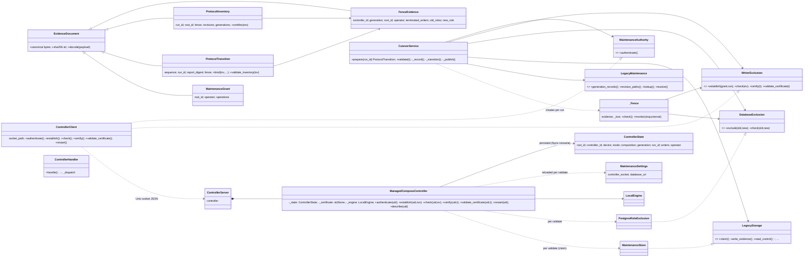

# P3 M1b architectural review: verification authority, epoch revocation and certification handoff

Phase 0 discovery output. Every review task below is **pending**; nothing in this
file is a completed finding except the three established escalation results, which
are taken as given from `P3_IMPLEMENTATION_PLAN.md#escalation`.

## 1. Goal and established findings

**Goal.** Resolve M1b verification authority, epoch revocation and certification
handoff so the `/implement-markdown` escalation can be replanned. Scope is the
integrity/lakectl seam, not a re-review of all of `src/huron`.

Established by verification 3 (`p3-evidence/m1b/verification3/report.md`, reproduced
by `p3-evidence/m1b/verification3/test_authority_repro.py`), treated as fact:

1. **Transport failure does not revoke endorsement.** `ManagedComposeController.check`
   clears `_certificate` only for `(OSError, ValueError)`
   (`src/huron/applications/lakectl/controller.py:162`); `httpx.HTTPError` and
   `asyncpg.PostgresError` escape, and `_validate_evidence` has no handler around
   the asyncpg pool at all (`controller.py:211-215`). Repro test 1.
2. **Maintenance database identity/configuration is unbound.** `_validate_evidence`
   reloads `maintenance_path` live (`controller.py:211`); `FenceEvidence`
   (`src/huron/core/integrity/models.py:146-155`) carries no database identity or
   configuration digest; `_check_volume` (`controller.py:257`) binds only root,
   controller, device/inode and Compose digest. Repro test 2.
3. **Direct `certify` re-endorses revoked bytes without rescanning.** `certify`
   (`controller.py:166-176`) accepts any stored matching record under the current
   generation; revocation only clears `_certificate`; `server.py:88-91` exposes
   `certify` to every cutover UID. Repro test 3. Verification 3 classifies this as a
   **plan defect**: the design (`P3_DESIGN.md` §5.2) never defines a
   controller-verifiable handoff from the client-owned scan to controller-owned
   endorsement.

`docs/adr/0001-controller-generation-is-the-verification-epoch.md` is **proposed,
not accepted**. Its five consequences are review inputs to confirm or reject, not
established facts.

### Discovery observations that qualify the ADR (unverified; owned by tasks below)

- ADR says "only `establish` mints a new generation". Code: `_load_state`
  (`controller.py:252`) advances the generation on every controller construction,
  and `establish` (`controller.py:133-134`) advances it **only when a different
  `run_id` was previously active**. A same-run re-`establish` keeps the generation.
  The ADR must state whether same-run re-establishment after loss advances (task A).
- ADR consequence 4 says a same-run replay after loss "lands on a new sequence
  number". `CutoverService._transition` (`cutover.py:177-190`) returns the first
  existing record with the same `run_id` and calls `validate_inventory`, which
  would **raise** (fence differs) rather than append, if the generation advanced.
  The ADR's claim requires a code change it does not name (task C).
- ADR consequence 5 relies on `_certificate` staying in memory. Nothing durable
  records endorsement; the ADR does not say whether endorsement should be persisted
  in `ControllerState` (task A/C).
- Binding database identity into `FenceEvidence` changes canonical bytes of
  `ProtocolInventory`/`ProtocolTransition` and the JSON contracts
  `src/huron/schema/documents/protocol-inventory-v1.json` and
  `protocol-transition-v1.json` (task B).
- Whether the cutover role may execute `pg_control_system()` on the target is
  unverified (task B).

## 2. Codebase map

### Major packages (`src/huron`)

| Package | Role (from `__init__` docstrings) | Relevance |
| --- | --- | --- |
| `schema/` | Versioned JSON Schema documents and validators; `documents/protocol-*-v1.json` are the evidence contracts | Contract floor for `FenceEvidence` changes |
| `pkg/catalog`, `pkg/rbac`, `pkg/auth` | Framework-free domain rules, RBAC, authentication | `catalog.manifest.canonical_bytes`, `catalog.paths` used by integrity models |
| `pkg/rawstore` | Raw POSIX/NFS mechanisms; `maintenance.py` = `MaintenanceStore` (no-follow read, write-once fsynced evidence, `claim()` flock inode) | Storage adapter for `LegacyStorage` port |
| `pkg/metastore` | Persistence adapters; `maintenance.py` = `PostgresRoleExclusion`; `legacy.py` = `PostgresLegacyMaintenance` | Adapters for `DatabaseExclusion`, `LegacyMaintenance` |
| `core/` | Authorized workflows (catalog, raw, revisions, …); `core/integrity` = cutover workflow, verifiers, evidence models, ports | Workflow owner of prepare/validate |
| `applications/api` | FastAPI control plane | Out of scope |
| `applications/lakectl` | Operator CLI, controller daemon, Unix-socket client, settings, wiring | Authority owner (controller) and composition root |

Dependency direction `applications → core → pkg → schema` is enforced by
import-linter (`pyproject.toml:161-270`); `core` may not import concrete adapters.
Only `applications/lakectl/*` imports `core.integrity`.

### Integrity/lakectl modules

| Module | Classes / functions | Owns |
| --- | --- | --- |
| `core/integrity/models.py` | `EvidenceDocument` (canonical/sha256/decode), `FenceEvidence`, `MaintenanceGrant`, `ProtocolInventory`, `ProtocolTransition` (`bind`, `validate_inventory`), `LegacyRevision`, `DocumentObservation`, `GenerationObservation`, `CertificationIndeterminateError` | Immutable evidence values and their internal consistency |
| `core/integrity/ports.py` | Protocols `LegacyStorage`, `MaintenanceAuthority`, `WriterExclusion` (`establish`/`check`/`certify`/`validate_certificate`), `DatabaseExclusion`, `LegacyMaintenance` | Consumer-owned seams |
| `core/integrity/cutover.py` | `CutoverService` (`prepare`, `validate`, `_prepare_owned`, `_record`, `_transition`, `_publish`), `_Fence` (latching `check`, `monitor`), `_settled_write` | Client-side scan, report/record publication, handoff to `certify` |
| `core/integrity/verification.py`, `generations.py` | `RevisionVerifier`, `GenerationVerifier` | Full payload and hierarchy verification (not in escalation scope) |
| `applications/lakectl/controller.py` | `ManagedComposeController` (`authenticate`, `restart`, `describe`, `establish`, `check`, `certify`, `validate_certificate`, `_validate_evidence`, `_writers`, `_load_state`, `_check_volume`, `_persist`, `_evidence`) | Durable generation, in-memory `_certificate`, live fence observation |
| `applications/lakectl/settings.py` | `ControllerState` (durable: root/controller ids, device, inode, composition, generation, run_id, writers, operator), `ControllerSettings`, `MaintenanceSettings` (controller_socket, database_url), `ControlledRoot`, `private_document` | Durable state shape, private config reads |
| `applications/lakectl/server.py` | `ControllerServer`, `ControllerHandler`, `_dispatch` (7 operations), `serve` (flock on state lock) | Operation surface, error-to-refusal mapping |
| `applications/lakectl/exclusion.py` | `ControllerClient` (adapter for `MaintenanceAuthority` + `WriterExclusion`) | RPC, `CertificationIndeterminateError` mapping |
| `applications/lakectl/engine.py` | `LocalEngine` (HTTPX over UDS; raises `httpx.HTTPError`), `Container`, `Mount` | Engine observations/termination |
| `applications/lakectl/wiring.py` | `prepare(settings, run_id)` composition root; `_implementation_digest` | Constructs `CutoverService` with `ControllerClient` as both authority and writers |
| `applications/lakectl/main.py` | `lakectl controller|restart|protocol cutover --prepare` | CLI; no `--validate` or `certify` subcommand exists |
| `pkg/metastore/maintenance.py` | `PostgresRoleExclusion.exclude/check` | Role fence; no cluster/database identity observation |
| `pkg/rawstore/maintenance.py` | `MaintenanceStore` | Immutable evidence and exclusive ownership |

### Class diagram (core/integrity + lakectl)



### Sequence diagram (current prepare → establish → scan → publish → certify → validate_certificate)

```mermaid
sequenceDiagram
    participant CLI as lakectl main/wiring
    participant CS as CutoverService
    participant CC as ControllerClient
    participant SRV as ControllerServer/_dispatch
    participant MC as ManagedComposeController
    participant ST as ControllerState (disk)
    participant MS as MaintenanceStore
    participant PG as PostgresRoleExclusion
    participant MP as maintenance.json

    Note over MC,ST: controller start: _load_state reads ST, generation += 1, _persist
    CLI->>CC: describe()
    CLI->>CS: prepare(run_id)
    CS->>CC: authenticate()
    CC->>SRV: {authenticate}
    SRV->>MC: authenticate(uid)
    CS->>CC: establish(grant, run_id)
    CC->>SRV: {establish, run_id}
    SRV->>MC: establish(uid, run_id)
    MC->>MC: _certificate = None; _check_volume; _writers()
    MC->>ST: write run_id, operator, writers; generation += 1 ONLY if prior run_id differs
    MC->>MC: terminate writers; evidence = _evidence(); check()
    MC-->>CS: FenceEvidence(generation G)
    CS->>MS: claim()
    CS->>PG: exclude(old, new); _Fence.check() (writers.check + roles.check)
    loop scan under _Fence.monitor
        CS->>CS: GenerationVerifier / RevisionVerifier per path; fence.check()
    end
    CS->>PG: LegacyMaintenance.resolve(...)
    CS->>MS: write_evidence(reports/{run}.json) [fence.check before/after]
    CS->>CS: _transition(): reuse existing same-run record or bind next sequence
    CS->>MS: write_evidence({seq}.json) [fence.check before/after]
    CS->>MS: release claim
    CS->>CC: certify(transition)
    CC->>SRV: {certify, transition}
    SRV->>MC: certify(uid, transition)  (asyncio.run)
    MC->>MC: _certificate = None
    MC->>MC: _validate_evidence: check(fence) → run_id == state.run_id
    MC->>MS: claim(); read_control record + report; validate_inventory
    MC->>MP: MaintenanceSettings.load(maintenance_path)  (live reread)
    MC->>PG: asyncpg.create_pool(database_url).check(old, new)
    MC->>MC: check(fence) twice more
    MC->>MC: _certificate = transition.sha256   (memory only)
    SRV-->>CC: ok / CONTROLLER_REFUSED (ValueError, OSError, httpx.HTTPError, asyncpg.PostgresError)
    CC-->>CS: return / PermissionError / CertificationIndeterminateError
    Note over CLI: later consumer
    CLI->>CS: validate(transition)
    CS->>CC: validate_certificate(transition)
    CC->>SRV: {validate_certificate, transition}
    SRV->>MC: validate_certificate(uid, transition)
    MC->>MC: expected = _certificate; _certificate = None; require expected == sha256
    MC->>MC: _validate_evidence (same as certify; check() clears _certificate only on OSError/ValueError)
    MC->>MC: _certificate = expected
```

Key seams for the review: (1) `WriterExclusion` port between `CutoverService` and the
controller; (2) `ControllerState` as the only durable authority state; (3)
`MaintenanceSettings` read live inside validation; (4) `_dispatch`'s seven public
operations reachable by any `cutover_operators` UID.

## 3. Review plan

Each task is sized for one subagent at 30k–50k tokens. Tasks read code, not design
prose, as evidence. "Decision N" refers to the four "Decisions required before
resuming" in the escalation; "ADR-Cn" to the numbered consequences of ADR-0001.

### Task A — Epoch and revocation semantics in the controller and its durable state

- **Scope.** `ManagedComposeController` generation lifecycle: `_load_state`,
  `establish` (same-run vs new-run increment), `check`'s catch list, `certify`,
  `validate_certificate`, `_persist`; `ControllerState` fields; `ControllerHandler`
  error mapping. Decide whether the durable generation is a sufficient epoch, whether
  endorsement must also be durable, and which observations must advance the epoch
  before the failure is reported.
- **Owns.** Decision 1 (authority owner), Decision 2 (which changes/failed
  observations end an epoch), ADR-C1, ADR-C2, ADR-C5, and the "only `establish`
  mints" claim versus `controller.py:133-134,252`.
- **Acceptance.** (a) A table of every public operation × every observable failure
  class (ValueError, OSError, `httpx.HTTPError` subclasses, `asyncpg.PostgresError`,
  `CancelledError`/`ExceptionGroup`) stating current effect on `_certificate` and on
  disk generation, cited by line. (b) A ruling on same-run re-`establish`: keep or
  advance, with the replay consequence stated. (c) A ruling on durable endorsement
  (persist `certified_sha256` in `ControllerState` or not) with the lost-ack and
  restart cases traced. (d) Explicit confirm/reject of ADR-C1, C2, C5 with the code
  change each requires named at function level. (e) Persistence ordering: advance
  on disk before raising — verified against `_persist` and `check` flow.
- **Files.** `controller.py`, `settings.py` (`ControllerState`), `server.py`
  (`handle`, `_dispatch`), `engine.py` (exception types), `tests/unit/test_managed_controller.py`,
  `tests/unit/test_controller_certificates.py`.

### Task B — Fence binding of database identity and maintenance configuration

- **Scope.** What `FenceEvidence` must bind beyond controller/root/roles: cluster
  system identifier, database name/oid, digest of private `MaintenanceSettings`,
  and whether the comparison happens at `establish`, every `check`, or only in
  `_validate_evidence`. Includes the `PostgresRoleExclusion` adapter (does it need
  an identity observation method on the `DatabaseExclusion` port?), the live reread
  of `maintenance_path` at `controller.py:211`, and the JSON contract impact.
- **Owns.** Decision 2 (binding of epoch, root, database identity/configuration,
  generation, report, record), ADR-C3, and the "restore old configuration stays
  invalid" claim.
- **Acceptance.** (a) A binding matrix: each identity fact → where captured →
  where compared → what happens on mismatch (currently vs proposed). (b) Ruling on
  whether the binding belongs in `FenceEvidence` (core model, changes canonical
  bytes and `schema/documents/protocol-*-v1.json`) or only in `ControllerState`
  (application-local), with the deletion test applied. (c) Verified statement of
  whether the cutover role can call `pg_control_system()` and a fallback identity
  if not — marked unverified until checked against `deploy/controlled/roles.sql`
  and PostgreSQL privilege rules. (d) Port change proposal for `DatabaseExclusion`
  kept minimal (one adapter today; justify any new method). (e) Repro test 2's
  expected failure point after the change, by line.
- **Files.** `controller.py` (`_check_volume`, `_validate_evidence`, `_evidence`),
  `settings.py` (`MaintenanceSettings`), `core/integrity/models.py` (`FenceEvidence`),
  `core/integrity/ports.py` (`DatabaseExclusion`), `pkg/metastore/maintenance.py`,
  `schema/documents/protocol-inventory-v1.json`, `protocol-transition-v1.json`,
  `deploy/controlled/roles.sql`, `deploy/controlled/maintenance.json.example`,
  `tests/contract/test_writer_exclusion.py`.

### Task C — Client-side handoff: CutoverService/_Fence, same-run replay, lost acknowledgement, and the operation surface

- **Scope.** The seam between `CutoverService.prepare` (client scan) and
  `ManagedComposeController.certify` (endorsement). Whether the ADR's "record bound
  to the current generation proves the scan completed under this epoch" holds
  given `_transition`'s same-run reuse (`cutover.py:177-190`), `_Fence` latching,
  `_settled_write`, `ControllerClient.certify`'s `CertificationIndeterminateError`
  mapping, and the `_dispatch` surface (`certify`, `check`, `establish` exposed to
  every cutover UID). Decide whether `certify` remains public, becomes an internal
  step of `establish`-scoped state, or requires a controller-issued token.
- **Owns.** Decision 3 (which operations create/endorse/validate/retry; lost ack vs
  stale evidence), ADR-C4, the considered-and-rejected options in the ADR (move scan
  into controller; sign report), and the `--validate` CLI gap (`main.py` has no
  validate subcommand although `P3_DESIGN.md` §5.2 step 6 names one — unverified
  whether M1c owns it).
- **Acceptance.** (a) A state/transition table for one run: establish → scanning →
  report published → record published → certify acked / lost → validate, with
  generation intact vs advanced, showing which transitions are legal and which
  operation performs them. (b) Ruling on `_transition` under an advanced generation
  (skip same-run record with stale fence and append, or refuse) and the record
  history consequence. (c) Ruling on the `certify` surface with the deep-module
  argument (does removing/narrowing it reduce the interface without losing
  behaviour?). (d) Trace of repro test 3 under the proposed rules showing where it
  now fails and confirming a legitimate same-run replay (existing test
  `test_report_without_record_is_resumable_under_the_same_fence`) still passes.
  (e) Explicit confirm/reject of ADR-C4 and the two rejected options.
- **Files.** `core/integrity/cutover.py`, `core/integrity/ports.py`
  (`WriterExclusion`), `applications/lakectl/exclusion.py`, `server.py`
  (`_dispatch`, `_require_request_fields`), `wiring.py`, `main.py`,
  `tests/unit/test_integrity_cutover.py`, `docs/operations/controlled-cutover.md`.

### Task D — Test architecture for adversarial authority regressions

- **Scope.** What the existing suites prove and how the three repro tests (plus the
  crash/RPC/engine-loss/process-death states from Decision 4) should be housed.
  Inspect fixture reuse (`prepared`, `engine_boundary`, `writer`,
  `EmptyDatabaseBoundary`), the boundary substitution policy ("only engine and SQL
  I/O substituted"), the contract suite against a real PostgreSQL, and the Linux
  integration subprocess test.
- **Owns.** Decision 4 (recoverable states and adversarial tests per state), and the
  AGENTS.md rule that core behaviour stays independent of transport tests.
- **Acceptance.** (a) Coverage map: each authority state from Task A/C's tables ×
  existing test that exercises it (file:test name) or "none". (b) Placement ruling
  for the three repro tests (unit under `tests/unit/test_controller_certificates.py`
  vs a new authority module) and for the states needing real PostgreSQL identity
  (contract) or real controller restart (integration). (c) A list of fixture
  changes needed to observe generation advancement on disk and endorsement state
  without reaching past the public interface. (d) Statement of which repro
  expectations (e.g. `match='endorsement'` in test 1, bare `ValueError` in tests
  2–3) must be tightened to the messages the accepted design will emit.
- **Files.** `tests/unit/test_managed_controller.py`,
  `tests/unit/test_controller_certificates.py`, `tests/unit/test_controller_settings.py`,
  `tests/unit/test_lakectl_wiring.py`, `tests/unit/test_integrity_cutover.py`,
  `tests/contract/test_writer_exclusion.py`,
  `tests/integration/test_protocol_cutover.py`,
  `p3-evidence/m1b/verification3/test_authority_repro.py`,
  `p3-evidence/m1b/verification3/test_finalization_contract.py`.

### Task E — Synthesis

- **Scope.** Reconcile A–D into one accepted-or-rejected verdict on ADR-0001 (with
  amendments), an answer to each of the four escalation decisions, and the list of
  function-level changes, port changes, schema-document changes and test additions
  the follow-up `/design-plan` must carry. Flag any place where tasks A–D disagree.
- **Owns.** Final disposition of ADR-0001 status (`proposed` → `accepted` /
  `rejected` / `superseded`), and the handoff to
  `P3_M1B_AUTHORITY_DESIGN.md` / `P3_M1B_AUTHORITY_IMPLEMENTATION_PLAN.md`.
- **Acceptance.** (a) One paragraph per escalation decision with the ruling and the
  task that established it. (b) Amended ADR text or an explicit rejection with the
  replacement decision. (c) Change inventory grouped by package respecting
  `applications → core → pkg → schema`, each item traceable to a repro test or a
  Decision 4 state. (d) Unresolved items listed as unresolved, not assumed.
- **Files.** This document's task outputs; `docs/adr/0001-*.md`;
  `P3_IMPLEMENTATION_PLAN.md#escalation`.

## Task A — findings

Evidence is code and executed receipts, not design prose. Line numbers refer to
`src/huron/applications/lakectl/controller.py` unless another file is named.
Receipts: `uv run pytest -q tests/unit/test_managed_controller.py tests/unit/test_controller_certificates.py`
→ 30 passed; `PYTHONPATH=. uv run pytest -q p3-evidence/m1b/verification3/test_authority_repro.py`
→ 3 failed (tests 1–3 as described in §1); a scratch receipt run (fixtures `prepared`,
`engine_boundary`, `writer`, faults injected only at the engine and `asyncpg.create_pool`
seams) produced:

```
gen_after_prepare=1  same_run_reestablish=(evidence 1, disk 1)
check+httpx.ConnectError: _certificate kept, disk gen 1
check+ValueError(writer):  _certificate None, disk gen 1
certify after that loss without rescan: endorsed again (repro 3)
certify+asyncpg.PostgresError:            _certificate None, disk gen 1
validate_certificate+asyncpg.PostgresError: _certificate None, disk gen 1
validate_certificate+OSError(store):        _certificate None, disk gen 1
establish(new run): evidence 2, disk 2, _certificate None
```

### A.1 Current generation lifecycle (what actually mints)

| Site | Condition | Effect |
| --- | --- | --- |
| `_load_state` :252–254 | every construction | `generation + 1` in memory → `_check_volume` → `_persist`. If `_check_volume` raises, the constructor fails and disk is **not** advanced (next start advances). |
| `establish` :133–134 | `run_id not in (None, run_id)` | advances only when a *different* run was previously active. First-ever `establish` (run_id `None`) and same-run re-`establish` keep the generation. Receipt: same-run re-establish = (1, 1). |
| `check` :162–164 | `OSError`/`ValueError` only | clears `_certificate`; **never** touches the generation. |
| `certify` :174 / `validate_certificate` :190 | unconditionally on entry | clears `_certificate`; restored only on success (:176, :194). Generation untouched. |

The ADR sentence "only `establish` mints a new generation" is **false** for the code:
`_load_state` mints on every start, and `establish` mints only conditionally. Under
ADR-C1 it must become "the generation advances at every epoch end: every `establish`,
every failed or disagreeing observation, and every controller start".

### A.2 (a) Operation × failure class → effect on `_certificate` and on-disk generation

Legend: cert = in-memory `_certificate`; gen = on-disk `ControllerState.generation`.
"escapes" = exception leaves the controller; `ControllerHandler.handle`
(`server.py:54`) maps `ValueError | OSError | httpx.HTTPError | asyncpg.PostgresError`
to `CONTROLLER_REFUSED`; anything else escapes `handle`.

| Operation | `ValueError` | `OSError` | `httpx.HTTPError` (ConnectError, TimeoutException, HTTPStatusError from `engine.py:66`) | `asyncpg.PostgresError` | `CancelledError` / `ExceptionGroup` |
| --- | --- | --- | --- | --- | --- |
| `authenticate` :52 | n/a (raises `PermissionError` :65; cert/gen untouched; handler does **not** catch `PermissionError` → escapes `handle`, client gets EOF → `json.loads(b"")` `ValueError` at `exclusion.py:151`) | — | — | — | — |
| `describe` :92 | `_check_volume` :275 → cert untouched, gen untouched | `path.stat()` :259 → same | `volume_path` :258 → same | — | — |
| `restart` :72 | :88 durable-fence refusal, or `_check_volume` → cert/gen untouched | :259 same | :258 / `engine.start` :90 same | — | — |
| `establish` :111 | cert **cleared at :123 before any observation**; `_check_volume` :124 or `_writers` :125 raise before `_persist` → gen untouched; `check` :141 raise after `_persist` → gen already written (conditional advance) | `_persist` :279–292 raise → **memory state (run_id, gen) ahead of disk**; cert None | `_writers` :125 (`engine.inventory`) or `terminate` :139 → cert None; gen written only if :139 (after `_persist`) | — | escape `handle`; `socketserver` catches `Exception` only, so `CancelledError`/`KeyboardInterrupt` end `serve_forever` → process death; gen advances at next start (:252) |
| `check` :144 | cert **None** (:162–164); gen untouched (receipt) | cert None; gen untouched | **cert kept** (receipt); gen untouched — repro test 1 | not reachable (no SQL in `check`) | escape; cert kept; gen untouched until restart |
| `certify` :166 | cert None (:174, never restored); gen untouched | cert None (store :200–209); gen untouched | cert None; gen untouched | cert None (receipt); gen untouched; `_validate_evidence` :211–215 has no handler | escape `asyncio.run` at `server.py:91`; cert None; gen untouched; no reply written → client `CertificationIndeterminateError` (`exclusion.py:107`) |
| `validate_certificate` :178 | :192 "no current controller endorsement" or any `_validate_evidence` `ValueError` → cert None; gen untouched | cert None (receipt); gen untouched | cert None; gen untouched | cert None (receipt); gen untouched | escape; cert None; gen untouched; client bare `ValueError` (`exclusion.py:118` has no indeterminate mapping) |

`ExceptionGroup`: no code path in `controller.py`/`engine.py`/`asyncpg` pool usage
produces one today (no `TaskGroup`/`gather` in this module); if one appeared it
would behave as an unlisted `Exception`: escapes `handle`, `socketserver.handle_error`
prints and the connection closes without a reply (analysis, not executed).

Two facts the table makes visible:

1. Only `check` called *directly* keeps `_certificate` across a transport failure.
   `certify`/`validate_certificate` clear it on entry, so finding 1 is narrower than
   stated: the escaping classes are `httpx.HTTPError` in `check` and everything in
   `_validate_evidence` after :197. But since the generation never advances on any
   failure, **every** row is exploitable through repro 3 (re-`certify` without rescan).
2. The on-disk generation is not touched by any failure. No current failure "ends the
   epoch" durably; only `_load_state` and a new-run `establish` do.

### A.3 (b) Ruling on same-run re-`establish`: advance, unconditionally

Delete the conditional at :133–134; every `establish` mints. Reason (deletion test):
the ADR's entire proof — "a record bound to the current generation proves the scan
completed under this epoch" — is only sound if *every* `establish` starts a fresh
epoch, because `establish` is the first step of `prepare` and `prepare` always
rescans. A same-run re-`establish` that keeps the generation lets a record produced by
an earlier attempt (whose scan may have been interrupted by exactly the loss that
motivated the retry) remain bound to the live epoch. The `run_id` is a client-chosen
attempt name, not evidence of continuity.

Replay consequence (stated, owned by Task C): after a same-run re-`establish` the
`ProtocolInventory` bytes differ (fence generation moved), so `prepare`'s
`_publish("reports/{run_id}.json")` hits `MaintenanceStore.write_evidence`'s
"conflicting existing evidence" `ValueError` (`pkg/rawstore/maintenance.py:119`)
**before** `_transition` (`cutover.py:177–190`) is reached, and `_transition` would
itself raise from `validate_inventory` on the same-run record. Therefore the report path
must carry the epoch (e.g. keyed by generation or by sequence), and `_transition` must
append rather than reuse when the same-run record names an older generation. The
existing same-run idempotence assertion
`assert controller.establish(1002, UUID(int=3)) == evidence`
(`tests/unit/test_managed_controller.py:112`) and
`test_report_without_record_is_resumable_under_the_same_fence` encode the rejected
semantics and must be rewritten (clean-sweep rule). "Same-run report-before-record
replay under an intact generation" (ADR-C4 second clause) becomes impossible by
construction because `prepare` re-establishes, and that is the intended outcome:
resumption is a rescan.

### A.4 (c) Ruling on durable endorsement: do not persist; the in-memory bit is obsolete

**No `certified_sha256` in `ControllerState`.** Trace:

- *Lost acknowledgement.* Client `certify` → controller validates and sets
  `_certificate` (:176) → reply lost → `CertificationIndeterminateError`
  (`exclusion.py:107`). Consumer later calls `validate_certificate`. Case (i)
  controller process alive, no loss observed since: `_certificate == sha256`, fresh
  `_validate_evidence` passes → usable. Case (ii) loss observed since: under A.5 the
  generation advanced → `check` :158 refuses "generation changed" whatever any durable
  digest says. Case (iii) controller restarted: `_load_state` :252 advanced → same
  refusal (`test_prepared_files_require_endorsement_and_restart_requires_reverification`
  already proves the restart branch). A durable digest is consulted in none of the
  three cases; it is dead state.
- *Controller restart.* The epoch ends at start (C5), so nothing endorsed before the
  restart can be valid after it. Persisting endorsement would only create a durable
  field that is always stale when read — plus one fsync per `certify` and a new
  invariant ("digest must name the current generation") to maintain.

Invariant that makes memory the correct scope: lifetime(`_certificate`) ⊆
lifetime(process) ⊆ lifetime(epoch), because start advances the epoch.

Stronger consequence: once every failed observation advances the generation (A.5),
`_certificate` protects nothing. `certify` and `validate_certificate` run the identical
`_validate_evidence`; the only extra fact `_certificate` carries is "this process ran
that validation once before under this epoch", which a fresh validation supersedes.
Recommendation: remove `_certificate` (:50, :123, :163, :174, :176, :189–194) and
collapse the two operations into one fresh `validate(uid, transition)`; the
"acknowledged vs indeterminate" distinction (`CertificationIndeterminateError`,
`models.py:295`; `exclusion.py:105–110`) then has no referent, because a lost reply is
answered by validating again. Whether the operation stays public and what it is called
is Task C's surface ruling; Task A's ruling is that endorsement state, durable or not,
is not part of the authority's interface.

### A.5 (d) ADR consequences

| Consequence | Verdict | Function-level change |
| --- | --- | --- |
| C1 "Revocation is permanent; the generation advances and the old record can never match again" | **Confirm**, with the ADR sentence about minting amended per A.1 | New private `ManagedComposeController._advance()` = `model_copy(generation+1)` then `_persist()`. Call it from `_load_state` (replace :252–254 inline increment), from `establish` unconditionally (replace :133–134), and from the observation guard in `check`. Remove `_certificate` clearing as the revocation mechanism (:163). |
| C2 "Any failed observation counts as loss … the catch list is everything" | **Confirm for observations; amend for arguments.** Failed or disagreeing *observations* (volume stat, engine inventory/volume_path, writer presence, `PostgresRoleExclusion.check`, store I/O under `claim`, and Task B's identity facts) end the epoch. A *mismatched argument* (`transition.run_id != state.run_id` :198, "stored record differs" :205, `validate_inventory` :210, wrong operator :160, unknown operation) is a refusal of the presented receipt, not a loss; it must not burn the live run. The distinction is cheap and keeps a bad client from ending another attempt's epoch by sending garbage. | `check`: `except BaseException: self._advance(); raise` around :157–161 (`BaseException` so `CancelledError` also advances before propagating; `_persist` is synchronous, so the refusal reply at `server.py:56` is written only after the fsync). `_validate_evidence`: move the SQL observation (:211–215) inside the same guard — simplest is a private `_observe(evidence)` that performs volume, engine, and DB observations under one `try/except BaseException` and is the only place `_advance()` is called for loss; the pure comparisons at :198, :205, :210 stay outside it. `server.py:54`: catch `Exception` (drop the named tuple and the `httpx`/`asyncpg` imports); `BaseException` deliberately kills the process, and C5's restart advance covers it. |
| C5 "A lost acknowledgement after endorsement stays indeterminate under the same generation; controller restart already advances the generation and forces a rescan" | **Confirm the restart clause** (`_load_state` :252; `test_prepared_files_require_endorsement_and_restart_requires_reverification` and `test_controller_persists_exclusion_before_termination_and_refuses_restart` :121–123 prove it). **Reject the "stays indeterminate" clause** as a design requirement: with A.4 the consumer resolves a lost reply by validating again under the same generation; there is no endorsement state to be uncertain about. Keep C5's restart sentence; replace the first sentence with "A lost reply is resolved by a fresh validation under the same generation." | No new code for restart. Delete `CertificationIndeterminateError` mapping in `exclusion.py:105–110` (Task C to confirm surface). |

### A.6 (e) Persistence ordering: advance on disk before raising

Current `_persist` (:277–292) is a correct durable write: `mkstemp` in the state
directory, write, `flush`, `fsync(fd)`, `os.replace`, then `fsync` of the parent
directory. It is called from `_load_state` :254 (after the in-memory increment and
after `_check_volume`) and from `establish` :137 (before `terminate`, verified by
`EngineBoundary.terminate` reading the state file and
`assert engine_boundary.observed_durable_fence`, `test_managed_controller.py:102`).
`check` never calls it (receipt: gen 1 after every failure class).

Proposed ordering inside the guard: increment in memory → `_persist()` → re-raise the
original exception. Failure cases: (1) `_persist` succeeds → disk and memory agree,
reply carries the refusal after the fsync. (2) `_persist` itself raises (`OSError`) →
the `OSError` propagates chained to the original; memory generation > disk generation,
so this process refuses every record for the rest of its life (`check` :158 compares
against memory), and the next start advances disk (:252). In neither case can a record
bound to the old generation validate again. The only window is an unobserved loss (no
`check` ran during it), which no persistence ordering can close; that is why `_Fence.monitor`
frequency, not the controller, bounds it (Task C).

One pre-existing ordering defect in `establish` to fix while there: on `_persist`
failure at :137 the in-memory `run_id`/`operator`/`writers` are already replaced
(:128–136), so a subsequent `restart` is refused by :88 on an unpersisted fence and
`_evidence()` names a state that does not exist on disk. Build the new state into a
local, persist it, then assign.

### A.7 Decisions owned

- **Decision 1 (authority owner).** The controller, through its durably persisted
  generation, owns *whether* an epoch is live; the client-side `CutoverService` owns
  *doing* the scan. The enforceable handoff is not a token or a signature but the epoch
  itself: `establish` (first step of `prepare`) mints, so any record whose fence names
  the current generation was produced by a `prepare` that started after the last mint
  and finished before any observed loss. This is sufficient **only** with A.3
  (unconditional mint) and A.5-C2 (every observed loss mints). A durable generation is a
  sufficient epoch; no second durable fact (endorsement) is needed.
- **Decision 2 (which changes / failed observations end an epoch).** Epoch ends:
  `establish`; controller start; any exception from an observation (volume identity,
  engine transport including status/timeout/connect, writer inventory, foreign or
  unmanaged container, `PostgresRoleExclusion.check` including `asyncpg` errors, store
  I/O under `claim`, `CancelledError` during any of these); and, from Task B, any
  database-identity or maintenance-configuration disagreement. Epoch does not end on:
  `PermissionError` (unauthenticated peer), malformed request, receipt/argument
  mismatch against durable state.

### A.8 Obsolete code to remove

- `_certificate` and all six touch points (:50, :123, :163, :174, :176, :189–194);
  `validate_certificate`'s expected-digest preamble (:189–192).
- Conditional mint expression :133–134 (replaced by `_advance()`).
- Named catch tuples at :162 and `server.py:54` (with the now-unused `httpx`/`asyncpg`
  imports in `server.py`).
- `CertificationIndeterminateError` (`models.py:295`) and `ControllerClient.certify`'s
  mapping (`exclusion.py:105–110`) — contingent on Task C adopting the single
  `validate` operation.
- Cumulative `writers` union at :126–127: it merges terminated writers across unrelated
  runs into every later fence's `terminated_writers`; under per-`establish` epochs the
  evidence should name the writers terminated by *this* `establish`.
- Tests encoding rejected semantics: `test_managed_controller.py:112` (same-run
  idempotence), `test_controller_certificates.py:40–55` (endorsement-required
  assertions), and repro test 1's `match='endorsement'` (Task D tightens messages).

### A.9 Unverified / out of scope

- Whether a UDS-level `httpx` timeout can leave `LocalEngine.terminate` half-applied
  is not tested here (Linux integration owns it); the ruling treats it as loss.
- `ExceptionGroup` row is analysis only.
- The socket-level lost-reply behaviour (`exclusion.py:151` `json.loads(b"")`) is
  read from code, not exercised.

## Task B — findings

Line numbers refer to `src/huron/applications/lakectl/controller.py` unless another
file is named; "current numbering" means before any Task A change lands. Task A's
rulings (unconditional mint, `_observe` guard that advances the generation on any
failed observation, removal of `_certificate`) are taken as given and not contradicted.
Receipts:

```
PYTHONPATH=. uv run pytest -q "p3-evidence/.../test_authority_repro.py::test_changed_maintenance_database_configuration_invalidates_receipt"
→ 1 failed: "DID NOT RAISE ValueError" at test_authority_repro.py:31
uv run python -c "canonical_bytes({'system_identifier': 7367538914089103371})"
→ ValueError: integer outside the JCS safe range at $.system_identifier
   canonical_bytes({'system_identifier': '7367538914089103371', 'database_oid': 16384}) → ok
curl .../REL_16_STABLE/src/backend/catalog/system_functions.sql | grep -i control → no lines (exit 0)
which pg_ctl initdb postgres psql → none installed; Podman not started (per instructions)
```

### B.1 (a) Binding matrix

"Captured" = where the value the fence will be compared against is fixed; "compared"
= where a live observation is checked against it. Current mismatch effect is always a
plain `ValueError` with no epoch change (Task A A.2). "Proposed" assumes Task A's
`_observe` guard, so every *observation* mismatch below also advances the generation.

| Fact | Captured (current) | Compared (current) | Mismatch (current) | Proposed |
| --- | --- | --- | --- | --- |
| `root_id`, `controller_id` | `ControllerSettings` → `ControllerState` at first start (`_load_state` :244–251); into `FenceEvidence` at `_evidence` :297–298 | `_check_volume` :260–275 every operation; `check` :158 (`evidence != _evidence()`); `ProtocolInventory.unique_membership` (`models.py`) | `ValueError`, epoch intact | Unchanged; epoch advances (Task A) |
| Volume `device`/`inode` | `ControllerState` at first start :247–248 | `_check_volume` :259 live `stat` | `ValueError` | Unchanged; correctly **not** in `FenceEvidence` (controller-local mapping of `root_id` → storage) |
| Compose digest (`composition`) | `ControllerState` at first start :249 | `_check_volume` :265 live reread + digest | `ValueError` | Unchanged; not in evidence |
| `generation` | `ControllerState`; evidence :299 | `check` :158 | `ValueError` | Task A (mint rules) |
| `operator` | `ControllerState` at `establish` :130; evidence :300 | `check` :158 and :160 vs live grant | `ValueError` | Unchanged |
| `terminated_writers` | `ControllerState` :127–132; evidence :301 | `check` :158 | `ValueError` | Task A (per-`establish`) |
| `old_roles`, `new_role` | `ControllerSettings` (process-immutable) → evidence :302–303 | `check` :158 (evidence vs settings); arguments to `PostgresRoleExclusion.check` :213 and client `_Fence.check` (`cutover.py:212`) | `ValueError` | Unchanged values; travel to the adapter inside the fence (B.4) |
| Cluster system identifier | **never** | **never** | none — repro test 2 | Captured at `establish` by the controller through `DatabaseExclusion.identify()` into `ControllerState.database` and `FenceEvidence.database`; compared inside the adapter's `check(fence)` at every client `_Fence.check` and at `_validate_evidence`; mismatch = observation loss → generation advances, `ValueError` |
| Database oid + name | **never** (`_effective_access` uses `current_database()` only as a query argument, `pkg/metastore/maintenance.py:148`) | **never** | none | Same row as above: one identity string (B.2) |
| Primary vs standby | never | never | none | `identify()` refuses when `pg_is_in_recovery()`; live predicate, not a bound fact (a standby shares the system identifier and its role catalog lags) — analysis, not executed |
| `MaintenanceSettings` bytes (DSN, socket) | never; **reread live** at :211 on every `_validate_evidence` | never | none — repro test 2 | Loaded **once** in `__init__` next to `_specification`/`_image`; never compared, never digested, never emitted (B.2). A change takes effect only at restart, which ends the epoch (Task A C5) |
| Report (`ProtocolInventory`) | `ProtocolTransition.bind` (`report_digest`) | `_validate_evidence` :207–210 (`validate_inventory`) | `ValueError` | Unchanged; refusal, not loss (Task A C2 amendment) |
| Record (`ProtocolTransition`) | stored bytes at `_publish` | :202–206 stored vs presented | `ValueError` | Unchanged; refusal, not loss |

### B.2 (b) Ruling: the database identity belongs in `FenceEvidence`; the settings digest belongs nowhere

**Deletion test on `FenceEvidence.database`.** Suppose the identity lived only in
`ControllerState`. Three consumers exist: (1) the controller's own comparison at
`_validate_evidence` — still works; (2) the client's `_Fence.check`
(`cutover.py:206–216`), which fences through a pool built from *its own* copy of the
configuration (`main.py:48` loads `arguments.config`; the controller loads
`settings.maintenance_path` — two paths, nothing ties them) — with the identity only in
controller state the client cannot prove it is fencing the database the controller
established the fence on; (3) the durable report `reports/{run}.json`, which is the
audit artefact — without the identity nobody reading it can say which database's
roles were excluded. Two of three consumers lose the fact, so it is not a pass-through:
it belongs in the evidence. `ControllerState` also carries it (`database: str | None`,
like `run_id`/`operator`/`writers`) because `_evidence()` :294–305 is derived from
state and that is the single source for the receipt.

**Shape.** One string field, `FenceEvidence.database`, formatted by SQL as
`<system_identifier>/<database_oid>/<datname>`, e.g. `7367538914089103371/16384/huron`.
Reasons, in order of weight:

- `system_identifier` is a 64-bit value; `canonical_bytes` refuses integers above
  2^53−1 (receipt above; `_assert_ints_safe`, `pkg/catalog/manifest.py:127`), so it can
  only be carried as text anyway.
- No consumer needs the parts separately: every use is equality (adapter compare) or
  human audit, and the joined form is readable.
- Layering: core may not import `huron.pkg.metastore` (`pyproject.toml` contract
  "core uses ports rather than concrete infrastructure"), and pkg may not import core.
  A structured `DatabaseIdentity` value would therefore need a home in `pkg.catalog`
  where it does not belong, or duplicate shapes on both sides of the seam. A string
  crosses the seam with no shared type.

**Settings digest: reject.** ADR-C3's "digest of the private maintenance settings"
is (i) a secret oracle — the file is a few hundred low-entropy bytes plus the
password, so a SHA-256 of it in a world-readable report permits offline guessing;
`private_document`'s contract (`settings.py:139`, "never emitted as operator
evidence") already forbids this; (ii) the wrong proxy — the same database reached
through a rotated password or renamed host would burn the epoch for nothing, while a
DNS change behind identical bytes would pass. Identity, compared live, is strictly
better. Nothing about the configuration is compared; the configuration is simply
process-immutable.

**"Restore old configuration stays invalid" (ADR-C3 last sentence): confirmed with a
rewording.** Under the proposal the claim is "restoring the old *database* after an
*observed* identity disagreement stays invalid": the disagreement is observed either
by the client's monitor (run aborts, no record) or by `_validate_evidence` (Task A
guard advances the generation on disk before the refusal is written), so the record's
fence names a dead generation and `check` :158 refuses forever. An *unobserved*
swap-and-restore (no validation ran in between) leaves the record valid, which is
correct — nothing was validated against the wrong database. A configuration edit
alone is never observed by design (loaded once); it takes effect at restart, which
ends the epoch (Task A C5). ADR-C3 should say "database identity", not
"configuration".

**Where the comparison runs.** Capture at `establish`; compare at every database
observation — the client's `_Fence.check` on its interval and the controller's
`_validate_evidence` — but **not** in the controller's `check`. `check` is the RPC hot
path the client already calls every interval; adding a SQL round trip there would
observe the same identity against the same evidence the client just observed, doubling
connections for no additional fact. The controller's database observation that matters
for endorsement is the one in `_validate_evidence`, and under Task A that observation
ends the epoch when it fails. Cross-task note for Task C: a loss observed only by the
client's `_Fence` is never reported to the controller; if Task C wants the client to be
able to end the epoch it needs an operation for it, which this task does not propose.

**`establish` must become async.** Capturing the identity requires the controller to
open its pool at `establish` (:111–142 is synchronous today; the DB is reached only at
:212). `WriterExclusion.establish` is already `async` in `ports.py`, and `server.py:91`
already runs `certify` under `asyncio.run`; `server.py:87` gets the same wrapper.
Sequence inside `establish`: `identify()` → build the new state locally (Task A A.6)
including `database` → `_persist` → terminate writers → `_evidence()` → `check`. An
`asyncpg` failure at `identify()` is an observation failure and advances (Task A).

**Contract impact.** `FenceEvidence` gains a required `database` string; it appears in
`$defs` of both `protocol-inventory-v1.json` and `protocol-transition-v1.json`.
`test_protocol_schema_loading_map_stays_in_sync_with_runtime_contracts`
(`tests/unit/test_protocol_documents.py:210–216`) asserts byte-for-byte equality with
`model_json_schema`, so both files must be regenerated in the same change. Keep the
`urn:huron:protocol-*:1` identifiers: no durable protocol evidence exists in any
deployment (unverified — a deployment fact this review cannot inspect), and the
clean-sweep rule applies.

### B.3 (c) Can `huron_cutover` call `pg_control_system()`? Yes — by source reading, not execution

- `deploy/controlled/roles.sql:5`: `CREATE ROLE huron_cutover NOLOGIN SUPERUSER;` —
  a superuser can execute any function, so the deployed role can call it regardless.
- PostgreSQL 16 source, fetched: `src/backend/utils/misc/pg_controldata.c`
  `pg_control_system` contains no `superuser()`/`has_privs_of_role` check; it takes
  `ControlFileLock` shared and reads the control file. `src/backend/catalog/system_functions.sql`
  on `REL_16_STABLE` contains no line matching `control` (receipt above), so no
  `REVOKE EXECUTE ... FROM public` applies and the function keeps the default PUBLIC
  `EXECUTE`. The docs page `functions-info.html` §9.26.10 lists the columns
  (`pg_control_version`, `catalog_version_no`, `system_identifier bigint`,
  `pg_control_last_modified`) and says nothing about privileges.
- Therefore a non-superuser cutover role would also work on PG 16. **Not verified by
  execution**: no local PostgreSQL binaries and Podman was not started. Task D's
  contract suite (`tests/contract/test_writer_exclusion.py`, `postgres:16`) is the
  place to add the receipt: `SELECT system_identifier FROM pg_control_system()` as a
  fresh `CREATE ROLE probe LOGIN` role.
- **Fallback** if a deployment revokes it: `(SELECT oid FROM pg_database WHERE datname
  = current_database())` plus `current_database()` — readable by every role. Weaker:
  it does not distinguish clusters. Note for both forms: a byte-level clone (base
  backup) shares system identifier *and* oid; identity binding proves "same logical
  database", not "not a clone". The `pg_is_in_recovery()` refusal and the role checks
  are what stand between a clone and a false pass; a promoted clone is out of scope.

Identity query (one `fetchval`, all catalog reads):

```sql
SELECT format('%s/%s/%s', system_identifier, d.oid, d.datname)
FROM pg_control_system(), pg_database d
WHERE d.datname = current_database() AND NOT pg_is_in_recovery()
```

(`NULL` result ⇒ in recovery ⇒ `ValueError("maintenance database is not a primary")`.)

### B.4 (d) `DatabaseExclusion` port change — one new method, both existing methods take the fence

```python
class DatabaseExclusion(Protocol):
    async def identify(self) -> str: ...            # NEW: live database identity, no roles needed
    async def exclude(self, fence: FenceEvidence) -> None: ...   # was (old_roles, new_role)
    async def check(self, fence: FenceEvidence) -> None: ...     # was (old_roles, new_role)
```

Justification for `identify()` (the only new method): the controller must capture the
identity at `establish`, which runs **before** the client's `exclude`
(`cutover.py:127–129`), i.e. while the roles may still be `LOGIN`. `check` cannot serve
as the capture because at that moment it would legitimately fail. A method that
observes identity without asserting the role fence is therefore a distinct behaviour,
not a convenience. Folding it into `check`'s return value was considered and rejected
for that reason.

`exclude(fence)` and `check(fence)` replace two parameters with one and put the
comparison where the SQL is: the adapter compares its live identity with
`fence.database` **before** `ALTER ROLE` in `exclude` (never fence a stranger's
database — the client's DSN is a separate file) and as the first step of `check`. The
existing `exclude` → `self.check(...)` tail call (`pkg/metastore/maintenance.py:52`)
becomes `await self.check(fence)`. Callers simplify: `_Fence.check`
(`cutover.py:211–212`) becomes `await self.roles.check(self.evidence)`;
`CutoverService.prepare` :128 becomes `await self._roles.exclude(evidence)`;
`_validate_evidence` :213–215 becomes `await roles.check(transition.fence)`.

Layering: pkg cannot import `FenceEvidence`. The adapter declares the shape it reads
as a local structural type and `FenceEvidence` satisfies it without a shared import:

```python
class DatabaseFence(Protocol):           # pkg/metastore/maintenance.py
    @property
    def database(self) -> str: ...
    @property
    def old_roles(self) -> tuple[str, ...]: ...
    @property
    def new_role(self) -> str: ...
```

If the team prefers no structural type in pkg, the fallback is explicit parameters
`(database: str, old_roles, new_role)` on both methods — three parameters instead of
one, same semantics. One adapter exists today; this proposal adds no second one and no
new seam, it changes the vocabulary crossing the existing seam.

Controller side: replace the per-call `asyncpg.create_pool` + `PostgresRoleExclusion`
construction at :212–213 with one private async context manager
`_database()` yielding `PostgresRoleExclusion(pool)` from the settings loaded in
`__init__`; `establish` and `_validate_evidence` both use it. The test seam stays
`controller_module.asyncpg.create_pool` (`test_controller_certificates.py:27`), so
the "only engine and SQL I/O substituted" policy holds.

### B.5 (e) Repro test 2 after the change

As written, `test_changed_maintenance_database_configuration_invalidates_receipt`
(`p3-evidence/m1b/verification3/test_authority_repro.py:24–32`) **still does not
raise**: line 30 rewrites `maintenance.json`, which the controller no longer reads
after construction, and `create_pool` is monkeypatched regardless of URL. The test's
premise (a file edit *is* a database change) is what this task rejects, so Task D must
rewrite it to fault the SQL seam:

1. `certify` succeeds (fixture `prepared`, `EmptyDatabaseBoundary.fetchval` returns a
   fixed identity for the `pg_control_system` query — fixture change for Task D;
   today it returns `False` for any query without `rolsuper`, `test_lakectl_wiring.py:42–46`).
2. Make `fetchval` return a different identity string.
3. `validate_certificate` → `_validate_evidence` → `roles.check(transition.fence)` →
   **fails at the first statement of `PostgresRoleExclusion.check`**
   (`pkg/metastore/maintenance.py`, new identity comparison, message
   `"maintenance database identity differs from the fence"`), inside the Task A
   `_observe` guard, which advances the on-disk generation and re-raises. Expected
   `ValueError` with that message.
4. Restore the identity. `certify` (or the single `validate` if Task C adopts it)
   → `check` :158 (current numbering) refuses `"controller exclusion generation
   changed"`. This step is the "restore stays invalid" assertion.

### B.6 Obsolete code to remove

- `MaintenanceSettings.load(self._settings.maintenance_path)` at :211 (live reread)
  and the inline pool construction :212–213 — replaced by construction-time load and
  `_database()`.
- Two-parameter `exclude`/`check` signatures on the port and adapter, the `_roles()`
  tuple helper's role-only calling convention (`pkg/metastore/maintenance.py:87–93`
  keeps its validation, receives `fence.old_roles`, `fence.new_role`).
- `FenceEvidence` doc line "Controller and database identities…" is finally true once
  `database` exists; no field is removed.
- `EmptyDatabaseBoundary.fetchval`'s query-substring dispatch grows one branch (Task D).
- ADR-C3 text: replace "and a digest of the private maintenance settings" and
  "compared live at every validation" with the B.2 wording (identity only; compared at
  every database observation; configuration is process-immutable).

### B.7 Unverified

- `pg_control_system()` executability by a non-superuser: source reading only (B.3).
- `pg_is_in_recovery()` refusal and the standby-lag argument: analysis, not executed.
- Absence of deployed protocol evidence (keeping the v1 identifiers): deployment fact.
- pyright acceptance of a frozen pydantic model against a property-only `Protocol`:
  expected from Python structural typing rules, not run here.

## Task C — findings

Line numbers refer to `src/huron/core/integrity/cutover.py` unless another file is
named. Task A's rulings (every `establish` mints; every failed observation advances the
on-disk generation before the refusal is written; `_certificate` removed) and Task B's
rulings (`FenceEvidence.database`; `DatabaseExclusion.exclude/check` take the fence;
`establish` async) are taken as given. Where this task goes further than A or B it says
so. Receipts:

```
uv run pytest -q tests/unit/test_integrity_cutover.py → 25 passed
scratch (fake WriterExclusion whose establish increments fence.generation, otherwise the
  test file's DeploymentBoundary; asyncio_mode=auto):
  report-then-crash, same-run prepare again →
    ExceptionGroup[ValueError('installed file conflicts with verified content: <run>.json')]
  record exists, same-run prepare again → same ValueError, same path
  (both raised by pkg/rawstore/materialize.py:218 from _publish("reports/{run_id}.json"),
   i.e. before _transition :177 runs — confirms Task A A.3's prediction)
grep: certify/validate_certificate/CertificationIndeterminateError call sites outside the
  four owning modules: server.py 4, main.py 4, models.py 1, generations.py 1 (docstring),
  tests 35, p3-evidence 11, tests/controlled_deployment.py 4
```

### C.1 (a) One run: states, transitions, and the operation that performs each

`G` is the generation minted by this run's `establish`. "Dead" means every artefact whose
fence names `G` is forensic history that no operation will ever admit. Under Task A there
is no endorsement state: the columns are storage facts plus the generation.

| # | State (durable facts) | Legal next transition | Performed by | Illegal / refused |
| --- | --- | --- | --- | --- |
| S0 | No live run (`ControllerState.run_id` None or a dead epoch) | → S1 mint `G`, terminate writers, persist | `WriterExclusion.establish` from `prepare` :100 (controller `establish`) | `validate` of anything: `check` refuses "generation changed" |
| S1 | Epoch `G` live; writers terminated; roles not yet excluded | → S2 | `DatabaseExclusion.exclude(fence)` + first `_Fence.check` :128–129 (client) | `validate`: no record exists |
| S2 | Scanning under `claim()`; monitor observing every `check_interval` | → S3 report installed | `_record` :172 `_publish("reports/…")` after `resolve` (client) | a `_Fence`-observed loss latches `_lost` :214; every later `_publish` refuses :193; run aborts → S-lost |
| S3 | Report at sequence `n` installed (write-once, fsynced) | → S4 record installed | `_transition` + `_publish("{n:06d}.json")` :173–174 (client) | crash here → S-strand(report) |
| S4 | Record `n` installed, bound to report digest and fence `G` | → S5 | `claim()` exit :103 (client) | loss at release (`test_exclusion_loss_at_ownership_release…`) → S-lost |
| S5 | Claim released; record `n` complete on disk under live `G` | → S6 | `WriterExclusion.validate(record)` as `prepare`'s last step (controller: storage under its own `claim`, SQL fence, writers, volume — today's `_validate_evidence`) | any failed *observation* advances to `G+1` (Task A) → S-lost; a mismatched *argument* refuses without advancing |
| S6 | `prepare` returned record `n`; epoch `G` still live; exclusion continues | → S6 (idempotent) any number of times; → S0 by `establish` (new `prepare`), controller restart, observed loss, or the future M1c activation | `validate` again (consumer or `--validate`) | — |
| S-lostack | Same durable facts as S5/S6; the client did not read the reply | → S6 by calling `validate` again — the controller kept no per-call state, so the answer is the same as the lost one | client/operator | nothing else is needed; `CertificationIndeterminateError` has no referent |
| S-lost | Epoch `G+1` on disk; writers still excluded; record `n` (if any) dead | → S1 only, via a new `prepare` (mints `G+2`) | `establish` | `validate(record n)`: refused "generation changed" forever |
| S-strand | Report `n` without record, or record `n` without a returned `prepare`, under a *live* `G` | see C.3: `prepare`'s failure path reports the abandonment, so this state collapses into S-lost | `abandon` (new, C.3) | must not be admissible: the design's "any preceding error leaves the prepared files unendorsed" (`P3_DESIGN.md` §5.2) |

Legal transitions therefore form a line S0→S1→S2→S3→S4→S5→S6 performed by one
`prepare`, plus the idempotent self-loop at S6 (`validate`) and one exit from every
state to S-lost. There is no transition that reuses an artefact across two `prepare`
invocations: with unconditional minting, "same run, intact generation" is unreachable.

### C.2 (b) `_transition` under an advanced generation: append; key the report by sequence; delete reuse

**Facts.** `_transition` :177–190 reuses the first record whose `run_id` matches and
calls `validate_inventory` :188, which raises when the fence differs (`models.py:292`
"protocol record disagrees with its inventory"). But the receipt shows that branch is
never reached: `_record` :172 publishes `reports/{run_id}.json` first, and
`MaintenanceStore.write_evidence` is write-once (`materialize.py:215–218`), so a
same-run replay whose fence generation moved dies on the report path with "installed
file conflicts with verified content". Under Task A every replay has a moved generation.
So today's code plus Task A = every retry of a `run_id` that ever wrote a report is
permanently refused, and the operator must invent a new UUID. That contradicts the
operator contract ("stable run UUID", `docs/operations/controlled-cutover.md:92`) and
ADR-C4 ("lands on a new sequence number").

**Ruling.** Append, never reuse, and key the report by the record's sequence:

- `_record` computes `sequence = next free over reports ∪ records` **before** writing
  anything (under `claim()` the value is stable), publishes `reports/{sequence:06d}.json`,
  then `ProtocolTransition.bind(inventory, sequence=…)` and `{sequence:06d}.json`. The
  report and the record are a 1:1 pair named by one number.
- `_transition` :177–190 is deleted. Its only non-trivial branch (same-run reuse) has no
  reachable caller; what remains — "first missing sequence" — is a two-line helper.
- `ProtocolTransition.run_id` / `ProtocolInventory.run_id` stay, as audit and as the
  idempotence key for `LegacyMaintenance.resolve` (`pkg/metastore/legacy.py:236,259` derive
  finding/audit ids with `uuid5(run_id, …)`, so a same-run retry upserts the same rows and a
  new run creates new ones — that is why the retry identity must survive even though it
  no longer names a file).
- Controller side: `_validate_evidence` (`controller.py:207–208`) reads the report by
  `transition.sequence` instead of `transition.run_id`; the `transition.run_id !=
  self._state.run_id` refusal (:198) becomes redundant with the generation comparison
  (unconditional mint ⇒ one run per generation) and may be deleted or kept as a cheap
  refusal; this task recommends deleting it so `run_id` has exactly one meaning (DB-side
  idempotence + audit).

**Record history consequence.** Every `prepare` that reaches S3 leaves a report, and every
one that reaches S4 leaves a record, each at its own sequence, each bound to the
generation it ran under. A stranded report (S3 crash) occupies its number forever; the
next attempt appends at the next number. Nothing is rewritten, nothing is reused,
history is append-only in both directories, and "which generation was this scanned
under" is readable from each file. `test_lost_fence_during_installation_retains_unusable_history_and_allows_fresh_scan`
:325 (`2 if destination == "record" else 1`) becomes `2` for both cases.

**Alternative considered and rejected: refuse.** Keep `reports/{run_id}.json` and refuse
any retry of a `run_id` that has evidence on disk (`P3_DESIGN.md` §5.2 "A changed
generation requires a fresh run"). Simpler in `cutover.py` but pushes work to the operator
(new UUID per crash) and to the database (`resolve` under a new `run_id` writes new
finding/audit rows for the same population). The append ruling keeps the operator
contract and the DB idempotence; it costs one directory listing.

### C.3 (c) The `certify` surface: one `validate`; client reports its own loss through `abandon`

**Deletion test on `certify`.** `certify` (`controller.py:166–176`) and
`validate_certificate` (:178–194) call the same `_validate_evidence`; the difference is
the memory bit `_certificate`, which Task A removes (A.4). Delete `certify` and nothing
reappears: `prepare` :105 calls `validate` instead and gets the identical checks; a
consumer calls `validate`; a lost reply is resolved by calling `validate` again, which
returns the same answer because the controller keeps no per-call state (C.1 S-lostack).
Interface shrink: `WriterExclusion` loses two methods and gains one; `_dispatch`
(`server.py:88–92`) and `_require_request_fields` lose two entries; `ControllerClient`
loses `certify`/`validate_certificate` and the `CertificationIndeterminateError` mapping
(`exclusion.py:98–110`); `main.py:14,51–56` lose the indeterminate branch and message;
`models.py:295` loses the class. No caller must learn "endorsed vs indeterminate";
the invariant a caller must know shrinks to one sentence: *a record is admissible iff its
fence names the live generation and every live observation passes now.*

**Token or establish-scoped internal step: rejected.** A controller-issued token per
`establish` would be a second copy of the generation with a second comparison; the
generation already is the token, and Task A's `check` :158 already compares the whole
`FenceEvidence`. Making validation an "internal step of establish" is impossible in the
serialized `socketserver` (`serve_forever`, one request at a time, 10 s request timeout at
`server.py:49`): the scan runs for hours in another process.

**Must the client report a `_Fence`-observed loss? Yes — and every other post-`establish`
failure too.** Disagreement with the implicit position in Task A/B that the client's
observation is only a local abort: two failure classes are visible only to the client —
(i) `DatabaseExclusion.check` on the client's own pool (roles re-enabled, application
session present, Task B identity mismatch), (ii) client↔controller transport failure
(`exclusion.py:143–151`). In (i) an application session may have raced `resolve`; the
controller's later `validate` re-runs `roles.check`, but if the condition was transient it
passes, and a record bound to a live `G` is admitted although exclusion was observed
broken during the run. Task A A.6 accepts an *unobserved* loss as the residual window; an
*observed* loss thrown away is worse. Under ADR-C1 revocation has exactly one form —
the generation advances — so the client's observation must be expressed that way.

Ruling:

- New port operation `WriterExclusion.abandon(evidence: FenceEvidence) -> None`: "end
  this epoch; the client's continuous observation of it failed or its run did not
  complete." Controller: `if evidence == self._evidence(): self._advance()` (Task A's
  helper), else no-op — a stale receipt cannot burn a newer epoch (Task A C2: mismatched
  arguments are refusals, not losses). Writers stay terminated and restart stays excluded;
  `abandon` ends the epoch, it does not un-fence. `_dispatch` gains `abandon`; any cutover
  UID may call it, which grants nothing new because the same UIDs can already end the
  epoch through `establish`.
- Call site: **`prepare`'s failure path, once, after `establish` succeeded** — not inside
  `_Fence.check`. `_Fence` keeps `_lost` latching (:208–215) for intra-run coordination
  (the monitor and queued `_publish` checks must agree, `test_concurrent_observations…`),
  but reporting is a run-level decision: any exception after :100 — fence loss, storage
  `OSError` such as the failed directory fsync in
  `test_failed_directory_sync_leaves_prepared_record_without_endorsement`, `resolve`
  failure, cancellation after `_settled_write` :225–235 settles — calls
  `abandon(evidence)` best-effort and re-raises. This restores the design invariant "any
  preceding error leaves the prepared files unendorsed" (`P3_DESIGN.md` §5.2) without a
  memory bit: a record is admissible iff the `prepare` that produced it returned.
  Residual window: `abandon` itself fails on transport while the controller is alive
  (dead controller ⇒ restart advances). Document it next to Task A A.6's unobserved-loss
  window; it is bounded by the same mechanism (`_Fence.monitor`) and closes at the next
  `check` the controller sees.
- `prepare` :105 becomes `await self._writers.validate(result)`; `CutoverService.validate`
  :108–122 keeps its grant checks and calls the same port method.

Resulting `WriterExclusion`: `establish` (mint), `check` (observe), `abandon` (end),
`validate` (admit). Four orthogonal operations instead of four where two were one
implementation plus a flag.

### C.4 (d) Repro test 3 and the existing replay test under the proposed rules

**Repro test 3** (`test_authority_repro.py:34–42`), with `certify` → `validate` (Task D
renames): line 35 `validate` passes. Line 37 plants a writer; line 39 `validate` →
`_validate_evidence` → `check` → `_writers()` returns it → `ValueError("…foreign writer
appeared")` inside Task A's observation guard → `_advance()` persists generation 2 →
re-raised: **fails here as expected, by advancing**. Line 40 removes the writer; line 42
`validate` → `check` :158 `evidence != self._evidence()` (generation 1 ≠ 2) →
`ValueError("controller exclusion generation changed")`: **the test now passes, at the
generation comparison, without any scan.** Task D should tighten line 41 to
`match="generation changed"`.

**`test_report_without_record_is_resumable_under_the_same_fence`** (:201–224): its
premise ("same fence") is unreachable once the fake's `establish` mints (receipt above:
today's code with a minting fake fails at `materialize.py:218`). It must change, not
merely be re-run. Rewrite as `test_stranded_report_is_history_and_retry_appends`: after
the interrupted record write, `reports/000001.json` exists and `000001.json` does not;
the second `prepare(UUID(int=2))` returns `sequence == 2`, `reports/000001.json` bytes are
unchanged, `reports/000002.json` and `000002.json` exist, and `result.fence.generation ==
2`. Its sibling `test_cutover_writes_bound_report_before_record_and_replays_same_receipt`
:113–126 loses its last assertion (`prepare` twice ≠ same record) and asserts sequence 2
under generation 2 instead. `DeploymentBoundary.establish` (`test_integrity_cutover.py:50`)
must mint, and the fake grows `abandon` (records the generation it ended) and `validate`
(refuses unless `transition.fence == self.evidence`); the six assertions of
`match="no current endorsement"` or `boundary.certificate is None` (:329, :371, :396, :439,
:516, :544) assert `validate` refuses with "generation changed" / that `abandon` was
observed — Task D owns the fixture edits.

### C.5 (e) ADR-C4 and the two rejected options

| Item | Verdict | Replacement text / reason |
| --- | --- | --- |
| C4 "Re-endorsement after loss requires `prepare` again" | **Confirm** | Unchanged. |
| C4 "A same-run replay after loss lands on a new sequence number" | **Confirm, generalised** | "Every `prepare` appends a new report/record pair at the next sequence; report and record share the number." |
| C4 "same-run report-before-record replay remains allowed only under an intact generation with agreeing immutable bytes" | **Reject** | Unreachable by construction (every `establish` mints). Delete the clause and the `_transition` reuse code; a stranded report is history. |
| Rejected option: move the scan into the controller | **Confirm rejection** | Add the concrete reason: the controller is a serialized one-request-at-a-time `socketserver` with a 10 s request timeout (`server.py:49,145`); hosting an hours-long scan there blocks `check` and `restart`. |
| Rejected option: sign / hash-chain the report | **Confirm rejection** | Add: the cutover UID that would present the signature is the same trusted root operator that runs the scan and writes both files; a signature it holds proves nothing the generation binding does not, and the threat model (`controlled-cutover.md:22–25`) already places that operator outside it. |

Add a sixth consequence to the ADR: "A client-observed loss or an incomplete `prepare`
ends the epoch through `abandon`; the client never keeps private knowledge of a loss."

### C.6 `--validate` CLI gap

`P3_IMPLEMENTATION_PLAN.md:208–209` (M1c item 1: "Wire `lakectl protocol init` … and
cutover prepare/validate commands") assigns the `--validate` subcommand to M1c; the gap in
`main.py:36–39` is therefore planned, not a defect — verified against the plan text, not
against any code. Recommendation for the replan: land `--validate --config … --sequence N`
now anyway (reads `protocol/{N:06d}.json`, calls `CutoverService.validate`, exits 0/1);
it is the only way an operator resolves a lost reply after `prepare` without a full
rescan, and without it `main.py`'s only reaction to S-lostack is "refused". Ten lines,
no new port.

### C.7 Obsolete code to remove

- `_transition` :177–190 (whole method) and the same-run reuse it implements; the report
  path `f"reports/{run_id}.json"` :172.
- `WriterExclusion.certify` and `validate_certificate` (`ports.py:129–143`);
  `ControllerClient.certify`/`validate_certificate` and the indeterminate mapping
  (`exclusion.py:88–123`); `_dispatch`'s `certify`/`validate_certificate` branch and field
  entries (`server.py:88–92,104–105`); `CertificationIndeterminateError` (`models.py:295`)
  and its `main.py:14,51–56` branch; the docstring mention in `generations.py`.
- `prepare`'s docstring sentence "A crash can repeat this operation with the same run only
  while the original exclusion generation remains in force" :84–85 and `validate`'s
  "indeterminately acknowledged receipt" :112.
- `docs/operations/controlled-cutover.md:113–116` (report named by run; controller reads
  `maintenance_path` at validation — the latter already obsolete under Task B) and
  `P3_DESIGN.md` §5.2 paragraphs "An acknowledgement lost after endorsement is explicitly
  indeterminate" and "Same-run report-before-record replay is allowed under intact
  exclusion".
- Tests encoding the removed semantics (C.4) and `tests/controlled_deployment.py:482`'s
  `validate_certificate` call and `test_controller_transport.py:227–266` (Task D).

### C.8 Unverified

- `abandon`'s residual transport window and the socket-level lost-reply path
  (`exclusion.py:151`) are analysed, not exercised.
- The `_validate_evidence` change to read the report by sequence is stated from
  `controller.py:207–208`, not run.
- M1c ownership of `--validate` rests on plan prose (`P3_IMPLEMENTATION_PLAN.md:208`).

## Task D — findings

Evidence is the test code as it stands on this branch; the accepted design is Tasks A–C's
rulings taken as given (every `establish` mints; `_observe` guard advances the on-disk
generation before any failed observation is reported; one fresh `validate` replaces
`_certificate`/`certify`/`validate_certificate`; `FenceEvidence.database` captured by
`DatabaseExclusion.identify()`; `exclude`/`check` take the fence; `_transition` deleted and
reports keyed by sequence; `WriterExclusion.abandon(evidence)` called from `prepare`'s
failure path). Receipt: `uv run pytest -q --co` over the four unit modules → 57 collected
(21 `test_managed_controller`, 9 `test_controller_certificates`, 25 `test_integrity_cutover`,
2 `test_lakectl_wiring`); `test_controller_transport.py` has 10 more. No source or test
file was modified; Podman/PostgreSQL were not started. Two line-number corrections to the
handover: the same-run idempotence assertion is `test_managed_controller.py:109`, not
:112; the transport tests Task C cites as `:227–266` are
`test_real_transport_endorses_and_validates_exact_durable_evidence` :205–234 and
`test_lost_endorsement_reply_is_indeterminate_and_live_validation_resolves_it` :236–266.

### D.1 What the suites prove today, by seam

| Suite | Substitutes | Real | Proves | Does not prove |
| --- | --- | --- | --- | --- |
| `test_managed_controller.py` | `LocalEngine` (`EngineBoundary`) | `ControllerState` on disk, volume stat, Compose digest, `_persist` ordering (`terminate` reads the state file, :47–54) | establish/restart/inventory refusals; new-run mint; restart mint; durable-fence-before-termination | any SQL observation (no pool seam; `establish` never reaches SQL today) |
| `test_controller_certificates.py` | engine + `asyncpg.create_pool` (`EmptyDatabaseBoundary`) | `MaintenanceStore` bytes, `claim()` flock, record/report binding | stored-bytes and report comparisons, storage-owner contention, `[release]` close fault, peer/run refusals; restart forces re-validation | that any failure moves the generation (Task A receipt: gen 1 after every class); `asyncpg.PostgresError` (`[sql]` raises `OSError` at `create_pool`, never reaching the adapter); engine transport failure |
| `test_integrity_cutover.py` | authority, writers, roles (`DeploymentBoundary`); catalog (`EmptyCatalog`) | `CutoverService`, `_Fence`, `_settled_write`, `MaintenanceStore`, real fsync/close | ordering of report→record→release, monitor interruption, cancellation waits for its writer, latching `_lost`, no receipt after loss | anything about the epoch: the fake's `establish` returns a constant generation and the fake's own `certificate` bit is what every "no current endorsement" assertion reads (:329, :371, :396, :439, :516, :544) |
| `test_lakectl_wiring.py` | `ControllerClient` (`ControllerBoundary`), pool | `wiring.prepare`, real `PostgresRoleExclusion` over the SQL fake, real store | composition root and pool lifetime | authority semantics (fake never refuses) |
| `test_controller_transport.py` | engine, pool, `SO_PEERCRED` | Unix socket, `ControllerServer`, `_dispatch`, byte bounds | error→`CONTROLLER_REFUSED` mapping, dropped reply → `CertificationIndeterminateError` (:236–266, rejected semantics) | messages (the client sees only "controller refused the requested maintenance operation", `exclusion.py:153`) |
| `tests/contract/test_writer_exclusion.py` | nothing | `postgres:16` | role fence, session termination, effective-access detection, owner/admin refusals | identity (no `identify()` exists); privilege of `pg_control_system()` for a non-superuser |
| `tests/integration/test_protocol_cutover.py` → `tests/controlled_deployment.py` | nothing | real controller process, real engine, real PostgreSQL, real UIDs | live SQL loss refuses `validate_certificate` and *restore stays refused* (:483–499); controller restart refuses the old fence (:505–515); dead controller → `OSError` (:516–523) | messages; on-disk generation (readable by the root script, not asserted) |

The boundary-substitution policy ("only engine and SQL I/O substituted") holds in every
controller-level module and should stay the rule for the new tests: the on-disk
generation is observed through `ControllerState.model_validate_json(settings.state_path
.read_bytes())`, exactly as `EngineBoundary.terminate` already does (:49), which is the
durable interface the ADR names as the epoch — not a private attribute.

### D.2 (a) Coverage map: authority states × existing tests

Rows are Task C's C.1 states and Task A's A.2 failure classes; "fake-bit" marks a test
whose assertion reads `DeploymentBoundary.certificate` / "no current endorsement", i.e.
the rejected semantics — it exercises the state but proves nothing about the epoch.

| State / failure | Existing test (file:test) | Verdict |
| --- | --- | --- |
| S0 no live run; old fence refused after restart | `test_managed_controller.py:test_controller_persists_exclusion_before_termination_and_refuses_restart` (:118–120); `test_controller_certificates.py:test_prepared_files_require_endorsement_and_restart_requires_reverification` (:314–315); `controlled_deployment.py:505–515` | covered |
| S1 epoch live, writers terminated, durable before termination | `test_managed_controller.py:test_controller_persists…` (:105–107); `test_integrity_cutover.py:test_cutover_writes_bound_report_before_record_and_replays_same_receipt` (`boundary.excluded`) | covered; same-run re-establish at :109 asserts the rejected "keeps generation" |
| S2 scanning under claim, monitor interrupts | `test_integrity_cutover.py:test_periodic_fence_loss_interrupts_an_incomplete_scan`, `test_independent_cutovers_cannot_share_a_live_same_run_owner`, `test_complete_scan_records_exact_healthy_orphan_membership` | covered (see D.5 for the concurrent-coordinator consequence) |
| S3 report installed, crash before record | `test_report_without_record_is_resumable_under_the_same_fence` (rejected replay), `test_lost_fence_during_installation…[report]` (fake-bit :329) | exercised; epoch consequence none |
| S4 record installed, loss/cancel before release | `test_lost_fence_during_installation…[record]` (fake-bit), `test_cancelled_installation_waits_for_its_actual_writer…` (fake-bit :371), `test_failed_directory_sync_leaves_prepared_record_without_endorsement` (fake-bit :396), `test_observed_fence_loss_stays_invalid_after_external_observations_recover` (fake-bit :439) | exercised; epoch consequence none |
| S5 claim released, loss at release | `test_exclusion_loss_at_ownership_release_cannot_return_a_receipt[False/True]` (fake-bit :516); controller side `test_failed_finalization_never_endorses_prepared_history[release]` | exercised; epoch consequence none |
| S6 `prepare` returned; `validate` idempotent | `test_controller_certificates.py:test_prepared_files…` (:309–310 certify+validate); `test_controller_transport.py:test_real_transport_endorses…` (:229–230); `test_integrity_cutover.py:test_independent_cutovers…` (:467); `controlled_deployment.py:482` | covered through the two-operation surface; needs the single `validate` twice |
| S-lostack dropped reply, resolved by validating again | `test_controller_transport.py:test_lost_endorsement_reply_is_indeterminate…` (:236–266) | exercised with the rejected `CertificationIndeterminateError` |
| S-lost via `establish` (new run) | `test_managed_controller.py:test_controller_persists…` (:114–117) | covered |
| S-lost via observed loss → generation advances on disk | **none** (repro tests 1 and 3 fail; Task A receipt) | gap — the whole point of Decision 4 |
| S-lost via `abandon` (client-observed loss / incomplete `prepare`) | **none** (`abandon` does not exist) | gap |
| S-strand collapses into S-lost | **none** | gap |
| `check` + `ValueError` (writer / generation / operator) | `test_managed_controller.py:test_controller_persists…` (:112, :116, :119), `test_surviving_or_reappearing_writer_invalidates_exclusion` (:152), `test_live_deployment_change…[check]` | covered as refusal; advance none |
| `check` + `OSError` (volume stat) | **none** directly (`test_storage_replacement…` exercises `describe`) | gap |
| `check` + `httpx.HTTPError` | repro test 1 only | gap |
| `establish` + `httpx.HTTPError` at `_writers`/`terminate`; `_persist` `OSError` (A.6 ordering defect) | **none** | gap |
| validate + argument refusal: run / stored record / report / peer / operator | `test_failed_finalization_never_endorses_prepared_history[run,record,report,peer]`; `test_controller_transport.py:test_real_transport_endorses…` (:231–232) | covered as refusal; "does not advance" unasserted |
| validate + store `BlockingIOError` (foreign maintenance owner) | `test_live_storage_owner_prevents_endorsement_and_consumer_admission` | covered as refusal; advance none |
| validate + pool unavailable (`OSError` at `create_pool`) | `test_failed_finalization…[sql]` | covered as refusal; advance none |
| validate + `asyncpg.PostgresError` from `check` | **none** in `tests/` (Task A scratch only) | gap |
| validate + live SQL fence loss (roles re-enabled) | `controlled_deployment.py:483–499` (real); `test_writer_exclusion.py::test_database_exclusion_revokes…` :179–181 (adapter only) | covered end to end; unit none (`EmptyDatabaseBoundary` never refuses) |
| validate + database identity mismatch (Task B) | **none** (repro test 2 does not observe it, B.5) | gap |
| validate + `CancelledError` inside an observation | **none** | gap |
| `PermissionError` peer does not end the epoch | `test_controller_requires_separate_kernel_peer_grants`; `test_failed_finalization…[peer]` | covered as refusal; "does not advance" unasserted |
| Controller process death → client `OSError` | `controlled_deployment.py:516–523` | covered |
| Client process death mid-`prepare` (no `abandon` sent) | **none**; see D.4 | admitted residual, not a test gap |
| RPC loss on `abandon` itself | **none** | residual (C.3), document only |

### D.3 (b) Placement rulings

**The three repro tests: unit, in the renamed controller module, as two parametrized
matrices — not three named tests.** Under the accepted design the three repros have one
shape: a complete record validates → one observation is faulted → `validate` raises and
the on-disk generation is one higher → the fault is removed → `validate` raises
"generation changed". That shape *is* Decision 4's "adversarial test per state", so house
it once:

- `git mv tests/unit/test_controller_certificates.py tests/unit/test_controller_epoch.py`.
  Every assertion in the current file names the deleted concept ("endorsement",
  `certify`, `validate_certificate`); after the rewrite nothing in it is about
  certificates, and a module named for a removed mechanism fails the AI-navigability
  test. Keep `prepared` there; keep `test_managed_controller.py` for
  establish/restart/inventory (it has no stored evidence and no SQL seam by design).
  Do not create a third module: one fixture, one subject (a complete record under a live
  generation × every live observation).
- `test_failed_observation_ends_the_epoch_before_the_refusal[fault]` — replaces repro
  tests 1, 2, 3 and `test_observed_writer_loss_permanently_revokes_endorsement`.
  Parameters, each injected only at the engine or SQL seam: `engine_connect`
  (`httpx.ConnectError` from `volume_path`), `engine_inventory` (`httpx.ReadTimeout` from
  `inventory`), `foreign_writer` (`engine_boundary.containers = (writer(…),)`),
  `volume_identity` (`engine_boundary.volume = other`), `database_identity`
  (`database_boundary.identity = …`), `sql_error` (`asyncpg.PostgresError` from
  `fetchval`), `sql_pool` (`OSError` from `create_pool`), `store_owner` (foreign
  `claim()` → `BlockingIOError`), `cancelled` (`asyncio.CancelledError` from `fetchval`).
  Assert: the injected exception class propagates unchanged; `generation_on_disk` is
  `record.fence.generation + 1`; after restoring, `validate` raises
  `ValueError, match="generation changed"`; `prepared`'s `describe` still works (the
  controller is alive). `engine_connect` is repro 1, `database_identity` is repro 2,
  `foreign_writer` is repro 3.
- `test_mismatched_receipt_is_refused_without_ending_the_epoch[fault]` — replaces
  `test_failed_finalization_never_endorses_prepared_history` minus its `sql`/`release`
  cases (those are observations and move to the matrix above). Parameters: `record`,
  `report`, `run` (only if Task C's optional run comparison survives; otherwise the same
  input is refused as `record`), `peer`, `operator`. Assert the refusal message,
  `generation_on_disk` unchanged, and that `validate(record)` **succeeds** afterwards —
  this is the executable form of Task A's C2 amendment (argument ≠ loss) and is what the
  transport test's final assertion (:233–234) must flip to.
- `test_prepared_files_require_endorsement_and_restart_requires_reverification` shrinks
  to: `validate` twice succeeds (S6 self-loop); a restarted controller refuses
  "generation changed". Delete the two "no current controller endorsement" blocks
  (:307–308, :312–313). `test_live_storage_owner_prevents…` becomes the `store_owner`
  parameter.
- One composition test in the same module,
  `test_abandoned_prepare_ends_the_real_controllers_epoch[fault]`, adopting the shape of
  `p3-evidence/m1b/verification3/test_finalization_contract.py` (`LocalControllerTransport`
  forwarding the real `CutoverService` to the real `ManagedComposeController` in-process,
  no socket): `post_install_fsync`, `post_release_close`, `release_fence_loss` →
  `prepare` raises → `generation_on_disk` advanced → `validate(decoded record)` raises
  "generation changed" → a fresh `prepare` returns sequence 2. This is the only test that
  proves the `abandon` seam reaches the durable epoch, and it does so without transport,
  honouring AGENTS.md's "core behavioural coverage independent of HTTP tests". The
  evidence file itself stays where it is as a receipt and is not maintained.

**Real PostgreSQL identity: contract.** Add to `tests/contract/test_writer_exclusion.py`
`test_identify_binds_cluster_and_database_and_refuses_a_foreign_fence`: create
`CREATE ROLE probe LOGIN PASSWORD …` (no `SUPERUSER`), open a pool as `probe`, assert
`PostgresRoleExclusion(pool).identify()` equals
`format('%s/%s/%s', …)` fetched by the admin connection — this is the executable receipt
Task B.3 asked for (executability of `pg_control_system()` for a non-superuser). In the
same test: `exclude(fence)` with a fence whose `database` differs raises
`"database identity differs"` and leaves `old_app` `LOGIN` (refusal before `ALTER ROLE`);
`check(fence)` with the true identity passes. Use a local `@dataclass(frozen=True)`
`Fence(database, old_roles, new_role)` rather than `FenceEvidence`, proving the adapter
needs no core type (Task B.4's structural `DatabaseFence`). The `pg_is_in_recovery()`
refusal needs a standby and stays **unverified**; do not fake it in unit.

**Real controller restart and process death: integration, already there.**
`controlled_deployment.py:505–523` proves both against a real controller process. Edits:
`validate_certificate` → `validate` at :482, :486, :494, :500; after :482 call `validate`
once more (S6 idempotence over the wire); after the `ALTER ROLE new_app LOGIN` refusal
(:483–489) read `settings.state_path` (the script runs as root) and assert the generation
advanced, then keep :490–499 as the "restore stays refused" receipt — its mechanism
changes from cleared `_certificate` to advanced generation, its assertion does not. The
Linux integration suite is the right home because the SQL loss there is real and the
controller is a separate process; nothing else about it changes.

**Transport: keep two tests, rewrite both.** `test_real_transport_endorses…` → drop
:227–228 (no endorsement state), `certify`/`validate_certificate` → `validate`, and flip
:233–234 to success (a run/record mismatch is an argument refusal).
`test_lost_endorsement_reply…` → `test_lost_reply_is_resolved_by_validating_again`:
dropped write → client raises the transport error for a truncated reply; `validate`
again succeeds; `generation_on_disk` unchanged. Today a truncated reply surfaces as the
bare `ValueError` from `json.loads(b"")` at `exclusion.py:151`, indistinguishable from
"response exceeds its bound"; recommend to Task E that `ControllerClient` raise
`ConnectionError` (an `OSError`) for an empty/truncated reply so this test can `match` on
transport rather than JSON. Messages cannot be asserted over the wire (`exclusion.py:153`),
which is why message-level assertions live only in the controller unit module.

### D.4 (c) Fixture changes and the concrete edits handed over

Ordered so each step keeps the suite runnable.

1. `EmptyDatabaseBoundary` (`test_lakectl_wiring.py:17–54`): add `self.identity =
   "7367538914089103371/16384/huron"` and `self.failure: BaseException | None = None`;
   `fetchval` raises `self.failure` when set, returns `self.identity` when
   `"pg_control_system" in query`, otherwise unchanged. This is Task B.6's "one branch"
   plus the single injection point the `sql_error`/`cancelled` parameters need. It stays
   the SQL seam; no adapter code is faked.
2. New fixture `database_boundary` in `test_managed_controller.py` (next to
   `engine_boundary`): one `EmptyDatabaseBoundary`, `monkeypatch.setattr(controller_module
   .asyncpg, "create_pool", lambda url: database)`, returned so tests can mutate
   `identity`/`failure`. Required there, not only in the epoch module, because after
   Task B every `establish` opens the pool for `identify()`; the seven
   `establish`-calling tests in `test_managed_controller.py` request it explicitly (a
   test that lists both seams says what it substitutes; hiding the pool inside
   `engine_boundary` would silently violate the substitution policy's readability).
   `prepared` depends on it and drops its own `create_pool` line (:288).
3. Helper `generation_on_disk(settings: ControllerSettings) -> int` in
   `test_managed_controller.py` beside `writer`, reading
   `ControllerState.model_validate_json(settings.state_path.read_bytes()).generation` —
   the same durable read `EngineBoundary.terminate` performs (:49). Exported like `writer`.
4. `prepared` becomes `async` (`establish` is async under Task B); `record.report_path`
   is already the abstraction over the report name, so the fixture's two
   `write_evidence` calls survive Task C's sequence-keyed report unchanged.
5. `test_managed_controller.py:109`: `assert controller.establish(1002, UUID(int=3)) ==
   evidence` → `again = await controller.establish(1002, UUID(int=3)); assert
   again.generation == evidence.generation + 1 == generation_on_disk(controller_settings)`
   and immediately `pytest.raises(ValueError, match="generation changed"):
   controller.check(1002, evidence)`. Lines :114–117 (new run) stay. All `establish`
   calls in the module gain `await`.
6. `DeploymentBoundary` (`test_integrity_cutover.py:26–73`): initial `generation=0`;
   `establish` does `self.evidence = self.evidence.model_copy(update={"generation":
   self.evidence.generation + 1})` and returns it, so the first run is generation 1 and
   sequence numbers stay readable; `check(evidence)` compares `evidence !=
   self.evidence` → `ValueError("controller exclusion generation changed")` before the
   `valid` flag; `exclude(fence)`/`check(fence)` take the fence; delete `certificate`,
   `certify`, `validate_certificate`; add `self.abandoned: list[int] = []` and
   `abandon(evidence)` that, when `evidence == self.evidence`, appends the generation and
   advances it (mirrors the controller: abandon ends the epoch, later `check` with the
   old evidence refuses); add `validate(transition)` = `await self.check(transition
   .fence)`. `evidence` gains `database="…"` matching `EmptyDatabaseBoundary.identity`.
7. `ControllerBoundary` (`test_lakectl_wiring.py:79–98`): `establish` sets `database`
   equal to the wiring test's `EmptyDatabaseBoundary().identity` (the real
   `PostgresRoleExclusion.exclude(fence)` now compares it); replace `certify`/
   `validate_certificate` with no-op `validate` and `abandon`.
8. Handover edits in `test_integrity_cutover.py`, all following from 6:
   - :201–224 `test_report_without_record_is_resumable_under_the_same_fence` →
     `test_stranded_report_is_history_and_retry_appends` exactly as Task C.4 specifies,
     plus `assert boundary.abandoned == [1]` after the interrupted attempt and
     `result.fence.generation == 2`.
   - :113–126: report path `reports/000001.json`; :126 → second `prepare` returns
     `sequence == 2`, `fence.generation == 2`, and `reports/000002.json` exists.
   - :329 → `assert boundary.abandoned == [1]`; :332 → `2` for both parameters; :334
     (same receipt twice) → sequence 3 under generation 3.
   - :371 → `assert boundary.abandoned == [1]` for both `fence_intact` values (abandon
     fires on any post-`establish` failure, cancellation included); :373 → `sequence == 2`
     (the cancelled write finished installing `000001.json`, :370).
   - :396 → `match="generation changed"` plus `abandoned == [1]`; :398–399 → the retry
     returns sequence 2 and validates.
   - :402–441: validate against the **same** `boundary`, not a fresh `DeploymentBoundary()`
     (a fresh fake refuses for the wrong reason — different authority); :439 →
     `match="generation changed"` plus `abandoned == [1]`.
   - :516 → `match="generation changed"` plus `abandoned == [1]`; :544 →
     `boundary.abandoned == [1]` (and the epoch ended although no record exists).
   - :193, :278, :302, :316: report paths become sequence-keyed; :304 and :468 (same
     receipt on retry) become "next sequence".
9. `controlled_deployment.py:482,486,494,500` and the two transport tests per D.3.

Not recommended: relocating `EngineBoundary`/`EmptyDatabaseBoundary`/`writer` into
`tests/unit/support/`. The `from tests.unit.test_x import fixture as fixture` re-export
convention is uniform across the five lakectl modules and the clean sweep does not
require touching it.

### D.5 Disagreement with Task C: concurrent coordinators under unconditional mint

`test_independent_cutovers_cannot_share_a_live_same_run_owner` (:443–468) expects the
first coordinator to complete while a second is refused by `BlockingIOError` at
`claim()`. In `prepare`, `establish` (:100) precedes `claim()` (:103). Once every
`establish` mints, the second coordinator's `establish` ends the first's epoch **before**
it blocks on the lock; the first then fails "generation changed" at its next
`_Fence.check`, and the second, failing after its own `establish`, calls `abandon` and
ends its epoch too. Neither returns a receipt. That is safe but it turns an operator
race into a double abort, and the test as written cannot pass. Two resolutions; this
task prefers the first and asks Task E to rule:

- Reorder `prepare` to `claim()` → `establish` → `exclude`. The storage owner lock is the
  coordinator mutex; the epoch is the writer mutex. A second coordinator is then refused
  by the kernel lock without touching the epoch and the test keeps its meaning (assert
  additionally that `boundary.abandoned == []` and the first's generation is intact).
  Unverified: whether `claim()` has a dependency on writers being terminated first
  (`pkg/rawstore/maintenance.py:138`); from the lock file's location under `protocol/`,
  which application writers never touch, none is apparent.
- Keep the order and rewrite the test to assert the double abort (`abandoned == [1, 2]`,
  no record, both `prepare`s raise). Weaker: it documents lost work as intended.

### D.6 (d) Repro expectations that must change

| Test | Current expectation | Accepted design emits | Rewrite |
| --- | --- | --- | --- |
| Repro 1 `:12–22` | `httpx.ConnectError` from `check`, then `match='endorsement'` on `validate_certificate` | `check` re-raises `httpx.ConnectError` unchanged after `_advance()`; `validate` refuses `"controller exclusion generation changed"` | keep the first `raises`; second → `match="generation changed"`; add `generation_on_disk == record.fence.generation + 1` between them; `certify` → `validate` |
| Repro 2 `:24–32` | rewrite `maintenance.json`, bare `ValueError` | nothing — the file is read once at construction (Task B); the observed fact is the identity string | delete the file edit; `database_boundary.identity = "1/16384/other"`; `validate` → `ValueError, match="database identity differs"` (adapter message per B.5) with the generation advanced; restore identity → `match="generation changed"` |
| Repro 3 `:34–42` | bare `ValueError` twice | `"…foreign writer appeared"` (observation, advances) then `"controller exclusion generation changed"` (refusal at `check` :158) | :38 → `match="foreign writer"`; :41 → `match="generation changed"`; `certify` → `validate` |
| Six `"no current endorsement"` / `boundary.certificate` sites | fake-bit | `DeploymentBoundary.validate` refuses `"generation changed"`; `abandoned` records the ended generation | per D.4 item 8 |
| `test_controller_certificates.py:307,312,328,341,347,388` "no current controller endorsement" | controller memory bit | message no longer exists | delete (:307, :312, :341, :347) or replace with `"generation changed"` (:328 → matrix; :388 → refusal matrix asserts success) |
| `test_controller_transport.py:262` `CertificationIndeterminateError, match="indeterminate"` | client mapping | class deleted (A.8, C.7) | transport error on the truncated reply, then `validate` succeeds |
| `[sql]` `OSError` at `create_pool` (`:370–373`) | refusal only | observation loss: advances | becomes matrix parameter `sql_pool` asserting the advance; add `sql_error` with a real `asyncpg.PostgresError` |

All message strings above are those the current source emits (`controller.py:159,161`)
or that Task B names for the adapter; the `"database identity differs"` fragment is a
design commitment from B.5, **unverified** until the adapter exists. Because the client
flattens every refusal to `PermissionError("controller refused …")`, message assertions
belong only in the controller unit module; transport and integration assert the refusal
plus, where the state file is readable, the on-disk generation.

### D.7 Obsolete tests and fixtures to remove

- `DeploymentBoundary.certificate`, `certify`, `validate_certificate`
  (`test_integrity_cutover.py:44, 64–73`); `ControllerBoundary.certify`/
  `validate_certificate` (`test_lakectl_wiring.py:94–98`).
- `test_observed_writer_loss_permanently_revokes_endorsement`,
  `test_live_storage_owner_prevents_endorsement_and_consumer_admission`,
  `test_failed_finalization_never_endorses_prepared_history` as named tests (absorbed by
  the two matrices); the two "no current controller endorsement" blocks in
  `test_prepared_files_require…`.
- `test_lost_endorsement_reply_is_indeterminate_and_live_validation_resolves_it` as
  written; the `CertificationIndeterminateError` import.
- `test_report_without_record_is_resumable_under_the_same_fence` as written; the
  `prepare(...) == record` replay assertions at :126, :334, :398, :468.
- `p3-evidence/m1b/verification3/test_authority_repro.py` and
  `test_finalization_contract.py` are receipts: keep as evidence, never collect
  (`testpaths = ["tests"]` already excludes them); their content is superseded by D.3.

### D.8 Coverage gate and unverified items

- `fail_under = 95.88` (`pyproject.toml:261`): the change deletes covered lines
  (`_certificate` touch points, `certify`, `validate_certificate`, `_transition`,
  `CertificationIndeterminateError`, `main.py`'s indeterminate branch) and adds
  `_advance`, `_observe`, `abandon`, `identify`, `_database`, each exercised by the
  matrices; net effect on the ratio is neutral to positive, but the `--validate` CLI
  (C.6) needs a `main.py` test — whether `main.py` has unit coverage today was not
  checked.
- Client process death without `abandon` is an admitted residual (C.3); a subprocess
  kill test would only demonstrate the window, not close it, and
  `tests/contract/test_maintenance_ownership.py` already proves the kernel releases the
  claim on death. No cutover process-death test is recommended.
- The `claim()`-before-`establish` reorder in D.5 is proposed from reading the test and
  `cutover.py:100–103`, not executed.
- `asyncpg.PostgresError()` constructibility for fault injection: Task A's scratch
  receipt used it; not re-run here.

## Task E — synthesis

Inputs: Task A–D findings above, `docs/adr/0001-controller-generation-is-the-verification-epoch.md`,
`P3_IMPLEMENTATION_PLAN.md:523–534` (Decisions 1–4), `.claude/skills/domain-modeling/ADR-FORMAT.md`,
`AGENTS.md:84–86` (dependency direction) and `:233–235` (lint scope). No source or test file
was modified; Podman/PostgreSQL were not started. Spot-checks made only to resolve
disagreements, cited inline: `src/huron/core/integrity/cutover.py:100–105`,
`src/huron/pkg/rawstore/maintenance.py:138–160`, `src/huron/applications/lakectl/exclusion.py:149–151`,
`src/huron/applications/lakectl/main.py:37,51–56`, `P3_IMPLEMENTATION_PLAN.md:208–209`,
`tests/unit/test_lakectl_main.py` (exists; `grep -rl lakectl.main tests/`).

Vocabulary is `codebase-design`'s: the `WriterExclusion` and `DatabaseExclusion` ports are
the **seams**; `ManagedComposeController` and `PostgresRoleExclusion` are the **adapters**;
the **interface** of the authority module is everything a `CutoverService` caller must know,
which the accepted design shrinks to one sentence (C.3).

### E.1 ADR-0001 disposition: **accepted, amended**

The decision itself — the durable generation is the epoch and the only authority state —
is confirmed by all four tasks. Every consequence needed rewording; none was rejected in
substance. The ADR file has been rewritten in place (`status: accepted`), same title.

| ADR clause (original) | Verdict | Established by | Amendment now in the ADR |
| --- | --- | --- | --- |
| "only `establish` mints a new generation" | Reject wording | A.1 (`controller.py:133–134,252`) | Mints at every `establish`, every start, every failed observation, every `abandon` |
| C1 revocation is permanent, generation advances | Confirm | A.5 | Unchanged in substance; "one form of revocation" |
| C2 catch list is everything | Confirm for observations; amend for arguments | A.5 C2 | Observation failure ends the epoch; mismatched argument is a refusal |
| C3 identity + settings digest, compared at every validation | Amend: identity only, digest rejected | B.2 | One identity string; settings loaded once, never digested; compared at every database observation |
| C4 clause 1 re-endorsement requires `prepare` | Confirm | C.5 | Unchanged |
| C4 clause 2 same-run replay lands on a new sequence | Confirm, generalised | C.2, C.5 | Every `prepare` appends a pair at the next sequence |
| C4 clause 3 same-run replay under intact generation | **Reject** (unreachable) | C.5, A.3 | Deleted |
| C5 "stays indeterminate" | **Reject** | A.4/A.5 (C.1 S-lostack, D.3 concur) | Lost reply resolved by `validate` again |
| C5 restart advances | Confirm | A.5 | Kept |
| Rejected option: scan in controller | Confirm rejection, reason added | C.5 (`server.py:49,145`) | Serialized server, 10 s timeout |
| Rejected option: sign report | Confirm rejection, reason added | C.5 | Same operator holds the key |
| (new) sixth consequence: `abandon` | Add | C.3 | Added, with residual windows named |
| (new) seventh: claim before establish | Add | D.5, ruled in E.3 item 1 | Added |
| (new) rejected options: durable endorsement, token, refuse-retry | Add | A.4, C.3, C.2 | Added |

What remains open does not touch the decision: it is execution receipts the plan owes
(E.5). Acceptance is of the decision, not of an implementation; nothing is implemented.

### E.2 Escalation decisions

**Decision 1 — authority owner (Task A, A.7; C.3 for the handoff).** The controller owns
*whether* an epoch is live, through the generation it persists; the client-side
`CutoverService` owns *doing* the scan. The enforceable handoff is the epoch itself, not a
token, signature or endorsement bit: `establish` (first step of `prepare`) mints, every
observed loss mints on disk before the failure is reported, and `prepare`'s failure path
declares abandonment, so a record whose fence names the live generation was produced by a
`prepare` that started after the last mint, was observed continuously, and returned. This
is sufficient only with unconditional minting (A.3) and the observation guard (A.5 C2); with
those, no second durable fact is needed (A.4). A "constrained verifier with an enforceable
handoff" is exactly what the client already is; what was missing was the mint discipline.

**Decision 2 — binding and epoch end (Task A A.7 for epoch end; Task B B.1/B.2 for binding).**
The epoch, root, controller, operator, terminated writers, roles and **database identity**
are bound in `FenceEvidence`; the record binds the report digest and the fence; the report
and record share one sequence number. Volume device/inode, Compose digest and the private
maintenance settings are controller-local and deliberately not in the evidence (B.1). The
epoch ends on: `establish`; controller start; any exception from a live observation
(volume stat, engine transport including connect/timeout/status, writer inventory, foreign
writer, `PostgresRoleExclusion.check` including `asyncpg` errors and identity mismatch,
store I/O under `claim`, `CancelledError` during any of these); and `abandon` with live
evidence. It does not end on `PermissionError`, malformed requests, or receipt/argument
mismatch against durable state.

**Decision 3 — operations (Task C, C.1/C.3).** `WriterExclusion` has four orthogonal
operations: `establish` (mint), `check` (observe), `abandon` (end), `validate` (admit).
`certify`/`validate_certificate` and `CertificationIndeterminateError` are deleted. A lost
acknowledgement is distinguished from stale evidence by having no state to distinguish:
the client calls `validate` again; if the generation is live the answer is the same as the
lost one, if it moved the record is refused "generation changed". A maintenance caller
cannot bypass rescanning because the only way to obtain a record under a live generation
is a `prepare` that ran to completion after that generation's mint; every operation the
cutover UID can call either observes, ends, or admits — none creates admissibility.

**Decision 4 — recoverable states and tests (Task D, D.2–D.4, over Task C's C.1 table).**
Recoverable states: S0 (no live run), S1–S5 (one `prepare` in progress; every exit is
S-lost), S6 (`prepare` returned; `validate` idempotent), S-lostack (same facts as S6;
resolved by `validate`), S-lost (generation moved; new `prepare` only), S-strand (report or
record without a returned `prepare`; collapses into S-lost through `abandon`). Consumer
validity is one predicate in all states: *admissible iff the fence names the live
generation and every live observation passes now.* Adversarial coverage is two parametrized
matrices in the renamed `tests/unit/test_controller_epoch.py`
(`test_failed_observation_ends_the_epoch_before_the_refusal[fault]` — nine faults at the
engine/SQL seams, absorbing repro tests 1–3; `test_mismatched_receipt_is_refused_without_ending_the_epoch[fault]`),
one in-process composition test proving `abandon` reaches the durable epoch, one contract
test for real identity, and edits to the existing integration script and two transport
tests. The on-disk generation is read through `ControllerState.model_validate_json`, never
a private attribute; "only engine and SQL I/O substituted" stays the policy.

### E.3 Cross-task items: resolutions

1. **D.5 — concurrent coordinators under unconditional mint. Ruling: reorder `prepare` to
   `claim()` → `establish` → `exclude`.** Spot-check: `cutover.py:100` awaits `establish`,
   `:103` enters `claim()`; `claim()` (`pkg/rawstore/maintenance.py:138–160`) opens
   `protocol/.maintenance.lock` under the root with `O_NOFOLLOW|O_NONBLOCK` and never
   touches application data, so it has no dependency on writers being terminated — D.5's
   one unverified premise holds by reading. Consequences the plan must carry: the
   `evidence.root_id/operator` comparison at `:101–102` moves inside the claim and, being
   after `establish`, is on the `abandon` path; `validate` at `:105` stays **outside** the
   claim because the controller's `_validate_evidence` takes its own `claim()`
   (`controller.py:200–209`) and would otherwise be refused by the client's own lock. The
   window between release (`:104`) and `validate` (`:105`), where a second coordinator's
   `establish` can make the first's finished record history, is an operator race under
   either order and is correct behaviour (the operator started a second cutover); D's test
   asserts `abandoned == []` and an intact generation for the first coordinator, which the
   reorder makes true. D's alternative (double abort) is rejected: it documents lost work.
2. **C.3 `abandon` versus A's guard. Ruling: compatible; adopt both, as three distinct
   epoch-end causes.** A's `_observe` guard classifies *observation failures* and A's C2
   amendment protects the epoch from *mismatched arguments*. `abandon` is a third cause — a
   *declared* end — and C already shaped it to A's rule: it advances only when
   `evidence == self._evidence()`, so a stale or foreign receipt is a no-op, never a loss.
   Both routes call the same private `_advance()`, so revocation keeps one form (C1).
   `abandon` must not call `_observe` (a failed observation during `abandon` would advance
   twice, which is harmless but muddies the receipt); it compares durable state only.
   Task B's note that "a loss observed only by the client is never reported" was an
   explicit deferral, not a disagreement; C's operation resolves it. Task A's list of
   `_advance()` call sites (A.5 C1) gains `abandon`.
3. **D.3 `ControllerClient` truncated reply. Ruling: accept.** Spot-check `exclusion.py:149–151`:
   `payload = response.readline(65537)`; an empty or newline-less payload reaches
   `json.loads` and surfaces as `JSONDecodeError` (a `ValueError`), indistinguishable from
   a malformed reply and, at the `_Fence`, from a controller refusal. `_call` raises
   `ConnectionError("controller closed the connection without a reply")` when `payload`
   is empty or does not end in `\n`. `ConnectionError` is an `OSError`: `_Fence.check`
   already latches loss on it, `main.py:58` already catches it, and D's rewritten transport
   test can match on transport. Application layer only; no port change.
4. **C.6 `--validate --sequence N` now versus M1c. Ruling: land it in the M1b authority
   plan; record the drift.** `P3_IMPLEMENTATION_PLAN.md:208–209` assigns "cutover prepare/
   validate commands" to M1c together with `protocol init` and API startup gating.
   The amended C5 makes `validate` the *only* resolution of S-lostack; without a CLI entry
   the ADR's lost-reply consequence is inoperable for an operator and the S-lostack state
   has no end-to-end receipt. `main.py:37` currently forces `--prepare`; the change is a
   mutually exclusive `--validate` with `--sequence N` reading `protocol/{N:06d}.json` and
   calling `CutoverService.validate`, exit 0/1. `tests/unit/test_lakectl_main.py` exists
   (closing D.8's open question), so coverage lands in the same module. `protocol init`
   and API startup gating stay in M1c; the scoped `/design-plan` must list this as
   roadmap drift against `design/roadmap.html` / M1c item 1, not silently absorb it.
5. **B.2 rejection of the settings digest. Ruling: accept B; ADR-C3 rewritten.** Two
   independent reasons (secret oracle over a low-entropy file, contradicting
   `private_document`'s "never emitted" contract at `settings.py:139`; wrong proxy for
   "same database") and a strictly better replacement (live identity). No task dissents.
6. **A.5 rejection of "stays indeterminate". Ruling: accept A; ADR-C5 rewritten.** C.1's
   S-lostack row and D.3's transport rewrite independently reach the same conclusion. The
   consequence is the deletion of `CertificationIndeterminateError` and its mapping, which
   C.7 and D.7 already inventory.
7. **C.5 rejection of ADR-C4 clause 3. Ruling: accept C; clause deleted.** A.3 predicted
   and C's receipt confirmed (`materialize.py:218` on the report path) that same-run replay
   under an intact generation is unreachable once every `establish` mints; keeping the
   clause would describe a state the code cannot enter.

Further disagreements found while reconciling, each resolved:

8. **C.2 recommends deleting the `transition.run_id != state.run_id` refusal
   (`controller.py:198`); D.3 keeps a `run` matrix parameter "only if it survives". Ruling:
   keep it, as a refusal.** `FenceEvidence` does not carry `run_id`, so the generation
   comparison cannot detect a client that established run X and wrote run Y into the
   inventory; the comparison is one equality against durable state, costs nothing, ends no
   epoch (A's C2), and is the only place the controller binds Decision 2's "record" to the
   run it established. C's "one meaning for `run_id`" is satisfied: it no longer names a
   file. D's `run` parameter stays.
9. **A.8 says removal of `CertificationIndeterminateError` is "contingent on Task C";
   C.3 and D.7 make it unconditional.** Resolved: unconditional (item 6).
10. **B.2 says the controller's `check` must not add a SQL round trip; A's Decision 2 lists
    `PostgresRoleExclusion.check` failures as epoch-ending.** Not a conflict: A's list is
    reached inside `_validate_evidence` (and, under B.4, inside `establish`'s `identify()`),
    never inside `check`. The ADR wording "every database observation" is B's.
11. **Line-number drift:** D corrects A's `test_managed_controller.py:112` to `:109` and
    C's transport range `:227–266` to `:205–234`/`:236–266`. The plan must use D's numbers;
    all controller line numbers in A–C are pre-change and shift once `_certificate` is
    removed.

### E.4 Change inventory

Grouped by package from the contract floor upward, so each group depends only on groups
listed before it (`applications → core → pkg → schema`, AGENTS.md:84–86). Traceability
keys: R1/R2/R3 = repro tests 1–3; S-* = Decision 4 states (C.1); D.5 = the concurrency
finding. **Delete** lines are explicit removals under the clean-sweep rule.

**`src/huron/schema/documents/`** (R2)
- `protocol-inventory-v1.json`, `protocol-transition-v1.json`: `$defs` `FenceEvidence`
  gains required `database: string`. Regenerate both from `model_json_schema` in the same
  change (`tests/unit/test_protocol_documents.py:210–216` asserts byte equality). Keep the
  `urn:huron:protocol-*:1` identifiers (E.5 item 3).

**`src/huron/pkg/metastore/maintenance.py`** (R2, S1, S5)
- `PostgresRoleExclusion.identify() -> str`: the B.3 query (`pg_control_system()`,
  `pg_database`, `NOT pg_is_in_recovery()`); `NULL` ⇒ `ValueError("maintenance database is
  not a primary")`.
- `exclude(fence)` / `check(fence)`: compare live identity with `fence.database` as the
  first statement (message `"maintenance database identity differs from the fence"`),
  before any `ALTER ROLE`; `exclude` tail-calls `await self.check(fence)`.
- Local structural `DatabaseFence` Protocol (`database`, `old_roles`, `new_role`); `_roles()`
  receives `fence.old_roles, fence.new_role`.
- Delete: the two-parameter `exclude(old_roles, new_role)` / `check(old_roles, new_role)`
  signatures.
- `pkg/rawstore/maintenance.py`: **no change** (`claim()` verified independent of writers).

**`src/huron/core/integrity/`** (R2, R3, S2–S6, S-lost, S-lostack, S-strand, D.5)
- `models.py`: `FenceEvidence.database: str` (required). Delete
  `CertificationIndeterminateError` (`:295`).
- `ports.py`: `DatabaseExclusion` = `identify() / exclude(fence) / check(fence)`;
  `WriterExclusion` = `establish(grant, run_id) / check(evidence) / abandon(evidence) /
  validate(transition)`. Delete `certify`, `validate_certificate` (`:129–143`).
- `cutover.py`:
  - `prepare`: `with self._storage.claim():` first, then `establish`, the root/operator
    comparison, `_prepare_owned`; any exception after `establish` returns calls
    `await self._writers.abandon(evidence)` best-effort (swallow its own failure, re-raise
    the original) — E.3 items 1–2; `:105` becomes `await self._writers.validate(result)`
    outside the claim.
  - `validate` `:122`: `await self._writers.validate(transition)`.
  - `_record`: compute `sequence` = next free over `reports/` ∪ records under the claim,
    publish `reports/{sequence:06d}.json`, `ProtocolTransition.bind(inventory, sequence=…)`,
    publish `{sequence:06d}.json`.
  - `_prepare_owned` `:128`: `await self._roles.exclude(evidence)`; `_Fence.check` `:211–212`:
    `await self.roles.check(self.evidence)`.
  - Delete: `_transition` (`:177–190`) whole; the `f"reports/{run_id}.json"` path (`:172`);
    docstring sentences `:84–85` and `:112`.
- `generations.py`: delete the `certify` docstring mention.

**`src/huron/applications/lakectl/`** (R1, R2, R3, S-lost, S-lostack, S6)
- `controller.py`:
  - New private `_advance()` = `model_copy(generation+1)` then `_persist()`; called from
    `_load_state` (replace `:252–254`), `establish` unconditionally (replace `:133–134`),
    the observation guard, and `abandon`.
  - New private `_observe(evidence)` under one `try/except BaseException: _advance(); raise`
    covering volume, engine, writers, store-under-claim and database observations; the
    pure comparisons (`:198`, `:205`, `:210`, operator `:160`) stay outside it. `check` and
    `_validate_evidence` use it.
  - `establish` becomes `async`; calls `identify()` through a private `_database()` context
    manager (pool from settings loaded in `__init__`); builds the new state locally,
    persists, then assigns (A.6 ordering defect); `terminated_writers` names this
    `establish`'s writers only. Delete the cumulative union (`:126–127`).
  - `validate(uid, transition)` replaces `certify` and `validate_certificate`;
    `_validate_evidence` reads the report by `transition.sequence`, calls
    `roles.check(transition.fence)`, keeps the `run_id` refusal (E.3 item 8).
  - `abandon(uid, evidence)`: `if evidence == self._evidence(): self._advance()`; no
    observation, no un-fencing.
  - Delete: `_certificate` and its six touch points (`:50, :123, :163, :174, :176, :189–194`);
    `certify` (`:166–176`); `validate_certificate` (`:178–194`); the named catch tuple
    (`:162`); the live `MaintenanceSettings.load(...)` (`:211`) and inline pool (`:212–213`).
- `settings.py`: `ControllerState.database: str | None` (set at `establish`).
- `server.py`: `_dispatch` gains `abandon` and `validate`, runs `establish` under
  `asyncio.run` like `certify` did (`:91`); `handle` catches `Exception`. Delete the
  `certify`/`validate_certificate` branches and field entries (`:88–92, :104–105`) and the
  `httpx`/`asyncpg` imports.
- `exclusion.py`: `ControllerClient.validate`, `abandon`; `_call` raises `ConnectionError`
  on an empty or unterminated reply (E.3 item 3). Delete `certify`/`validate_certificate`
  and the indeterminate mapping (`:88–123`).
- `main.py`: `--validate --config … --sequence N` mutually exclusive with `--prepare`
  (E.3 item 4). Delete the `CertificationIndeterminateError` import and branch (`:14, :51–56`).
- `wiring.py`: signatures only; confirm `ControllerClient` still satisfies both ports.

**`tests/`** (per D.3–D.7; the plan copies D.4's nine ordered steps verbatim)
- `git mv tests/unit/test_controller_certificates.py tests/unit/test_controller_epoch.py`;
  add the two matrices and `test_abandoned_prepare_ends_the_real_controllers_epoch[fault]`;
  shrink `test_prepared_files_require…`.
- `test_managed_controller.py`: `database_boundary` fixture, `generation_on_disk` helper,
  `:109` rewritten to assert the advance, all `establish` calls awaited.
- `test_lakectl_wiring.py`: `EmptyDatabaseBoundary.identity`/`failure`; `ControllerBoundary`
  gains `validate`/`abandon`.
- `test_integrity_cutover.py`: `DeploymentBoundary` mints, refuses on evidence mismatch,
  records `abandoned`; D.4 item 8 edits, including
  `test_independent_cutovers_cannot_share_a_live_same_run_owner` asserting
  `abandoned == []` (E.3 item 1) and `test_stranded_report_is_history_and_retry_appends`.
- `tests/contract/test_writer_exclusion.py`:
  `test_identify_binds_cluster_and_database_and_refuses_a_foreign_fence` (non-superuser
  `probe` role; the executable receipt for E.5 item 1).
- `tests/controlled_deployment.py:482,486,494,500`: `validate`; read `state_path` after the
  SQL-loss refusal and assert the advance.
- `test_controller_transport.py`: rewrite both tests per D.3;
  `test_lost_reply_is_resolved_by_validating_again` matches `ConnectionError`.
- `tests/unit/test_lakectl_main.py`: `--validate` success and refusal cases.
- Delete (D.7): `DeploymentBoundary.certificate/certify/validate_certificate`;
  `ControllerBoundary.certify/validate_certificate`;
  `test_observed_writer_loss_permanently_revokes_endorsement`,
  `test_live_storage_owner_prevents_endorsement_and_consumer_admission`,
  `test_failed_finalization_never_endorses_prepared_history`,
  `test_lost_endorsement_reply_is_indeterminate_and_live_validation_resolves_it`,
  `test_report_without_record_is_resumable_under_the_same_fence` as written; the
  `prepare(...) == record` replay assertions (`:126, :334, :398, :468`).
  `p3-evidence/m1b/verification3/*.py` stay as receipts, never collected.

**Documentation** (no code dependency)
- `docs/operations/controlled-cutover.md:113–116`: report named by sequence; controller
  reads maintenance settings once at start; add the residual-window paragraph (E.3 item 2)
  and the `--validate` recovery step.
- `P3_DESIGN.md` §5.2: delete "An acknowledgement lost after endorsement is explicitly
  indeterminate" and "Same-run report-before-record replay is allowed under intact
  exclusion"; reference ADR-0001.

### E.5 Unresolved items

Each is a fact the review could not establish, listed with the recommended option; none
changes the accepted decision.

1. **`pg_control_system()` executable by a non-superuser** — source reading only (B.3);
   `deploy/controlled/roles.sql:5` grants `SUPERUSER` anyway. Recommended: the contract test
   in E.4 is the receipt; if it fails, fall back to the `pg_database` oid + `current_database()`
   identity (B.3) and record the weaker cluster distinction in the ADR.
2. **`pg_is_in_recovery()` refusal and standby role-catalog lag** — analysis only; no
   standby fixture. Recommended: keep the predicate in the query, mark unverified in the
   plan, do not fake it in unit tests (D.3).
3. **No deployed protocol evidence exists** (keeping `urn:huron:protocol-*:1`) — deployment
   fact. Recommended: keep v1 under the clean-sweep rule; the plan states the assumption.
4. **Static typing of a frozen pydantic model against the property-only `DatabaseFence`
   Protocol** — expected from structural typing, not run (B.7). Recommended: `make lint`
   in the plan's baseline decides; fallback is explicit `(database, old_roles, new_role)`
   parameters (B.4).
5. **`asyncpg.PostgresError()` constructibility for fault injection** — A's scratch used
   it, D did not re-run. Recommended: the `sql_error` matrix parameter verifies it.
6. **`claim()` → `establish` reorder** — ruled from reading (E.3 item 1), not executed.
   Recommended: adopt; the rewritten concurrency test and
   `test_abandoned_prepare_ends_the_real_controllers_epoch` are the receipts.
7. **Residual windows** (unobserved loss between checks; failed `abandon` against a live
   controller; client death before `abandon`) — residual by design, not gaps. Recommended:
   document in `controlled-cutover.md`; no test (D.8).
8. **UDS-level `httpx` timeout leaving `LocalEngine.terminate` half-applied** (A.9) —
   Linux integration owns it; treated as loss. Recommended: no new test in this plan.
9. **Coverage floor 95.88 after the deletions** — D.8 expects neutral-to-positive; not
   computed. Recommended: the plan's baseline run reports it; no threshold change.

### E.6 Handoff to `/design-plan`

Inputs the scoped design/plan must read: this file (Task A–D findings and E.1–E.5);
`docs/adr/0001-controller-generation-is-the-verification-epoch.md` (accepted text);
`P3_IMPLEMENTATION_PLAN.md:482–576` (escalation, retained-tree state, source-inventory
SHA-256, required follow-up); `P3_DESIGN.md` §5.2; `design/roadmap.html` and
`P3_IMPLEMENTATION_PLAN.md:208–209` (M1c item 1, for the `--validate` drift);
`p3-evidence/m1b/verification3/report.md` and `test_authority_repro.py` (receipts);
`.claude/skills/codebase-design/SKILL.md` and `oop-design` for `pkg/`/`core/` code.

Constraints it must honor:
- Static lint targets `src/` as the user directed (`AGENTS.md:233–235`); tests and the
  migration schema-map check remain required; no new suppressions, exclusions or skips.
- The authorized native-duplication exception (`make lint` exits 2 at native duplication
  60/100 against the unchanged 90 threshold, `P3_IMPLEMENTATION_PLAN.md:554–556`) covers
  only that check; every other gate must pass.
- No fourth M1b fix pass outside the new plan: the `/implement-markdown` cap stands; work
  resumes only under `P3_M1B_AUTHORITY_IMPLEMENTATION_PLAN.md` with its own baseline and
  at most three verification attempts per task.
- No NFS or production certification claims; no activation, deployment, commit or push as
  part of verification; Podman/PostgreSQL only for the contract and integration suites the
  plan names.
- Dependency direction `applications → core → pkg → schema`; `pkg` gets no `core` import
  (the `DatabaseFence` structural type is the mechanism); import-linter contracts stay green.
- Preserve later P3 scope: `protocol init` and API startup gating stay M1c; only
  `--validate --sequence N` moves, and the plan records that drift.
- Clean sweep: the deletions in E.4 are removals, not deprecations; no compatibility shims
  for `certify`, `validate_certificate`, `CertificationIndeterminateError` or `_transition`.
- Use D's corrected line numbers (E.3 item 11) and expect every `controller.py` number to
  shift after the `_certificate` removal.

## 4. Status

| Task | Name | Status |
| --- | --- | --- |
| A | Epoch and revocation semantics in the controller and its durable state | complete |
| B | Fence binding of database identity and maintenance configuration | complete |
| C | Client-side handoff, same-run replay, lost acknowledgement, operation surface | complete |
| D | Test architecture for adversarial authority regressions | complete |
| E | Synthesis and ADR-0001 disposition | complete |
