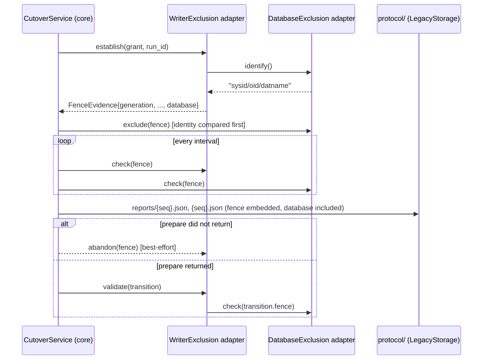
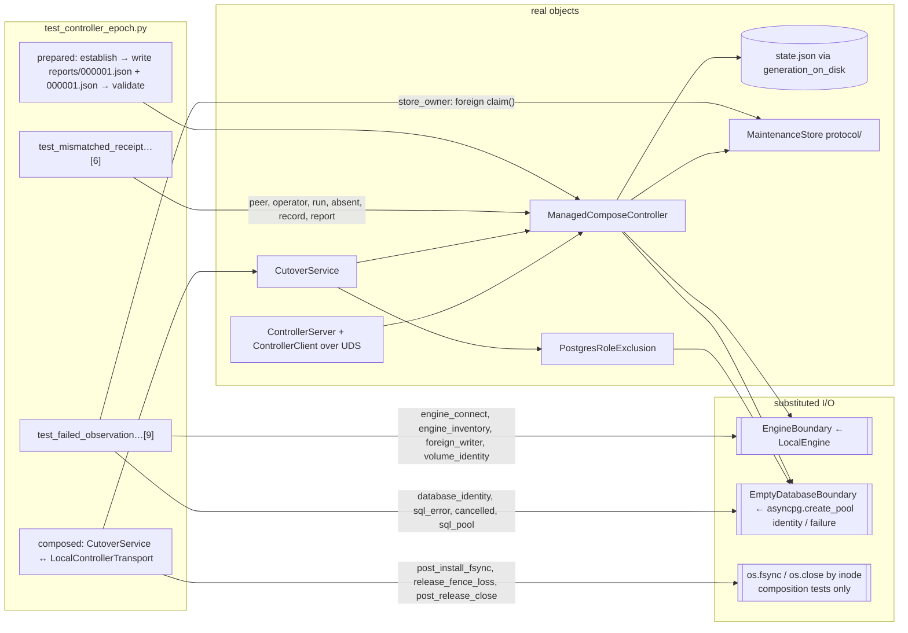
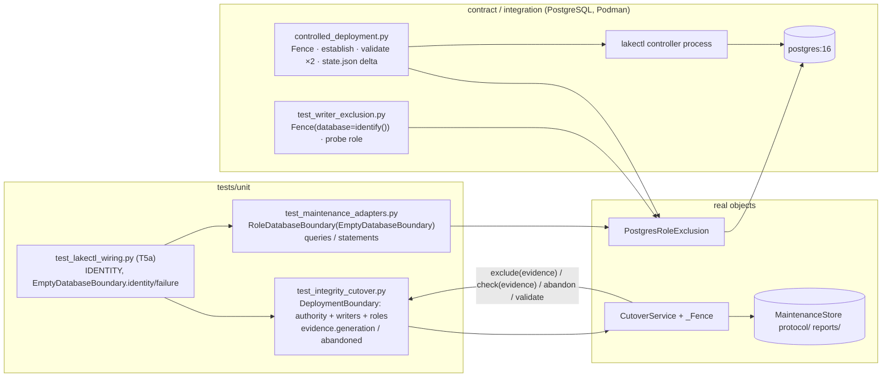
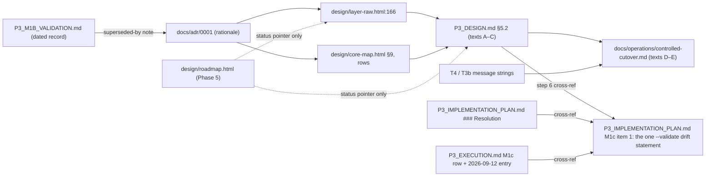

# P3 M1b — Authority and reverification: design

Goal: resolve M1b's verification authority, epoch revocation and certification
handoff so that a maintenance caller can never make stale or revoked evidence usable
without a fresh complete scan, while preserving M1c–M7 scope unchanged. Inputs, in
authority order: `AGENTS.md` (names `design/` as the architecture record and
`design/roadmap.html` as delivery status); `docs/adr/0001-controller-generation-is-the-verification-epoch.md`
(accepted, amended by the review); `P3_M1B_ARCHITECTURAL_REVIEW.md` (Task E carries the
accepted rulings and change inventory); `P3_IMPLEMENTATION_PLAN.md#escalation` (retained
tree, receipts, decisions 1–4). `P3_DESIGN.md`, `P3_EXECUTION.md`, `P3_M1A_VALIDATION.md`,
`P3_M1B_VALIDATION.md`, `docs/operations/controlled-cutover.md`, `CONTEXT.md` and
`design/layer-raw.html` restate the design and status; `p3-evidence/` holds historical
receipts. Phase 0 (this section) grills those documents against the tree at
`p3/integrity-and-raw-flows` (HEAD `e22d000`) on 2026-09-12; later phases add the target
design, alternatives and milestones.

## Roadmap Drift

Findings are claim → evidence → classification. Work marked todo/deferred whose code is
absent (M1c–M7, `protocol init`, API startup gating) is not listed as drift. The three
authority defects are established by the escalation and were reproduced, not re-derived.

### Wrong

1. **"Any failed authorized validation revokes endorsement; apparently restored
   observations do not revive it"** (`P3_DESIGN.md:278–279`, `docs/operations/controlled-cutover.md:142–143`,
   `P3_M1B_VALIDATION.md` "Failed authorized validation and controller restart revoke
   endorsement") → `ManagedComposeController.check` (`src/huron/applications/lakectl/controller.py:162`)
   clears `_certificate` only for `OSError`/`ValueError`; HTTPX transport errors escape.
   `test_observed_unreachable_engine_permanently_revokes_receipt` and
   `test_revoked_receipt_cannot_be_reendorsed_without_full_reverification` fail
   (`DID NOT RAISE ValueError`) → **wrong**.
2. **"[validate] repeats complete storage, SQL and writer-fence checks under exclusive
   ownership"** as a binding guarantee (`P3_DESIGN.md:276–278`, `controlled-cutover.md:140–142`)
   → `FenceEvidence` (`src/huron/core/integrity/models.py:146–155`) and both
   `protocol-*-v1.json` `$defs.FenceEvidence` carry no database identity; the SQL check
   runs against whatever `maintenance_path` currently names.
   `test_changed_maintenance_database_configuration_invalidates_receipt` fails → **wrong**.
3. **"Every retry performs a full scan … cannot be reused merely by presenting its
   files to the consumer"** (`P3_DESIGN.md:284–288`) → `CutoverService.prepare` does rescan
   (`cutover.py:139–175`), but `server.py:88–90` exposes `certify` to every cutover UID and
   `certify` (`controller.py:166–176`) admits stored bytes plus current observations with
   no link to a completed scan (repro test 3) → **wrong** as a guarantee; the scan claim
   itself is clean.

### Stale

4. `design/roadmap.html:365–366` — M1b "has local functional acceptance, with independent
   verification pending" → all three attempts failed (`p3-evidence/m1b/verification3/report.md`
   "Functional: FAIL", escalation "Stopped") → **stale**. The row's `todo` tag and
   "not deployable" wording are correct.
5. `P3_M1B_VALIDATION.md:5` — "independent verification 3 of 3 is pending"; §"M1b is under
   review" → attempt 3 returned FAIL and the workflow is stopped → **stale**. Its
   endorsement/indeterminate contract paragraph is also superseded by ADR-0001
   (`certify`, `validate_certificate`, `CertificationIndeterminateError` are to be deleted).
6. `P3_EXECUTION.md:28` progress table — M1b "Implementation in progress; verification Not
   started" → the same file's "Stopped at mandatory escalation" section records three
   exhausted attempts → **stale** (internally inconsistent).
7. `P3_EXECUTION.md:85` — "`Containerfile` still starts `huron.service.api.main:app`" →
   `Containerfile:30` and `deploy/controlled/compose.json.example:7` start
   `huron.applications.api.main:app`; `src/huron/service` does not exist → **stale**.
8. `P3_IMPLEMENTATION_PLAN.md:538` — "The incomplete changes remain uncommitted" → commit
   `f619342` landed all 17 M1b source files and both protocol schemas;
   `git status --porcelain -- src/huron` is empty → **stale** (the "unverified" half stands).
9. `design/layer-raw.html:166` — "live controller certificate validation and legacy
   verification are implemented and under review" → verification failed, and the
   certificate/endorsement model is rejected by the accepted ADR → **stale**.
10. `P3_DESIGN.md:3` — "verified-completion implementation is under validation" → M1a passed
    independent verification on 2026-09-11 (`P3_M1A_VALIDATION.md:3`) → **stale** (minor).
    `P3_DESIGN.md §5.2:266–288` and `controlled-cutover.md:130–150` describe endorsement,
    "explicitly indeterminate" lost acknowledgements and same-run reuse, all rejected by
    ADR-0001 → **stale** (superseded; must be rewritten by the authority plan).
11. `CONTEXT.md` — "completion-path implementation is planned for P3" → M1a implemented it →
    **stale** (minor, outside the target path).
12. `P3_IMPLEMENTATION_PLAN.md:551`, `P3_M1B_VALIDATION.md` — "1,628 units" → 1,634 pass
    today; the +6 come from untracked `tests/unit/test_books_upload_script.py` (outside the
    target path); coverage unchanged at 95.88% → **stale receipt, benign**.

### Deferred, recorded for the plan (not drift)

- `P3_DESIGN.md:254` step 6 "`--validate` checks report digests, protocol, database head
  and activation prerequisites" → `lakectl protocol cutover` accepts only `--prepare`
  (`src/huron/applications/lakectl/main.py:36–39`); `CutoverService.validate` exists
  (`cutover.py:108`). The plan places the CLI under M1c (`P3_IMPLEMENTATION_PLAN.md:208–209`);
  review E.6 moves only `--validate --sequence N` into the authority plan. **Unverified/deferred**.
- `FenceEvidence.database`, `DatabaseExclusion.identify()`, `abandon`, stateless
  `validate`, `tests/unit/test_controller_epoch.py` → none exist; consistent with the
  review's "nothing is implemented".

### Clean

- Controller persists exclusion before confirmed process removal: `establish` calls
  `_persist()` (`controller.py:139`) before the `terminate` loop (`:140–141`); `check`
  refuses evidence that differs from the live state (`:158–159`); restart advances the
  generation (`:252`). The same-run non-advance (`:133–134`) is the review's A.3 finding,
  not documentation drift.
- Every retry performs a full scan (`cutover.py:139–175`); same-run replay reuses a record
  only after `validate_inventory` (`:177–190`), matching the documented exception.
- 1,634 units at 95.88%; floor `fail_under = 95.88` (`pyproject.toml:261`); all 17 M1b
  source files (8 `lakectl`, 6 `core/integrity`, `metastore/legacy.py`,
  `metastore/maintenance.py`, `rawstore/maintenance.py`) at 100% line coverage.
- 48 contract and 14 integration tests collect (not run).
- `make lint` exits 2 solely at native duplication: 60/100 against 90, 213/935 fragments,
  253 pairs, 58 groups; lint targets `src` (`Makefile:58–70`).
- 132 production Python files under `src/huron` (115 pre-existing + 17 M1b).
- The three authority regressions fail deterministically (3 failed, exit 1).
- `P3_IMPLEMENTATION_PLAN.md:1–10` status header; `P3_M1A_VALIDATION.md`; `AGENTS.md:9`
  authority statement; roadmap P3 `todo` tag and duplication figures; protocol schema
  `$id`s `urn:huron:protocol-*:1`; ADR-0001 text matches the review's E.1 table.

### Receipts

Run from `/home/karl/repo/huron` on 2026-09-12; Podman, PostgreSQL and the 9 GiB
acceptance test were not started.

| Command | Exit | Observed |
| --- | --- | --- |
| `uv run pytest -q tests/unit --cov=src/huron --cov-report=term-missing` | 0 | 1634 passed, 121 s; TOTAL 6822 stmts, 281 miss, 95.88%; 17 M1b files 100% |
| `make lint` | 2 | all static checks pass; `pyscn` native duplication 60/100 (required ≥90), 213/935 fragments, 253 pairs, 58 groups; health score 92/100 |
| `uv run pytest -q --co -m contract` | 0 | 48/1697 collected |
| `uv run pytest -q --co -m integration` | 0 | 14/1697 collected |
| `PYTHONPATH=. uv run pytest -q p3-evidence/m1b/verification3/test_authority_repro.py` | 1 | 3 failed, all `DID NOT RAISE ValueError` |
| `git status --porcelain -- src/huron` | 0 | empty; `f619342` landed the 17 M1b files |
| `find src/huron -name '*.py' -not -path '*__pycache__*' \| wc -l` | 0 | 132 |
| `grep -rn "def certify\|validate_certificate\|CertificationIndeterminateError" src/huron` | 0 | present in `ports.py`, `exclusion.py`, `controller.py`, `server.py`, `models.py`, `main.py` |
| `grep -n "main:app" Containerfile deploy/` | 0 | `huron.applications.api.main:app` |
| `python3` load of `protocol-*-v1.json` `$defs.FenceEvidence` | 0 | required: controller_id, generation, root_id, operator, terminated_writers, old_roles, new_role — no `database` |

## Current State

Discovery on 2026-09-12 against HEAD `e22d000` (`p3/integrity-and-raw-flows`). Read-only:
no source, test or other markdown changed; Podman and PostgreSQL not started. Vocabulary is
`codebase-design`'s (module, interface, seam, adapter). The review's §2 codebase map, class
diagram and sequence diagram (`P3_M1B_ARCHITECTURAL_REVIEW.md:60–211`) describe the current
seam accurately and are referenced, not redrawn; this section adds what the plan needs that
the review does not carry: sizes, conventions with file citations, test-double substitution
points, and executed emptiness checks.

### Codebase map (target path)

| Module | Lines | Role at the authority seam |
| --- | --- | --- |
| `src/huron/core/integrity/models.py` | 296 | `EvidenceDocument` (canonical bytes, sha256, strict `decode`), `FenceEvidence` (7 fields, no `database`), `ProtocolInventory`, `ProtocolTransition` (`bind` hard-codes `report_path=f"reports/{run_id}.json"` at `:265`; `validate_inventory` re-binds and compares), `CertificationIndeterminateError` (`:295`) |
| `src/huron/core/integrity/ports.py` | 213 | Protocols `LegacyStorage` (`@runtime_checkable`), `MaintenanceAuthority`, `WriterExclusion` (`establish/check/certify/validate_certificate`, `:104–143`), `DatabaseExclusion` (`exclude(old_roles,new_role)/check(old_roles,new_role)`, `:146–167`), `LegacyMaintenance` |
| `src/huron/core/integrity/cutover.py` | 235 | `CutoverService.prepare` (`authenticate → establish → root/operator compare → claim() → _prepare_owned → certify`, `:78–106`), `validate` (`:108–122` → `validate_certificate`), `_record` (report keyed by `run_id`, `:139–175`), `_transition` (same-run reuse, `:177–190`), `_Fence` (latching; calls `roles.check(old_roles,new_role)` at `:211–212`), `_settled_write` |
| `src/huron/core/integrity/generations.py`, `verification.py` | 138, 179 | Scan verifiers; only `generations.py:24` docstring mentions "certifying" |
| `src/huron/applications/lakectl/controller.py` | 329 | `ManagedComposeController`: sync `establish` (`:111–144`; conditional mint `:133–134`; cumulative writer union `:126–127`; assigns state before `_persist`), `check` (`:146–164`; clears `_certificate` only on `OSError|ValueError`), async `certify`/`validate_certificate` (`:166–194`), `_validate_evidence` (`:196–216`; reads `protocol/reports/{run_id}.json`; `MaintenanceSettings.load` live at `:211`; inline `asyncpg.create_pool` `:212`), `_load_state` (mint at start `:252`), `_persist` (mkstemp + fsync + rename + dir fsync, `:275–290`), `_evidence` (`:292–303`) |
| `src/huron/applications/lakectl/settings.py` | 160 | `ControllerState` (frozen; `generation ge=0`, `run_id`, `writers`, `operator`; no `database`), `ControllerSettings` (has `maintenance_path`, `old_roles`, `new_role`), `MaintenanceSettings` (`controller_socket`, `database_url: SecretStr`), `private_document` |
| `src/huron/applications/lakectl/server.py` | 159 | `ControllerHandler.handle` catches `(ValueError, OSError, httpx.HTTPError, asyncpg.PostgresError)` (`:52`); `_dispatch` 7 operations, `asyncio.run` only for certify/validate_certificate (`:88–92`); `_require_request_fields` exact-field-set table (`:97–110`); `serve` flocks `state.lock` |
| `src/huron/applications/lakectl/exclusion.py` | 154 | `ControllerClient` = adapter for both `MaintenanceAuthority` and `WriterExclusion`; `certify` maps `(OSError, ValueError, CancelledError)` → `CertificationIndeterminateError` (`:88–110`); `_call` (`:132–154`) reads one line, `json.loads` on an empty/unterminated reply raises `JSONDecodeError` |
| `src/huron/applications/lakectl/main.py` | 66 | `protocol cutover --prepare` only (`:36–39`); catches `CertificationIndeterminateError` (`:51–56`) then `(ValueError, OSError, ExceptionGroup, asyncpg.PostgresError, httpx.HTTPError)` (`:57`) |
| `src/huron/applications/lakectl/wiring.py` | 77 | `prepare(settings, run_id)` composition root: `ControllerClient` passed as both `authority` and `writers`; `PostgresRoleExclusion(pool)`; `MaintenanceStore(root.path, root.owner_uid)` |
| `src/huron/applications/lakectl/engine.py` | 161 | `LocalEngine` over HTTPX UDS (raises `httpx.HTTPError`) |
| `src/huron/pkg/metastore/maintenance.py` | 151 | `PostgresRoleExclusion.exclude/check` two-parameter; module-level `_identifier`, `_roles`, `_require_dedicated`, `_revoke_access`, `_effective_access`; no cluster/database identity query; imports `asyncpg` under `TYPE_CHECKING` only |
| `src/huron/pkg/rawstore/maintenance.py` | 312 | `MaintenanceStore.write_evidence` (`:112`, write-once fsynced, "without replacement"), `claim()` (`:138–170`, `O_RDWR|O_CREAT|O_NOFOLLOW|O_NONBLOCK` + `LOCK_EX|LOCK_NB` on `protocol/.maintenance.lock`), no-follow reads |
| `src/huron/schema/documents/protocol-{inventory,transition}-v1.json` | — | `$id` `urn:huron:protocol-*:1`; `$defs.FenceEvidence.required` = `controller_id, generation, new_role, old_roles, operator, root_id, terminated_writers` (no `database`) |

Dependency direction is enforced by `pyproject.toml:166–170` (`layers = ["huron.applications",
"huron.core", "huron.pkg", "huron.schema"]`), `:172–178` (packages independent), `:180–190`
(applications independent), `:244–262` ("core uses ports rather than concrete
infrastructure": `huron.core` may not import `huron.pkg.metastore`, `huron.pkg.rawstore`,
`asyncpg`, …). `AGENTS.md:84–86` states the same direction. Consequence confirmed for the
design: `pkg/metastore` cannot import `core.integrity.models.FenceEvidence`; the review's
structural `DatabaseFence` Protocol in `pkg` is the only import-clean mechanism, and `core`
cannot name `asyncpg.PostgresError` (today `server.py`/`main.py`, both in `applications`,
do).

### Diagrams

The current class seam: `P3_M1B_ARCHITECTURAL_REVIEW.md:96–147` (classDiagram). The current
prepare → establish → scan → publish → certify → validate_certificate sequence:
`:149–211` (sequenceDiagram). Both match the code read today (line numbers above).

What neither shows is which seam each unit-test double replaces, which decides where new
tests can live without violating the "only engine and SQL I/O substituted" policy:

```mermaid
flowchart LR
    subgraph core["core/integrity (ports only)"]
        CS[CutoverService + _Fence]
    end
    subgraph app["applications/lakectl"]
        CC[ControllerClient]
        SRV[ControllerServer/_dispatch]
        MC[ManagedComposeController]
        LE[LocalEngine]
    end
    subgraph pkg["pkg"]
        PRE[PostgresRoleExclusion]
        MS[MaintenanceStore]
    end
    CS -- WriterExclusion + MaintenanceAuthority --> CC
    CS -- DatabaseExclusion --> PRE
    CS -- LegacyStorage --> MS
    CC -- UDS JSON --> SRV --> MC
    MC --> LE
    MC -. per validate .-> PRE
    MC -. per validate: claim + read .-> MS
    PRE -- asyncpg.Pool --> PG[(PostgreSQL)]
    LE -- httpx UDS --> ENG[(Podman)]

    DB1[["DeploymentBoundary<br/>test_integrity_cutover.py:26"]] -. replaces CC + PRE .-> CS
    DB2[["ControllerBoundary<br/>test_lakectl_wiring.py:57<br/>test_lakectl_main.py:45,70"]] -. replaces CC .-> CS
    DB3[["EmptyDatabaseBoundary<br/>test_lakectl_wiring.py:17<br/>(+RoleDatabaseBoundary subclass<br/>test_maintenance_adapters.py:21)"]] -. replaces asyncpg.Pool .-> PRE
    DB4[["EngineBoundary<br/>test_managed_controller.py:21"]] -. replaces LocalEngine .-> MC
    DB5[["live_server thread<br/>test_controller_transport.py:31"]] -. real UDS .-> SRV
```

`MaintenanceStore` is never doubled in unit tests (`prepared` writes real evidence under
`tmp_path`); `ControllerState` is read back from disk with `model_validate_json`
(`EngineBoundary.terminate`, `test_managed_controller.py:49`).

### Conventions the design must follow (one citation each)

1. **Frozen pydantic evidence with canonical bytes.** `EvidenceDocument`
   (`models.py:17–55`): `ConfigDict(extra="forbid", frozen=True)`, `canonical` via
   `pkg.catalog.manifest.canonical_bytes`, `decode` refuses non-canonical bytes. Durable
   controller state is the same style (`settings.py:14–26`). New fields are required, not
   optional-with-default, unless the durable state needs an absent value (`run_id`,
   `operator` are `None` before the first `establish`).
2. **Ports are `Protocol`s in core; adapters live in pkg/applications.** `ports.py` (five
   Protocols; `LegacyStorage` is `@runtime_checkable`, the async ones are not), adapters
   `pkg/metastore/maintenance.py`, `pkg/rawstore/maintenance.py`,
   `applications/lakectl/exclusion.py`. Port methods are `async` except storage. Import of
   model types in `ports.py` is under `TYPE_CHECKING`.
3. **Async adapter methods, sync controller methods.** `ControllerClient` is fully async
   (`asyncify(self._call)`); `ManagedComposeController` is sync except `certify`/
   `validate_certificate`, which the server runs with `asyncio.run` inside the handler
   thread (`server.py:91`). Making `establish` async (E.4) follows the existing
   `asyncio.run` route; nothing else in the controller is on an event loop.
4. **pydoclint Google style, complete for anything with parameters.** `pyproject.toml:115–125`
   (`style="google"`, `arg-type-hints-in-docstring=false`,
   `skip-checking-short-docstrings=false`, `check-arg-order=true`). Public methods carry
   `Args/Returns/Raises`; private helpers (`_validate_evidence`, `_record`) carry none.
   `make lint` runs `pydoclint src` only (`Makefile:61`), so test docstrings are one-line.
5. **Test markers and default selection.** `pyproject.toml:150–159`: `unit`, `contract`,
   `integration`, `acceptance`; `addopts="-m unit --strict-markers"`;
   `asyncio_mode="auto"` (async `def test_` needs no decorator). Every unit module sets
   `pytestmark = pytest.mark.unit` (`test_managed_controller.py:16`); contract modules use
   `testcontainers` `PostgresContainer("postgres:16")` (`tests/contract/test_writer_exclusion.py:12–17`).
6. **Coverage ratchet.** `pyproject.toml:258–262` `fail_under = 95.88`, "never lower it";
   new or touched files are covered in full. All 17 M1b files are at 100% today (Roadmap
   Drift "Clean"), so every deleted line lowers the numerator and denominator together and
   every added line needs a test.
7. **Write-once evidence store and inode lock.** `MaintenanceStore.write_evidence`
   (`rawstore/maintenance.py:112–136`) installs without replacement;
   `claim()` (`:138–170`) is a non-blocking exclusive flock that touches no application data.
   Nothing under `protocol/` is ever overwritten or deleted; "history" is the only
   disposition for stranded files.
8. **Fixtures at the seam.** `controller_settings` (`tests/unit/test_controller_settings.py:69–90`)
   writes a real `maintenance.json` (`database_url: "private"`, mode 0600) and a compose
   file under `tmp_path`, with `root_metadata` faking root ownership via `lstat/fstat/stat`
   monkeypatches; `engine_boundary` (`test_managed_controller.py:58–67`) substitutes
   `controller_module.LocalEngine`; `prepared` (`test_controller_certificates.py:24–37`)
   additionally patches `controller_module.asyncpg.create_pool` to `EmptyDatabaseBoundary`
   and writes real report/record bytes; `DeploymentBoundary` (`test_integrity_cutover.py:26–75`)
   is one object serving `authority`, `writers` and `roles`; `EmptyDatabaseBoundary`
   (`test_lakectl_wiring.py:17–54`) answers `fetchval` by substring match on the SQL text.
   Doubles are plain classes with one-line docstrings; no `unittest.mock`.
9. **Refusal mapping is by exception class at the transport edge.** Server: named tuple →
   `CONTROLLER_REFUSED` (`server.py:52`); client: `not ok` → `PermissionError`
   (`exclusion.py:152`); CLI: two catch tuples → exit 1 with a fixed message, never the
   exception text (`main.py:50–63`, asserted by
   `test_command_failures_do_not_echo_connection_material`).
10. **Composition at the application boundary.** `wiring.prepare` constructs every adapter
    and owns the pool lifetime (`async with asyncpg.create_pool(...)`, `wiring.py:52`);
    `CutoverService.__init__` takes injected collaborators plus a `now` clock.
11. **Exceptions from the scan are wrapped.** `_prepare_owned` runs the monitor and the
    scan in an `asyncio.TaskGroup` (`cutover.py:130–137`), so a failure after `establish`
    surfaces as `ExceptionGroup` (already in `main.py:57`'s catch tuple) or as
    `CancelledError` (a `BaseException`). Any "on failure, abandon" logic must be written
    against `BaseException`, not `Exception`.

### Factual observations relevant to the tasks

- Mint sites today: `_load_state` (`controller.py:252`, every start) and `establish`
  (`:133–134`, only when the prior `run_id` differs). `check` never advances; `certify`/
  `validate_certificate` never advance (review A.1, confirmed).
- `establish` assigns `self._state` then `_persist()` (`:125–139`); a `_persist` failure
  leaves memory ahead of disk (review A.6).
- `_validate_evidence` takes its own `MaintenanceStore.claim()` (`:200`); the client's
  `validate` therefore must be called outside the client's claim (E.3 item 1 already rules
  this).
- `ControllerHandler` catches `Exception` subclasses only; `CancelledError`/`BaseException`
  from `asyncio.run` would kill the handler thread's request without a reply, which the
  client then sees as an empty payload (`exclusion.py:149–151`) — the truncated-reply
  finding (E.3 item 3).
- `ManagedComposeController.__init__` does not read `maintenance_path` today; the
  `controller_settings` fixture already provisions a loadable `maintenance.json`, so
  loading `MaintenanceSettings` once at start is fixture-compatible, **but** eagerly
  creating an `asyncpg` pool in `__init__` is not: `test_managed_controller.py` constructs
  the controller in 11 tests without patching `create_pool`.
- `DeploymentBoundary.check(self, *arguments)` accepts any signature, so the
  `check(fence)` change does not break it; `DeploymentBoundary.exclude(old_roles, new_role)`
  and `ControllerBoundary`/`EmptyDatabaseBoundary` do need edits.
- `EmptyDatabaseBoundary.fetchval` returns `"SELECT NOT (rolsuper" in query` (a `bool`) for
  any query it does not recognise, and `RoleDatabaseBoundary.fetchval` returns
  `self.effective`; an `identify()` query would receive `False`, not a string, in both.
- `test_managed_controller.py` calls `establish` synchronously 11 times inside sync
  `def test_` functions (`:105–261`); `tests/controlled_deployment.py:375,589` twice.
- `main.py` today prints `result.canonical` for `--prepare` and exits 1 on the two catch
  tuples; there is no `--validate`, `--sequence`, or any read of `protocol/{N:06d}.json`.

### Emptiness checks (command → answer)

| Question | Command / file | Answer |
| --- | --- | --- |
| Deployed protocol evidence pinning the v1 URNs? | `grep -rln "urn:huron:protocol" .` (excluding `.git`, `.venv`, `node_modules`); `find . -type d -name protocol`; `find . -name '[0-9]{6}.json'` | Only `src/huron/core/integrity/models.py`, the two schema files, `tests/unit/test_protocol_documents.py`, `P3_DESIGN.md`, the review/design files and one M1b log. No `protocol/` directory and no `NNNNNN.json` anywhere in the tree; `deploy/controlled/` holds `compose.json.example`, `controller.json.example`, `maintenance.json.example`, `roles.sql`, two unit files — no evidence. **Empty**: keeping `urn:huron:protocol-*:1` with a new required field breaks nothing deployed (E.5 item 3 confirmed). |
| Consumers of `certify` / `validate_certificate` / `CertificationIndeterminateError` beyond tests? | `grep -rn "certify\|validate_certificate\|CertificationIndeterminateError" src tests docs deploy scripts design p3-evidence P3_*.md` | Production: `ports.py:129,137`, `cutover.py:105,122`, `models.py:295`, `controller.py:166,178`, `server.py:88–92,104–105`, `exclusion.py:14,88–123`, `main.py:14,51`. No consumer in `applications/api`, `scripts/`, or `deploy/`. Tests: `test_controller_certificates.py`, `test_controller_transport.py:227–266`, `test_integrity_cutover.py:64–73`, `test_lakectl_wiring.py:94–97`, **`test_lakectl_main.py:15,58,71–73`** (not in review E.4), `tests/controlled_deployment.py:482–500`. Docs: `docs/operations/controlled-cutover.md:140`, `P3_DESIGN.md:276`, **`design/core-map.html:165,343`** (untracked; not in E.4), `P3_IMPLEMENTATION_PLAN.md:510` (escalation history, keep). `p3-evidence/**` are receipts, never collected. |
| Does `tests/unit/test_lakectl_main.py` exist; what does it cover? | `wc -l`, `grep -n '^def test_'`, `git log -1 -- tests/unit/test_lakectl_main.py` | Exists, tracked since `f619342`, 160 lines, 5 tests: controller config load; restart prints result; cutover `--prepare` prints canonical transition, parametrized `lost_acknowledgement=[False, True]` with an inner `AcknowledgementBoundary(ControllerBoundary)` whose `certify` raises `CertificationIndeterminateError`; failures never echo connection material (parametrized); module entry point. No `--validate` coverage. |
| Other `DatabaseExclusion` / `WriterExclusion` implementations? | `grep -rn "async def exclude\|async def establish\|def establish\|def exclude" src tests p3-evidence scripts` | Production: exactly one each — `PostgresRoleExclusion` (`pkg/metastore/maintenance.py:23`) and `ControllerClient` (`exclusion.py:56`); `ManagedComposeController.establish` is the server side, not a port adapter. Doubles: `DeploymentBoundary` (`test_integrity_cutover.py:50,55`), `ControllerBoundary` (`test_lakectl_wiring.py:79`), `p3-evidence/m1b/verification3/test_finalization_contract.py:27` (receipt). Two-parameter `exclude/check` **callers**: `tests/unit/test_maintenance_adapters.py:64,84` and `tests/contract/test_writer_exclusion.py:40,47,70,71,75,95,149,153,156,186` (14 sites, none in E.4). |
| Anything already named `identify`, `abandon`, `_advance`, `_observe`, `pg_control_system`, `pg_is_in_recovery` in the target path? | `grep -rn` over `src tests deploy docs` | Only the ADR mentions `identify()`. `_advance` exists in `pkg/catalog/ingest.py:302` and `_observe_part` in `core/_ingest.py:615` (unrelated; no name clash inside `lakectl`). `abandon` appears only in unrelated ingest code and one cutover test docstring. `tests/unit/test_controller_epoch.py` does not exist. |
| Superuser status of the cutover role? | `deploy/controlled/roles.sql:5` | `CREATE ROLE huron_cutover NOLOGIN SUPERUSER;` — production grants superuser; the contract test's non-superuser `probe` role (E.4) is the only place the non-superuser question is answered. |

## Design Tasks

Each task is sized for one subagent at 30k–50k tokens. "Settled" means the review (Task
A–D findings, E.1–E.6) and ADR-0001 fix the decision and the subagent writes the design
from those artifacts plus the files listed; "needs code" means the decision depends on
reading application code or design documents beyond the artifacts. Dependencies follow
the package order `schema → pkg → core → applications → tests → docs`. Where two tasks
touch one object, the owner named here decides; the other task consumes.

### T1 — Core contracts and schema regeneration (owner: core/integrity models and ports)

- **Decides:** `FenceEvidence.database: str` (required, single string
  `<system_identifier>/<database_oid>/<datname>`; validation pattern if any); the
  `DatabaseExclusion` port as `identify() -> str` / `exclude(fence)` / `check(fence)`; the
  `WriterExclusion` port as `establish(grant, run_id)` / `check(evidence)` /
  `abandon(evidence)` / `validate(transition)`; deletion of `certify`,
  `validate_certificate`, `CertificationIndeterminateError`; docstring wording for each
  port method (Google style, `Raises` sections where the port promises a class); whether
  the fence parameter type in `ports.py` is `FenceEvidence` (it is — core owns the model);
  regeneration of both `protocol-*-v1.json` from `model_json_schema` under the unchanged
  `$id`s.
- **Does not decide:** `ProtocolTransition.bind`'s `report_path` (T2 owns); the pkg-side
  `DatabaseFence` structural type (T4 owns, must be satisfied by T1's `FenceEvidence`).
- **Settled from artifacts:** yes (E.4 `schema/` and `core/integrity` groups, B.2, B.4,
  C.3, E.3 items 6 and 9). Needs only `models.py`, `ports.py`, the two schema files and
  `tests/unit/test_protocol_documents.py:200–216` to confirm the regeneration path.
- **Acceptance:** the design lists the exact post-change `ports.py` method signatures and
  docstrings; states that `FenceEvidence` equality (used by `check` and `abandon`) now
  includes `database`; shows the regenerated `$defs.FenceEvidence.required` list; names
  every import site of the deleted error (`exclusion.py`, `main.py`, `test_lakectl_main.py`,
  `test_controller_transport.py`) for T3b/T5a to delete; confirms `core` gains no import.
- **Files:** `src/huron/core/integrity/models.py`, `ports.py`, `generations.py:24`
  (docstring), `src/huron/schema/documents/protocol-inventory-v1.json`,
  `protocol-transition-v1.json`, `tests/unit/test_protocol_documents.py`.

### T2 — `CutoverService` flow (owner: core/integrity/cutover.py)

- **Decides:** the `prepare` order `authenticate → claim() → establish → root/operator
  compare → _prepare_owned → release → validate` (E.3 item 1) and where the claim context
  ends; the `abandon`-on-failure shape (`except BaseException` around everything after
  `establish` returns, best-effort `await self._writers.abandon(evidence)` that swallows
  its own failure and re-raises the original, including `ExceptionGroup` from the
  `TaskGroup` and `CancelledError`); sequence allocation in `_record` (next free number
  over `reports/` ∪ records, computed under the claim; how "next free" is enumerated given
  `LegacyStorage` exposes only `read_control` and `write_evidence` — whether a new port
  method is needed or a probe loop with `FileNotFoundError` suffices, as `_transition`
  does today); **the report path convention `reports/{sequence:06d}.json`, including the
  matching edit to `ProtocolTransition.bind` in `models.py:265`** (T2 owns this line even
  though the file is T1's); deletion of `_transition` and the same-run reuse; `_Fence.check`
  calling `roles.check(self.evidence)`; `_prepare_owned` calling `roles.exclude(evidence)`;
  `validate` → `writers.validate(transition)`; docstrings `:84–85`, `:112`.
- **Settled from artifacts:** mostly (C.1–C.3, E.3 items 1–2, E.4). **Needs code** for the
  sequence-allocation mechanism (`_transition`'s probe loop, `MaintenanceStore.read_control`
  semantics for `protocol/reports`, and whether `write_evidence`'s write-once refusal is the
  concurrency backstop) and for the `TaskGroup`/`ExceptionGroup` failure path.
- **Acceptance:** the design gives the full post-change `prepare` control flow as a
  sequence diagram with the claim span, the abandon path and the epoch-end cause for every
  exit; states the invariant "report and record of one `prepare` share one sequence
  number, nothing under `protocol/` is reused"; lists the `test_integrity_cutover.py`
  assertions that change (`:126, :334, :398, :468` replay assertions;
  `test_report_without_record_is_resumable_under_the_same_fence`;
  `test_independent_cutovers_cannot_share_a_live_same_run_owner` expects `abandoned == []`)
  for T5b; confirms the run/record `run_id` refusal stays on the controller (E.3 item 8), not
  here.
- **Files:** `src/huron/core/integrity/cutover.py`, `models.py:265` (`bind.report_path`),
  `src/huron/pkg/rawstore/maintenance.py` (read only; E.4 says no change — confirm).

### T3a — Controller epoch mechanics (owner: `ManagedComposeController` and `ControllerState`)

- **Decides:** `_advance()` (copy `generation+1`, persist, then assign — fixing the A.6
  ordering so disk leads memory); `_observe(...)` guard shape (one `try/except
  BaseException: _advance(); raise` around volume, engine, writer inventory, store-under-
  claim and database observations; pure comparisons outside it); unconditional mint in
  `establish`; `establish` becoming `async` with `identify()` captured through a private
  `_database()` context; **pool lifecycle** — settings loaded once in `__init__`, pool
  created lazily per `_database()` use (an eager pool in `__init__` breaks 11 unpatched
  controller tests and holds a connection for the daemon's lifetime; the design must say
  which and why); `terminated_writers` = this `establish`'s writers only (delete the
  cumulative union); `ControllerState.database: str | None`; `validate(uid, transition)`
  replacing both endorsement methods, `_validate_evidence` reading
  `protocol/reports/{transition.sequence:06d}.json` (T2's convention) and calling
  `roles.check(transition.fence)`; `abandon(uid, evidence)` = `if evidence ==
  self._evidence(): self._advance()` with no observation; `_evidence()` including
  `database`; keep the `run_id` refusal (E.3 item 8); delete `_certificate` and its six
  touch points, `certify`, `validate_certificate`, the named catch tuple, the live
  `MaintenanceSettings.load`.
- **Settled from artifacts:** the semantics (A.2–A.8, B.4, C.3, E.2, E.3 items 2, 8, 10).
  **Needs code** for: the `_observe` placement relative to `authenticate` (a
  `PermissionError` must not end the epoch), the `_check_volume`/`_writers` call graph, the
  `_load_state` bootstrap when `database` is absent, and the pool/settings lifecycle
  against the fixtures in `tests/unit/test_controller_settings.py:69–90`.
- **Acceptance:** a table of every controller entry point × failure class → (epoch ends?
  reply) matching A.2 as amended; the exact ordered list of `_advance()` call sites; the
  statement that no code path assigns `self._state` before `_persist` succeeds; the
  `_validate_evidence` step order with the claim span; the `identify()` call's position in
  `establish` (before or after termination — B.4/E.3 item 10 say inside `establish`, the
  design fixes where); no new import into `core`.
- **Files:** `src/huron/applications/lakectl/controller.py`, `settings.py:14–26`.

### T3b — Server, client, CLI and wiring (owner: `server.py`, `exclusion.py`, `main.py`, `wiring.py`)

- **Decides:** `_dispatch` gaining `abandon` and `validate` (both under `asyncio.run`, as
  `establish` now is), the `_require_request_fields` table entries, deletion of the
  `certify`/`validate_certificate` branches and the `httpx`/`asyncpg` imports; `handle`
  catching `Exception` (and whether `BaseException` from `asyncio.run` — `CancelledError` —
  needs a reply so the client never sees a truncated payload); `ControllerClient.validate`
  and `abandon`, `_call` raising `ConnectionError("controller closed the connection without
  a reply")` on an empty or newline-less payload (E.3 item 3), deletion of the
  indeterminate mapping; `main.py`: `--validate` mutually exclusive with `--prepare`,
  `--sequence N` reading `protocol/{N:06d}.json` through the controller-described root
  (needs `describe()` + `MaintenanceStore.read_control`, or a new `wiring.validate`
  entry point — the design chooses and keeps `wiring.py` the only composition root),
  exit 0/1, deletion of the `CertificationIndeterminateError` branch and import; whether
  `ExceptionGroup` stays in the CLI catch tuple (yes: `TaskGroup`).
- **Settled from artifacts:** C.3, C.6, D.3, E.3 items 3–4, E.4. **Needs code** for the
  `--validate` composition (how `wiring.prepare` builds `CutoverService` and what
  `validate` needs — authority, writers and `root_id` only, no pool) and for the
  `ControllerHandler` thread/`asyncio.run` interaction.
- **Acceptance:** the post-change operation table (name → required fields → controller
  method → sync/async); the client error mapping table (transport → `ConnectionError`,
  refusal → `PermissionError`, malformed → `ValueError`); the exact `argparse` surface and
  the `--validate` data flow; confirmation that `ControllerClient` still satisfies both
  ports structurally; the drift note that `--validate` moves from M1c item 1 (recorded in
  Roadmap Drift "Deferred") — `protocol init` and API startup gating stay M1c.
- **Files:** `src/huron/applications/lakectl/server.py`, `exclusion.py`, `main.py`,
  `wiring.py`.

### T4 — PostgreSQL adapter (owner: `pkg/metastore/maintenance.py`)

- **Decides:** the `identify()` query (B.3: `pg_control_system().system_identifier`,
  `pg_database.oid` for `current_database()`, `datname`, guarded by
  `NOT pg_is_in_recovery()`; `NULL` ⇒ `ValueError("maintenance database is not a
  primary")`); the identity string format and that it is compared as one string; the
  fence comparison as the first statement of `exclude` and `check` (message `"maintenance
  database identity differs from the fence"`) before any `ALTER ROLE`; `exclude`
  tail-calling `check(fence)`; the local structural `DatabaseFence` Protocol (`database`,
  `old_roles`, `new_role` as read-only properties) and `_roles(fence.old_roles,
  fence.new_role)`; deletion of the two-parameter signatures; the E.5 item 1 fallback
  (`pg_database` oid + `current_database()` without `pg_control_system()`) written as a
  contingency, chosen by the contract test receipt; the standby-refusal wording (E.5 item 2,
  unverified, not faked in unit tests).
- **Settled from artifacts:** yes (B.1–B.5, E.3 items 5 and 10, E.5 items 1, 2, 4).
  Apply `postgresql-table-design` only for the catalog-query correctness (no table design
  is involved). Needs `pkg/metastore/maintenance.py` and the contract test file to read.
- **Acceptance:** the exact SQL for `identify()`; a statement that the adapter never
  imports `huron.core`; a note on mypy/ty structural typing of a frozen pydantic model
  against a property-only Protocol with the explicit-parameter fallback (E.5 item 4); the
  list of every `exclude/check` call site to change (14 test sites in
  `test_maintenance_adapters.py` and `tests/contract/test_writer_exclusion.py`, plus
  `cutover.py`, `controller.py`, `DeploymentBoundary`) handed to T2/T3a/T5b.
- **Files:** `src/huron/pkg/metastore/maintenance.py`,
  `tests/contract/test_writer_exclusion.py` (read), `deploy/controlled/roles.sql` (read).

### T5a — Unit tests: controller, transport, wiring, CLI (owner: application-layer test modules)

- **Decides:** the `git mv test_controller_certificates.py → test_controller_epoch.py`
  contents: the two parametrized matrices
  (`test_failed_observation_ends_the_epoch_before_the_refusal[fault]`, nine faults at the
  engine/SQL seams absorbing repro tests 1–3;
  `test_mismatched_receipt_is_refused_without_ending_the_epoch[fault]`), the in-process
  composition test that `abandon` reaches the durable epoch, the shrunken
  `test_prepared_files_require…`; the `prepared` fixture rewrite (async `establish`;
  `create_pool` patched before construction; report written at
  `reports/000001.json`); `test_managed_controller.py`: `database_boundary` fixture,
  `generation_on_disk` helper, `:109` asserting the advance, 11 `establish` calls
  converted to async tests; `EmptyDatabaseBoundary.identity`/`failure` routing the
  `identify()` query by SQL substring (owner of this double; T5b consumes through
  `RoleDatabaseBoundary`); `ControllerBoundary` gaining `validate`/`abandon`;
  `test_controller_transport.py:205–266` rewritten (`test_lost_reply_is_resolved_by_validating_again`
  on `ConnectionError`); `test_lakectl_main.py`: delete the `lost_acknowledgement`
  parametrization and `AcknowledgementBoundary`, add `--validate` success and refusal.
- **Settled from artifacts:** D.2–D.4, D.6, D.7, E.2 Decision 4, E.3 item 11. **Needs
  code**: the fixtures above and the `asyncpg.PostgresError()` constructibility for the
  `sql_error` fault (E.5 item 5).
- **Acceptance:** each new test named with its fault parameters and the observable
  assertion (on-disk generation via `ControllerState.model_validate_json`, never a private
  attribute); the list of deleted tests (D.7) with file:line; a coverage argument per
  deleted production block; "only engine and SQL I/O substituted" restated as the policy.
- **Files:** `tests/unit/test_controller_certificates.py` (→ `test_controller_epoch.py`),
  `test_managed_controller.py`, `test_controller_transport.py`, `test_lakectl_wiring.py`,
  `test_lakectl_main.py`, `test_controller_settings.py` (fixtures, read).

### T5b — Unit tests: cutover service and adapters; contract and integration (owner: core/pkg test modules and Linux scripts)

- **Decides:** `DeploymentBoundary` rewrite (mints on `establish`, refuses on evidence
  mismatch in `check`, records `abandoned`, `exclude(fence)`, `validate`; delete
  `certificate/certify/validate_certificate`); the D.4 item 8 edits to
  `test_integrity_cutover.py` including `test_stranded_report_is_history_and_retry_appends`
  and the replay assertions at `:126, :334, :398, :468`; `test_maintenance_adapters.py:64,84`
  and `RoleDatabaseBoundary.fetchval` routing for the identity query;
  `tests/contract/test_writer_exclusion.py` — 12 call sites moved to a fence value and the
  new `test_identify_binds_cluster_and_database_and_refuses_a_foreign_fence` with a
  non-superuser `probe` role (the E.5 item 1 receipt); `tests/controlled_deployment.py:482–500`
  → `validate`, read `state_path` after the SQL-loss refusal and assert the advance,
  `:375,589` establish calls; `tests/integration/test_protocol_cutover.py` unchanged unless
  it names the deleted operations (grep says it does not).
- **Settled from artifacts:** D.3–D.4, D.5/E.3 item 1, D.7. **Needs code**: the contract
  test's pool/role setup (`_exercise_exclusion`) to place the `probe` role, and the
  `controlled_deployment.py` flow around `:470–520`.
- **Acceptance:** every changed test named with the new expectation; the fence value the
  contract test constructs (a plain object satisfying `DatabaseFence`, not a core import —
  contract tests may import core, but the design says which); confirmation that no unit
  test fakes `pg_is_in_recovery()`.
- **Files:** `tests/unit/test_integrity_cutover.py`, `test_maintenance_adapters.py`,
  `tests/contract/test_writer_exclusion.py`, `tests/controlled_deployment.py`,
  `tests/integration/test_protocol_cutover.py` (read).

### T6 — Documentation reconciliation (owner: prose that restates the seam)

- **Decides:** the rewrite of `P3_DESIGN.md` §5.2 (`:229–296`; delete the indeterminate-
  acknowledgement and same-run-replay sentences, reference ADR-0001, step 6 `--validate
  --sequence N`); `docs/operations/controlled-cutover.md:113–150` (report named by
  sequence, settings read once at start, residual-window paragraph, `--validate` recovery
  step); `P3_M1B_VALIDATION.md` status and contract paragraph (Roadmap Drift item 5);
  `P3_EXECUTION.md:28,85` and the stopped-escalation section (items 6–7);
  `design/layer-raw.html:166` (item 9); **`design/core-map.html:165,343`** (untracked file
  in the working tree that describes `WriterExclusion.certify()` — include it, since
  `AGENTS.md` names `design/` as the architecture record); `CONTEXT.md` (item 11, one
  line). `design/roadmap.html` is Phase 5's and is excluded.
- **Settled from artifacts:** yes (Roadmap Drift items 1–11, E.4 "Documentation", E.5 item
  7). Needs only the documents listed.
- **Acceptance:** per document, the passage (file:line) and its replacement text or a
  precise instruction; no claim of implementation or verification status beyond "designed";
  the drift note for `--validate` moving out of M1c is stated once and cross-referenced.
- **Files:** `P3_DESIGN.md`, `docs/operations/controlled-cutover.md`, `P3_M1B_VALIDATION.md`,
  `P3_EXECUTION.md`, `design/layer-raw.html`, `design/core-map.html`, `CONTEXT.md`.

### Ownership summary where tasks meet

| Object | Owner | Consumers |
| --- | --- | --- |
| `FenceEvidence.database`, port signatures, schema regeneration | T1 | T2, T3a, T4, T5a, T5b |
| `report_path = reports/{sequence:06d}.json` (`bind` and `_record`) | T2 | T3a (`_validate_evidence`), T5a (`prepared`), T5b |
| `DatabaseFence` structural Protocol (pkg) | T4 | T1 must keep `FenceEvidence` satisfying it |
| `identify()` SQL and identity format | T4 | T3a captures, T5a/T5b double it |
| Pool/settings lifecycle in the controller | T3a | T5a fixtures |
| `EmptyDatabaseBoundary` | T5a | T5b (`RoleDatabaseBoundary`), T5a (`prepared`) |
| `abandon` semantics (compare durable state only) | T3a | T2 calls it, T3b exposes it, T5a/T5b test it |
| `_advance()` call-site list | T3a | T5a matrices |
| `--validate` composition | T3b | T5a, T6 |

## Design: T1 — Core contracts and schema regeneration

Scope: `src/huron/core/integrity/{models.py,ports.py,generations.py}`, the two
`protocol-*-v1.json` documents and `tests/unit/test_protocol_documents.py`. Settled inputs
applied without re-derivation: ADR-0001 C3 (one identity string), review B.2/B.4 (field in
`FenceEvidence`; `identify()/exclude(fence)/check(fence)`), C.3 (`abandon`, one `validate`),
E.3 items 6 and 9 (unconditional deletion of the indeterminate error). No source was edited.

### 1. Target design

**`models.py` — `FenceEvidence` gains one required field, declared last.** Nothing else in
the module changes except the deletion in §3. Canonical bytes are key-sorted (RFC 8785), so
declaration order affects only the generated schema's `properties`/`required` order.

```python
class FenceEvidence(EvidenceDocument):
    """Controller and database identities whose enforced exclusion protects a scan."""

    controller_id: UUID
    generation: Annotated[int, Field(ge=1)]
    root_id: UUID
    operator: Annotated[str, Field(min_length=1)]
    terminated_writers: tuple[str, ...]
    old_roles: tuple[str, ...]
    new_role: Annotated[str, Field(min_length=1)]
    database: Annotated[str, Field(pattern=r"^[0-9]{1,20}/[0-9]{1,10}/[^/]{1,63}$")]
```

The pattern is the documented shape `<system_identifier>/<database_oid>/<datname>`:
`system_identifier` is a PostgreSQL `uint64` (≤ 20 digits), `oid` a `uint32` (≤ 10 digits),
`datname` a `NAMEDATALEN-1` = 63-byte identifier. It is a shape check on what T4's
`identify()` produced, not a parser: every consumer compares the whole string (receipt R3).
The module imports nothing new (`Annotated`, `Field` are already imported); `core` gains no
import.

**`ports.py` — the two changed Protocols, verbatim.** `LegacyStorage`,
`MaintenanceAuthority` and `LegacyMaintenance` are unchanged. The `TYPE_CHECKING` import
block already names `FenceEvidence`, `MaintenanceGrant`, `ProtocolTransition` and `UUID`;
it does not change.

```python
class WriterExclusion(Protocol):
    """Mint, observe, end and admit the controller epoch that excludes application writers."""

    async def establish(self, grant: MaintenanceGrant, run_id: UUID) -> FenceEvidence:
        """Begin a new exclusion epoch, terminating every application writer.

        Args:
            grant: Authenticated authority accepted by the workflow.
            run_id: Audit and database-idempotence identity of this cutover attempt.

        Returns:
            Receipt naming the live generation, root, operator, terminated writers,
            excluded roles and the maintenance database identity captured before any
            role was fenced.

        Raises:
            PermissionError: If the authority refuses the operator or its identity changed.
            OSError: If the authority could not be reached or replied incompletely.
        """
        ...

    async def check(self, evidence: FenceEvidence) -> None:
        """Require a fresh proof that the receipt still names the live, intact epoch.

        Args:
            evidence: Receipt returned by ``establish``; compared whole, ``database`` included.

        Raises:
            PermissionError: If the epoch ended, a writer appeared or the receipt differs.
            OSError: If the authority could not be observed; the caller treats this as loss.
        """
        ...

    async def abandon(self, evidence: FenceEvidence) -> None:
        """Declare that this receipt's run did not complete, ending its epoch.

        A receipt that no longer names the live epoch is ignored, so a stale or foreign
        receipt cannot end a newer epoch. Writers stay terminated and restart stays
        excluded; only admissibility of records under this generation ends.

        Args:
            evidence: Receipt whose continuous observation failed or whose run did not return.

        Raises:
            PermissionError: If the authority refuses the operator.
            OSError: If the authority could not be reached; the epoch then ends at the
                authority's next observation or restart.
        """
        ...

    async def validate(self, transition: ProtocolTransition) -> None:
        """Admit a durable record only if its fence names the live epoch and every live
        observation passes now.

        The authority keeps no per-call state: a lost reply is resolved by calling again
        under the same generation, and every failed observation ends the epoch before the
        refusal is reported.

        Args:
            transition: Exact record as stored under ``protocol/{sequence:06d}.json``.

        Raises:
            PermissionError: If the record, its report, the fence or any live observation
                is refused.
            OSError: If the reply was lost; call again.
        """
        ...


class DatabaseExclusion(Protocol):
    """Identify the maintenance database and hold its application roles excluded."""

    async def identify(self) -> str:
        """Observe the live primary's identity without asserting any role fence.

        Returns:
            ``<system_identifier>/<database_oid>/<datname>`` of the connected database.

        Raises:
            ValueError: If the connected database is not a primary.
        """
        ...

    async def exclude(self, fence: FenceEvidence) -> None:
        """Disable the fenced roles, revoke legacy access and terminate their sessions.

        Args:
            fence: Receipt naming the database whose ``old_roles`` and ``new_role`` to fence.

        Raises:
            ValueError: If the live identity differs from ``fence.database``, a role is
                unsafe, a session survived, or the fence does not hold afterwards.
        """
        ...

    async def check(self, fence: FenceEvidence) -> None:
        """Verify identity, login, session, ownership and effective access under the fence.

        Args:
            fence: Receipt naming the database and roles that must remain excluded.

        Raises:
            ValueError: If the live identity differs from ``fence.database`` or any
                application identity has escaped its fence.
        """
        ...
```

`pydoclint` (Google style, `check-arg-order=true`) accepts multi-line `Raises` entries with
hanging indentation as written; `validate`'s summary spans two lines because the one-sentence
invariant is the whole contract.

**`generations.py:24`** — `"""Refuse missing, stale or ambiguous hierarchy evidence before
verifying revisions."""` ("certifying" → "verifying"; the only wording change in the file).

**Schema regeneration.** Both documents are regenerated from the model, not hand-edited,
under the unchanged `$id`s `urn:huron:protocol-inventory:1` and
`urn:huron:protocol-transition:1` (E.5 item 3: no deployed evidence exists). The
regeneration path is the equality the sync test asserts
(`tests/unit/test_protocol_documents.py:200–216`,
`test_protocol_schema_loading_map_stays_in_sync_with_runtime_contracts`:
`model.model_json_schema(by_alias=True)` + `$schema` + `$id` `== load_schema(name)`); the
implementer writes exactly that dict with `json.dump(indent=2)` and a trailing newline,
matching the current files' formatting (receipt R1 confirms the files equal the current
model output today, so this is the only correct source). The regenerated
`$defs.FenceEvidence.required` in both files (receipt R2):

```json
["controller_id", "generation", "root_id", "operator", "terminated_writers", "old_roles", "new_role", "database"]
```

with `properties.database = {"pattern": "^[0-9]{1,20}/[0-9]{1,10}/[^/]{1,63}$", "title":
"Database", "type": "string"}`. No other key of either document changes.

**`tests/unit/test_protocol_documents.py`.** (a) `inventory()` (`:33–41`) passes
`database="7367538914089103371/16384/huron"` to `FenceEvidence`. (b) One new test,
`test_fence_binds_one_bounded_database_identity`, parametrized over `""`, `"abc/1/huron"`,
`"1/2"`, `"1/2/"`, `"1/2/hur/on"`: `FenceEvidence.model_validate(...)` raises `ValueError`
and `validate("protocol-transition-v1.json", ...)` raises `jsonschema.ValidationError` for
the same document (mirrors the existing portable/runtime pairing at `:157–176`); plus one
assertion that a fence document without `database` is refused by both paths. Existing
tests are otherwise untouched; the sync test needs no edit.

### 2. Explicit contracts

- **`FenceEvidence.database` invariant.** Required, non-empty, exactly one `/`-separated
  triple of the documented shape; captured once by `WriterExclusion.establish` via
  `DatabaseExclusion.identify()` and never recomputed by core. Core never parses it.
- **Equality is whole-value.** `FenceEvidence` is a frozen pydantic model; `==` compares all
  eight fields, so `check` and `abandon` (which compare the presented receipt with the
  authority's durable evidence) now distinguish fences by database identity (receipt R3:
  two fences differing only in `database` are unequal). Any legacy fence bytes without
  `database` fail `decode` (`extra="forbid"` plus the required field; receipt R3).
- **Structural compatibility with T4's `DatabaseFence`.** `database`, `old_roles` and
  `new_role` remain plain readable attributes; no property, alias or `Field(exclude=...)`
  may be added to them. Receipt R4 shows both `mypy --strict` and `ty` accept a frozen
  model with these fields as an argument typed by a property-only Protocol, so E.5 item 4's
  fallback is not needed.
- **Error classes at the ports.** Refusals by the writer authority surface as
  `PermissionError` (the client maps every `not ok` reply to it, `exclusion.py:152`;
  convention 9); transport and lost-reply failures as `OSError` (`ConnectionError` after
  E.3 item 3). The database adapter raises `ValueError` for identity and fence
  disagreements (messages owned by T4: `"maintenance database identity differs from the
  fence"`, `"maintenance database is not a primary"`) and lets `asyncpg.PostgresError`
  propagate. `PermissionError` is an `OSError`, so `main.py`'s remaining catch tuple
  `(ValueError, OSError, ExceptionGroup, asyncpg.PostgresError, httpx.HTTPError)` already
  covers every port-promised class.
- **Lifecycle.** `identify()` is callable before `exclude` (roles may still be `LOGIN`);
  `exclude(fence)` is called once per run after `establish` and tail-calls `check(fence)`;
  `check(fence)` is repeatable on the client's interval. `establish` mints; `check`
  observes; `abandon` ends; `validate` admits — no method carries state between calls, and
  `validate` is idempotent under one generation. `abandon` is best-effort from the caller's
  side (T2 swallows its failure and re-raises the original) and a no-op for evidence that
  does not name the live epoch (T3a owns the comparison).
- **Schema contract.** `$id`s unchanged; a v1 document is valid iff it is valid against
  the regenerated file; portable validation refuses a missing or malformed `database`
  exactly as the runtime model does (receipt R5).

### 3. Deletions

- `src/huron/core/integrity/models.py:295–296`: `class CertificationIndeterminateError`.
- `src/huron/core/integrity/ports.py:129–135`: `WriterExclusion.certify`; `:137–143`:
  `WriterExclusion.validate_certificate`.
- `src/huron/core/integrity/ports.py:149–156` and `:158–166`: the two-parameter
  `DatabaseExclusion.exclude(old_roles, new_role)` / `check(old_roles, new_role)`
  signatures (replaced, not kept alongside).
- `src/huron/core/integrity/generations.py:24`: the word "certifying".
- Not deleted: `ProtocolInventory.certifies` (`models.py:206`) and the "certification"
  wording in `LegacyRevision.consistent_outcome` — they describe verified scan membership,
  not controller endorsement, and have three test callers.

Import sites of the deleted error, for the owning tasks to remove: `exclusion.py:14`
(T3b), `main.py:14,51` (T3b), `tests/unit/test_lakectl_main.py:15,73` (T5a),
`tests/unit/test_controller_transport.py:244,264` (T5a). Callers of the deleted port
methods: `cutover.py:105,122` (T2); `controller.py:166,178`, `server.py:88–92,104–105`,
`exclusion.py:88–123` (T3a/T3b); doubles `test_integrity_cutover.py:64–73` (T5b),
`test_lakectl_wiring.py:94–97`, `test_lakectl_main.py:71–73`,
`tests/controlled_deployment.py:482–500`, `test_controller_certificates.py` (T5a).

### 4. Data flow



### 5. Rejected alternatives

- A structured `DatabaseIdentity` value (three typed parts): would need a home visible to
  both `core` and `pkg`, which the import-linter contracts forbid; every use is equality
  (B.2).
- `min_length=1` only, no pattern: cheaper, but the portable schema would then accept any
  string as an identity and the sync test would prove nothing about the shape T4 emits.
- `database: str | None = None` for compatibility with existing fence bytes: no deployed
  evidence exists (E.5 item 3) and an optional identity would let a fence pass `check`
  with the identity unobserved — the exact defect being fixed.

### 6. Open questions

1. **Datname edge cases under the pattern.** A `datname` containing `/` or longer than 63
   characters (multibyte names are ≤ 63 bytes, hence ≤ 63 characters, so only `/` is
   real) would make `identify()`'s string fail validation at `establish`, refusing the run
   before any role is touched. Recommended: keep the strict pattern; a maintenance database
   named with a slash is an operator choice this deployment does not support, and refusal
   at `establish` is the safe failure. T4 may additionally refuse such a name in SQL.
2. **Declaration position of `database`.** Placed last to keep the schema diff to one
   property plus one `required` entry. Recommended: last; moving it changes only cosmetic
   `properties` order, and either choice is regenerated mechanically.

### 7. Receipts

Run from `/home/karl/repo/huron` on 2026-09-12; scripts under the session scratchpad; no
repo file changed; no Podman/PostgreSQL.

| Id | Command | Exit | Relevant output |
| --- | --- | --- | --- |
| R1 | `uv run python scratchpad/t1_schema.py` (part 1: current files vs `model_json_schema`) | 0 | `current file == model_json_schema: protocol-inventory-v1.json True`; `... protocol-transition-v1.json True` |
| R2 | same script (part 2: `create_model` subclass of `FenceEvidence` with the `database` field) | 0 | `required: ["controller_id","generation","root_id","operator","terminated_writers","old_roles","new_role","database"]`; `database property: {"pattern": "^[0-9]{1,20}/[0-9]{1,10}/[^/]{1,63}$", "title": "Database", "type": "string"}` |
| R3 | same script (part 3–4) | 0 | `canonical: b'{"controller_id":"…","database":"7367538914089103371/16384/huron","generation":1,…}'`; `decode round trip: True`; `equality differs on database only: True True`; rejected `''`, `abc/1/huron`, `1/2`, `1/2/`, `1/2/hur/on`, `-1/2/huron`, 64-char datname; `max int accepted: 18446744073709551615/4294967295/huron`; `legacy fence refused: 1 validation error` |
| R4 | `uv run mypy --strict scratchpad/t1_fence_protocol.py`; `uv run ty check scratchpad/t1_fence_protocol.py` (frozen model passed where a property-only `DatabaseFence` Protocol is expected) | 0; 0 | `Success: no issues found in 1 source file`; `All checks passed!` |
| R5 | `uv run python scratchpad/t1_jsonschema.py` (transition schema with the regenerated `$defs.FenceEvidence`, `Draft202012Validator`) | 0 | `check_schema` ok; `good document valid: True`; `missing: 'database' is a required property`; `slash in datname` and `non-numeric` each `does not match '^[0-9]{1,20}/[0-9]{1,10}/[^/]{1,63}$'` |
| R6 | `grep -rn 'CertificationIndeterminateError\|certify\|validate_certificate' src/ tests/ --include='*.py'` | 0 | production: `models.py:295`, `ports.py:129,137`, `cutover.py:105,122`, `controller.py:166,178`, `server.py:88,90,104,105`, `exclusion.py:14,88,95,101,108,112,120`, `main.py:14,51`, `generations.py:24`; tests as listed in §3 |
| R7 | `grep -rln model_json_schema src scripts Makefile tests` | 0 | only `src/huron/applications/api/app.py` and the sync test — no generation script exists; the test is the regeneration path |

### 8. Handoffs

- **T2 (`cutover.py`)**: `await self._roles.exclude(evidence)`, `await self.roles.check(self.evidence)`,
  `await self._writers.validate(result)` / `validate(transition)`, `await self._writers.abandon(evidence)`
  on the post-`establish` failure path (swallow `abandon`'s own `Exception`, re-raise the
  original, written against `BaseException` per convention 11). `report_path` in `bind` is T2's.
- **T3a (`controller.py`, `settings.py`)**: `establish` populates `database` from
  `identify()` before `_persist`; `ControllerState.database: str | None`; `_evidence()`
  emits it; `abandon`/`validate` server-side semantics; `_validate_evidence` calls
  `roles.check(transition.fence)`.
- **T3b (`server.py`, `exclusion.py`, `main.py`, `wiring.py`)**: delete the error import
  and branch (`main.py:14,51–56`); `ControllerClient.validate`/`abandon` with the
  `PermissionError`/`OSError` mapping above; `_dispatch` entries `abandon` and `validate`;
  confirm `ControllerClient` satisfies the four-method `WriterExclusion`.
- **T4 (`pkg/metastore/maintenance.py`)**: emit exactly `<system_identifier>/<database_oid>/<datname>`
  (digits `/` digits `/` name, no whitespace) so the string passes the pattern; keep
  `DatabaseFence` property-only (receipt R4 shows it type-checks against the frozen model).
- **T5a**: import-site removals in `test_lakectl_main.py` and `test_controller_transport.py`;
  every `FenceEvidence(...)` construction in application-layer tests needs `database=`.
- **T5b**: `DeploymentBoundary.exclude(fence)`/`check(fence)`/`identify()`/`abandon`/`validate`;
  `FenceEvidence(...)` constructions in `test_integrity_cutover.py` need `database=`;
  the new `test_fence_binds_one_bounded_database_identity` above lives in
  `test_protocol_documents.py` (T1's file) and is part of this task's change.
- **T6**: `docs/operations/controlled-cutover.md` and `P3_DESIGN.md` §5.2 describe the
  fence as carrying the database identity string and name the four `WriterExclusion`
  operations; no "certify"/"endorsement"/"indeterminate" wording survives.

## Design: T2 — `CutoverService` flow

Scope: `src/huron/core/integrity/cutover.py` and the single `report_path` line of
`ProtocolTransition.bind` (`models.py:269` today; the task entry's `:265` is drift — the
f-string is at `:269`). Settled inputs applied without re-derivation: ADR-0001 (append-only
pairs, `abandon`, claim before `establish`), review C.1–C.3, E.3 items 1, 2 and 8, E.4, and
T1's port signatures (`exclude(fence)`, `check(fence)`, `abandon(evidence)`,
`validate(transition)`). No source was edited. `pkg/rawstore/maintenance.py` and
`materialize.py` need no change (receipts R3–R4 below confirm E.4's claim by execution).

### 1. Target design

Module layout is unchanged: `cutover.py` keeps `CutoverService`, `_Fence` and
`_settled_write`. Interface to callers (`wiring.py`, `main.py`) is unchanged in shape —
`prepare(run_id) -> ProtocolTransition`, `validate(transition) -> None`. Inside,
`_transition` is deleted and three private helpers appear. New imports:
`from contextlib import asynccontextmanager, suppress`, `from itertools import count`,
and `AsyncIterator` under `TYPE_CHECKING`.

```python
class CutoverService:
    """Coordinate complete legacy verification without treating observations as exclusion."""

    async def prepare(self, run_id: UUID) -> ProtocolTransition:
        """Verify and record the complete legacy population under one exclusion epoch.

        No application role is enabled here. Activation belongs to the separately
        validated deployment transition. Every invocation appends one report and one
        record at the next free sequence number; an invocation that does not return
        ends its own epoch, so nothing under ``protocol/`` is reused or admitted from
        an earlier attempt. A root owned by another coordinator, an authority refusal
        and a lost reply propagate unchanged from the claim, the authority and the scan.

        Args:
            run_id: Audit and database-idempotence identity of this cutover attempt.

        Returns:
            Durable record admitted by the live authority, leaving application writers excluded.

        Raises:
            PermissionError: If external authority lacks this root's cutover grant.
            ValueError: If the controller evidence names another actor or root.
        """
        grant = await self._authority.authenticate()
        if grant.root_id != self._root_id or "cutover" not in grant.operations:
            raise PermissionError("operator is not authorized for this root's cutover")
        with self._storage.claim():
            evidence = await self._writers.establish(grant, run_id)
            async with self._abandoning(evidence):
                if (evidence.root_id, evidence.operator) != (grant.root_id, grant.operator):
                    raise ValueError("controller evidence disagrees with authenticated authority")
                result = await self._prepare_owned(grant, evidence, run_id)
        await self._writers.validate(result)
        return result

    async def validate(self, transition: ProtocolTransition) -> None:
        """Admit a record only through the live authority's complete validation.

        Args:
            transition: Record to admit, exactly as stored under ``protocol/{sequence:06d}.json``.

        Raises:
            PermissionError: If the caller or record belongs to another maintenance root.
        """
        grant = await self._authority.authenticate()
        if grant.root_id != self._root_id or transition.root_id != grant.root_id:
            raise PermissionError("record belongs to another maintenance root")
        if "cutover" not in grant.operations or transition.actor != grant.operator:
            raise PermissionError("operator is not authorized for this record")
        await self._writers.validate(transition)

    @asynccontextmanager
    async def _abandoning(self, evidence: FenceEvidence) -> AsyncIterator[None]:
        try:
            yield
        except BaseException:
            with suppress(Exception):
                await self._writers.abandon(evidence)
            raise

    async def _prepare_owned(
        self, grant: MaintenanceGrant, evidence: FenceEvidence, run_id: UUID
    ) -> ProtocolTransition:
        fence = _Fence(self._writers, self._roles, evidence)
        await self._roles.exclude(evidence)
        await fence.check()
        ...  # TaskGroup body unchanged (:130–137)

    async def _record(
        self, grant: MaintenanceGrant, fence: _Fence, run_id: UUID
    ) -> ProtocolTransition:
        ...  # scan, inventory and resolve unchanged (:142–171)
        await fence.check()
        sequence = await asyncify(self._next_sequence)()
        await self._publish(f"reports/{sequence:06d}.json", inventory.canonical, fence)
        transition = ProtocolTransition.bind(
            inventory, sequence=sequence, instant=self._now(), code_digest=self._code_digest
        )
        await self._publish(f"{sequence:06d}.json", transition.canonical, fence)
        return transition

    def _next_sequence(self) -> int:
        return next(sequence for sequence in count(1) if not self._occupied(sequence))

    def _occupied(self, sequence: int) -> bool:
        name = f"{sequence:06d}.json"
        for directory in ("protocol/reports", "protocol"):
            try:
                self._storage.read_control(directory, name)
            except FileNotFoundError:
                continue
            return True
        return False
```

`_Fence.check` (`:211–212`) becomes `await self.writers.check(self.evidence)` followed by
`await self.roles.check(self.evidence)`; the `_lost` latch, the lock and `monitor` are
unchanged. `_settled_write` is unchanged.

**`models.py:269`** — `report_path=f"reports/{sequence:06d}.json"`, and the `sequence`
argument's docstring line becomes `sequence: Record number, shared with the report this
record binds.` Nothing else in `bind` or `validate_inventory` changes; because
`validate_inventory` recomputes the expected record through `bind`, `report_path` remains
derivable from `sequence` and a record whose path disagrees is refused as today.

Why a private `@asynccontextmanager` rather than `try/except` in `prepare`: pydoclint's
DOC503 counts a bare `raise` under `except BaseException` — and `raise error` for a bound
name — as raising `BaseException` in the body, which the `Raises` section would then have
to list (receipt R5). A docstring-less private helper is outside DOC503 and passes ruff
(receipt R6); the behaviour is identical (receipt R7 shows the same `ExceptionGroup`
object and a bare `CancelledError` re-raised after `abandon`).

### 2. Explicit contracts

**Order and spans.** `authenticate` → grant check → `claim()` → `establish` → root/operator
compare → `_prepare_owned` (`exclude`, first `check`, TaskGroup{monitor, `_record`}) →
claim release → `validate`. Three nested spans:

- *Claim span*: from `claim()` entry to the `with` exit, covering `establish` and every
  storage read and write. The kernel lock is the coordinator mutex: a second `prepare`
  on the same root fails with `BlockingIOError` before `establish` and therefore touches
  no epoch (receipt R4: a second `claim()` in the same process also raises
  `BlockingIOError`, so the mutex is per descriptor, not per process).
- *Abandon span*: from `establish` returning to `_prepare_owned` returning, strictly
  inside the claim. Every exception there — `ValueError` from the compare or from
  `exclude`, the bare `ValueError`/`PermissionError`/`OSError` from the first
  `fence.check()`, the `ExceptionGroup` the TaskGroup raises for any monitor or scan
  failure, and `CancelledError` — triggers exactly one best-effort
  `await self._writers.abandon(evidence)`. `abandon`'s own `Exception` (transport
  `OSError`, controller `PermissionError`) is suppressed and the original exception is
  re-raised unchanged; a `CancelledError` raised *by* `abandon` (a second cancellation)
  is not suppressed and propagates with the original as `__context__`. No `finally`
  work runs after `abandon`; the claim is released by the `with` exit during unwinding.
- *Outside both*: claim release and `validate`. A failure there leaves a complete,
  fsynced report/record pair on disk under a live epoch (C.1 S-lostack). `prepare` does
  **not** abandon here, so `CutoverService.validate` (CLI `--validate --sequence N`, E.3
  item 4) can still admit the record or let the controller's own observation end the
  epoch; abandoning would convert every lost reply into a mandatory rescan.

**Epoch-end cause for every exit** (the "epoch" is the generation minted by this
`establish`; "controller" means T3a's observation guard):

| Exit | Raised to caller | Epoch |
| --- | --- | --- |
| grant refused | `PermissionError("operator is not authorized for this root's cutover")` | none minted |
| root owned elsewhere | `BlockingIOError` from `claim()` | none minted; the owner's epoch untouched |
| `establish` fails | `PermissionError`/`OSError` unchanged | controller-owned (T3a); nothing to abandon |
| evidence ≠ grant | `ValueError("controller evidence disagrees with authenticated authority")` | ended by `abandon` |
| `exclude` fails | `ValueError`/`asyncpg.PostgresError` unchanged | ended by `abandon` |
| first `fence.check()` fails | the observation's own exception (bare, not grouped) | ended by the controller if it observed the loss, else by `abandon` (no-op when already ended) |
| monitor or scan failure inside the TaskGroup | `ExceptionGroup[...]` | same as above |
| cancellation during the scan or a settled write | `CancelledError` | ended by `abandon` |
| claim release fails | `OSError` from the `with` exit | live; record admissible via `validate` |
| `validate` refuses or reply lost | `PermissionError`/`OSError` unchanged | ended by the controller on a failed observation; live on a lost reply (call `validate` again) |
| returns | — | live; the record names it |

**Sequence invariant.** *The report and record of one `prepare` share one sequence
number; nothing under `protocol/` is reused.* Allocation: `sequence` is the smallest
`n ≥ 1` for which neither `protocol/reports/{n:06d}.json` nor `protocol/{n:06d}.json`
exists, computed once per `_record`, under the claim, immediately before the report is
written. Because both directories are written only by `_record`, in ascending order, under
the claim, and never deleted (convention 7), this equals max-existing + 1: a stranded
report occupies its number forever and the next attempt appends. "Free" means exactly
`FileNotFoundError` from `read_control` — raised both for a missing file and for a not yet
created `reports/` directory (receipt R3). Any other error (a directory or special file
squatting a sequence name → `ValueError`, a symlink → `OSError`) propagates, ends the run
through `abandon`, and is an operator-visible refusal of an unsafe `protocol/` tree.
`write_evidence` creates `reports/` on first use (`descendant(..., create=True)`), so no
pre-creation step exists.

**Concurrency.** The claim is the mutex; `write_evidence`'s write-once refusal
(`ValueError("installed file conflicts with verified content: …")`, `materialize.py:218`)
is the backstop against a writer that does not hold the claim (a shared filesystem where
`flock` does not propagate, or a hand-placed file). The refusal fires only for differing
bytes; identical bytes are accepted silently (receipt R3), which no two `prepare`s can
produce because every fence carries a distinct generation and every record a fresh
`instant`. No new port method is needed.

**Error text.** Messages tests may match on: `"operator is not authorized for this root's
cutover"`, `"controller evidence disagrees with authenticated authority"`, `"exclusion was
lost during this verification run"` (unchanged); `validate`'s two `PermissionError`s become
`"record belongs to another maintenance root"` and `"operator is not authorized for this
record"` (no test matches their text; the CLI never echoes exception text, convention 9).

**`run_id`.** Core never compares `run_id` with anything; it flows to `establish`,
`ProtocolInventory`, `resolve` and `bind` as audit and database-idempotence identity. The
`transition.run_id != state.run_id` refusal stays on the controller (E.3 item 8; T3a).

**Lifecycle.** A `CutoverService` instance is reusable across runs (no per-run state on
`self`); `_Fence` is per run; `_abandoning` holds no state beyond the receipt it was given.

### 3. Deletions

- `cutover.py:177–190`: `_transition` whole (same-run reuse and its probe loop).
- `cutover.py:172`: the `f"reports/{run_id}.json"` path.
- `cutover.py:105`: `await self._writers.certify(result)`; `:122`:
  `await self._writers.validate_certificate(transition)`.
- `cutover.py:84–85`: "A crash can repeat this operation with the same run only while the
  original exclusion generation remains in force."; `:112`: "Previously returned or
  indeterminately acknowledged receipt."; the word "certificate" in `:109` and in the two
  `PermissionError` messages at `:119` and `:121`.
- `cutover.py:128` and `:212`: the two-argument `exclude(old_roles, new_role)` /
  `check(old_roles, new_role)` calls.
- `models.py:269`: `f"reports/{inventory.run_id}.json"`.
- Nothing in `pkg/rawstore/maintenance.py` or `materialize.py`.

### 4. Data flow

```mermaid
sequenceDiagram
    participant OP as caller (wiring/main)
    participant CS as CutoverService
    participant ST as LegacyStorage (protocol/)
    participant WX as WriterExclusion
    participant DX as DatabaseExclusion
    participant DB as LegacyMaintenance
    OP->>CS: prepare(run_id)
    CS->>CS: authenticate; grant check (PermissionError, no epoch)
    rect rgb(235,235,245)
        note over CS,ST: claim span (BlockingIOError here: no epoch minted)
        CS->>ST: claim()
        CS->>WX: establish(grant, run_id)
        WX-->>CS: evidence{generation G, database}
        rect rgb(250,235,235)
            note over CS,DB: abandon span
            CS->>CS: evidence root/operator == grant (ValueError)
            CS->>DX: exclude(evidence)
            CS->>WX: check(evidence)
            CS->>DX: check(evidence)
            par monitor every check_interval
                CS->>WX: check(evidence)
                CS->>DX: check(evidence)
            and _record
                CS->>DB: generation_records / revision_paths / lookup / resolve
                CS->>ST: read_control probes → sequence n
                CS->>ST: write_evidence(reports/{n}.json)
                CS->>ST: write_evidence({n}.json)
            end
            alt any exception (bare, ExceptionGroup or CancelledError)
                CS-->>WX: abandon(evidence) [failure suppressed]
                CS-->>OP: re-raise original; epoch G ended
            end
        end
        CS->>ST: release claim
    end
    CS->>WX: validate(record n)
    alt refused or reply lost
        CS-->>OP: PermissionError / OSError; no abandon (S-lostack → validate again)
    else admitted
        CS-->>OP: record n (fence names live G)
    end
```

### 5. Rejected alternatives

- A new `LegacyStorage` listing method (`evidence_names()`) for O(1) allocation: adds
  port, adapter and adapter-test surface for one caller; the probe reads at most one
  bounded file per prior cutover, once per hours-long run.
- `try/finally` with a `finished` flag, or documenting `BaseException` in `prepare`'s
  `Raises`: the flag hides the intent behind control state; the docstring entry
  misdescribes the interface (nothing new is raised) to satisfy a linter.
- Including `validate` in the abandon span ("any failure after establish"): a lost reply
  would then always force a rescan, contradicting C.1 S-lostack and making E.3 item 4's
  `--validate` unreachable in the case it exists for.

### 6. Open questions

1. **Claim-release failure outside the abandon span.** An `OSError` from closing the lock
   descriptor after both files are installed leaves the epoch live and the record
   admissible through `validate`. Recommended: keep it outside; the evidence is complete
   and fsynced, the lock is not a fence observation, and Linux releases the descriptor
   regardless. Alternative: widen `_abandoning` to wrap the `with` (needs `evidence`
   hoisted out of the claim) at the cost of a rescan for a non-evidence failure.
2. **Double's failed observation in `test_exclusion_loss_at_ownership_release…`.** With
   `validate` outside the abandon span, D.4's `abandoned == [1]` at `:516` cannot hold;
   the record's later refusal must come from the authority's own observation-driven
   advance. Recommended (T5b decides, as fixture owner): `DeploymentBoundary.check`
   advances its generation when `valid` is false, mirroring `ManagedComposeController`'s
   guard, so `:512` matches `"external fence lost"`, `abandoned == []`, and `:516` matches
   `"generation changed"`. Alternative: assert only the refusal at `:512` and drop `:516`.

### 7. Receipts

Run from `/home/karl/repo/huron` on 2026-09-12 (Python 3.12.4); scripts under the session
scratchpad; no repo file changed; no Podman/PostgreSQL.

| Id | Command | Exit | Relevant output |
| --- | --- | --- | --- |
| R1 | `uv run pytest -q tests/unit/test_integrity_cutover.py` (baseline) | 0 | `25 passed` |
| R2 | `uv run python scratchpad/t2_taskgroup.py` cases A–E (TaskGroup{monitor, body} inside `except BaseException` + best-effort abandon) | 0 | A body `OSError` → `ExceptionGroup inner=['OSError']`, abandoned; B monitor `ValueError` with blocked body → `ExceptionGroup inner=['ValueError']`, abandoned; C abandon raising `OSError` → `abandon failure swallowed`, original `ExceptionGroup` re-raised; D outer `task.cancel()` → bare `CancelledError`, abandoned; E task stays pending while a slow abandon completes, then `CancelledError` |
| R3 | same script, case F (`MaintenanceStore` under `claim()`) | 0 | `read_control('protocol','000001.json')`: `FileNotFoundError`; `read_control('protocol/reports','000001.json')` with no `reports/` dir: `FileNotFoundError: … 'reports'`; after `write_evidence("reports/000001.json")` the file is readable and `000002.json` is `FileNotFoundError`; same bytes rewrite `accepted (idempotent)`; different bytes → `ValueError: installed file conflicts with verified content: 000001.json`; listing `['protocol/.maintenance.lock', 'protocol/reports/000001.json']` |
| R4 | same script, case G (nested `claim()` in one process) | 0 | `BlockingIOError` |
| R5 | `uv run pydoclint --config pyproject.toml scratchpad/t2_prepare_shape.py` (bare `raise` in `except BaseException`); `…/t2_shape_b.py` (`raise error`) | 1; 1 | `DOC503 … Raised exceptions in the body: ['BaseException', 'PermissionError', 'ValueError']`; same for the bound name |
| R6 | `uv run pydoclint --config pyproject.toml scratchpad/t2_shape_c.py`; `uv run ruff check --config pyproject.toml` on the same and on `t2_prepare_shape.py` (`_next_sequence`/`_occupied` shape) | 0; 0 | pydoclint silent; `All checks passed!` |
| R7 | `uv run python scratchpad/t2_abandoning.py` (`@asynccontextmanager _abandoning` around the TaskGroup) | 0 | success → `validate` called, no abandon; body `OSError` and monitor loss → `ExceptionGroup`, abandon called; abandon raising `OSError` → original `ExceptionGroup` re-raised, `log=[]`; cancel → `CancelledError` after abandon; `same ExceptionGroup object re-raised: True` |

### 8. Handoffs

- **T1 (`models.py`)**: line `:269` and the `sequence` docstring line as in §1 are T2's
  edit inside T1's file; no other model change.
- **T3a (`controller.py`)**: `_validate_evidence` reads
  `protocol/reports/{transition.sequence:06d}.json` (equivalently `transition.report_path`,
  which `bind` now derives from `sequence`); `abandon(evidence)` must be a no-op for evidence
  that does not name the live epoch, because `prepare` calls it after the controller's own
  observation may already have advanced; the `run_id` refusal stays there.
- **T3b (`main.py`, `exclusion.py`)**: `main.py:57`'s catch tuple already covers every
  class `prepare` lets out (`BlockingIOError` and `PermissionError` are `OSError`;
  `ExceptionGroup` listed); `ControllerClient.abandon` must raise only `Exception`
  subclasses for transport failure so `_abandoning`'s suppression applies.
- **T5b (`test_integrity_cutover.py`)**, on top of D.4 items 6 and 8: (a) `:121`, `:193`,
  `:278`, `:302`, `:316` report paths → `reports/000001.json`; (b) `:126` → a second
  `prepare` returns `sequence == 2`, `fence.generation == 2`,
  `report_path == "reports/000002.json"`, both `000002` files exist, `000001.json` bytes
  unchanged; rename the test (it no longer replays); (c) `:201–224` →
  `test_stranded_report_is_history_and_retry_appends` per C.4, plus `abandoned == [1]`,
  `000001.json` still absent after the retry; (d) `:329` `abandoned == [1]`; `:332` → `2`
  for both parameters; `:334` → a third `prepare` returns `sequence == 3` and is not equal
  to `result`; (e) `:371` `abandoned == [1]` for both `fence_intact` values; `:373` →
  `sequence == 2`; (f) `:396` `match="generation changed"` + `abandoned == [1]`; `:398` →
  retry returns `sequence == 2`; `:399` validates the retry; (g) `:437–440` validate against
  the same `boundary` → `"generation changed"`, `abandoned == [1]`; (h) `:460`
  `BlockingIOError` stays, add `boundary.abandoned == []` before `:462`; `:468` → next
  `prepare` returns `sequence == 2`, `fence.generation == 2`; (i) `:512` stays
  `"external fence lost"` (raised by the double's `validate` after release), add
  `abandoned == []`; `:516` per open question 2; (j) `:544` `abandoned == [1]`; (k) add
  `abandoned == [1]` to `test_controller_evidence_must_match_external_authentication`
  and `test_lost_external_fence_prevents_a_report` (both fail inside the abandon span; the
  latter's `match="external fence lost"` still holds because the first `fence.check()` is
  outside the TaskGroup) and `abandoned == []` to
  `test_cutover_requires_an_authenticated_root_and_operation_grant`; (l) the write
  interceptors that key on `"000001.json"` (`:209`, `:352`, `:421`) are unchanged.
  `DeploymentBoundary.check` takes `(self, evidence)`; its `validate(transition)` is
  `await self.check(transition.fence)`.
- **T6**: docs describe `reports/{sequence:06d}.json`, the three epoch-end causes (observed,
  declared via `abandon`, restart), the residual window "`abandon` fails against a live
  controller" (bounded by the fence-check interval), and the `--validate` recovery for a
  lost reply; no "certificate"/"replay"/"same run" wording survives.

## Design: T3a — Controller epoch mechanics

Scope: `src/huron/applications/lakectl/controller.py` and `ControllerState`
(`settings.py:14–26`); `MaintenanceSettings` (`:40–58`) is read and unchanged. Settled
inputs applied without re-derivation: ADR-0001; review A.2–A.8, B.4, E.2 Decision 2, E.3
items 2, 8 and 10; T1's `FenceEvidence.database`, `identify()`/`check(fence)` and the
four-method `WriterExclusion`; T2's `reports/{sequence:06d}.json`, "`abandon` is a no-op for
stale evidence" and "the `run_id` refusal stays on the controller". No source was edited.

**One explicit deviation from the task wording.** The task says `_advance()` should
"persist, then assign, so disk leads memory". The design persists first and then assigns
*whether or not* `_persist` raised (`try/finally`). Reason (receipt R2, case D): `_persist`
can fail *after* `os.replace` (directory `fsync`), leaving disk at G+1 while memory stays at
G; a receipt naming G then still passes `check` and `validate` for the rest of the process —
an observed loss the ADR says must be enforced "before the refusal is reported" would be
enforced on disk but not in the running daemon. With the `finally`, memory is never behind
disk (case C) and after a failed persist it is one ahead (case B): the process refuses
every receipt until restart, which re-advances disk. This is the fail-closed direction
A.6 wanted for the loss path; A.6's `establish` "defect" (an unpersisted fence in memory)
is the same fail-closed state — restart is refused until the daemon restarts, no client
holds the unpersisted receipt — and is accepted as such.

### 1. Target design

**`settings.py` — `ControllerState` gains one optional field; nothing else changes.**

```python
class ControllerState(BaseModel):
    """Durable restart admission bound to a particular root and controller generation."""

    model_config = ConfigDict(extra="forbid", frozen=True)
    root_id: UUID
    controller_id: UUID
    device: int
    inode: int
    composition: str
    generation: Annotated[int, Field(ge=0)]
    run_id: UUID | None = None
    writers: tuple[str, ...] = ()
    operator: str | None = None
    database: str | None = None
```

`run_id`, `operator` and `database` are written together by `establish` and are `None`
together before the first `establish`. No bootstrap logic is needed when `database` is
absent from a stored document: pydantic supplies `None` (receipt R4), `_live()` below treats
such a state as holding no live epoch, and the durable restart exclusion (`run_id`) is kept.

**`controller.py` — module layout.** Same module, same public names except the two
deleted endorsement methods replaced by `abandon` and `validate`. New imports:
`from contextlib import asynccontextmanager, contextmanager`; under `TYPE_CHECKING`:
`from collections.abc import AsyncIterator, Iterator`. `asyncpg`, `PostgresRoleExclusion`,
`MaintenanceStore`, `MaintenanceSettings` stay imported. `core` gains no import.

```python
class ManagedComposeController:
    """Own application restart authority and preserve exclusion across process restarts."""

    def __init__(self, settings: ControllerSettings) -> None:
        """Validate local authority, load private configuration once and mint the start epoch.

        Args:
            settings: Private administrator-provisioned deployment configuration.
        """
        require_local_administrator()
        self._settings = settings
        self._maintenance = MaintenanceSettings.load(settings.maintenance_path)
        self._engine = LocalEngine(settings.engine_socket)
        self._specification = settings.application_specification()
        self._image = self._engine.image_identity(str(self._specification["Image"]))
        self._volume = self._engine.volume_path(settings.volume_name)
        self._composition = hashlib.sha256(private_document(settings.compose_path)).hexdigest()
        self._state = self._load_state()
        self._check_volume()
        self._advance()

    def authenticate(self, peer_uid: int) -> MaintenanceGrant:
        ...  # unchanged (:52–70)

    def restart(self, peer_uid: int) -> str:
        """Admit only the fixed legacy application while no exclusion is active.

        Args:
            peer_uid: Kernel-authenticated invoking operator.

        Returns:
            Newly created application container identity.

        Raises:
            PermissionError: If the peer lacks restart authority.
            ValueError: If a durable fence excludes application starts.
        """
        if peer_uid not in self._settings.restart_operators:
            raise PermissionError("operator has no application restart grant")
        if self._state.run_id is not None:
            raise ValueError("application restart is excluded by the durable cutover fence")
        with self._observing():
            self._check_volume()
            return self._engine.start(self._specification)

    def describe(self, peer_uid: int) -> ControlledRoot:
        """Bind maintenance inspection to the actual protected storage namespace.

        Args:
            peer_uid: Kernel-authenticated maintenance operator.

        Returns:
            Live root identity after deployment and storage validation.
        """
        self.authenticate(peer_uid)
        with self._observing():
            self._check_volume()
        return ControlledRoot(...)  # unchanged fields (:103–109)

    async def establish(self, peer_uid: int, run_id: UUID) -> FenceEvidence:
        """Mint a new exclusion epoch, persist it, then terminate every application volume holder.

        Args:
            peer_uid: Kernel-authenticated maintenance operator.
            run_id: Audit and database-idempotence identity of this cutover attempt.

        Returns:
            Receipt naming the new generation, operator, the writers this call terminated,
            the excluded roles and the maintenance database identity observed before minting.
        """
        grant = self.authenticate(peer_uid)
        with self._observing():
            self._check_volume()
            writers = self._writers()
            async with self._database() as roles:
                database = await roles.identify()
        self._advance(
            run_id=run_id,
            operator=grant.operator,
            writers=tuple(sorted(writer.identifier for writer in writers)),
            database=database,
        )
        with self._observing():
            for writer in writers:
                self._engine.terminate(writer.identifier)
        evidence = self._evidence()
        self.check(peer_uid, evidence)
        return evidence

    def check(self, peer_uid: int, evidence: FenceEvidence) -> None:
        """Observe the volume and writer inventory afresh, then require the live epoch.

        Args:
            peer_uid: Kernel-authenticated maintenance operator.
            evidence: Receipt returned by ``establish``, compared whole.

        Raises:
            ValueError: If a writer holds the volume, the receipt names another
                generation or database, or the peer is not the receipt's operator.
        """
        grant = self.authenticate(peer_uid)
        with self._observing():
            self._check_volume()
            if self._writers():
                raise ValueError("controller exclusion was lost or a foreign writer appeared")
        if not self._live(evidence):
            raise ValueError("controller exclusion generation changed")
        if evidence.operator != grant.operator:
            raise ValueError("receipt names another maintenance operator")

    def abandon(self, peer_uid: int, evidence: FenceEvidence) -> None:
        """End the epoch this receipt names, observing nothing.

        A receipt that does not name the live epoch is ignored, so a stale or foreign
        receipt cannot end a newer epoch.

        Args:
            peer_uid: Kernel-authenticated maintenance operator.
            evidence: Receipt whose run did not complete.
        """
        self.authenticate(peer_uid)
        if self._live(evidence):
            self._advance()

    async def validate(self, peer_uid: int, transition: ProtocolTransition) -> None:
        """Admit a stored record only under the live epoch and fresh complete observations.

        Args:
            peer_uid: Kernel-authenticated maintenance operator or consumer.
            transition: Record exactly as stored under ``protocol/{sequence:06d}.json``.

        Raises:
            ValueError: If the record's run disagrees with the established run.
        """
        self.check(peer_uid, transition.fence)
        if transition.run_id != self._state.run_id:
            raise ValueError("record run differs from current controller ownership")
        await self._validate_evidence(transition)
        self.check(peer_uid, transition.fence)

    async def _validate_evidence(self, transition: ProtocolTransition) -> None:
        name = f"{transition.sequence:06d}.json"
        with self._observing():
            store = MaintenanceStore(self._volume, self._settings.owner_uid)
            with store.claim():
                stored = _stored(store, "protocol", name)
                report = _stored(store, "protocol/reports", name)
        if stored is None or report is None:
            raise ValueError("no stored evidence at the presented sequence")
        if ProtocolTransition.decode(stored) != transition:
            raise ValueError("stored protocol record differs from presented receipt")
        transition.validate_inventory(ProtocolInventory.decode(report))
        with self._observing():
            async with self._database() as roles:
                await roles.check(transition.fence)

    def _writers(self) -> tuple[Container, ...]:
        ...  # unchanged (:219–234)

    def _load_state(self) -> ControllerState:
        path = self._settings.state_path
        path.parent.mkdir(mode=0o700, parents=True, exist_ok=True)
        _private_directory(path.parent)
        try:
            return ControllerState.model_validate_json(private_document(path))
        except FileNotFoundError:
            info = self._volume.stat()
            return ControllerState(
                root_id=self._settings.root_id,
                controller_id=self._settings.controller_id,
                device=info.st_dev,
                inode=info.st_ino,
                composition=self._composition,
                generation=0,
            )

    def _check_volume(self) -> None:
        ...  # unchanged (:257–275)

    def _advance(self, **changes: object) -> None:
        advanced = self._state.model_copy(
            update={**changes, "generation": self._state.generation + 1}
        )
        try:
            self._persist(advanced)
        finally:
            self._state = advanced

    def _persist(self, state: ControllerState) -> None:
        ...  # body unchanged (:278–292) except it writes state.model_dump_json()

    @contextmanager
    def _observing(self) -> Iterator[None]:
        try:
            yield
        except BaseException:
            self._advance()
            raise

    @asynccontextmanager
    async def _database(self) -> AsyncIterator[PostgresRoleExclusion]:
        async with asyncpg.create_pool(self._maintenance.database_url.get_secret_value()) as pool:
            yield PostgresRoleExclusion(pool)

    def _live(self, evidence: FenceEvidence) -> bool:
        return self._state.database is not None and evidence == self._evidence()

    def _evidence(self) -> FenceEvidence:
        return FenceEvidence.model_validate(
            {
                "controller_id": self._settings.controller_id,
                "root_id": self._settings.root_id,
                "generation": self._state.generation,
                "operator": self._state.operator,
                "terminated_writers": self._state.writers,
                "old_roles": self._settings.old_roles,
                "new_role": self._settings.new_role,
                "database": self._state.database,
            }
        )


def _stored(store: MaintenanceStore, directory: str, name: str) -> bytes | None:
    try:
        return store.read_control(directory, name)
    except FileNotFoundError:
        return None
```

`_private_directory`, `_exposes`, `_require_isolated_container` are unchanged. The
`Raises` sections list exactly the classes raised by `raise` statements in each body
(pydoclint DOC503 counts only those; receipt R5 shows this shape passes pydoclint, ruff and
`mypy --strict`); `PermissionError` from `authenticate` and the observation classes are
documented once on the port (T1) and on `authenticate`.

### 2. Explicit contracts

**Invariants.**

- I1 *(single writer, memory never behind disk)*. `self._state` is assigned in exactly two
  places: `__init__` (`self._state = self._load_state()` — the on-disk document, or the
  never-persisted generation-0 bootstrap — immediately followed by `_check_volume()` and
  `_advance()`) and the `finally` of `_advance()`. `_persist(state)` takes the document to
  write as its parameter and is called only by `_advance()`. Hence: after `__init__`
  returns, `disk.generation ≤ memory.generation ≤ disk.generation + 1`, equality whenever
  the last `_persist` succeeded; a failed `_persist` leaves the process one generation
  ahead (fail closed) and the next successful `_advance()` — at latest the next daemon start
  — reconciles disk. (Deviation from the task's "assign only after `_persist` succeeds"; see
  the preamble and receipt R2.)
- I2 *(every observation is guarded)*. After `__init__`, every call into the engine
  (`volume_path`, `inventory`, `start`, `terminate`), the volume (`stat`), the maintenance
  store (`MaintenanceStore(...)`, `claim()`, `read_control`, claim release) and the database
  (`create_pool`, `identify`, `check`, pool close) executes inside `with self._observing():`.
  Any `BaseException` leaving such a block — including `CancelledError` — calls `_advance()`
  once and propagates unchanged; if `_persist` fails inside that `_advance()`, its `OSError`
  propagates with the observation's exception as `__context__` (receipt R3). `_persist`
  is synchronous, so the on-disk advance completes before control returns to the caller
  that will write the refusal reply.
- I3 *(comparisons are never guarded)*. `authenticate`, the `run_id` durable-fence check
  in `restart`, `_live()`, the operator comparison in `check`, the `run_id` comparison in
  `validate`, absence/`decode`/equality/`validate_inventory` of stored evidence in
  `_validate_evidence`, and the equality in `abandon` run outside `_observing()`. Their
  failures refuse the presented argument and leave the epoch intact (ADR: "a mismatched
  argument … does not end the epoch").
- I4 *(mint is total and unconditional)*. Every `establish` that reaches `_advance(...)`
  mints a new generation and writes `run_id`, `operator`, `writers` (this call's inventory
  only) and `database` in the same document. A same-`run_id` re-`establish` therefore
  returns evidence with `generation + 1` (`test_managed_controller.py:109` flips, T5a).
- I5 *(`_evidence()` precondition)*. `_evidence()` requires `self._state.database is not
  None` (set together with `run_id`/`operator` by `establish`); `_live()` checks it first,
  so `check`, `abandon` and `validate` are total on any loadable state, including a
  pre-identity document.

**Entry point × failure class → epoch / raised.** "Guard" = inside `_observing()`; "pure"
= outside. The server (T3b) maps every `Exception` to `CONTROLLER_REFUSED`; a
`BaseException` escapes after the disk advance has already completed. This is A.2 amended
by E.2 Decision 2; D.3's nine observation faults (`engine_connect`, `engine_inventory`,
`foreign_writer`, `volume_identity`, `database_identity`, `sql_error`, `sql_pool`,
`store_owner`, `cancelled`) all fall in "guard" rows and its five mismatch faults
(`record`, `report`, `run`, `peer`, `operator`) in "pure" rows.

| Entry point | Failure class | Where | Epoch ends? | Raised |
| --- | --- | --- | --- | --- |
| `__init__` | settings, compose or engine identity failure before the state is loaded | before `_load_state` | no state; disk untouched; daemon does not start | `ValueError` / `OSError` / `httpx.HTTPError` |
| `__init__` | `_check_volume` identity change | after load | disk untouched; daemon refuses to start | `ValueError("controller root or deployment identity changed")` |
| `__init__` | `_persist` in the start `_advance()` | — | disk unchanged or advanced; instance discarded | `OSError` |
| `authenticate` | peer not in `cutover_operators` | pure | no | `PermissionError("operator has no maintenance grant for this root")` |
| `describe` | peer refused | pure | no | `PermissionError` |
| `describe` | `volume_path` transport, `stat`, identity change | guard | **yes** | the observation's exception unchanged |
| `restart` | peer not in `restart_operators` | pure | no | `PermissionError("operator has no application restart grant")` |
| `restart` | durable fence (`run_id` set) | pure | no | `ValueError("application restart is excluded by the durable cutover fence")` |
| `restart` | volume observation or `engine.start` failure | guard | yes (no run is live; the number moves) | exception unchanged |
| `establish` | peer refused | pure, before any observation | no | `PermissionError` |
| `establish` | volume; inventory (foreign identity, unmanaged/host container, ambiguous mount); `create_pool`; `identify()` (`ValueError("maintenance database is not a primary")`, `asyncpg.PostgresError`, `OSError`); cancellation | guard 1 | **yes** — the prior epoch ends; nothing minted; no writer terminated | exception unchanged |
| `establish` | `_persist` failure in the mint | `_advance` | memory minted, disk unchanged or minted; restart refused until daemon restart | `OSError` |
| `establish` | `terminate` transport failure; cancellation | guard 2 | **yes** — the just-minted epoch ends; `run_id` is on disk so restart stays excluded | exception unchanged |
| `establish` | final `check`: survivor or reappeared writer | guard 3 | **yes** | `ValueError("controller exclusion was lost or a foreign writer appeared")` |
| `check` | peer refused | pure | no | `PermissionError` |
| `check` | volume; inventory transport; any writer present | guard | **yes** | exception; writer → `ValueError("controller exclusion was lost or a foreign writer appeared")` |
| `check` | receipt ≠ durable evidence (any of the eight fields) or no exclusion established | pure | no | `ValueError("controller exclusion generation changed")` |
| `check` | peer's grant operator ≠ receipt operator | pure | no | `ValueError("receipt names another maintenance operator")` |
| `abandon` | peer refused | pure | no | `PermissionError` |
| `abandon` | receipt not live (stale, foreign, or nothing established) | pure | no — returns `None` | — |
| `abandon` | receipt live | — | **yes, declared** | returns `None`; `_persist` failure → `OSError`, memory advanced |
| `validate` | peer refused | pure | no | `PermissionError` |
| `validate` | first `check` | as `check` | as `check` | as `check` |
| `validate` | `transition.run_id != state.run_id` | pure | no | `ValueError("record run differs from current controller ownership")` |
| `validate` | store construction; `claim()` refused (`BlockingIOError`); `read_control` I/O error or symlink refusal; claim release (`os.close` failure) | guard (claim span) | **yes** | exception unchanged |
| `validate` | record or report absent | pure | no | `ValueError("no stored evidence at the presented sequence")` |
| `validate` | stored record undecodable or ≠ receipt | pure | no | pydantic `ValueError` / `ValueError("stored protocol record differs from presented receipt")` |
| `validate` | report undecodable or `validate_inventory` disagreement | pure | no | `ValueError` from `decode` / `validate_inventory` |
| `validate` | `create_pool`; `roles.check(fence)` (`ValueError("maintenance database identity differs from the fence")`, role/session escape, `asyncpg.PostgresError`, `OSError`); pool close; cancellation | guard | **yes** | exception unchanged |
| `validate` | final `check` | as `check` | as `check` | as `check` |
| any guarded row | `_persist` fails inside the guard's `_advance()` | — | memory advanced; disk unchanged or advanced | `OSError` with the observation's exception as `__context__` |

**`_advance()` call sites, in file order (exactly four).**

1. `__init__` — `self._advance()`; the start epoch, unconditional.
2. `establish` — `self._advance(run_id=…, operator=…, writers=…, database=…)`; the mint.
3. `abandon` — `self._advance()`; the declared end, only when `_live(evidence)`.
4. `_observing` — `self._advance()` in `except BaseException`; the observed loss. This is
   the only loss site; it is reached from `describe`, `restart`, `establish` (three spans),
   `check` (hence `validate` twice) and `_validate_evidence` (two spans).

**`_validate_evidence` step order and claim span.** (0) `validate` has already run
`check` (guarded) and the `run_id` comparison (pure). (1) Guard: construct
`MaintenanceStore`, enter `claim()`, read `protocol/{N}.json` and
`protocol/reports/{N}.json` through `_stored` (absence → `None`, any other failure →
loss), exit the claim. The claim span is exactly the two reads; it ends before any
comparison or database round trip. (2) Pure: absence refusal; `decode` and equality of
the record; `decode` of the report and `validate_inventory`. (3) Guard: `_database()` →
`roles.check(transition.fence)`. (4) `validate` runs the final `check`. The DB observation
is deliberately outside the claim: the claim protects the two reads, and T2's `prepare`
calls `validate` after releasing its own claim, so the controller's claim is never
contended by the coordinator; a stray holder is a loss (`store_owner`).

**`identify()` position in `establish`.** Inside the first guard, after the writer
inventory and before `_advance(...)`, i.e. before termination. Reasons: the identity is
persisted in the same document as `run_id` (no half-established state, no second fsync);
a failed identity (standby, unreachable database, wrong DSN) ends the prior epoch and
mints nothing, so a misconfigured database costs no application downtime; and T1's port
promise ("captured before any role was fenced") holds because `exclude` runs later in
core. What the controller calls on T4's adapter: `await PostgresRoleExclusion(pool).identify()
-> str` and `await PostgresRoleExclusion(pool).check(fence)` with `fence: FenceEvidence`
(structurally a `DatabaseFence`); nothing else.

**Pool and settings lifecycle.** `MaintenanceSettings.load` runs once in `__init__`
(ADR: a configuration edit takes effect at restart, which ends the epoch); the
`controller_settings` fixture already provisions a loadable `maintenance.json`. The pool is
created lazily per `_database()` use, with the same single positional call
`asyncpg.create_pool(url)` as today so T5a's `lambda url: EmptyDatabaseBoundary()` patch
shape is unchanged. An eager pool in `__init__` is rejected for three reasons, the first
decisive: (a) asyncpg 0.31 binds `Pool._loop = asyncio.get_event_loop()` at construction
(`pool.py:371–372`, receipt R6) and every acquire/release uses that loop, while the server
runs each async operation under its own `asyncio.run` in the handler thread
(`server.py:91`, one fresh loop per request), so a constructor-time pool could serve no
request; (b) the 10 `ManagedComposeController(controller_settings)` sites in
`test_managed_controller.py` (8 tests, 21 collected cases) never patch `create_pool` and
the fixture DSN is the string `"private"` (receipt R7); (c) a daemon-lifetime pool holds
`min_size` idle superuser sessions to the maintenance database between cutovers and dies
with the first database restart. Construction therefore touches no database; only
`establish` and `validate` do.

**Threading and sync/async.** `establish` and `validate` are `async` and run under the
server's per-request `asyncio.run` (T3b); `authenticate`, `describe`, `restart`, `check`,
`abandon` are synchronous. `abandon` is deliberately sync: it observes nothing and needs no
loop. The server is one-request-at-a-time, so `self._state` needs no lock. A sync
`@contextmanager` around `await` statements is correct (receipt R3).

**Messages tests may match on.** Unchanged: `"restart is excluded"`, `"identity changed"`,
`"generation changed"`, `"foreign writer"`, `"maintenance grant"`, `"restart grant"`,
`"trustworthy normalized"`. New: `"receipt names another maintenance operator"`
(`test_managed_controller.py:113` `check(0, evidence)` now matches this, not `"foreign
writer"`), `"no stored evidence at the presented sequence"`, `"record run differs from
current controller ownership"`. Deleted: `"no current controller endorsement"`,
`"certificate run differs …"`.

### 3. Deletions

- `controller.py:50, :123, :163, :174, :176, :189–194`: `self._certificate` and all six
  touch points.
- `controller.py:166–177`: `certify`; `:178–194`: `validate_certificate`.
- `controller.py:156–164`: the `try/except (OSError, ValueError)` around `check`'s body.
- `controller.py:126–127`: `previous = self._state.writers` and the cumulative union.
- `controller.py:133–134`: the conditional mint expression.
- `controller.py:211–215`: the live `MaintenanceSettings.load` and inline
  `asyncpg.create_pool` inside `_validate_evidence`; `:208` the `f"{transition.run_id}.json"`
  report name; `:216–217` the two trailing `check` calls (one final `check` moves to
  `validate`).
- `controller.py:252–254`: the inline `generation + 1` copy, `_check_volume` and `_persist`
  inside `_load_state` (moved to `__init__` as `_check_volume(); _advance()`).
- `controller.py:128–137`: `self._state = self._state.model_copy(...)` followed by
  `self._persist()` in `establish` (replaced by one `_advance(...)`).
- `controller.py:198–199`: the old `run_id` message text (`"certificate run differs …"`);
  the comparison itself stays, in `validate`.
- `settings.py`: nothing deleted; `MaintenanceSettings.load` keeps its single caller.

### 4. Data flow

```mermaid
sequenceDiagram
    participant SRV as ControllerHandler (T3b, asyncio.run per request)
    participant MC as ManagedComposeController
    participant DISK as state.json
    participant ENG as LocalEngine
    participant DB as PostgresRoleExclusion (T4)
    participant ST as MaintenanceStore (protocol/)
    SRV->>MC: establish(uid, run_id)
    MC->>MC: authenticate (PermissionError, epoch intact)
    rect rgb(250,235,235)
        note over MC,DB: _observing() span 1 — any BaseException: _advance() then re-raise
        MC->>ENG: volume_path / stat / inventory
        MC->>DB: create_pool; identify()
        DB-->>MC: "sysid/oid/datname"
    end
    MC->>DISK: _advance(run_id, operator, writers, database): persist G+1, then assign
    rect rgb(250,235,235)
        note over MC,ENG: span 2
        MC->>ENG: terminate(each writer)
    end
    rect rgb(250,235,235)
        note over MC,ENG: span 3 (check): volume, inventory must be empty
    end
    MC->>MC: _live(evidence) and operator compare (pure)
    MC-->>SRV: FenceEvidence{G+1, database}
    SRV->>MC: validate(uid, transition)
    MC->>MC: check (guarded observe, pure compare); run_id == state.run_id (pure)
    rect rgb(250,235,235)
        note over MC,ST: claim span, guarded
        MC->>ST: claim(); read protocol/{N}.json; read protocol/reports/{N}.json; release
    end
    MC->>MC: absent / decode / equality / validate_inventory (pure refusals)
    rect rgb(250,235,235)
        note over MC,DB: guarded
        MC->>DB: create_pool; check(transition.fence)
    end
    MC->>MC: final check
    MC-->>SRV: None (admitted) or exception
    SRV->>MC: abandon(uid, evidence)
    MC->>MC: authenticate; _live(evidence)?
    MC->>DISK: _advance() only if live
    MC-->>SRV: None
```

### 5. Rejected alternatives

- A single `_observe(evidence)` method performing all observations (A.5's sketch): the
  observations differ per entry point (sync engine, async database, claimed store) and are
  interleaved with pure comparisons; a parameterless context manager keeps the loss
  `_advance()` at one textual site without passing callables or flags.
- Assign `self._state` only after `_persist` succeeds (the task's literal wording): leaves
  memory behind disk on a post-`replace` failure, keeping an observed-lost epoch live in
  the daemon (receipt R2, case D).
- A `model_validator` on `ControllerState` requiring `run_id`/`operator`/`database` to be
  set together: refuses to start on a pre-identity state document, and the operator's only
  remedy (deleting the file) also deletes the durable restart exclusion; `_live()`'s
  `database is not None` gives the same refusals without the start failure.

### 6. Open questions

1. **Confirm the fail-closed `finally` in `_advance()` over the task's "disk leads memory"
   wording.** Recommended: adopt the `finally` (receipt R2). It is the only ordering under
   which a persisted-but-unconfirmed advance cannot leave the old epoch live in the running
   daemon; the cost is that after a failed persist the daemon refuses every receipt and
   every restart until it is restarted, which is the safe direction. If the human prefers
   the literal wording, T5a's `generation_on_disk` assertions are unaffected; only the
   process-local refusal after a persist failure differs.
2. **Pool sizing.** `create_pool(url)` uses asyncpg's default `min_size=10`, so each
   `establish`/`validate` opens ten superuser sessions for one or two queries; `wiring.py:52`
   does the same. Recommended: keep the default here to preserve the exact `create_pool(url)`
   seam T5a doubles, and tune both call sites together in a later change (`min_size=1,
   max_size=1` needs the double's lambda to accept keyword arguments).

### 7. Receipts

Run from `/home/karl/repo/huron` on 2026-09-12; scripts under the session scratchpad; no
repo file changed; no Podman/PostgreSQL.

| Id | Command | Exit | Relevant output |
| --- | --- | --- | --- |
| R1 | `uv run pytest -q tests/unit/test_managed_controller.py tests/unit/test_controller_certificates.py` (baseline) | 0 | `30 passed` |
| R2 | `uv run python scratchpad/t3a_advance.py` (real `_persist` body copied, parameterised on the state; `_advance` with `finally`; monkeypatched `tempfile.mkstemp` and directory `os.fsync`) | 0 | `A success: disk 2 memory 2`; `B mkstemp failure: … disk 2 memory 3 … old evidence live in memory: False`; `C dir-fsync failure (design): … disk 4 memory 4`; `D dir-fsync failure (disk-leads variant): … disk 5 memory 4 … memory BEHIND disk, old generation still live: True` |
| R3 | `uv run python scratchpad/t3a_guard.py` (sync `@contextmanager` guard around `await`; `ValueError`, `OSError`, `CancelledError`; persist failure; external `task.cancel()`) | 0 | `ValueError re-raised, gen now 2`; `OSError re-raised, gen now 3`; `CancelledError re-raised, gen now 4`; `persist failure: persist failed | context: ValueError('volume') | gen 1`; `external cancel: CancelledError propagated, gen 2` |
| R4 | `uv run python scratchpad/t3a_state.py` (`ControllerState` with `database: str | None = None`) | 0 | `pre-identity document loads: database = None generation 3`; `unknown key refused: certified` |
| R5 | `uv run pydoclint --config pyproject.toml scratchpad/t3a_doc.py`; `uv run ruff check --config pyproject.toml …`; `uv run mypy --strict …` (the `establish`/`check`/`abandon`/`_advance`/`_observing`/`_database` shapes above) | 0; 0; 0 | pydoclint silent; `All checks passed!`; `Success: no issues found in 1 source file` |
| R6 | `grep -n "get_event_loop\|self._loop = " .venv/lib/python3.12/site-packages/asyncpg/pool.py`; `python -c "import asyncpg; print(asyncpg.__version__)"` | 0 | `371: loop = asyncio.get_event_loop()`; `372: self._loop = loop`; uses at `:165, :191, :282, :540, :963`; `0.31.0` |
| R7 | `grep -c 'ManagedComposeController(controller_settings)' tests/unit/test_managed_controller.py`; `grep -c create_pool …` | 0 | `10`; `0` |

### 8. Handoffs

- **T3b (`server.py`, `exclusion.py`)**: `_dispatch` runs `establish` and `validate` under
  `asyncio.run`; `abandon` is synchronous (`controller.abandon(uid, FenceEvidence.model_validate(request["evidence"]))`,
  returns `None`), as are `check`, `describe`, `restart`. Request fields: `abandon` →
  `{"operation", "evidence"}`, `validate` → `{"operation", "transition"}`; delete `certify`/
  `validate_certificate`. `handle` catches `Exception`; every refusal above is a
  `ValueError`/`PermissionError`/`OSError`/`httpx.HTTPError`/`asyncpg.PostgresError`. The
  disk advance is complete before any exception leaves the controller, so whether a
  `BaseException` gets a reply changes nothing about the epoch.
- **T4 (`pkg/metastore/maintenance.py`)**: the controller calls exactly
  `PostgresRoleExclusion(pool).identify() -> str` and `.check(fence: FenceEvidence)`; the
  constructor keeps its single `pool` argument; identity and fence disagreements surface as
  `ValueError` and are losses here.
- **T2 (`cutover.py`)**: `abandon` is a no-op unless `evidence == self._evidence()` under
  a state with `database` set (confirmed); `validate` refusals reach the client as
  `PermissionError` via the server mapping; the `run_id` refusal lives in `validate`.
- **T5a (`test_managed_controller.py`, `test_controller_epoch.py`)**: `establish` is
  `async` (11 call sites become `await` in `async def` tests; construction stays sync and
  needs no `create_pool` patch); `:109` asserts `generation + 1` on a same-run
  re-`establish`; `:113` matches `"another maintenance operator"`; the `database_boundary`
  fixture must answer `identify()` with a string matching T1's pattern and route it by SQL
  substring; `prepared` patches `create_pool` before the first `establish` and writes
  `reports/000001.json`; `generation_on_disk` reads `state_path` with
  `ControllerState.model_validate_json`; `terminated_writers` is per-`establish`; the
  mismatch matrix's `record`/`report`/`run`/`peer`/`operator` rows and the observation
  matrix's nine rows map to the table in §2; an absent sequence is a refusal, not a loss.
- **T5b (`tests/controlled_deployment.py:375,589,482–500`)**: `establish` is async; after
  the SQL-loss refusal read `state_path` and assert the advance; `validate` replaces both
  endorsement calls.
- **T6**: settings loaded once at start; three epoch-end causes plus the start epoch; the
  fail-closed behaviour after a persist failure (daemon refuses until restart); the residual
  windows unchanged.

## Design: T3b — Server, client, CLI and wiring

Scope: `src/huron/applications/lakectl/{server.py,exclusion.py,main.py,wiring.py}`.
Settled inputs applied without re-derivation: review C.3, C.6, D.3, E.3 items 3–4, E.4, E.6;
T1's four-method `WriterExclusion` and the `PermissionError`/`OSError`/`ValueError`
classes at the ports; T2's "`main.py:57`'s tuple already covers every class `prepare` lets
out", "`ControllerClient.abandon` raises `Exception` subclasses only" and "`--validate`
resolves a lost reply without a rescan"; T3a's "`abandon` is sync; only `establish` and
`validate` run under `asyncio.run`", the request-field sets and "`handle` catches
`Exception`". No source was edited; Podman/PostgreSQL not started.

**Roadmap drift recorded here (E.3 item 4).** `lakectl protocol cutover --validate
--sequence N` moves out of M1c item 1 (`P3_IMPLEMENTATION_PLAN.md:208–209`,
`design/roadmap.html` M1c) into this plan, because it is the only operator resolution of a
lost `validate` reply (S-lostack) that does not rescan. `protocol init` and API startup
gating stay in M1c. Roadmap Drift "Deferred" already lists the gap; T6 cross-references
this note once.

### 1. Target design

**`server.py`.** Same module layout; `asyncpg` and `httpx` are no longer imported. Only
`handle`, `_dispatch` and `_require_request_fields` change; `ControllerServer`, `_request`,
`_peer_uid`, `serve` and `_remove_stale_socket` are unchanged.

```python
class ControllerHandler(socketserver.StreamRequestHandler):
    """Authenticate each request using credentials supplied by the operating system."""

    def handle(self) -> None:
        """Dispatch one bounded request without echoing credentials or configuration."""
        server = cast("ControllerServer", self.server)
        try:
            self.request.settimeout(10)
            request = _request(self.rfile.readline(65537))
            uid = _peer_uid(self.request)
            result = _dispatch(server.controller, uid, request)
            response = {"ok": True, "result": result}
        except Exception:
            response = {"ok": False, "error": "CONTROLLER_REFUSED"}
        self.wfile.write(json.dumps(response).encode() + b"\n")


def _dispatch(controller: ManagedComposeController, uid: int, request: dict[str, object]) -> object:
    operation = request.get("operation")
    _require_request_fields(request)
    if operation == "authenticate":
        return controller.authenticate(uid).model_dump(mode="json")
    if operation == "describe":
        return controller.describe(uid).model_dump(mode="json")
    if operation == "restart":
        return controller.restart(uid)
    if operation == "establish":
        run_id = UUID(str(request["run_id"]))
        return asyncio.run(controller.establish(uid, run_id)).model_dump(mode="json")
    if operation == "validate":
        transition = ProtocolTransition.model_validate(request["transition"])
        asyncio.run(controller.validate(uid, transition))
        return None
    evidence = FenceEvidence.model_validate(request["evidence"])
    if operation == "abandon":
        controller.abandon(uid, evidence)
    else:
        controller.check(uid, evidence)
    return None


def _require_request_fields(request: dict[str, object]) -> None:
    fields = {
        "authenticate": {"operation"},
        "describe": {"operation"},
        "restart": {"operation"},
        "establish": {"operation", "run_id"},
        "check": {"operation", "evidence"},
        "abandon": {"operation", "evidence"},
        "validate": {"operation", "transition"},
    }
    operation = request.get("operation")
    if not isinstance(operation, str) or set(request) != fields.get(operation):
        raise ValueError("unsupported controller operation or request fields")
```

Post-change operation table (the whole wire interface):

| Operation | Required fields (exact set) | Controller method | Runs as |
| --- | --- | --- | --- |
| `authenticate` | `{operation}` | `authenticate(uid)` | sync |
| `describe` | `{operation}` | `describe(uid)` | sync |
| `restart` | `{operation}` | `restart(uid)` | sync |
| `establish` | `{operation, run_id}` | `await establish(uid, UUID(run_id))` | `asyncio.run`, one fresh loop per request |
| `check` | `{operation, evidence}` | `check(uid, FenceEvidence)` | sync |
| `abandon` | `{operation, evidence}` | `abandon(uid, FenceEvidence)` | sync |
| `validate` | `{operation, transition}` | `await validate(uid, ProtocolTransition)` | `asyncio.run` |

`ruff` selects no `BLE` rule (`pyproject.toml [tool.ruff.lint] select`), so `except
Exception:` needs no suppression; the catch is the transport edge's whole policy (every
failure is one generic refusal, convention 9). `_dispatch`'s `if` chain is the reason
`server.py` needs no `httpx`/`asyncpg` name: the classes only ever mattered to the catch
tuple.

**`exclusion.py`.** `ControllerClient` keeps `authenticate`, `describe`, `establish`,
`check`, `restart`; gains `abandon`, `validate`; loses `certify`, `validate_certificate`
and the `asyncio`/`CertificationIndeterminateError` imports. The reply tail of `_call`
moves into a module-level `_reply` so its branches are testable without a socket.

```python
    async def establish(self, grant: MaintenanceGrant, run_id: UUID) -> FenceEvidence:
        """Begin a new exclusion epoch, terminating every application writer.

        Args:
            grant: Prior authenticated grant checked against the controller response.
            run_id: Audit and database-idempotence identity of this cutover attempt.

        Returns:
            Receipt of the new epoch after actual process termination.

        Raises:
            PermissionError: If the controller's authenticated identity changed.
        """
        ...  # body unchanged (:69–73)

    async def check(self, evidence: FenceEvidence) -> None:
        """Require a fresh live proof that the receipt still names the intact epoch.

        Args:
            evidence: Receipt returned by ``establish``, compared whole by the controller.
        """
        await asyncify(self._call)(
            {"operation": "check", "evidence": evidence.model_dump(mode="json")}
        )

    async def abandon(self, evidence: FenceEvidence) -> None:
        """Declare that this receipt's run did not complete, ending its epoch.

        Args:
            evidence: Receipt whose continuous observation failed or whose run did not return.
        """
        await asyncify(self._call)(
            {"operation": "abandon", "evidence": evidence.model_dump(mode="json")}
        )

    async def validate(self, transition: ProtocolTransition) -> None:
        """Ask the controller to admit a stored record under the live epoch.

        Args:
            transition: Record exactly as stored under ``protocol/{sequence:06d}.json``.
        """
        await asyncify(self._call)(
            {
                "operation": "validate",
                "transition": transition.model_dump(mode="json", by_alias=True),
            }
        )

    def _call(self, request: dict[str, object]) -> object:
        ...  # socket-metadata refusal unchanged (:134–142)
        with socket.socket(socket.AF_UNIX, socket.SOCK_STREAM) as connection:
            connection.settimeout(60)
            connection.connect(str(self._socket_path))
            connection.sendall(json.dumps(request).encode() + b"\n")
            with connection.makefile("rb") as response:
                return _reply(response.readline(65537))


def _reply(payload: bytes) -> object:
    if len(payload) > 65536:
        raise ValueError("controller response exceeds its bound")
    if not payload.endswith(b"\n"):
        raise ConnectionError("controller closed the connection without a reply")
    reply = json.loads(payload)
    if not isinstance(reply, dict) or "ok" not in reply:
        raise ValueError("controller reply is not a reply object")
    if not reply["ok"]:
        raise PermissionError("controller refused the requested maintenance operation")
    return reply.get("result")
```

The bound check precedes the newline check so `test_client_refuses_replaceable_socket_and_oversized_response`
(`b"x" * 65537`, no newline) keeps matching `"response exceeds"` (receipt R2).

**`wiring.py`.** Two public entry points over one private composition; `wiring.py` stays
the only composition root. `ProtocolTransition` becomes a runtime import (`decode` is
called); `asynccontextmanager` and `AsyncIterator` (under `TYPE_CHECKING`) are new.

```python
async def prepare(settings: MaintenanceSettings, run_id: UUID) -> ProtocolTransition:
    """Run verification against the controller's actual Linux storage namespace.

    Args:
        settings: Private dedicated maintenance credentials and controller endpoint.
        run_id: Audit and database-idempotence identity of this verification attempt.

    Returns:
        Durable record admitted by the live controller, with application identities still excluded.
    """
    async with _deployment(settings) as (service, _):
        return await service.prepare(run_id)


async def validate(settings: MaintenanceSettings, sequence: int) -> ProtocolTransition:
    """Ask the live controller to admit one stored record without rescanning.

    Args:
        settings: Private dedicated maintenance credentials and controller endpoint.
        sequence: Record number under the controller-described root's ``protocol/``.

    Returns:
        The stored record, exactly as admitted by the live controller.
    """
    async with _deployment(settings) as (service, store):
        stored = store.read_control("protocol", f"{sequence:06d}.json")
        transition = ProtocolTransition.decode(stored)
        await service.validate(transition)
        return transition


@asynccontextmanager
async def _deployment(
    settings: MaintenanceSettings,
) -> AsyncIterator[tuple[CutoverService, MaintenanceStore]]:
    require_local_administrator()
    if sys.platform != "linux":
        raise ValueError("cutover requires the controller's actual local Linux namespace")
    controller = ControllerClient(settings.controller_socket)
    root = await controller.describe()
    info = root.path.lstat()
    if (info.st_dev, info.st_ino) != (root.device, root.inode):
        raise ValueError("local inspection root differs from authenticated controller storage")
    store = MaintenanceStore(root.path, root.owner_uid)
    async with asyncpg.create_pool(settings.database_url.get_secret_value()) as pool:
        service = CutoverService(
            controller,
            controller,
            PostgresRoleExclusion(pool),
            PostgresLegacyMaintenance(pool, _now),
            store,
            root_id=root.root_id,
            catalog_root=PurePosixPath("/data"),
            code_digest=_implementation_digest(),
            now=_now,
        )
        yield service, store
```

`_now` and `_implementation_digest` are unchanged. `prepare`'s `Raises: ValueError`
section is deleted with the `raise` statements it described (they now live in the
docstring-less private helper; pydoclint DOC502 would otherwise flag it — receipt R4).

**`main.py`.** `CertificationIndeterminateError`, its import and branch are deleted;
`asyncpg`/`httpx` stay (the `controller` command surfaces `httpx.HTTPError` from
`LocalEngine`, `--prepare` surfaces `asyncpg.PostgresError` from `exclude`/`resolve`);
`ExceptionGroup` stays (T2's `TaskGroup`, receipt T2-R2).

```python
def main() -> None:
    """Parse operator commands and print only resulting identities or evidence.

    Raises:
        SystemExit: If maintenance is refused, without exposing connection material.
    """
    parser = argparse.ArgumentParser(prog="lakectl")
    commands = parser.add_subparsers(dest="command", required=True)
    controller = commands.add_parser("controller")
    controller.add_argument("--config", type=Path, required=True)
    restart = commands.add_parser("restart")
    restart.add_argument("--socket", type=Path, required=True)
    protocol = commands.add_parser("protocol")
    operations = protocol.add_subparsers(dest="operation", required=True)
    cutover = operations.add_parser("cutover")
    action = cutover.add_mutually_exclusive_group(required=True)
    action.add_argument("--prepare", action="store_true")
    action.add_argument("--validate", action="store_true")
    cutover.add_argument("--config", type=Path, required=True)
    cutover.add_argument("--run-id", type=UUID)
    cutover.add_argument("--sequence", type=_sequence)
    arguments = parser.parse_args()
    if arguments.command == "protocol" and (
        arguments.prepare != (arguments.run_id is not None)
        or arguments.validate != (arguments.sequence is not None)
    ):
        cutover.error("--prepare takes --run-id and --validate takes --sequence")
    try:
        if arguments.command == "controller":
            serve(ControllerSettings.load(arguments.config))
        elif arguments.command == "restart":
            print(asyncio.run(ControllerClient(arguments.socket).restart()))
        elif arguments.prepare:
            settings = MaintenanceSettings.load(arguments.config)
            print(asyncio.run(prepare(settings, arguments.run_id)).canonical.decode())
        else:
            settings = MaintenanceSettings.load(arguments.config)
            print(asyncio.run(validate(settings, arguments.sequence)).canonical.decode())
    except (ValueError, OSError, ExceptionGroup, asyncpg.PostgresError, httpx.HTTPError):
        print(
            "lakectl refused the operation; application activation was not performed",
            file=sys.stderr,
        )
        raise SystemExit(1) from None


def _sequence(text: str) -> int:
    value = int(text)
    if not 1 <= value <= 999_999:
        raise argparse.ArgumentTypeError("sequence must be between 1 and 999999")
    return value
```

Exact `argparse` surface (receipt R5):

```
lakectl controller --config PATH
lakectl restart --socket PATH
lakectl protocol cutover (--prepare --run-id UUID | --validate --sequence N) --config PATH
```

`--prepare` and `--validate` are a required mutually exclusive pair; `--run-id` pairs with
`--prepare` and `--sequence` with `--validate`, enforced after parsing through the
subparser's `error` (usage error, exit 2). `_sequence` bounds `N` to
`ProtocolTransition.sequence`'s `ge=1, le=999_999` (`models.py:224`), so `f"{N:06d}.json"`
is always the six-digit name T2 writes. `--help` still lists `{controller,restart,protocol}`
(`test_module_entry_point_exposes_the_same_command_parser` unchanged).

Exit codes: `0` printed result (the record's canonical bytes for both `--prepare` and
`--validate`; the container identity for `restart`); `1` any refusal, loss or
malformed evidence, with the one fixed stderr line and never the exception text; `2`
argparse usage errors. A successful `--validate` prints exactly the bytes the lost
`--prepare` would have printed, since both print `transition.canonical` of the same stored
record.

### 2. Explicit contracts

**Server.**

- Every `Exception` leaving `_request`, `_peer_uid`, model validation or the controller
  becomes `{"ok": false, "error": "CONTROLLER_REFUSED"}`; the reply carries no other
  field. `ValueError`, `PermissionError`, `OSError`, `httpx.HTTPError`,
  `asyncpg.PostgresError`, pydantic `ValidationError` and `json.JSONDecodeError` are all
  `Exception`s, so T3a's table is covered without naming a class.
- A `BaseException` (`CancelledError`, `KeyboardInterrupt`) gets **no reply**, by design.
  Receipt R3: with `except Exception` in the handler, `asyncio.run` propagates a
  `CancelledError` or `KeyboardInterrupt` raised inside the coroutine unchanged;
  `socketserver._handle_request_noblock` re-raises anything that is not an `Exception`
  after `shutdown_request`, `serve_forever` exits, and the client's `readline` returns
  `b""`. In production `serve_forever` runs in the main thread, `asyncio.Runner` converts
  SIGINT into task cancellation plus `KeyboardInterrupt`, and `serve()`'s `finally`
  unlinks the socket and closes the lock descriptor: the daemon stops, which is what the
  interrupt asked for. T3a's `_observing` guard has already advanced the generation on disk
  before the exception reaches the handler, so the epoch is settled either way; a
  fabricated `CONTROLLER_REFUSED` would assert a definite refusal the terminating process
  cannot vouch for (an `establish` or `validate` interrupted after its last observation did
  succeed), whereas the empty payload is truthfully a lost reply. The client turns it into
  `ConnectionError`, which every caller already treats as loss.
- The one-request-at-a-time server means one `asyncio.run` loop at a time; a loop is
  never shared across requests (T3a's lazy pool depends on this).
- Wire bounds are unchanged: 65,536-byte request line, 10 s socket timeout on the server,
  60 s on the client.

**Client error mapping** (`_call` → `_reply`), in evaluation order:

| Condition | Raised | Port class |
| --- | --- | --- |
| socket not a root-owned socket, or parent not root-owned/writable | `PermissionError("controller socket is not protected by administrator ownership")` | `OSError` |
| connect/send/recv failure: missing socket, refused, reset, broken pipe, 60 s timeout | native `OSError` subclass unchanged (`FileNotFoundError`, `ConnectionRefusedError`, `ConnectionResetError`, `BrokenPipeError`, `TimeoutError`) | `OSError` (transport) |
| reply longer than 65,536 bytes | `ValueError("controller response exceeds its bound")` | `ValueError` (malformed) |
| reply empty or not ending in `\n` | `ConnectionError("controller closed the connection without a reply")` | `OSError` (transport, lost reply) |
| reply not JSON | `json.JSONDecodeError` (a `ValueError`) | `ValueError` (malformed) |
| reply JSON not an object with `ok` | `ValueError("controller reply is not a reply object")` | `ValueError` (malformed) |
| `ok` false | `PermissionError("controller refused the requested maintenance operation")` | `OSError` (refusal) |
| `result` fails `MaintenanceGrant`/`ControlledRoot`/`FenceEvidence` validation | pydantic `ValidationError` (a `ValueError`) | `ValueError` (malformed) |
| `establish` result names another root/operator than the grant | `PermissionError("controller authentication changed during exclusion")` | `OSError` (refusal) |

Transport failures are `OSError`s; the lost-reply case and every connection-level failure
except a missing socket file and a timeout are `ConnectionError`s. Those two are left
as their native classes rather than wrapped: `_Fence`, `main.py`'s tuple and T1's ports
already treat all `OSError`s as loss, and a wrapper would only hide the class. Receipt
R2 shows why the newline rule is needed: today a complete-looking JSON object without its
newline parses successfully and an empty payload is a `ValueError` indistinguishable from
malformed input.

- `abandon` and `validate` raise only the classes above, all `Exception` subclasses, plus
  `CancelledError` if the awaiting task itself is cancelled (asyncer's `asyncify` waits
  for the worker thread; the cancellation is delivered to the awaiting task, not raised by
  `_call`). This is exactly what T2's `_abandoning` requires: transport failure suppressed,
  a second cancellation propagated.
- `ControllerClient` holds no state beyond the socket path; every method opens one
  connection and sends one line. `validate` is idempotent under one generation (the
  controller keeps no per-call state, C.3).
- **Structural port satisfaction** (receipt R4, `mypy --strict`): `ControllerClient`
  satisfies T1's `MaintenanceAuthority` (`authenticate`) and `WriterExclusion`
  (`establish`, `check`, `abandon`, `validate`); `describe` and `restart` are extra
  members and do not affect structural typing. It is **not** a `DatabaseExclusion`
  (mypy: "missing `exclude`, `identify`"); that port is implemented by
  `PostgresRoleExclusion` and passed separately by `_deployment`.

**Wiring and CLI.**

- `_deployment` yields exactly once, after the root/inode check and inside the pool's
  `async with`; the pool closes when the caller's block exits, on success or failure
  (`database.closed` assertions in `test_lakectl_wiring.py:119` and
  `test_lakectl_main.py:104` keep holding for both entry points).
- `validate` reads `protocol/{N:06d}.json` through `MaintenanceStore.read_control`
  (no-follow, regular-file, 64 MiB bound; `FileNotFoundError` for an absent record,
  `ValueError` for an unsafe entry) and `ProtocolTransition.decode` (strict canonical
  bytes; `ValueError` otherwise). No claim is taken: the record is write-once and the
  controller's own `validate` takes its own `claim()` (T3a), which the CLI must not hold.
  `CutoverService.validate` then applies T2's grant/root/actor checks and calls
  `writers.validate(transition)`; the controller re-reads the same bytes itself, so the
  CLI's read only names the record.
- `--validate` data flow on a lost `--prepare` reply: the operator finds `N` as the
  highest `protocol/NNNNNN.json` (T6 documents this), runs `--validate --sequence N`; a
  `0` exit with the printed record is the admission the lost reply would have carried; a
  `1` exit after a `PermissionError` means the epoch ended (observed loss, `abandon`, or
  controller restart) and only a new `--prepare` can produce an admissible record; a `1`
  exit after `ConnectionError`/`TimeoutError` is another lost reply and `--validate` is
  simply run again. One exit code and one message cover all three (convention 9).
- Every class `prepare`/`validate` lets out is in the tuple: `BlockingIOError`,
  `PermissionError`, `FileNotFoundError`, `ConnectionError`, `TimeoutError` are
  `OSError`; pydantic and decode failures are `ValueError`; the scan's `TaskGroup` raises
  `ExceptionGroup`; `asyncpg.PostgresError` from `exclude`/`resolve`.

### 3. Deletions

- `server.py:17–18`: `import asyncpg`, `import httpx`; `:54` the four-class tuple (→
  `except Exception`); `:88–92` the `certify`/`validate_certificate` branch and its
  `action` selection; `:104–105` the two field entries.
- `exclusion.py:5`: `import asyncio` (only the indeterminate mapping used it); `:14`
  `CertificationIndeterminateError` import; `:88–110` `certify` and the
  `(OSError, ValueError, CancelledError)` → indeterminate mapping; `:112–123`
  `validate_certificate`; `:149–154` the inline reply tail (moved into `_reply`, with the
  `KeyError`/`TypeError` a non-object reply raised today replaced by `ValueError`).
- `main.py:14`: the import; `:37` `required=True` on `--prepare`; `:46–50` the bare
  `else` (split into `prepare`/`validate` branches); `:51–56` the indeterminate branch
  and its message text.
- `wiring.py:29–62`: `prepare`'s inline composition (moved into `_deployment`; the
  function keeps its name and signature); `:39–41` the `Raises` section;
  `:24` the `TYPE_CHECKING`-only `ProtocolTransition` import (becomes a runtime import).
- Test-side deletions this design causes are T5a's (`test_controller_transport.py:205–266`,
  `test_lakectl_main.py:15, 58, 70–73, 94–97, 106–109`, `test_lakectl_wiring.py:94–98`).

### 4. Data flow

```mermaid
sequenceDiagram
    participant OP as operator (lakectl main)
    participant W as wiring._deployment / validate
    participant CC as ControllerClient
    participant SRV as ControllerHandler (one request at a time)
    participant MC as ManagedComposeController (T3a)
    participant ST as MaintenanceStore (protocol/)
    OP->>W: validate(settings, N)
    W->>CC: describe()
    CC->>SRV: {"operation":"describe"}\n
    SRV->>MC: describe(uid)  [sync]
    SRV-->>CC: {"ok":true,"result":{...}}\n
    W->>W: root inode == described; open pool
    W->>ST: read_control("protocol", "{N:06d}.json") → decode
    W->>W: CutoverService.validate(transition): authenticate; grant/root/actor checks
    W->>CC: validate(transition)
    CC->>SRV: {"operation":"validate","transition":{...}}\n
    SRV->>MC: asyncio.run(validate(uid, transition))
    alt Exception (refusal, loss already advanced on disk)
        SRV-->>CC: {"ok":false,"error":"CONTROLLER_REFUSED"}\n
        CC-->>W: PermissionError → exit 1
    else BaseException (SIGINT / cancellation)
        note over SRV: no reply; serve_forever exits; socket unlinked
        SRV-->>CC: EOF
        CC-->>W: ConnectionError("...without a reply") → exit 1; run --validate again
    else admitted
        SRV-->>CC: {"ok":true,"result":null}\n
        W-->>OP: transition → print canonical, exit 0
    end
```

### 5. Rejected alternatives

- Reply on `BaseException` (`try/finally` writing `CONTROLLER_REFUSED`): asserts a definite
  refusal from a process that is terminating and whose last operation may have succeeded;
  the empty payload already maps to the correct class on the client.
- `--validate` composed in `main.py` from `describe()` + `MaintenanceStore.read_control`
  + `ControllerClient.validate` directly: a second composition root that skips
  `CutoverService.validate`'s grant/root/actor checks or duplicates them in the CLI.
- `--prepare RUN_ID` / `--validate N` as valued options instead of the flag-plus-option
  pairs: tidier for argparse but changes the documented `--run-id` surface for no
  behavioural gain; the pairing check costs four lines.

### 6. Open questions

1. **`--validate` opens the maintenance pool it never queries.** `_deployment` builds one
   `CutoverService` for both entry points, so `--validate` opens `asyncpg.create_pool(url)`
   (asyncpg default `min_size=10` superuser sessions) although only the controller runs
   SQL during validation. Recommended: accept it. `CutoverService.validate` is T2's
   settled home for the grant checks, the constructor needs the pool-backed adapters, the
   DSN already sits beside the socket in `maintenance.json`, the controller's own
   `validate` needs the same database to be reachable anyway, and T3a's open question 2
   already schedules pool sizing for both call sites together. Alternative: T2 splits the
   grant checks into a pool-free core object; more surface for one caller.
2. **One exit code for refusal and lost reply on `--validate`.** Recommended: keep `1` with
   the fixed message (convention 9; the operator's next step in both cases is cheap and
   safe — re-run `--validate`, and on a repeated refusal run `--prepare`). Alternative:
   a distinct message for `ConnectionError`/`TimeoutError` ("reply lost; validate again"),
   which requires a second catch clause ordered before the `OSError` tuple.

### 7. Receipts

Run from `/home/karl/repo/huron` on 2026-09-12 (Python 3.12); scripts under the session
scratchpad (`t3b_*.py`); no repo file changed; no Podman/PostgreSQL.

| Id | Command | Exit | Relevant output |
| --- | --- | --- | --- |
| R1 | `uv run pytest -q tests/unit/test_controller_transport.py tests/unit/test_lakectl_main.py tests/unit/test_lakectl_wiring.py` (baseline) | 0 | `27 passed` |
| R2 | `uv run python scratchpad/t3b_reply.py` | 0 | today: `b''` → `JSONDecodeError` (a `ValueError`); `b'{"ok": true, "result": nul'` → `JSONDecodeError`; `b'{"ok": true, "result": null}'` (no newline) → parses as a success; `b'[1]\n'` → `[1]` (then `TypeError` at `result["ok"]`). Proposed `_reply`: the three newline-less payloads → `ConnectionError controller closed the connection without a reply`; `b'[1]\n'`, `b'{"result": 1}\n'` → `ValueError controller reply is not a reply object`; `ok:false` → `PermissionError`; `ok:true` → `7`; `b"x"*65537` with the bound checked first → `ValueError("controller response exceeds its bound")` |
| R3 | `uv run python scratchpad/t3b_baseexc.py {exception,cancelled,interrupt}` (`UnixStreamServer` in a thread; handler runs `asyncio.run` of a coroutine raising the named class; handler catches `Exception`) | 0; 0; 0 | `exception \| client payload: b'{"ok": false, "error": "CONTROLLER_REFUSED"}\n' \| thread alive: True`; `cancelled \| client payload: b'' \| thread alive: False \| {'serve_forever': 'raised CancelledError'}`; `interrupt \| client payload: b'' \| thread alive: False \| {'serve_forever': 'raised KeyboardInterrupt'}` |
| R3a | `inspect.getsource(socketserver.BaseServer._handle_request_noblock)`, `asyncio.runners.Runner.run` | 0 | `except Exception: handle_error…; except: shutdown_request; raise`; `Runner.run` installs the SIGINT handler only on the main thread and re-raises `KeyboardInterrupt` after cancelling the main task |
| R4 | `uv run ruff check --config pyproject.toml --ignore I001 t3b_{exclusion,server,wiring,main}.py`; `uv run pydoclint --config pyproject.toml` same files; `MYPYPATH=src uv run mypy --strict` on those plus `t3b_ports.py` (T1's post-change Protocols) | 1; 0; (2 findings) | ruff: only a leftover unused `Protocol` import and TC002 on the scratch stand-in import, both scratch artefacts; pydoclint silent on all four modules; mypy: `_structural(client) -> tuple[MaintenanceAuthority, WriterExclusion]` accepted; the only errors are the deliberate negative `_not_database`: `"ControllerClient" is missing following "DatabaseExclusion" protocol members: exclude, identify`, and `t3b_wiring.py:77` against the **current** ports: `missing … certify, validate_certificate` (resolved by T1) |
| R5 | `uv run python scratchpad/t3b_argparse.py` | 0 | `--prepare --run-id U` OK; `--validate --sequence 1` and `--sequence 999999` OK; `EXIT 2` for: both flags; `--prepare` without `--run-id`; `--validate` without `--sequence`; `--sequence 0`; `--sequence 1000000`; `--prepare --run-id U --sequence 1`; neither flag (`one of the arguments --prepare --validate is required`); `--help` exit 0 listing `{controller,restart,protocol}` |
| R6 | `sed -n '/\[tool.ruff.lint\]/,/per-file-ignores/p' pyproject.toml` | 0 | `select = ["E","F","I","N","UP","B","SIM","TCH","RUF","FAST","D"]` — no `BLE` |

### 8. Handoffs

- **T3a (`controller.py`)**: the server calls exactly `authenticate(uid)`, `describe(uid)`,
  `restart(uid)`, `check(uid, evidence)`, `abandon(uid, evidence)` synchronously and
  `asyncio.run(establish(uid, run_id))`, `asyncio.run(validate(uid, transition))`; each
  request gets a fresh loop, never shared. No reply is written for a `BaseException`;
  the disk advance must therefore complete before the exception leaves the controller
  (T3a I2 already guarantees this).
- **T2 (`cutover.py`)**: `wiring.validate` calls `CutoverService.validate(transition)` with
  the record decoded from `protocol/{N:06d}.json`; `ControllerClient.abandon` raises
  `Exception` subclasses only (confirmed above); `prepare`'s signature is unchanged.
- **T5a (`test_controller_transport.py`, `test_lakectl_main.py`, `test_lakectl_wiring.py`)**:
  transport — `test_real_transport_validates_exact_durable_evidence` (establish; write
  `reports/000001.json` and `000001.json`; `validate` admits; `abandon`; `validate` refused;
  a run-id-forged record refused) and `test_lost_reply_is_resolved_by_validating_again`
  (`socketserver._SocketWriter.write` dropped → `pytest.raises(ConnectionError,
  match="without a reply")`, then `await client.validate(record)` succeeds); a parametrized
  `_reply` test over the table in §2 (`b"[1]\n"`, `b'{"result":1}\n'`, newline-less,
  oversized) needs no socket; `test_server_refuses_malformed…` may add
  `b'{"operation":"certify","transition":{}}\n'` (now an unsupported operation).
  CLI — delete the `lost_acknowledgement` parametrization and `AcknowledgementBoundary`;
  add `--validate --sequence 1` after a `--prepare` (stdout equals the stored bytes,
  `database.closed`), `--validate --sequence 2` → exit 1 with `"refused the operation"`
  (`FileNotFoundError`), and `--prepare` without `--run-id` → `SystemExit(2)`;
  `test_command_failures_do_not_echo_connection_material` is unchanged. Wiring —
  `ControllerBoundary` gains `abandon`/`validate` (both no-ops) and drops
  `certify`/`validate_certificate`; `wiring.validate` needs one test through the same
  boundaries (`EmptyDatabaseBoundary.closed` after admission).
- **T1**: no change to its section; the import-site deletions it listed for `exclusion.py`
  and `main.py` are §3 above.
- **T6**: document `lakectl protocol cutover --validate --config M --sequence N` as the
  lost-reply recovery (find `N` as the highest `protocol/NNNNNN.json`; exit 0 prints the
  record; exit 1 after a repeated `--validate` means the epoch ended and a new `--prepare`
  is required; exit 2 is a usage error); the reply contract (`CONTROLLER_REFUSED` for every
  refusal, no reply on daemon interruption, client reports "closed the connection without a
  reply"); and the drift note at the top of this section, cross-referenced once.

## Design: T4 — PostgreSQL adapter

Scope: `src/huron/pkg/metastore/maintenance.py` only. Settled inputs applied without
re-derivation: review B.3 (identity query and fallback), B.4 (port shape, local structural
type, comparison before `ALTER ROLE`), B.5 (message text), E.3 items 5 and 10, E.5 items 1,
2 and 4; T1's `FenceEvidence.database` pattern `^[0-9]{1,20}/[0-9]{1,10}/[^/]{1,63}$` and
its receipt R4; T3a's statement that the controller calls only `identify()` and
`check(fence)`; T2's statement that the cutover service calls `exclude(evidence)` and
`check(evidence)`. No source was edited; the full proposed module was written to the session
scratchpad (`t4_maintenance.py`) and run through the `make lint` tools and a substring
double (receipts R1–R5).

### 1. Target design

**Module layout.** One module, one adapter class, one local structural type, one private SQL
constant, module-level private helpers. The adapter imports `re`, `typing` and (under
`TYPE_CHECKING`) `asyncpg`; it never imports `huron.core` — the import-linter layers
contract `applications → core → pkg → schema` forbids it (receipt R6, "9 kept, 0 broken"),
and the structural `DatabaseFence` below is what makes the import unnecessary.

```python
"""Dedicated-role exclusion and audited schema-0010 maintenance."""

from __future__ import annotations

import re
from typing import TYPE_CHECKING, Protocol

if TYPE_CHECKING:
    import asyncpg

_IDENTITY_SQL = (
    "SELECT format('%s/%s/%s', (system_identifier::numeric + 18446744073709551616) "
    "% 18446744073709551616, d.oid, d.datname) FROM pg_control_system(), pg_database d "
    "WHERE d.datname = current_database() AND NOT pg_is_in_recovery()"
)


class DatabaseFence(Protocol):
    """Receipt naming the database and the application roles it holds excluded."""

    @property
    def database(self) -> str:
        """Identity string the maintenance database must report."""
        ...

    @property
    def old_roles(self) -> tuple[str, ...]:
        """Permanent legacy application exclusions."""
        ...

    @property
    def new_role(self) -> str:
        """Replacement role kept disabled during the verification interval."""
        ...


class PostgresRoleExclusion:
    """Revoke legacy application access without treating a login check as process death."""

    def __init__(self, pool: asyncpg.Pool) -> None:  # unchanged

    async def identify(self) -> str:
        """Observe the live primary's identity without asserting any role fence.

        Returns:
            ``<system_identifier>/<database_oid>/<datname>`` of the connected database.

        Raises:
            ValueError: If the connected database is not a primary.
        """
        async with self._pool.acquire() as connection:
            identity = await connection.fetchval(_IDENTITY_SQL)
        if identity is None:
            raise ValueError("maintenance database is not a primary")
        return str(identity)

    async def exclude(self, fence: DatabaseFence) -> None:
        """Disable the fenced roles, revoke legacy access and terminate their sessions.

        Dedicated application roles must own no objects and hold no administrative
        attributes. The adapter refuses owner-role deployments instead of deleting or
        transferring their objects.

        Args:
            fence: Receipt naming the database whose ``old_roles`` and ``new_role`` to fence.

        Raises:
            ValueError: If the live identity differs from ``fence.database``, a role is
                unsafe, a session survived, or the fence does not hold afterwards.
        """
        roles = _roles(fence.old_roles, fence.new_role)
        async with self._pool.acquire() as connection:
            async with connection.transaction():
                await _require_identity(connection, fence)
                for role in roles:
                    await _require_dedicated(connection, role)
                    await connection.execute(f"ALTER ROLE {_identifier(role)} NOLOGIN")
                for role in fence.old_roles:
                    await _revoke_access(connection, role)
            stopped = await connection.fetch(...)          # unchanged pg_terminate_backend
            if any(not row["stopped"] for row in stopped):
                raise ValueError("application database session termination was not confirmed")
        await self.check(fence)

    async def check(self, fence: DatabaseFence) -> None:
        """Verify identity, login, session, ownership and effective access under the fence.

        Args:
            fence: Receipt naming the database and roles that must remain excluded.

        Raises:
            ValueError: If the live identity differs from ``fence.database`` or any
                application identity has escaped its fence.
        """
        roles = _roles(fence.old_roles, fence.new_role)
        async with self._pool.acquire() as connection:
            await _require_identity(connection, fence)
            for role in roles:
                await _require_dedicated(connection, role)
            ...                                             # unchanged admitted / effective checks
            for role in fence.old_roles:
                if await _effective_access(connection, role):
                    raise ValueError("legacy role retains effective application access")


async def _require_identity(connection: asyncpg.Connection, fence: DatabaseFence) -> None:
    if await connection.fetchval(_IDENTITY_SQL) != fence.database:
        raise ValueError("maintenance database identity differs from the fence")
```

`_identifier`, `_roles`, `_require_dedicated`, `_revoke_access` and `_effective_access` are
byte-for-byte unchanged; `_roles` keeps its two-tuple signature and is now called with
`fence.old_roles, fence.new_role`. The docstrings above are T1's port wording verbatim, so
the adapter and the port read identically.

**The `identify()` SQL, exactly (one `fetchval`, catalog reads only, no parameters):**

```sql
SELECT format('%s/%s/%s',
              (system_identifier::numeric + 18446744073709551616) % 18446744073709551616,
              d.oid, d.datname)
FROM pg_control_system(), pg_database d
WHERE d.datname = current_database() AND NOT pg_is_in_recovery()
```

Correctness notes on the catalog query (`postgresql-table-design` applied to the query only):

- `pg_control_system()` returns one row always (it reads the control file on primaries and
  standbys alike); `pg_database` has exactly one row for `current_database()`; the cross join
  therefore yields one row on a primary and zero rows when `pg_is_in_recovery()` — `fetchval`
  returns `None`, never a partial identity.
- `system_identifier` is exposed as `bigint` although the control file holds a `uint64`
  (`pg_controldata` prints it `%llu`). The value is built from `tv_sec << 32 | tv_usec << 12 |
  pid & 0xFFF`, so bit 63 is set for any cluster initialised after 2038-01-19; `format('%s')`
  would then print a sign and T1's digits-only pattern would refuse every `establish`. The
  modular rewrite `(x::numeric + 2^64) % 2^64` renders the unsigned value for both halves of
  the range (receipt R5) and is the identity operation for today's positive values, so it
  changes nothing observable now and keeps the emitted shape inside the pattern forever.
  The `18446744073709551616` literal exceeds `bigint` and is parsed as `numeric`; every
  operand has scale 0, so the text form has no decimal point.
- `d.oid` renders as unsigned decimal (`oid` is a 32-bit unsigned type in text form); `datname`
  is `name` and renders raw. A `datname` containing `/` is refused by T1's pattern at
  `establish`, before any role is touched (T1 open question 1); the adapter adds no SQL check
  for it, since the refusal already happens at the only consumer that constructs a fence.
- No `SECURITY DEFINER`, no superuser-only catalog: `pg_control_system()` keeps default
  `PUBLIC EXECUTE` (B.3, source reading), `pg_database` and `pg_is_in_recovery()` are readable
  by every role. `deploy/controlled/roles.sql:5` grants `SUPERUSER` to `huron_cutover` in any
  case. The non-superuser executability is the E.5 item 1 receipt owned by T5b's contract
  test (`probe` role, D.3).

**Connection and transaction placement.** `identify()` acquires its own connection and runs
the one statement outside any explicit transaction (autocommit, a single read). In `exclude`,
`_require_identity` is the first statement *inside* `connection.transaction()`, on the same
connection that then issues `ALTER ROLE` and the `REVOKE`s: a failover or connection loss
between the identity read and the role changes aborts that transaction and raises
`asyncpg.PostgresError`/`OSError` from the same `await`, so the identity and the role changes
cannot straddle a primary switch — either both are observed on one backend of one primary or
neither is committed. The post-commit `pg_terminate_backend` fetch stays on the same
connection as today. In `check`, `_require_identity` is the first statement on the acquired
connection, ahead of `_require_dedicated`; the five reads run on one backend but without an
explicit transaction, as today (each read is a point observation; a mid-`check` failover
surfaces as an exception, which every caller treats as loss).

**`_roles` before I/O.** Local validation of the role tuple stays ahead of the identity
query in both methods, so a malformed fence costs no round trip and no query reaches the
connection (receipt R2, `not database.queries`). Order in `exclude`: `_roles` → acquire →
begin → identity → per-role dedicated/`NOLOGIN` → revokes → commit → terminate → `check`.

### 2. Explicit contracts

- **`DatabaseFence` (pkg-local structural type).** Three read-only properties; no method,
  no equality, no construction. Any object with plain attributes `database: str`,
  `old_roles: tuple[str, ...]`, `new_role: str` satisfies it — T1's frozen `FenceEvidence`
  (receipt R3, `mypy --strict` and `ty` both accept it as an argument, re-confirming T1's R4)
  and a frozen `@dataclass` in tests (same receipt). The adapter reads exactly those three
  attributes and nothing else from the fence; it never stores or returns the fence. T1 must
  keep the three names as plain fields (no alias, no `Field(exclude=...)`, no property
  override) — that is the whole compatibility contract, and it is checked by `make lint`
  (`mypy`, `ty`) at the two production call sites `cutover.py` and `controller.py`.
- **`identify() -> str`.** Returns exactly `<unsigned system_identifier>/<oid>/<datname>`,
  digits `/` digits `/` name, no whitespace; matches T1's pattern for every cluster (R5).
  Pure observation: no role is read or altered, callable while roles are still `LOGIN`
  (that is its reason to exist, B.4). Raises `ValueError("maintenance database is not a
  primary")` when the query returns no row; lets `asyncpg.PostgresError` (unreachable
  catalog, revoked function) and `OSError` (transport) propagate unchanged. Compared by
  consumers as one opaque string, never parsed (T1 §2).
- **`exclude(fence)`.** Precondition: `fence.database` was produced by `identify()` on the
  same database, `fence.old_roles` nonempty and disjoint from `fence.new_role`, all names
  simple identifiers (`_roles`, unchanged messages). First statement inside the transaction:
  identity comparison; on disagreement raises `ValueError("maintenance database identity
  differs from the fence")` with **no `ALTER ROLE`, no `REVOKE` executed** (R2: `statements`
  empty) and the transaction rolled back by the context manager. On a standby the query
  returns `NULL`, `NULL != fence.database` holds, and the same "differs from the fence"
  message is raised — the "not a primary" wording is reserved for `identify()`, where a
  misconfigured DSN is diagnosed before any downtime (T3a places `identify()` before
  `_advance`). Existing messages (`"application role is missing, administrative or owns
  database objects"`, `"application database session termination was not confirmed"`) are
  unchanged and still matched by tests. Postcondition: `check(fence)` passed once (tail call).
  Idempotent: a second `exclude` with the same fence re-fences and passes (contract test
  `:71` today).
- **`check(fence)`.** Same precondition; first statement on the connection is the identity
  comparison with the same message; then the unchanged dedicated/login/session/effective
  checks with their unchanged messages. Repeatable at the client's interval; no state.
- **Error classes.** Every refusal the adapter itself makes is `ValueError`; driver and
  transport failures propagate as `asyncpg.PostgresError`/`OSError`. Every caller (T2's
  `_Fence.check`, T3a's `_observing` guard, `main.py`'s catch tuple) already treats all three
  as loss/refusal; no new class is introduced.
- **Lifecycle.** Stateless beyond the injected pool; the pool is owned by the caller
  (`wiring.prepare`, T3a's `_database()`); the adapter never closes it. Constructor keeps its
  single `pool` argument (T3a handoff).
- **Test-double contract (for T5a's `EmptyDatabaseBoundary` and T5b's
  `RoleDatabaseBoundary`).** The identity query is the only `fetchval` whose text contains
  `pg_control_system`; doubles route on that substring and answer a string matching T1's
  pattern (or `None` to exercise the "not a primary" branch of `identify()` only — never to
  fake a standby inside `exclude`/`check`, E.5 item 2). The fallback query in §6 does not
  contain that token; if it is chosen, doubles route on `NOT pg_is_in_recovery` instead.

### 3. Deletions

- `src/huron/pkg/metastore/maintenance.py:23` `exclude(self, old_roles: tuple[str, ...],
  new_role: str)` and `:54` `check(self, old_roles: tuple[str, ...], new_role: str)`:
  replaced by the one-parameter signatures; the two-parameter forms are not kept alongside.
- `:52` `await self.check(old_roles, new_role)` → `await self.check(fence)`.
- Nothing else in the module is deleted; no helper is removed.

Two-parameter call sites, all outside this module, each handed to its owner in §8:
`cutover.py:128` and `:212` (T2); `controller.py:213–215` (T3a);
`tests/unit/test_maintenance_adapters.py:64,84` (T5b); `tests/contract/test_writer_exclusion.py:40,47,70,71,75,95,149,153,156,186`
(10 sites, T5b); `tests/controlled_deployment.py:365` (T5b; **absent from every earlier
inventory**, receipt R7); `tests/unit/test_integrity_cutover.py:55` `DeploymentBoundary.exclude(old_roles, new_role)`
(T5b). Total: 12 test sites plus the script site plus the double (the "14" in Current State
counted the two doubles' definitions; R7 is the authoritative list).

### 4. Data flow

```mermaid
sequenceDiagram
    participant MC as ManagedComposeController (T3a)
    participant CS as CutoverService (T2)
    participant AD as PostgresRoleExclusion
    participant PG as PostgreSQL primary
    MC->>AD: identify()
    AD->>PG: SELECT format(...) ... AND NOT pg_is_in_recovery()
    PG-->>AD: "sysid/oid/datname" | no row
    AD-->>MC: str | ValueError("...is not a primary")
    CS->>AD: exclude(fence)
    AD->>AD: _roles(fence.old_roles, fence.new_role)
    AD->>PG: BEGIN; identity query (same connection)
    alt identity != fence.database
        AD->>PG: ROLLBACK
        AD-->>CS: ValueError("...identity differs from the fence")
    else equal
        AD->>PG: ALTER ROLE ... NOLOGIN; REVOKE ...; COMMIT; pg_terminate_backend
        AD->>AD: check(fence)
    end
    loop client interval / controller validate
        CS->>AD: check(fence)
        MC->>AD: check(transition.fence)
        AD->>PG: identity query first, then role/session/access reads
    end
```

### 5. Rejected alternatives

- Explicit parameters `exclude(database, old_roles, new_role)` (B.4 fallback): three
  parameters re-spread at every call site and lose the "one receipt, compared whole"
  vocabulary; R3 shows the structural type needs no fallback.
- One private `_identify(connection) -> str` helper raising "not a primary" for both
  `identify()` and `_require_identity`: pydoclint DOC502 refuses a `Raises` section on a
  method whose body contains no `raise` (receipt R1, first run); inlining the two raises
  costs one line and gives each site its own message.
- Rendering `system_identifier` with `%s` unchanged (B.3 verbatim): emits a sign for
  clusters initialised after 2038 and would then fail T1's pattern at every `establish`.

### 6. Open questions

1. **Fallback query if `pg_control_system()` is not executable by the deployed role (E.5
   item 1).** The contract test receipt (T5b, `probe` role) decides. Recommended: keep the
   primary query; production runs as `SUPERUSER` (`roles.sql:5`) and B.3's source reading
   says the function keeps `PUBLIC EXECUTE`. Contingency, applied only if that test fails
   with `insufficient privilege`:

   ```sql
   SELECT format('%s/%s', d.oid, d.datname) FROM pg_database d
   WHERE d.datname = current_database() AND NOT pg_is_in_recovery()
   ```

   which no longer distinguishes clusters; T1's pattern then changes to
   `^[0-9]{1,10}/[^/]{1,63}$`, the ADR's third consequence records the weaker distinction,
   and the doubles route on the substring `NOT pg_is_in_recovery` instead of
   `pg_control_system`. This is a contingency, not a second code path: exactly one query
   ships.
2. **Standby refusal wording.** `identify()` on a standby says "not a primary";
   `exclude`/`check` on a standby say "identity differs from the fence". Both are
   unverified by execution (E.5 item 2, no standby fixture) and must not be faked in unit
   tests beyond the `None` branch of `identify()`. Recommended: accept the two wordings as
   designed; add no standby fixture in this plan.

### 7. Receipts

Run from `/home/karl/repo/huron` on 2026-09-12; scratch files under the session scratchpad
(`t4_maintenance.py` = the full proposed module, `t4_typing.py`, `t4_test.py`); no repo file
changed; no Podman/PostgreSQL.

| Id | Command | Exit | Relevant output |
| --- | --- | --- | --- |
| R0 | `uv run pytest -q tests/unit/test_maintenance_adapters.py` (baseline) | 0 | `17 passed` |
| R1 | `uv run ruff check --config pyproject.toml t4_maintenance.py`; `uv run ruff format --check`; `uv run pydoclint --config pyproject.toml t4_maintenance.py`; `uv run radon cc --min C`; `uv run complexipy --max-complexity-allowed 15` | 0; 0; 0 (1 on the first draft: `DOC502` on `identify` with the raise in a helper — resolved by inlining); 0; 0 | `All checks passed!`, `1 file already formatted`, pydoclint silent, radon silent, `All functions are within the allowed complexity` |
| R2 | `uv run pytest -q -o asyncio_mode=auto t4_test.py` (substring double; frozen dataclass fence) | 0 | `13 passed`: `identify()` returns the string and `None` ⇒ `match="is not a primary"`; `exclude`/`check` with `database="1/16384/other"` ⇒ `match="database identity differs from the fence"`, `statements == []`, exactly one query issued (`pg_control_system` in it); success path: identity query first, `ALTER ROLE "old_app" NOLOGIN` first statement, identity queried twice (exclude + tail `check`); the four existing refusal messages and the four `_roles` refusals unchanged, the latter with `queries == []` |
| R3 | `uv run mypy --strict --ignore-missing-imports t4_maintenance.py t4_typing.py`; `uv run ty check` same | 0; 0 | `Success: no issues found in 2 source files`; `All checks passed!` — a frozen pydantic model with `database`/`old_roles`/`new_role` fields and a frozen dataclass are both accepted where `DatabaseFence` is expected, and as arguments to `exclude`/`check` (re-confirms T1 R4 against the real adapter signatures) |
| R4 | `grep -n "huron.core\|^from\|^import" t4_maintenance.py` | 0 | only `from __future__ import annotations`, `import re`, `from typing import TYPE_CHECKING, Protocol` |
| R5 | `t4_test.py::test_unsigned_rendering_matches_the_fence_pattern` (Python model of `(x + 2^64) % 2^64`) | 0 | `-1`, `-2^63`, `2^63-1`, `7367538914089103371` all render inside `^[0-9]{1,20}/…`; `-1/16384/huron` refused |
| R6 | `uv run lint-imports` | 0 | `Contracts: 9 kept, 0 broken`, including "applications depend on core then packages then schema" (layers) — pkg cannot import core |
| R7 | `grep -n '\.exclude(\|\.check((' tests/unit/test_maintenance_adapters.py tests/contract/test_writer_exclusion.py src/huron/core/integrity/cutover.py src/huron/applications/lakectl/controller.py tests/controlled_deployment.py`; `grep -rn PostgresRoleExclusion src tests` | 0 | the 12 test sites listed in §3 plus `tests/controlled_deployment.py:365` (not in Current State, E.4 or T5b's entry) and `cutover.py:128`; consumers of the class: `controller.py:20,213`, `wiring.py:15,54`, `controlled_deployment.py:265,365` |

Not tested (no PostgreSQL): the SQL itself (row count on primary/standby, `numeric` text
form, `format` of `oid`/`name`), `pg_control_system()` privilege, standby behaviour. These
are T5b's contract receipts.

### 8. Handoffs

- **T1**: keep `database`, `old_roles`, `new_role` as plain fields (R3 re-confirmed); if
  open question 1's contingency is taken, the pattern becomes `^[0-9]{1,10}/[^/]{1,63}$`.
- **T2 (`cutover.py`)**: `:128` → `await self._roles.exclude(evidence)`; `:212` →
  `await self.roles.check(self.evidence)`; both may raise `ValueError("maintenance database
  identity differs from the fence")`, already a loss on those paths.
- **T3a (`controller.py`)**: `:211–215` → `await roles.identify()` in `establish` and
  `await roles.check(transition.fence)` in `_validate_evidence`, through `_database()`; the
  identity `ValueError`s are losses inside `_observing()`; delete the import only if the
  module stops constructing the adapter (it does not).
- **T5a (`test_lakectl_wiring.py` `EmptyDatabaseBoundary`)**: `fetchval` gains one branch
  ahead of the `rolsuper` fallback: `if "pg_control_system" in query: return self.identity`
  with `self.identity = "7367538914089103371/16384/huron"` (T1's sample) and a `failure`
  hook for the `sql_error` matrix; `None` is a legal answer only for the `identify()` test.
- **T5b (`test_maintenance_adapters.py`)**: `:64,84` take a fence value; add
  `RoleDatabaseBoundary.identity` routed on `pg_control_system`; new unit cases are R2's
  list (foreign fence refused before any statement in both methods; `identify()` `None` ⇒
  "is not a primary"; identity query is the first query in `exclude` and `check`). Use a
  local `@dataclass(frozen=True) class Fence(database, old_roles, new_role)`, not
  `FenceEvidence`. **`tests/contract/test_writer_exclusion.py`**: the 10 sites → one
  `Fence(database=await fence.identify(), old_roles=("old_app",), new_role="new_app")`
  built after the pool exists; `test_identify_binds_cluster_and_database_and_refuses_a_foreign_fence`
  asserts `identify()` as `probe` equals
  `f"{sysid % 2**64}/{oid}/{datname}"` computed from the admin's
  `SELECT system_identifier FROM pg_control_system()`, `SELECT oid FROM pg_database WHERE
  datname = current_database()` and `current_database()` (an independent evaluation, not the
  adapter's constant), matches T1's pattern, and that `exclude` with `database="1/16384/other"`
  raises `match="database identity differs"` leaving `old_app` `rolcanlogin`. This test is
  the E.5 item 1 receipt and selects open question 1. **`tests/controlled_deployment.py:365`**
  (missed by every inventory): `fence_database()` runs before `establish`, so it must call
  `identify()` itself and pass a local `Fence`; the later `:375` establish captures the same
  identity through the controller.
- **T6**: `docs/operations/controlled-cutover.md` names the identity as
  `<system_identifier>/<database_oid>/<datname>` (unsigned), the "not a primary" refusal at
  `--prepare`, and the "identity differs from the fence" refusal at every later database
  observation; the ADR's third consequence is already worded for it.

## Design: T5a — Unit tests: controller, transport, wiring, CLI

Scope: `tests/unit/test_controller_certificates.py` (→ `test_controller_epoch.py`),
`test_managed_controller.py`, `test_controller_transport.py`, `test_lakectl_wiring.py`,
`test_lakectl_main.py`; `test_controller_settings.py` read only. Settled inputs applied
without re-derivation: review D.2–D.4, D.6, D.7, E.2 Decision 4, E.3 item 11; T1's
`FenceEvidence.database` and the deleted-symbol import sites; T2's `reports/{sequence:06d}.json`
and the `prepare` control flow (`claim → establish → _abandoning → _prepare_owned`, then
`validate` outside the claim); T3a's async `establish`, the four `_advance()` sites, the
entry point × failure table, `"receipt names another maintenance operator"`, "absent
sequence is a refusal"; T3b's `_reply`, `ControllerClient.abandon/validate`, `wiring.validate`,
the argparse surface and `SystemExit(2)` pairing; T4's `pg_control_system` routing token and
the `"maintenance database identity differs from the fence"` message. No source or test was
edited; no Podman/PostgreSQL.

**Policy (restated, and what it means here).** Only engine and SQL I/O are substituted:
`controller_module.LocalEngine` by `EngineBoundary` and `controller_module.asyncpg.create_pool`
by `EmptyDatabaseBoundary`. `ManagedComposeController`, `ControllerState`, `MaintenanceStore`,
`PostgresRoleExclusion` (over the SQL double), `CutoverService`, `ControllerServer`,
`ControllerClient` and the Unix socket are real. Faults are injected only at those two seams
(or, in the composition tests, at two kernel calls keyed by inode — `os.fsync` of the
`protocol/` directory and `os.close` of the lock inode — the shape D.3 adopted from
`test_finalization_contract.py`). The in-process `LocalControllerTransport` replaces the UDS
transport, not a huron object: it forwards each port call to the real controller under peer
1002. The durable epoch is always read with `generation_on_disk()` →
`ControllerState.model_validate_json(settings.state_path.read_bytes()).generation`; no test
touches `_state`, `_certificate` or any private attribute. Message assertions live only in the
controller modules; transport and CLI tests assert the flattened class (`PermissionError`,
`ConnectionError`, `SystemExit`) plus, where the state file is readable, the on-disk
generation.

### 1. Target design

**Module layout.**

| Module | Role after the change | Collected today → after |
| --- | --- | --- |
| `tests/unit/test_managed_controller.py` | `EngineBoundary`, `engine_boundary`, **`database_boundary`**, `writer`, **`generation_on_disk`**, **`raising`**; establish/restart/inventory/identity tests; no stored evidence | 21 → 26 |
| `tests/unit/test_controller_epoch.py` (`git mv` of `test_controller_certificates.py`) | `prepared`, `composed`, `LocalControllerTransport`; one complete record under a live epoch × every observation, mismatch, `abandon`, and the two composition tests | 9 → 21 |
| `tests/unit/test_controller_transport.py` | real UDS: `abandon` and `validate` over the wire, lost reply, socket-free `_reply` matrix | 15 → 22 |
| `tests/unit/test_lakectl_wiring.py` | `EmptyDatabaseBoundary` (+`IDENTITY`, `identity`, `failure`), `ControllerBoundary` (+`abandon`/`validate`), `wiring.validate` test | 2 → 3 |
| `tests/unit/test_lakectl_main.py` | `--prepare`, `--validate` success/refusal, usage-error matrix | 10 → 19 |

**Doubles and helpers (verbatim).**

`test_lakectl_wiring.py` — the SQL seam, owned here, consumed by T5b's `RoleDatabaseBoundary`:

```python
IDENTITY = "7367538914089103371/16384/huron"


class EmptyDatabaseBoundary:
    """Supply an empty schema-0010 primary through its external SQL boundary."""

    def __init__(self) -> None:
        self.closed = False
        self.identity: str | None = IDENTITY
        self.failure: BaseException | None = None

    ...  # acquire / transaction / __aenter__ / __aexit__ / fetch / execute unchanged

    async def fetchval(self, query: str, *arguments: object) -> object:
        """Answer the identity, schema and safety probes, or raise the injected fault."""
        if self.failure is not None:
            raise self.failure
        if "pg_control_system" in query:
            return self.identity
        if "version_num" in query:
            return "0010_independent_raw"
        return "SELECT NOT (rolsuper" in query
```

`ControllerBoundary.establish` passes `database=IDENTITY` (the real `PostgresRoleExclusion.exclude(fence)`
in `wiring.prepare` now compares it against the double's answer); `certify`/`validate_certificate`
are replaced by:

```python
    async def abandon(self, evidence: FenceEvidence) -> None:
        """Record the generation the coordinator declared lost."""
        self.abandoned.append(evidence.generation)

    async def validate(self, transition: ProtocolTransition) -> None:
        """Admit the deterministic controller's record."""
```

with `self.abandoned: list[int] = []` in `__init__`.

`test_managed_controller.py` — beside `engine_boundary` and `writer`:

```python
@pytest.fixture
def database_boundary(monkeypatch: pytest.MonkeyPatch) -> EmptyDatabaseBoundary:
    """Substitute the maintenance database's SQL boundary before any controller is built."""
    database = EmptyDatabaseBoundary()
    monkeypatch.setattr(controller_module.asyncpg, "create_pool", lambda url: database)
    return database


def generation_on_disk(settings: ControllerSettings) -> int:
    """Read the durable epoch exactly as a restarted controller would."""
    return ControllerState.model_validate_json(settings.state_path.read_bytes()).generation


def raising(error: BaseException) -> Callable[..., object]:
    """Build an engine or SQL observation that fails with the given fault."""

    def fail(*arguments: object) -> object:
        raise error

    return fail
```

(`from tests.unit.test_lakectl_wiring import EmptyDatabaseBoundary` is a new import here;
`test_lakectl_wiring.py` does not import this module, so there is no cycle.)

**`test_managed_controller.py` — edits by line.** Every test that calls `establish` becomes
`async def` and requests `database_boundary` explicitly (a test names both seams it
substitutes). The 10 call sites are `:105, :109, :114, :146, :150, :189, :192, :229, :239,
:261` (receipt R4; Current State's "11" counted `tests/controlled_deployment.py:375` once
too many).

| Line | Today | After |
| --- | --- | --- |
| `:105–107` | `evidence = controller.establish(...)`; `terminated_writers == (WRITER,)` | `await`; add `assert evidence.database == database_boundary.identity` and `assert generation_on_disk(controller_settings) == evidence.generation` |
| `:109` | `assert controller.establish(1002, UUID(int=3)) == evidence` | `again = await controller.establish(1002, UUID(int=3))`; `assert again.generation == evidence.generation + 1 == generation_on_disk(controller_settings)`; `assert again.terminated_writers == ()` (per-`establish`, the union is gone: the writer was terminated by the first call); `with pytest.raises(ValueError, match="generation changed"): controller.check(1002, evidence)` |
| `:113` | `match="foreign writer"` for `check(0, evidence)` | `match="another maintenance operator"` (peer 0 holds a grant; its operator differs) — applied to `again`, the live receipt |
| `:114–117` | new run advances | unchanged (`changed.generation == again.generation + 1`) |
| `:145–146, :150` | survivor → `"foreign writer"`; sync `establish` | `await`; messages unchanged; the epoch arithmetic for this scenario lives in the dedicated test below, not here |
| `:189, :192, :229, :239, :261` | sync `establish` | `await` |

Rather than embed arithmetic in `test_surviving_or_reappearing_writer_invalidates_exclusion`,
add one dedicated test:

- `test_establish_mints_before_terminating_and_a_survivor_ends_the_new_epoch` — start epoch
  is 1 (`generation_on_disk == 1` after construction); `survives = True`; `establish` raises
  `"foreign writer"`; `generation_on_disk == 3` (mint 2, observed loss 3); `restart(1003)`
  refused `"restart is excluded"` (`run_id` is on disk); `survives = False`; `establish`
  returns `generation == 4`.
- `test_engine_failure_during_describe_or_restart_ends_the_epoch[describe|restart]` —
  `monkeypatch.setattr(engine_boundary, "volume_path", raising(httpx.ConnectError("engine unavailable")))`;
  `describe(1002)` / `restart(1003)` raises `httpx.ConnectError`; `generation_on_disk == 2`.
  (T3a table rows `describe`/`restart` "guard"; the `restart` row needs
  `restart_operators=(1003,)`, already in the fixture, and no prior `establish`.)
- `test_check_and_abandon_refuse_before_any_epoch_is_established` — fresh controller,
  `fence = FenceEvidence(controller_id=UUID(int=2), root_id=UUID(int=1), generation=1,
  operator="local:1002", terminated_writers=(), old_roles=("old_app",), new_role="new_app",
  database=IDENTITY)`; `check(1002, fence)` → `"generation changed"`; `abandon(1002, fence)`
  returns and `generation_on_disk == 1`; `abandon(1003, fence)` → `PermissionError("maintenance grant")`.
  Covers `_live()`'s `database is None` short-circuit and `abandon`'s ignored-receipt branch
  without stored evidence.

**`test_controller_epoch.py`.** Header docstring: `"""One complete record is admissible only
while its fence names the live, intact controller epoch."""`. Imports drop `Path`; add
`asyncio`, `os`, `asyncpg`, `httpx`, `PurePosixPath`, `CutoverService`, `PostgresRoleExclusion`,
`EmptyCatalog` (from `test_integrity_cutover`), `database_boundary`, `generation_on_disk`,
`raising` (from `test_managed_controller`), `IDENTITY`-free (the fixture's `identity` is used).

```python
@pytest.fixture
async def prepared(
    controller_settings: ControllerSettings,
    engine_boundary: EngineBoundary,
    database_boundary: EmptyDatabaseBoundary,
) -> tuple[ManagedComposeController, ProtocolTransition]:
    """Write real immutable evidence under a live epoch, substituting only engine and SQL I/O."""
    controller = ManagedComposeController(controller_settings)
    fence = await controller.establish(1002, UUID(int=3))
    inventory = ProtocolInventory(root_id=fence.root_id, run_id=UUID(int=3), fence=fence,
                                  revisions=(), generations=())
    record = ProtocolTransition.bind(inventory, sequence=1,
                                    instant=datetime(2026, 1, 1, tzinfo=UTC), code_digest="b" * 64)
    store = MaintenanceStore(engine_boundary.volume, controller_settings.owner_uid)
    store.write_evidence(record.report_path, inventory.canonical)
    store.write_evidence("000001.json", record.canonical)
    await controller.validate(1002, record)
    return controller, record
```

`create_pool` is patched by `database_boundary` before construction (fixture order);
`record.report_path` is `reports/000001.json` under T2's `bind`, so the report lands at
`protocol/reports/000001.json`. The fixture's own `validate` is the S6 baseline every matrix
row relies on ("a complete record validates → …"); `record.fence.generation == 2` (start
epoch 1, mint 2).

`test_failed_observation_ends_the_epoch_before_the_refusal[fault]` — nine parameters, each
injected at one seam, each asserting: the named class propagates unchanged; exactly one
advance (`generation_on_disk == record.fence.generation + 1`); after restoring the seam,
`validate` raises `ValueError, match="generation changed"`; the refusal is pure
(`generation_on_disk` unchanged after it); `controller.describe(1002)` still answers.

| `fault` | Injection (all inside `monkeypatch.context()` or reset after) | Hits (T3a table row) | Raised class / `match` | Absorbs |
| --- | --- | --- | --- | --- |
| `engine_connect` | `patch.setattr(engine_boundary, "volume_path", raising(httpx.ConnectError("engine unavailable")))` | `validate` → first `check`, guard | `httpx.ConnectError` | repro 1 |
| `engine_inventory` | `patch.setattr(engine_boundary, "inventory", raising(httpx.ReadTimeout("engine slow")))` | same | `httpx.ReadTimeout` | — |
| `foreign_writer` | `engine_boundary.containers = (writer(engine_boundary),)`; restore `()` | same | `ValueError`, `"foreign writer"` | repro 3, `test_observed_writer_loss…` |
| `volume_identity` | `engine_boundary.volume = tmp_path / "replacement"` (mkdir); restore | same (`_check_volume`) | `ValueError`, `"identity changed"` | — |
| `database_identity` | `database_boundary.identity = "1/16384/other"`; restore | `_validate_evidence` → `roles.check(fence)`, guard | `ValueError`, `"database identity differs"` (T4's message; the one row bound to T4) | repro 2 |
| `sql_error` | `database_boundary.failure = asyncpg.PostgresError("private")`; restore `None` | same | `asyncpg.PostgresError` | D.6 last row |
| `sql_pool` | `patch.setattr(controller_module.asyncpg, "create_pool", raising(OSError("database unavailable")))` | `_database()`, guard | `OSError` | old `[sql]` |
| `store_owner` | `with MaintenanceStore(engine_boundary.volume, 1001).claim():` around the call | claim span, guard | `BlockingIOError` | `test_live_storage_owner…`, old `[release]` (same guard lines) |
| `cancelled` | `database_boundary.failure = asyncio.CancelledError()`; restore | `roles.check`, guard | `asyncio.CancelledError` (a `BaseException`; `pytest.raises` accepts it, receipt R3) | — |

Implementation shape: a module-level `def observation_fault(fault, engine_boundary,
database_boundary, patch, tmp_path) -> tuple[type[BaseException], str | None]` that applies
the injection and returns `(expected_class, match)`; the test body is then eight lines and
identical for every row. The `store_owner` row uses `contextlib.ExitStack` in the same
helper so the claim is released with the patch context.

`test_mismatched_receipt_is_refused_without_ending_the_epoch[fault]` — six parameters, each a
wrong argument, asserting: the named refusal; `generation_on_disk == record.fence.generation`
(unchanged); `await controller.validate(1002, record)` **succeeds** afterwards (argument ≠
loss, ADR C2).

| `fault` | Presented argument | Raised / `match` | T3a row |
| --- | --- | --- | --- |
| `peer` | `validate(1003, record)` | `PermissionError`, `"maintenance grant"` | `validate` peer refused |
| `operator` | `validate(0, record)` (peer 0 holds a grant, operator `local:0`) | `ValueError`, `"another maintenance operator"` | `check` operator ≠ receipt |
| `run` | `record.model_copy(update={"run_id": UUID(int=4)})` | `ValueError`, `"record run differs"` | `validate` run_id |
| `absent` | `ProtocolTransition.bind(inventory, sequence=2, …)` (no files at `000002`) | `ValueError`, `"no stored evidence"` | record or report absent |
| `record` | rewrite `protocol/000001.json` with `code_digest="c"*64` bytes (chmod 0600, `write_bytes`, as today) | `ValueError`, `"differs from presented receipt"` | stored ≠ receipt |
| `report` | rewrite `protocol/reports/000001.json` as `b"{}"` | `ValueError`, `"validation error"` (pydantic, receipt R5) | report undecodable |

The `record`/`report` rows mutate files under `protocol/`; for the follow-up success
assertion the test restores the original bytes (kept from before the rewrite). `inventory`
is rebuilt from `record.fence` for the `absent` row (`ProtocolInventory(root_id=…, run_id=UUID(int=3), fence=record.fence, revisions=(), generations=())`).

Remaining named tests in the module:

- `test_complete_record_validates_repeatedly_and_a_restarted_controller_refuses_it` (the
  shrunken `test_prepared_files_require…`): `validate` again succeeds; `generation_on_disk ==
  record.fence.generation`; `restarted = ManagedComposeController(controller_settings)` →
  `generation_on_disk == record.fence.generation + 1`; `restarted.validate(1002, record)` →
  `"generation changed"`; `restarted.restart(1003)` → `"restart is excluded"`.
- `test_abandon_ends_only_the_live_epoch`: `abandon(1003, fence)` → `PermissionError`;
  `abandon(1002, record.fence)` → `generation_on_disk == record.fence.generation + 1`; a
  second `abandon(1002, record.fence)` (now stale) leaves it unchanged; `validate` →
  `"generation changed"`; `restart(1003)` → `"restart is excluded"`.

Composition (no socket): the fixture and transport double.

```python
class LocalControllerTransport:
    """Forward the authenticated peer's port calls to the real controller in-process."""

    def __init__(self, controller: ManagedComposeController) -> None:
        self.controller = controller

    async def authenticate(self) -> MaintenanceGrant:
        """Authenticate peer 1002 through the real grant table."""
        return self.controller.authenticate(1002)

    async def establish(self, grant: MaintenanceGrant, run_id: UUID) -> FenceEvidence:
        """Mint through the real controller."""
        return await self.controller.establish(1002, run_id)

    async def check(self, evidence: FenceEvidence) -> None:
        """Observe through the real controller."""
        self.controller.check(1002, evidence)

    async def abandon(self, evidence: FenceEvidence) -> None:
        """Declare loss through the real controller."""
        self.controller.abandon(1002, evidence)

    async def validate(self, transition: ProtocolTransition) -> None:
        """Admit through the real controller."""
        await self.controller.validate(1002, transition)


@pytest.fixture
def composed(
    controller_settings: ControllerSettings,
    engine_boundary: EngineBoundary,
    database_boundary: EmptyDatabaseBoundary,
) -> tuple[ManagedComposeController, CutoverService]:
    """Compose the real coordinator over the real controller with only engine and SQL doubled."""
    controller = ManagedComposeController(controller_settings)
    transport = LocalControllerTransport(controller)
    service = CutoverService(
        transport, transport, PostgresRoleExclusion(database_boundary), EmptyCatalog(),
        MaintenanceStore(engine_boundary.volume, controller_settings.owner_uid),
        root_id=controller_settings.root_id, catalog_root=PurePosixPath("/data"),
        code_digest="b" * 64, now=lambda: datetime(2026, 1, 1, tzinfo=UTC),
    )
    return controller, service
```

`PostgresRoleExclusion(database_boundary)` shares the instance the controller's
`create_pool` returns, so `exclude(fence)`/`check(fence)` in core and `identify()`/`check`
in the controller see one identity.

- `test_interrupted_prepare_ends_the_real_controllers_epoch[post_install_fsync|release_fence_loss]`
  (D.3's `test_abandoned_prepare_ends…`, renamed because only the first row ends the epoch
  through `abandon`; the second ends it through observation). Interceptors, installed in a
  `monkeypatch.context()` around `service.prepare(UUID(int=4))` only, keyed by inode so the
  controller's own `_persist` (which fsyncs `private/` and closes that directory descriptor)
  is never hit:
  - `post_install_fsync`: `os.fsync(fd)` raises `OSError("post-install fsync acknowledgement lost")`
    when `os.fstat(fd).st_ino == (volume / "protocol").stat().st_ino` and
    `volume / "protocol/000001.json"` exists — the record's post-install directory fsync
    (`materialize.py:219`, receipt R6), inside the `TaskGroup`. Assert
    `pytest.raises(ExceptionGroup)` with `group_contains(OSError)`; `generation_on_disk ==
    3` (start 1, mint 2, **abandon** 3 — the only path that advanced is
    `_abandoning → transport.abandon → controller.abandon → _advance`, since no observation
    failed); `record = ProtocolTransition.decode(path.read_bytes())` decodes (the record is
    complete); `service.validate(record)` → `ValueError, match="generation changed"`;
    `result = await service.prepare(UUID(int=5))` → `result.sequence == 2`,
    `result.fence.generation == 4`, `000001.json` bytes unchanged.
  - `release_fence_loss`: `os.close(fd)` sets `engine_boundary.containers = (writer(engine_boundary),)`
    after closing when the descriptor is the lock inode and `000001.json` exists — the
    claim release in `prepare`, after `_abandoning` has exited. `prepare`'s trailing
    `validate(result)` then observes the writer: `pytest.raises(ValueError, match="foreign writer")`;
    `generation_on_disk == 3` (observed loss, `abandon` not called — assert
    `transport`-independent: the number is the same, the mechanism is the T3a `_observing`
    guard); `engine_boundary.containers = ()`; `service.validate(record)` → `"generation
    changed"`; fresh `prepare` → sequence 2, generation 4.
- `test_lost_return_after_release_keeps_the_record_admissible` (`post_release_close`, a
  separate test because its expectation is the opposite): `os.close(fd)` closes and then
  raises `OSError("close acknowledgement lost after release")` for the lock inode once
  `000001.json` exists. Under T2's flow the claim's `__exit__` is outside `_abandoning`, so
  no `abandon` is sent and `validate` is never reached: `pytest.raises(OSError)` (bare, not
  an `ExceptionGroup`); `generation_on_disk == 2` (unchanged); `service.validate(record)`
  **succeeds** — this is S-lostack, the case `lakectl protocol cutover --validate` exists
  for. See open question 1.

**`test_controller_transport.py`.**

- `test_client_authenticates_describes_establishes_and_checks_real_requests` gains
  `database_boundary` (the server's `establish` now calls `identify()`) and, after the
  existing assertions: `await client.abandon(evidence)`; `generation_on_disk(controller_settings)
  == evidence.generation + 1`; `pytest.raises(PermissionError, match="refused")` on
  `client.check(evidence)`. This is the wire coverage of `_dispatch`'s `abandon` branch.
- `:205–234` → `test_real_transport_validates_exact_durable_evidence` (`database_boundary`,
  `engine_boundary`): establish over the wire; write `record.report_path` and `000001.json`
  through a real `MaintenanceStore(engine_boundary.volume, 1001)`; `await client.validate(record)`
  twice (S6 over the wire); `client.validate(record.model_copy(update={"run_id": UUID(int=4)}))`
  → `PermissionError("refused")` and `generation_on_disk == fence.generation` (argument
  refusal, no advance); `client.abandon(fence)`; `client.validate(record)` → `PermissionError`
  and `generation_on_disk == fence.generation + 1`.
- `:236–266` → `test_lost_reply_is_resolved_by_validating_again`: same setup; inside
  `monkeypatch.context()` patch `socketserver._SocketWriter.write` to drop the payload;
  `pytest.raises(ConnectionError, match="without a reply")` on `client.validate(record)`;
  after the context `await client.validate(record)` succeeds; `generation_on_disk ==
  fence.generation` throughout (the controller admitted both times; only the reply was lost).
  The `CertificationIndeterminateError` import (`:244`) and `match="indeterminate"` (`:264`)
  are gone with the test.
- New, socket-free: `test_reply_maps_bound_newline_shape_and_refusal[payload]` over
  `from huron.applications.lakectl.exclusion import _reply` (T3b's internal seam), parametrized
  `(payload, expected, match)`:

| `payload` | Raised / returned | `match` |
| --- | --- | --- |
| `b"x" * 65537` | `ValueError` | `"response exceeds"` |
| `b""` | `ConnectionError` | `"without a reply"` |
| `b'{"ok": true, "result": null}'` (no newline) | `ConnectionError` | `"without a reply"` |
| `b"x\n"` | `ValueError` (`JSONDecodeError`) | — |
| `b"[1]\n"` | `ValueError` | `"not a reply object"` |
| `b'{"result": 1}\n'` | `ValueError` | `"not a reply object"` |
| `b'{"ok": false, "error": "CONTROLLER_REFUSED"}\n'` | `PermissionError` | `"refused"` |
| `b'{"ok": true, "result": 7}\n'` | returns `7` | — |

- `test_server_refuses_malformed_oversized_and_actor_supplied_requests` gains two payloads:
  `b'{"operation":"certify","transition":{}}\n'` (deleted operation) and
  `b'{"operation":"validate","transition":{}}\n'` (pydantic `ValidationError` reaching the
  `except Exception` edge).

**`test_lakectl_wiring.py`.** `:94–98` replaced by the `abandon`/`validate` methods above.
`test_wiring_runs_actual_core_and_adapters_with_dedicated_pool_lifetime` adds
`assert controller.abandoned == []`. New:

- `test_wiring_validates_a_stored_record_through_the_same_boundaries`: same monkeypatches;
  `receipt = await wiring.prepare(settings, UUID(int=3))`; `database.closed = False`;
  `assert await wiring.validate(settings, 1) == receipt`; `assert database.closed` (the pool
  opened by `_deployment` for `validate` is closed too); `pytest.raises(FileNotFoundError)`
  on `wiring.validate(settings, 2)`; `assert not (tmp_path / "protocol/000002.json").exists()`.
  Covers `_deployment` (both entry points), `validate`'s read/decode/admit path and the
  absent-record class the CLI maps to exit 1.

**`test_lakectl_main.py`.** Imports drop `CertificationIndeterminateError` (`:15`); keep
`ProtocolTransition`. `test_cutover_command_prints_the_exact_canonical_transition` loses its
parametrization and `AcknowledgementBoundary` (`:58, :70–75, :94–97, :106–109`), uses
`ControllerBoundary(tmp_path)` directly and keeps the success assertions (`:100–104, :111`).
New:

- `test_validate_command_prints_the_admitted_record_and_refuses_an_absent_sequence`: same
  `maintenance.json` and monkeypatches; set up the record with
  `asyncio.run(wiring.prepare(MaintenanceSettings.load(path), UUID(int=2)))` (not via the
  CLI — one command per test); `argv = ["lakectl", "protocol", "cutover", "--validate",
  "--config", str(path), "--sequence", "1"]`; `cli.main()`; `capsys.readouterr().out ==
  stored.decode() + "\n"` where `stored = (tmp_path / "protocol/000001.json").read_bytes()`;
  `database.closed`. Then `--sequence 2`: `pytest.raises(SystemExit)` with `code == 1`, empty
  stdout, `"refused the operation" in err`, `"000002" not in err`.
- `test_cutover_usage_errors_exit_two[case]` — `argv = ["lakectl", "protocol", "cutover",
  "--config", "maintenance.json", *case]`, each → `SystemExit` with `code == 2`, `"usage:"
  in capsys.readouterr().err`, and neither `wiring.prepare` nor `wiring.validate` called
  (`monkeypatch.setattr(cli, "prepare", raising(AssertionError("prepare ran")))`, same for
  `validate`). Cases, mirroring T3b receipt R5: `["--prepare"]`; `["--validate"]`;
  `["--prepare", "--run-id", U, "--sequence", "1"]`; `["--validate", "--sequence", "1", "--run-id", U]`;
  `["--prepare", "--validate", "--run-id", U, "--sequence", "1"]`; `[]`;
  `["--validate", "--sequence", "0"]`; `["--validate", "--sequence", "1000000"]`.
- `test_command_failures_do_not_echo_connection_material` unchanged (T3b); its `OSError`
  parameter already stands for `ConnectionError`/`FileNotFoundError` from `--validate`.

**Complete post-change test inventory (new or renamed; unchanged tests omitted).**

| Module | Test (parameters) | Observable assertion |
| --- | --- | --- |
| managed_controller | `…_persists_exclusion_before_termination_and_refuses_restart` (edited) | same-run re-`establish` → `generation + 1 == generation_on_disk`; `terminated_writers == ()`; `database == identity`; peer 0 → "another maintenance operator" |
| managed_controller | `test_establish_mints_before_terminating_and_a_survivor_ends_the_new_epoch` | disk 1 → 3 across one failed `establish`; restart excluded; next `establish` is 4 |
| managed_controller | `test_engine_failure_during_describe_or_restart_ends_the_epoch[describe, restart]` | `httpx.ConnectError` propagates; disk 1 → 2 |
| managed_controller | `test_check_and_abandon_refuse_before_any_epoch_is_established` | "generation changed"; `abandon` ignored; disk stays 1 |
| epoch | `test_failed_observation_ends_the_epoch_before_the_refusal[9 faults]` | class unchanged; disk `+1`; then "generation changed"; refusal pure |
| epoch | `test_mismatched_receipt_is_refused_without_ending_the_epoch[6 faults]` | named refusal; disk unchanged; `validate(record)` succeeds |
| epoch | `test_complete_record_validates_repeatedly_and_a_restarted_controller_refuses_it` | S6 self-loop; restart ends the epoch on disk |
| epoch | `test_abandon_ends_only_the_live_epoch` | live → `+1`; stale → no-op; peer refused |
| epoch | `test_interrupted_prepare_ends_the_real_controllers_epoch[post_install_fsync, release_fence_loss]` | `ExceptionGroup`/`ValueError`; disk 3; decoded record refused; next `prepare` is sequence 2, generation 4 |
| epoch | `test_lost_return_after_release_keeps_the_record_admissible` | bare `OSError`; disk 2; `validate(record)` succeeds |
| transport | `…_authenticates_describes_establishes_and_checks_real_requests` (edited) | `abandon` over the wire advances disk; `check` refused |
| transport | `test_real_transport_validates_exact_durable_evidence` | `validate` twice; forged run refused without advance; `abandon` then refused with advance |
| transport | `test_lost_reply_is_resolved_by_validating_again` | `ConnectionError("without a reply")`; second `validate` succeeds; disk unchanged |
| transport | `test_reply_maps_bound_newline_shape_and_refusal[8 payloads]` | class and message per table |
| transport | `…_refuses_malformed_oversized_and_actor_supplied_requests[+2]` | `CONTROLLER_REFUSED` |
| wiring | `test_wiring_validates_a_stored_record_through_the_same_boundaries` | `validate(1) == prepare` receipt; pool closed; `FileNotFoundError` for 2 |
| main | `test_cutover_command_prints_the_exact_canonical_transition` (unparametrized) | stdout is the stored record |
| main | `test_validate_command_prints_the_admitted_record_and_refuses_an_absent_sequence` | stdout is the stored record; sequence 2 → exit 1, fixed message |
| main | `test_cutover_usage_errors_exit_two[8 cases]` | `SystemExit(2)`, usage on stderr, no composition entered |

Collected: 57 today (receipt R1) → 91 after (26 + 21 + 22 + 3 + 19).

### 2. Explicit contracts

- **`EmptyDatabaseBoundary`** (owner: T5a; consumer: T5b via `RoleDatabaseBoundary`, which
  overrides `fetchval` and must keep the `failure` check first and the `pg_control_system`
  branch before its own routing — T5b handoff). `identity` is the answer to the one query
  containing `pg_control_system` (T4's routing token); `None` is legal only to exercise
  `identify()`'s "not a primary" branch in T5b's adapter tests, never to fake a standby in
  `exclude`/`check` (E.5 item 2). `failure`, when set, is raised by `fetchval` before any
  routing — it is the single injection point for `sql_error` and `cancelled`; `fetch` and
  `execute` are never faulted. `closed` flips on `__aexit__` as today. The default identity
  matches T1's pattern and T4's format, so `ControllerBoundary`, `DeploymentBoundary` (T5b)
  and every controller test agree on one string; if T4's open question 1 changes the format,
  `IDENTITY` is the one constant to edit.
- **`database_boundary` fixture.** Patches `controller_module.asyncpg.create_pool` with a
  single-positional lambda (T3a's seam shape) and returns the instance; any test that calls
  `establish` or `validate` on a controller requests it by name. Construction never opens the
  pool (T3a), so tests that only construct/`restart`/`describe` do not request it.
- **`generation_on_disk`.** Reads `settings.state_path` with `ControllerState.model_validate_json`;
  it is the only way any test observes the epoch. Invariant used everywhere: start epoch is
  1; the first `establish` is 2; every observed loss, `abandon` of a live receipt, and
  controller construction adds exactly 1; every refusal adds 0.
- **`raising(error)`.** Returns a callable that ignores its arguments and raises `error`;
  used with `monkeypatch.setattr` on `engine_boundary` methods and `create_pool`, and on
  `cli.prepare`/`cli.validate` in the usage matrix. Never installed on a huron object.
- **`LocalControllerTransport`.** Structurally a `MaintenanceAuthority` and a
  `WriterExclusion` for `CutoverService`; forwards under peer 1002 (a `cutover_operators`
  member); raises exactly what the controller raises (no `PermissionError` flattening, so
  the composition tests can `match` messages). It is the only test double that is neither an
  engine nor a SQL seam; it stands in for the socket, which has its own real-transport module.
- **Kernel interceptors (composition tests only).** Installed under `monkeypatch.context()`
  for the duration of one `prepare`; each first performs the real call, then triggers only
  when `os.fstat(fd).st_ino` equals the `protocol/` directory (fsync) or the
  `.maintenance.lock` inode (close) and `protocol/000001.json` exists. They never fire for
  `state.json`'s temp file or the `private/` directory, so the controller's `_persist` is real
  and unfaulted in every test.
- **Messages matched.** Controller: `"generation changed"`, `"foreign writer"`,
  `"identity changed"`, `"another maintenance operator"`, `"record run differs"`,
  `"no stored evidence"`, `"differs from presented receipt"`, `"restart is excluded"`,
  `"maintenance grant"`; adapter (T4): `"database identity differs"`; pydantic:
  `"validation error"`; client (T3b): `"without a reply"`, `"response exceeds"`,
  `"not a reply object"`, `"refused"`; CLI: `"refused the operation"`, `"usage:"`. None of
  the deleted strings (`"endorsement"`, `"indeterminate"`, `"certificate"`) survives in
  `tests/unit`.
- **Fixture lifecycle.** `prepared` is an async fixture (pytest-asyncio 1.4.0 in auto mode,
  receipt R3); it establishes, writes both files and validates once, so every consumer starts
  in S6 with the epoch at `record.fence.generation == 2`. `composed` is sync and opens
  nothing. Both depend on `database_boundary` before `ManagedComposeController` is built.

### 3. Deletions

Tests and fixtures, by file:line (current numbering):

- `tests/unit/test_controller_certificates.py` — the whole file moves (`git mv`); within it:
  `:23–37` `prepared` (rewritten as above); `:40–54`
  `test_prepared_files_require_endorsement_and_restart_requires_reverification` (shrunk and
  renamed; the two `"no current controller endorsement"` blocks `:46–47`, `:51–52` deleted);
  `:57–68` `test_observed_writer_loss_permanently_revokes_endorsement` (→ `foreign_writer`);
  `:71–87` `test_live_storage_owner_prevents_endorsement_and_consumer_admission` (→
  `store_owner`); `:90–128` `test_failed_finalization_never_endorses_prepared_history[record,
  report, sql, release, run, peer]` (→ mismatch matrix `record/report/run/peer`; `sql` →
  `sql_pool`; `release` dropped — see open question 2); imports `Path` (`:4`), the
  `writer` import stays.
- `tests/unit/test_controller_transport.py:205–234`
  `test_real_transport_endorses_and_validates_exact_durable_evidence`; `:236–266`
  `test_lost_endorsement_reply_is_indeterminate_and_live_validation_resolves_it` including the
  `CertificationIndeterminateError` import at `:244`.
- `tests/unit/test_lakectl_main.py:15` (`CertificationIndeterminateError` import); `:58` the
  `lost_acknowledgement` parametrization; `:65` the parameter; `:70–75` `AcknowledgementBoundary`;
  `:94–99` the branch; `:106–109` the `"indeterminate"` assertions.
- `tests/unit/test_lakectl_wiring.py:94–98` `ControllerBoundary.certify`/`validate_certificate`.
- `tests/unit/test_managed_controller.py`: no test deleted; `:109` (replay equality) and
  `:112–113` (`"foreign writer"` for peer 0) are replaced as in §1.
- `p3-evidence/m1b/verification3/test_authority_repro.py` and `test_finalization_contract.py`:
  untouched receipts, never collected (`testpaths = ["tests"]`); superseded by the matrices.

Coverage argument per deleted production block (line coverage; `pyproject.toml` sets
`fail_under = 95.88` and no `[tool.coverage.run] branch`, receipt R7; all 17 M1b files are at
100%, so each deleted line leaves numerator and denominator together and each added line
needs one executing test):

| Deleted production block (owner) | Replacement lines | Covered by |
| --- | --- | --- |
| `controller.py` `_certificate` + six touch points, `certify`, `validate_certificate`, `check`'s `try/except`, cumulative union, conditional mint, live `MaintenanceSettings.load`, inline `create_pool`, `_load_state` mint (T3a §3) | `__init__` `_advance()`; `establish` (async, `identify()`, `_advance(**changes)`); `abandon` (both branches); `validate` (`check`, `run_id`, `_validate_evidence`, final `check`); `_validate_evidence` (claim span, `_stored` `None` branch, `validate_inventory`, `roles.check`); `_advance` (`try/finally`); `_observing` (`yield` and `except BaseException`); `_database`; `_live` (both operands); `_evidence` with `database`; `_stored` (both branches) | every controller test (start `_advance`); `prepared` (establish/validate happy path incl. `_database` twice, `_stored` found); observation matrix (`_observing` except path from every guard: `check` ×4, `_database` ×3, claim ×1); `absent` row (`_stored` `None`); `test_abandon_ends_only_the_live_epoch` (`abandon` live), `test_check_and_abandon_refuse_before…` (`abandon` ignored, `_live` `database is None`); `run` row (`validate` run refusal) |
| `settings.py` `ControllerState.database` (T3a) | one field | every controller test |
| `server.py` `asyncpg`/`httpx` imports, four-class tuple, `certify`/`validate_certificate` branch, two field entries (T3b §3) | `except Exception`; `validate` branch; `abandon` branch; two field entries | `…_refuses_malformed…` (+`validate` with `{}` → `ValidationError` through `except Exception`); `test_real_transport_validates…` (`validate`); `…_establishes_and_checks_real_requests` (`abandon`) |
| `exclusion.py` `asyncio` import, `certify` with the indeterminate mapping, `validate_certificate`, inline reply tail (T3b §3) | `abandon`, `validate`, `_reply` (five branches) | transport `abandon`/`validate` tests; `test_reply_maps_bound_newline_shape_and_refusal` (every `_reply` branch, socket-free); `test_lost_reply…` (the `ConnectionError` branch end-to-end) |
| `main.py` `CertificationIndeterminateError` import and branch, `required=True` flags, bare `else` (T3b §3) | mutually exclusive group, `--sequence`, pairing check + `cutover.error`, `validate` branch, `_sequence` (both branches) | `test_validate_command…` (validate branch, `_sequence` accept); `test_cutover_usage_errors_exit_two` (pairing error, `_sequence` refusal both bounds); `test_cutover_command…` (prepare branch) |
| `wiring.py` inline composition in `prepare`, `Raises` section, `TYPE_CHECKING` import (T3b §3) | `_deployment`, `validate`, runtime `ProtocolTransition` import | `test_wiring_validates_a_stored_record…` (`validate` success and `FileNotFoundError`); existing prepare tests (`_deployment` refusals before the pool) |
| `models.py` `CertificationIndeterminateError`; `ports.py` two methods (T1) | none (pure deletion) | — (T5b covers `models.py:269` via `bind`) |

Net: every added production line above has a named executing test; the ratchet holds at or
above 100% for the 17 files.

### 4. Data flow



### 5. Rejected alternatives

- Three named repro tests instead of the observation matrix: nine rows share one body; the
  matrix makes "every observation ends the epoch before the refusal" a single assertion set
  (D.3, settled) and keeps the fault list auditable in one table.
- A `failures` dict on `EngineBoundary` mirroring `EmptyDatabaseBoundary.failure`: the
  engine faults are one-line `monkeypatch.setattr(..., raising(...))` calls with automatic
  restoration; adding state to the double duplicates `monkeypatch`.
- Faulting the composition tests through `EngineBoundary`/`EmptyDatabaseBoundary` only (no
  kernel interceptors): cannot produce a *complete* record followed by a failed return, which
  is the S-strand/S-lostack case the tests exist to prove.

### 6. Open questions

1. **`post_release_close` proves S-lostack, not `abandon`.** Under T2's settled flow the
   claim's release is outside `_abandoning`, so a failure there sends no `abandon`, the epoch
   stays live and `validate(record)` succeeds — the opposite of D.3's expectation for this
   fault. Recommended: keep the test as designed (`test_lost_return_after_release_keeps_the_record_admissible`);
   it is the executable form of "a lost return with a complete record is resolved by
   `--validate`", and widening `_abandoning` over the claim release would end an epoch whose
   record is complete for no safety gain. Alternative: T2 moves the claim inside
   `_abandoning`; then this test flips to the abandon expectation and `generation_on_disk == 3`.
2. **Drop the old `release` fault (patched `os.close` on the controller's own claim release
   in `_validate_evidence`).** It exercises the same `_observing` lines as `store_owner` and
   needs a process-wide `os.close` patch inside the controller module's I/O. Recommended:
   drop it; nine observation faults as E.2 Decision 4 fixed. Alternative: a tenth
   `store_release` row using the same inode-keyed interceptor as the composition tests.

### 7. Receipts

Run from `/home/karl/repo/huron` on 2026-09-12; scratch under the session scratchpad; no
repo file changed; no Podman/PostgreSQL.

| Id | Command | Exit | Relevant output |
| --- | --- | --- | --- |
| R1 | `uv run pytest -q --co tests/unit/test_controller_certificates.py tests/unit/test_managed_controller.py tests/unit/test_controller_transport.py tests/unit/test_lakectl_main.py tests/unit/test_lakectl_wiring.py`; then the same without `--co` (baseline) | 0; 0 | `57 tests collected` (9 + 21 + 15 + 10 + 2); `57 passed, 1 warning` |
| R2 | `uv run python -c "import asyncpg; asyncpg.PostgresError(); asyncpg.PostgresError('boom')"` with MRO and a `try/except Exception` | 0 | `no-arg ok: PostgresError() True`; `one-arg ok: PostgresError('boom') boom`; MRO `PostgresError → PostgresMessage → Exception`; `caught as Exception: PostgresError`; asyncpg `0.31.0` — the `sql_error` fault is constructible (E.5 item 5 closed) |
| R3 | `uv run pytest -q -p no:cacheprovider -c pyproject.toml scratchpad/t5a_cancel.py` (async fixture in auto mode; a substring double with `failure`/`identity`; `pytest.raises(asyncio.CancelledError)` and `pytest.raises(asyncpg.PostgresError)` around an awaited `except BaseException: advance; raise` subject) | 0 | `2 passed`; pytest-asyncio `1.4.0` |
| R4 | `grep -n 'establish(' tests/unit/test_managed_controller.py` | 0 | 10 sites: `105 109 114 146 150 189 192 229 239 261` |
| R5 | `uv run python -c "from huron.core.integrity.models import ProtocolInventory; ProtocolInventory.decode(b'{}')"` | 0 | `ValidationError | 4 validation errors for ProtocolInventory` — the `report` row matches `"validation error"` |
| R6 | `grep -n "fsync\|rename" src/huron/pkg/rawstore/materialize.py` (in `install`) | 0 | `:215 rename_exclusive(parent, name, target_dir, target)`; `:219 os.fsync(target_dir)`; `:220 os.fsync(parent)` — the record's post-install fsync is on the `protocol/` directory descriptor, so the interceptor can key on that inode |
| R7 | `grep -n -A6 '\[tool.coverage.run\]' pyproject.toml; grep -n fail_under pyproject.toml` | 0 | no `[tool.coverage.run]` section (line coverage); `:261 fail_under = 95.88` |
| R8 | `uv run python -c` over `EmptyDatabaseBoundary().fetchval(...)` today with a `pg_control_system` query and a `rolsuper` query; `httpx.ConnectError('x')`, `httpx.ReadTimeout('x')` | 0 | identity query → `False` (the routing gap T4/D.4 item 1 close); rolsuper → `True`; both httpx classes constructible with one argument and are `httpx.HTTPError` subclasses |

Not tested: the rewritten tests themselves (no source exists yet); T4's
`"database identity differs"` message and T3a's `"another maintenance operator"` are design
commitments the matrices match on.

### 8. Handoffs

- **T5b (`test_maintenance_adapters.py`, `test_integrity_cutover.py`)**:
  `RoleDatabaseBoundary.fetchval` must start with `if self.failure is not None: raise self.failure`
  and `if "pg_control_system" in query: return self.identity` before its own routing (or call
  `await super().fetchval(query)` for those two); import `IDENTITY` from `test_lakectl_wiring`
  for `DeploymentBoundary.evidence.database` so core, adapter and controller tests share one
  identity string; `EmptyCatalog` is imported by `test_controller_epoch.py` — keep its name and
  three methods.
- **T3a**: the matrices assume exactly one `_advance()` per guarded failure (no nested
  `_observing` spans) and that `abandon` of a live receipt advances exactly once; the
  `absent` row assumes `_stored` returns `None` for a missing `reports/000002.json` even when
  `protocol/reports/` exists (T2 R3 confirms `read_control` raises `FileNotFoundError`).
- **T3b**: `_reply` must stay module-level and importable as `_reply`; the server must reply
  `CONTROLLER_REFUSED` for `{"operation":"validate","transition":{}}`; `cutover.error` is the
  pairing-failure path (usage on stderr, exit 2).
- **T2**: the composition tests depend on the claim release being outside `_abandoning`
  (open question 1) and on `_next_sequence` returning 2 after a complete `000001.json`.
- **T6**: none beyond T3b's `--validate` documentation; the test names above are the
  executable index of the three epoch-end causes plus S-lostack.

## Design: T5b — Unit tests: cutover service and adapters; contract and integration

Scope: `tests/unit/test_integrity_cutover.py`, `tests/unit/test_maintenance_adapters.py`,
`tests/contract/test_writer_exclusion.py`, `tests/controlled_deployment.py`;
`tests/integration/test_protocol_cutover.py` read only. Settled inputs applied without
re-derivation: review C.4, D.3–D.5, D.7, E.3 item 1, E.5 items 1–2; T1's port signatures and
`FenceEvidence.database`; T2's `prepare` flow (`claim → establish → _abandoning → _prepare_owned`,
`validate` outside both spans), `reports/{sequence:06d}.json`, `_occupied` over both
directories, and its per-line list (a)–(l); T3a's async `establish`, `abandon` = "advance only
if live", `state_path`; T4's `DatabaseFence`, `identify()` SQL, the `pg_control_system` routing
token and its two messages; T5a's `IDENTITY`, `EmptyDatabaseBoundary.identity/failure` and
`EmptyCatalog`. No source or test was edited; no Podman/PostgreSQL. The contract PostgreSQL
"fixture" is not a fixture: every contract module opens its own
`testcontainers.postgres.PostgresContainer("postgres:16")` inline (there is no
`tests/contract/conftest.py`; `tests/integration/conftest.py`'s module-scoped `catalog_database`
is the integration suite's), and the new contract test follows the module's inline pattern.

**Two rulings this section makes, and where they contradict earlier handoffs.**

1. *T2 open question 2, decided: `DeploymentBoundary.check` ends its epoch on a failed
   observation.* A `valid == False` observation advances the double's generation before raising
   `"external fence lost"`, mirroring T3a's `_observing` guard. Consequence, applied uniformly:
   every loss *observed* through `valid` ends the epoch by observation and the subsequent
   `abandon` is a no-op on stale evidence (`abandoned == []`); every failure that is *not* an
   observation — a storage `OSError`, cancellation, the evidence/grant mismatch, and the two
   subclasses that raise once without advancing — ends it through `abandon` (`abandoned ==
   [G]`). This contradicts T2 §8 (k) for `test_lost_external_fence_prevents_a_report` and (d)
   for `:329` (`[1]` there; `[]` here) and agrees with T2's own epoch table ("ended by the
   controller if it observed the loss, else by `abandon` (no-op when already ended)") and with
   T5a's `release_fence_loss` row. Receipt R4 cases C and D execute both outcomes.
2. *Start epoch is generation 1, the first mint is 2.* `FenceEvidence.generation` is
   `Field(ge=1)` (receipt R4: `generation=0` is a `ValidationError`), so D.4 item 6's "initial
   generation=0" cannot be built. The double therefore holds a never-issued start receipt at
   generation 1 and mints from it, exactly T5a's `generation_on_disk` arithmetic (start 1, mint
   2, loss or abandon +1, next mint +1). Every number below follows that rule; T2 §8 (b)–(j)
   and C.4/D.4 numbers are one lower and are superseded here. Where a test holds a receipt,
   assertions are written relative to it (`retry.fence.generation == record.fence.generation + 2`)
   so the arithmetic is read from the fixture docstring once.

### 1. Target design

**`tests/unit/test_integrity_cutover.py`.** Module docstring: `"""Core cutover enforces
external authority and appends one report and one record per epoch."""`. New import
`from tests.unit.test_lakectl_wiring import IDENTITY` (that module imports nothing from
this one; T5a's `test_controller_epoch.py` imports `EmptyCatalog` from here — no cycle).
`EmptyCatalog` and `service(...)` are unchanged. `DeploymentBoundary`, verbatim:

```python
class DeploymentBoundary:
    """Deterministic authentication, controller epoch and role-fence boundary.

    The start receipt is generation 1 and is never issued; ``establish`` mints 2, and every
    observed loss, ``abandon`` of the live receipt and later mint adds one, as the real
    controller's durable state does.
    """

    def __init__(self) -> None:
        self.grant = MaintenanceGrant(
            root_id=UUID(int=1), operator="operator", operations={"cutover"}
        )
        self.evidence = FenceEvidence(
            root_id=UUID(int=1),
            operator="operator",
            controller_id=UUID(int=3),
            generation=1,
            terminated_writers=("terminated-process",),
            old_roles=("old",),
            new_role="new",
            database=IDENTITY,
        )
        self.valid = True
        self.excluded = False
        self.abandoned: list[int] = []

    async def authenticate(self) -> MaintenanceGrant:
        """Supply the grant from the injected authentication boundary."""
        return self.grant

    async def establish(self, grant: MaintenanceGrant, run_id: UUID) -> FenceEvidence:
        """Mint the next epoch unconditionally and issue its receipt."""
        self._advance()
        return self.evidence

    async def identify(self) -> str:
        """Report the maintenance database identity the receipts carry."""
        return self.evidence.database

    async def exclude(self, fence: FenceEvidence) -> None:
        """Record exclusion at the database I/O boundary."""
        self.excluded = True

    async def check(self, evidence: FenceEvidence) -> None:
        """Observe the fence first, ending the epoch on loss; then compare the receipt whole."""
        if not self.valid:
            self._advance()
            raise ValueError("external fence lost")
        if evidence != self.evidence:
            raise ValueError("controller exclusion generation changed")

    async def abandon(self, evidence: FenceEvidence) -> None:
        """End the epoch this receipt names; ignore a receipt that is already stale."""
        if evidence == self.evidence:
            self.abandoned.append(evidence.generation)
            self._advance()

    async def validate(self, transition: ProtocolTransition) -> None:
        """Admit a record only while its fence is the live, intact receipt."""
        await self.check(transition.fence)

    def _advance(self) -> None:
        self.evidence = self.evidence.model_copy(
            update={"generation": self.evidence.generation + 1}
        )
```

`identify()` is never called by `CutoverService`; it is kept so the one object that fills the
`roles` slot is a complete `DatabaseExclusion` (mypy/ty check `src` only — receipt R5 — so
this is port completeness, not typing). The two subclasses keep their one-shot fault but
delegate otherwise, so a later `validate` refuses for the right reason:

```python
    class RecoveringBoundary(DeploymentBoundary):
        async def check(self, evidence: FenceEvidence) -> None:
            if entered.is_set() and not observed.is_set():
                observed.set()
                raise ValueError("one observed exclusion loss")
            await super().check(evidence)
```

(`ObservationBoundary` likewise: its `await release.wait(); raise` branch, else
`await super().check(evidence)`.) Both faults are raised *without* advancing, so they model a
loss the authority did not itself observe: the epoch ends through `abandon`.

Edits by test (current line numbers; "G" = the receipt's generation, 2 for a first run):

| Current test (line) | New name | New expectation |
| --- | --- | --- |
| `test_cutover_writes_bound_report_before_record_and_replays_same_receipt` (`:113`) | `test_cutover_writes_bound_report_before_record_and_a_second_run_appends` | report read from `reports/000001.json`; `record.fence.generation == 2`; `again = await cutover.prepare(UUID(int=2))`: `again.sequence == 2`, `again.fence.generation == 3`, `again.report_path == "reports/000002.json"`, `protocol/000002.json` and `protocol/reports/000002.json` are files, `000001.json` bytes `== record.canonical` unchanged, `boundary.abandoned == []` |
| `test_cutover_requires_an_authenticated_root_and_operation_grant` (`:130`) | same | add `boundary.abandoned == []` and `boundary.evidence.generation == 1` (nothing minted) |
| `test_controller_evidence_must_match_external_authentication` (`:142`) | same | add `boundary.abandoned == [2]`, `not boundary.excluded` (mismatch precedes `exclude`) |
| `test_lost_external_fence_prevents_a_report` (`:151`) | same | `match="external fence lost"` stays (bare, first `fence.check()` precedes the TaskGroup); add `boundary.abandoned == []`, `boundary.evidence.generation == 3`, `boundary.excluded` (ruling 1; contradicts T2 (k)) |
| `test_fence_observation_interval_must_be_positive` (`:160`) | same | unchanged |
| `test_complete_scan_records_exact_healthy_orphan_membership` (`:178`) | same | `:193` → `reports/000001.json` |
| `test_report_without_record_is_resumable_under_the_same_fence` (`:201`) | `test_stranded_report_is_history_and_retry_appends` | interceptor unchanged (`"000001.json"`); after the `ExceptionGroup`: `boundary.abandoned == [2]`, `reports/000001.json` is a file, `000001.json` absent; `retry = await service(...).prepare(UUID(int=2))`: `retry.sequence == 2`, `retry.fence.generation == 4`, `retry.report_path == "reports/000002.json"`, `reports/000001.json` bytes unchanged, `000001.json` **still absent**, `000002.json` is a file |
| `test_periodic_fence_loss_interrupts_an_incomplete_scan` (`:227`) | same | add `boundary.abandoned == []`, `boundary.evidence.generation == 3` (the monitor observed the loss) |
| `test_corrupt_revision_does_not_prevent_exact_healthy_population_certification` (`:247`) | same ("certification" here is `ProtocolInventory.certifies`, kept by T1) | `:278` → `reports/000001.json` |
| `test_database_resolution_fence_loss_cannot_publish_or_resume_old_evidence` (`:289`) | same | `:302` → `reports/000001.json` absent; add `abandoned == []`, `generation == 3`; `:304` → `first.sequence == 1`, `first.run_id == UUID(int=2)`, `first.fence.generation == 4`; `:305–306` → `result.sequence == 2`, `result.run_id == UUID(int=4)`, `result.fence.generation == 5` |
| `test_lost_fence_during_installation_retains_unusable_history_and_allows_fresh_scan[report,record]` (`:309`) | same | `report = "reports/000001.json"`; `:329` → `boundary.abandoned == []` and `boundary.evidence.generation == 3` (`_publish`'s post-write check observed it); `:332` → `result.sequence == 2` for both; `:333` unchanged; `:334` → `third = await ...prepare(UUID(int=4))`: `third.sequence == 3`, `third.fence.generation == result.fence.generation + 1`, `third != result` |
| `test_cancelled_installation_waits_for_its_actual_writer_before_resolving_evidence[fence_intact]` (`:337`) | same | `:371` → `boundary.abandoned == [2]` for both values (cancellation is not an observation; the 1 s monitor cannot fire in the cancel window, as today's test already assumes); `:373` → `retry.sequence == 2`, `retry.fence.generation == 4` |
| `test_failed_directory_sync_leaves_prepared_record_without_endorsement` (`:376`) | `test_failed_directory_sync_leaves_a_complete_record_that_no_epoch_admits` | after the `ExceptionGroup`: `boundary.abandoned == [2]`; `:396` `match="generation changed"`; `:398` → `retry.sequence == 2`, `retry.fence.generation == 4`, `retry != record`, `000001.json` bytes unchanged; `:399` `validate(retry)` succeeds |
| `test_observed_fence_loss_stays_invalid_after_external_observations_recover` (`:402`) | same | `boundary = RecoveringBoundary()` held; `:437` `replacement` deleted; `:439–440` `validate(record)` against `boundary` → `match="generation changed"`; add `boundary.abandoned == [2]` |
| `test_independent_cutovers_cannot_share_a_live_same_run_owner` (`:443`) | same | after `BlockingIOError` (`:460`): add `boundary.abandoned == []`, `boundary.evidence.generation == 2` (only the first minted); `:468` → `again.sequence == 2`, `again.fence.generation == 3`, `again != record` |
| `test_consumer_requires_exact_root_and_operator_authority[4]` (`:471`) | same | unchanged (refused by `CutoverService.validate` before `writers.validate`) |
| `test_exclusion_loss_at_ownership_release_cannot_return_a_receipt[after_close]` (`:490`) | same; docstring "A loss observed at the final validation ends the epoch, so the complete record is never admitted." | `:512` `match="external fence lost"` stays (raised by the double's `validate` after the claim release); add `boundary.abandoned == []`, `boundary.evidence.generation == 3`; `:515` stays; `:516` `match="generation changed"` |
| `test_concurrent_observations_cannot_replace_a_lost_fence_with_recovered_state` (`:520`) | same | `:544` → `boundary.abandoned == [2]`; `:545` unchanged |

The three write interceptors keyed on `"000001.json"` (`:209`, `:352`, `:421`) are unchanged
(T2 (l)). Collected: 25 → 25.

**`tests/unit/test_maintenance_adapters.py`.** New imports: `asyncpg`,
`from dataclasses import asdict, dataclass`, `from tests.unit.test_lakectl_wiring import
IDENTITY, EmptyDatabaseBoundary`. The fence value and the double, verbatim:

```python
@dataclass(frozen=True)
class Fence:
    """The three attributes the adapter reads from a receipt: pkg's structural ``DatabaseFence``."""

    database: str = IDENTITY
    old_roles: tuple[str, ...] = ("old_app",)
    new_role: str = "new_app"


class RoleDatabaseBoundary(EmptyDatabaseBoundary):
    """Inject externally observed SQL role/session facts independently of the exclusion adapter."""

    def __init__(self) -> None:
        super().__init__()
        self.safe = True
        self.admitted = False
        self.effective = False
        self.stopped = True
        self.queries: list[str] = []
        self.statements: list[str] = []

    async def fetchval(self, query: str, *arguments: object) -> object:
        """Route the identity probe and injected faults to the shared seam, then role facts."""
        self.queries.append(query)
        if self.failure is not None or "pg_control_system" in query:
            return await super().fetchval(query, *arguments)
        if "SELECT NOT (rolsuper" in query:
            return self.safe
        if "rolcanlogin" in query:
            return self.admitted
        return self.effective
```

`fetch`/`execute` unchanged. Tests:

| Test | Assertions |
| --- | --- |
| `test_role_adapter_refuses_ambiguous_or_unquotable_application_identities[4]` (`:57`) | `:64` → `exclude(Fence(old_roles=old, new_role=new))`; add `assert not database.queries` (T4: `_roles` precedes every round trip) |
| `test_role_adapter_refuses_unconfirmed_external_exclusion[4]` (`:77`) | `:84` → `exclude(Fence())` |
| `test_role_adapter_identifies_the_primary_and_refuses_an_empty_identity` (new) | `await PostgresRoleExclusion(database).identify() == IDENTITY`; `len(database.queries) == 1`, `"pg_control_system" in database.queries[0]` and `"NOT pg_is_in_recovery()" in database.queries[0]` (the predicate cannot be executed without a standby, E.5 item 2, so its presence in the one statement is the only unit-observable fact); `database.identity = None` → `pytest.raises(ValueError, match="is not a primary")` (T4's one permitted `None`); `database.failure = asyncpg.PostgresError("private")` → `pytest.raises(asyncpg.PostgresError)` unchanged class |
| `test_role_adapter_refuses_a_foreign_fence_before_any_role_change[exclude,check]` (new, parametrized by method name) | `getattr(PostgresRoleExclusion(database), method)(Fence(database="1/16384/other"))` → `pytest.raises(ValueError, match="database identity differs from the fence")`; `database.statements == []`; `len(database.queries) == 1` and `"pg_control_system" in database.queries[0]` |
| `test_role_adapter_observes_identity_before_every_role_statement` (new) | `exclude(Fence())` succeeds; `"pg_control_system" in database.queries[0]`; `database.statements[0] == 'ALTER ROLE "old_app" NOLOGIN'`; `sum("pg_control_system" in q for q in database.queries) == 2` (exclude + tail `check`); `database.queries.clear()`; `check(Fence())` → `"pg_control_system" in database.queries[0]` |

`LegacyDatabaseBoundary` and the two legacy tests are unchanged. Collected: 17 → 21.

**`tests/contract/test_writer_exclusion.py`.** New imports `re`, `from dataclasses import
dataclass`. Module-level:

```python
@dataclass(frozen=True)
class Fence:
    """A receipt as the adapter sees it; the identity is always observed, never assumed."""

    database: str
    old_roles: tuple[str, ...] = ("old_app",)
    new_role: str = "new_app"


async def _fence(exclusion: PostgresRoleExclusion, old_roles: tuple[str, ...] = ("old_app",)) -> Fence:
    return Fence(database=await exclusion.identify(), old_roles=old_roles)
```

Call sites (the adapter variable named `fence` today becomes `exclusion`; `fence` is the value):

| Function | Lines | After |
| --- | --- | --- |
| `_exercise_exclusion` | `:21` after `pool` is created: `exclusion = PostgresRoleExclusion(pool)`; `fence = await _fence(exclusion)` (before the role setup — `identify()` reads no role) | `:40 exclusion.exclude(fence)`, `:47 exclusion.check(fence)`, `:70 exclusion.check(fence)`, `:71 exclusion.exclude(fence)`, `:75 exclusion.check(fence)` |
| `_exercise_owner_refusal` | `:95` | `exclusion = PostgresRoleExclusion(pool)`; `exclusion.exclude(await _fence(exclusion, ("old_owner",)))` |
| `_exercise_effective_access` | `:148` `exclusion = PostgresRoleExclusion(pool)`; `fence = await _fence(exclusion)` | `:149 exclude(fence)`, `:153 check(fence)`, `:156 check(fence)` |
| `_exercise_unsafe_role` | `:186` | `exclusion = PostgresRoleExclusion(pool)`; `exclusion.exclude(await _fence(exclusion))` (holds for `DROP ROLE old_app`: `identify()` reads no role) |

The new test, verbatim (the E.5 item 1 receipt):

```python
def test_identify_binds_cluster_and_database_and_refuses_a_foreign_fence() -> None:
    """A non-superuser observes the same identity the catalog reports; a foreign fence touches no role."""
    with PostgresContainer("postgres:16") as postgres:
        asyncio.run(_exercise_identity(postgres.get_connection_url(driver=None)))


async def _exercise_identity(dsn: str) -> None:
    async with asyncpg.create_pool(dsn, min_size=1, max_size=2) as admin:
        await admin.execute("CREATE ROLE old_app LOGIN")
        await admin.execute("CREATE ROLE new_app LOGIN")
        await admin.execute("CREATE ROLE probe LOGIN PASSWORD 'probe-test'")
        assert not await admin.fetchval("SELECT rolsuper FROM pg_roles WHERE rolname = 'probe'")
        system = await admin.fetchval("SELECT system_identifier FROM pg_control_system()")
        oid = await admin.fetchval("SELECT oid FROM pg_database WHERE datname = current_database()")
        datname = await admin.fetchval("SELECT current_database()")
        expected = f"{system % 2**64}/{oid}/{datname}"
        async with asyncpg.create_pool(
            dsn, user="probe", password="probe-test", min_size=1, max_size=1
        ) as pool:
            identity = await PostgresRoleExclusion(pool).identify()
        assert identity == expected
        assert re.fullmatch(r"[0-9]{1,20}/[0-9]{1,10}/[^/]{1,63}", identity)
        exclusion = PostgresRoleExclusion(admin)
        foreign = Fence(database="1/16384/other")
        with pytest.raises(ValueError, match="database identity differs from the fence"):
            await exclusion.exclude(foreign)
        with pytest.raises(ValueError, match="database identity differs from the fence"):
            await exclusion.check(foreign)
        assert await admin.fetchval("SELECT rolcanlogin FROM pg_roles WHERE rolname = 'old_app'")
        await exclusion.exclude(Fence(database=identity))
        await exclusion.check(Fence(database=identity))
```

`expected` is evaluated independently of the adapter's constant (three catalog reads as the
superuser, unsigned rendering done in Python) and the regex literal is T1's pattern without
anchors. Collected: 48 → 49 (`-m contract`).

**`tests/controlled_deployment.py`.** Module level: `import dataclasses` and

```python
@dataclasses.dataclass(frozen=True)
class Fence:
    """Receipt shape the maintenance adapter reads; built from the observed identity."""

    database: str
    old_roles: tuple[str, ...] = ("old_app",)
    new_role: str = "new_app"
```

(stdlib only, so `provision` under the system interpreter is unaffected). Edits:

| Lines | After |
| --- | --- |
| `:359–366` `fence_database()` | returns `str`: `exclusion = PostgresRoleExclusion(pool)`; `identity = await exclusion.identify()`; `await exclusion.exclude(Fence(database=identity))`; `return identity`. `:366` → `identity = asyncio.run(fence_database())` |
| `:375` | `evidence = asyncio.run(controller.establish(0, uuid.uuid4()))`; add `assert evidence.database == identity` (the controller's own pool and the script's pool observed one identity) |
| `:480–500` | `record = asyncio.run(prepare(maintenance, uuid.uuid4()))`; `asyncio.run(client.check(record.fence))`; `asyncio.run(client.validate(record))` **twice** (S6 over the wire); `assert _generation_on_disk(settings) == record.fence.generation`; `ALTER ROLE new_app LOGIN`; `validate` → `PermissionError` else `AssertionError("consumer accepted a live SQL exclusion loss")`; `assert _generation_on_disk(settings) == record.fence.generation + 1` (observed loss advanced disk); `ALTER ROLE new_app NOLOGIN`; `validate` → `PermissionError` else `AssertionError("restored SQL observations revived an ended epoch")`; `assert _generation_on_disk(settings) == record.fence.generation + 1` (a refusal is pure); `record = asyncio.run(prepare(maintenance, uuid.uuid4()))`; `assert record.sequence == 2`; `asyncio.run(client.validate(record))`; the two `print` markers unchanged |
| `:503–510` restart | `before = _generation_on_disk(settings)` immediately before `process.terminate()`; after `_await_controller`: `assert _generation_on_disk(settings) == before + 1`, then the existing `check(record.fence)` → `PermissionError` block. Reading the delta is what makes the assertion about *restart*: by then `_foreign_writer_refused` and `_descendant_writers_refused` have each ended an epoch through the controller's observation guard, so `record.fence` is stale for several reasons |
| `:589` | unchanged: `ControllerClient.establish` was already a coroutine run under `asyncio.run` |
| new helper | `def _generation_on_disk(settings: ControllerSettings) -> int:` importing `ControllerState` from `huron.applications.lakectl.settings` inside the function (the script's local-import style) and returning `ControllerState.model_validate_json(settings.state_path.read_bytes()).generation`; the script runs as root, `state_path` is `root / "state.json"` (`:205`) |

Every `print` marker asserted by `tests/integration/test_protocol_cutover.py:87–94` is
unchanged; that file is untouched (receipt R3: it names none of `certify`,
`validate_certificate`, `indeterminate`, `endorse`, `exclude(`, `check(`). Collected:
`-m integration` 14 → 14.

### 2. Explicit contracts

- **`DeploymentBoundary` invariants.** (i) `self.evidence` is always a valid `FenceEvidence`
  (generation ≥ 1) and is the whole durable state; tests read `boundary.evidence.generation`
  and `boundary.abandoned`, never a private attribute. (ii) `establish` mints unconditionally;
  the receipt it returns is `self.evidence` at that moment, so a caller's copy goes stale on
  the next `_advance`. (iii) `check` order is observation → comparison, as T3a: a failed
  observation advances *before* raising `"external fence lost"`; a stale or foreign receipt
  raises `"controller exclusion generation changed"` without advancing. (iv) `abandon`
  advances iff `evidence == self.evidence`, recording the ended generation; a stale receipt is
  ignored. Hence `abandoned` is exactly the list of epochs ended *by the coordinator's
  declaration*, and `abandoned == []` after a failed run means the authority ended it first
  (or nothing was minted — distinguish by `evidence.generation`). (v) `validate(transition)`
  is `check(transition.fence)`: whole-receipt equality including `database`. (vi) `_Fence.check`
  calls the same object twice (`writers.check`, `roles.check`); on `valid == False` the first
  call advances and raises, so one loss advances exactly once. (vii) Messages tests match on:
  `"external fence lost"`, `"generation changed"`, `"authenticated authority"`,
  `"not authorized"`; plus `ExceptionGroup`/`match="TaskGroup"`, `BlockingIOError`,
  `CancelledError` as today.
- **`RoleDatabaseBoundary`.** `failure` is checked first and the `pg_control_system` probe is
  answered by `EmptyDatabaseBoundary.fetchval` (T5a's seam; `identity` defaults to `IDENTITY`),
  so the three T5a semantics (`failure` before routing, `identity` for the one probe, `None`
  only for `identify()`) are inherited, not re-implemented. `queries` records every `fetchval`
  in order (including the one that raised), `statements` every `execute`; both are the
  "identity first, no statement" observables T4 R2 asserted. No unit test sets `identity =
  None` on a path through `exclude`/`check`, and no unit test fakes `pg_is_in_recovery()`:
  the predicate is asserted as text in the single identity statement and executed only by
  the contract test (on a primary). If T4's contingency is taken, `IDENTITY` (T5a) and this
  module's routing token (`"NOT pg_is_in_recovery"`) are the two edits.
- **The contract fence value: a local frozen `@dataclass`, not `FenceEvidence`.** Contract
  tests may import `core` (no import-linter contract covers `tests/`), so the choice is
  design, not layering: the adapter's interface is three attributes (T4 `DatabaseFence`), and
  a test that builds a `FenceEvidence` would have to invent five controller fields the adapter
  never reads and would silently pass if the adapter grew a dependency on one of them. The
  dataclass is the executable statement that `pkg` needs no `core` type (B.4). `database` has
  no default in the contract module — an identity is observed through `identify()` on the same
  pool, never typed in — while the unit module defaults it to `IDENTITY` because there the
  double *is* the database.
- **Decision rule of `test_identify_binds_cluster_and_database_and_refuses_a_foreign_fence`
  (E.5 item 1, T4 open question 1).** The test has no branch. Outcomes: (a) passes → T4's
  primary query ships, nothing else changes; (b) fails at the `probe` `identify()` line with
  `asyncpg.InsufficientPrivilegeError` (SQLSTATE 42501) → T4 §6 item 1's contingency applies
  as one change set: the fallback query, T1's pattern `^[0-9]{1,10}/[^/]{1,63}$`, `IDENTITY =
  "16384/huron"`, doubles routing on `NOT pg_is_in_recovery`, this test's `expected =
  f"{oid}/{datname}"` and regex `[0-9]{1,10}/[^/]{1,63}`, and the ADR's third consequence;
  (c) any other failure (wrong string, `NULL`, sign, `datname` shape) is an adapter defect, not
  a fallback trigger. The `rolsuper` assertion makes outcome (a) a real receipt: `probe` holds
  no superuser bypass.
- **`tests/controlled_deployment.py` contract with the daemon.** `_generation_on_disk` reads
  the same document the daemon persists (`ControllerState`, T3a); assertions are deltas
  because the script's in-process controller (`:276`) and the daemon share `state.json` and
  each construction and each refused observation in `_foreign_writer_refused`/
  `_descendant_writers_refused` advances it. The loss → advance → pure refusal → fresh
  `prepare` sequence (`:480–500`) is the integration-level form of T5a's `database_identity`
  row with a real SQL loss and a separate controller process.
- **Lifecycle.** `DeploymentBoundary` instances span several `prepare`/`validate` calls within
  one test (that is how "retry appends" and "stale record refused" are observed); `service(...)`
  builds a fresh `CutoverService` per call as today. `RoleDatabaseBoundary` is per test. The
  contract module keeps one container per test function (inline pattern); the new test opens
  two pools (superuser admin, non-superuser `probe`) inside one container.

### 3. Deletions

- `tests/unit/test_integrity_cutover.py:44` `self.certificate = None`; `:52` the reset in
  `establish`; `:55` two-parameter `exclude(old_roles, new_role)`; `:59` `check(self,
  *arguments)`; `:64–73` `certify` and `validate_certificate`; `:126, :334, :398, :468` the
  same-receipt replay assertions; `:437` `replacement = DeploymentBoundary()`; the six
  `certificate is None` / `"no current endorsement"` assertions (`:329, :371, :396, :439, :516,
  :544`); `:415, :529` the `*arguments` signatures of the two subclass overrides; the test
  names `..._replays_same_receipt`, `..._resumable_under_the_same_fence`,
  `..._without_endorsement`; the module docstring's "certification".
- `tests/unit/test_maintenance_adapters.py:32` `fetchval(...) -> bool` (return type becomes
  `object`); `:64, :84` the two-parameter calls.
- `tests/contract/test_writer_exclusion.py:40, 47, 70, 71, 75, 95, 149, 153, 156, 186` the
  two-parameter calls; the adapter variable name `fence` at `:39` and `:148`.
- `tests/controlled_deployment.py:365` the two-parameter `exclude`; `:482, :486, :494, :500`
  `validate_certificate`; the message text `"revived endorsement"` (`:498`).
- Nothing in `tests/integration/test_protocol_cutover.py`.

### 4. Data flow



### 5. Rejected alternatives

- `DeploymentBoundary.check` that only compares and never advances (T2's alternative: assert
  `:512` and drop `:516`): a loss observed at `validate` would leave the record admissible once
  `valid` flips back — the fake would model the defect ADR-0001 removes, and
  `test_exclusion_loss_at_ownership_release…` would lose its second half.
- A private `_generation: int` starting at 0 with `evidence` as a computed property (to keep
  D.4's "first run is generation 1"): `:145` mutates `boundary.evidence`, `check` before any
  mint needs a special case, and the arithmetic would differ from T5a's on-disk rule by one.
- `FenceEvidence` as the contract fence (allowed by layering): proves nothing about the
  adapter's structural interface and drags five unrelated required fields into a `pkg` test.

### 6. Open questions

1. **Accept ruling 1 (observation-ended runs report `abandoned == []`).** Recommended: yes.
   It is T2's recommended option, matches T3a's guard and T5a's `release_fence_loss` row, and
   keeps `abandoned` meaningful as "ended by declaration". The alternative — the double
   recording every `abandon` call regardless of staleness — would hide whether the controller
   or the coordinator ended the epoch, which is the distinction the ADR introduces.
2. **Keep the `fence_intact=False` parameter** of `test_cancelled_installation…` although both
   values now assert `abandoned == [2]`? Recommended: keep. It still proves that a loss flagged
   but not yet observed at cancellation time does not change the outcome (the epoch ends by
   declaration either way), and dropping it would remove the only cancel-under-loss path.
   Alternative: collapse to one unparametrized test.
3. **Contract regex duplication.** The new contract test repeats T1's pattern as a literal.
   Recommended: keep the literal (one line; the test must not import `core` to stay a `pkg`
   receipt). Alternative: assert only `identity == expected` and drop the shape check.

### 7. Receipts

Run from `/home/karl/repo/huron` on 2026-09-12 (Python 3.12); scratch under the session
scratchpad (`t5b_boundary.py`); no repo file changed; no Podman/PostgreSQL started.

| Id | Command | Exit | Relevant output |
| --- | --- | --- | --- |
| R1 | `uv run pytest -q tests/unit/test_integrity_cutover.py tests/unit/test_maintenance_adapters.py` (baseline) | 0 | `42 passed, 1 warning` (25 + 17) |
| R2 | `uv run pytest -q --co -m contract`; `uv run pytest -q --co -m integration` | 0; 0 | `48/1697 tests collected`; `14/1697 tests collected` |
| R3 | `grep -n 'certify\|validate_certificate\|indeterminate\|endorse\|exclude(\|check(' tests/integration/test_protocol_cutover.py` | 1 | no match — the integration test names none of the deleted operations |
| R4 | `uv run python scratchpad/t5b_boundary.py` — the proposed `DeploymentBoundary` (without `database`, which T1 has not added yet) driven by a skeleton of T2's `prepare` (`claim → establish → _abandoning → exclude/check → TaskGroup{monitor, record}`, real `MaintenanceStore`, `_occupied` over both directories, `validate` after release). First run with `generation=0` | 1 then 0 | `ValidationError … generation Input should be greater than or equal to 1` (ruling 2); then all asserts pass: A two runs → `(sequence, generation)` `(1, 2)` then `(2, 3)`, `abandoned == []`, `reports/000002.json` present; B record write `OSError` → `ExceptionGroup ['OSError']`, `abandoned == [2]`, generation 3, `reports/000001.json` present, `000001.json` absent, retry → `(2, 4)`, `000001.json` still absent; C `valid=False` before the scan → bare `external fence lost`, `abandoned == []`, generation 3, `excluded`; D `valid=False` set by an `os.close` interceptor on the lock inode → `external fence lost` from `validate`, `abandoned == []`, generation 3, then `validate` of the generation-2 receipt → `controller exclusion generation changed`; E operator mismatch → `abandoned == [2]`, not excluded; F foreign `claim()` held → `BlockingIOError`, generation 1, `abandoned == []` (the script's print labels still show the pre-correction numbers; the asserts carry the values quoted here) |
| R5 | `grep -n -A2 '^\[tool.mypy\]' pyproject.toml; grep -n -A1 '^\[tool.ty.src\]' pyproject.toml` | 0 | `files = ["src"]`; `include = ["src"]` — tests are not type-checked, so `DeploymentBoundary.identify` is port completeness, not a typing need |
| R6 | `grep -n 'state_path\|maintenance_path\|SUPERUSER' tests/controlled_deployment.py src/huron/applications/lakectl/settings.py` | 0 | script `:162` `CREATE ROLE cutover LOGIN SUPERUSER`, `:205` `"state_path": root/state.json`, `:207` `maintenance_path`; `settings.py:68,70` the two fields — the script can read the daemon's state document and the in-process controller can load `maintenance.json` at construction (T3a) |
| R7 | `find tests -name conftest.py`; `grep -c PostgresContainer tests/contract/test_writer_exclusion.py` | 0 | `tests/integration/conftest.py`, `tests/unit/conftest.py` only; `4` inline containers — no shared contract fixture exists |

Not tested (no PostgreSQL/Podman): the contract test itself (its outcome is the E.5 item 1
decision, §2), `sysid % 2**64` against asyncpg's `bigint` decoding, and the
`controlled_deployment.py` flow; the double's `database` field awaits T1.

### 8. Handoffs

- **T2 (`cutover.py`)**: numbers in §8 (b)–(j) shift by one (first mint is generation 2) and
  `abandoned` is `[]` wherever the loss went through `valid` (ruling 1); nothing in T2's flow
  changes. The tests depend on: `_occupied` probing `protocol/reports` *and* `protocol` (the
  `report` parameter of `test_lost_fence_during_installation…` needs `sequence == 2` with only
  `reports/000001.json` present); the first `fence.check()` being outside the TaskGroup (bare
  `"external fence lost"` at `:155`); `validate(result)` outside `_abandoning` (`:512`).
- **T3a (`controller.py`, `settings.py`)**: `ControllerState` stays importable from
  `huron.applications.lakectl.settings` and `state_path` stays on `ControllerSettings`
  (`_generation_on_disk` in the script); `establish` on a foreign descendant writer ends the
  prior epoch (`_descendant_writers_refused`), which the restart assertion accounts for by delta.
- **T4 (`pkg/metastore/maintenance.py`)**: the contract test is the E.5 item 1 receipt with the
  decision rule in §2; the unit tests assert `'ALTER ROLE "old_app" NOLOGIN'` as the first
  statement and exactly two identity queries per `exclude` (one in the tail `check`), and that
  the identity statement contains both `pg_control_system` and `NOT pg_is_in_recovery()`.
- **T5a (`test_lakectl_wiring.py`, `test_controller_epoch.py`)**: `IDENTITY` is imported by
  both modules here; `EmptyDatabaseBoundary.fetchval` must keep `failure` before routing and
  return `self.identity` for the `pg_control_system` probe (consumed via `super()`);
  `EmptyCatalog` keeps its name and three methods.
- **T1 (`models.py`)**: `DeploymentBoundary` constructs `FenceEvidence(..., database=IDENTITY)`;
  `generation=1` is the start receipt because of `ge=1`.
- **T6**: none beyond the marker strings staying unchanged; the integration test's assertions
  are the executable index and need no prose change.
- **Implementation plan**: collection targets after this task — `tests/unit/test_integrity_cutover.py`
  25, `tests/unit/test_maintenance_adapters.py` 21, `-m contract` 49, `-m integration` 14; the
  contract receipt runs on the plan's Linux/Podman gate, not in the unit baseline.

## Design: T6 — Documentation reconciliation

Scope: the prose that restates the seam — `P3_DESIGN.md` §5.2 and its status lines,
`docs/operations/controlled-cutover.md`, `P3_M1B_VALIDATION.md`, `P3_EXECUTION.md`,
`P3_IMPLEMENTATION_PLAN.md` (M1b section, M1c item 1, `## Escalation`),
`design/layer-raw.html`, `design/core-map.html` and `CONTEXT.md`. `design/roadmap.html`
is Phase 5's. Settled inputs applied without re-derivation: ADR-0001; review E.4
"Documentation", E.5 item 7, E.6 "only `--validate --sequence N` moves"; Roadmap Drift
items 1–12; T1's four `WriterExclusion` operations and the fence's `database` string; T2's
`reports/{sequence:06d}.json`, the epoch-end table and the residual windows; T3a's
settings-once, fail-closed and start-epoch rules; T3b's `--validate` surface, exit codes,
reply contract and drift note; T4's identity format and two refusal messages; T5b's
numbering (start 1, first mint 2). No target document was edited; this section is the
edit list the implementation plan carries as its documentation task. Every line number
below was re-pinned on 2026-09-12 against HEAD `e22d000` plus the untracked working tree
(receipt R4); the implementer re-pins with the same command before editing.

### 1. Target design

**1.0 Rules every replacement obeys** (the interface of the prose; the per-document
edits are the implementation).

- *Vocabulary.* "Epoch" is the controller's durably persisted generation; `establish`
  "mints" one; an epoch "ends" by exactly three causes — an observed loss, a declared
  `abandon`, a controller restart; `validate` "admits" or "refuses" a record. "Record" is
  `protocol/NNNNNN.json`, "report" is `protocol/reports/NNNNNN.json`; the two of one
  `prepare` share the sequence number. The "fence" (fence evidence) names the generation,
  run, operator and the database identity `<system_identifier>/<database_oid>/<datname>`.
  The four `WriterExclusion` operations are `establish`, `check`, `abandon`, `validate`.
- *Banned senses.* No surviving passage uses "certify/certificate/certification",
  "endorse/endorsement", "indeterminate", "replay", "same-run" or "receipt" for the
  controller's admission of a record. Surviving senses, unchanged: "certifies a revision"
  (`ProtocolInventory.certifies`, exact VERIFIED membership — `controlled-cutover.md:117`,
  `core-map.html:345`); "certification" of a deployment or provider (`P3_DESIGN.md:41`
  D-6, `:186` §5.1, `controlled-cutover.md:27`); "replay" for upload idempotency
  (`layer-raw.html:257–514`); "acknowledgement" of findings (`P3_DESIGN.md:47` D-12).
- *Numbering.* Stated identically wherever a generation number appears: the controller
  mints generation 1 at every start and never issues it; the first `establish` mints 2;
  every epoch end adds one.
- *Status.* No replacement claims implementation or verification. Status sentences say
  "designed in `P3_M1B_AUTHORITY_DESIGN.md` under ADR-0001; delivery is tracked by
  `P3_M1B_AUTHORITY_IMPLEMENTATION_PLAN.md` and `design/roadmap.html`". Historical
  records (`P3_M1B_VALIDATION.md`, `P3_EXECUTION.md`, `## Escalation`) keep their dated
  text and gain a superseding note; nothing dated is rewritten as if it never happened.
- *One drift statement.* The `--validate --sequence N` move out of M1c is stated once, in
  `P3_IMPLEMENTATION_PLAN.md` M1c item 1 (`:209–210`), citing T3b's note in this file.
  `P3_DESIGN.md` step 6, the `## Escalation` resolution note and the `P3_EXECUTION.md`
  M1c row cross-reference it as "M1c item 1"; the operator document does not mention the
  move at all (its `:7–9` list of what "remains the following delivery slice" already
  omits `--validate`).
- *`design/` wins.* `layer-raw.html:166` and the `core-map.html` rows are the architecture
  record (`AGENTS.md:9`, `docs/agents/domain.md:55`); the markdown replacements say
  nothing the HTML does not.
- *Lint.* `make docs` = `zensical build --strict` over `docs/` only (`Makefile:72–73`,
  `zensical.toml`); it fails on a broken internal link (receipt R2) and accepts a relative
  link to `docs/adr/0001-….md`, `!!! note` admonitions and in-page anchors to new `##`
  headings (receipts R2, R3). Root markdown and `design/*.html` have no lint; no test reads
  any target document (receipt R5).

**1.1 `P3_DESIGN.md`**

| Passage | Current text (brief) | Replacement |
| --- | --- | --- |
| `:3` | "Status: design agreed 2026-09-08; verified-completion implementation is under validation." | `Status: design agreed 2026-09-08; M1a passed independent verification on 2026-09-11 ([P3_M1A_VALIDATION.md](P3_M1A_VALIDATION.md)). M1b's authority model is superseded by [ADR-0001](docs/adr/0001-controller-generation-is-the-verification-epoch.md) and designed in [P3_M1B_AUTHORITY_DESIGN.md](P3_M1B_AUTHORITY_DESIGN.md); its delivery is tracked by that design's implementation plan and `design/roadmap.html`.` |
| `:72` | "Preparatory protocol evidence and legacy verification are implemented and under review;" | `Preparatory protocol evidence and legacy verification follow §5.2 and ADR-0001, with delivery status in `design/roadmap.html`;` (rest of the line unchanged) |
| `:231–233` step 1 | "creates a run identity in `protocol/`'s report workspace and establishes exclusion." | Replace the step with: `1. `lakectl protocol cutover --prepare` takes the storage claim, then asks the controller to establish exclusion. `establish` mints a new controller generation — the verification epoch — and returns fence evidence naming that generation, the run, the operator and the maintenance database identity. It supports exactly schema 0010 as a legacy maintenance mode, never as an API startup compatibility mode.` |
| `:247–248` step 4, last sentence | "All local finalization precedes controller endorsement; the report and record alone never assert successful certification." | `All local finalization precedes the controller's `validate`; the report and record alone never establish that their epoch is live.` |
| `:254–256` step 6 | "`--validate` checks report digests, protocol, database head and activation prerequisites. Only then enable …" | `6. `--validate --sequence N` asks the controller to admit record `N` under the live epoch; this command is delivered by the M1b authority plan, not M1c (see `P3_IMPLEMENTATION_PLAN.md` M1c item 1). Database head, migration and activation prerequisites remain M1c checks. Only then enable the new application role/deployment. Old roles remain disabled. The activation receipt binds this run/report/database.` |
| `:258–264` | lock-inode paragraph | Unchanged. |
| `:266–273` | "After all local writes … endorsing the exact record digest … An acknowledgement lost after endorsement is explicitly indeterminate" | Replace the paragraph with text A below. |
| `:275–282` | "The implemented consumer contract is `CutoverService.validate(receipt)`, backed by `ControllerClient.validate_certificate(receipt)` … revokes endorsement …" | Replace the paragraph with text B below. |
| `:284–288` | "Every retry performs a full scan. Same-run report-before-record replay is allowed …" | Replace the paragraph with text C below. |
| `:290–296` | empty-root paragraph | Unchanged. |

Text A:

```markdown
After all local writes, monitor shutdown and ownership release succeed, `prepare`
asks the controller to validate the record. The controller's durably persisted
generation is the verification epoch and its only authority state
([ADR-0001](docs/adr/0001-controller-generation-is-the-verification-epoch.md)).
`validate` is stateless: under its own claim the controller re-reads the record and
report, checks the exact record/report/root/run binding, the live PostgreSQL role
fence and database identity and its live deployment/writer generation, and admits
the record only if its fence names the live generation. Because `establish` is the
first step of `prepare` and every failure after it ends the epoch, an admitted record
proves that the scan producing it completed under the live epoch. A lost reply is
resolved by calling `validate` again (step 6); it is neither success nor failure.
```

Text B:

```markdown
An epoch ends in exactly three ways, each advancing the generation on disk before
any refusal is reported: the controller observes a loss (volume identity, engine
transport, writer inventory, storage I/O under its claim, the role fence or the
database identity, or cancellation during any of these); the client declares one
through `abandon`, which `prepare` sends for any failure after `establish`; or the
controller restarts. Apparently restored observations revive nothing, because the
generation already moved. A mismatched argument (wrong run, stored record, report
digest, operator or peer) refuses the presented record without ending the epoch.
The controller mints generation 1 at every start and never issues it; the first
`establish` mints 2 and every epoch end adds one. The fence binds the maintenance
database as `<system_identifier>/<database_oid>/<datname>`, captured at `establish`
and compared at every later database observation; the private maintenance settings
are read once at controller start and are never digested or emitted. Future
initialization and activation consumers must call the same `validate`; they cannot
infer admission from JSON files alone. No M1c activation is implemented here.
```

Text C:

```markdown
Every `prepare` performs a full scan and appends a new report/record pair at the
next free sequence number; report and record share the number and nothing under
`protocol/` is reused or rewritten. A report without its record is history left by a
failed run, not something a later run resumes. A retry after any epoch end is a
fresh `prepare` under a fresh generation; `run_id` remains only the audit and
database-idempotence key, so the same run identity may be resubmitted. Residual
windows — an unobserved loss between fence checks, an `abandon` that fails against
a live controller, a client that dies before sending it — are bounded by the
fence-check interval and the controller's next observation; the operator contract
documents them, nothing closes them.
```

**1.2 `docs/operations/controlled-cutover.md`** (the only linted target)

| Passage | Current text (brief) | Replacement |
| --- | --- | --- |
| `:37–38` | "Controller restart advances the generation; old evidence is then invalid." | `Controller restart, every observed loss and every client-declared abandonment advance the generation; evidence naming an earlier generation is then refused (see [Verification epoch](#verification-epoch)).` The following sentence ("Periodic checks detect fence loss …") is unchanged. |
| `:100` | "The command prints only its canonical transition receipt;" | `The command prints only the canonical bytes of its numbered record;` |
| `:113–120` | "`protocol/reports/RUN_UUID.json` contains … `protocol/000001.json` binds the root, run, controller generation and exact report digest." | Replace `:113–116` (up to "before the record is installed.") with text D; `:117–120` unchanged. |
| `:122–128` | lock-inode paragraph | Unchanged. |
| `:130–152` | the three paragraphs "After all local writes …", "The implemented consumer contract …", "Every retry performs …" | Replace all three with text E (two new `##` sections, inserted before `## Verification evidence` at `:154`). |

Text D:

```markdown
`protocol/reports/000001.json` contains per-revision observations and structural
document digests; `protocol/000001.json` is the numbered record binding the root,
run, controller generation, maintenance database identity and exact report digest.
Report and record of one `--prepare` share one sequence number; every `--prepare`
appends the next free pair and nothing under `protocol/` is reused or rewritten. A
report without its record is history left by a failed run, not something a later
run resumes. The controller reads its private `maintenance_path` configuration once
at start to check the database fence independently; editing it takes effect only at
restart. The report is fsynced before the record is installed.
```

Text E:

````markdown
## Verification epoch

The controller's durably persisted generation is the verification epoch and its only
authority state
([ADR-0001](../adr/0001-controller-generation-is-the-verification-epoch.md)). The
controller mints generation 1 at every start and never issues it. `--prepare` begins
with `establish`, which mints the next generation and returns fence evidence naming
it, the run, the operator and the maintenance database identity
`<system_identifier>/<database_oid>/<datname>`, captured from the database before any
writer is terminated. A database that is not a primary refuses `--prepare`
("maintenance database is not a primary"). Every later database observation compares
the live identity with the fence before any role change and refuses on disagreement
("maintenance database identity differs from the fence").

An epoch ends in exactly three ways, each advancing the generation on disk before
the refusal is reported: the controller observes a loss (volume identity, engine
transport, writer inventory, storage I/O under its claim, the role fence or the
database identity, or cancellation during any of these); the client declares one
through `abandon`, which `--prepare` sends for any failure after `establish`; or the
controller restarts. Restoring the database, volume or engine afterwards revives
nothing, because the generation already moved. A mismatched argument (wrong run,
stored record, report digest, operator or peer) refuses the presented record without
ending the epoch. If the controller cannot persist an advance it refuses every
request until it is restarted.

After all local writes, monitor shutdown and ownership release succeed, `--prepare`
asks the controller to validate the record. `validate` is stateless: under its own
claim the controller re-reads the record and report, checks the exact
record/report/root/run binding, the live role fence and database identity and its
deployment/writer generation, and admits the record only if the fence names the
live epoch. Because `establish` is the first step of `--prepare` and every failure
after it ends the epoch, an admitted record proves that the scan producing it
completed under that epoch. Every refusal reaches the client as `CONTROLLER_REFUSED`
and the command exits 1 with one fixed message, never the reason. Later
initialization and activation consumers must call the same `validate`; JSON files
alone never establish admission. No M1c activation is implemented here.

!!! note "Residual windows"
    Three windows are bounded, not closed: a writer loss between two fence checks is
    unobserved until the next check; an `abandon` that fails to reach a live
    controller, or a client that dies before sending it, leaves the epoch open until
    the controller's next observation. Each closes at the next fence check or
    observation, and `validate`'s own observations refuse a record whose fence names
    an ended epoch.

## Recovering a lost reply

A controller interrupted while handling a request sends no reply; the client reports
"controller closed the connection without a reply" and the command exits 1. The
record may still be admissible. Find `N` as the highest `protocol/NNNNNN.json` and
run:

```sh
lakectl protocol cutover --validate --config /etc/huron/maintenance.json --sequence N
```

Exit 0 prints the admitted record, exactly the bytes the lost `--prepare` would have
printed. Exit 1 while the controller is unreachable is another lost reply; run
`--validate` again once it answers. Exit 1 from an answering controller means the
epoch ended and only a new `--prepare`, with its full scan, can produce an admissible
record. Exit 2 is a usage error. `--validate` never rescans and never changes the
epoch when it admits.
````

**1.3 `P3_M1B_VALIDATION.md`** (dated record; keep the gate table and the history)

| Passage | Current text (brief) | Replacement |
| --- | --- | --- |
| `:3–7` | "Implementation attempt 3 / fix pass 2 addresses … **independent verification 3 of 3 is pending.** M1b is under review …" | `Implementation attempt 3 / fix pass 2 addressed all three findings from [independent verification 2](p3-evidence/m1b/verification2/report.md). **Local functional validation passed; [independent verification 3](p3-evidence/m1b/verification3/report.md) returned functional FAIL on three authority regressions and the M1b workflow stopped at escalation.** The authority model recorded below is superseded by [ADR-0001](docs/adr/0001-controller-generation-is-the-verification-epoch.md), reviewed in [P3_M1B_ARCHITECTURAL_REVIEW.md](P3_M1B_ARCHITECTURAL_REVIEW.md) and designed in [P3_M1B_AUTHORITY_DESIGN.md](P3_M1B_AUTHORITY_DESIGN.md); this file is the historical record of attempt 3. M1b is not independently deployable. Initialization, activation/startup, recovery and cleanup capabilities remain planned.` |
| `:15` | "1,628 passed" | Unchanged: it is the fix-2 report's figure (Roadmap Drift item 12, benign). |
| `:26–33` | "… current controller endorsement is required … Lost acknowledgements are explicitly indeterminate … intact-fence report-before-record replay remain supported." | `The pending-marker mechanism is removed. Permanent kernel ownership excludes independent maintenance processes through settled writes. Immutable files are prepared history. Attempt 3 required a current controller endorsement, treated lost acknowledgements as indeterminate and allowed same-run report-before-record replay; verification 3 showed that endorsement could be revoked and re-granted without a rescan, that the database identity was not bound to the fence and that transport errors escaped revocation. ADR-0001 replaces endorsement with the controller generation as the epoch: every failed observation, `abandon` and restart advances it, a stateless `validate` admits only a record whose fence names the live generation, a lost reply is resolved by validating again, and every `prepare` appends a new report/record pair.` |

**1.4 `P3_EXECUTION.md`** (ledger; rows corrected, history kept, one dated entry added)

| Passage | Current text (brief) | Replacement |
| --- | --- | --- |
| `:28` M1b row | "\| 1, `/root/implement_m1b` \| Not started \| Implementation in progress; disposable test environments only \|" | Replace the row with text F below. |
| `:29` M1c row | "\| M1c cutover/startup \| Not started \| Not started \| Pending \|" | Replace the row with text G below. |
| `:45` | "No M1b certification has run. Implementation attempt 1; verification not yet started." | `No M1b certification has run. This paragraph is the 2026-09-11 19:27 UTC snapshot; the M1b rows above and the entries below carry the outcome.` |
| `:85` | "Inspection found `Containerfile` still starts `huron.service.api.main:app`, while the implemented application lives at `huron.applications.api.main:app`." | `Inspection on 2026-09-11 found `Containerfile` starting `huron.service.api.main:app`; `Containerfile:30` and `deploy/controlled/compose.json.example:7` now start `huron.applications.api.main:app`, and `src/huron/service` no longer exists.` (following sentences unchanged) |
| `:269–270` | "records all reviews, the retained uncommitted tree, design decisions" | `records all reviews, the retained tree (committed as `f619342` on `p3/integrity-and-raw-flows`, unverified), design decisions` |
| after `:271` | — | Append: `## Architectural review and authority design — 2026-09-12` followed by one paragraph: `[P3_M1B_ARCHITECTURAL_REVIEW.md](P3_M1B_ARCHITECTURAL_REVIEW.md) accepted [ADR-0001](docs/adr/0001-controller-generation-is-the-verification-epoch.md) with amendments: the controller's persisted generation is the sole verification epoch; `certify`, `validate_certificate` and `CertificationIndeterminateError` are deleted in favour of a stateless `validate` and a client-declared `abandon`; the fence binds the maintenance database identity; every `prepare` appends a new report/record pair. [P3_M1B_AUTHORITY_DESIGN.md](P3_M1B_AUTHORITY_DESIGN.md) carries the design; its implementation plan carries the tasks. Nothing from that design is implemented or verified by this ledger's entries; M1b, M1c and P3 remain incomplete.` |

Text F (`:28`):

```markdown
| M1b exclusion and legacy verifier | 3 (attempt 1, fix passes 1–2), `/root/implement_m1b` | 3/3 exhausted, `/root/verify_m1b` | Functional FAIL on three authority regressions; stopped at escalation; authority redesign under ADR-0001 (see the 2026-09-12 entry) |
```

Text G (`:29`):

```markdown
| M1c cutover/startup | Not started | Not started | Pending; `--validate --sequence N` moved to the M1b authority plan (P3_IMPLEMENTATION_PLAN.md M1c item 1) |
```

**1.5 `P3_IMPLEMENTATION_PLAN.md`**

| Passage | Current text (brief) | Replacement |
| --- | --- | --- |
| `:5–7` | "M1b failed independent verification attempt 3; implementation is stopped pending architectural review. See [Escalation](#escalation)." | `M1b failed independent verification attempt 3 and stopped at [Escalation](#escalation); the architectural review is complete and M1b resumes only under the companion [P3_M1B_AUTHORITY_DESIGN.md](P3_M1B_AUTHORITY_DESIGN.md) and its implementation plan (see [Resolution](#resolution)).` |
| `:166–169` item 6 | "Require process-exclusive storage ownership through settled writes and live controller endorsement after durable preparation. Consumer validation rechecks exact stored bindings, SQL exclusion and controller generation; file presence never certifies failed or indeterminately acknowledged preparation." | `6. Require process-exclusive storage ownership through settled writes. The controller's persisted generation is the verification epoch (ADR-0001): `establish` mints it, every failed observation, `abandon` and restart end it, and a stateless `validate` admits only a record whose fence names the live generation and the bound database identity. File presence never establishes admission; a lost reply is resolved by validating again.` |
| `:182–183` | "Foreign writer/startup, changed controller generation, unreachable node, lost DB fence or lost proof mid-scan invalidate certification." | `- Foreign writer/startup, unreachable node, lost DB fence, changed database identity or lost proof mid-scan end the epoch; the record is refused afterwards even if the condition is restored.` |
| `:184` | "Report-before-record crash is resumable; exclusion loss forces reverification." | `- A report without its record is history; the next `--prepare` appends the next sequence number; any epoch end forces a full rescan.` |
| `:197–199` | "M1b corrective implementation is under review after independent verification attempts 1 and 2 failed; these implementation details do not mark M1c delivered. See [the receipt](P3_M1B_VALIDATION.md)." | `All three M1b verification attempts failed ([the record](P3_M1B_VALIDATION.md)); the authority model is redesigned under ADR-0001 in [P3_M1B_AUTHORITY_DESIGN.md](P3_M1B_AUTHORITY_DESIGN.md) and delivered by its own plan. These implementation details do not mark M1c delivered.` |
| `:209–210` M1c item 1 | "Wire `lakectl protocol init` for genuinely empty roots and cutover prepare/ validate commands." | `1. Wire `lakectl protocol init` for genuinely empty roots. **Roadmap drift (2026-09-12):** `lakectl protocol cutover --validate --sequence N` moves out of this item into the M1b authority plan, because it is the only operator resolution of a lost `validate` reply that does not rescan (`P3_M1B_AUTHORITY_DESIGN.md`, "Design: T3b", "Roadmap drift recorded here"); `protocol init` and API startup gating stay here.` (following sentences unchanged) |
| `:486–534` | escalation findings and decisions | Unchanged (history the review cites). |
| `:538` | "The incomplete changes remain uncommitted and explicitly unverified, described by" | `The incomplete changes are committed as `f619342` on `p3/integrity-and-raw-flows` and remain explicitly unverified, described by` |
| `:548` | "1,628 units" | Unchanged (dated receipt; Roadmap Drift item 12). |
| `:576` | "The architecture review and replanning have not been started by this execution." | Replace with a `### Resolution` subsection: `Both invocations ran on 2026-09-12. [P3_M1B_ARCHITECTURAL_REVIEW.md](P3_M1B_ARCHITECTURAL_REVIEW.md) (Task E) accepted [ADR-0001](docs/adr/0001-controller-generation-is-the-verification-epoch.md) with amendments and answers decisions 1–4: the controller's persisted generation is the sole authority (1, 2); `establish`, `check`, `abandon` and a stateless `validate` are the only operations, a lost reply is resolved by validating again, and nothing is re-endorsed (3); the recoverable states are the epoch-end table in the design (4). [P3_M1B_AUTHORITY_DESIGN.md](P3_M1B_AUTHORITY_DESIGN.md) and its implementation plan carry the work; `--validate --sequence N` moves there from M1c item 1. This section stays as the record of why.` |

**1.6 `design/layer-raw.html`** — at `:291`, replace the opening `<strong>Verified completion implementation is under validation.</strong>` with `<strong>Verified completion is implemented and independently verified (M1a, 2026-09-11).</strong>` (rest of the paragraph unchanged; surfaced by receipt R8, same drift as `P3_DESIGN.md:3`). At `:166`, replace the `<p class="note">` element with:

```html
<p class="note"><strong>Layout status.</strong> The upload/completion/envelope split is implemented and independently verified (M1a). Preparatory protocol report/record storage, exclusive maintenance ownership and legacy verification follow the controller-generation epoch of <a href="../docs/adr/0001-controller-generation-is-the-verification-epoch.md">ADR-0001</a>: every <code>prepare</code> appends a report/record pair under <code>protocol/</code>, and a record is admitted only while its fence names the controller's live generation. Immutable files alone never establish admission. Delivery status is <a href="roadmap.html">the roadmap's</a>. Protocol initialization, activation/startup enforcement, recovery and trash cleanup remain planned. Historically, P2 wrote directly into the session envelope; that release did not provide the new separation. See <a href="#p3-integrity">P3 integrity contracts</a>.</p>
```

**1.7 `design/core-map.html`** (untracked; see open question 2)

| Line | Current text (brief) | Replacement |
| --- | --- | --- |
| `:165` models row | "…`ProtocolTransition`, `CertificationIndeterminateError`" / "…authority receipts, and indeterminate certification errors." | Symbols: `EvidenceDocument, DocumentObservation, LegacyRevision, FenceEvidence, MaintenanceGrant, GenerationObservation, ProtocolInventory, ProtocolTransition`; description: `Canonical evidence, exact membership, and the fence/record models bound to the controller generation and database identity.` |
| `:336` | "`validate(transition)` asks the live authority to validate the receipt." | `<code>validate(transition)</code> asks the live authority to admit the record under its current generation.` |
| `:339` | "`WriterExclusion.establish()` establishes writer exclusion; the returned actor/root must match." | `<code>WriterExclusion.establish()</code> mints a new controller generation and returns fence evidence naming it, the run, the operator and the database identity; the returned actor/root must match the grant.` |
| `:340` | "`DatabaseExclusion.exclude()` excludes application database roles." | `<code>DatabaseExclusion.exclude()</code> compares the fence's database identity with the live database, then excludes application database roles.` |
| `:343` | "After releasing local ownership, `WriterExclusion.certify()` validates and endorses the prepared evidence. The live authority remains necessary for later certificate validation." | `<li>Any failure after <code>establish</code> ends the epoch through <code>WriterExclusion.abandon()</code>. After releasing local ownership, <code>WriterExclusion.validate()</code> asks the controller to admit the record; it is admitted only while its fence names the live generation, and a lost reply is resolved by validating again.</li>` |
| `:346` warning | "The existence of an immutable report is not itself a live certificate." | `The existence of an immutable report or record does not establish admission; only the controller's live generation does.` (rest unchanged) |
| `:363` ports row | "`MaintenanceAuthority`, `WriterExclusion`: external authentication, exclusion, certification." | `<code>MaintenanceAuthority</code>, <code>WriterExclusion</code>, <code>DatabaseExclusion</code>: external authentication, epoch-bound writer exclusion, database identity and role exclusion.` |
| `:391` card | "Follow both durable evidence and live exclusion/certificate checks." | `Follow both durable evidence and the controller's live generation checks.` |

**1.8 `CONTEXT.md:31`** — replace the one line with:
`- Verified payload isolation is agreed design; its completion path is implemented and independently verified (M1a, 2026-09-11).`
No implementation detail; the glossary gains no term, since "epoch", "record" and
"fence" are maintenance vocabulary owned by `design/` and the operator contract.

**1.9 `docs/agents/domain.md`** — read; no change. Its rule (`:55`) is honoured by
editing `design/layer-raw.html` and `design/core-map.html` in the same change as the
markdown, and by the markdown saying nothing the HTML does not.

### 2. Explicit contracts

- *Every replacement is literal.* The implementer pastes the text above; wording changes
  are a design change, not an editorial choice. Line numbers are locators, re-pinned by
  receipt R4's command; quoted text is the match key.
- *Quoted messages are owned elsewhere.* The operator document quotes four strings:
  `"maintenance database is not a primary"` and `"maintenance database identity differs
  from the fence"` (T4, `pkg/metastore/maintenance.py`), `"controller closed the connection
  without a reply"` (T3b, `exclusion.py`) and `CONTROLLER_REFUSED` (T3b, `server.py`). If
  an owner changes a string, the document changes with it in the same task.
- *Exit codes are T3b's.* `0` printed record; `1` any refusal, loss or malformed evidence
  with the one fixed stderr line; `2` usage. The operator text distinguishes "exit 1
  while the controller is unreachable" from "exit 1 from an answering controller" by the
  controller's reachability, never by CLI output, because the CLI never echoes the reason.
- *Numbering invariant* (T5b ruling 2, T3a `_advance()` site 1): "generation 1 at every
  start, never issued; first `establish` mints 2; every epoch end adds one" appears in
  `P3_DESIGN.md` text B and `controlled-cutover.md` text E, identically.
- *Status invariant.* After the edits, `grep -n "under validation\|under review\|is
  pending\|Implementation in progress\|remain uncommitted" P3_DESIGN.md
  docs/operations/controlled-cutover.md P3_M1B_VALIDATION.md P3_EXECUTION.md
  P3_IMPLEMENTATION_PLAN.md design/layer-raw.html design/core-map.html CONTEXT.md` matches
  exactly the other senses receipt R8 lists: `P3_EXECUTION.md:188` (dated "verdict is
  pending", history), `P3_DESIGN.md:488` and `design/layer-raw.html:344,703` ("pending"
  operations and removals, not delivery status).
- *Banned-sense invariant.* After the edits,
  `grep -n -i "endors\|indetermin\|same-run\|validate_certificate\|WriterExclusion.certify\|CertificationIndeterminateError\|certificate valid" ` over the same files matches only
  the historical passages this design leaves in place: `P3_M1B_VALIDATION.md:26–33`
  (rewritten to describe attempt 3 in the past tense), `P3_EXECUTION.md:232,245,260–261`
  (dated verification history), `P3_IMPLEMENTATION_PLAN.md:494–531` (escalation history),
  and the M3-recovery sense of "indeterminate" at `P3_DESIGN.md:479` and
  `P3_IMPLEMENTATION_PLAN.md:336` (out of scope).
- *Lint contract.* `make docs` exits 0 after the edits: the ADR link is relative from
  `docs/operations/`, the two new headings produce anchors `verification-epoch` and
  `recovering-a-lost-reply`, the admonition is `!!! note` with a four-space body, and the
  `sh` fence sits inside a `##` section, not inside the admonition (receipts R1–R3).
- *`design/` link contract.* `layer-raw.html`'s link to the ADR is `../docs/adr/…` (the
  page lives in `design/`); `core-map.html` keeps its `../src/huron/...` links unchanged.
- *Lifecycle.* This task runs last in the implementation plan (after tests), so its
  receipts see the final message strings; it never runs first, because the messages it
  quotes do not exist until T3b/T4 land.

### 3. Deletions

Sentences and symbols removed from the documents (no file is deleted):

- `P3_DESIGN.md:272–273` and `controlled-cutover.md:136–137`: "An acknowledgement lost
  after endorsement is explicitly indeterminate, rather than proof of failure."
- `P3_DESIGN.md:284–285` and `controlled-cutover.md:148–149`: "Same-run
  report-before-record replay is allowed under intact exclusion only when immutable bytes
  agree."
- `P3_DESIGN.md:275–276` and `controlled-cutover.md:139–140`:
  "`CutoverService.validate(receipt)`, backed by `ControllerClient.validate_certificate(receipt)`".
- `P3_DESIGN.md:278–280` and `controlled-cutover.md:142–144`: "Any failed authorized
  validation revokes endorsement; apparently restored observations do not revive it.
  Controller restart also discards all endorsements" (Roadmap Drift item 1's claim; the
  replacement states the epoch rule instead).
- `controlled-cutover.md:113`: `protocol/reports/RUN_UUID.json`.
- `P3_M1B_VALIDATION.md:31–33` present-tense "Lost acknowledgements are explicitly
  indeterminate … replay remain supported" (rewritten as attempt-3 history).
- `P3_IMPLEMENTATION_PLAN.md:167–169`: "live controller endorsement … indeterminately
  acknowledged preparation"; `:184` "Report-before-record crash is resumable".
- `design/core-map.html:165` `CertificationIndeterminateError`; `:343`
  `WriterExclusion.certify()`; `:363` "certification"; `:391` "certificate checks".
- `design/layer-raw.html:166`: "live controller certificate validation … under review".
- `design/layer-raw.html:291`: "Verified completion implementation is under validation."
- `P3_EXECUTION.md:28` "Implementation in progress"; `:85` `huron.service.api.main:app`
  as a present-tense claim.

### 4. Data flow



### 5. Rejected alternatives

- Delete `P3_M1B_VALIDATION.md` and the `## Escalation` section as superseded — rejected:
  the review, the ADR and this design cite them as receipts; a superseding note keeps
  the history legible.
- Move the epoch contract into the ADR and have the operator document link to it —
  rejected: `docs/agents/domain.md:55` makes the ADR rationale and `design/` the record;
  the operator document must be complete for an operator with no repository access.
- State the `--validate` drift in every document that names `--validate` — rejected:
  the acceptance criterion is one statement plus cross-references, and the operator
  document has no reason to know milestone boundaries.

### 6. Open questions

1. **Does the documentation task stay "designed" after the code lands?** The task runs
   last, after T1–T5b are implemented and the plan's gates have run. Recommended: yes —
   the status sentences above point to the plan and `design/roadmap.html` rather than
   asserting a state, so they stay true whether or not verification has passed; the
   plan's own validation record and Phase 5's roadmap edit are the only places that say
   "implemented" or "verified". Reason: this task must not be the one that upgrades
   status, or a docs edit could outrun a failed verification attempt.
2. **`design/core-map.html` is untracked** (`git status`: `?? design/core-map.html`).
   Recommended: the documentation task stages it (`git add design/core-map.html`) with
   the other edits, since `AGENTS.md:9` names `design/` as the architecture record and
   `docs/agents/domain.md:55` requires the page to be reconciled in the same change; an
   untracked architecture page is not a record. The commit itself remains the user's
   decision (AGENTS.md: commit only when asked).
3. **`P3_M1B_VALIDATION.md:15` and `P3_IMPLEMENTATION_PLAN.md:548` keep "1,628 units".**
   Recommended: leave them; they are dated receipts of the fix-2 tree (Roadmap Drift item
   12, benign) and the plan's new baseline reports its own count.

### 7. Receipts

Run from `/home/karl/repo/huron` on 2026-09-12; no target document was modified; scratch
copies live under `scratchpad/t6docs/`; Podman and PostgreSQL were not started.

| # | Command | Exit | Observed |
| --- | --- | --- | --- |
| R1 | `make docs` | 0 | `zensical build --strict` — "No issues found"; `docs/adr/` (untracked, not in `nav`) builds as a page |
| R2 | scratch copy of `docs/` + `zensical.toml`; appended to `controlled-cutover.md` a link `../adr/0001-controller-generation-is-the-verification-epoch.md`, a link `../adr/0002-missing.md` and a `!!! warning` admonition; `uv run --project /home/karl/repo/huron --group docs zensical build --strict -f zensical.toml` | 1 | one issue: `operations/controlled-cutover.md:167:14 … page does not exist` (the deliberate `0002-missing.md`); the ADR link and admonition raised nothing |
| R2b | same with the broken link removed | 0 | "No issues found"; `grep -c ADR-0001 site/operations/controlled-cutover/index.html` → 1; `admonition warning` rendered |
| R3 | same scratch copy plus `## Verification epoch`, `## Recovering a lost reply`, in-page links `#verification-epoch`/`#recovering-a-lost-reply` and an `sh` fence | 0 | "No issues found"; both `id="verification-epoch"` and `id="recovering-a-lost-reply"` present in the built page |
| R4 | `for spec in <36 file:line pairs>; do sed -n "${n}p" "$f"; done` and `grep -n` for each quoted sentence | 0 | every cited line contains the quoted text; exact pins: `P3_DESIGN.md:3,72,231,244,248,254,258,266,275,284,290`; `controlled-cutover.md:37,100,113,130,139,148`; `P3_M1B_VALIDATION.md:5,26`; `P3_EXECUTION.md:28,29,45,85,257,269`; `P3_IMPLEMENTATION_PLAN.md:5,166,182,184,197,209,486,538,548,576`; `layer-raw.html:166`; `core-map.html:165,336,339,340,343,346,363,391`; `CONTEXT.md:31` |
| R5 | `grep -rln 'controlled-cutover\|P3_DESIGN\|CONTEXT.md\|layer-raw\|core-map' tests scripts src`; `grep -n -i 'design\|html\|\.md\|docs' Makefile` | 0 | no test or source reads a target document; the only document gate is `docs:` (`Makefile:72–73`) |
| R6 | `grep -n -i 'endors\|certif\|indetermin\|same-run\|replay\|RUN_UUID.json\|validate_certificate\|acknowledg\|under validation\|under review\|--validate\|planned for P3'` over the eight target files | 0 | surfaced the additional stale/superseded lines adopted above: `P3_DESIGN.md:72`, `P3_EXECUTION.md:45`, `P3_IMPLEMENTATION_PLAN.md:5–7,182–184,197–199`, `core-map.html:336,339,340,346,363,391`; confirmed the allowed senses listed in §1.0 |
| R7 | `grep -n 'stderr\|print(\|SystemExit' src/huron/applications/lakectl/main.py` | 0 | `:59` `"lakectl refused the operation; application activation was not performed"` — the one fixed line; exception text never printed (convention 9) |
| R8 | the two §2 invariant greps run on the current (pre-edit) tree | 0 | status grep: the passages this design replaces (`P3_DESIGN.md:3,72`, `P3_M1B_VALIDATION.md:5–6`, `P3_EXECUTION.md:28`, `P3_IMPLEMENTATION_PLAN.md:538`, `layer-raw.html:166`) plus `layer-raw.html:291` (added to §1.6) and the four other-sense lines named in §2; banned-sense grep: the passages in §3 plus the residual history lines named in §2 |

### 8. Handoffs

- **Implementation plan**: one documentation task, ordered last (after T5b's tests and
  the gates), whose steps are: re-pin lines with R4's command; apply §1.1–1.8 literally;
  `git add design/core-map.html` (open question 2); gates `make docs` (exit 0) plus the two
  invariant greps in §2 (status, banned senses) with the expected residual matches listed
  there. No unit, contract or integration test changes; no `src/` change.
- **Phase 5 (`design/roadmap.html`)**: the M1b row's "local functional acceptance, with
  independent verification pending" (Roadmap Drift item 4) and the M1c row's mention of
  cutover validate commands are Phase 5's edits; the wording to reuse is `P3_DESIGN.md:3`
  and M1c item 1 above, so the roadmap and the plan state the drift identically.
- **T3b / T4**: the operator document quotes your message strings and exit codes verbatim
  (§2); a change to `"maintenance database is not a primary"`, `"maintenance database
  identity differs from the fence"`, `"controller closed the connection without a reply"`,
  `CONTROLLER_REFUSED` or the `0/1/2` mapping is a change to text E.
- **T2 / T3a**: text B and text E state "exactly three" epoch-end causes, the settings-once
  rule and the fail-closed refusal after a failed persist; if the `_advance()` call-site
  list or the `_observing` scope changes, those sentences change with it.
- **T5b**: none; the numbering sentence in texts B and E is your ruling 2 verbatim.
