# Huron Raw storage redesign

Status: Design — not implemented; plan: RAW_STORAGE_IMPLEMENTATION_PLAN.md

## 1. Summary

**Where the bytes live.** A Raw dataset is one Polaris generic table. Its dataset root is the location Polaris
would give any table of that name in that catalog, `<catalog default-base-location>/<namespace…>/<table>/`, and
that exact string is the table's `base-location` (OD-9, D-12). Versions sit directly under it at
`versions/<NNNNNN>/`. There is no `datasets/<id>/` level: the dataset id is in the `huron.raw.dataset-id`
property, in PostgreSQL and in every `version.json`, never in a path. Polaris stores `base-location` verbatim and
never validates, reads, writes or deletes the bytes. Huron writes them, only under operator-allowlisted storage
roots, and keeps scratch, parked, trash and quarantine areas in `<storage root>/.huron/` on the same filesystem,
so publication stays one exclusive rename (D-11..D-19).

```text
storage root  local-storage = file://<repo>/.local/polaris/storage/            (HURON_RAW__STORAGE_ROOTS)
catalog       science: default-base-location …/storage/science/
dataset root  science.ocean.sst_daily → …/storage/science/ocean/sst_daily/     (= Polaris base-location)
version 1     …/sst_daily/versions/000001/{payload/…, manifest.json, metadata.json, schema.json, version.json}
scratch       …/storage/.huron/staging/<session hex>/                          (never inside a catalog path)
```

**Goals.**
- **Versions (req. 2, 3, 8):** each tus 1.0.0 upload session yields at most one immutable, complete, independent
  version; numbers 1..999999 are gap-free and allocated at commit; publication is storage-first.
- **Polaris (req. 4; OD-1, OD-5):** one generic table per dataset, created by the BFF at dataset creation under the
  user's principal, with property standard 2 (13 fixed `huron.*` keys); per-version facts in `version.json` and SQL.
- **Lifecycle (req. 7):** PENDING → ACTIVE ⇄ ARCHIVED → DELETED; versions AVAILABLE → DELETED; deleted bytes are
  parked at once and purged after 30 days.
- **Semaphores (req. 1):** fail-fast per-process `anyio` gates, cluster-wide PostgreSQL counts, `Retry-After`.
- **Registry (req. 4, 9):** Raw-owned version-metadata JSON Schemas; metadata validated once at session start; the
  exact schema embedded in each version.
- **Split and cleanup (req. 8):** mutable state in PostgreSQL, immutable facts in sealed documents; one maintenance
  pass per replica expires, verifies, finishes, reaps, parks, purges and reports.
- **API (OD-6..OD-8):** one Raw API under `/api/v1/raw`, BFF delegation only, a `RawAuthority` seam for the SDK.
- **Code (req. 6; OD-2):** aggregates with transition tables, value objects, narrow ports and small protocol
  steps, evolved in place under the full gate.

**Non-goals.** No layers, releases, tags, branches, amendments, delta or carry-forward in Raw (req. 3, 5). No
payload schemas, S3 adapter, SDK or API-key credential (OD-8), Huron→Polaris call (OD-5), legacy data migration
(OD-4), undelete, or tus `creation`, `creation-defer-length` or `concatenation`. Catalog datasets, layers and
`Dataset.version` are untouched. Integrity and lakectl are deleted (OD-3).

## 2. Requirements traceability

Each row maps one owner requirement (brief, "The owner's request") to the checklist items whose sections carry
the contracts, and to the decisions in §3. Checklist items C1..C20 are the stable anchors; §3 groups every
D-id under its item, and the table after the owner decisions maps each item to its sections.

| # | Owner requirement | How the design answers it | Items | Decisions |
|---|---|---|---|---|
| 1 | Use semaphores for rate limiting. | The per-process limits are fail-fast:<br>• L1: an `anyio.Semaphore` caps PATCH streams (`503 UPLOAD_CAPACITY_EXHAUSTED`).<br>• L2, L3 and L10: dedicated `CapacityLimiter`s size the chunk-write, verified-copy and download-read thread pools.<br>• A PATCH superseded by a newer one on the same tus upload gives its tokens back at once, so the per-principal cap holds.<br><br>The cluster-wide limits are counted in PostgreSQL under transaction-scoped advisory locks:<br>• L4: streams per principal (`429`).<br>• L5: open sessions per principal (`429`).<br>• L6: one COMMITTING session per dataset (`409`).<br><br>L7 to L9 are size, free-space and chunk caps (`413`/`507`); free space counts what every OPEN session on the root still needs. `Retry-After` comes from `DomainError.retry_after`. The wizard retries 429, 503, 507 and 460. | C12, C5, C6 | D-60, D-61, D-62, D-24, D-28 (steps 4–5), D-22, D-112, D-113, D-155, D-158, D-162 |
| 2 | Use the tus protocol for file uploads. | Native tus 1.0.0 under `/api/v1/raw/tus`, with the extensions `checksum`, `expiration` and `termination`.<br>• The server creates one tus upload per manifest file at session start.<br>• A chunk lands whole or not at all; the offset advances by compare-and-set with a writer epoch.<br>• The BFF streams PATCH bodies and binds `Upload-Checksum` into the delegation.<br>• tus-js-client is used with `uploadUrl` and no `endpoint`. | C5, C6 | D-25 to D-33, D-62, D-74, D-97 to D-101, D-103; OD-7 |
| 3 | New versions are full copies, with full versions only: no branching, tags or releases. | Every version is a complete, verified, independent copy, published by one exclusive rename. A dataset has one linear, gap-free number series. Releases, tags and amendments are deleted. The table property `huron.raw.version.model = full-copy-linear` says so. | C1, C4, C8, C15 | D-1, D-21 to D-23, D-43 to D-45, D-50, D-70 (rows 4, 7), D-124 |
| 4 | Use Polaris generic tables, with a property standard pointing to the data path, the data version, the schema version and the schema location or ID, plus anything else that tracks these. | One generic table per dataset, under property standard 2:<br>• Data path: `base-location` and `huron.raw.dataset-root`.<br>• Data versions: `huron.raw.version.path-template`, `.number-width`, `.document` and `huron.raw.versions-url`.<br>• Schema location and ID: `huron.raw.schema.subject`, `.subject-id` and `.registry-url`.<br>• Also: `huron.raw.standard`, `huron.raw.dataset-id`, `huron.raw.version.model`, `huron.raw.created-at` and `doc`.<br><br>Properties cannot change after creation (OD-1), so each version's own facts live elsewhere: its number, location, manifest digest and exact schema version are in `version.json` (`schema_ref`), its schema is embedded as `schema.json`, and `raw_versions` holds the same facts. | C10, C11, C14 | D-50 to D-54, D-56, D-57, D-69, D-107, D-109; OD-1, OD-5, OD-9 |
| 5 | Raw data storage has no bronze, silver or gold layers. | Raw has:<br>• no layer path segment;<br>• no `entry_layer` gate;<br>• no `huron.layer` on Raw tables;<br>• no layer-scoped RBAC.<br><br>Catalog's layer vocabulary and routes are untouched. | C3, C15 | D-2, D-14, D-70 (row 6), D-71 |
| 6 | Object-oriented programming where it makes sense. | Aggregates: `RawDataset`, `UploadSession` (with `UploadFile`), `Version` and `SchemaSubject` (with `SchemaVersion`).<br>Supporting pieces:<br>• value objects for locations, grants and properties;<br>• an enum plus a transition table for every state machine;<br>• `CommitIntent` as a Command;<br>• `PlacementPolicy` as a policy object;<br>• narrow consumer-owned ports;<br>• plain functions where an object adds nothing. | C17 | D-20, D-75 to D-78, D-114, D-131, D-132 |
| 7 | A simple dataset lifecycle (active, pending, archived, deleted or similar). | Datasets: PENDING (waiting for Polaris registration) → ACTIVE ⇄ ARCHIVED → DELETED (irreversible). Versions: AVAILABLE → DELETED. Delete parks the bytes at once; they are purged after `HURON_RAW__DELETED_RETENTION_DAYS` (30). | C9 | D-46 to D-49, D-52, D-53, D-107, D-108, D-115, D-167 to D-170, D-178, D-179 |
| 8 | Ingestion follows tus uploads, covering: the session start; scratch versus final location; new versus existing datasets; PostgreSQL for mutable things, elsewhere for immutable ones; failures and cleanup. | • Session start: `POST /datasets/{id}/upload-sessions` with the manifest and metadata.<br>• Bytes land in per-session scratch on the dataset's own storage root, never directly in the final location.<br>• New dataset: `POST /datasets` (PENDING, then registration). Existing dataset: found by id or by target. Each new version is a new session.<br>• Mutable state is in eight `raw_*` tables. Immutable facts are in sealed documents and in write-once byte columns.<br>• Failures and cleanup: leases with takeover, then expiry, reaping, parking, purging and orphan findings. A takeover never fails a published commit, and a park never moves another dataset's bytes (§3.7). | C2, C4, C7, C8, C13, C14 | D-5, D-9, D-21 to D-24, D-36 to D-42, D-52, D-63 to D-69, D-96, D-105, D-106, D-114 to D-118, D-120, D-121, D-165 to D-171, D-176 |
| 9 | Anything else that must be built to tie this together, such as an actual schema registry. | • the schema registry;<br>• realm/endpoint pinning;<br>• signed catalog-storage facts;<br>• the storage-root allowlist and root sentinels;<br>• the credential seam;<br>• orphan findings;<br>• forward migrations and the local reset;<br>• named race tests and the gate budget;<br>• the security and protocol hardening of §3.6: authentication before any body byte, descriptor-served downloads, linear-time schema regexes, the privilege table, inert property values and tus headers on BFF answers;<br>• the crash-safety hardening of §3.7: root identities, atomic sentinels, device checks under every placement and counters tied to their rows. | C2, C3, C6, C11, C13, C18, C19 | D-7, D-10, D-11, D-17, D-35, D-55 to D-59, D-66, D-79 to D-84, D-89, D-110, D-111, D-117, D-119, D-125, D-155 to D-179 |

Owner decisions and where they are honoured:

| Decision | Honoured by |
|---|---|
| OD-1: one generic table per dataset; immutable properties | D-50, D-51, D-54, D-69 |
| OD-2: implementable under the full gate | D-81, D-84, §6 (package placement) |
| OD-3: delete integrity and lakectl | D-70 (row 1), D-77, §6 |
| OD-4: reset local Raw data | D-79 (`0017` guard), D-80, D-125, D-177 |
| OD-5: BFF registers and drops tables under the user's principal | D-10, D-35, D-52, D-53, D-107, D-179 |
| OD-6: one Raw API | D-35, D-70 (row 2), D-72, D-89, D-126, D-153 |
| OD-7: v1 layout | D-25, D-31, D-72, D-73, D-126 to D-130, D-145, D-147, D-156, D-163, §6 (router split) |
| OD-8: scripted uploads retired | D-35, D-70 (row 3) |
| OD-9: bytes in the catalog's storage | D-10 to D-19, D-24, D-90 to D-94, D-149, D-158, D-162, D-164, D-168 to D-170, D-172 to D-175, D-178 |
| OD-10: O-1..O-4 answered | D-59 (ADR 0003), D-70 (row 15), D-80, D-81, D-84, D-86, D-125, D-136, D-142 (O-2) |
| OD-11: coverage floor on deletions | D-84 as amended by D-133 and D-154, §22.4 |
| OD-12: O-6..O-8 answered | D-150 (O-6), D-138 and §22.8 (O-7), D-154 and §22.4 (O-8), §24 |
| Execution constraint (2026-10-15): the orchestrator deletes whole files | D-123, D-137, D-141, §21.1 rule 2 |

Milestone 0 of `RAW_STORAGE_IMPLEMENTATION_PLAN.md` (tasks M0.2 and M0.3, approved to start early on
2026-10-15) executes §21.2 rows 1, 3 and 4 before the rest of this design; D-124 aligns the design with it.

Checklist items and the sections that carry their contracts:

| Item | Sections | Item | Sections |
|---|---|---|---|
| C1 Vocabulary | §7 | C11 Schema registry | §16 |
| C2 Identity | §8.3.1, §10.5, §13.1, §13.2, §15.4 | C12 Rate limits | §17 |
| C3 Storage layout | §9.1–§9.5, §9.8 | C13 Cleanup and TTLs | §18 |
| C4 Scratch and verified copies | §9.3, §9.8.3, §9.8.4, §13.5 | C14 Mutable and immutable split | §9.6, §10 |
| C5 tus profile | §11 | C15 Deletions | §21 |
| C6 Bridge and authentication | §12 | C16 API and web | §19, §20 |
| C7 Sessions and commit | §13.3–§13.6, §14.2 | C17 OOP model and placement | §6, §8 |
| C8 Numbering | §10.6, §13.6, §14.4 | C18 Migrations and reset | §10.3, §10.10–§10.12 |
| C9 Lifecycle | §13.8, §13.9, §14 | C19 Testing | §22, plus each section's tests |
| C10 Polaris property standard | §15 | C20 Risks and open questions | §23, §24 |

## 3. Decision register

The binding owner decisions come first, verbatim as the owner gave them (2026-10-14 and 2026-10-15). The
design decisions follow, one summary row each, grouped by checklist item: D-1..D-86 from the lead architect's
register (§3.2, §3.3), D-87..D-136, which record what the sections settled beyond that register and how the
assembled design resolved disagreements between sections (§3.4), D-137..D-154, which record the corrections
of the codebase and owner-fit review (§3.5), D-155..D-164, which record the corrections of the security
and protocol review (§3.6), and D-165..D-179, which record the corrections of the crash-safety review
(§3.7). §25 logs every review finding and its outcome. Each row is a summary: the contract, with
rationale and rejected alternatives, is in the section for its checklist item, and that section governs where
the two differ. A row marked "amended by D-n" is read together with that later row.

### 3.1 Owner decisions (binding; not reopened)

- **OD-1 Polaris model.** One Polaris generic table per dataset. Its `huron.*` properties are fixed at
  creation (the generic-table API is list/create/load/drop only — verified in
  `~/repo/polaris/spec/polaris-catalog-apis/generic-tables-api.yaml`) and point to the dataset root,
  the version path template, the schema subject and Huron's versions endpoint. Each version's details
  (number, location, manifest, schema version) live in an immutable version document in storage plus a
  PostgreSQL row. No Polaris fork changes, no drop/recreate, no table per version.
- **OD-2 Delivery.** Design → verified implementation plan → implementation in this repository, executed
  task by task through a serial implement/verify loop with the full gate (see AGENTS.md "Testing and
  tools" and `.claude/commands/implement-markdown.md`). The design must therefore be implementable under
  the repo's gates: ruff, mypy strict, ty, import-linter contracts, radon (no C-grade functions, no
  B-grade modules), complexipy ≤ 15, pyscn (no dead code), the duplication guard, 100% line coverage on
  touched files and the coverage ratchet, plus web `npm run check/test/lint/build` and Playwright.

- **OD-3 Legacy integrity removal (owner, 2026-10-14).** Delete the legacy integrity and lakectl
  packages: `src/huron/core/integrity/**`, `src/huron/applications/lakectl/**` and everything that exists
  only to serve them (legacy/maintenance adapters, protocol documents, cutover tests, operator docs,
  ADR-0001 status, import-linter contracts, entry points). This is decided — no longer an open question.
- **OD-4 Local Raw data reset (owner, 2026-10-14).** Reset existing local Raw data instead of migrating
  it: existing Raw revisions, staging trees, shadow-hierarchy rows and old generic-table registrations are
  discarded (a reset step/script plus forward migrations), not converted. This is decided — no longer an
  open question.

- **OD-5 Polaris registration authority (owner, 2026-10-14).** The SvelteKit BFF creates — and on delete
  drops — a dataset's Polaris generic table under the signed-in user's own Polaris principal, consistent with
  design/polaris.html ("every mutation is performed with the authenticated user's Polaris principal"). The
  Raw API holds no Polaris credentials and never calls Polaris. Registration happens at dataset creation so a
  failure surfaces immediately; any retry is an authorized user action (BFF), never a server-side janitor
  calling Polaris. Server-side processes may only record/observe registration state that the BFF reports.

- **OD-6 One Raw API (owner, 2026-10-14).** Delete the `/api/v1` Raw routes (ingest sessions, revisions,
  releases, Raw layer routes) and the Huron-hierarchy/Huron-RBAC model for Raw. Raw gets ONE Polaris-keyed API
  surface inside the existing `/api/v1` tree (see OD-7), replacing `/api/raw-web` that provides everything Polaris cannot: dataset records and lifecycle
  (create PENDING, get by id or Polaris target, archive/unarchive/delete, registration status), upload sessions
  (start with manifest + schema-validated metadata, get, abort, commit), tus byte transfer, versions (list,
  latest, get, manifest, ranged file download, delete), the schema registry (register, get by id/version, list,
  deprecate), the BFF registration handshake (report table created/dropped) and limits/health. Authentication
  today is the BFF's signed delegation carrying the Polaris grants it checked for the user; the design must keep
  a seam (a consumer-owned authorization port) for a later API-key/SDK path that checks Polaris grants, without
  building that path now.

- **OD-7 v1 layout for Huron APIs (owner, 2026-10-14).** Huron-specific APIs, including the new Raw API, keep
  the layout structure of the current v1 APIs: URLs under `/api/v1/...`; code in
  `src/huron/applications/api/routes/v1/endpoints/<resource>.py` with request/response models in
  `routes/v1/schema/<resource>.py`; routers registered in `routes/v1/__init__.py` with prefix, tags and
  authentication declared once; the existing conventions (problem+json codes listed in design/api.html §7 and
  pinned by tests/unit/test_error_contract.py, the keyset pagination envelope, Idempotency-Key on creating
  POSTs, If-Match/ETag on mutations, declared response types). The separate `/api/raw-web` router tree and
  `applications/api/routes/raw_web.py` are removed; the BFF's signed delegation becomes a credential accepted
  by the v1 Raw routes (alongside, or as the only accepted credential for, those routes — the design decides
  and justifies it). tus byte-transfer routes also live under `/api/v1` and follow the same layout, with
  tus-specific headers/status codes as a documented exception where tus 1.0.0 requires them.

- **OD-8 Scripted uploads retired for now (owner, 2026-10-14).** Delete `scripts/main.py` (the owner's Books
  uploader, which uses an API key against the v1 ingest routes) and `tests/unit/test_books_upload_script.py`.
  Scripted/programmatic uploads return later with the SDK/API-key path (a follow-up plan); this change keeps
  only the consumer-owned authorization seam for it (OD-6). Name this explicitly in the deletions inventory.

- **OD-9 Raw bytes live in the catalog's storage (owner, 2026-10-14).** A Raw dataset's root — and its Polaris
  `base-location` — is the location Polaris uses for any table of that name in that catalog:
  `<catalog default-base-location>/<namespace segments…>/<table name>/` (segment encoding must match how the
  Polaris fork builds default table locations — check its source), with versions under it at
  `versions/<NNNNNN>/`. Consequences the design must handle: (a) Huron writes only inside an operator-configured
  allowlist of storage roots (each allowed storage URI prefix mapped to a local mount path for FILE; S3 later),
  refusing any catalog whose base is outside it, so a catalog setting can never aim Huron's writes at arbitrary
  paths; (b) the Raw API has no Polaris credentials (OD-5), so the BFF reads the catalog's storage configuration
  (`default-base-location`, `storageConfigInfo.allowedLocations`, storage type) from Polaris and passes it in its
  signed request when a dataset is created; Huron validates the derived base-location against both the catalog's
  allowedLocations and its own allowlist; (c) scratch/staging, trash, quarantine and the root sentinel live in a
  per-root hidden area (e.g. `<storage root>/.huron/...`) on the same filesystem as the catalog root, so
  publication stays one exclusive rename; free-space checks and cleanup run per root; (d) dataset creation refuses
  a root directory that already exists and is non-empty (a dropped Polaris table leaves its files behind);
  (e) deleting a dataset must free its name for reuse; (f) PostgreSQL stores each dataset's immutable
  base-location URI and root-relative version paths. Storage therefore mirrors catalog → namespace → table, next to
  the catalog's Iceberg/Icechunk tables, and stays valid if Polaris adds generic-table location validation
  (upstream PR #5748). This supersedes any single Huron-owned `datasets/<id>/` root.

- **OD-10 Owner confirmations O-1..O-4 answered (owner, 2026-10-14).** O-1: the owner's uncommitted multi-realm
  `web/`, `CONTEXT.md` and design work is committed as one baseline commit on branch `raw-storage` before task 1
  (already agreed). O-2: tasks may regenerate `scripts/duplication_baseline.json` only when total clones stay
  ≤ 144 and no clone group grows; the verifier reviews every such edit and the plan's execution notes log it.
  O-3: accept an ADR (docs/adr/0003) narrowing design decision 16 to the Raw-owned registry (PLATFORM + CATALOG
  scopes); ORGANIZATION/PROJECT scopes remain future work; reconcile the design pages. O-4: retire the manual
  "Register a Raw collection" action; Raw tables come only from Huron-managed dataset creation (existing example
  registrations are cleared by the OD-4 reset). None of O-1..O-4 is open any longer.

OD-10 answers every OWNER-CONFIRM item of D-86. Four effects follow:
- O-1 fixes the baseline commit on branch `raw-storage`.
- O-2 replaces D-84's "owner-reviewed manual step" with the regeneration rule above: total clones ≤ 144 and no
  growing clone group, reviewed by the verifier and logged in the execution notes.
- O-3 numbers the D-59 ADR `docs/adr/0003`.
- O-4 widens the D-80 reset to the seeded example registration (§4 row 13, D-125).

- **OD-11 Coverage ratchet on deletions (owner, 2026-10-15).** When a task deletes code, `fail_under` may be
  reset to the newly measured total coverage (rounded down to two decimals), provided the verifier confirms the
  drop comes entirely from deleted covered statements and every new or modified file is at 100% line coverage;
  the ratchet rises again as the redesign adds tests. Coverage stays measured on the unit run as configured.
- **Execution constraint (observed 2026-10-15).** Implementation subagents cannot delete tracked files (the
  permission system refuses it); the orchestrator performs whole-file deletions with `git rm` before or after
  an implementation pass. Plan tasks must list whole-file deletions explicitly so the orchestrator can do them.

- **OD-12 Answers to open questions O-6..O-8 (owner, 2026-10-15).** O-6: yes — publishing a catalog-scoped
  schema may record a missing realm binding, using the same validation as dataset creation, so schemas can exist
  before an organization's first Raw dataset. O-7: run the 9 GiB acceptance gate on a local APFS/ext4 volume with
  at least 25 GiB free (the owner frees space or attaches a volume) and in the Acceptance CI workflow once the
  branch is pushed; until then the 2 GiB rehearsal runs locally and the branch is not merged into main. O-8: yes —
  the OD-11 re-baseline rule also covers new PostgreSQL adapter statements fully covered by the contract run:
  `fail_under` may be reset to the new unit total under the same checks, with the verifier confirming 100% of the
  new adapter statements via `uv run pytest -m "unit or contract" --cov=src/huron`.

OD-11 answers the coverage question that the drafts carried as O-5; D-133 makes it mechanical and amends
D-84. OD-12 answers the three questions §24 carried, each as the design recommended (D-154): O-6 becomes
D-150, O-7 fixes where the 9 GiB gate runs (§22.8, anchored by D-138), and O-8 extends OD-11's reset to new
adapter statements that the contract run covers (§22.4). The execution constraint is §21.1 rule 2 (D-123,
D-137, D-141).

### 3.2 Design decisions D-1..D-45 (C1–C8)

| D | C | Decision |
|---|---|---|
| D-1 | C1 | "Version" replaces "Raw revision" now, everywhere. New tables, routes, documents, properties and CONTEXT.md use only "version". Python is renamed module by module as each module is rewritten. Files in baseline clone groups keep their names: `_impl/ingest.py`, `_impl/ingestion.py`, `raw/ports.py`, `metastore/ingest.py`, `rawstore/{store,materialize}.py`. The closing gate `rg -n -i "revision" src/huron/core/raw src/huron/core/rawstore src/huron/applications/api/routes/v1 src/huron/schema/raw_layout.py` must print nothing. Amended by D-137 and D-152: four modules that hold only legacy content are deleted whole and re-created under the same names, and row 2a rewords the gate's one Catalog hit. |
| D-2 | C1 | Terms and code names: Raw dataset, dataset locator, storage root, dataset placement, dataset root / base location, version, version number (`number`), upload session, tus upload, chunk, upload offset, writer epoch, verified payload, publication, registration, property standard, schema subject and schema version, park, purge, `etag`. Retired for Raw: revision, release, part, layer, RECOVERING, VERIFYING, PREPARING, UPLOADING, removal intent, revision index, ingest session and data root. The metadata member `tags` is kept. Amended by D-148: the retired "release" is the release tag; freeing a deleted dataset's locator is **locator release** and keeps its names. |
| D-3 | C1 | The CAS collision disappears by ownership. No Raw row has a `version` concurrency column or member. `raw_datasets.etag` (bigint, starts at 1, +1 on every lifecycle, registration or latest-number change) is sent as `ETag`/`If-Match` and parsed by `preconditions.expected_version()`. Sessions and versions have no etag. Dataset JSON calls the newest committed number `latest_number`. Catalog's `Dataset.version` is untouched. |
| D-4 | C1 | CONTEXT.md is edited on top of the owner's Organization, Polaris realm and Catalog entries:<br>• "Raw revision" becomes **Version**.<br>• **Verified payload** and **Publication** say "version".<br>• New entries: Raw dataset, Upload session, tus upload, Storage root, Dataset root, Dataset lifecycle, Schema subject, Schema version, Property standard, Purge.<br>• Removal intent and Pending removal are deleted.<br>• Relationships and the example dialogue are updated, and the archive/delete ambiguity is flagged. The full text is in §7.1. Amended by D-148: a **Locator release** entry is added. |
| D-5 | C2 | The dataset record is Raw-owned: `raw_datasets` with an API-minted UUIDv7, and an immutable locator `(realm, catalog, namespace text[], name)` and placement.<br>• No Catalog organization, project or dataset rows.<br>• The shadow hierarchy is deleted: `ExternalCatalog`, `PROVISIONER_SUBJECT`, the `pc-`/`ns-`/`ds-` slugs, the `raw-web` classification, `raw_external_datasets` and `raw_catalog_publications`.<br>• Raw stops importing `catalog`; the declared edge stays. |
| D-6 | C2 | A partial unique index `raw_datasets_live_locator` covers the locator `WHERE released_at IS NULL`. A create at a live locator answers `409 DATASET_EXISTS` (the holder's id in context). A create at a DELETED-but-unreleased locator answers `409 TARGET_RELEASING` (no `Retry-After`). After release the same locator gets a new UUID, the same derived base-location and numbers from 1. |
| D-7 | C2 | The endpoint binds to the realm on first use, in `raw_realm_bindings(realm PK, endpoint, bound_at)` (immutable). The first create in a realm inserts the binding; every targeted delegation must match it, else `409 REALM_BINDING_CONFLICT`. A realm with no row is accepted only by create; other routes answer 404. Target-less delegations are not realm-checked. Amended by D-150: catalog schema subject creation also pins an unbound realm (OD-12 O-6). |
| D-8 | C2 | No Huron RBAC for Raw: no `AccessPolicy`, `decide()`, role binding or layer rule. A request needs the grant's permission, and either its target equal to the dataset's locator (endpoint passing D-7) or, on tus and owner-scoped session routes, ownership (`created_by`). Start needs both target and `write`; commit also needs ownership. Mismatch → 404. Raw's `raw_dataset_bindings`/`DelegatedBindings`/`RoleBindingAuthorizer` use is deleted. |
| D-9 | C2 | The BFF resolves a dataset by id with `GET /api/v1/raw/datasets/{dataset_id}`, or by its signed target with `GET /api/v1/raw/datasets/by-target`; that call has no query parameters and also finds a DELETED but not yet released dataset. A table whose `huron.raw.dataset-id` names a dataset with another locator is foreign (404). After an out-of-band drop, the BFF's "Repair registration" re-sends the stored create request (`create`). Huron never recreates tables. |
| D-10 | C2 | The catalog's storage facts travel in the signed create delegation as claim `catalog_storage {storage_type, default_base_location, allowed_locations, namespace_location}`. The BFF reads them with the user's own Polaris client. Create requires the claim (else `422 STORAGE_LOCATION_REFUSED`, `catalog_storage_missing`); other routes ignore it; it is never stored. The SDK path will get the same `CatalogStorage` from its `RawAuthority`. |
| D-11 | C3 | `HURON_RAW__STORAGE_ROOTS` is the operator allowlist: at most 16 entries of `{key, uri, path}`, `file` scheme only, no duplicate or nested URIs or paths. The default is empty, so every create fails closed with `outside_storage_roots`. The local stack has `local-storage` → `.local/polaris/storage` and `local-nasa-storage` → `.local/polaris/nasa-storage`. Raw never writes to `HURON_DATA_ROOT`. |
| D-12 | C3 | Placement is derived purely, in `core/raw/locations.py`:<br>• `StorageLocation.parse` mirrors Polaris's FILE normalization and refuses query, fragment, userinfo, `%`, `\`, empty, `.` or `..` segments, and text over 4096 characters.<br>• `base_location = catalog_base.join(*namespace, name).as_directory()`: raw, unencoded segments and one trailing `/`.<br>• `PolarisName` applies the fork's `EntityNameValidator` plus a URI rule (no whitespace or `% [ ] { } ^`); a violation is `422 TARGET_NAME_UNSUPPORTED`.<br>• The result is `DatasetPlacement(root, path, base_location)`. |
| D-13 | C3 | Placement is validated in the create request, before any write. Refusals are `422 STORAGE_LOCATION_REFUSED` with `context.reason` from a closed set of nine: `catalog_storage_missing`, `unsupported_storage_type`, `invalid_location`, `namespace_location_mismatch`, `outside_catalog_allowed_locations`, `outside_storage_roots`, `reserved_path`, `overlaps_dataset`, `cross_device`. The overlap check runs under `pg_advisory_xact_lock(hashtextextended('raw-placement:' \|\| root_key, 0))`. Amended by D-164: the overlap check compares `placement_key`, so names differing only in case or normalization overlap. |
| D-14 | C3 | Each root has the hidden area `.huron/` (0700), holding `root.json`, `staging/<session hex>/{upload,completion,envelope}`, `deleted/<dataset hex>[.<NNNNNN>]`, `trash/` and `quarantine/`. Beside it is the catalog tree `<base…>/<ns…>/<table>/versions/<NNNNNN>/` (versions sealed 0555/0444). No layer segment, slugs, `INDEX.json`, `releases/` or `COMMITTED`. Huron owns only `versions/` inside a dataset root and creates directories outside `.huron` as 0755. |
| D-15 | C3 | `huron.schema.raw_layout` is the pure layout contract. Constants: `HIDDEN`, `ROOT_SENTINEL`, `STAGING`, `DELETED`, `TRASH`, `QUARANTINE`, `VERSIONS`, `PAYLOAD`, the four document names, `NUMBER_WIDTH=6`, `MAX_NUMBER=999_999`, `VERSION_PATH_TEMPLATE`. Functions: `version_dir`, `version_location`, `staging_dir`, `scratch_input`, `parked_dataset`, `parked_version`, `is_reserved`. `core/raw/paths.py` is deleted. |
| D-16 | C3 | PostgreSQL stores immutable `storage_root`, `storage_path`, `base_location` and `catalog_base_location`, plus `raw_versions.path = <storage_path>/versions/<NNNNNN>`. A dataset occupies its placement while `state <> 'DELETED' OR parked_at IS NULL` (unique index `raw_datasets_placement`). No absolute local path is ever stored. Amended by D-164: the immutable `placement_key` is stored beside them. |
| D-17 | C3 | A root sentinel `.huron/root.json` (`urn:huron:raw-root:1`, JCS, 0444, carrying key and uri) is checked at startup. A missing sentinel is created only when no unpurged dataset and no non-terminal session references the key. Otherwise the root is UNAVAILABLE, as it is on a key or uri mismatch or cross-device staging. While unavailable:<br>• touching its storage answers `503 RAW_STORAGE_UNAVAILABLE` with `Retry-After: 60`;<br>• reads from PostgreSQL still work;<br>• maintenance skips the root;<br>• `/readyz` fails.<br>Every absence-means-done step re-reads the sentinel first. Amended by D-172 to D-174: the sentinel carries a `root_id` recorded in `raw_storage_roots`, and only a key without a row gets a new one; it is published by `link(2)` from a candidate; `.huron/` and its four children share the root's device, and absence under a placement also checks the device. |
| D-18 | C3 | Creation claims the dataset root. `claim_dataset_root` requires the root to be absent or an empty real directory, else `409 STORAGE_LOCATION_OCCUPIED`. After the row commits, `ensure_dataset_root` creates the parents, the root and `versions/` (0755, idempotent); start and publication call it again. The check-then-mkdir window is accepted risk R3. Amended by D-149: session start no longer calls it; publication does, before its rename. Amended by D-169: the claim also accepts a dataset directory whose only entry is an empty, service-owned `versions/`. |
| D-19 | C3 | Delete parks the bytes immediately: rename `<path>/versions` → `.huron/deleted/<dataset hex>`, then `rmdir <path>`, ignoring `ENOTEMPTY`/`ENOENT`, then set `parked_at`. A version parks to `.huron/deleted/<hex>.<NNNNNN>`. `ParkDeleted` finishes after a crash. The location is empty at once, so the name is reusable after release. Purge renames parked bytes into trash after retention. Amended by D-168 and D-178: parks move only directories whose `version.json` names this dataset (and number); foreign entries in `versions/` stay and are reported; the dataset park also stamps its unparked DELETED versions. |
| D-20 | C3 | Three placement-addressed ports in `core/raw/ports.py` replace the path-shaped `RawStore`: `UploadArea`, `VersionArchive`, `StorageSweeper`. No `Path`, stat, rename or chmod appears in their signatures. Value types live in `huron.schema.storage`.<br>• `PosixRawStore` (evolved) is the per-root adapter; the new `PosixStorageRoots` dispatches by key.<br>• Catalog keeps its own `PosixRawStore` at `HURON_DATA_ROOT`.<br>• The S3 adapter is documented only. Amended by D-132: `staging_ids` moves to `UploadArea` (6, 5 and 8 methods). Amended by D-158: `StoredObject` carries the checked open descriptor, not a path. Amended by D-168, D-169 and D-178: `StorageSweeper` gains `remove_empty_root` (9 methods), `park_dataset` returns a `ParkReport`, and parks may raise `VersionIdentityError`. |
| D-21 | C4 | Bytes land only in per-session scratch on the dataset's own root. Rejected: direct-to-final (a held descriptor survives chmod and rename; partial files would appear in the catalog location), renaming the input into the envelope, and reflink. |
| D-22 | C4 | A leased `FileVerifier` makes the verified independent copy, asynchronously. The last chunk makes the file RECEIVED; the verifier claims it (600 s lease, 60 s heartbeat). `UploadArea.materialize` copies to a fresh inode, fsyncs, re-hashes and installs exclusively under `envelope/payload/<path>`. Under the session-row lock first, a match makes the file VERIFIED and stores its fingerprint; a mismatch sets RECEIVING, offset 0, `DIGEST_MISMATCH`. Amended by D-171: the input is discarded only by a verifier whose claim a heartbeat just confirmed, and only while the input is the inode it copied. |
| D-23 | C4 | Publication never re-hashes payload. It writes the four control documents, then runs `verify_envelope(..., digests=False)`, which checks:<br>• the exact inventory;<br>• each file is regular, service-owned, `nlink == 1`, 0444, with manifest size and stored fingerprint;<br>• the control documents are byte-equal to the frozen bytes.<br>Then it seals the envelope and makes one exclusive rename. The sealed re-verification is removed; commit is O(files). |
| D-24 | C4 | Session start refuses with `507 INSUFFICIENT_STORAGE` (`Retry-After: 60`) when `free_bytes(root) < 2 × total + HURON_RAW__STORAGE_RESERVE_BYTES` (1 GiB). The per-copy reservation `CompletionAdmission.reserve` stays as the hard guard. `ENOSPC` maps to 507. Amended by D-162: the start transaction also counts the root's outstanding bytes under a `raw-space:` lock, and each chunk keeps the reserve. |
| D-25 | C5 | tus 1.0.0 is implemented natively in `routes/v1/endpoints/raw_tus.py` over `UploadService` (`describe_file`, `begin_chunk`, `finish_chunk`, `abort`):<br>• `OPTIONS /api/v1/raw/tus`, and `HEAD`/`PATCH`/`DELETE /api/v1/raw/tus/{tus_upload_id}`;<br>• one server-created tus upload per manifest file; clients use `uploadUrl` with no `endpoint`;<br>• zero-byte files are VERIFIED at start; their digest must be the empty SHA-256, else `400 MANIFEST_MISMATCH`. |
| D-26 | C5 | `Tus-Extension: checksum,expiration,termination`; `OPTIONS` answers 204 with `Tus-Version`, `Tus-Max-Size` (10737418240) and `Tus-Checksum-Algorithm: sha256,sha1`. Not offered: creation, creation-with-upload, creation-defer-length, concatenation and checksum-trailer. |
| D-27 | C5 | `HEAD` answers 200 with `Upload-Offset`, `Upload-Length`, `Upload-Expires`, `Upload-Metadata` (`path`, `sha256`), `Huron-Upload-State` and `Cache-Control: no-store`. It is read-only. An unknown upload or another actor's answers 404; a session that is not OPEN or a dataset that is not ACTIVE answers `410 UPLOAD_GONE` (`context.state`). |
| D-28 | C5 | `PATCH` runs nine composed steps, each with cyclomatic complexity ≤ 10 and cognitive complexity ≤ 15:<br>1. `TusPatchHeaders.parse`<br>2. `RawGrant.require_body_digest`<br>3. `ChunkPolicy.check` (64 MiB)<br>4. the process gate<br>5. `begin_chunk`: ownership and state checks, offset match, principal stream cap, `writer_epoch + 1`, stream lease<br>6. positional write with SHA-256 (and SHA-1), fsync, idle 60 s, deadline 900 s<br>7. checksum compare (460)<br>8. `finish_chunk`, a compare-and-set on epoch and offset that renews expiry<br>9. 204<br>A `Content-Length: 0` request is a read-only 204. |
| D-29 | C5 | `DELETE` (termination) is owner-only and aborts the whole OPEN session (`CLIENT`), answering 204; afterwards every upload answers 410. On a non-OPEN session it answers `410 UPLOAD_GONE`. |
| D-30 | C5 | The offset advances only by whole, checksum-verified, fsynced chunks. The newest PATCH wins through the epoch: no 423, and no lock held across a stream. `chunk_bytes` is 32 MiB (8–64 MiB, in 4 MiB multiples) with a 64 MiB cap. `Upload-Expires` = `expires_at` = `LEAST(last chunk + 86400 s, start + 604800 s)`. Amended by D-155: a superseded stream ends at once instead of streaming to its end. |
| D-31 | C5 | The status table covers 400, 401, 404, 409, 410, 412, 413, 415, 429, 460, 503 and 507, each with the web client's reaction. The path-scoped middleware `TusResumableHeaders` adds `Tus-Resumable: 1.0.0` to every tus response. `460` is the `DomainError` subclass `ChecksumMismatch`. Amended by D-163: the BFF's own tus answers carry the same headers. |
| D-32 | C6 | tus goes through the BFF, streamed: `rawBridgeStream()` (node:http, explicit `Content-Length`, 300 s timeout).<br>• A PATCH without `Upload-Checksum: sha256` is refused.<br>• tus headers pass through verbatim.<br>• `upload_url` is rewritten to `/ingestion/api/v1/raw/tus/{id}?organization=<slug>`.<br>• `BODY_SIZE_LIMIT` stays 64 MiB; there is no BFF semaphore and no browser-held token. |
| D-33 | C6 | Delegation claims: `permissions` ⊆ {read, write, create, manage, drop, schema}; `target` (None on target-less routes; catalog-level for schema routes); `catalog_storage`.<br>• A PATCH binds `body_sha256` to the `Upload-Checksum` digest and binds `tus-resumable`, `upload-offset`, `upload-checksum`, `content-length` and `content-type`.<br>• Everything is authorized before the first body byte; the finish step is epoch-fenced.<br>• There is no `jti` and no nonce store. |
| D-34 | C6 | The BFF maps Polaris privileges to the six permissions using the fork's super-privilege sets. Each route class needs one permission or ownership (create, read, manage, drop, write+ownership, `schema`). tus is authorized by session ownership; `write` is re-checked at start and at commit. Amended by D-159: §12.11 carries the full privilege table, and `TABLE_WRITE_DATA` confers `manage`. |
| D-35 | C6 | The BFF delegation is the only credential on Raw routes; API keys, OIDC tokens and cookies answer `401 INVALID_CREDENTIAL`.<br>• `RawGrant` (`core/raw/grants.py`) offers `require`, `require_target`, `require_owner` and `require_body_digest`.<br>• The `RawAuthority` Protocol and `DelegatedRawAuthority` live in `applications/api/authorization/raw.py`, declared once as the Raw routers' dependency.<br>• The SDK path will add a second `RawAuthority` later. Amended by D-89: `RawGrant` also offers `dataset_target` and `require_catalog`, and core enforces the D-7 binding. Amended by D-145: the package `__init__` exports `RawAuthority` and `DelegatedRawAuthority` beside `raw_grant`. |
| D-36 | C7 | Session states: OPEN → COMMITTING → COMMITTED, OPEN → ABORTED, and COMMITTING → FAILED (`STAGING_LOST` only). ABORTED carries `end_reason` CLIENT, EXPIRED, DATASET_ARCHIVED, DATASET_DELETED or STAGING_LOST.<br>File states: RECEIVING → RECEIVED → VERIFIED, or RECEIVED → RECEIVING; VERIFIED is final.<br>Each machine is an enum plus a transition table, mirrored by triggers. |
| D-37 | C7 | Lock order: `raw_datasets` → `raw_upload_sessions` → `raw_upload_files` → `raw_versions`. State decisions lock the session `FOR UPDATE`; `begin_chunk` locks it `FOR SHARE`. This serializes freeze against verifier resets, and lifecycle changes against commits. |
| D-38 | C7 | Commit runs these steps:<br>0. authorize (`write`, target, owner);<br>1. a PostgreSQL-only replay check;<br>2. the freeze transaction: gates; `number = latest_number + 1`; `version_id`; the `version.json` bytes; COMMITTING with a `work_token` lease;<br>3. publish, with a 30 s heartbeat;<br>4. the record transaction: COMMITTED, a `raw_versions` row, `latest_number`, `etag + 1`, audit `raw.version.committed`. |
| D-39 | C7 | The publication decision table reads the staged envelope first, then the target. A byte-equal target is `ALREADY_PUBLISHED`. A foreign target is quarantined, with finding `RAW_FOREIGN_VERSION_QUARANTINED`. A damaged envelope is `STAGING_LOST`, with finding `RAW_STAGING_DAMAGED`. Both absent, after the sentinel check, is `STAGING_LOST`. Amended by D-164: a target holding another dataset's version is refused (`CLAIMED`), never quarantined. Amended by D-165 and D-166: a vanished envelope or a lost rename race is observed again, never failed; only positive evidence makes a target DIFFERENT or an envelope damaged; a target holding this session's `version.json` with another document differing is `HELD`, never quarantined. |
| D-40 | C7 | Lease and takeover: `FinishCommits`, or a commit request, claims an expired COMMITTING lease. It rotates `work_token` and re-drives steps 3–4 from the frozen bytes; every completion is fenced by the token. Archive and delete refuse while COMMITTING. `HURON_RAW__COMMIT_LEASE_SECONDS` is 120. Amended by D-165 and D-167: the fenced-out driver's running publish cannot be stopped, so publication tolerates it; archive and delete decide COMMITTING in a statement issued after the row lock, with two backstop triggers. |
| D-41 | C7 | Commit is synchronous: `200 CommitView {session, version}` with `Content-Location`, and a replay returns the same. Commit takes no `Idempotency-Key`, because the session id is the identity. Dataset create, session start, schema subject create and schema version register require `Idempotency-Key`. Amended by D-147: that is OD-7's own criterion, documented in §19.5 and design/api.html; commit also takes no `If-Match`. |
| D-42 | C7 | Start: `POST /api/v1/raw/datasets/{dataset_id}/upload-sessions` with `StartUploadSession {files 1..10000, metadata, schema_version}`. Order: mint the id, then `open_staging`, then one transaction inserting the session and file rows. Response: `201 UploadSessionView`. Abort: `POST …/upload-sessions/{id}/abort` (owner, idempotent). Maintenance aborts expired OPEN sessions (`EXPIRED`). |
| D-43 | C8 | The number is allocated at commit, under the dataset row lock. A dataset may have many OPEN sessions but at most one COMMITTING (`raw_upload_sessions_one_committing`). Numbers are 1..999999. |
| D-44 | C8 | `expected_latest_number` is optional in the API, and the wizard always sends it. A mismatch answers `409 LATEST_VERSION_CHANGED` with `context.latest_number`; the user confirms before retrying. |
| D-45 | C8 | The trigger `raw_versions_contiguous` requires `number = latest_number + 1`, the D-16 path and an ACTIVE dataset; version rows are append-only. A number is reused only after a FAILED commit with no row. Deleted versions keep their numbers. |

### 3.3 Design decisions D-46..D-86 (C9–C20)

| D | C | Decision |
|---|---|---|
| D-46 | C9 | Dataset transitions (`DATASET_TRANSITIONS`; trigger `raw_datasets_identity`). Each needs the row lock and `If-Match` on `etag` (registration reports are state-guarded instead), and writes audit `raw.dataset.<transition>`.<br>• create → PENDING;<br>• PENDING → ACTIVE (`REGISTERED`);<br>• PENDING → discarded (`CONFLICT`; the row is hard-deleted);<br>• ACTIVE ⇄ ARCHIVED (`manage`);<br>• PENDING, ACTIVE or ARCHIVED → DELETED (`drop`; aborts OPEN sessions; refused while COMMITTING; parks the bytes);<br>• DELETED with `RELEASED` sets `released_at`.<br>DELETED is irreversible. |
| D-47 | C9 | Gating:<br>• Start and commit work only on ACTIVE: `409 DATASET_NOT_ACTIVE` on PENDING or ARCHIVED, `410 DATASET_DELETED` on DELETED.<br>• tus requests of an ARCHIVED or DELETED dataset answer `410 UPLOAD_GONE`.<br>• Version reads work on PENDING (empty), ACTIVE and ARCHIVED, and answer 410 on DELETED.<br>• Delete is idempotent on DELETED.<br>• Dataset and registration views always work. |
| D-48 | C9 | Version lifecycle: AVAILABLE → DELETED via `DELETE /api/v1/raw/datasets/{id}/versions/{number}` (`drop`, `If-Match` on the dataset etag, dataset ACTIVE or ARCHIVED). The directory is parked at once. Reads of a deleted version answer `410 VERSION_DELETED`; `versions/latest` returns the highest AVAILABLE version; `purged_at` is a fact, not a state. |
| D-49 | C9 | `HURON_RAW__DELETED_RETENTION_DAYS` = 30 for datasets and versions. `PurgeDeleted` renames parked bytes into trash and sets `purged_at`; it needs `parked_at`, not `released_at`. Rows stay forever as tombstones. Restore is by hand, through an operator runbook, not a product feature. |
| D-50 | C10 | `RawTableProperties.for_dataset` builds the exact create request: `format raw`, `base-location`, `doc`, and 13 `huron.*` keys (`dataset-type`, `raw.standard=2`, `raw.dataset-id`, `raw.dataset-root`, `raw.version.{path-template,number-width,document,model}`, `raw.versions-url`, `raw.schema.{subject,subject-id,registry-url}`, `raw.created-at`). It is validated against `raw-table-properties-v2.json`, stored as JCS in `raw_datasets.create_request` and re-sent byte-identically on every attempt. It holds no actor and no per-version facts. |
| D-51 | C10 | `versions-url` and `schema.registry-url` are absolute URLs on `HURON_RAW__PUBLIC_API_URL`, required when the Raw routes are enabled. Today only the BFF can call them: no non-browser credential exists. Storage is therefore self-describing: `versions/` plus `version.json`, `manifest.json`, `metadata.json` and `schema.json`. Readers treat `dataset-id` as identity and URLs as locators. |
| D-52 | C10 | Registration happens at creation, by the BFF, under the user's principal:<br>1. `POST /api/v1/raw/datasets` (`CreateDataset {title, description, schema_subject_id}`, the class `CreateRawDataset`, D-127) answers 201 with `registration {state: PENDING, create_request}`.<br>2. The BFF sends `create_request` to Polaris verbatim.<br>3. The BFF reports `REGISTERED` or `CONFLICT`. A Polaris 409 counts as `REGISTERED` only when the existing table is ours.<br>Reports apply only when their precondition holds, else `409 REGISTRATION_STATE_CONFLICT`. PENDING never expires. Uploads wait for ACTIVE. |
| D-53 | C10 | Delete and release:<br>1. BFF `DELETE` (`drop`): the dataset becomes DELETED and its bytes are parked.<br>2. The BFF loads the Polaris table. If it is ours, the BFF drops it and reports `RELEASED`. On 404 it reports `RELEASED`. If it is foreign, it reports `RELEASED` without dropping.<br>3. Huron sets `released_at`, freeing the locator.<br>"Finish deletion" repeats steps 2–3. The non-atomic load-then-drop is risk R4. Amended by D-179: our table created after a released delete is dropped by the BFF that created it, or later through "Finish deletion" on the tombstone. |
| D-54 | C10 | Readers ignore unknown `huron.raw.*` keys. Any key change needs a new standard number. A table shows a higher standard as "managed but unsupported", and a table without `huron.raw.standard` as "Unmanaged Raw table" (read-only). The reset drops the beta `huron-raw-v1` tables in the local stack (widened by OD-10 O-4). |
| D-55 | C11 | The registry is Raw-owned: `raw_schema_subjects` and `raw_schema_versions`.<br>• One kind: version-metadata JSON Schemas (2020-12). Payload schemas are out of scope.<br>• Scopes: PLATFORM (seeded by migration) and CATALOG (realm + catalog; published with `schema`).<br>• A dataset binds one subject at creation, by default `huron.raw.metadata`. The subject must be PLATFORM or its own catalog's, else `422 SCHEMA_SUBJECT_NOT_USABLE`. Amended by D-151: it must also have an ACTIVE version. |
| D-56 | C11 | Identifiers and content:<br>• Subjects: UUIDv7, `name` matching `^[a-z0-9][a-z0-9._-]{0,127}$`, unique on `(realm, catalog, name)` with NULLS NOT DISTINCT.<br>• Versions: UUIDv7, gap-free `number`, JCS bytes of 2..262144, deduplicated by SHA-256 (an identical document answers 200).<br>• Publish rules: Draft 2020-12, top-level object, local `$ref` only (`422 SCHEMA_INVALID`).<br>• States: ACTIVE → DEPRECATED; compatibility NONE.<br>• Seed: `huron.raw.metadata` (`018f0000-0000-7000-8000-000000000001`) v1 = `raw-metadata-v1.json`. Amended by D-161: publish rule 6 requires every regex to compile under RE2. |
| D-57 | C11 | Metadata is validated once, at session start, against the pinned schema version: the given `schema_version`, or the highest ACTIVE one. It is stored as JCS and published byte-identically.<br>• Errors: `422 SCHEMA_VERSION_NOT_USABLE`, or `422 METADATA_INVALID` with at most 20 errors. `CONTRACT_MISMATCH` is retired for Raw.<br>• Each version records `schema_version_id` and `schema_ref`, and embeds `schema.json`. Amended by D-161: metadata regexes run under RE2, and validation runs on a worker thread. |
| D-58 | C11 | Registry API `routes/v1/endpoints/raw_schemas.py`, eight routes:<br>• list and create subjects;<br>• get a subject;<br>• list and register versions (201 new, 200 deduplicated; PLATFORM answers `403`);<br>• get a version by number or by global id;<br>• deprecate. |
| D-59 | C11 | An ADR narrows design decision 16 (now `docs/adr/0003`, per OD-10 O-3):<br>• scopes PLATFORM and CATALOG;<br>• integer versions;<br>• ACTIVE/DEPRECATED;<br>• an embedded `schema.json` instead of a storage mirror;<br>• version-metadata schemas only.<br>design/catalog-search.html and design/api.html point to the ADR. |
| D-60 | C12 | Limits:<br>• L1: process PATCH streams, `anyio.Semaphore` 16, `503`.<br>• L2: write threads, `CapacityLimiter` = L1.<br>• L3: verifier threads, 2.<br>• L4: principal streams, 4, `429`, counted from file-row leases.<br>• L5: principal OPEN sessions, 8, `429`.<br>• L6: one COMMITTING per dataset, `409`.<br>• L7: files, file and version size, `413`.<br>• L8: free space per root, `507`.<br>• L9: chunk size, `413`.<br>Advisory locks are transaction-scoped only. Amended by D-155, D-158 and D-162: a superseded stream gives back its L1 and L2 tokens, L10 sizes the download-read pool, and L8 counts outstanding bytes and keeps the reserve per chunk. |
| D-61 | C12 | `UploadAdmission(streams, verifiers)` lives in `core/raw/admission.py`, with `stream()`, `write_threads` and `verify_threads`. It replaces the `BoundedSemaphore` in `CompletionAdmission.slot()`. L4 and L5 are SQL in the adapter. `DomainError.retry_after: ClassVar[int \| None]` drives `Retry-After`. Amended by D-155 and D-158: `UploadAdmission` also offers `writer()` and `read_threads`. |
| D-62 | C12 | The wizard sets tus-js-client `retryDelays` to `[0, 1000, 3000, 5000, 10000, 30000, 60000]`.<br>• `onShouldRetry` retries 409 (after a HEAD), 429, 460 (at most 3 times), 5xx and `TUS_BODY_INCOMPLETE`.<br>• It never retries 401, 403, 404, 410, 412, 413 or 415.<br>• JSON calls honour `Retry-After`. |
| D-63 | C13 | `RawMaintenance` runs one pass per replica every 30 s, at most 100 items per duty. The loop is `MaintenanceLoop`, evolved from `ExpirySweep`. `VerificationTrigger.wake()` starts verification at once. Every leased duty uses one claim SQL shape: `FOR UPDATE SKIP LOCKED` plus a `work_token` lease and a token-fenced completion. Every lease, expiry, grace and retention decision uses the database clock. |
| D-64 | C13 | Duties: `ExpireSessions`, `VerifyFiles`, `FinishCommits`, `ReapStaging`, `SweepOrphanStaging`, `ParkDeleted`, `PurgeDeleted`, `EmptyTrash`, `ReportOrphans` and `PruneRows`. Each has a setting-backed TTL: staging grace 3600 s, retention 30 days, session-row retention 30 days, orphan scan 86400 s. |
| D-65 | C13 | Safety argument, seven points, each with a named test:<br>• only `.huron/trash/` is ever unlinked;<br>• claims are re-checked under their token;<br>• staging is trashed only when its session is terminal or row-less past the grace;<br>• a late writer hits an unlinked inode;<br>• the sentinel gates every absence;<br>• every duty fails closed without PostgreSQL;<br>• one driver per step. Amended by D-165: one driver records per step; a fenced-out driver's storage step may still complete, so every storage step is idempotent and publication re-observes a changed envelope. |
| D-66 | C13 | Orphans are reported to `reconciliation_findings`, never deleted:<br>• `RAW_UNRECORDED_VERSION_DIRECTORY`<br>• `RAW_VERSION_DIRECTORY_MISSING`<br>• `RAW_PARKED_DIRECTORY_MISSING`<br>• `RAW_FOREIGN_VERSION_QUARANTINED`<br>• `RAW_STAGING_DAMAGED`<br>Catalog directories are not scanned. Amended by D-164: `RAW_ALIASED_VERSION_DIRECTORY` (publication refused). Amended by D-166, D-168, D-174 and D-178: `RAW_COMMIT_STALLED`, `RAW_CROSS_DEVICE_PLACEMENT` and `RAW_FOREIGN_VERSIONS_ENTRY`; parks and purges also report `RAW_ALIASED_VERSION_DIRECTORY`. |
| D-67 | C14 | DDL for seven tables:<br>• `0014`: `raw_schema_subjects`, `raw_schema_versions`.<br>• `0015`: `raw_realm_bindings`, `raw_datasets`.<br>• `0016`: `raw_upload_sessions`, `raw_upload_files`, `raw_versions`.<br>They come with shape CHECKs, generated `sha256` columns and partial unique indexes. `base_location` admits only `file:///`. Revision numbers follow M0.3's `0013_retire_releases` (D-124); CHECK and trigger details are D-120 and D-121. Amended by D-172: `0015` also creates an eighth table, `raw_storage_roots`. |
| D-68 | C14 | Ten triggers raising SQLSTATE `23514`:<br>• identity and immutability: `raw_realm_bindings_immutable`, `raw_schema_subjects_identity`, `raw_schema_versions_immutable`, `raw_datasets_identity`;<br>• contiguity: `raw_schema_versions_contiguous`, `raw_versions_contiguous`;<br>• discard: `raw_datasets_discard`;<br>• frozen and append-only: `raw_upload_sessions_frozen`, `raw_upload_files_frozen`, `raw_versions_append_only`. Amended by D-167, D-172 and D-176: eighteen triggers, adding `raw_datasets_commit_guard`, `raw_upload_sessions_freeze_guard`, `raw_storage_roots_immutable`, `raw_upload_files_cascade_only` and the deferred constraint triggers `raw_versions_counted`, `raw_datasets_latest_recorded`, `raw_schema_versions_counted` and `raw_schema_subjects_latest_recorded`. |
| D-69 | C14 | Immutable documents, all 0444:<br>• `manifest.json` (`urn:huron:manifest:1`, unchanged);<br>• `metadata.json` (exact JCS);<br>• `schema.json` (exact registry bytes);<br>• `version.json` (`urn:huron:raw-version:1`, the publication marker);<br>• `.huron/root.json` (`urn:huron:raw-root:1`).<br>Added: `raw-version-v1.json`, `raw-metadata-v1.json`, `raw-table-properties-v2.json`, `raw-root-v1.json`. Deleted: `committed-v1/v2`, `revision-index-v1`, `metadata-v1`. |
| D-70 | C15 | The deletion inventory has 16 rows:<br>1. integrity and lakectl (OD-3)<br>2. the v1 Raw routes and raw-web (OD-6/OD-7)<br>3. `scripts/main.py` and its test (OD-8)<br>4. releases<br>5. the part protocol<br>6. Raw layers<br>7. amendments<br>8. removal intents and `purge_records`<br>9. recovery machinery<br>10. the old session model<br>11. the shadow hierarchy<br>12. revision documents and paths<br>13. Huron RBAC for Raw<br>14. Raw use of `HURON_DATA_ROOT`<br>15. web `registerRawTable` and part code (O-4)<br>16. Raw `CONTRACT_MISMATCH`<br>§21.2 splits row 2 into 2a (the v1 routes) and 2b (`/api/raw-web`) and adds row 17 (outbox writes and the wide persistence protocols) and row 18 (documents). Milestone 0 executes rows 1, 3 and 4 (D-124). |
| D-71 | C15 | Kept on purpose:<br>• `jobs`;<br>• `outbox_events` (Raw stops writing to it);<br>• `retention_holds` and `science_profiles`;<br>• `reconciliation_findings`, `idempotency_records` and `audit_events`;<br>• Catalog layers, Catalog datasets and Catalog's `HURON_DATA_ROOT`;<br>• `manifest-v1.json` and the reused rawstore modules;<br>• the unused `raw → catalog` import edge. |
| D-72 | C16 | All Raw routes live under `/api/v1/raw`, in `endpoints/raw_{datasets,upload_sessions,tus,versions,schemas}.py` with models of the same names. Tags: `raw-datasets`, `raw-uploads`, `raw-tus`, `raw-versions`, `raw-schemas`. Every route depends on `Depends(raw_grant)`. The route table covers datasets, registration, lifecycle, sessions, commit, limits, tus, versions, manifest, Range file downloads and version delete, with views `DatasetView`, `UploadSessionView`, `VersionView`, `CommitView` and `RawLimitsView`. The Raw `DatasetView` and `CreateDataset` class names collide with Catalog's models of the same names; see §7.5. |
| D-73 | C16 | Problem codes are added to design/api.html §7 and pinned by `test_error_contract.py`, each in the same task as its first raiser. The added codes cover status 400, 409, 410, 412, 413, 415, 422, 429, 460, 503 and 507. Renamed: `EMPTY_VERSION` and `VERSION_TOO_LARGE`. Removed: tag, amendment, ingest-transition, lock, recovery and removal codes. |
| D-74 | C16 | Web:<br>• The BFF gains `rawBridgeStream`, an operation allowlist, `readCatalogStorage`, three new permissions, and create, release and repair flows.<br>• The wizard uses tus-js-client 4.3.1 with a SHA-256 worker `httpStack` and server-side resume.<br>• The explorer recognizes standard 2 and shows lifecycle, registration and history, with Range downloads.<br>• Catalog settings gain a "Metadata schemas" page.<br>• Tests run in Vitest and Playwright. |
| D-75 | C17 | Aggregates: `RawDataset` (`datasets.py`), `UploadSession` with `UploadFile` (`ingest.py`, evolved), `Version` (`versions.py`) and `SchemaSubject` with `SchemaVersion` (`schemas.py`). `CommitIntent` is a Command. Value objects: `locations.py`, `grants.py` and `properties.py`, plus the `huron.schema.storage` values. `ChunkHeaders` lives in applications. |
| D-76 | C17 | Services:<br>• `DatasetService`, `UploadService` and `CommitDriver`;<br>• `FileVerifier` and `VersionReadService`;<br>• `SchemaRegistry`, `RawMaintenance` and `UploadAdmission`.<br>Ports, each with at most 8 methods: `DatasetStore`, `UploadStore`, `VersionStore`, `SchemaStore`, `MaintenanceStore`, `UploadArea`, `VersionArchive`, `StorageSweeper` and `VerificationTrigger`. `RawRuntime` composes them. `ApiRuntime` gains `raw` and `raw_roots`. Amended by D-144: `raw` holds the new `RawRuntime`, `raw_web` leaves, and `raw_store` becomes `catalog_store`, Catalog's store. |
| D-77 | C17 | Placement:<br>• No new core package. Import-linter changes only for the OD-3 removals.<br>• `core/raw` imports `foundation`, `schema`, `anyio`, `asyncer` and `jsonschema`.<br>• `metastore` never imports `huron.schema`; `rawstore` imports only `huron.schema`.<br>• Applications hold the authority, tus parsing, middleware, loop and settings.<br>See §6. Amended by D-161: `core/raw` also imports `re2` (google-re2). |
| D-78 | C17 | Pattern notes:<br>• An enum plus a transition table, not the State pattern.<br>• `CommitIntent` is a Command; `PlacementPolicy` is an injected policy.<br>• No forwarding facades.<br>• Protocol handlers are compositions of small units.<br>• SQL lives only in adapters; paths only in `raw_layout` and `rawstore`. |
| D-79 | C18 | Forward-only migrations after `0012` and M0.3's `0013_retire_releases` (D-124):<br>• `0014_raw_schema_registry` (with the seed);<br>• `0015_raw_datasets`;<br>• `0016_raw_uploads`;<br>• `0017_retire_legacy_raw`: guarded, refusing legacy rows unless `-x raw_reset=yes`, then dropping in foreign-key order. It no longer touches `releases` or `release.create`, which `0013_retire_releases` drops.<br>Every downgrade raises. |
| D-80 | C18 | `scripts/raw_reset.py` is development-only, a dry run by default (`--apply` to act), and idempotent. It deletes legacy and shadow rows, moves legacy bytes under `HURON_DATA_ROOT` aside and deletes them, and with `--drop-polaris-tables` drops the `huron-raw-v1` generic tables (widened by OD-10 O-4). It ships with `0017`. Amended by D-125: `TRUNCATE`, slug-based shadow detection and a wider Polaris drop rule. Amended by D-177: the `TRUNCATE` also names `releases` while that table exists. |
| D-81 | C18 | Landing order, after O-1:<br>1. settings, layout and documents<br>2. the registry<br>3. datasets and registration<br>4. uploads, tus, verifier and commit<br>5. version reads and deletes<br>6. maintenance<br>7. legacy deletion and the reset<br>8. documentation<br>9. the grep gate<br>At most one migration per task. Code evolves in place, with delete-first ordering for long replacements. Milestone 0 has already taken §21.2 rows 1, 3 and 4 (D-124). Amended by D-137, D-138 and D-139: slice 4 opens with the legacy-removal task, the web tasks follow slice 5, the browser acceptance runs start with the wizard's tus task, and each slice adds only the store methods its tables allow. |
| D-82 | C19 | Test layers:<br>• unit tests, including a parity table of at least 12 cases;<br>• a Hypothesis tus state machine;<br>• contract tests on `postgres:16` testcontainers;<br>• integration tests: the full flow, a two-process takeover, tuspy interop and an opt-in `-m polaris` parity test;<br>• a 9 GiB kill-and-resume acceptance run;<br>• web Vitest and Playwright.<br>Amended by D-143: the parity test carries only the `polaris` marker and is not a per-task gate. |
| D-83 | C19 | Named tests pin the commit races, lifecycle and cleanup safety, concurrency limits and OD-9 placement hazards. Ported: the commit-intent, process-death, crash-matrix and writer-exclusion suites. Deleted: the feature suites of D-70. |
| D-84 | C19 | Gates:<br>• 100% coverage on touched files, with PostgreSQL adapter modules measured over `-m "unit or contract"` (§22.3); the total floor stays on the unit run and follows OD-11 (amended by D-133);<br>• no new or grown clone groups (regeneration per OD-10 O-2);<br>• cyclomatic complexity ≤ 10 and cognitive complexity ≤ 15, with no radon C-grade function or B-grade module;<br>• the web gates on every web task.<br>Amended by D-142: a new or changed clone-group signature is accepted only through §22.5's verifier review. |
| D-85 | C20 | Risks R1–R14, each with a mitigation and a named test:<br>• Polaris location validation and a moved catalog base;<br>• a foreign writer and a non-atomic drop;<br>• an unmounted or remapped root;<br>• a long commit or a long PATCH;<br>• ENOSPC and stale stream leases;<br>• a revoked grant and the gates;<br>• the owner's web work and APFS Unicode;<br>• property URLs that non-browser clients cannot call. |
| D-86 | C20 | OWNER-CONFIRM O-1..O-4 (multi-realm work first, baseline policy, ADR narrowing decision 16, retiring "register Raw table") are all answered by OD-10, as recommended, with the refinements in §3.1. |

### 3.4 Design decisions D-87..D-136 (settled in the sections)

The section writers settled these points beyond D-1..D-86, and the assembled design resolved the places where
two sections disagreed. Rows marked "resolves" record such a choice: the named section was aligned to it. A row
never reopens an owner decision.

| D | C | Decision |
|---|---|---|
| D-87 | C1 | CONTEXT.md wording (§7.1): an ACTIVE or ARCHIVED Raw dataset has exactly one Polaris generic table, and a PENDING one is waiting for it; a relationship states that each Version records the exact Schema version its metadata was validated against; the **Upload session** entry leaves "becomes at most one version" to the relationships; the "Register-in-place" ambiguity is kept unchanged (no task builds that mode; the owner may delete it). |
| D-88 | C1, C17 | Names added to the register's glossary of canonical names, which fixed every other spelling this design uses:<br>• core types of §8: `PlacementCheck`, `DatasetDraft`, `DatasetQuery`, `RegistrationState`, `RegistrationOutcome`, `SessionEndReason`, `UploadFileState`, `FileResetReason`, `VersionState`, `SchemaScope`, `SchemaVersionState`, `FrozenCommit`, `NewUploadSession`, `SessionRequest`, `SessionQuery`, `CommitStage`, `FileProgress`, `ChunkClaim`, `Verification`, `VersionQuery`, `VersionRead`, `FileRead`, `VersionDocument`, `VersionFiles`, `SchemaRef`, `SchemaDocument`, `SubjectDraft`, `RawPorts`, `RawLimits`, `WorkKind`, `WorkItem`, `PlacementInventory`, `Finding`, `FindingCode`, `DutyReport`, `CommitResult`, `PLATFORM_METADATA_SUBJECT_ID`, `RENAME_LEASE_SECONDS`;<br>• ports: `RawTransaction`, `DatasetRows`, `SchemaVersionRows`, `DatasetTransaction`, `UploadTransaction`, `OffsetLedger`, `ChunkTransaction`, `VersionTransaction`, `SchemaTransaction`;<br>• API: `ChunkPolicy`, `raw_grant`, `RawGrantDep`, `RawDep`, `RawSettingsDep`, `RAW_ERRORS`, `principal_routes`, `raw_routes`, `RawDatasetView`, `CreateRawDataset`, `DatasetSchema`, `SessionSchema`, `UploadFileView`, `RegistrationDiscarded`;<br>• web: `callRaw`, `RAW_ROUTES`, `ChunkHasher`, `UploadRun`, the draft key `huron.raw-upload.v1:<session_id>`, the Web Locks name `huron-raw-upload:<session_id>`, and the TS types `RawPermissions` (six flags), `RawBoundCatalog`, `CatalogStorageClaim` and `RawDelegation.body: Uint8Array \| {sha256}`;<br>• the fourth advisory key `'raw-finding:' \|\| root \|\| ':' \|\| code \|\| ':' \|\| path` (D-117), and the reset option `--polaris-state PATH` (§10.11). Amended by D-155..D-164 (§3.6), which add `UploadAdmission.writer`, `RawLimits.stream_watch`, `OffsetLedger.writer_epoch`, `UploadTransaction.outstanding_bytes`, `UploadAdmission.read_threads` (L10), `read_capped`, `body_limit`, `raw_body`, `json_request_body`, `RequestBodyTooLarge`, `DescriptorResponse`, `ByteSpan`, `rawBridgeDownload`, `RawMetadataValidator`, `DatasetPlacement.placement_key`, `PublishOutcome.CLAIMED`, `FindingCode.ALIASED_VERSION_DIRECTORY` and the fifth advisory key `'raw-space:' \|\| root`. Amended by D-165..D-179 (§3.7), which add `PublishOutcome.HELD`, `VersionIdentityError`, `ParkReport`, `RootIdentity`, `MaterializedFile.input`, `StorageSweeper.remove_empty_root`, `MaintenanceStore.storage_roots`, `MaintenanceStore.record_root`, `FindingCode.COMMIT_STALLED`, `FindingCode.CROSS_DEVICE_PLACEMENT`, `FindingCode.FOREIGN_VERSIONS_ENTRY`, the table `raw_storage_roots`, the root setting `require_mount` and the triggers named in D-68's amendment. |
| D-89 | C2, C6 | Resolves where the D-7 binding is checked: in core, not in the authority. `DelegatedRawAuthority` copies the delegated endpoint into `RawGrant.endpoint`. `RawGrant.require_target(locator, endpoint=…)` and `require_catalog(catalog, endpoint=…)` compare it with the realm's pinned endpoint, which is joined onto `RawDataset` or read through `DatasetStore.realm_endpoint`. An unbound realm answers `404` except on dataset creation, and a different endpoint `409 REALM_BINDING_CONFLICT`. Scope is checked before permission everywhere (`404` before `403`; dataset creation needs a dataset-level target, else `401`). AGENTS.md has operations enforce authorization themselves, and the later SDK authority inherits the rule (§6.5 rule 2, §8.3.2, §12.10, §12.11). Amended by D-150: catalog subject creation also pins an unbound realm. |
| D-90 | C3 | Name and path limits: each namespace level and table name is at most 255 UTF-8 bytes (`422 TARGET_NAME_UNSUPPORTED`) and so is each manifest path segment (`400 PATH_TOO_LONG` at session start); guard 4 re-parses the joined `base_location` (≤ 4096 characters, `storage_path` ≤ 4096 bytes, `invalid_location`); names are used without Unicode normalization, so APFS collisions are R13 (§8.3.1, §9.4, §9.5). |
| D-91 | C3 | Directories and operator rules: every directory Huron creates in a catalog tree gets `fchmod(0o755)` after `mkdir` (`descendant(..., mode=)`, default `0o700`); existing directories keep their mode and owner; every catalog's `default-base-location` lies strictly below its storage root; a referenced root keeps its `key` and `uri`, while its mount may move; other table writers in namespace directories that Huron created need a shared group (operator docs; §9.3, §9.4). Amended by D-158: because namespace writers can rename dataset directories, downloads never re-open a checked path. |
| D-92 | C3 | `claim_dataset_root` refuses a symlink or file anywhere on the path, checks the device of the nearest existing directory and keeps D-18's "empty" strict, because it is the only guard for R13; both dataset-root calls re-read the sentinel first. The residual window is documented with its operator remedy: a session start racing a delete can leave an empty `versions/` that blocks reuse of the name (§9.8.4). Amended by D-149: session start no longer creates `versions/`, which closes that window; only a stalled commit driver's narrower one remains. Amended by D-169: that one closes too, because the claim accepts an empty, service-owned `versions/` and leaves aliases to `placement_key` (D-164); no operator remedy remains. Amended by D-174: every directory creation under a placement checks the device. |
| D-93 | C3, C13 | Storage values and absence (§9.8.1, §9.8.6): `huron.schema.storage` gains `DatasetRootOccupiedError`, `PublishResult.damage`, `MaterializedFile.fingerprint = None` when nothing was installed, `DatasetPlacement.__post_init__` (the placement-shape CHECK in memory) and `StorageRootUnavailableError(root, reason)` with six reasons, and receives `CrossDeviceCommitError`; `staging_ids` and `version_numbers` return tuples; `PosixStorageRoots` alone confirms every absence answer by re-reading the sentinel (`discard_input` needs none); `PermissionError` answers `503`, a `FileNotFoundError` on an AVAILABLE root `500`. Amended by D-166, D-168, D-171, D-172, D-174, D-175 and D-178: `PublishOutcome.HELD`, `VersionIdentityError`, `ParkReport`, `RootIdentity` and `MaterializedFile.input` join the module; the reasons grow to eight with `not_mounted` and `placement_mismatch`; `EXDEV` at publication or a park answers `503` (`cross_device`), and an `OSError` other than `ENOENT` at publication is retried, never damage. |
| D-94 | C3 | `PosixStorageRoots.open(mounts, *, sentinels, referenced, reserve_bytes)`: a referenced key the settings no longer list is UNAVAILABLE (`unconfigured`); one lock guards the state table; request paths read the recorded state, while storage duties and `/readyz` probe with `root_available`, bounded by `READINESS_TIMEOUT_SECONDS` (2 s); only `open` creates a sentinel. Modules: new `rawstore/roots.py` and `rawstore/sweep.py`, `publish_version` in `commit.py`, `remove_tree` in `materialize.py`, `PosixRawStore(root, *, reserve_bytes)`; Catalog's `initialize()` stops creating `.staging/` (§9.8.6). Amended by D-172 and D-173: `open(mounts, *, sentinels, recorded, referenced, require_mount, reserve_bytes)` takes the recorded root identities, creates a sentinel only for a key without one, publishes it atomically and reports each identity it found or wrote (`identities()`). |
| D-95 | C4 | Publication and reads (§9.8.4, §9.8.5): `publish` observes the envelope, then the target, and dispatches to six row functions; `EEXIST` triggers a second observation; `_reseal` repairs a crash between rename and `fchmod`; a `0555` target becomes `0755` before quarantine; a foreign target that cannot be moved raises `PermissionError` (`503`); `manifest.json` is written into the envelope at publication and `version.json` last; findings use the session id as `subject_id` and carry `detail.root`; `open_object` and `read_document` check type, owner, link count and mode, and `read_document` refuses files above 16 MiB; `park_version` makes the directory `0755` before the move. Amended by D-158 and D-164: `open_object` returns the checked descriptor, and a seventh row function refuses another dataset's version. Amended by D-165 and D-166: `ENOENT` or `EEXIST` from the rename, or a vanished envelope, triggers the second observation; an eighth row function, `_hold`, answers `HELD`. |
| D-96 | C4, C13 | Verifier (§8.6.4, §13.5, §18.4): claims only RECEIVED files of OPEN sessions, at most `min(MAINTENANCE_BATCH, floor(verify_threads.available_tokens))`, copied concurrently; a match records VERIFIED and then discards the input; a mismatch discards the input first and then records RECEIVING at 0 (`DIGEST_MISMATCH`), so a new chunk never lands in an input about to be trashed; `ScratchInputMissingError` resets with `SCRATCH_LOST`; `StagingMissingError` (sentinel present) aborts the session `STAGING_LOST`; a terminal session only clears the claim; heartbeats are fenced by the token and an OPEN session; `discard_input` renames into `trash/`. Amended by D-171: the guarantee holds for the claim holder, which confirms its claim before a mismatch discard and discards only the inode it copied; a stale verifier skips the discard. |
| D-97 | C5 | tus placement (§11.1, §11.8): `ChunkHeaders`, `TusPatchHeaders`, `ChunkPolicy` and the header builders in `routes/v1/schema/raw_tus.py`; `TusResumableHeaders` in `applications/api/tus.py`; transport errors in `applications/api/errors.py`; `FileProgress` (with `require_open`, `require_chunk`) and `ChunkClaim` (`session_id`, `tus_upload_id`, `root`, `actor`, `epoch`, `offset`, `length`) in `core/raw/ingest.py`; `UploadService` gains `write_chunk` and `release_chunk`; the ledger port is `OffsetLedger` with the unit-of-work `ChunkTransaction` (seven methods), which keeps D-76's limit. |
| D-98 | C5 | tus wire rules (§11.2–§11.7): `Content-Length` is required on PATCH; a missing `Tus-Resumable` answers `412`; `Content-Type` parameters are ignored; the §11.2 `Upload-Checksum` grammar and order apply, and a malformed digest is `400 TUS_HEADER_INVALID`; client `Upload-Length`, `Upload-Metadata`, `Upload-Defer-Length` and `Upload-Concat` are ignored; a malformed id is `422 REQUEST_INVALID`; `410 UPLOAD_GONE` carries `{session_id, state, reason}`; a PATCH on a RECEIVED or VERIFIED file answers `409 UPLOAD_OFFSET_CONFLICT` with `upload_offset` = size; a zero-length PATCH compares the offset (`409`) and the empty-input checksum (`460`); DELETE racing an abort answers `204` twice, racing a freeze `409 UPLOAD_SESSION_CLOSED` and then `410`. |
| D-99 | C5 | tus write path (§11.6, §11.8, §11.12): `renew_session` adds `AND deadline_at > now()`; every recorded chunk clears `last_error`; `UploadArea.write_chunk` always computes SHA-256 and SHA-1; `body_chunks` gains `deadline_seconds`, fixed when the generator is created, with each pull under `fail_after(min(idle, remaining))`; `TusBodyIncomplete` is a core error raised by `body_chunks` and by `write_chunk` on `ChunkLengthMismatchError`; `write_chunk` re-reads the sentinel before raising `StagingMissingError`; `TusResumableHeaders` also sets `Cache-Control: no-store` on every tus response and `Tus-Version` on every `412`, installed outermost through `_HuronFastAPI.build_middleware_stack()`. |
| D-100 | C5, C12 | `RawSettings` bounds: `BODY_IDLE_SECONDS` 1..`CHUNK_DEADLINE_SECONDS`; `CHUNK_DEADLINE_SECONDS ≥ 60`; `SESSION_IDLE_SECONDS ≥ 60`; `SESSION_MAX_SECONDS ≥ SESSION_IDLE_SECONDS`; `MAX_CHUNK_BYTES ≤ 67108864`; `PROCESS_STREAMS ≤ 1024`, `PROCESS_VERIFIERS ≤ 64`, `PRINCIPAL_STREAMS ≤ 1024`, `PRINCIPAL_OPEN_SESSIONS ≤ 1024`; `MAX_FILES`, `MAX_FILE_BYTES` and `MAX_VERSION_BYTES` capped at the DDL bounds with `le=` (§10.8); relations T1–T8 (§18.5). |
| D-101 | C6 | Delegation verification (§12.3, §12.4, §12.10): `ApiRuntime.raw_authority: RawAuthority \| None`, `None` while `HURON_RAW_BRIDGE_SECRET` is empty, so every Raw route answers `404` and stays mounted; the verifier is built once; `PUBLIC_API_URL` is required when the secret is set; the pure helpers `bound_header_names`, `streams_body` and `creates_dataset` decide binding by request shape, mirrored by the BFF's `boundHeaders`; `RawGrant.body_sha256` is set only for streamed PATCHes; `DelegationTarget` gains `(name is None) == (len(namespace) == 0)`; `target` and `namespace_location` are required keys that may be null; `RawDelegation` keeps only `verify_body`. Amended by D-156: a fourth helper, `body_limit`, caps every non-streamed body, read only after the token passed. |
| D-102 | C6 | BFF routes (§12.2, §20.3): one typed `RAW_ROUTES` table; `organization` on every request and `target` on targeted ones (catalog targets as `{organization, catalog}`); body limits 16 MiB for session start, 1 MiB for schema writes, 64 KiB for create and commit, 1 KiB otherwise; `requireRawPermissions` gains a catalog branch and runs once per browser request; `callRaw` is the one server-side signing entry; the composite `POST /datasets/{id}/registration` (body `{}`) chooses finish or repair (`create`) or finish deletion (`drop`) from the dataset state. Amended by D-157: `callRaw` is the JSON entry; tus pass-through, PATCH and downloads have their own. |
| D-103 | C6 | `rawBridgeStream` and pass-through (§12.5, §12.8): PATCH pre-checks (`Content-Type`, `Content-Length` ≤ `BODY_SIZE_LIMIT`, `^sha256 [A-Za-z0-9+/]{43}=$`); `AbortSignal.any([event.request.signal, AbortSignal.timeout(300_000)])`; at most 64 KiB of an upstream answer read; early answers end the upstream request; `+server.ts` exports `GET`, `POST`, `PATCH`, `HEAD`, `DELETE` and `OPTIONS`, without `PUT`; `rawBridgeRequest` guards `/api/v1/raw/`, times out at 300 s and maps nothing to `PolarisApiError`; request and response header allowlists per kind; problem documents pass through; BFF failures use API codes plus the BFF-only `REQUEST_TOO_LARGE` (413) and `TARGET_TAKEN` (409); unreachable, invalid or redirected upstreams answer `503 DEPENDENCY_UNAVAILABLE` with `Retry-After: 5`; `upload_url` gains `organization`, commit's `Content-Location` gains `organization` and `target`, and an unexpected shape fails closed. Amended by D-157 and D-163: downloads use `rawBridgeDownload` (unsigned range headers, a 300 s wait for headers only), and BFF refusals on tus paths carry `Tus-Resumable`. |
| D-104 | C6, C10 | `readCatalogStorage` (§12.9): an empty `allowedLocations` becomes `[default-base-location]`, Polaris's own default; more than 64 entries answer `422 STORAGE_LOCATION_REFUSED` (`invalid_location`); a missing `default-base-location` answers `503`; values pass verbatim; a Polaris `403` or `404` signs nothing. |
| D-105 | C7 | Replay before storage (§13.1, §13.3, §8.9): dataset create and session start check the `Idempotency-Key` receipt in a short transaction that rolls back before any storage access, then claim it again in the inserting transaction; a replay answers `201` with the current view, so a replayed create returns the first dataset even if the catalog changed; `Replay.kind` gains `raw_dataset`, `upload_session`, `schema_subject` and `schema_version`, fingerprinted by `raw_claim(operation, actor, key, *parts)`; the session-start transaction reads the dataset row and the pinned schema version `FOR SHARE`. |
| D-106 | C7, C13 | A commit driver or verifier that stops for any reason other than a lost lease releases it (`work_expires_at = now()` under its token), so the next retry or pass takes over at once (§18.2 E11, E12). Amended by D-165 and D-166: that includes a second storage change during publication and every `OSError` that is no evidence of damage (E12, E16). |
| D-107 | C9, C10 | Registration handshake (§13.1, §15.4): a `CONFLICT` report removes storage first (`park_dataset`, then `purge_parked_dataset`; amended by D-170 to `remove_empty_root`, which removes only empty directories) and then deletes the PENDING row; the registration view is derived from `registered_at` and `released_at`; `RawDatasetView.registration.create_request` is present only while PENDING, and `GET …/registration` always carries it; the BFF sends `JSON.stringify(create_request)` only when its SHA-256 equals `create_request_sha256`; the BFF preflight (`preflightRawTarget`) stays as a fast path; a live dataset whose name a foreign table holds gets no report and no automatic action, and the UI offers Delete. |
| D-108 | C9, C14 | A version delete bumps the dataset `etag` (D-48), so `raw_datasets_identity` also allows an etag-only `+1`; an already DELETED version answers `200` unchanged when `If-Match` matches (§10.5, §14.4, §14.5). |
| D-109 | C10 | `RawTableProperties` offers `for_dataset`, `request` and `encode`; `raw-table-properties-v2.json` (`urn:huron:raw-table-properties:2`) is given in full; `huron.raw.created-at` is truncated to whole seconds; `public_api_url` has no trailing slash; the explorer classifies standard-2, unmanaged and unsupported tables as §15.3 lists, labelled "Raw dataset", "Unmanaged Raw table", "Raw (newer standard)" and "Generic" (§15.2, §15.3, §20.5). |
| D-110 | C11 | Resolves the registry names in favour of §8: `SchemaDocument.parse` (publish rules 1–5), `SubjectDraft`, `SchemaSubject.next_version`, `require_readable`, `require_publishable`, `require_bindable`, `SchemaTransaction` with `find_schema_version`, and `SchemaStore.pinnable_version`. List ports return `Window`, and subjects page by `(name, id)`. Rules: every `$dynamicRef` is local too; validators use an empty `referencing.Registry()`; errors are `{pointer, message}`, at most 20; the validator cache holds 64; deprecating a PLATFORM version answers `403`, like registering one; CATALOG subjects are readable by any target in their realm and catalog; list items carry `document: null`; a register replay answers `200` (§8.4.4, §8.6.6, §16.6–§16.10). |
| D-111 | C11, C18 | PLATFORM seed (§10.4, §16.11): schema version id `018f0000-0000-7000-8000-000000000002`, `created_by = 'huron-migration'`, `created_at = now()` and the subject description of §10.4; the JCS bytes are frozen in `0014_raw_schema_registry` as `SEED_DOCUMENT`, and a contract test pins them to `raw-metadata-v1.json` (`urn:huron:raw-metadata:1`); `core/raw/metadata.py` (`MetadataSubmission`) is deleted (§21.2 row 12). |
| D-112 | C12 | Cap mechanics (§17.3, §17.4): L5 counts only live OPEN sessions (`expires_at > now()`) and has an unlocked pre-check before staging; the advisory lock and the count are separate statements (the `READ COMMITTED` snapshot rule); L4 excludes the file being claimed; `UploadAdmission` sizes are keyword-only (`ValueError` below 1), the object is exposed as `RawRuntime.admission`, and `stream()` is entered only on the event loop. |
| D-113 | C12, C16 | Client retry policy (§17.7): `shouldRetry` retries status 0 while online, a `400` only for `TUS_BODY_INCOMPLETE`, and `460` at most three times per chunk (the counter resets in `onChunkComplete`); `requestWithRetry` budgets 600 s for commit and 120 s for session start, sleeps `min(Retry-After, 60)` (2 s when the header was lost), restarts the commit budget while `context.pending` falls, and shows the resume list on `TOO_MANY_OPEN_SESSIONS`. |
| D-114 | C13, C17 | Resolves the maintenance shapes in favour of §8.6.7: `MaintenanceDuty.name`, `DutyReport(name, claimed, done, failed)`, `RawMaintenance(duties, *, batch)` with `run_pass()` and `verify_now()`, and `CommitDriver.resume(item)`. One `raw-maintenance` task per replica runs `run_pass()` in D-64 order and `verify_now()` on `wake()`; a wake during a run is served right after it. `MaintenanceLoop` is built before `RawRuntime` as its `VerificationTrigger` and started after wiring and the conformance asserts (§6.6, §18.3). |
| D-115 | C13 | Claims and leases (§8.7, §18.3): `MaintenanceStore.claim` gains `roots: Collection[str]`, joins `raw_datasets.storage_root = ANY($available)` and locks only the claimed table (`FOR UPDATE OF <alias> SKIP LOCKED`); the constant `RENAME_LEASE_SECONDS` (120) leases `ReapStaging`, `ParkDeleted` and `PurgeDeleted`; a dataset or version delete stamps that park lease in its own transaction and drives its own park, `record_parked` clears the work columns, `ParkDeleted` takes over only after the lease lapses, and a retried `DELETE` parks again while `parked_at` is NULL. Amended by D-168: the `PARK_VERSION` claim also requires the dataset unparked or not DELETED, and the dataset park's completion stamps its unparked DELETED versions. |
| D-116 | C13 | Duty details (§18.4): `ExpireSessions` is one statement plus one `raw.session.aborted` row per session; `SweepOrphanStaging` takes only 32-hex names, oldest first, at most `batch`, and treats a tree whose row has `staging_reaped_at` set as garbage; a DELETED version of a DELETED dataset is purged without a finding (G3); `EmptyTrash` uses the new iterative, descriptor-relative `remove_tree` (no links, no device crossing, `fchmod(0o700)` before unlinking, first `batch` entries by name); `ReportOrphans` keeps a per-root cursor, scans `batch` datasets per pass, reads AVAILABLE numbers, then the listing, then recorded or COMMITTING numbers, re-checks each candidate and never resolves findings; `PruneRows` adds no index, and a commit retry after its session row is pruned answers `404`. Amended by D-168: G3's versions get `parked_at` from their dataset's park, so `ParkDeleted` never moves a version path after that park. |
| D-117 | C13, C14 | Findings and audit (§10.9, §14.6): a Raw finding is deduplicated on `(detail->>'root', code, path)` under the transaction-scoped advisory key `'raw-finding:' \|\| root \|\| ':' \|\| code \|\| ':' \|\| path`; no index is added to `reconciliation_findings` or `idempotency_records`; audit rows use `subject_kind` `raw_dataset`, `raw_upload_session`, `raw_version`, `raw_schema_subject` or `raw_schema_version` with the §14.6 payloads, and maintenance writes as `huron-raw-maintenance`. |
| D-118 | C13 | Clocks and outcomes (§18.1, §18.2, §18.5): the delegation lifetime and the 24 h idempotency window keep their application-clock checks, and `SweepOrphanStaging` compares directory mtimes with the host clock; stamped bounds move only future stamps; foreign entries beside `versions/` are tolerated (A11); the BFF repeats a crashed discard (A15); a same-key retry of a discarded create answers `404` (A18); a start stalled past the grace fails safely (B6); until a failed park succeeds, a create at that path answers `overlaps_dataset` (F6); a read that misses in storage re-reads PostgreSQL and answers `410` (F12). |
| D-119 | C13, C16 | `/readyz` checks `data_root` (renamed from `raw_store`), `database`, and `raw_root:<key>` for every root an unpurged dataset references; the root checks run only after the database check, and a referenced key that is no longer configured is UNAVAILABLE (§19.7). Amended by D-144: `data_root` probes `ApiRuntime.catalog_store`. |
| D-120 | C14 | Trigger plumbing and rules (§10.1, §10.4–§10.6): every trigger has a same-named function and refuses through `raw_refuse(rule, detail)` (SQLSTATE 23514, `CONSTRAINT = TG_NAME`), so adapters map `constraint_name`; no `BEFORE` trigger reads a generated column; the contiguity triggers refuse rows not born ACTIVE or AVAILABLE; `raw_datasets_identity` sets `registered_at` only on PENDING → ACTIVE and changes `latest_number` only while ACTIVE; `raw_upload_sessions_frozen` makes `end_reason` write-once and also fires `BEFORE DELETE` (only after `staging_reaped_at`); `raw_upload_files_frozen` enforces D-36's file edges, freezes `verified_at` with VERIFIED and lets `upload_offset` only grow or reset to 0; `raw_versions_contiguous` locks the dataset `FOR SHARE` and requires the row to match its session's frozen commit, replacing `ingest_session_revision_guard`. |
| D-121 | C14 | CHECKs and objects (§10.5, §10.6, §10.8, §10.12): each deletion fact is present exactly when DELETED; `raw_upload_sessions_open_shape` also covers ABORTED and `raw_upload_sessions_commit_shape` FAILED; `raw_upload_files_state_shape` requires `verified_at IS NULL` before VERIFIED; `version_document` is at most 65536 bytes; new are CHECK `raw_datasets_placement_shape` and index `raw_datasets_pending_owner`; metadata over 1 MiB of JCS answers `422 METADATA_INVALID` before the insert; the map is checked by name (`test_schema_map_names_every_raw_object`). Amended by D-140: that test collects the seven Raw tables by name. Amended by D-172 and D-176: eight tables, and the new triggers carry map lines. |
| D-122 | C14 | Document contracts (§9.6): `raw-version-v1.json` and `raw-root-v1.json` are given in full; `uuid` pairs `format: uuid` with a lowercase pattern; `committed_at` is rendered by today's `_render_instant`; the root sentinel's `uri` matches `^file:///(.*/)?$`, the sentinel is read up to 4 KiB, validated and compared on `schema`, `key` and `uri`, and the loser of the `O_EXCL` race re-reads the winner's file. Amended by D-172 and D-173: the sentinel also carries `root_id`, compared with the recorded identity, and is published by `link(2)` from a candidate, whose loser adopts the winner's `root_id`. |
| D-123 | C15 | Whole-file deletions (execution constraint; §21.1): the orchestrator removes every whole file and directory with `git rm`, before the implementation pass for a delete-first task and after it when the file must stay live until its replacement lands in that pass; tasks list every such path; the verifier checks the list against `git status`; an implementer that finds another whole file reports it and stops, never emptying or stubbing it. Rows that replace nothing (1, 3, 4 and 7) are deleted as early as their dependants allow. Row 1 also covers `deploy/controlled/`, the `docker-compose.yml` header comment and the symbols its deletions orphan (`parse_revision_dir`, `RevisionPath`, `split_component`); hand-made roles stay with their administrator; row 18 re-renders the UML atlases. Amended by D-137 and D-141: the Raw engine's rows go in slice 4's legacy-removal task, and renames are orchestrator `git mv`s. |
| D-124 | C15, C18 | Resolves the overlap with the executing Milestone 0. M0.2 executes §21.2 rows 1 and 3. M0.3 executes row 4 with its own revision `0013_retire_releases`, which drops `releases`, `releases_immutable()`, its indexes and the `release.create` rows. The Raw chain is therefore `0014_raw_schema_registry`, `0015_raw_datasets`, `0016_raw_uploads` and `0017_retire_legacy_raw`, which drops nine legacy tables and four functions and guards six tables (amends D-67, D-79 and the glossary's migration names). `reconciliation_findings` is kept, because Raw writes its findings there (D-66, D-71); no migration drops it, whatever M0.2's execution notes list. As M0.3 expects, the web deletion row also removes the fixture-backed `[release]` routes and the fixture release and revision helpers that only they use (requirement 3); the rest of the legacy fixture tree stays. |
| D-125 | C15, C18 | The local reset (amends D-80 and D-54; §10.11): `TRUNCATE` of the legacy tables that still exist, because row triggers refuse `DELETE`; shadow rows found by their `pc-`/`ns-`/`ds-` + 48-hex slugs; it also deletes their role bindings and policy attachments, the legacy idempotency receipts, `revision.committed` outbox rows, `releases/` trees and whole `organization/pc-…--…/` directories (made `0700` first); a foreign-keyed reference to a shadow row exits 1 with nothing changed. `--drop-polaris-tables` drops every generic table marked Raw (`format = raw` or `huron.dataset-type = raw`) that lacks `huron.raw.standard`: the beta tables, the seeded `heliophysics.solar_wind.ace.ace_source_files` and manual registrations (OD-10 O-4). `seed_catalog_types.py` stops registering its Raw table. Catalog storage is never deleted, so the seed's files stay and block that name (D-18) until an operator clears them. Amended by D-177: the `TRUNCATE` also names `releases` while it exists, so the reset works on a database that a refused upgrade left at `0012`. |
| D-126 | C16 | Resolves the router composition in favour of §6.5 and §19.1: `routes/v1/__init__.py` builds a dependency-free `/api/v1` router with two children, `principal_routes` (`Depends(current_principal)`, `AUTHENTICATED_ERRORS`) and `raw_routes` (prefix `/raw`, `Depends(raw_grant)`, `RAW_ERRORS` = `UNIVERSAL_ERRORS` plus `401`, `403` and `404`); `raw_grant` is exported from `authorization/__init__.py`; endpoints take `RawGrantDep`; `raw_upload_sessions.py` has three routers (`dataset_sessions`, `router`, `limits`); `by-target` and `latest` are declared before their typed siblings; `app.py` includes only `auth_routes.router` and `v1.router`. Amended by D-145: `authorization/__init__.py` also exports `RawGrantDep`, `RawAuthority` and `DelegatedRawAuthority`. |
| D-127 | C16 | Models (§7.5, §19.4): Raw classes avoid live Catalog names (`RawDatasetView`, `CreateRawDataset`; `ManifestFile` and `CommitView` land only after their legacy namesakes are deleted); the view parts are `DatasetSchema`, `SessionSchema`, `UploadFileView`, `SchemaRef` and `RegistrationDiscarded`; a JSON member `schema` is the attribute `schema_binding` or `schema_pin` with an alias; `UploadSessionView` carries `file_count` and `total_bytes`; `files`, `VersionView.metadata` and `SchemaVersionView.document` are `null` in list items, and `metadata` is `null` for a DELETED version; `CommitView.version` carries `metadata` from the frozen bytes; `StartUploadSession.files` has no length bounds; `ManifestFile.media_type` gains the 1..255 bound. |
| D-128 | C16 | Lists (§19.3, §19.5): every Raw list takes `limit` (1..200, default 50) and the opaque `after` cursor and answers `Page {items, next_cursor}` (OD-7); D-72's `?before=` is that cursor, never a second parameter; orders and keys are §19.5's, subjects by `(name, id)`; `created_cursor_key` and `number_cursor_key` replace `tag_cursor_key`; route 2, `GET /api/v1/raw/datasets?state=PENDING` (target-less, the actor's own, newest first, index `raw_datasets_pending_owner`), is the creator's list that D-52 promises. |
| D-129 | C16 | JSON conventions (§19.5): no API-side JSON body cap; a `201` carries no `Location`; `If-Match` goes through `expected_version()` against `etag`, and a missing or malformed header answers `422`; `ETag` is sent only on `RawDatasetView` bodies, the manifest and downloads; `If-None-Match` is not evaluated; the API sets `Cache-Control` only on tus responses; routes 1, 10 and 27 replay `201` with the current view and route 30 `200`; a repeated `CONFLICT` answers `200 {"discarded": true}` while the row exists and `404` after; tus handlers return `Response`, document the PATCH body through `openapi_extra` and declare only their route-specific statuses. Resolves the manifest route: route 23 answers the exact `manifest.json` bytes after the `manifest_sha256` check (`application/json`, `ETag`, no `Range`); route 24 is the `FileResponse` with `Range`. Amended by D-156 and D-158: the API caps each JSON body at its route limit after authenticating, and route 24 is `DescriptorResponse`. |
| D-130 | C16 | design/api.html §7 and OpenAPI (§19.6, §19.7): a `Retry-After` column pinned by `test_domain_error_rows_document_their_retry_after`; `CONTRACT_MISMATCH` becomes `reserved` with its last Raw raise site; new meanings for `MANIFEST_MISMATCH`, `TOO_MANY_FILES`, `PRECONDITION_FAILED`, `FORBIDDEN`, `NOT_FOUND` and `DEPENDENCY_UNAVAILABLE`; `LAYER_WRITE_FORBIDDEN` and `LAYER_WORKFLOW_VIOLATION` stay live; the planned-P3 table and read-admission section go; `TARGET_TAKEN` and `REQUEST_TOO_LARGE` are documented in §3 only; `RAW_STORAGE_UNAVAILABLE` carries no `context` (D-11); error classes are named after their codes, transport classes in the API and domain classes in `core/raw/errors.py`; the OpenAPI document carries 17 tags. |
| D-131 | C17 | Resolves the error classes in favour of §8.2: one class per code. `Forbidden` and `AuthError` move to `huron.core.foundation.errors` (re-exported by `core/security`), and `Window` moves to `huron.core.foundation.paging` (re-exported by `core/catalog/types`), so `core/raw` imports neither `security` nor `catalog`. No second `FORBIDDEN` or `INVALID_CREDENTIAL` class exists; `AuthError` keeps its own handler, which adds `WWW-Authenticate: Bearer`. Amended by D-146: no re-export remains; the moving task updates every importer. |
| D-132 | C17 | Composition inputs and port sizes (§6.5 rules 3–5, §8.7, §9.8.3): `raw_layout` renders path ids with `uuid.UUID.hex`; `PosixStorageRoots.open` receives the referenced root keys and the JCS sentinel bytes from the wiring and core, so rawstore never imports foundation or reads PostgreSQL; `huron.core.raw.locations` re-exports `DatasetPlacement`, `FileEvidence` and `StoredObject` for metastore; `staging_ids` moves from `StorageSweeper` to `UploadArea`, giving 6, 5 and 8 methods (amends D-20). |
| D-133 | C19 | OD-11 applied (§22.4; amends D-84): the verifier confirms that every new or modified file is at 100 % and that the task adds no missed statement to the unit run (a new file has none, an unmodified file keeps its missed lines within the old set, a modified D-84 adapter module's missed count does not grow); the new floor is `floor(10000 × covered / statements) / 100`, from counts; each reset is recorded in the plan's execution notes; the gate's own ratchet raises the floor. M0.2 applied it first (96.01 → 95.36) and rewrote the `pyproject.toml` comment. PostgreSQL adapter modules reach 100 % over `-m "unit or contract"` (§22.3). Amended by D-154: OD-12 O-8 exempts fully contract-covered adapter statements from the no-new-missed-statement check. |
| D-134 | C19 | Test infrastructure (§22.2, §22.6, §22.8, §21.4): the Playwright harness `tests/raw_e2e_support.py` (port 8099, two roots, 8 MiB chunks) and the mock hook `POST /__mock/fail-next-generic-table-create`; `tuspy==1.1.0` in the `dev` group; the 2 GiB rehearsal (8 GiB precheck) and the 9 GiB gate share `tests/raw_resume_harness.py`, `playwright.acceptance.config.ts` and `require_upload_capacity(minimum=…)`; the rehearsal records the BFF's idle and peak resident memory; `docs/operations/raw-storage.md` replaces the cutover page. Amended by D-137 and D-138: the harness lands in two steps, and the browser acceptance runs start with the wizard's tus task. |
| D-135 | C20 | Risk register (§23): D-85's R1–R14 keep their numbers, each with a symptom and a fallback decision point; R12 is closed by `8b6f270`; R15 (a race no named test pins) and R16 (the streamed proxy; fallback per-chunk buffering with the API unchanged) are new; an intermittent failure of a named race or safety test counts as a failure; the duties that move or remove bytes land last (R5); operator thresholds: commits up to 600 s (R6), `CHUNK_BYTES` down to 8 MiB for slow links (R7), `CHUNK_DEADLINE_SECONDS` 300 while the BFF is the only client (R9). |
| D-136 | C20 | Open questions (§24): OD-10 answered O-1..O-4 and OD-11 answered O-5; those numbers are not reused. Three remain, each with a recommendation, a default and the first task that needs it: O-6, may catalog subject creation pin the realm binding (recommended yes; default D-7 as registered); O-7, where the 9 GiB gate runs (recommended a local POSIX volume with 25 GiB free, then the `Acceptance` workflow; default the 2 GiB rehearsal and no merge into `main`); O-8, does OD-11's reset cover new adapter statements that the contract run covers (recommended yes; default stop at the gate, R11). Amended by D-154: OD-12 answered all three as recommended; none remains open. |

### 3.5 Design decisions D-137..D-154 (codebase and owner-fit review)

A review of the assembled design against the committed code, the repository's gates and the owner decisions
found places where the design could not be executed as written, or did not state how it met an owner
decision. These rows record the corrections. Like §3.4, a row never reopens an owner decision.

| D | C | Decision |
|---|---|---|
| D-137 | C15, C18 | Resolves where the legacy Raw code leaves (amends D-81 and D-123; §8.2, §10.3, §21.1 rule 1, §21.2, §22.6). Slice 4 opens with the **legacy-removal task**, before any slice-4 task rewrites a legacy module under its own name (D-1):<br>• it deletes the code, tests and API document rows of §21.2 rows 2a, 2b, 5, 9, 10, 13 and 17 and the code halves of rows 6, 11, 12, 14 and 16, with every symbol its deletions leave without callers, so no task carries the old engine beside the new one;<br>• its whole-file list holds every evolved module its removals would leave empty, confirmed against the tree before the pass: at least `raw/_impl/ingest.py` and `raw/_impl/ingestion.py`, and at HEAD also `raw/ingest.py` and `metastore/ingest.py`, which hold only legacy definitions. §21.1 rule 2 forbids emptying or stubbing them; slice 4 re-creates them under the same names, and the duplication guard's changed signatures are accepted under D-142;<br>• it removes `tests/acceptance/test_raw_ingest_gate.py`, which imports `PART_BYTES` and `tests/ingest_client.py` and would break collection even under `-m unit`; the wizard's tus task writes its successor (§22.8);<br>• it points Playwright at a first `tests/raw_e2e_support.py`, built from what slices 1–3 provide, and deletes the e2e scenarios that drove the old engine; the web tasks bring their successors (§22.6).<br>The web tasks follow slice 5: the BFF bridge with its tus and download proxies, then the wizard (whose tus task completes the harness), then the explorer and lifecycle UI, then the catalog settings page. Until the wizard's task the web has no working Raw upload path, and nothing is merged into `main` before the 9 GiB gate passes (OD-12 O-7). `ApiRuntime.raw` holds one `RawRuntime` throughout: slices 2 and 3 add their services beside the old engine, which leaves in the legacy-removal task. Slice 7 keeps `0017_retire_legacy_raw`, the reset and the SQL and data halves of rows 5, 8–11, 14 and 17; row 5's Web line goes with the web tasks. §19.6's transition concerns problem codes only. |
| D-138 | C19 | Re-anchors the browser acceptance runs (amends D-134; §22.1, §22.8, §24.2, R16). The 2 GiB rehearsal and the 9 GiB gate create the dataset and upload through the wizard and download through the BFF (§22.8 steps 4 and 6). They need route 24 with the BFF download proxy (slice 5 and the first web task), `MaintenanceLoop`'s wake path (slice 4) and the wizard's tus work. Both therefore first run in the wizard's tus task, which is the closing task for the 9 GiB gate (where it runs: OD-12 O-7); the rehearsal then runs in every later task that touches the upload path. Slice-4 and slice-5 tasks prove the upload path with the unit, contract and integration suites of §22.2. R16's buffering decision moves to the wizard's tus task, the first task that can measure the BFF under the rehearsal. |
| D-139 | C14, C18 | Store methods by slice (amends D-81; §8.7, §10.3): each task's contract run touches only tables that exist at its head.<br>• Slice 2 (`0014`): `SchemaStore`, `SchemaTransaction` without `bind_realm`, and the registry's PLATFORM half. Every catalog-scoped registry call reads `raw_realm_bindings` (D-89), and subject creation writes it (D-150), so catalog subjects, their versions and their deprecation land in slice 3, after `0015`.<br>• Slice 3 (`0015`): the `DatasetStore` reads and `realm_endpoint`; `DatasetTransaction` without `end_open_sessions` and `release_dataset`, with `lock_dataset` lacking the `EXISTS(COMMITTING session)` clause, which D-167 makes its second statement (it reports `committing = False`); `MaintenanceStore.referenced_roots`; `DatasetService.create`, `get`, `by_target`, `mine` and `report` for `REGISTERED` and `CONFLICT`; the registry's catalog half with `SchemaTransaction.bind_realm`.<br>• Slice 4 (`0016`, in its first task after the legacy-removal task): the `EXISTS` clause, `bump_dataset`, the upload and ledger ports, the version reads that commit replay needs, `MaintenanceStore.claim`, `heartbeat` and `complete` for verification and commit, and `MaintenanceStore.report` for publication's findings.<br>• Slice 5: the rest of `VersionStore` and `VersionTransaction`, `end_open_sessions`, `release_dataset`, `DatasetStore.record_parked`, dataset archive, unarchive and delete, and the `RELEASED` report outcome (routes 7–9 and route 6's `RELEASED`).<br>• Slice 6: `MaintenanceStore.expire_sessions`, `inventory`, `prune` and the remaining claim kinds.<br>Amended by D-167, D-169 and D-172: slice 3 also adds `MaintenanceStore.storage_roots` and `record_root` with `raw_storage_roots`; the `0016` task adds the COMMITTING read as `lock_dataset`'s second statement; slice 5's `RELEASED` report also runs `StorageSweeper.remove_empty_root`. |
| D-140 | C14 | The map test's scope (amends D-121; §10.12). `test_schema_map_names_every_raw_object` collects the triggers, constraints and indexes of the seven Raw tables named in an explicit list (`c.relname = ANY($1)`), never by `LIKE 'raw\_%'`. The legacy triggers `raw_external_datasets_immutable` and `raw_catalog_publications_immutable`, live from `0012` until `0017`, are therefore outside it. It lands with `0014` in `tests/contract/test_raw_schema.py`, sees at each head only the tables that exist, and checks all 58 objects from `0016` on. Amended by D-172 and D-176: the list adds `raw_storage_roots`, and the test checks 66 objects from `0016` on. |
| D-141 | C15 | Renames and the complete whole-file list (amends D-123; §6.4, §9.9, §21.1 rule 2, §21.2, §22.7). A file that a task evolves under a new name is a rename: the orchestrator runs `git mv` before that task's pass, and the implementer edits the new path. A file whose successor is written fresh, in the same or another task, is a whole-file deletion (`git rm`, D-123). Each such path appears in its §21.2 row as `old → successor` with its action. The inventory gains `raw/_impl/revisions.py` and `raw/_impl/reader.py` (row 12), `api/expiry.py` and `tests/integration/test_verified_raw_ingest.py` (row 10), `tests/acceptance/test_raw_ingest_gate.py` (row 2a), `test_api_completion_capacity.py` (row 14) and the rename `test_catalog_documents.py` → `test_raw_documents.py` (row 12). Row 2a names the three ingest-session requests of `tests/unit/test_api_rbac.py::test_rbac_delegation_and_layer_writes`. §9.9, §22.2 and §22.7 agree on every test file's fate. |
| D-142 | C19 | The duplication mechanism (amends D-84; §8.7.5, §8.10, §18.3, §21.1 rule 6, §22.5, R11). pyscn reports structural type-2/type-4 silhouettes at 0.80 similarity, not copied statements, so shared SQL (D-77) cannot promise "no new clone group", and a deletion or rename that leaves part of a known group behind yields a signature the baseline lacks. `--update-baseline` refuses any new or grown signature and writes nothing; it bootstraps only when the file is absent. A baseline that must accept such a signature is therefore replaced by bootstrapping, after the orchestrator `git rm`s `scripts/duplication_baseline.json`, or by a reviewed hand edit. The verifier compares the result with the previous committed baseline under OD-10 O-2: total clones ≤ 144; every signature in both keeps a size ≤ its old maximum; a new signature is accepted only when it traces to a deletion or rename (a subset of an old group's files, size ≤ that group's) or to a module the task adds and the verifier has reviewed. The same review covers a ratchet-down after a deletion. The headroom, 21 clones (123 of 144 after M0.3), is budgeted across slices 2–6. |
| D-143 | C19 | The Polaris parity check (amends D-82; §9.9, §22.1, §22.2, R1). `tests/integration/test_raw_polaris_parity.py` carries only the `polaris` marker, which `pyproject.toml` registers, so `pytest -m integration` never collects it. It is not a per-task gate, because no implementer or orchestrator may start the owner's stack. The placement task runs `uv run pytest -m polaris` only when `scripts/polaris-dev.sh` is already up; otherwise it records "not run: stack not available" in the plan's execution notes, which is neither a skip nor a failure. The owner, or a CI job with the stack, runs it before `raw-storage` is merged into `main` and before every Polaris fork upgrade (R1). |
| D-144 | C17 | `ApiRuntime` fields (amends D-76 and D-119; §6.6, §19.7, §21.2 row 14). `raw` holds the new `RawRuntime`; `raw_web` (with `ApiStores.raw_web`) leaves with row 2b; `raw_roots` (`PosixStorageRoots`) and `raw_authority` (D-101) are added; `raw_store` is renamed `catalog_store` and keeps Catalog's `PosixRawStore` at `HURON_DATA_ROOT`, which Catalog's collections in `dependencies.py` and the `data_root` readiness check use. The rename lands in the task that adds the `raw_root:<key>` checks and renames the `raw_store` check to `data_root`. |
| D-145 | C16, C17 | The authorization surface (amends D-35 and D-126; §6.5 rule 1, §12.10). The import-linter contract "the authorization package is entered through its public surface" has `routes.**` and `app` as its sources, and `_build_runtime` in `app.py` builds the authority. `authorization/__init__.py` therefore exports `raw_grant`, `RawGrantDep`, `RawAuthority` and `DelegatedRawAuthority`. `runtime.py` imports `RawAuthority` only under `TYPE_CHECKING`: `authorization/credentials.py` imports `..runtime` at module level, so a runtime import of `authorization.raw` from `runtime.py` would be an import cycle. Amended by D-156: the package also exports `raw_body`. |
| D-146 | C17 | No compatibility re-exports (amends D-131; §8.2, §11.11, §19.6). The task that moves `Forbidden` and `AuthError` to `huron.core.foundation.errors` and `Window` to `huron.core.foundation.paging` updates every importer in `src/` and `tests/` and leaves no re-export behind, as the plan's clean-sweep rule requires. `FORBIDDEN` moves from security's `ERROR_CODES` to foundation's; `ApiKeyExpired` and `ApiKeyRevoked` keep subclassing `AuthError`, imported from foundation. |
| D-147 | C7, C16 | The commit route and OD-7's conventions (amends D-41; §13.6, §19.5, §19.7). A POST takes `Idempotency-Key` when a retry could otherwise create a second resource, that is, when it creates a resource whose identity the caller cannot name in advance: routes 1, 10, 27 and 30. Commit (route 14) is a transition of a session the caller names, and one session yields at most one version, so a retry finds the session COMMITTED and answers the same `200 CommitView`; it takes no key. It takes no `If-Match` either: its dataset precondition is `expected_latest_number` (`409 LATEST_VERSION_CHANGED`, D-44), and a session has no etag (D-3). This applies OD-7's convention by its criterion and adds no exception beside the tus ones. §19.5 and design/api.html §3 state it, and the api.html preamble's "Idempotency-Key on mutating posts" becomes that criterion, because abort, commit, archive, unarchive, deprecate and the registration report take none. |
| D-148 | C1 | "Release" in Raw (amends D-2 and D-4; §7.1, §7.3, §20.4.2, §20.5.2, §21.2 row 4). Requirement 3 retires the release tag. Freeing a deleted dataset's locator keeps its canonical names (`RELEASED`, `released_at`, `TARGET_RELEASING`, `RawDataset.release()`, `release_dataset`, `raw.dataset.released`) as **Locator release**, which CONTEXT.md defines. Releasing a lease, a semaphore token or a claim (`release_chunk`, D-106) is ordinary usage. User-facing text says "unregistered", never "released". Row 4's closing check matches the tag symbols only, so a docstring that begins "Release …" never trips it. |
| D-149 | C3 | Session start leaves the dataset root alone (amends D-18 and D-92; §8.6.1, §8.6.2, §9.8.4, §13.1, §13.3, §18.2 A10). Start writes only `.huron/staging/<hex>` (`open_staging` takes the storage root), so it no longer calls `ensure_dataset_root`; creation and publication's `_drive`, before its rename, are the only callers. That closes the window in which a start racing a delete recreated an empty `versions/` and kept the deleted name blocked, contrary to OD-9 e. One narrower window remains: a commit driver stalled past its lease before its `_drive` call can recreate `versions/` after a takeover published, the dataset was deleted and its bytes parked. §9.8.4 keeps the operator remedy for that case. Amended by D-169: the recreated empty `versions/` no longer blocks the name, so the operator remedy is withdrawn. |
| D-150 | C2, C11 | Catalog subject creation pins the realm (OD-12 O-6; amends D-7 and D-89; §8.3.2, §8.6.6, §8.7.2, §12.10, §12.11, §16.3, §16.10, §19.3 route 27, §20.6, §24.1). `SchemaRegistry.create_subject` takes the grant's catalog, reads `realm_endpoint` and compares it as dataset creation does (`409 REALM_BINDING_CONFLICT`), requires `schema`, and pins an unbound realm with the same `bind_realm` statement inside its transaction, comparing the pinned endpoint again. `SchemaTransaction` gains `bind_realm`, whose SQL lives once in a `rows.py` mixin shared with `DatasetTransaction`. It never calls `require_catalog`, which answers `404` for an unbound realm. Reads do not change. Contract case: `test_subject_creation_pins_an_unbound_realm`. |
| D-151 | C11 | A dataset binds only a subject with an ACTIVE version (amends D-55; §8.4.4, §13.1 guard 6, §13.2, §16.3, §16.6, §19.6, §20.4.2, §20.4.3). `require_bindable` also refuses a subject whose `latest_active_number` is null, with `422 SCHEMA_SUBJECT_NOT_USABLE`; the code stays context-free and its meaning widens. The create dialog lists only subjects with an ACTIVE version. A dataset whose subject later loses every ACTIVE version, because all were deprecated, is caught by the wizard: it reads `latest_active_number` null, shows "No active metadata schema", disables Start, and links `schema` holders to the catalog's Metadata schemas tab, where publishing a new version (new content: identical content answers the deprecated one) recovers the dataset. |
| D-152 | C1 | The D-1 gate keeps `routes/v1` (amends D-1; §7.3, §21.2 row 2a). Its one hit outside the Raw files is Catalog's `CreateDataset.entry_layer` comment in `routes/v1/schema/datasets.py` ("so no raw revision will ever exist"). Row 2a, which removes the routes that comment presumed, rewords it to "so its raw layer never receives data". The field and its behaviour stay (§21.3, D-153). |
| D-153 | C15, C16 | OD-6's "Raw layer routes" and Catalog's raw entry (§19.2, §21.2 row 2a, §21.3). The Raw layer routes are the routes Huron RBAC gated by `data.write@raw` or `data.read@raw`: the v1 ingest, transfer and revision routes, all removed with row 2a. `/api/v1/datasets/{dataset_id}/layers` stays as Catalog vocabulary. Those routes were the only writers of a Catalog dataset's raw layer, so afterwards Catalog's default `entry_layer = "raw"` declares an entry layer that no route fills until a Catalog ingestion path exists. Catalog is out of scope: the design records the gap and builds nothing for it. |
| D-154 | C20 | OD-12 answered O-6..O-8 as recommended (amends D-133 and D-136; §22.4, §22.8, §24, R11). O-6 is D-150. O-7: the 9 GiB gate runs on a local APFS or ext4 volume with at least 25 GiB free and in the `Acceptance` workflow once the branch is pushed; until a recorded green run exists, the 2 GiB rehearsal runs locally and `raw-storage` is not merged into `main`; the first task that needs it is the wizard's tus task (D-138). O-8: OD-11's reset also covers new PostgreSQL adapter statements that `uv run pytest -m "unit or contract" --cov=src/huron` covers in full, so §22.4 step 2 exempts them and R11 no longer stops a task on that case. No question remains open. |

### 3.6 Design decisions D-155..D-164 (security and protocol review)

A review of the assembled design for abuse paths and protocol conformance found places where a
caller could exceed a limit, read what it must not, or meet a response the protocol forbids. These
rows record the corrections. Like §3.4 and §3.5, a row never reopens an owner decision; none of
them conflicts with OD-1..OD-12.

| D | C | Decision |
|---|---|---|
| D-155 | C5, C12 | A superseded PATCH stream ends at once (amends D-30, D-60 and D-61; §2, §8.3.3, §8.6.2, §8.7.2, §8.8, §8.10, §11.6, §11.8, §11.9, §11.11, §11.14, §11.15, §12.5, §17.2–§17.5, §17.10, §18.2 C8). L4 keeps leaving out the file being claimed, so a retry is never throttled by its own stale lease; the stream a newer epoch supersedes stops holding admission instead. `UploadAdmission.writer(tus_upload_id, epoch)` keeps the newest epoch's cancel scope per tus upload on each process, and a newer epoch cancels the older scope when it starts writing. Beside `write_chunk`, a watcher re-reads `writer_epoch` (`OffsetLedger.writer_epoch`, one primary-key `SELECT`, no transaction held) every `RawLimits.stream_watch` (5 s, not a setting) and cancels on the other replicas. AnyIO runs each from-thread pull inside the caller's cancel scope, so even an idle or trickling stream ends without thread cancellation; the cancellation maps to `409 UPLOAD_SUPERSEDED`, and the L1 and L2 tokens return. A same-file takeover therefore overlaps not at all on one process, apart from a write in flight, and for at most one watcher period on another. Rejected: a poll inside the body pull, which an idle or trickling stream reaches only when bytes arrive. Test: `test_superseded_stream_releases_admission_promptly`. |
| D-156 | C6, C16 | Authentication before any body byte (amends D-101, D-129 and D-145; §6.4, §6.5, §8.8, §12.2, §12.4, §12.10, §12.14, §16.10, §19.1, §19.4–§19.7). FastAPI 0.141.1 reads and parses a declared body before it solves any dependency, `raw_grant` included, so no Raw route declares a body parameter. `DelegatedRawAuthority` verifies the token from headers alone, then reads at most `body_limit(method, path)`, the §12.2 limit of the route, through `read_capped`: a larger `Content-Length` is refused before the read and a streamed body as soon as it passes the cap, with the new API-raised `413 REQUEST_BODY_TOO_LARGE` (`RequestBodyTooLarge`, `applications/api/errors.py`; §19.6 then adds 38 §7 rows). Routes 1, 6, 10, 14, 27 and 30 validate the cached bytes through `raw_body(Model)` (`422` through `RequestValidationError`) and document their bodies through `openapi_extra`, `_HuronFastAPI.openapi()` registering the schemas. A request without a valid delegation answers `401` before any byte is read, malformed JSON included. Rejected: a pure ASGI guard on `/api/v1/raw`, which would duplicate the delegation check outside FastAPI's exception handlers and render its own problem documents. Tests: `test_unauthenticated_oversized_body_refused_before_read`, `test_malformed_json_without_credential_is_401`, `test_raw_routes_declare_no_body_parameter`. |
| D-157 | C6, C16 | Downloads through the BFF (amends D-102 and D-103; §6.1, §12.3, §12.8, §12.14, §13.7, §20.2, §20.3.1, §20.3.4, §22.6). `callRaw` carries the JSON routes only. The tus `HEAD`, `OPTIONS` and `DELETE` pass-through calls `rawBridgeRequest` directly, the streamed PATCH calls `rawBridgeStream`, and version-file downloads call the new `rawBridgeDownload`. It signs only the bound headers, none on a `GET`, and forwards `Range`, `If-Range` and `If-None-Match` unsigned, since a signed `range` would make the claim differ from the API's expected bound set. Its 300 s timer covers only the wait for the response headers, because Node's `fetch` aborts a still-streaming body when an `AbortSignal.timeout` fires (measured on Node 26.6.0). While the body streams, the browser's signal and a 60 s upstream idle timer, armed only while the BFF waits on the API, bound it. Tests: `ranged download is signed without range and returns 206`, `a download streaming past 300 s is not aborted`. |
| D-158 | C3, C12, C16 | Downloads serve the checked descriptor (amends D-20, D-60, D-61, D-91, D-95 and D-129; §2, §5, §6.4, §6.5 rule 6, §8.3.3, §8.6.5, §8.9, §9.3, §9.4, §9.8.1, §9.8.4, §9.8.7, §9.9, §13.7, §17.1–§17.3, §17.8, §19.5, §22.2). `StoredObject` carries `(size, fd)`, not a path. `open_object` opens the file with `O_NOFOLLOW` relative to its descriptor walk, checks the open descriptor and returns it, so a namespace writer of D-91's shared group cannot rename a symlinked tree into place between the check and an open by name, as Starlette's `FileResponse` would do. Route 24's `DescriptorResponse` (`applications/api/downloads.py`) serves it with one byte range (`ByteSpan.select`: several ranges or a malformed header serve the whole file, `If-Range` must equal the strong `ETag`, `416` is a problem document), reads with `os.pread` on the new thread pool L10 (`UploadAdmission.read_threads`, sized like L1) and closes the descriptor on every path. Rejected: `FileResponse` with `stat_result`, which still opens by path. Test: `test_download_does_not_follow_swapped_dataset_root`. |
| D-159 | C6 | The privilege table (amends D-34; §12.2, §12.11, §12.12, §12.14, §16.3, §22.6). §12.11 carries D-34's mapping from the decision record. `read`: `TABLE_READ_DATA`, `TABLE_WRITE_DATA`, `CATALOG_MANAGE_CONTENT`. `write`: `TABLE_WRITE_DATA`, `CATALOG_MANAGE_CONTENT`. `create`: `TABLE_CREATE`, `TABLE_FULL_METADATA`, `CATALOG_MANAGE_METADATA`, `CATALOG_MANAGE_CONTENT`, at catalog or namespace level only. `manage`: the fork's super-privilege set of `TABLE_WRITE_PROPERTIES` (`TABLE_WRITE_PROPERTIES`, `TABLE_WRITE_DATA`, `TABLE_FULL_METADATA`, `CATALOG_MANAGE_METADATA`, `CATALOG_MANAGE_CONTENT`). `drop`: the set of `TABLE_DROP` (`TABLE_DROP`, `TABLE_FULL_METADATA`, `CATALOG_MANAGE_METADATA`, `CATALOG_MANAGE_CONTENT`). `schema`: `CATALOG_MANAGE_METADATA`, `CATALOG_MANAGE_CONTENT`, at catalog level only. Every set without a stated level counts at catalog, namespace and table level. `TABLE_WRITE_DATA` alone confers `manage`, so any principal that may upload may archive, which aborts every user's OPEN sessions of the dataset. A Vitest truth table pins the mapping. |
| D-160 | C10, C16 | Polaris property values are inert text (§15.3, §20.2, §20.5.2, §22.6). The newer-standard row shows `huron.raw.versions-url` as plain copyable text, as §20.5.2 already said, and the explorer never renders a property value, `base-location` or `doc` as an `href` or `src`. Any principal with `TABLE_CREATE` can give a generic table of standard 3 a `javascript:` URL, Svelte does not neutralize it in a dynamic `href`, and the web app sets no CSP. A future link must first pass `new URL(value)` with protocol `http:` or `https:`. Test: `RawDatasetDetail.test.ts`. |
| D-161 | C11 | Tenant regexes run under RE2 (amends D-56, D-57 and D-77; §6.4, §8.4.4, §8.6.2, §16.6, §22.2). Publish rule 6 refuses a schema whose `pattern` values or `patternProperties` names do not compile under RE2 (google-re2, a new runtime dependency imported only by `core/raw/schemas.py`) or exceed 1,024 characters. `RawMetadataValidator` extends `Draft202012Validator` with RE2-backed `pattern` and `patternProperties`, so an uploader cannot trigger exponential backtracking in a catalog admin's regex and freeze the API for every realm. Session start validates on a worker thread for responsiveness only: CPython's `re` holds the GIL for a whole match, so a thread alone would not have protected the event loop. Rejected: banning `pattern` and `patternProperties`, which removes the most common string constraint from tenant schemas, and validating in a separate process with a timeout. Test: `test_backtracking_pattern_validates_in_linear_time`. |
| D-162 | C4, C12 | Free space counts outstanding bytes and keeps the reserve (amends D-24 and D-60; §2, §8.3.3, §8.6.2, §8.7.2, §9.2, §9.8.3, §10.7, §13.3 guard 13, §17.2 L8, §17.4, §18.2 B3 and C13, R8). In the start transaction, under `pg_advisory_xact_lock(hashtextextended('raw-space:' \|\| root, 0))`, session start requires `free ≥ 2 × total_bytes + outstanding(root) + STORAGE_RESERVE_BYTES`, with `free` measured again under the lock. `outstanding(root)` sums, over the root's other live OPEN sessions, `size − upload_offset` per file plus `size` for each file not yet `VERIFIED`, so no byte is counted twice, apart from one in flight. `UploadArea.write_chunk` takes `reserve` and raises `ENOSPC` (`507`) before writing when `free − length < reserve`. The catalog's Iceberg and Icechunk writers on the same filesystem (OD-9 c) therefore keep the reserve. Tests: `test_start_counts_outstanding_bytes_of_open_sessions`, `test_chunk_refused_below_reserve`. |
| D-163 | C5, C6 | tus headers on BFF answers (amends D-31 and D-103; §11.3, §12.5, §12.8, §12.14, §19.5, §20.2, §22.6). The BFF is the tus server the browser talks to, and tus 1.0.0 requires `Tus-Resumable` on every response except to `OPTIONS`. `rawProblem()` and the hook's early refusals therefore add `Tus-Resumable: 1.0.0` and `Cache-Control: no-store` when the browser path is under `/ingestion/api/v1/raw/tus`. Tests in `raw-api.test.ts` and the new `src/hooks.server.test.ts`. |
| D-164 | C2, C3, C13 | Placement aliases (amends D-13, D-16, D-39, D-66 and D-95; §8.6.3, §8.7.2, §8.7.3, §9.8.1, §9.8.4, §9.9, §10.5, §10.7, §10.12, §13.1, §18.2 E15, §22.2, R13). `raw_datasets.placement_key`, `NFC(casefold(NFC(storage_path)))` computed in Python (`DatasetPlacement.placement_key`) and immutable, replaces `storage_path` in `raw_datasets_placement` and in D-13's overlap scan under the `raw-placement:` lock. Names that differ only in case or normalization therefore overlap, also when created concurrently or during another dataset's window between commit and `ensure_dataset_root`, which the unlocked `claim_dataset_root` cannot order. This is the conservative rule, recorded here: a case-sensitive root also refuses `Data` beside `data` (`overlaps_dataset`). `publish` never quarantines a target whose `version.json` names another dataset id: a seventh row function, `_refuse_claimed`, answers `CLAIMED` with nothing moved, and the driver records the error finding `RAW_ALIASED_VERSION_DIRECTORY`, releases its lease and answers `503` until an operator separates the datasets. Kept as R13's fallback: folding per root from a probe at `PosixStorageRoots.open`. Tests: `test_concurrent_alias_creates_refuse_the_second`, `test_publish_never_quarantines_another_datasets_version`. |

### 3.7 Design decisions D-165..D-179 (crash-safety review)

A review of the assembled design for crash windows, interleavings and storage edge cases found
places where a crash, a stalled worker thread or an unusual mount could fail a published commit,
move or trash live bytes, or keep a deleted name blocked. These rows record the corrections. Like
§3.4 to §3.6, a row never reopens an owner decision; none of them conflicts with OD-1..OD-12.
D-164 had already settled CS-11, so it has no row here (§25).

| D | C | Decision |
|---|---|---|
| D-165 | C7, C13 | Publication survives a concurrent publisher (amends D-39, D-40, D-65 and D-95; §8.6.3, §9.7.3, §9.8.4, §9.9, §13.6, §18.2 E6, §18.4 duty 3, §18.6, §22.2). A fenced-out commit driver cannot be stopped: `asyncify` runs `publish` on a worker thread to completion, so after a takeover its rename can land while the new holder is inside `_publish_new`. The loser of two exclusive renames of one source gets `ENOENT`, because the source is looked up first, never `EEXIST`. `_publish_new` therefore treats `ENOENT` anywhere in steps 1–4, and `ENOENT` or `EEXIST` from the rename, as "storage changed": it observes again, envelope first, then target, both confirmed by the sentinel, and an ABSENT envelope dispatches once more through its row (ABSENT/EQUAL gives `_reseal` and `ALREADY_PUBLISHED`; ABSENT/ABSENT gives `STAGING_LOST`). An envelope still PRESENT, or a change met during that second dispatch, propagates: the driver releases its lease and answers `409 COMMIT_IN_PROGRESS`, and the next retry takes over. The envelope is trashed with `STAGING_LOST` and `damage` only for a `ValueError`-class mismatch in an envelope still at its staging name, and only while the target is ABSENT or DIFFERENT. `_drive` starts neither `ensure_dataset_root` nor `publish` once its run is marked lost, and §13.6 no longer claims that a fenced-out driver stops a running publish. Rejected: holding the envelope's descriptor across steps 1–3, which would follow the envelope into `versions/<N>`, and a lease check inside the worker thread before the rename, which is not atomic with the rename. Tests: `test_concurrent_publishers_never_fail_a_published_session` (the other driver's rename injected between the observation and step 1, and between step 1 and the step-2 open), `test_lost_rename_race_is_already_published`. |
| D-166 | C7, C13 | Only positive evidence counts as damage or foreign content (amends D-39, D-93, D-95 and D-106; §8.6.3, §8.7.3, §9.8.1, §9.8.4, §18.2 E4, E8, E12 and E16, §18.4 duty 3). The target observation is ABSENT (`ENOENT`, confirmed by the sentinel), EQUAL, CLAIMED, HELD or DIFFERENT, and DIFFERENT needs positive evidence: a file, a symlink, an entry the service user does not own, or a real directory whose control documents were read, or found absent, and differ. Any other `OSError` while observing or in steps 1–4 (`EIO`, `ESTALE`, `EMFILE`, `ENFILE`, `EACCES` on a service-owned entry) is no evidence: it is raised after the sentinel check, the driver releases its lease, and the request answers `503 RAW_STORAGE_UNAVAILABLE` (`507` for `ENOSPC`). A target whose `version.json` equals the frozen bytes while another control document differs is HELD: nothing moves, `PublishOutcome.HELD` answers, and the driver records the error finding `RAW_COMMIT_STALLED` (`detail.reason` = `published_version_differs`), releases its lease and answers `503`. The session stays COMMITTING for an operator, and its own version is never quarantined. `FinishCommits` also records `RAW_COMMIT_STALLED` (`detail.reason` = the error class) when a takeover fails and the session has been COMMITTING for more than ten commit leases (20 minutes by default); every failed attempt logs at ERROR. Tests: `test_io_error_is_not_damage` (`EIO` on the target read during an E4 takeover and on a step-1 document write: the version stays in `versions/<N>` and is recorded, and the envelope is not trashed), `test_held_target_is_never_quarantined`. |
| D-167 | C7, C9, C14 | COMMITTING is decided after the row lock (amends D-40, D-68 and D-139; §8.4.1, §8.7.1, §8.7.2, §10.2, §10.3, §10.6, §10.7, §10.12, §14.5, §22.2). Under `READ COMMITTED` a subquery in the locking statement keeps the snapshot taken before the lock wait, and the freeze never updates the dataset row, so the `EXISTS(COMMITTING session)` inside `lock_dataset`'s `SELECT … FOR UPDATE` missed a freeze that committed during the wait. Archive or delete then left a COMMITTING session on an ARCHIVED or DELETED dataset, and a late publish could land in a parked location. `lock_dataset` now runs two statements: the row lock, then `SELECT EXISTS (… WHERE dataset_id = $1 AND state = 'COMMITTING')`, which takes its snapshot after the lock is held (the D-112 rule). Two `0016` triggers backstop it: `raw_datasets_commit_guard` refuses ACTIVE → ARCHIVED or DELETED while a COMMITTING session exists (mapped to `409 COMMIT_IN_PROGRESS`), and `raw_upload_sessions_freeze_guard` reads the dataset `FOR SHARE` on OPEN → COMMITTING and requires ACTIVE (mapped to `409 DATASET_NOT_ACTIVE`). A session leaves COMMITTING without the dataset lock (`_fail`), which can only make the flag stale-true. Test: `test_archive_and_delete_refused_while_committing` gains the interleaving in which a freeze commits while archive and delete wait for the row lock: both answer `409 COMMIT_IN_PROGRESS`, and the commit then records. |
| D-168 | C9, C13 | Version parks never move another dataset's version (amends D-19, D-95, D-115 and D-116; §8.7.2, §8.7.3, §9.8.1, §9.8.5, §14.4, §18.2 F14 and G3, §18.3, §18.4 duties 6 and 7). Once a dataset is DELETED and parked its placement is free, so a version park still pending from before could move a recreated dataset's live `versions/<N>` into `.huron/deleted/`, to be purged 30 days later. Three changes close it. The dataset park's completion (`DatasetStore.record_parked` and `ParkDeleted`'s `complete`) also sets `parked_at` and clears the work columns of the dataset's DELETED versions whose `parked_at` is still NULL, in the same statement: their bytes left with `versions/`. The `PARK_VERSION` claim joins `raw_datasets` and requires `d.state <> 'DELETED' OR d.parked_at IS NULL`. `park_version` and `purge_parked_version` check identity before they move anything: they open the directory with `O_NOFOLLOW`, read its `version.json` through that descriptor, and move it only when it names this dataset and number; after the rename they compare the moved entry's `(st_dev, st_ino)` with the descriptor and rename it back on a mismatch. Anything else raises `VersionIdentityError` (`huron.schema.storage`), and nothing moves or is recorded: the request logs it, and `ParkDeleted` or `PurgeDeleted` records the error finding `RAW_ALIASED_VERSION_DIRECTORY` with `detail.step`. Test: `test_version_park_never_moves_a_recreated_datasets_version`. |
| D-169 | C3, C9 | A late `ensure_dataset_root` never keeps a name blocked (OD-9 e; amends D-18, D-92 and D-149; §8.6.1, §8.6.3, §9.8.4, §9.8.5, §9.9, §13.1, §13.9, §15.5, §18.2 F15). D-149 removed the call from session start. A commit driver stalled past its lease could still make its `_drive` call after a takeover, a record, a delete and a release, and `commit_envelope` walked the target's parent with `create=True`, which creates `0700` directories (HEAD `commit.py:119`, `materialize.py:65`). Now `_drive` runs `ensure_dataset_root` inside its heartbeat task group and skips it once the run is lost, and `commit_envelope` walks with `create=False`. The `RELEASED` report runs the new `StorageSweeper.remove_empty_root(placement)`, which removes `<path>/versions` only when it is an empty directory the service user owns, then `<path>`, ignoring `ENOENT` and `ENOTEMPTY`; `rmdir` cannot remove content. `claim_dataset_root` step 4 accepts a dataset directory whose only entry is such an empty `versions/` and leaves occupancy to the create transaction, whose `placement_key` check (D-164) refuses every Huron alias whatever the directory holds. This reads OD-9 d as its parenthesis states: creation refuses a location holding what a dropped table left behind, and an empty `versions/` that Huron's own service user created holds nothing, while refusing it would break OD-9 e. The operator remedy of §9.8.4 and D-92's residual window are withdrawn. Create's own post-commit call (§8.6.1 step 9) stays: a delete racing it can leave only an empty `versions/`, which the claim accepts. Test: `test_late_ensure_never_blocks_name_reuse`. |
| D-170 | C9, C10 | The `CONFLICT` discard removes only empty directories (amends D-107; §8.6.1, §13.1, §14.1, §18.2 A14–A16). The discard cleaned storage before it held the decision: on an unlocked read it parked and purged the whole `versions/`, so a racing `REGISTERED` report followed by a commit, or a stale repeat after a new dataset reused the placement, could trash committed versions. A PENDING dataset has no version (`raw_datasets_pending_empty`), so the discard needs only `remove_empty_root` (D-169): `ENOENT` counts as done after the sentinel check, and a `versions/` that holds anything aborts the discard with `409 REGISTRATION_STATE_CONFLICT`, logged. The locked re-decision and `discard_dataset` follow unchanged, and neither a racing report nor a stale repeat can remove content. |
| D-171 | C4, C13 | A stale verifier never discards a resumed input (amends D-22 and D-96; §8.6.4, §9.8.1, §9.8.3, §13.5, §18.2 D2 and D8, §18.4 duty 2). `discard_input` ran by name and unfenced. A verifier whose lease lapsed mid-copy could therefore, after another verifier's mismatch reset and the client's resumed chunk at offset 0, trash the new `upload/<u>` and force a second `SCRATCH_LOST` restart of up to 10 GiB. `materialize` now returns `MaterializedFile.input`, an adapter-defined identity of the scratch input it read (`"<st_dev>:<st_ino>"`), and `discard_input(..., input=)` renames only while `upload/<u>` still has that identity. On a mismatch the verifier first confirms its claim with `work.heartbeat(item)` and skips the discard when the claim is lost. After a match it discards only when `settle_file` returned `True`, because VERIFIED admits no PATCH. D-96's guarantee is restated for the claim holder: a stale verifier skips the discard or finds another inode. Rejected: generation-named scratch inputs, which need a column, a trigger rule and a new name format across PATCH, verifier and sweep for a race that the lease check and the inode check already close; and the rename inside the D-22 transaction, which §8.9 forbids. Test: `test_stale_verifier_never_discards_a_resumed_input`. |
| D-172 | C3, C14 | Root identity (amends D-17, D-67, D-68, D-93, D-94 and D-140; §2, §6.2, §6.6, §8.7.3, §9.2, §9.6.5, §9.8.1, §9.8.6, §10, §18.2 H10, §18.4 duty 10, §18.5, R5). The sentinel's `schema`, `key` and `uri` cannot tell the configured volume from a bare mount point once no unpurged dataset references the root: `open` then wrote a fresh sentinel on the mount point, new versions landed on the wrong filesystem, and the volume's own sentinel still matched once it was mounted. `root.json` gains `root_id`, a uuid4 per initialization, and `0015` adds an eighth Raw table, `raw_storage_roots(key, uri, root_id, initialized_at)`, kept immutable by the trigger `raw_storage_roots_immutable`. The wiring passes the recorded identities to `PosixStorageRoots.open`, and every probe and absence confirmation also compares `root_id`. `open` creates a sentinel only for a key that has no row, adopts a present sentinel that has none, and the wiring records each new identity with `MaintenanceStore.record_root`. Re-initializing a recorded key is an explicit operator step (operator docs), like moving a realm's endpoint. A root entry may set `require_mount: true`; `open` then creates a sentinel only when `os.path.ismount(path)`, and the root is otherwise UNAVAILABLE (`not_mounted`). The operator docs require volumes to be mounted before the API starts. Tests: the `test_rawstore_roots.py` cases of §9.9, `test_purged_root_never_gets_a_fresh_sentinel`. |
| D-173 | C3 | The sentinel appears atomically (amends D-17; §9.2, §9.3, §9.6.5, §9.8.6, §18.2 H11). `open` created `root.json` with `O_CREAT \| O_EXCL` and only then wrote its bytes, so a crash left an empty or partial file that counts as different and is never rewritten, and a replica that lost the race could read it half-written. `open` now writes the bytes to `.huron/root.json.<uuid4 hex>` (`0444`), fsyncs it, publishes it with `link(2)` (`EEXIST` means the race was lost), unlinks the candidate and fsyncs `.huron/`. A loser re-reads the winner's complete file, compares `schema`, `key` and `uri`, and adopts its `root_id`. `open` removes stray `root.json.*` candidates. Test: `test_sentinel_publication_is_atomic`. |
| D-174 | C3, C13 | Device checks on every placement step (amends D-17, D-92 and D-93; §8.7.3, §9.2, §9.3, §9.8.1, §9.8.4, §9.8.6, §18.2 E17 and H9). The device was compared only between `.huron/staging` and the root path, and for a dataset path at creation. A catalog or namespace directory that later became, or stopped being, a mount point therefore turned absence into "done", and `EXDEV` at publication into a `500` retried forever. Now `path`, `.huron/` and its four children must share one device (§9.2). Every absence answer and every directory creation under a placement first checks that the nearest existing ancestor has the `st_dev` of `.huron/staging`. `EXDEV`, or a failed check, at publication, a park or a purge raises `StorageRootUnavailableError` (`cross_device`): `503`, the lease released, and the error finding `RAW_CROSS_DEVICE_PLACEMENT`. The root is not marked UNAVAILABLE: a root-level probe cannot see a sub-mount and would mark it AVAILABLE again on the next pass, and the root's other datasets are unaffected. Test: `test_sub_mount_never_counts_as_absence`. |
| D-175 | C3, C14 | The placement prefix is enforced where the URI is known (§9.5, §9.8.1, §9.8.6, §10.5). CHECK `raw_datasets_placement_shape` and `DatasetPlacement.__post_init__` enforce only the suffix (`base_location` ends with `/` + `storage_path` + `/`); §9.5 and §10.5 claimed more. `derive` enforces the root-URI prefix at creation, and `PosixStorageRoots` now refuses, before any I/O, a placement whose `base_location` is not the key's configured `uri` + `path` + `/` (`StorageRootUnavailableError`, reason `placement_mismatch`, logged), so no write follows a row that would tell Polaris another location. No schema change: a stored root URI per row would repeat what that check and the sentinel already hold. No startup scan of every occupying row's prefix either: the per-call check precedes every placement-addressed operation. Test: `test_placement_with_foreign_prefix_refused`. |
| D-176 | C8, C14 | Counters and rows move together (amends D-68, D-121 and D-140; §10.2, §10.3, §10.4, §10.6, §10.12, §14.5). The triggers checked only `+1` steps, never that a counter and its row change in one transaction, and `raw_upload_files` had no delete guard. Five triggers close the gap. The deferred constraint triggers `raw_versions_counted` and `raw_schema_versions_counted` require, at commit, that the parent's `latest_number` has reached the new row's number. `raw_datasets_latest_recorded` and `raw_schema_subjects_latest_recorded` require, at commit, a row at the new `latest_number`. `raw_upload_files_cascade_only` refuses deleting a file row while its session row exists, so only the `PruneRows` cascade removes one. Deferred refusals surface at `COMMIT`, where the adapters map them as `500` caller bugs. The `0014` seed inserts and bumps in one transaction, so it passes. |
| D-177 | C18 | The reset also clears `releases` (amends D-80 and D-125; §10.10, §10.11). A refused upgrade from below `0013` rolls the database back to `0012`, where `releases` still references `dataset_revisions` through `releases_revision_dataset_fk`. PostgreSQL refuses a `TRUNCATE` of a referenced table unless the referencing table is in the same command, even when it is empty, so "reset, then start again" looped. Step 1 therefore truncates `releases` in the same statement whenever `to_regclass('releases')` is not null. Contract case: a database at `0012` holding a legacy revision and a release refuses `upgrade head` and stays at `0012`; the reset runs as a dry run and with `--apply`; `upgrade head` then succeeds without `-x`. |
| D-178 | C3, C9 | A dataset park moves only the dataset's versions (amends D-19 and D-66; §6.2, §9.4, §9.8.1, §9.8.5, §14.1, §18.2 F7, §18.4 duty 6). Polaris lets a table or namespace named `versions` default to a location inside a Raw dataset's `versions/`, and the whole-tree park moved that table's files and later purged them. `park_dataset` now lists `versions/` and reads each six-digit entry's `version.json` as `park_version` does (D-168). When every entry is a version of this dataset, it renames `versions/` whole, as before. Otherwise it moves each of the dataset's versions, made `0755` first, into `.huron/deleted/<dataset hex>/` by exclusive rename, and leaves every other entry, and `versions/` with them, in place. It returns `ParkReport(moved, foreign)`. The request records `parked_at` only when nothing was left behind; otherwise `ParkDeleted` repeats the park after the lease, records the warning finding `RAW_FOREIGN_VERSIONS_ENTRY` for each foreign entry, and records `parked_at` once none of the dataset's versions remains. The name stays blocked until an operator moves the foreign content (OD-9 d, F7). Test: `test_dataset_park_leaves_foreign_entries`. |
| D-179 | C10, C16 | An own table created after a released delete is dropped (amends D-53; §15.4, §18.2 A17, §20.3.2, §20.5.3, §22.6). A "Finish registration" or "Repair registration" create that lands after a concurrent delete's load and release leaves our table pointing at a tombstone, and no handshake row dropped it, so every later create at that name ended in `409 TARGET_TAKEN`. When the `REGISTERED` report that follows the BFF's own create answers `409 REGISTRATION_STATE_CONFLICT` with `context.state = "DELETED"`, the BFF loads the table. If it is ours and the user holds `drop` (D-34), the BFF drops it and reports `RELEASED`, which answers `200` unchanged when the dataset is already released. If the user holds only `create`, the problem says that the dataset was deleted and that a user with `drop` must finish the deletion. §15.4 gains the row DELETED, RELEASED, ours: "Finish deletion" (`drop`), reached through the table's `huron.raw.dataset-id`, because by-target stops at release. R4's window applies unchanged. Vitest: `drops an own table created after a released delete`. |


## 4. Roadmap drift (Raw)

These are claims in the roadmap, the design record and the agent rules about Raw, each checked against the tree
at `8286b2e` plus the owner's uncommitted work (2026-10-14). Only verified items are listed. Paths are
repository-relative. `raw/`, `rawstore/`, `metastore/` and `api/` abbreviate `src/huron/core/raw/`,
`src/huron/core/rawstore/`, `src/huron/core/metastore/` and `src/huron/applications/api/`.

Classification:
- **holds**: true of today's tree and kept.
- **holds → superseded**: true today; this design replaces it.
- **stale**: already false today.
- **overstated**: claims more than the code does.
- **unbuilt**: planned and absent; this design builds it or drops it.

| # | Claim (where) | Evidence | Class | Resolution |
|---|---|---|---|---|
| 1 | P2 "Raw ingest & commit — done": session state machine and lease, 64 MiB parts, expiry sweep, revision reads (roadmap.html:277-311) | `raw/ingest.py:29-30` (`LEASE_TTL` 2 h, `PART_BYTES` 64 MiB); `api/routes/v1/endpoints/ingest_sessions.py`, `revisions.py`; `api/expiry.py:23` `ExpirySweep` | holds → superseded | OD-6/OD-7; D-25..D-31, D-36..D-45, D-70 rows 2, 5, 10 |
| 2 | "A session whose driver crashed in COMMITTING holds its dataset lock until the P3 reconciler" (roadmap.html:308) | expiry selects only `'PREPARING','UPLOADING','VERIFYING'` (`metastore/ingest.py:86`); no code moves a session into RECOVERING (`raw/ingest.py:49,75` define it; `metastore/ingest.py:381,769` only exclude it) | holds (a defect) | D-40 lease takeover; D-43 (no dataset lock while uploading) |
| 3 | "Automatic staging deletion and orphan reconciliation remain P3"; the crash rows "proven by P3's sweeper and reconciler" (roadmap.html:352-353, 364-366) | no `rmtree` or `rmdir` anywhere in `src/`; `expire_lapsed` only changes rows (`raw/_impl/ingest.py:351-395`) | unbuilt | D-63..D-66 |
| 4 | P3 "recovery orchestration using the implemented RECOVERING state"; cutover and startup gates "remain required before deployment" (roadmap.html:368-382) | RECOVERING has no writer (row 2); `ingest_recoveries` (`migrations/versions/0011_verified_raw.py:42`) is never referenced in `src/`; the cutover refuses any schema but exactly `0010_independent_raw` (`metastore/legacy.py:166-169`), while the head is `0012_raw_web_catalogs` | overstated (RECOVERING); holds → superseded (the cutover cannot run on a current database) | OD-3; D-40; D-70 rows 1, 9 |
| 5 | P5 "The amendment fold and field allow-list are implemented (`core/raw/amendments.py`); the rest is not started" (roadmap.html:401-410) | `raw/amendments.py` exists; nothing in `src/` writes `revision_amendments` or `purge_records`; no registry table in migrations 0001–0012 | holds | D-70 rows 7, 8; registry narrowed by D-55..D-59 and ADR 0003 (OD-10 O-3) |
| 6 | Release tags are built: P1 (roadmap.html:184-219), T1 m7 "Built: release-tag create/resolve" (roadmap.html:584), decision 14 (index.html:269) | `raw/_impl/releases.py`; `releases` table (`migrations/versions/0001_foundations.py:77`) | holds → superseded | requirement 3; D-70 row 4 |
| 7 | T2 m8 "Raw ingestion — done": nine HTTP operations under `data.write@raw`; service accounts cannot upload to raw (roadmap.html:599-612) | `raw/_impl/ingestion.py:74,118` (`ensure_layer_writable(Layer.RAW, …)`); `raw/_impl/ingest.py:154-156` (entry layer must be raw) | holds → superseded | OD-6; D-8; D-70 rows 2, 6, 13 |
| 8 | Commit "emits the audit and outbox events milestones 6 and 18 consume" (roadmap.html:609-611) | commit inserts outbox rows (`raw/ports.py:96,116`; `metastore/hierarchy.py:1140-1148`); nothing in `src/` reads `outbox_events` | holds; the consumers are unbuilt | D-71: Raw stops writing outbox; audit kept (D-38, D-46) |
| 9 | "The Raw wizard connects actual multipart uploads … retryable Polaris registration" (roadmap.html:454); P10 "Raw generic-table registration … implemented" (roadmap.html:471); "Completion requires both a committed immutable revision and a verified Polaris generic-table registration" (frontend.html:105, uncommitted) | the table is created after commit with only `huron.dataset-type`, `huron.raw.service` and `huron.raw.dataset-id`, and no `base-location` (`web/src/lib/server/raw-registration.ts:75-100`); parts: `web/src/lib/api/raw-ingestion-client.ts:230`; the BFF buffers 64 MiB (`web/src/lib/server/raw-api.ts:27-30`) | holds → superseded | D-52 (registration at creation, before any upload); D-50; D-32, D-74 |
| 10 | "The existing single NASA Science organization migrates to `POLARIS`, preserving its identifier, members, datasets, grants and Raw identities" (polaris.html:98, uncommitted owner edit) | Raw identities today are the shadow rows `raw_external_datasets` and `raw_catalog_publications` (`migrations/versions/0012_raw_web_catalogs.py:11,20`) plus the `huron-raw-v1` generic tables (`raw-registration.ts:82-90`) | holds → superseded | OD-4: the reset discards them (D-79 `0017` guard, D-80). The sentence drops "and Raw identities" (D-81 step 8). |
| 11 | "maps the upstream target to a durable internal hierarchy"; "A stable Polaris registration follows commit … never drops/recreates a table" (polaris.html:92-93) | `api/routes/raw_web.py:32-33` (`/api/raw-web`); `src/huron/core/catalog/external.py`; `api/raw_web.py:86,117` (`DelegatedBindings`, `raw_dataset_bindings`) | holds → superseded | OD-6/OD-7; D-5; D-8; D-52; the BFF now drops on delete (OD-5, D-53) |
| 12 | "Managed entries additionally carry `huron.raw.service=huron-raw-v1`"; "new Raw registration validates" `huron.layer` (polaris.html:102-103) | `raw-registration.ts:82-90`; manual action `registerRawTable` (`web/src/lib/server/polaris-raw-actions.ts:7-34`; `NamespaceContents.svelte:208-210`, "Register a Raw collection") | holds → superseded | D-50, D-54; D-70 rows 6, 15; OD-10 O-4 |
| 13 | "The external example Raw registrations remain unchanged" (polaris.html:136); web/README.md:59-60 runs `scripts/seed_catalog_types.py` | `scripts/seed_catalog_types.py:33-35,269-289` registers `heliophysics.solar_wind.ace.ace_source_files` (`format: raw`, `huron.dataset-type: raw`, `huron.layer: bronze`, its files directly in `base-location`, no `huron.raw.service`) | holds → superseded | OD-10 O-4 clears it with the OD-4 reset. D-80 step 3 matches only `huron-raw-v1`; widened by D-125. |
| 14 | "The bridge maps each upstream endpoint/realm/catalog to an internal storage organization … Moving a catalog between workspace organizations therefore does not move its revision files" (layer-raw.html:93-98) | the owner's realm-bound organizations: "Catalogs cannot be regrouped across realms without an explicit data and grant migration" (polaris.html:94, uncommitted) and the CONTEXT.md **Organization** entry | stale | D-5 (no internal hierarchy); OD-9 (files live in the catalog's storage) |
| 15 | Decision 7: "Polaris is used targeted: it catalogs Iceberg-format tabular Gold products … a one-way sync" (index.html:211) | generic-table registration already exists (row 9); polaris.html:115 already supersedes the Iceberg-only proposal | stale | OD-1 (one generic table per Raw dataset) |
| 16 | Decision 15: "A dataset declares an entry layer" (index.html:276). Decision 16: "One schema registry governs every structured document" (index.html:296) | entry-layer gate in `raw/_impl/ingest.py:154-156`; no registry tables in 0001–0012 | 15 holds → superseded for Raw; 16 unbuilt | D-70 row 6 (Catalog keeps entry layers, D-71); D-59 with ADR 0003 (OD-10 O-3) |
| 17 | Decision 17: "datasets are ACTIVE on creation", rejecting a "DRAFT → ACTIVE activation checklist" (index.html:317-321) | `src/huron/core/catalog/_impl/creation.py:256` inserts `DatasetLifecycle.ACTIVE` | holds for Catalog | A Raw dataset is PENDING only until the BFF reports its Polaris table (D-46, D-52). That is a system state, not an approval gate. Catalog is unchanged (D-49). |
| 18 | `PUT /transfer/uploads/{file_id}/parts/{n}`, "parts are 64 MiB" (api.html:152-158) | `api/routes/v1/endpoints/ingest_sessions.py`; `raw/ingest.py:30` | holds → superseded | D-25..D-31, D-72, D-73 (api.html §3 and §7 rewritten) |
| 19 | "immutable revisions within datasets", **Raw revision**, **Removal intent**, **Pending removal** (CONTEXT.md:3, 7, 13-15, 28-30) | nothing in `src/` writes `purge_records` or `revision_amendments` | holds → superseded | D-1, D-4; §7.1 |
| 20 | Package boundaries: "`raw/` Ingestion, revision publication/reads, releases and expiry"; "`integrity/` Verification, cutover …"; the dependency-table row `integrity` (AGENTS.md:30-31, 87; roadmap.html:114) | the pyproject import-linter contracts list `integrity` (exhaustive layers, two forbidden contracts) and `lakectl` (application independence) | holds → superseded | OD-3; D-70 row 1 (M0.2 already removed `integrity` and `lakectl` from AGENTS.md and the contracts, D-124); the `raw/` line changes in the documentation task |
| 21 | "each successful Raw upload creates a new immutable revision … A retry of the same upload identity must return the same revision" (AGENTS.md:111, 120-122) | `tests/unit/test_api_ingest_sessions.py:1476` (`test_a_replayed_commit_returns_the_same_revision`) | holds (renamed) | D-1 ("version"); D-41 (a replay returns the recorded version) |
| 22 | "The Python SDK … will create/get a dataset and upload an independent revision" (roadmap.html:143-145) | no SDK package under `src/huron` | unbuilt | OD-8: only the `RawAuthority` seam (D-35); `scripts/main.py` deleted (D-70 row 3) |

## 5. Current state

This is a short summary. The seven code maps (`map/map_*.md`, digest in `map/digest.md`) hold the full citations.
The rows below were re-checked at `8286b2e`. Path prefixes are as in §4.

| Area | Today | Evidence (map; spot-checked source) | Fate |
|---|---|---|---|
| Ingest protocol | A manifest-first session (lease 2 h) takes numbered 64 MiB PUT parts written in place under `.staging/<id>/upload/`. Each file's "complete" makes a verified independent copy into `envelope/payload/`. Then verify, then commit: freeze, storage-first exclusive rename, record. | map_raw-domain; `raw/ingest.py:29-30`; `raw/_impl/ingest.py:114` (`IngestService`, in a 985-line module) | evolved in place: tus chunks, `FileVerifier`, `CommitDriver` (D-22, D-28, D-38) |
| HTTP surfaces | Two surfaces share one core. `/api/v1` accepts API keys, OIDC or cookie+CSRF under Huron RBAC with `data.write@raw`. `/api/raw-web` accepts only the BFF's 60 s HS256 delegation. | map_api; `api/routes/v1/__init__.py:30-34`; `api/app.py:354-358` | one `/api/v1/raw` surface, delegation only (OD-6, OD-7, D-35, D-72) |
| Identity | raw-web auto-provisions a hashed shadow hierarchy per Polaris target (`pc-`/`ns-`/`ds-`) in `raw_external_datasets`. | map_polaris-bridge-web; `migrations/versions/0012_raw_web_catalogs.py:11` | the `raw_datasets` locator plus placement (D-5, D-6) |
| Polaris | After the first commit, the BFF creates one generic table with three properties and no `base-location`, then acknowledges each revision in `raw_catalog_publications`. A failed registration can be retried only from the uploader's open tab. | map_polaris-bridge-web; `web/src/lib/server/raw-registration.ts:75-100` | registration at creation, standard 2 (D-50, D-52) |
| Layout | `<HURON_DATA_ROOT>/organization/<slug>--<id>/project/…/dataset/…/raw/revision/NNNNNN--<id>/`, plus `.staging/` and a best-effort `INDEX.json`. The local root is `.local/huron/raw`. | map_rawstore-schema; `scripts/polaris_dev.py:102` | the catalog location plus `.huron/` per storage root (OD-9, D-14) |
| Numbering and locks | The number is reserved when a session opens, under the dataset row lock; one open session per dataset. COMMITTING sessions never lapse. RECOVERING has no driver. | map_metastore-migrations; `metastore/ingest.py:86` | allocated at commit, with lease takeover (D-40, D-43) |
| Cleanup | None. Abort and expiry only change rows. Staging trees, session rows, idempotency rows and outbox rows accumulate. | map_rawstore-schema; `raw/_impl/ingest.py:351-395` | `RawMaintenance` duties (D-63, D-64) |
| Rate limits | The only limit is a per-process `BoundedSemaphore` on completion copies. Uploads share AnyIO's default 40-thread pool. | map_api; `rawstore/completion.py:38` | L1–L10 (D-60, D-61, D-158) |
| Metadata schema | The packaged closed `metadata-v1.json` is the only schema; a violation answers `409 CONTRACT_MISMATCH`. No registry exists (decision 16 is unbuilt). | map_docs-tests | Raw registry (D-55..D-59) |
| Releases, layers, amendments, removal intents | Releases, Raw layers and amendments exist (amendments have no writer). Removal intents exist as `purge_records`, with no writer. | map_raw-domain; `raw/_impl/releases.py`; `raw/amendments.py` | deleted (D-70 rows 4, 6-8) |
| Integrity and lakectl | A one-time v1→v2 cutover, pinned to exactly alembic `0010`; the head is `0012`. | map_catalog-layers-integrity; `metastore/legacy.py:166-169` | deleted (OD-3, D-70 row 1) |
| Local Raw service | Runs at `127.0.0.1:8080` with its own `huron_raw` PostgreSQL on port 5440, migrated by the full chain. | map_metastore-migrations; `scripts/polaris-dev.sh:142-154` | same chain, forward migrations `0013_retire_releases` (Milestone 0) and 0014–0017 (D-79, D-124) |
| Web | The wizard hashes whole files and uploads parts. The BFF buffers each body up to 64 MiB (`BODY_SIZE_LIMIT` 64 MiB) and signs a body digest. | map_polaris-bridge-web; `web/src/lib/server/raw-api.ts:27-30`; `web/scripts/start.mjs:2` | tus-js-client and a streaming BFF (D-32, D-74) |
| Vocabulary | "Raw revision" is the glossary term. "version" already names Catalog's CAS counter. | map_docs-tests; `CONTEXT.md:7`; `src/huron/core/catalog/types.py:134`; `api/routes/v1/schema/datasets.py:83` | §7 |
| Gates | `total_clones` is 144, at the cap. Six Raw modules sit in clone groups. About 50 test modules and one 9 GiB acceptance gate pin Raw. | `scripts/duplication_baseline.json`; map_docs-tests | D-1 rename rule, D-83, D-84 |

The current tree already satisfies three requirements: full-copy revisions, linear gap-free numbering and no
branching (map_raw-domain summary).

## 6. Target architecture

### 6.1 Components

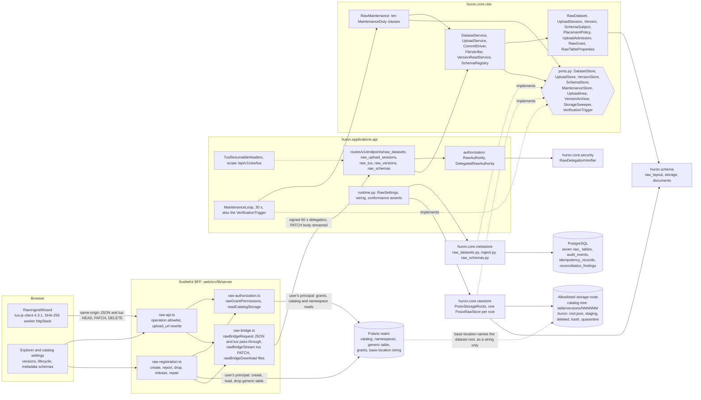

The Raw API holds no Polaris credential and never calls Polaris (OD-5). The BFF performs every Polaris read and
mutation with the signed-in user's own principal and is the only browser-facing hop. The API trusts Polaris
facts only as signed claims in the delegation: `target`, `permissions` and `catalog_storage` (D-10, D-33).

### 6.2 Who owns what: Huron storage and Polaris namespaces

| Concern | Owner | Mechanism | Never |
|---|---|---|---|
| Catalog, namespace and table name | Polaris | the generic-table identity under the realm root | Huron never creates, renames or lists Polaris namespaces; on disk it only creates the missing directories on the path to a dataset root (D-18) |
| Who may read, write, create, manage, drop or publish schemas | Polaris grants, evaluated by the BFF | privileges mapped to the six `RawPermission`s and signed into the delegation (D-34) | Huron RBAC for Raw (D-8) |
| The table's existence | the BFF, under the user's principal | create at dataset creation; drop after delete (D-52, D-53) | the Raw API or a server janitor calling Polaris (OD-5) |
| The `base-location` string | Huron derives it, the BFF sends it, Polaris stores it verbatim | `PlacementPolicy.derive` (D-12); the stored `create_request` (D-50) | Polaris validating, reading or deleting it (verified in the fork; C3) |
| Catalog storage settings: `default-base-location`, `allowedLocations`, storage type | the Polaris catalog (admin-editable) | read by the BFF, signed as `catalog_storage`, validated by Huron (D-10, D-13) | trusted alone as filesystem authority (D-11) |
| Which local paths Huron may write | the operator | the `HURON_RAW__STORAGE_ROOTS` allowlist with a sentinel per root (D-11, D-17) | catalog-controlled |
| Version directories under `<base-location>versions/` | Huron (`rawstore`) | sealed directories created only by exclusive rename (D-23, D-39); moved only after their `version.json` names the dataset (D-168, D-178) | Polaris or foreign writers; foreign content at a version's number is quarantined by publication when positively foreign (D-166) |
| Anything else inside a dataset root, such as a nested namespace's tables, including entries in `versions/` that are not this dataset's versions | foreign | not moved by any Raw code path (D-14); a park leaves them in place and reports those inside `versions/` (D-178) | moved, scanned or cleaned |
| Scratch, parked, trash, quarantine, sentinel | Huron | `<storage root>/.huron/`; no dataset may live under it (`reserved_path`, D-13) | inside a catalog location |
| Lifecycle, sessions, version records, schemas, root identities | Huron PostgreSQL | eight `raw_*` tables (D-67, D-172) | Polaris properties, which are immutable (OD-1) |
| Per-version facts: number, location, digests, schema | `version.json` plus `raw_versions` | sealed document and write-once columns (D-69) | table properties (OD-1) |

A Polaris namespace is one directory level of the catalog tree. Namespace `ocean` in catalog `science` is the
directory `<science default-base-location>/ocean/`; a nested namespace `ocean.daily` would be `…/ocean/daily/`.
A Raw dataset, an Iceberg table and an Icechunk repository in one namespace are sibling directories. A namespace
whose `location` differs from that default is refused at Raw dataset creation (`namespace_location_mismatch`,
D-13), so Raw roots never diverge from where Polaris itself would place tables.

### 6.3 End to end: where Polaris is involved and where it is not

Polaris is mutated only by the BFF, and only when a dataset is created, deleted, or has its registration repaired.
For every JSON request that carries a target (session start, commit, reads, lifecycle), the BFF first re-checks the
user's Polaris grants. tus chunk traffic is authorized by session ownership and never touches Polaris. The API
never calls Polaris at all.

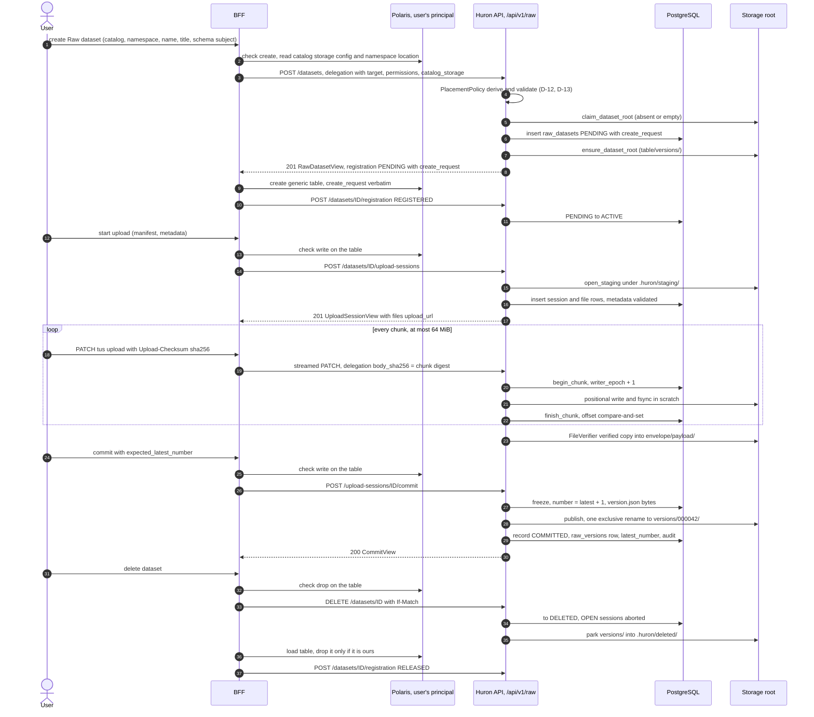

### 6.4 Package placement against the AGENTS.md graph

| Package | Raw content in the target | May import (pyproject contracts) | Must not import |
|---|---|---|---|
| `huron.schema` | `raw_layout.py` (new, D-15); `storage.py` (evolved: `DatasetPlacement`, `ChunkDigests`, `MaterializedFile`, `FileEvidence`, `PublishOutcome`, `PublishResult`, `StoredObject` and the four storage errors, D-20; then `ParkReport`, `RootIdentity` and `VersionIdentityError`, D-168, D-172, D-178); `documents/raw-version-v1.json`, `raw-metadata-v1.json`, `raw-table-properties-v2.json`, `raw-root-v1.json` | stdlib, `jsonschema` | any `huron.core` package (the layers contract `applications → core → schema`) |
| `huron.core.foundation` | `DomainError.retry_after` (D-61) | nothing from Huron | every Huron package |
| `huron.core.security` | `raw_delegation.py`: the `permissions`, `target`, `catalog_storage` and PATCH-binding claims (D-10, D-33) | `foundation` | `raw`, `catalog`, `schema`, the adapters |
| `huron.core.raw` | `datasets.py`, `ingest.py` (re-created under its name, D-137), `versions.py`, `schemas.py`, `locations.py`, `grants.py`, `properties.py`, `manifest.py`, `admission.py`, `maintenance.py`, `ports.py` (evolved), `runtime.py` (evolved); `_impl/{datasets,ingestion,ingest,verifier,versions,version_reader,schemas}.py` | `foundation`, `schema`, `anyio`, `asyncer`, `jsonschema`, `re2` (google-re2, `schemas.py` only, D-161). The edges to `catalog` and `security` stay declared but unused (D-5, D-77). | `metastore`, `rawstore`, `fastapi`, `starlette`, `asyncpg`, `httpx` |
| `huron.core.metastore` | `raw_datasets.py` (new: `DatasetStore`, `MaintenanceStore`, the claim primitive); `ingest.py` (re-created under its name after the legacy-removal task, D-137: `UploadStore`, `VersionStore`); `raw_schemas.py` (new: `SchemaStore`); shared helpers in `rows.py` | `raw`, `catalog`, `security`, `foundation`, `asyncpg` | `huron.schema`, `rawstore` |
| `huron.core.rawstore` | `store.py` (evolved `PosixRawStore`, one per root); `roots.py` (new `PosixStorageRoots`); `materialize.py`, `commit.py`, `inspection.py` (`digests=False`), `completion.py` (reservation only) | `huron.schema` only | every `huron.core` package, including `foundation` |
| `huron.applications.api` | `routes/v1/endpoints/raw_*.py` and `routes/v1/schema/raw_*.py`; `authorization/raw.py`; `maintenance.py` (new, succeeding `expiry.py`, D-141); `TusPatchHeaders`, `ChunkHeaders`, `TusResumableHeaders`; `RawSettings`; `runtime.py` wiring; `streams.py` (`idle_timeout`, `read_capped`, D-156); `downloads.py` (`DescriptorResponse`, D-158) | core, schema, adapters (for composition only) | another application; none remains after OD-3 |
| Deleted | `huron.core.integrity`, `huron.applications.lakectl`, `metastore/{legacy,maintenance,raw_web}.py`, `rawstore/maintenance.py`, `raw/{web,web_ports,paths,metadata,amendments}.py`, `raw/_impl/releases.py`, `raw/_impl/revisions.py` and `raw/_impl/reader.py` (succeeded by the new `_impl/versions.py` and `_impl/version_reader.py`), `catalog/external.py`, `api/raw_web.py`, `api/routes/raw_web.py`, `api/expiry.py` (succeeded by the new `api/maintenance.py`), `routes/v1/{endpoints,schema}/{ingest_sessions,revisions}.py`. Also deleted whole and re-created under the same names in slice 4: `raw/ingest.py`, `raw/_impl/ingest.py`, `raw/_impl/ingestion.py`, `metastore/ingest.py` (D-137, D-141) | — | — |

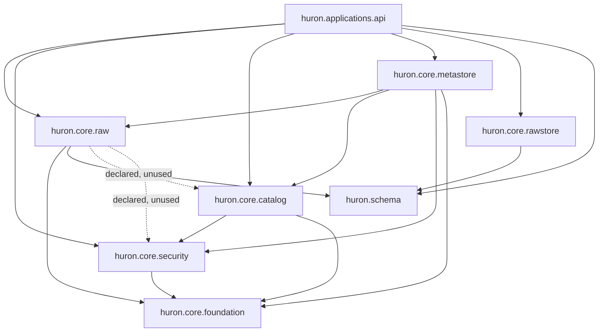

OD-3 removes `huron.core.integrity`, together with its edges to `catalog`, `raw`, `foundation` and `schema`, and
`huron.applications.lakectl`. No other edge changes.

### 6.5 Composition rules the graph and the gates force

1. **Two credential classes under one `/api/v1` prefix.** Today `routes/v1/__init__.py:30-34` puts
   `Depends(current_principal)` on the `/api/v1` router itself. Every Raw route would inherit it, and a
   delegation-only request would fail with 401. The router splits into two children of a dependency-free
   `/api/v1` router. Authentication is still declared once per class (OD-7, D-35, D-72):

   ```python
   principal_routes = APIRouter(dependencies=[Depends(current_principal)], responses=AUTHENTICATED_ERRORS)
   principal_routes.include_router(organizations.router)  # … the existing includes, minus ingest_sessions/revisions
   raw_routes = APIRouter(prefix="/raw", dependencies=[Depends(raw_grant)], responses=RAW_ERRORS)
   raw_routes.include_router(raw_datasets.router)         # each module's router declares its own tag
   raw_routes.include_router(raw_upload_sessions.dataset_sessions)
   raw_routes.include_router(raw_upload_sessions.router)
   raw_routes.include_router(raw_upload_sessions.limits)
   raw_routes.include_router(raw_tus.router)
   raw_routes.include_router(raw_versions.router)
   raw_routes.include_router(raw_schemas.router)
   router = APIRouter(prefix="/api/v1")
   router.include_router(principal_routes)
   router.include_router(raw_routes)
   ```

   `applications/api/authorization/__init__.py` exports `raw_grant`, `RawGrantDep`, `raw_body` (D-156),
   `RawAuthority` and `DelegatedRawAuthority`. The contract "the authorization package is entered through its public surface" has
   `routes.**` and `app` as its source modules, so neither the routes nor `app.py`, whose `_build_runtime` builds
   the authority (§12.10), may import `authorization.raw` directly. `runtime.py` names `RawAuthority` only under
   `TYPE_CHECKING`, because `authorization/credentials.py` imports `..runtime` at module level and a runtime
   import in the other direction would be a cycle (D-145). The
   existing router-composition tests keep holding for `principal_routes`. `RAW_ERRORS` is §19.1's error set
   (`UNIVERSAL_ERRORS` plus `401`, `403` and `404`), and §19.1 is the full composition (D-126).
2. **Authorization rules stay in core.** `DelegatedRawAuthority` verifies the token (`RawDelegationVerifier`) and
   translates it into a `RawGrant` with `actor`, `target`, `endpoint`, `permissions`, `catalog_storage` and
   `body_sha256`. The core services enforce permission, target, ownership and the D-7 realm binding: the
   realm's pinned endpoint comes through `DatasetStore` (a join, or the create transaction's insert-or-read) and
   is compared by `RawGrant`. The later SDK authority then inherits every rule unchanged.
3. **`huron.schema` imports no `huron.core`.** `raw_layout` renders `<… hex>` path names with `uuid.UUID.hex`,
   which equals `foundation.identifiers.id_for_path`.
4. **`rawstore` imports only `huron.schema`.** It never composes a document or reads PostgreSQL.
   - Control documents and the root sentinel arrive as exact bytes composed in `core/raw` with
     `foundation.canonical`, as `store.py` already receives "the canonical bytes of the document".
   - `PosixStorageRoots.open(...)` receives the set of root keys that PostgreSQL references (`MaintenanceStore`)
     from the API wiring, then decides "create the sentinel" or "UNAVAILABLE" (D-17).
5. **`metastore` never imports `huron.schema`.** It builds `RawDataset` and `Version` from `huron.core.raw`'s
   public modules. `huron.core.raw.locations` re-exports `DatasetPlacement`, and the other `huron.schema.storage`
   values an adapter needs, so the import stays indirect (that contract sets `allow_indirect_imports = true`).
6. **HTTP shapes stay in applications.** `ChunkHeaders`, `TusPatchHeaders` and `TusResumableHeaders` live there.
   Only the API's `DescriptorResponse` (route 24) consumes `StoredObject.fd`, and it closes it (D-158). Core raises `DomainError`s, and their
   `retry_after` becomes `Retry-After` in `problems.py`.
7. **Import-linter edits come only from OD-3 (D-70 row 1):**
   - drop `integrity` from the exhaustive layers list;
   - delete the integrity-owned forbidden contracts, and every `huron.core.integrity` entry in the other
     contracts;
   - delete the `Applications are independent` contract, since only `api` remains;
   - update the OWNERS tuple in `tests/unit/test_domain_import_contracts.py`.

   The AGENTS.md package list and dependency table drop `integrity`, and its `raw/` description loses
   "revision … releases" (§4 row 20).
8. **Complexity and duplication budgets shape the units (D-84).**
   - Protocol handlers are compositions of steps with cyclomatic complexity ≤ 10 (D-28).
   - Each state machine is a transition table, not branches.
   - SQL lives only in the adapters, and shared row helpers go in `metastore/rows.py`.
   - Clone-group files are evolved in place under their existing names (D-1).

### 6.6 Runtime composition (API lifespan)

1. `RawSettings` (`ApiSettings.raw`, `HURON_RAW__*`) validates the storage roots, `PUBLIC_API_URL` and the limits.
   The Raw routes are enabled only when `HURON_RAW_BRIDGE_SECRET` is set.
2. The asyncpg pool comes up, and the metastore adapters of `DatasetStore`, `UploadStore` (which also fills
   `OffsetLedger`), `VersionStore`, `SchemaStore` and `MaintenanceStore` are built on it.
3. `UploadAdmission(streams=PROCESS_STREAMS, verifiers=PROCESS_VERIFIERS)` is built, one per process.
4. `PosixStorageRoots.open(...)` runs with the referenced root keys, the root identities recorded in
   `raw_storage_roots` (`MaintenanceStore.storage_roots()`) and candidate sentinel bytes, each with a
   fresh `root_id` (D-172). Each root is AVAILABLE or UNAVAILABLE; `/readyz` fails while a referenced
   root is UNAVAILABLE. The wiring then records every identity that `open` wrote or adopted for an
   unrecorded key with `MaintenanceStore.record_root`; a recorded `root_id` that differs from the one
   `open` read makes that root UNAVAILABLE (`sentinel_mismatch`).
5. `PlacementPolicy(roots)` is built over the configured `StorageRoot` values.
6. `MaintenanceLoop` is constructed and placed in `RawPorts.trigger` as the `VerificationTrigger` (D-114).
7. `RawRuntime(ports, placement=policy, admission=…, limits=…, public_api_url=…, clock=…)` (§8.6.8) composes
   `DatasetService`, `UploadService`,
   `CommitDriver`, `FileVerifier`, `VersionReadService`, `SchemaRegistry` and `RawMaintenance`. It replaces the
   old `RawRuntime` in `ApiRuntime.raw`; `ApiRuntime.raw_web` and `ApiStores.raw_web` are removed, and
   `ApiRuntime` gains `raw_roots` (the `PosixStorageRoots`) and `raw_authority` (D-101). `ApiRuntime.raw_store`
   is not removed: Catalog's collections (`dependencies.py`) and the `/readyz` check use it, so it is renamed
   `catalog_store` and keeps Catalog's store (step 10), in the task that renames that check to `data_root`
   (§19.7, D-144).
8. Conformance is asserted at wiring: each adapter satisfies every port it fills.
9. After the conformance asserts, `loop.running(runtime.raw.maintenance)` starts the loop, which runs a pass
   immediately, then every 30 s (§18.3).
10. Catalog keeps its own `PosixRawStore` at `HURON_DATA_ROOT` for generation documents only, as
    `ApiRuntime.catalog_store` (D-144).

## 7. Vocabulary

### 7.1 CONTEXT.md after this change

This is the complete target text, the D-4 edits and D-148's **Locator release** entry applied. The owner's **Organization**, **Polaris realm** and
**Catalog** entries and their two relationship lines are copied byte-for-byte from the working tree. The two
existing flagged ambiguities are kept, as are the headings and the developer's line in the example dialogue.
Everything else changes or is new.

````markdown
# Huron

Huron preserves scientific submissions as immutable versions within datasets.

## Language

**Version**: An immutable, independently stored, complete copy of one submission's declared files and version metadata, numbered consecutively from 1 within its dataset.

**Verified payload**: A version file materialized independently from upload files and verified against its declared size and digest before publication.

**Publication**: The transition that makes a completed version authoritative and readable.

**Organization**: A Huron membership and administration root bound immutably to one configured Polaris realm. Each realm belongs to at most one organization in a deployment. Huron login is shared, while Polaris credentials and grants remain realm-scoped.

**Polaris realm**: The native upstream isolation boundary, containing one root and its catalogs, principals, roles and grants. Huron binds provisioned realms; the Polaris admin tool provisions them.

**Catalog**: A native Polaris catalog under an organization’s realm root, typically grouping a program or scientific data domain. Raw, Iceberg and Icechunk identify dataset formats within catalog namespaces. Catalog names need only be unique inside their realm.

**Raw dataset**: A dataset bound for life to one Polaris generic table (its realm, catalog, namespace and name) and to one dataset root. It has a lifecycle state and a linear series of versions.

**Dataset root**: A Raw dataset's directory: its catalog's default base location, then its namespace levels and table name. It is the table's Polaris base location and holds one directory per version.

**Storage root**: An operator-allowlisted storage location under which Huron may write Raw bytes.

**Dataset lifecycle**: PENDING until its Polaris table is registered, then ACTIVE; ARCHIVED blocks new versions and is reversible; DELETED is irreversible, moves the bytes out of the catalog location at once and purges them after the retention period.

**Locator release**: The step that ends a deleted Raw dataset's hold on its Polaris table name and location, once its table is reported dropped, absent or not Huron's; a new Raw dataset may then use the name. It has nothing to do with release tags, which Raw does not have.

**Upload session**: One attempt to create one version: the declared files with their sizes and digests, the version metadata checked against a pinned schema version, one tus upload per file, and an expiry.

**tus upload**: One declared file's resumable byte stream within an upload session, created by Huron when the session starts.

**Schema subject**: A named, linear series of immutable JSON Schema documents that version metadata follows; it belongs to the platform or to one catalog.

**Schema version**: One immutable member of a schema subject, numbered consecutively from 1 within that subject.

**Property standard**: The numbered, fixed set of `huron.*` properties written once on a Raw dataset's Polaris table; it locates the dataset root, the versions and the schema subject.

**Purge**: The physical removal of a deleted dataset's or version's bytes after the retention period; the records remain.

## Relationships

- An **Organization** binds one **Polaris realm**, whose root owns its **Catalogs**.
- Organization membership permits selecting the root; native Polaris grants determine catalog and dataset access.

- A **Raw dataset** has many **Versions**.
- Each **Version** contains its own **Verified payload**, without carrying forward files from earlier versions.
- An **Upload session** becomes at most one **Version**.
- Each **Version** records the exact **Schema version** its metadata was validated against.
- An ACTIVE or ARCHIVED **Raw dataset** has exactly one Polaris generic table; a PENDING one is waiting for its table to be registered.
- A **Raw dataset**'s root lies under exactly one **Storage root**, next to its catalog's other tables.

## Example dialogue

> **Scientist:** Can an upload still in progress change my published version?
> **Developer:** No. Publication uses independently materialized, verified payload files.

## Flagged ambiguities

- Register-in-place avoids a second upload; it does not promise to avoid a verified storage copy.
- Verified payload isolation is agreed design; its completion path is implemented and independently verified (M1a, 2026-09-11).
- Archive is reversible; delete is not; bytes are purged after the retention period.
````

### 7.2 The `version` collision, resolved

Before this change, "version" meant Catalog's compare-and-swap counter (`Dataset.version`, `DatasetView.version`,
`If-Match`). "Raw revision" meant a stored submission. Raw now takes "version" for the submission, so every other
meaning gets its own spelling (D-2, D-3):

| Meaning | Canonical spelling | Where it appears | Never spelled |
|---|---|---|---|
| A Raw dataset's immutable full copy | **Version**: `Version`, `raw_versions`, `version_id` (UUIDv7), `VersionView`, `version.json` | core, SQL, wire, storage | "revision" |
| A version's position in its dataset | `number` (1..999999); `latest_number`, `expected_latest_number`; path segment `NNNNNN` via `version_location(number)` → `versions/000042/` | everywhere | bare `version`, `version_number`, `revision_number` |
| Raw dataset optimistic concurrency | `raw_datasets.etag` → `ETag: "<etag>"`, `If-Match`; `RawDatasetView.etag` | SQL, HTTP | any column or member named `version` |
| Catalog dataset optimistic concurrency | `Dataset.version` (`src/huron/core/catalog/types.py:134`), `DatasetView.version` (`routes/v1/schema/datasets.py:83`) | Catalog only; untouched | renamed by this plan |
| A schema document's position | `SchemaVersion`, `raw_schema_versions.number` (per subject) and `.id` (global); `StartUploadSession.schema_version` (a number); `schema_version_id`; `schema_ref.number` | registry, sessions, `version.json` | "revision" or semver |
| The property standard | `huron.raw.standard` = `"2"` | Polaris properties | "version" |
| The version model | `huron.raw.version.model` = `full-copy-linear` | Polaris properties | — |
| A document contract | the URN suffix: `urn:huron:raw-version:1`, `urn:huron:manifest:1`, `urn:huron:raw-root:1` | packaged schemas | — |
| The transfer protocol | `Tus-Resumable` / `Tus-Version: 1.0.0` | tus headers | — |

Rules:
- No Raw column, JSON member, Python attribute or parameter is named bare `version`.
- Compounds that carry the noun are allowed: `version_id`, `version_document`, `VersionView`, `schema_version`,
  `schema_version_id` and `huron.raw.version.*`.
- Catalog's `version` keeps its meaning and its field name. A Raw view never exposes it (D-3).

### 7.3 Retired terms and the closing gate

These terms are retired for Raw in code, wire, SQL and documents (D-2, D-70):
- revision, revision index, release in the sense of a release tag, and tag in the sense of a release (the
  metadata keyword list `tags` stays). Two other senses of "release" are not retired (D-148). **Locator release**
  (§7.1) frees a deleted dataset's name and keeps its canonical names: `RELEASED`, `released_at`,
  `TARGET_RELEASING`, `RawDataset.release()`, `release_dataset` and `raw.dataset.released`. Releasing a lease, a
  semaphore token or a claim (`release_chunk`, D-106) is ordinary usage. User-facing text says "unregistered",
  never "released";
- part, `part_bytes`, `completed_parts`;
- entry layer, and layer as a Raw concept;
- removal intent, pending removal;
- RECOVERING, VERIFYING, PREPARING, UPLOADING;
- ingest session as a wire term;
- data root, for Raw.

The last implementation task runs this command, and it must print nothing, comments and docstrings included (D-1):

```sh
rg -n -i "revision" src/huron/core/raw src/huron/core/rawstore src/huron/applications/api/routes/v1 src/huron/schema/raw_layout.py
```

The `routes/v1` operand also covers Catalog's files. Their one hit at HEAD is the comment on Catalog's
`CreateDataset.entry_layer` in `routes/v1/schema/datasets.py` ("so no raw revision will ever exist"), which row 2a
rewords to "so its raw layer never receives data" (D-152); no other Catalog line names a revision.

Files in baseline clone groups keep their names, because a renamed file in a clone group fails
`scripts/check_duplication.py`. Those files are `core/raw/_impl/ingest.py`, `core/raw/_impl/ingestion.py`,
`core/raw/ports.py`, `core/metastore/ingest.py`, `core/rawstore/store.py` and `core/rawstore/materialize.py`,
checked against `scripts/duplication_baseline.json` (total 144, 48 groups). Three of them hold only legacy
content and are deleted whole by slice 4's legacy-removal task, then re-created under the same names (D-137).
A deletion or rename that still changes a group's signature is accepted only through §22.5's review (D-142).

### 7.4 Rename map

| Today | Target | Decision |
|---|---|---|
| `RevisionRecord` (`core/raw/types.py:44`) | `Version` aggregate (`core/raw/versions.py`) | D-1, D-75 |
| `revision_number`, `revision_id` | `number`, `version_id` | D-1 |
| `RevisionReadService` (`core/raw/_impl/revisions.py:20`) | `VersionReadService` (`_impl/versions.py`) | D-1, D-76 |
| `RevisionService` module (`core/raw/_impl/reader.py:35`) | `_impl/version_reader.py`, with the class renamed to pass the closing gate | D-1 |
| `IngestSession` (`core/raw/ingest.py:243`) | `UploadSession`, with entity `UploadFile`, in the same file | D-75 |
| `RawIngestionService` (`core/raw/_impl/ingestion.py:29`) | `UploadService`, same file | D-76 |
| `IngestService` (`core/raw/_impl/ingest.py:114`) | its commit path becomes `CommitDriver` in the same file; `complete_file` becomes `FileVerifier` (`_impl/verifier.py`); the rest is deleted | D-76 |
| `RawWebOperations` (`core/raw/web.py`) | its dataset half becomes `DatasetService` (`_impl/datasets.py`); the module is deleted | D-76, D-70 |
| `expire_lapsed` (`core/raw/runtime.py:61`) | the `ExpireSessions` duty of `RawMaintenance` | D-63, D-76 |
| `ExpirySweep` (`applications/api/expiry.py:23`) | `MaintenanceLoop` (`applications/api/maintenance.py`) | D-63 |
| `CompletionAdmission.slot()` (`core/rawstore/completion.py:15`) | `UploadAdmission` (`core/raw/admission.py`); `reserve` stays | D-24, D-61 |
| `RawStore` port (`core/raw/ports.py:306`) | `UploadArea`, `VersionArchive`, `StorageSweeper` | D-20 |
| `write_part`, `finish_file` | `UploadArea.write_chunk`, `UploadArea.materialize` | D-20, D-22 |
| `PartLengthMismatchError` (`src/huron/schema/storage.py:4`) | `ChunkLengthMismatchError` | D-20 |
| `core/raw/paths.py` | `huron.schema.raw_layout` | D-15 |
| `COMMITTED` marker, `INDEX.json`, `metadata-v1.json` | `version.json` (`urn:huron:raw-version:1`); none; `raw-metadata-v1.json` | D-56, D-69 |
| `CONTRACT_MISMATCH` (Raw), `EMPTY_REVISION`, `REVISION_TOO_LARGE` | `METADATA_INVALID`, `EMPTY_VERSION`, `VERSION_TOO_LARGE` | D-57, D-73 |
| `/api/v1/…/ingest-sessions…`, `/api/v1/transfer/uploads/…`, `/api/v1/…/revisions…`, `/api/raw-web/…` | `/api/v1/raw/datasets…` (versions at `/datasets/{dataset_id}/versions…`), `/api/v1/raw/upload-sessions…`, `/api/v1/raw/tus…`, `/api/v1/raw/schemas…`, `/api/v1/raw/limits` | D-72 |

### 7.5 Model-name collisions outside `version`

FastAPI names OpenAPI components after Pydantic class names. Probed with the locked FastAPI 0.141.1 and Pydantic
2.13.4: when two models share a class name, both components become module-qualified, for example
`huron__applications__api__routes__v1__schema__datasets__DatasetView`.

`tests/unit/test_api_router_composition.py::test_hierarchy_keeps_named_patch_and_response_schemas` pins
`#/components/schemas/DatasetView` for Catalog's datasets. Raw routes are mounted unconditionally, so Raw's models
always enter the same document.

| Register name (D-52, D-72) | Collides with | Raw class name | Wire shape |
|---|---|---|---|
| `DatasetView` | `routes/v1/schema/datasets.py:63` (Catalog) | `RawDatasetView` | unchanged |
| `CreateDataset` | `routes/v1/schema/datasets.py:15` (Catalog) | `CreateRawDataset` | unchanged |
| `ManifestFile` | `routes/v1/schema/ingest_sessions.py:23` (deleted, D-70 row 2) | `ManifestFile`, landing only after the legacy module is deleted (slice 4's legacy-removal task, D-137) | unchanged |
| `CommitView` | `routes/raw_web.py:62` (deleted, D-70 row 2) | `CommitView`, landing only after `routes/raw_web.py` is deleted (the same task) | unchanged |

Any other new Raw model must not reuse a class name that is live in the app when the model lands.

## 8. Domain model

This section is the type-level contract of `core/raw` and of the ports its adapters fill. The
wire formats are in §11 (tus) and §12 (bridge), the flows in §13, the state machines in §14, the
property standard in §15 and the registry rules in §16. Where those sections already fix a
signature, this section repeats it only as a pointer.

### 8.1 Shape and rules

- **Aggregates are frozen dataclasses.** Every decision is a method that returns a value (a
  target state, a command, a new value) or raises a `DomainError`. Persistence, clocks and I/O
  belong to services and adapters, as in today's `IngestSession`.
- **Every state machine is an enum plus a transition table** (`DATASET_TRANSITIONS`,
  `UPLOAD_SESSION_TRANSITIONS`, `UPLOAD_FILE_TRANSITIONS`, §14), not the State pattern. The
  matching trigger (D-68) is the database backstop.
- **Services take a `RawGrant`, never a token** (D-35). One service instance per process serves
  every request. There are no actor-bound facades, so nothing only forwards (D-78).
- **Decision timestamps come from PostgreSQL.** Leases, expiries, graces and retention use
  `now()`, written by the adapter's SQL. Core compares against `RawTransaction.now()` only when a
  rule needs the instant (the freeze expiry check). Record timestamps (`created_at`,
  `state_changed_at`, `committed_at`) come from the injected `Clock` (D-63).
- **SQL lives only in `core/metastore`, paths only in `huron.schema.raw_layout` and
  `core/rawstore`** (D-78). Core never builds a filesystem path.
- **Ports are consumer-owned Protocols in `core/raw/ports.py`.** Each is used by one service
  family and declares at most 8 methods. Persistence and storage ports have two adapters
  (PostgreSQL or POSIX for production, in-memory or a temporary root for tests), so each is a
  real seam.
- **Every function stays at cyclomatic complexity ≤ 10 and cognitive complexity ≤ 15.** Every
  module stays at radon grade A. Rules are table lookups or small guard methods, and services
  compose guards in the order §13 lists (§8.10).

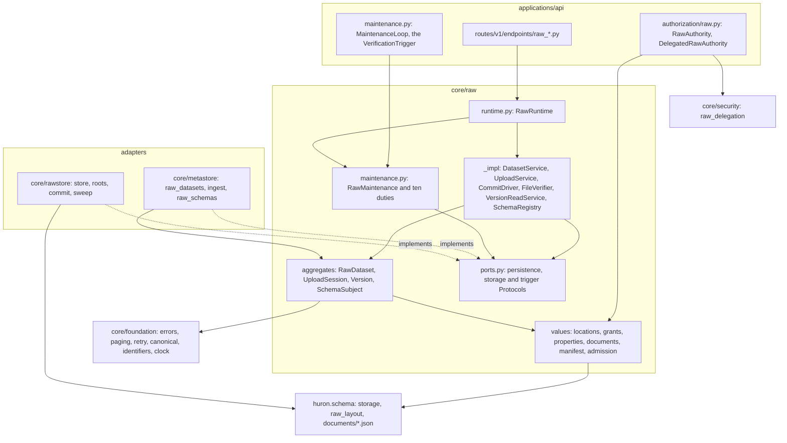

### 8.2 Package placement

`core/raw` keeps its public surface in its top-level modules and its workflows in `_impl/`, which
import-linter protects ("raw implementations are private to their owner"). "Evolved" means the
file keeps its name and is rewritten by the task that replaces its behaviour (D-1, D-81). "Re-created" means
the file holds only legacy content today: slice 4's legacy-removal task deletes it whole (the orchestrator's
`git rm`, never an emptied or stubbed file), and a later slice-4 task writes the new content under the same
name (D-137). "New, succeeding" means a fresh file under a new name whose predecessor that task deletes (D-141).

| Module | Contents | Status |
|---|---|---|
| `core/raw/locations.py` | `PolarisName`, `DatasetLocator`, `StorageLocation`, `CatalogStorage`, `StorageRoot`, `PlacementPolicy`, `PlacementCheck`; re-exports `DatasetPlacement`, `FileEvidence`, `StoredObject` from `huron.schema.storage` for `metastore` (§6.5 rule 5) | new |
| `core/raw/grants.py` | `RawPermission`, `CatalogRef`, `RawGrant` | new |
| `core/raw/datasets.py` | `DatasetState`, `RegistrationState`, `RegistrationOutcome`, `DATASET_TRANSITIONS`, `DatasetDraft`, `DatasetQuery`, `RawDataset` | new |
| `core/raw/ingest.py` | `UploadSessionState`, `SessionEndReason`, `UploadFileState`, `FileResetReason`, both transition tables, `UploadFile`, `FrozenCommit`, `UploadSession`, `NewUploadSession`, `SessionRequest`, `SessionQuery`, `CommitStage`, `CommitIntent`, `FileProgress`, `ChunkClaim`, `Verification` | re-created (keeps its name; D-137) |
| `core/raw/versions.py` | `VersionState`, `VersionQuery`, `Version` | new |
| `core/raw/schemas.py` | `SchemaScope`, `SchemaVersionState`, `SchemaDocument`, `SubjectDraft`, `SchemaSubject`, `SchemaVersion` | new |
| `core/raw/manifest.py` | `ManifestEntry`, `Manifest`, `validate_manifest`, `validate_manifest_path`, plus `manifest_bytes`, `decode_manifest` and `EMPTY_SHA256` moved from `documents.py` (D-69) | evolved |
| `core/raw/documents.py` | `VersionDocument` (`version.json`), `root_sentinel()` (`.huron/root.json` bytes) | evolved; `MetadataDocument`, `CommitRecord`, `RevisionIndex`, `IndexEntry`, `revision_from_storage` and `CommitIntent` leave it |
| `core/raw/properties.py` | `RawTableProperties` (§15.2) | new |
| `core/raw/admission.py` | `UploadAdmission` (D-61), `RawLimits` | new |
| `core/raw/errors.py` | the Raw `DomainError` classes of §8.8 and `ERROR_CODES` | evolved |
| `core/raw/types.py` | `AuditEvent` (kept), `WorkKind`, `WorkItem`, `PlacementInventory`, `FindingCode`, `Finding`, `DutyReport`, `CommitResult` | evolved; `RevisionRef`, `RevisionRecord`, `OutboxEvent`, `Release`, `LedgerEntry`, `ExpiryReport`, `PayloadFile`, `SessionLedger` deleted |
| `core/raw/retry.py` | `raw_claim(operation, principal, key, *parts)`, the one fingerprint helper for the four creating POSTs | evolved |
| `core/raw/ports.py` | §8.7 | evolved (clone group; keeps its name) |
| `core/raw/maintenance.py` | `MaintenanceDuty`, `RawMaintenance` and the ten duty classes (D-64) | new |
| `core/raw/runtime.py` | `RawRuntime` | evolved |
| `core/raw/_impl/datasets.py` | `DatasetService` | new |
| `core/raw/_impl/ingestion.py` | `UploadService` | re-created (clone group; keeps its name): `RawIngestionService` leaves with the file in the legacy-removal task (D-137) |
| `core/raw/_impl/ingest.py` | `CommitDriver` | re-created (clone group; keeps its name): `IngestService` leaves with the file in the legacy-removal task, and the commit task writes `CommitDriver` after its commit path (D-137) |
| `core/raw/_impl/verifier.py` | `FileVerifier` | new |
| `core/raw/_impl/versions.py` | `VersionReadService` | new, succeeding `_impl/revisions.py` (D-141) |
| `core/raw/_impl/version_reader.py` | `VersionFiles`: verified document reads and the manifest-entry cache | new, succeeding `_impl/reader.py` (D-141) |
| `core/raw/_impl/schemas.py` | `SchemaRegistry` | new |
| `core/raw/{paths,metadata,web,web_ports,amendments}.py`, `_impl/releases.py`, `_impl/revisions.py`, `_impl/reader.py` | — | deleted (D-15, D-57, D-70, D-141) |
| `core/foundation/errors.py` | `DomainError.retry_after` (D-61); `Forbidden` and `AuthError` move here from `core/security` | evolved |
| `core/foundation/paging.py` | `Window[ItemT]`, moved from `core/catalog/types.py` | new |
| `core/foundation/retry.py` | `Replay.kind` gains `raw_dataset`, `upload_session`, `schema_subject`, `schema_version`; loses `release`, `ingest_session`, `ingest_commit` and `revision` with their writers | evolved |
| `huron/schema/storage.py` | §9.8.1 | evolved |
| `huron/schema/raw_layout.py` | §9.8.2 | new |

Three moves keep `core/raw` free of `catalog` and `security` imports (D-77) without duplicating
error codes or types. The moving task updates every importer in `src/` and `tests/` to the new module
and leaves no re-export behind, because the plan's clean-sweep rule forbids compatibility shims (D-146):
- `Forbidden` (403 `FORBIDDEN`) moves to `huron.core.foundation.errors`, and `FORBIDDEN` moves from
  `huron.core.security.errors.ERROR_CODES` to foundation's. Security's raisers (`_impl/access.py`,
  `_impl/identity.py`, `_impl/self_access.py`, `raw_delegation.py`), `authorization/guards.py` and
  the tests import it from foundation. Raw raises it for a PLATFORM-subject mutation (D-58) and for a
  missing permission.
- `AuthError` (401 `INVALID_CREDENTIAL`) moves to `huron.core.foundation.errors`.
  `huron.core.security.authentication_errors` keeps `ApiKeyExpired` and `ApiKeyRevoked`, which
  subclass it imported from foundation, and every other importer (`security`'s authenticators,
  `authorization/credentials.py`, `problems.py`, the tests) imports it from foundation.
  `RawGrant.require_body_digest` raises it (D-28 step 2).
- `Window` moves to `huron.core.foundation.paging`. `routes/v1/pagination.py`,
  `core/catalog/{ports,_impl/collections}.py`, `core/metastore/{hierarchy,queries}.py` and
  `test_api_pagination.py` and `test_stores_ports.py` import it from there, so
  `routes/v1/pagination.page()` renders Catalog and Raw windows alike.

The error-contract test walks the live class tree (`tests/unit/test_error_contract.py`), so each
code keeps exactly one declaring class. With a second `FORBIDDEN` class in `core/raw`,
`_class_name_by_code()` would keep only the last class it visits. The live-row check would then
depend on walk order.

### 8.3 Value objects

All are `@dataclass(frozen=True, slots=True)` unless shown as a class. A constructor that receives
a shape a caller should never produce raises `ValueError`, which is a bug and answers 500. A
user-reachable refusal raises the `DomainError` named in the comment.

#### 8.3.1 Names, locators and locations (`core/raw/locations.py`)

```python
_POLARIS_FORBIDDEN = frozenset('/\\:*?"<>|#+`')   # fork EntityNameValidator.FORBIDDEN_CHARS
_URI_UNSAFE = frozenset("%[]{}^")                 # Huron: the fork would join these unencoded

class PolarisName:                       # one namespace level or a table name
    value: str
    @classmethod
    def parse(cls, text: str) -> PolarisName: ...  # TargetNameUnsupported(context={"segment": text})

class DatasetLocator:                    # D-2; never holds the endpoint
    realm: str                           # 1..256 characters
    catalog: str                         # 1..256
    namespace: tuple[str, ...]           # 1..32 segments of 1..256
    name: str                            # 1..256
    @property
    def catalog_ref(self) -> CatalogRef: ...
    def segments(self) -> tuple[PolarisName, ...]: ...  # namespace levels, then the name

class StorageLocation:                   # a FILE storage URI, normalized as Polaris does
    uri: str
    @classmethod
    def parse(cls, text: str) -> StorageLocation: ...  # LocationInvalid (internal, see below)
    def join(self, *names: PolarisName) -> StorageLocation: ...
    def as_directory(self) -> StorageLocation: ...     # exactly one trailing "/"
    def contains(self, other: StorageLocation) -> bool: ...  # Polaris isChildOf (prefix test)
    def relative_to(self, parent: StorageLocation) -> str: ...  # root-relative POSIX path

class CatalogStorage:                    # the signed catalog_storage claim (D-10), unparsed
    storage_type: str                    # "FILE" | "S3" | "GCS" | "AZURE"
    default_base_location: str
    allowed_locations: tuple[str, ...]   # 1..64
    namespace_location: str | None

class StorageRoot:                       # one HURON_RAW__STORAGE_ROOTS entry, minus its mount path
    key: str                             # ^[a-z][a-z0-9-]{0,62}$
    uri: StorageLocation                 # slash-terminated

class PlacementPolicy:                   # D-78: a policy object injected with the roots
    def __init__(self, roots: Sequence[StorageRoot]) -> None: ...  # ValueError: duplicate key, equal or nested URIs
    @property
    def roots(self) -> tuple[StorageRoot, ...]: ...
    def derive(self, locator: DatasetLocator, storage: CatalogStorage | None) -> DatasetPlacement: ...

class PlacementCheck:                    # what the create transaction found under the placement lock
    holder: RawDataset | None            # the dataset holding the live locator (D-6)
    overlaps: tuple[str, ...]            # occupying storage_path values on the same root (D-13)
    def require_free(self) -> None: ...  # DatasetExists | TargetReleasing | StorageLocationRefused
```

- `PolarisName.parse` applies the fork's rules verbatim. It refuses an empty name, `.`, `..`, any
  ISO control character (`unicodedata.category(c) == "Cc"`, U+0000–U+001F and U+007F–U+009F, as
  `Character.isISOControl`) and the forbidden characters. It then applies Huron's URI rule: no
  whitespace anywhere (`str.isspace`) and none of `% [ ] { } ^`. This covers the fork's
  leading-or-trailing whitespace rule. Last comes Huron's file-name rule: at most 255 UTF-8 bytes,
  because each name becomes one directory name (§9.5).
- `StorageLocation.parse` follows `StorageLocation.of` in the fork. A leading `file:/+` becomes
  `file:///`, a leading `/+` becomes `file:///`, and any other scheme is refused. It then refuses
  `?`, `#`, `%`, `\`, an empty interior segment, a `.` or `..` segment, and text longer than 4096
  characters. A host (`file://host/x`) cannot survive normalization, because the fork reads it as
  the first path segment, and so does Huron. `LocationInvalid` is a private exception of the
  module that `derive` turns into `StorageLocationRefused(reason="invalid_location")`.
- `join` strips one trailing `/` from the base and appends `/`-separated raw names, never encoded
  (D-12). `contains` is the fork's `isChildOf`: both sides gain one trailing `/`, then a string
  prefix test.

`PlacementPolicy.derive` composes eight guard functions, each with cyclomatic complexity ≤ 4.
The first failure answers:

| # | Guard | Refusal (`422`) |
|---|---|---|
| 1 | every `locator.segments()` parses | `TARGET_NAME_UNSUPPORTED` (`context.segment`) |
| 2 | `storage is not None` | `STORAGE_LOCATION_REFUSED` `catalog_storage_missing` |
| 3 | `storage.storage_type == "FILE"` | `unsupported_storage_type` |
| 4 | `default_base_location`, every `allowed_locations` entry and `namespace_location` parse; the joined `base_location` is re-parsed the same way (≤ 4096 characters, `storage_path` ≤ 4096 UTF-8 bytes, §9.5) | `invalid_location` (`context.value`) |
| 5 | `namespace_location`, when present, equals `catalog_base.join(*namespace).as_directory()`; both sides are parsed and slash-terminated first | `namespace_location_mismatch` (`context.expected`, `context.actual`) |
| 6 | some allowed location `contains` the derived `base_location` | `outside_catalog_allowed_locations` |
| 7 | exactly one `StorageRoot.uri` `contains` it (roots never nest) | `outside_storage_roots` |
| 8 | `raw_layout.is_reserved(path)` is false | `reserved_path` |

The result is `DatasetPlacement(root=root.key, path=base.relative_to(root.uri),
base_location=base.uri)`, where `base = catalog_base.join(*segments).as_directory()`. The
remaining D-13 reasons need I/O: `overlaps_dataset` is decided in the create transaction
(`PlacementCheck`), and `cross_device` in `VersionArchive.claim_dataset_root` (§9.8.4).

#### 8.3.2 Authority (`core/raw/grants.py`)

```python
class RawPermission(StrEnum):
    READ = "read"; WRITE = "write"; CREATE = "create"; MANAGE = "manage"; DROP = "drop"; SCHEMA = "schema"

class CatalogRef:
    realm: str
    catalog: str

class RawGrant:                                    # D-35; built by a RawAuthority (§12)
    actor: str                                     # the delegation subject, "huron-web:<uuid>"
    target: DatasetLocator | CatalogRef | None     # None on target-less routes (D-33)
    endpoint: str | None                           # the delegated Polaris endpoint; None iff target is None
    permissions: frozenset[RawPermission]
    catalog_storage: CatalogStorage | None         # present only on dataset creation (D-10)
    body_sha256: str | None                        # None for a grant not bound to one body
    @property
    def catalog(self) -> CatalogRef | None: ...    # the target's realm and catalog, at either level
    def require(self, permission: RawPermission) -> None: ...            # Forbidden (403)
    def dataset_target(self) -> DatasetLocator: ...                      # AuthError (401) if not dataset-level
    def require_target(self, locator: DatasetLocator, *, endpoint: str) -> None: ...
    def require_catalog(self, catalog: CatalogRef, *, endpoint: str | None) -> None: ...
    def require_owner(self, created_by: str) -> None: ...                # ResourceNotFound (404)
    def require_body_digest(self, algorithm: str, digest: bytes) -> None: ...  # AuthError (401)
```

- `require_target` answers `404` when the target is not that locator (D-8). When the locator
  matches but `endpoint` (the realm's pinned endpoint, joined onto every `RawDataset`) differs, it
  answers `409 REALM_BINDING_CONFLICT` (D-7, §6.5 rule 2).
- `require_catalog` answers `404` when `self.catalog` differs, or when `endpoint is None`: an
  unbound realm accepts only the two calls that pin it, dataset creation and catalog subject
  creation, and neither calls `require_catalog`; each compares the endpoint in its own create
  transaction instead (D-7, D-150). It answers `409 REALM_BINDING_CONFLICT` on a different
  endpoint. PLATFORM-subject reads skip it (D-34).
- `require_body_digest` passes when `body_sha256 is None`. Otherwise it requires
  `algorithm == "sha256"` and `hmac.compare_digest(digest.hex(), body_sha256)`.

#### 8.3.3 Limits and admission (`core/raw/admission.py`)

```python
class RawLimits:                         # built once from RawSettings (HURON_RAW__*)
    chunk_bytes: int                     # CHUNK_BYTES, advertised per session
    max_file_bytes: int; max_files: int; max_version_bytes: int              # L7
    session_idle: timedelta; session_max: timedelta                          # D-30
    chunk_deadline: timedelta            # stream lease length (D-28 step 5)
    stream_watch: timedelta              # 5 s: the supersession watcher's period (D-155); not a setting
    principal_streams: int; principal_open_sessions: int                     # L4, L5
    storage_reserve_bytes: int                                               # L8
    verify_lease: timedelta; commit_lease: timedelta                         # D-22, D-40
    staging_grace: timedelta; deleted_retention: timedelta; session_row_retention: timedelta
    orphan_scan_interval: timedelta; maintenance_batch: int                  # D-64
    def check_open_sessions(self, count: int) -> None: ...   # TooManyOpenSessions (429)
    def check_streams(self, count: int) -> None: ...         # UploadStreamsExhausted (429)
    def check_free(self, free_bytes: int, total_bytes: int, *, outstanding: int = 0) -> None: ...
        # InsufficientStorage (507) unless free ≥ 2 × total + outstanding + reserve (D-24, D-162)

class UploadAdmission:                   # D-61; one per process, built in the lifespan
    def __init__(self, *, streams: int, verifiers: int) -> None: ...
    def stream(self) -> AbstractContextManager[None]: ...  # L1; UploadCapacityExhausted (503)
    def writer(self, tus_upload_id: UUID, epoch: int) -> AbstractContextManager[anyio.CancelScope]: ...
        # this process's stream of one tus upload; a newer epoch cancels the older scope (D-155)
    @property
    def write_threads(self) -> anyio.CapacityLimiter: ...  # L2, total_tokens = streams
    @property
    def verify_threads(self) -> anyio.CapacityLimiter: ... # L3, total_tokens = verifiers
    @property
    def read_threads(self) -> anyio.CapacityLimiter: ...   # L10, total_tokens = streams (D-158)
```

`ChunkPolicy`, `ChunkHeaders` and `TusPatchHeaders` are HTTP-shaped and live in the API (§11.1).
`BODY_IDLE_SECONDS`, `MAX_CHUNK_BYTES` and `MAINTENANCE_INTERVAL_SECONDS` are read only there.

### 8.4 Aggregates

Each aggregate mirrors its table (D-67). An adapter builds it from one row, plus the joined
facts named below, and never lets it outlive the request or the transaction that read it.

#### 8.4.1 `RawDataset` (`core/raw/datasets.py`)

```python
class DatasetState(StrEnum): PENDING = "PENDING"; ACTIVE = "ACTIVE"; ARCHIVED = "ARCHIVED"; DELETED = "DELETED"
class RegistrationState(StrEnum): PENDING = "PENDING"; REGISTERED = "REGISTERED"; RELEASED = "RELEASED"
class RegistrationOutcome(StrEnum): REGISTERED = "REGISTERED"; CONFLICT = "CONFLICT"; RELEASED = "RELEASED"

class DatasetDraft:                      # the create command; the locator comes from the grant
    title: str                           # 1..256
    description: str                     # ≤ 9000
    schema_subject_id: UUID | None       # None binds PLATFORM huron.raw.metadata

class DatasetQuery:                      # the creator's own list (§13.1): GET /datasets?state=
    state: DatasetState | None
    after: tuple[datetime, UUID] | None  # keyset (created_at DESC, id DESC)
    limit: int

class RawDataset:
    id: UUID
    locator: DatasetLocator
    endpoint: str                        # the realm's pinned endpoint, joined from raw_realm_bindings
    placement: DatasetPlacement          # (storage_root, storage_path, base_location)
    catalog_base_location: str
    title: str
    description: str
    schema_subject_id: UUID
    create_request: bytes                # JCS bytes of the standard-2 create request (D-50)
    state: DatasetState
    etag: int
    latest_number: int
    created_by: str
    created_at: datetime
    registered_at: datetime | None
    state_changed_by: str
    state_changed_at: datetime
    deleted_at: datetime | None
    purge_after: datetime | None
    parked_at: datetime | None
    purged_at: datetime | None
    released_at: datetime | None
    committing: bool                     # a COMMITTING session exists (lock_dataset's second statement, D-167)

    @classmethod
    def create(cls, *, dataset_id: UUID, locator: DatasetLocator, endpoint: str,
               placement: DatasetPlacement, catalog_base_location: str, draft: DatasetDraft,
               schema_subject_id: UUID, create_request: bytes, actor: str, at: datetime) -> RawDataset: ...
    @property
    def registration_state(self) -> RegistrationState: ...  # derived from registered_at, released_at
    @property
    def occupies_placement(self) -> bool: ...    # state != DELETED or parked_at is None (D-16)
    def require_etag(self, if_match: int) -> None: ...       # PreconditionFailed (412)
    def require_active(self) -> None: ...        # DatasetNotActive (409) | DatasetDeleted (410)
    def require_readable(self) -> None: ...      # DatasetDeleted (410)
    def register(self) -> DatasetState | None: ...
    def discard(self) -> None: ...
    def release(self) -> bool: ...
    def archive(self) -> DatasetState | None: ...
    def unarchive(self) -> DatasetState | None: ...
    def delete(self) -> DatasetState | None: ...
    def next_number(self) -> int: ...            # latest_number + 1; VersionLimitReached (409)
```

The decisions follow §14.1. Each returns the target state, or `None` for "unchanged, answer
`200`", and raises the gating error otherwise:

| Method | PENDING | ACTIVE | ARCHIVED | DELETED |
|---|---|---|---|---|
| `register()` | `ACTIVE` | `None` (repair, D-9) | `None` | `RegistrationStateConflict` |
| `discard()` | ok (`latest_number = 0` is implied by CHECK `raw_datasets_pending_empty`) | `RegistrationStateConflict` | `RegistrationStateConflict` | `RegistrationStateConflict` |
| `release()` | `RegistrationStateConflict` | `RegistrationStateConflict` | `RegistrationStateConflict` | `True` when `released_at` is null, else `False` |
| `archive()` | `DatasetNotActive` | `CommitInProgress` when `committing`, else `ARCHIVED` | `None` | `DatasetDeleted` |
| `unarchive()` | `DatasetNotActive` | `None` | `ACTIVE` | `DatasetDeleted` |
| `delete()` | `DELETED` | `CommitInProgress` when `committing`, else `DELETED` | `DELETED` | `None` |

- Invariants that the dataclass checks in `__post_init__` (`ValueError`): `etag ≥ 1`;
  `0 ≤ latest_number ≤ 999999`; `PENDING` implies `latest_number == 0` and `registered_at is None`;
  `DELETED` holds exactly when `deleted_at` and `purge_after` are set; `parked_at`, `purged_at`
  and `released_at` are set only on `DELETED`; `purged_at` implies `parked_at`. These are the
  D-67 shape CHECKs, held in memory too.
- `committing` is exact only on a row read by `lock_dataset` (§8.7). A session enters COMMITTING
  only while its freeze holds the dataset row lock (D-37, D-38), and `lock_dataset` reads the flag
  in a second statement issued after its own row lock is granted, so under `READ COMMITTED` that
  statement's snapshot sees every freeze committed before the lock (D-167). A subquery inside the
  locking statement would keep the snapshot taken before the lock wait and miss such a freeze. A
  session can leave COMMITTING without the dataset lock (`_fail`), which can only leave the flag
  true a moment too long: archive or delete then answers `409 COMMIT_IN_PROGRESS` and the retry
  succeeds. The triggers `raw_datasets_commit_guard` and `raw_upload_sessions_freeze_guard` back
  the decision in the database (§10.6).
- Every target state is checked against `DATASET_TRANSITIONS` (§14.1) in one private helper, so
  each decision method has cyclomatic complexity ≤ 4.

#### 8.4.2 `UploadSession` and `UploadFile` (`core/raw/ingest.py`)

The enums and transition tables are §14.2 and §14.3: `UploadSessionState`, `SessionEndReason`,
`UploadFileState`, `FileResetReason`, `UPLOAD_SESSION_TRANSITIONS`, `UPLOAD_FILE_TRANSITIONS`.

```python
class UploadFile:                        # entity; one tus upload (D-2)
    id: UUID                             # tus_upload_id = raw_upload_files.id, UUIDv7
    entry: ManifestEntry                 # path ("payload/…"), size, sha256, media_type
    state: UploadFileState
    upload_offset: int
    writer_epoch: int
    verified_fingerprint: str | None
    last_error: FileResetReason | None
    @classmethod
    def planned(cls, entry: ManifestEntry, *, file_id: UUID,
                empty: FileEvidence | None) -> UploadFile: ...  # size 0: VERIFIED with open_staging evidence
    def evidence(self) -> FileEvidence: ...  # (path, size, verified_fingerprint); ValueError unless VERIFIED

class FrozenCommit:                      # the freeze facts; write-once columns of the session row
    number: int
    version_id: UUID
    version_document: bytes              # version.json JCS bytes (D-69)
    committing_at: datetime

class UploadSession:                     # aggregate root
    id: UUID
    dataset_id: UUID
    state: UploadSessionState
    end_reason: SessionEndReason | None
    manifest: Manifest                   # decoded from raw_upload_sessions.manifest
    metadata: bytes                      # JCS bytes validated at start (D-57)
    schema_version_id: UUID
    created_by: str
    created_at: datetime
    expires_at: datetime
    deadline_at: datetime
    files: tuple[UploadFile, ...]        # manifest order; () when read without files
    commit: FrozenCommit | None
    work_expires_at: datetime | None
    ended_at: datetime | None
    def lapsed(self, now: datetime) -> bool: ...          # OPEN and expires_at <= now
    def pending(self) -> int: ...                         # files not VERIFIED
    def abort(self) -> bool: ...                          # see below
    def commit_stage(self, now: datetime) -> CommitStage: ...
    def freeze(self, dataset: RawDataset, *, expected_latest_number: int | None, version_id: UUID,
               schema: SchemaVersion, subject: SchemaSubject, committed_at: datetime) -> FrozenCommit: ...

class CommitStage(StrEnum): REPLAY = "REPLAY"; TAKE_OVER = "TAKE_OVER"; FREEZE = "FREEZE"

class NewUploadSession:                  # what the start transaction inserts
    id: UUID; dataset_id: UUID; manifest: Manifest; metadata: bytes; schema_version_id: UUID
    created_by: str; created_at: datetime; files: tuple[UploadFile, ...]

class SessionRequest:                    # the start command (StartUploadSession without HTTP)
    files: tuple[ManifestEntry, ...]
    metadata: Mapping[str, JsonValue]
    schema_version: int | None

class SessionQuery:                      # the owner's resume list (D-72)
    dataset_id: UUID | None; state: UploadSessionState | None
    after: tuple[datetime, UUID] | None; limit: int
```

- `abort()` returns `True` on OPEN (write `ABORTED`, `CLIENT`) and `False` on ABORTED (answer
  `200` unchanged, D-42). It raises `UploadSessionClosed` (`context.state`, `context.reason`)
  otherwise. The tus DELETE checks OPEN first through `FileProgress.require_open` (§11.7).
- `commit_stage(now)` is the D-38 step 1 table. COMMITTED gives `REPLAY`. ABORTED and FAILED
  raise `UploadSessionClosed`. COMMITTING gives `TAKE_OVER` when `work_expires_at ≤ now`, and
  raises `CommitInProgress` (`Retry-After: 5`) otherwise. OPEN gives `FREEZE`.
- `freeze(...)` composes the §13.6 guards 1 and 3–6 in order. Guard 2, expiry, runs first in the
  service, which aborts the session `EXPIRED` and commits before raising (§8.6.2). Guard 1 is
  `dataset.require_active()`, and guard 6 is `dataset.next_number()`. `freeze` composes the
  `version.json` bytes with `VersionDocument.compose` (§8.5), with `committed_by = created_by`
  (commit requires the owner, D-38 step 0) and `committed_at` from the `Clock`. It returns the
  `FrozenCommit`.
- `FileProgress` (the lock-free read model of one tus upload, §11.5) and `ChunkClaim` (§11.8) are
  frozen values in this module. `FileProgress.require_open()` and `require_chunk(offset, length)`
  are the only rules the PATCH path needs (§11.8).

```python
class Verification:                      # FileVerifier outcome for one claimed file (D-22)
    state: UploadFileState               # VERIFIED, or RECEIVING for a reset
    fingerprint: str | None              # with VERIFIED: "<st_ino>:<st_mtime_ns>" of the installed copy
    reset: FileResetReason | None        # with RECEIVING
    @classmethod
    def of(cls, progress: FileProgress, observed: MaterializedFile) -> Verification: ...
    @classmethod
    def lost(cls) -> Verification: ...   # ScratchInputMissingError: RECEIVING, SCRATCH_LOST
```

`Verification.of` returns `VERIFIED` only when `observed.fingerprint is not None` (installed), and
`observed.size` and `observed.sha256` equal the manifest entry. Otherwise it returns `RECEIVING`
with `DIGEST_MISMATCH`.

#### 8.4.3 `Version` (`core/raw/versions.py`)

```python
class VersionState(StrEnum): AVAILABLE = "AVAILABLE"; DELETED = "DELETED"

class VersionQuery:                      # GET …/versions?state=&limit=&after= (the cursor decodes to before)
    state: VersionState | None           # None lists DELETED tombstones too (D-48)
    before: int | None                   # keyset on number, newest first
    limit: int

class Version:
    id: UUID                             # version_id, UUIDv7 minted at freeze
    dataset_id: UUID
    number: int                          # 1..999999
    session_id: UUID                     # no foreign key: sessions are pruned (D-64)
    path: str                            # root-relative "<storage_path>/versions/<NNNNNN>"
    manifest_sha256: str
    metadata_sha256: str
    schema_version_id: UUID
    file_count: int
    total_bytes: int
    document: bytes                      # the exact version.json bytes
    committed_by: str
    committed_at: datetime
    state: VersionState
    deleted_by: str | None
    deleted_at: datetime | None
    purge_after: datetime | None
    parked_at: datetime | None
    purged_at: datetime | None
    @property
    def location(self) -> str: ...       # "versions/000042/" (raw_layout.version_location)
    def descriptor(self) -> VersionDocument: ...   # VersionDocument.decode(document)
    def require_available(self) -> None: ...       # VersionDeleted (410)
    def delete(self) -> bool: ...        # False when already DELETED (§14.4)
```

A version row is append-only apart from the deletion facts (`raw_versions_append_only`). The
aggregate never changes `document` or any digest. `descriptor()` re-validates the stored bytes,
so a reader that serves `schema_ref` from PostgreSQL serves exactly what storage holds.

#### 8.4.4 `SchemaSubject` and `SchemaVersion` (`core/raw/schemas.py`)

The scope, identifier and publish rules are §16.1–§16.6.

```python
class SchemaScope(StrEnum): PLATFORM = "PLATFORM"; CATALOG = "CATALOG"
class SchemaVersionState(StrEnum): ACTIVE = "ACTIVE"; DEPRECATED = "DEPRECATED"

class SubjectDraft:                      # CreateSchemaSubject without HTTP
    name: str                            # ^[a-z0-9][a-z0-9._-]{0,127}$
    description: str                     # ≤ 4000

class SchemaDocument:                    # one JSON Schema 2020-12 document as stored
    canonical: bytes                     # RFC 8785 bytes, 2..262144
    sha256: str                          # the content address
    @classmethod
    def parse(cls, document: object) -> SchemaDocument: ...  # §16.6 rules 1-6; SchemaInvalid (422)
    @classmethod
    def stored(cls, payload: bytes) -> SchemaDocument: ...   # from a row; ValueError if not canonical

class SchemaSubject:
    id: UUID
    scope: SchemaScope
    catalog: CatalogRef | None           # None iff PLATFORM
    name: str
    description: str
    latest_number: int                   # 0..999999
    latest_active_number: int | None     # computed on read (SchemaSubjectView, §13.2)
    created_by: str
    created_at: datetime
    @property
    def qualified(self) -> str: ...      # "platform/<name>" | "catalog/<name>"
    def require_readable(self, grant: RawGrant, *, endpoint: str | None) -> None: ...  # 404 (§16.3)
    def require_publishable(self, grant: RawGrant, *, endpoint: str | None) -> None: ...  # 403 PLATFORM; SCHEMA; 404/409
    def require_bindable(self, locator: DatasetLocator) -> None: ...  # SchemaSubjectNotUsable (422): scope, or no ACTIVE version (D-151)
    def next_version(self, document: SchemaDocument, *, version_id: UUID, actor: str,
                     at: datetime) -> SchemaVersion: ...  # number = latest_number + 1

class SchemaVersion:
    id: UUID                             # the global schema version id
    subject_id: UUID
    number: int
    document: SchemaDocument
    state: SchemaVersionState
    created_by: str
    created_at: datetime
    deprecated_at: datetime | None
    def require_pinnable(self) -> None: ...          # SchemaVersionNotUsable (422) when DEPRECATED
    def deprecate(self) -> bool: ...                 # False when already DEPRECATED (idempotent)
    def validate(self, metadata: object) -> bytes: ...  # MetadataInvalid (422); the JCS bytes ≤ 1 MiB;
                                                        # synchronous: start runs it on a worker thread
```

- `SchemaSubject.require_publishable` raises `Forbidden` for PLATFORM (D-58), requires
  `RawPermission.SCHEMA`, and then calls `grant.require_catalog(self.catalog, endpoint=…)`.
  `require_readable` passes for PLATFORM and calls `require_catalog` for CATALOG. A subject the
  grant may not read is `404`, never `403` (§16.3).
- `require_bindable` passes for a PLATFORM subject or one of the locator's own realm and catalog,
  and only when `latest_active_number` is not null: a subject with no ACTIVE version would refuse
  every session start, and the binding is immutable (D-151).
- `next_version` raises `ValueError` at `latest_number == 999999`, which is unreachable in
  practice. Deduplication happens before it: the service looks up `(subject_id, sha256)` first
  (§8.6.6).
- `SchemaVersion.validate` uses a module-level cache of 64 validators keyed by schema version id
  (§16.6). Each validator is a `RawMetadataValidator` built with `FormatChecker()` and an empty
  `referencing.Registry()`, so a remote `$ref` fails closed. `RawMetadataValidator` is
  `jsonschema.validators.extend(Draft202012Validator, {"pattern": …, "patternProperties": …})`,
  whose two keywords match with RE2 (`re2.search`, google-re2) instead of Python's backtracking
  `re`, so every tenant regex runs in time linear in the length of the string it tests (D-161).

### 8.5 Commands and documents

```python
# core/raw/ingest.py — the Command consumed by CommitDriver (D-75, D-78)
class CommitIntent:
    session_id: UUID
    dataset_id: UUID
    placement: DatasetPlacement
    number: int
    version_id: UUID
    token: UUID                          # the work_token that fences this driver (D-40)
    files: tuple[FileEvidence, ...]      # every manifest file, manifest order
    documents: Mapping[str, bytes]       # exactly manifest.json, metadata.json, schema.json, version.json
    committed_by: str
    committed_at: datetime
    @classmethod
    def of(cls, session: UploadSession, dataset: RawDataset, schema: SchemaVersion, *,
           token: UUID) -> CommitIntent: ...
    def version(self) -> Version: ...    # the AVAILABLE row the record transaction inserts

# core/raw/documents.py
class SchemaRef:                         # version.json "schema_ref" (§16.7)
    subject_id: UUID
    subject: str                         # qualified name
    number: int
    schema_version_id: UUID
    sha256: str                          # SHA-256 of schema.json

class VersionDocument:                   # version.json, urn:huron:raw-version:1 (§9.6.1)
    dataset_id: UUID
    version_id: UUID
    number: int
    session_id: UUID
    manifest_sha256: str
    file_count: int
    total_bytes: int
    metadata_sha256: str
    schema_ref: SchemaRef
    committed_by: str
    committed_at: datetime
    @classmethod
    def compose(cls, session: UploadSession, *, number: int, version_id: UUID,
                schema: SchemaVersion, subject: SchemaSubject, committed_at: datetime) -> VersionDocument: ...
    @classmethod
    def decode(cls, payload: bytes) -> VersionDocument: ...  # ValueError: not canonical or invalid
    def canonical(self) -> bytes: ...    # JCS bytes, validated against raw-version-v1.json
    @property
    def location(self) -> str: ...       # "versions/<NNNNNN>/"

def root_sentinel(root: StorageRoot, *, created_at: datetime) -> bytes: ...  # .huron/root.json (§9.6.5)
```

- `CommitIntent.of` serves both a fresh freeze and a takeover (D-40), from the stored row alone.
  It requires `session.commit` to be set. It decodes `commit.version_document` and checks that
  `dataset_id`, `version_id`, `number`, `session_id`, the manifest digest, count and bytes, the
  metadata digest, and `schema_ref.schema_version_id` and `sha256` agree with the session and the
  schema version. A disagreement is a `ValueError` (500), today's `require_session` guard. Then it
  maps the four document names to exact bytes and the files to `UploadFile.evidence()`.
- `VersionDocument.decode` refuses bytes that are not their own JCS form (today's
  `_decode_canonical`), a schema violation, and a `location` that is not the padded `number`.
  Both Huron readers of `version.json`, `CommitIntent.of` and `Version.descriptor`, use it.
  Publication compares the bytes and never decodes them (D-23). A storage-only reader outside
  Huron applies the same checks (§9.7.3).
- `RawTableProperties` is §15.2. It produces `RawDataset.create_request` and nothing else.

### 8.6 Services

All services live in `core/raw/_impl/`, take their collaborators in the constructor, and are
built once by `RawRuntime` (§8.6.8). Every public method takes the request's `RawGrant` first.
Guards run in the order §13 gives. Each guard is a private method or a method of a value object,
so each public method is a straight-line composition.

#### 8.6.1 `DatasetService` (`_impl/datasets.py`)

```python
class DatasetService:
    def __init__(self, datasets: DatasetStore, schemas: SchemaStore, archive: VersionArchive,
                 sweeper: StorageSweeper, placement: PlacementPolicy, *, limits: RawLimits,
                 public_api_url: str, clock: Clock) -> None: ...
    async def create(self, grant: RawGrant, draft: DatasetDraft, *, idempotency_key: str) -> RawDataset: ...
    async def get(self, grant: RawGrant, dataset_id: UUID) -> RawDataset: ...
    async def by_target(self, grant: RawGrant) -> RawDataset: ...
    async def mine(self, grant: RawGrant, query: DatasetQuery) -> Window[RawDataset]: ...
    async def report(self, grant: RawGrant, dataset_id: UUID,
                     outcome: RegistrationOutcome) -> RawDataset | None: ...  # None: discarded
    async def archive(self, grant: RawGrant, dataset_id: UUID, *, if_match: int) -> RawDataset: ...
    async def unarchive(self, grant: RawGrant, dataset_id: UUID, *, if_match: int) -> RawDataset: ...
    async def delete(self, grant: RawGrant, dataset_id: UUID, *, if_match: int) -> RawDataset: ...
```

`create` composes the ten guards of §13.1 as follows:
1. `locator = grant.dataset_target()` (`401` unless the target is dataset-level), then
   `grant.require(CREATE)`: scope before permission (D-89).
2. `datasets.realm_endpoint(realm)`: a different endpoint raises `RealmBindingConflict`.
3. `_replayed(claim)` runs a transaction that calls `claim` and leaves by a private exception, so
   nothing commits. A receipt returns `datasets.dataset(receipt.resource_id)`. The claim is
   `raw_claim("raw_dataset", actor, key, *locator parts, title, description, subject id)`.
4. `placement.derive(locator, grant.catalog_storage)` covers guards 4 and 5.
5. The subject is the given id or `PLATFORM_METADATA_SUBJECT_ID`
   (`UUID("018f0000-0000-7000-8000-000000000001")`, `core/raw/schemas.py`). An unknown id, or
   `require_bindable` failing (another catalog's subject, or no ACTIVE version, D-151), raises
   `SchemaSubjectNotUsable`.
6. `asyncify(archive.claim_dataset_root)(placement)`. Storage errors map as §8.8 lists:
   unavailable gives 503, occupied gives 409, cross-device gives 422 `cross_device`.
7. `RawTableProperties.for_dataset(...)` builds the request, and `RawDataset.create(...)` the row.
8. One transaction: `claim` (a receipt is answered from it), `bind_realm`, `reserve_placement`
   with `PlacementCheck.require_free()`, `insert_dataset`, the `raw.dataset.created` audit row,
   and `remember(claim, Replay("raw_dataset", id))`.
9. After the commit, `asyncify(archive.ensure_dataset_root)(placement)`. Its failure is logged,
   not raised. Publication calls it again before its rename; session start never does (D-18,
   D-149). A delete that races this call can leave only an empty, service-owned `versions/`,
   which the `RELEASED` report removes and a later claim accepts (D-169).

`report`: `REGISTERED` and `CONFLICT` need `CREATE`, and `RELEASED` needs `DROP` (D-34). The
dataset is read, `grant.require_target(dataset.locator, endpoint=dataset.endpoint)` runs, and the
decision of §8.4.1 is applied under `lock_dataset`. `CONFLICT` checks `discard()` on the read
row, then cleans storage with `asyncify(sweeper.remove_empty_root)(placement)`, which removes only
an empty `versions/` and an empty dataset directory and is idempotent. A `False` answer, a
`versions/` that holds anything, aborts the discard with `RegistrationStateConflict` (logged):
a PENDING dataset has no version (`raw_datasets_pending_empty`), so content there means the
dataset is no longer PENDING or the content is foreign. Otherwise the service locks, decides
again, and calls `discard_dataset` with the `raw.dataset.discarded` audit row (§13.1, D-170).
`RELEASED`, after its transaction commits, runs the same `remove_empty_root` and ignores its
answer: an empty `versions/` that a stalled commit driver's late `ensure_dataset_root` recreated
leaves the location, and a failure is logged (D-169).

`archive`, `unarchive` and `delete` (`MANAGE`, `MANAGE`, `DROP`) share one private
`_transition(grant, dataset_id, decide, reason)`:
1. Read the dataset and run `require_target`.
2. In one transaction: `lock_dataset` (whose `committing` flag is read after the row lock,
   D-167), `require_etag(if_match)`, then `decide(locked)`. `None` returns the locked row
   unchanged.
3. Otherwise `end_open_sessions(id, reason)` (archive and delete only), `transition_dataset`, and
   the audit row with the aborted session ids.

`delete` then parks at once: `asyncify(sweeper.park_dataset)(placement, id)`, and
`datasets.record_parked(id)` when the returned `ParkReport` lists no foreign entry. Otherwise, and
on a storage failure, which is logged, the row keeps `parked_at` NULL and `ParkDeleted` finishes
the park after the lease, reporting each foreign entry (D-19, D-178). `record_parked` also stamps
`parked_at` on the dataset's DELETED versions that have none (D-168).

`create`, `get`, `by_target`, `mine` and `report` for `REGISTERED` and `CONFLICT` land in slice 3,
when only `0015`'s tables exist. `archive`, `unarchive`, `delete` and the `RELEASED` report land in
slice 5: they need `end_open_sessions` and the `committing` flag of `lock_dataset`, both of which
read `raw_upload_sessions` (`0016`, D-139).

#### 8.6.2 `UploadService` (`_impl/ingestion.py`)

```python
class UploadService:
    def __init__(self, uploads: UploadStore, ledger: OffsetLedger, datasets: DatasetStore,
                 schemas: SchemaStore, area: UploadArea, archive: VersionArchive,
                 admission: UploadAdmission, trigger: VerificationTrigger,
                 commits: CommitDriver, *, limits: RawLimits, clock: Clock) -> None: ...
    async def start(self, grant: RawGrant, dataset_id: UUID, request: SessionRequest, *,
                    idempotency_key: str) -> UploadSession: ...
    async def get(self, grant: RawGrant, session_id: UUID) -> UploadSession: ...
    async def mine(self, grant: RawGrant, query: SessionQuery) -> Window[UploadSession]: ...
    async def abort(self, grant: RawGrant, session_id: UUID) -> UploadSession: ...
    async def commit(self, grant: RawGrant, session_id: UUID, *,
                     expected_latest_number: int | None) -> CommitResult: ...
    async def describe_file(self, grant: RawGrant, tus_upload_id: UUID) -> FileProgress: ...
    async def begin_chunk(self, grant: RawGrant, tus_upload_id: UUID, *, offset: int,
                          length: int) -> ChunkClaim: ...
    async def write_chunk(self, claim: ChunkClaim, chunks: Iterator[bytes]) -> ChunkDigests: ...
    async def finish_chunk(self, claim: ChunkClaim, new_offset: int) -> FileProgress: ...
    async def release_chunk(self, claim: ChunkClaim) -> None: ...
```

- `start` composes the thirteen guards of §13.3:
  1. read the dataset, `require_target`, `require(WRITE)`, the `_replayed` check (as in
     `DatasetService.create` step 3) and `dataset.require_active()` (guards 1–3);
  2. `validate_manifest(request.files, limits)` (guards 4–5);
  3. `schemas.pinnable_version(subject, request.schema_version)` then `require_pinnable()`
     (guard 6);
  4. `await asyncify(schema.validate)(request.metadata)` (guard 7). It runs on a worker thread so
     the pure-Python walk of up to 1 MiB of metadata never holds the event loop. That is not what
     bounds a tenant's regex: CPython's `re` holds the GIL for a whole match, so a catastrophic
     `re.search` would freeze the loop from any thread. RE2 bounds it (D-161, §16.6);
  5. `limits.check_free(asyncify(area.free_bytes)(root), total_bytes)` (guards 8–9), an unlocked
     pre-check like L5's, so a refused start usually creates no staging tree;
  6. `open_staging(root, session_id, empty_paths)` returning the zero-byte evidence. Start writes
     only under `.huron/staging/` and never touches the dataset root (D-149);
  7. one transaction: `claim`, `lock_dataset(share=True)` with `require_active`,
     `lock_schema_version` with `require_pinnable`, `count_open_sessions` with
     `limits.check_open_sessions`, then `outstanding_bytes(root)`, a fresh
     `asyncify(area.free_bytes)(root)` and `limits.check_free(free, total_bytes,
     outstanding=…)` (guard 13, D-162), `insert_session(NewUploadSession(...))`, the audit row, and
     `remember(claim, Replay("upload_session", id))`.

  Every file id and the session id are `uuid7()`. Zero-byte files are `UploadFile.planned(...,
  empty=evidence)`.
- `abort` runs one transaction: `lock_session`, `require_owner`, `session.abort()`, then
  `save_session(..., source=OPEN)` with `ABORTED`/`CLIENT` and the `raw.session.aborted` audit row
  when it returned `True`.
- `commit` reads the session and its dataset, runs `require_target`, `require_owner` and
  `require(WRITE)` (§12.11 order), then calls `CommitDriver.commit`.
- The four chunk methods are the §11.6 steps 5, 6 and 8 and the `finally` release. They use
  `OffsetLedger` exactly as §11.8 shows. `write_chunk` runs
  `asyncify(area.write_chunk, limiter=admission.write_threads)` with
  `reserve=limits.storage_reserve_bytes` (D-162) and maps storage errors:
  - `ChunkLengthMismatchError` gives `TusBodyIncomplete` (400);
  - `ScratchInputMissingError` gives `reset_offset`, then `UploadOffsetConflict(upload_offset=0)`;
  - `StagingMissingError`, which the adapter raises only after re-reading a matching root
    sentinel (§9.8.6), gives an abort with `STAGING_LOST`, then `UploadGone`;
  - `StorageRootUnavailableError` gives `RawStorageUnavailable`;
  - `OSError(ENOSPC)` gives `InsufficientStorage`.

  `finish_chunk` calls `trigger.wake()` when the file became `RECEIVED`.
- **A superseded stream ends at once (D-155).** `write_chunk` runs the `asyncify` call inside
  `admission.writer(claim.tus_upload_id, claim.epoch)`, whose cancel scope a newer epoch of the same
  tus upload on this process cancels when it starts writing. Beside the call, in one task group, a
  watcher sleeps `limits.stream_watch` (5 s), reads `ledger.writer_epoch(claim.tus_upload_id)` (one
  primary-key `SELECT`, no transaction held) and cancels the scope once the epoch has moved, which
  covers a newer PATCH on another replica. A failed read is logged and retried at the next period;
  only a moved epoch cancels. AnyIO runs each from-thread pull of `body_chunks` as a task inside the
  calling task's cancel scope (`run_async_from_thread`, anyio 4.14.2 `_backends/_asyncio.py:2656-2686`),
  so cancelling the scope makes the pending or next pull raise, even while the stream is idle or
  trickling: anyio turns the pull task's cancellation into `concurrent.futures.CancelledError` in the
  worker thread. The thread then unwinds through `UploadArea.write_chunk`'s `finally` without any
  thread cancellation. The private `_supervised_write` maps whatever leaves the write once
  `scope.cancel_called` is true (the scope's own cancellation, or that `CancelledError`, also when the
  task group wraps it in an `ExceptionGroup`) to `UploadSuperseded` (409), and re-raises anything
  else unchanged. The handler's `finally` releases the L1 token, and the returned thread has freed
  its L2 token. Nothing is recorded, and `release_chunk` is a no-op under the epoch fence (§11.9).
- Core never imports Starlette (contract "domains exclude frameworks"). `body_chunks`
  (`applications/api/streams.py`) converts `ClientDisconnect` and its idle or total `TimeoutError`
  into the core error `TusBodyIncomplete`, which crosses the worker thread and `write_chunk`
  unchanged (§11.6). A stream that ends short or runs long makes the adapter raise
  `ChunkLengthMismatchError`, which maps to the same error.

#### 8.6.3 `CommitDriver` (`_impl/ingest.py`)

```python
class CommitDriver:
    def __init__(self, uploads: UploadStore, datasets: DatasetStore, versions: VersionStore,
                 schemas: SchemaStore, work: MaintenanceStore, archive: VersionArchive, *,
                 limits: RawLimits, clock: Clock) -> None: ...
    async def commit(self, session: UploadSession, dataset: RawDataset, *,
                     expected_latest_number: int | None) -> CommitResult: ...
    async def resume(self, item: WorkItem) -> CommitResult | None: ...   # FinishCommits takeover
```

| Private step | Does | Transactions |
|---|---|---|
| `_stage` | `session.commit_stage(clock.now())`. `REPLAY` reads `versions.version(dataset.id, commit.number)`. `TAKE_OVER` calls `work.claim(FINISH_COMMIT, ids=(session.id,))`; none returned raises `CommitInProgress`. | 0 or 1 |
| `_freeze` | `lock_dataset`, `lock_session(files=True)`, `tx.now()`. A lapsed session is saved `ABORTED`/`EXPIRED` and raises `UploadSessionClosed` after the commit. Otherwise `session.freeze(...)`, then `save_session(source=OPEN, lease=limits.commit_lease, token=uuid4())`. A unique violation of `raw_upload_sessions_one_committing` raises `CommitInProgress`; a `raw_upload_sessions_freeze_guard` refusal, which only a writer that skipped `lock_dataset` can meet, raises `DatasetNotActive` (D-167). | 1 |
| `_drive` | Inside an `anyio` task group that runs `work.heartbeat` every 30 s: `CommitIntent.of(...)`, then `ensure_dataset_root` and `archive.publish` on worker threads, neither of them started once the run is marked lost (D-169). A failed heartbeat cancels nothing: a worker thread always runs to completion (`asyncify` wraps `anyio.to_thread.run_sync`), so a publish already running may still rename the envelope after a takeover, and publication tolerates that (D-165). It marks the run lost, and a lost run raises `CommitInProgress` instead of recording. An `OSError` that `publish` propagates (D-166) releases the lease and maps as §9.8.1 lists; a second storage change answers `CommitInProgress`. | heartbeats only |
| `_record` | `lock_dataset`, then `save_session(COMMITTED, source=COMMITTING, token)`. A `False` re-reads and answers as `_stage`. Then `insert_version(intent.version())`, `bump_dataset(latest=True)` and `raw.version.committed`. | 1 |
| `_fail` | `STAGING_LOST`: `save_session(FAILED, source=COMMITTING, token)` and `raw.session.failed`, then `UploadSessionClosed`. | 1 |
| `_report` | `PublishResult.quarantined` gives `RAW_FOREIGN_VERSION_QUARANTINED`, `PublishResult.damage` gives `RAW_STAGING_DAMAGED` (or, with outcome `HELD`, `RAW_COMMIT_STALLED` with `detail.reason` = `published_version_differs`), and `PublishResult.claimed_by` gives `RAW_ALIASED_VERSION_DIRECTORY`, all via `work.report`. After a `CLAIMED` or `HELD` outcome the driver releases its lease and raises `RawStorageUnavailable` (503) without recording (D-164, D-166, §18.2 E15, E16). A `cross_device` refusal gives `RAW_CROSS_DEVICE_PLACEMENT` (D-174). In `resume`, a failed takeover of a session COMMITTING for more than ten commit leases also gives `RAW_COMMIT_STALLED` with the error class (D-166). | own |

#### 8.6.4 `FileVerifier` (`_impl/verifier.py`)

```python
class FileVerifier:
    def __init__(self, uploads: UploadStore, ledger: OffsetLedger, work: MaintenanceStore,
                 area: UploadArea, admission: UploadAdmission, *, limits: RawLimits) -> None: ...
    async def run(self, batch: int) -> DutyReport: ...   # the VerifyFiles duty delegates here
```

`run` claims `work.claim(VERIFY_FILE, batch=batch, lease=limits.verify_lease)`. These are
RECEIVED files of OPEN sessions (§13.5). For each `WorkItem` it calls `_verify_one`:
1. `progress = ledger.progress(item.id)`. Gone, or not OPEN, ends with `work.complete(item)`,
   which only clears the token.
2. `asyncify(area.materialize, limiter=admission.verify_threads)(...)` runs while a sibling task
   heartbeats every 60 s. It returns `Verification.of(progress, observed)`, or
   `Verification.lost()` on `ScratchInputMissingError`.
3. On `DIGEST_MISMATCH`, the verifier first confirms its claim with
   `work.heartbeat(item, lease=limits.verify_lease)`. A `False` means another verifier holds the
   file, or held it and reset it: this one discards nothing, and its `settle_file` would match no
   row anyway. Otherwise `area.discard_input(..., input=materialized.input)` runs before the
   record, and renames `upload/<u>` only while it is still the inode the copy read. While the row
   is still RECEIVED, `begin_chunk` admits no PATCH, so a new chunk can never land in an input
   that the claim holder is about to trash (D-96, D-171).
4. One `UploadStore` transaction: `lock_session` (`FOR UPDATE`), then
   `settle_file(item, verification)` when the session is still OPEN, else nothing.
5. On `VERIFIED`, `area.discard_input(...)` runs after the commit, and only when `settle_file`
   returned `True`: the file is then VERIFIED, which admits no PATCH.

A verifier whose lease lapsed during a long copy can still be running when another verifier
claims the file, resets it and the client resumes at offset 0 with a new `upload/<u>` (D8). Step 3's
heartbeat and the inode check keep that stale verifier from trashing the new input (D-171).

`StagingMissingError`, which the adapter raises only with a matching root sentinel (§9.8.6),
aborts the session with `STAGING_LOST`. `ENOSPC` and `StorageRootUnavailableError` record
nothing, and the lease lapses (§13.5).

#### 8.6.5 `VersionReadService` (`_impl/versions.py`) and `VersionFiles` (`_impl/version_reader.py`)

```python
class VersionRead:                       # one version and its verified metadata.json bytes
    version: Version
    metadata: bytes

class FileRead:                          # one payload file ready for a Range response
    entry: ManifestEntry                 # its sha256 is the ETag
    stored: StoredObject

class VersionReadService:
    def __init__(self, versions: VersionStore, datasets: DatasetStore, files: VersionFiles,
                 sweeper: StorageSweeper, *, limits: RawLimits, clock: Clock) -> None: ...
    async def page(self, grant: RawGrant, dataset_id: UUID, query: VersionQuery) -> Window[Version]: ...
    async def latest(self, grant: RawGrant, dataset_id: UUID) -> VersionRead: ...
    async def get(self, grant: RawGrant, dataset_id: UUID, number: int) -> VersionRead: ...
    async def manifest(self, grant: RawGrant, dataset_id: UUID, number: int) -> bytes: ...
    async def open_file(self, grant: RawGrant, dataset_id: UUID, number: int, path: str) -> FileRead: ...
    async def delete(self, grant: RawGrant, dataset_id: UUID, number: int, *, if_match: int) -> Version: ...

class VersionFiles:                      # internal; verified reads through VersionArchive
    def __init__(self, archive: VersionArchive, *, manifests: int = 64) -> None: ...
    async def document(self, placement: DatasetPlacement, version: Version, name: str) -> bytes: ...
    async def open(self, placement: DatasetPlacement, version: Version, path: str) -> FileRead: ...
```

- Reads run `require_target`, `require(READ)`, `dataset.require_readable()` (`410
  DATASET_DELETED`), and `version.require_available()` for single-version reads (`410
  VERSION_DELETED`). `page` touches PostgreSQL only (§13.7).
- `VersionFiles.document` reads through `VersionArchive.read_document` and checks the digest that
  `version.json` names (`manifest_sha256`, `metadata_sha256`, `schema_ref.sha256`). A mismatch or
  a missing file on an available root is an integrity failure. It raises `RuntimeError` (500), is
  logged, and is left to `ReportOrphans` (§13.7).
- `VersionFiles.open` finds the path's `ManifestEntry` in the decoded manifest. Decoded manifests
  are cached in an LRU of 64 keyed by version id; the bytes behind a version id never change. A
  path not in the manifest answers `404`. Then `VersionArchive.open_object` runs and returns the
  checked, open descriptor (D-158). A size that differs from the manifest entry is an integrity
  failure (`500`). On that refusal, on any other exception and on a cancellation before `FileRead`
  is returned, `VersionFiles.open` closes the descriptor; otherwise `FileRead` hands it to route 24,
  which owns it from then on.
- `delete` runs `require_target` and `require(DROP)`. In one transaction it calls `lock_dataset`, `require_etag`,
  `require_readable` and `lock_version`. When `version.delete()` returns `True`, it calls
  `delete_version(version, actor, retention)`, `bump_dataset(latest=False)` (etag only, §14.5) and
  writes `raw.version.deleted`. Then, outside the transaction, `park_version` and
  `versions.record_parked` (D-48).

#### 8.6.6 `SchemaRegistry` (`_impl/schemas.py`)

```python
class SchemaRegistry:
    def __init__(self, schemas: SchemaStore, datasets: DatasetStore, *, clock: Clock) -> None: ...
    async def subjects(self, grant: RawGrant, *, after: tuple[str, UUID] | None,
                       limit: int) -> Window[SchemaSubject]: ...  # keyset (name, id)
    async def subject(self, grant: RawGrant, subject_id: UUID) -> SchemaSubject: ...
    async def create_subject(self, grant: RawGrant, draft: SubjectDraft, *,
                             idempotency_key: str) -> SchemaSubject: ...
    async def versions(self, grant: RawGrant, subject_id: UUID, *, before: int | None,
                       limit: int) -> Window[SchemaVersion]: ...
    async def version(self, grant: RawGrant, subject_id: UUID, number: int) -> SchemaVersion: ...
    async def version_by_id(self, grant: RawGrant, schema_version_id: UUID) -> SchemaVersion: ...
    async def register(self, grant: RawGrant, subject_id: UUID, document: object, *,
                       idempotency_key: str) -> tuple[SchemaVersion, bool]: ...  # True: created (201)
    async def deprecate(self, grant: RawGrant, subject_id: UUID, number: int) -> SchemaVersion: ...
```

- Authority comes from `SchemaSubject.require_readable` and `require_publishable`, with the
  realm's pinned endpoint from `datasets.realm_endpoint(realm)`.
- `create_subject` pins the realm as dataset creation does (D-150, OD-12 O-6). It takes the grant's
  catalog (`grant.catalog`; a grant without a target answers `404`), reads
  `datasets.realm_endpoint(realm)`, where a bound endpoint other than the delegated one answers
  `409 REALM_BINDING_CONFLICT`, then runs `grant.require(SCHEMA)` and the replay check. One
  transaction then runs `claim`, `bind_realm(realm, grant.endpoint)` (insert or read) with the same
  comparison, `insert_subject`, the `raw.schema.subject_created` audit row and
  `remember(claim, Replay("schema_subject", id))`. It never calls `require_catalog`, which answers
  `404` for an unbound realm before any transaction could pin it.
- `register` reads the subject and runs `require_publishable` first, so an unauthorized caller
  learns nothing about the document. Then `SchemaDocument.parse(document)` runs (`422
  SCHEMA_INVALID`). One transaction then runs `claim`, `lock_subject`, and
  `find_schema_version(subject_id, sha256)`. A match returns `(existing, False)`, answered `200`.
  Otherwise it runs `subject.next_version(...)`, `insert_schema_version` (which also sets the
  subject's `latest_number`), the audit row, and `remember(claim, Replay("schema_version", id))`.
- `deprecate` runs `lock_subject`, `require_publishable`, `lock_schema_version`, then
  `version.deprecate()` and `deprecate_schema_version` when the result is `True`.

#### 8.6.7 `RawMaintenance` and its duties (`core/raw/maintenance.py`)

```python
class MaintenanceDuty(Protocol):
    name: str
    async def run(self, batch: int) -> DutyReport: ...

class RawMaintenance:
    def __init__(self, duties: Sequence[MaintenanceDuty], *, batch: int) -> None: ...
    async def run_pass(self) -> tuple[DutyReport, ...]: ...  # D-64 order; a failing duty is logged
    async def verify_now(self) -> DutyReport: ...            # VerifyFiles alone, on wake()
```

| Duty | Collaborators | One item |
|---|---|---|
| `ExpireSessions` | `MaintenanceStore` | `expire_sessions(batch)`: one statement with its audit rows |
| `VerifyFiles` | `FileVerifier` | `FileVerifier.run(batch)` |
| `FinishCommits` | `MaintenanceStore`, `CommitDriver` | `claim(FINISH_COMMIT)`, then `CommitDriver.resume(item)` |
| `ReapStaging` | `MaintenanceStore`, `StorageSweeper` | `claim(REAP_STAGING)`; `trash_staging(root, id)`, whose `False` is already sentinel-checked; `complete(item)` |
| `SweepOrphanStaging` | `UploadStore`, `UploadArea`, `StorageSweeper`, root keys, `RawLimits` | per available root: `area.staging_ids(root)` older than the grace, minus `uploads.known_sessions(ids)`, then `trash_staging` |
| `ParkDeleted` | `MaintenanceStore`, `StorageSweeper`, `DatasetStore`, `VersionStore` | `claim(PARK_DATASET \| PARK_VERSION)`; `park_*`; on `False` the sentinel is checked first; `complete(item)` |
| `PurgeDeleted` | `MaintenanceStore`, `StorageSweeper` | `claim(PURGE_DATASET \| PURGE_VERSION)`; `purge_parked_*`; a `False` after the sentinel check reports `RAW_PARKED_DIRECTORY_MISSING`; `complete(item, audit=raw.*.purged)` |
| `EmptyTrash` | `StorageSweeper`, root keys | per available root: `empty_trash(root, batch)` |
| `ReportOrphans` | `MaintenanceStore`, `StorageSweeper`, root keys | at most once per `orphan_scan_interval` per process: `inventory(root, …)` against `version_numbers(placement)`, then `report(finding)` |
| `PruneRows` | `MaintenanceStore`, `RawLimits` | `prune(batch=batch, retention=session_row_retention)` |

Every duty acts as the fixed actor `huron-raw-maintenance` (§14.6). Each storage step it takes is
idempotent, and a missing source counts as done only after the adapter has re-read the root's
sentinel (§9.8.6; D-65 points 5 and 7).

#### 8.6.8 `RawRuntime` (`core/raw/runtime.py`)

```python
class RawPorts:                          # the adapters the API wires (§6.6)
    datasets: DatasetStore; uploads: UploadStore; ledger: OffsetLedger; versions: VersionStore
    schemas: SchemaStore; work: MaintenanceStore
    area: UploadArea; archive: VersionArchive; sweeper: StorageSweeper   # one PosixStorageRoots
    trigger: VerificationTrigger                                        # the MaintenanceLoop

class RawRuntime:
    def __init__(self, ports: RawPorts, *, placement: PlacementPolicy, admission: UploadAdmission,
                 limits: RawLimits, public_api_url: str, clock: Clock) -> None: ...
    datasets: DatasetService
    uploads: UploadService
    versions: VersionReadService
    schemas: SchemaRegistry
    maintenance: RawMaintenance
    admission: UploadAdmission           # read by the PATCH handler (§11.6 step 4)
```

The constructor only composes. It acquires no resource and starts no task: the API lifespan owns
the pool, the roots and the loop (§6.6). `CommitDriver` and `FileVerifier` are built once and
shared by `UploadService` and the duties.

### 8.7 Ports (`core/raw/ports.py`)

Persistence follows today's unit-of-work shape (`HierarchyStore.transaction()`). A store exposes
lock-free reads plus `transaction()`. The transaction object reads under locks and writes, and
the service applies every rule between those calls. An adapter writes decision timestamps with
`now()` and raises only `ResourceNotFound`, a guard's `PreconditionFailed`, or the domain error
that one SQL condition decides on its own (named in the comments).

#### 8.7.1 Shared transaction protocols

```python
class RawTransaction(RetryTransaction, Protocol):    # claim/remember come from foundation
    async def now(self) -> datetime: ...              # SELECT now(), constant within the transaction
    async def append_audit(self, event: AuditEvent) -> None: ...

class DatasetRows(Protocol):
    async def lock_dataset(self, dataset_id: UUID, *, share: bool = False) -> RawDataset: ...
        # two statements (D-167): SELECT … FOR UPDATE | FOR SHARE, joining
        # raw_realm_bindings.endpoint (ResourceNotFound); then, after the lock is held,
        # SELECT EXISTS (SELECT 1 FROM raw_upload_sessions WHERE dataset_id = $1
        # AND state = 'COMMITTING') AS committing, whose READ COMMITTED snapshot sees every freeze
        # committed during the lock wait. Until 0016 exists (slice 3) the second statement is
        # absent and committing is False (D-139)
    async def transition_dataset(self, dataset: RawDataset, target: DatasetState, *, actor: str,
                                 at: datetime, retention: timedelta) -> RawDataset: ...
        # state = target, state_changed_by/at, etag = etag + 1; PENDING→ACTIVE adds
        # registered_at = now(); →DELETED adds deleted_at = now(), purge_after = now() + retention
        # and stamps the park lease (work_token, work_expires_at = now() + RENAME_LEASE_SECONDS, D-115);
        # WHERE id = $id AND etag = $dataset.etag (0 rows: PreconditionFailed); RETURNING the row
    async def bump_dataset(self, dataset: RawDataset, *, latest: bool) -> RawDataset: ...
        # etag + 1, plus latest_number + 1 when latest (record transaction); same etag guard

class SchemaVersionRows(Protocol):
    async def lock_schema_version(self, schema_version_id: UUID, *,
                                  share: bool = False) -> SchemaVersion: ...  # ResourceNotFound
```

#### 8.7.2 Family ports

```python
class DatasetStore(Protocol):                      # DatasetService; reads also by other services
    def transaction(self) -> AbstractAsyncContextManager[DatasetTransaction]: ...
    async def dataset(self, dataset_id: UUID) -> RawDataset: ...               # ResourceNotFound
    async def dataset_at(self, locator: DatasetLocator) -> RawDataset | None: ...  # released_at IS NULL
    async def datasets(self, owner: str, query: DatasetQuery) -> Window[RawDataset]: ...
    async def realm_endpoint(self, realm: str) -> str | None: ...
    async def record_parked(self, dataset_id: UUID) -> bool: ...
        # parked_at = now(), work columns cleared WHERE state = 'DELETED' AND parked_at IS NULL;
        # in the same statement (a CTE), parked_at = now() and cleared work columns on the
        # dataset's raw_versions with state = 'DELETED' AND parked_at IS NULL (D-168)

class DatasetTransaction(RawTransaction, DatasetRows, Protocol):
    async def bind_realm(self, realm: str, endpoint: str) -> str: ...
        # INSERT … ON CONFLICT DO NOTHING, then SELECT: the pinned endpoint (one rows.py mixin,
        # shared with SchemaTransaction.bind_realm, D-150)
    async def reserve_placement(self, locator: DatasetLocator,
                                placement: DatasetPlacement) -> PlacementCheck: ...
        # pg_advisory_xact_lock(hashtextextended('raw-placement:' || root, 0)); then the live
        # holder of the locator, then occupying rows p on the same root with p.placement_key = $key
        # OR starts_with(p.placement_key, $key || '/') OR starts_with($key, p.placement_key || '/'),
        # where $key = placement.placement_key (D-164)
    async def insert_dataset(self, dataset: RawDataset) -> None: ...
    async def release_dataset(self, dataset: RawDataset) -> RawDataset: ...
        # released_at = now(), etag + 1 WHERE state = 'DELETED' AND released_at IS NULL
    async def discard_dataset(self, dataset_id: UUID) -> None: ...     # DELETE; trigger raw_datasets_discard
    async def end_open_sessions(self, dataset_id: UUID,
                                reason: SessionEndReason) -> tuple[UUID, ...]: ...
        # UPDATE raw_upload_sessions SET state = 'ABORTED', end_reason, ended_at = now()
        # WHERE dataset_id = $id AND state = 'OPEN' RETURNING id; it never touches a COMMITTING
        # row, which lock_dataset's committing flag has already refused (D-167); lands in slice 5
        # with release_dataset and archive/delete, after 0016 (D-139)

class UploadStore(Protocol):                       # UploadService, CommitDriver, FileVerifier
    def transaction(self) -> AbstractAsyncContextManager[UploadTransaction]: ...
    async def session(self, session_id: UUID, *, files: bool = True) -> UploadSession: ...
    async def sessions(self, owner: str, query: SessionQuery) -> Window[UploadSession]: ...
    async def known_sessions(self, ids: Collection[UUID]) -> frozenset[UUID]: ...

class UploadTransaction(RawTransaction, DatasetRows, SchemaVersionRows, Protocol):
    async def count_open_sessions(self, actor: str) -> int: ...
        # pg_advisory_xact_lock(hashtextextended('raw-sessions:' || actor, 0)), then count live OPEN
        # sessions (expires_at > now()) in a separate statement (§17.4)
    async def outstanding_bytes(self, root: str) -> int: ...
        # pg_advisory_xact_lock(hashtextextended('raw-space:' || root, 0)), then, in a separate
        # statement, the bytes the root's live OPEN sessions still need (D-162, §9.2)
    async def insert_session(self, new: NewUploadSession, *, idle: timedelta,
                             max_age: timedelta) -> UploadSession: ...
        # expires_at = now() + idle, deadline_at = now() + max_age; one row per file
    async def lock_session(self, session_id: UUID, *, files: bool = False) -> UploadSession: ...
    async def save_session(self, session: UploadSession, *, source: UploadSessionState,
                           token: UUID | None = None, lease: timedelta | None = None) -> bool: ...
        # state, end_reason, the FrozenCommit columns; ended_at = now() on a terminal state;
        # entering COMMITTING: work_token = token, work_expires_at = now() + lease (unique
        # violation of raw_upload_sessions_one_committing: CommitInProgress); leaving it: both NULL;
        # WHERE id AND state = source [AND work_token = token when leaving COMMITTING]; False: 0 rows
    async def settle_file(self, item: WorkItem, outcome: Verification) -> bool: ...
        # VERIFIED: verified_fingerprint, verified_at = now(); RECEIVING: upload_offset = 0,
        # last_error, received_at = NULL; clears the token; WHERE id AND work_token = $token
        # AND state = 'RECEIVED'
    async def insert_version(self, version: Version) -> None: ...      # trigger raw_versions_contiguous

class OffsetLedger(Protocol):                      # UploadService tus half; exactly §11.8
    def transaction(self) -> AbstractAsyncContextManager[ChunkTransaction]: ...
    async def progress(self, tus_upload_id: UUID) -> FileProgress | None: ...
    async def writer_epoch(self, tus_upload_id: UUID) -> int | None: ...   # the D-155 watcher; no locks
# ChunkTransaction (§11.8): lock_file, count_streams, open_stream, renew_session, advance,
# close_stream, reset_offset

class VersionStore(Protocol):                      # VersionReadService, CommitDriver replay
    def transaction(self) -> AbstractAsyncContextManager[VersionTransaction]: ...
    async def versions(self, dataset_id: UUID, query: VersionQuery) -> Window[Version]: ...
    async def version(self, dataset_id: UUID, number: int) -> Version: ...    # ResourceNotFound
    async def latest(self, dataset_id: UUID) -> Version | None: ...           # highest AVAILABLE
    async def record_parked(self, version_id: UUID) -> bool: ...
        # parked_at = now(), work columns cleared WHERE state = 'DELETED' AND parked_at IS NULL

class VersionTransaction(RawTransaction, DatasetRows, Protocol):
    async def lock_version(self, dataset_id: UUID, number: int) -> Version: ...
    async def delete_version(self, version: Version, *, actor: str,
                             retention: timedelta) -> Version: ...
        # state = 'DELETED', deleted_by, deleted_at = now(), purge_after = now() + retention, and the
        # park lease as transition_dataset stamps it (D-115); WHERE id AND state = 'AVAILABLE'

class SchemaStore(Protocol):                       # SchemaRegistry; pins by UploadService
    def transaction(self) -> AbstractAsyncContextManager[SchemaTransaction]: ...
    async def subject(self, subject_id: UUID) -> SchemaSubject: ...
    async def subjects(self, catalog: CatalogRef | None, *, after: tuple[str, UUID] | None,
                       limit: int) -> Window[SchemaSubject]: ...  # PLATFORM plus that catalog's
    async def schema_version(self, subject_id: UUID, number: int) -> SchemaVersion: ...
    async def schema_version_by_id(self, schema_version_id: UUID) -> SchemaVersion: ...
    async def schema_versions(self, subject_id: UUID, *, before: int | None,
                              limit: int) -> Window[SchemaVersion]: ...
    async def pinnable_version(self, subject_id: UUID, number: int | None) -> SchemaVersion | None: ...
        # a given number in any state (the caller checks require_pinnable); None: highest ACTIVE

class SchemaTransaction(RawTransaction, SchemaVersionRows, Protocol):
    async def bind_realm(self, realm: str, endpoint: str) -> str: ...
        # DatasetTransaction's statement, from the same rows.py mixin: the pinned endpoint (D-150)
    async def insert_subject(self, subject: SchemaSubject) -> None: ...   # unique: SchemaSubjectExists
    async def lock_subject(self, subject_id: UUID) -> SchemaSubject: ...
    async def find_schema_version(self, subject_id: UUID, sha256: str) -> SchemaVersion | None: ...
    async def insert_schema_version(self, version: SchemaVersion) -> None: ...
        # also latest_number = version.number on the subject (trigger: OLD + 1)
    async def deprecate_schema_version(self, version: SchemaVersion) -> SchemaVersion: ...
        # state = 'DEPRECATED', deprecated_at = now() WHERE state = 'ACTIVE'
```

| Protocol | Declared methods | Consumers |
|---|---|---|
| `RawTransaction`, `DatasetRows`, `SchemaVersionRows` | 2, 3, 1 | mixed into the family transactions |
| `DatasetStore` / `DatasetTransaction` | 6 / 6 | `DatasetService`; reads by every service |
| `UploadStore` / `UploadTransaction` | 4 / 6 | `UploadService`, `CommitDriver`, `FileVerifier`, `SweepOrphanStaging` |
| `OffsetLedger` / `ChunkTransaction` | 2 / 7 | `UploadService` (§11.8) |
| `VersionStore` / `VersionTransaction` | 5 / 2 | `VersionReadService`, `CommitDriver` |
| `SchemaStore` / `SchemaTransaction` | 7 / 6 | `SchemaRegistry`, `DatasetService`, `UploadService`, `CommitDriver` |
| `MaintenanceStore` | 10 (`storage_roots` and `record_root` added by D-172) | the duties, `FileVerifier`, `CommitDriver` (claim, heartbeat, report), the lifespan wiring (root identities) |
| `UploadArea`, `VersionArchive`, `StorageSweeper` | 6, 5, 9 (`staging_ids` moves from `StorageSweeper` to `UploadArea`, §9.8.3; `remove_empty_root` added by D-169) | §9.8 |
| `VerificationTrigger` | 1 | `UploadService` |

#### 8.7.3 Maintenance port and its values (`core/raw/ports.py`, `core/raw/types.py`)

```python
class WorkKind(StrEnum):
    VERIFY_FILE = "VERIFY_FILE"; FINISH_COMMIT = "FINISH_COMMIT"; REAP_STAGING = "REAP_STAGING"
    PARK_DATASET = "PARK_DATASET"; PARK_VERSION = "PARK_VERSION"
    PURGE_DATASET = "PURGE_DATASET"; PURGE_VERSION = "PURGE_VERSION"

class WorkItem:                          # one claimed row (D-63)
    kind: WorkKind
    id: UUID                             # the file, session, dataset or version id
    token: UUID                          # the work_token this claim wrote
    dataset_id: UUID
    root: str                            # the dataset's storage_root
    path: str                            # the dataset's storage_path
    number: int | None                   # version kinds only

class PlacementInventory:                # one occupying dataset of a root, for ReportOrphans
    dataset_id: UUID
    placement: DatasetPlacement
    available: frozenset[int]            # AVAILABLE numbers: their directories must exist
    expected: frozenset[int]             # also DELETED-but-unparked and a COMMITTING number

class FindingCode(StrEnum):              # D-66
    UNRECORDED_VERSION_DIRECTORY = "RAW_UNRECORDED_VERSION_DIRECTORY"
    VERSION_DIRECTORY_MISSING = "RAW_VERSION_DIRECTORY_MISSING"
    PARKED_DIRECTORY_MISSING = "RAW_PARKED_DIRECTORY_MISSING"
    FOREIGN_VERSION_QUARANTINED = "RAW_FOREIGN_VERSION_QUARANTINED"
    STAGING_DAMAGED = "RAW_STAGING_DAMAGED"
    ALIASED_VERSION_DIRECTORY = "RAW_ALIASED_VERSION_DIRECTORY"   # publication, park or purge refused (D-164, D-168)
    COMMIT_STALLED = "RAW_COMMIT_STALLED"                         # error: HELD target, or takeovers failing (D-166)
    CROSS_DEVICE_PLACEMENT = "RAW_CROSS_DEVICE_PLACEMENT"         # error: a sub-mount under a placement (D-174)
    FOREIGN_VERSIONS_ENTRY = "RAW_FOREIGN_VERSIONS_ENTRY"         # warning: left in versions/ by a park (D-178)

class Finding:
    code: FindingCode
    severity: Literal["warning", "error"]
    root: str                            # stored in detail.root: reconciliation_findings has no root column
    path: str                            # root-relative
    subject_id: UUID | None              # dataset or session id
    detail: Mapping[str, JsonValue]

class DutyReport:
    name: str; claimed: int; done: int; failed: int

class CommitResult:                      # CommitView without HTTP
    session: UploadSession
    version: Version

class MaintenanceStore(Protocol):
    async def referenced_roots(self) -> frozenset[str]: ...   # storage_root of every unpurged dataset (D-17)
    async def storage_roots(self) -> Mapping[str, RootIdentity]: ...   # raw_storage_roots by key (D-172)
    async def record_root(self, key: str, identity: RootIdentity) -> RootIdentity: ...
        # INSERT … ON CONFLICT (key) DO NOTHING, then SELECT: the identity recorded for the key
    async def expire_sessions(self, *, batch: int) -> tuple[UUID, ...]: ...
        # one statement (FOR UPDATE SKIP LOCKED, no lease): OPEN with expires_at < now() becomes
        # ABORTED/EXPIRED with ended_at = now(), plus one raw.session.aborted audit row per session
        # (CTE), actor huron-raw-maintenance
    async def claim(self, kind: WorkKind, *, roots: Collection[str], batch: int, lease: timedelta,
                    older_than: timedelta = timedelta(0),
                    ids: Collection[UUID] = ()) -> tuple[WorkItem, ...]: ...   # the D-63 primitive;
        # only rows whose dataset's storage_root is in roots (the AVAILABLE ones, §18.3, D-115)
    async def heartbeat(self, item: WorkItem, *, lease: timedelta) -> bool: ...
        # work_expires_at = now() + lease WHERE id AND work_token = $token
    async def complete(self, item: WorkItem, *, audit: AuditEvent | None = None) -> bool: ...
    async def inventory(self, root: str, *, after: UUID | None,
                        limit: int) -> tuple[PlacementInventory, ...]: ...
    async def report(self, finding: Finding) -> bool: ...
        # INSERT unless an unresolved finding has the same code, path and detail->>'root'
    async def prune(self, *, batch: int, retention: timedelta) -> int: ...
        # terminal sessions with staging_reaped_at < now() - retention (files cascade), and
        # idempotency_records with expires_at < now()
```

The claim predicates (`claim` adds `(work_expires_at IS NULL OR work_expires_at < now())`, orders
by the due column and limits to `batch` with `FOR UPDATE SKIP LOCKED`) and the fenced completions:

| Kind | Table | Predicate | Due column | `complete` sets |
|---|---|---|---|---|
| `VERIFY_FILE` | `raw_upload_files` | `state = 'RECEIVED'`, its session OPEN | `received_at` | the token only (the outcome is `settle_file`) |
| `FINISH_COMMIT` | `raw_upload_sessions` | `state = 'COMMITTING'` (the lease column is the due column) | `work_expires_at` | — (the record transaction fences) |
| `REAP_STAGING` | `raw_upload_sessions` | terminal, `staging_reaped_at IS NULL`, `ended_at < now() - older_than` | `ended_at` | `staging_reaped_at = now()` |
| `PARK_DATASET` / `PARK_VERSION` | `raw_datasets` / `raw_versions` | `state = 'DELETED' AND parked_at IS NULL`; `PARK_VERSION` also joins its dataset and requires `d.state <> 'DELETED' OR d.parked_at IS NULL` (D-168) | `deleted_at` | `parked_at = now()`; `PARK_DATASET` also stamps the dataset's unparked DELETED versions in the same statement (D-168) |
| `PURGE_DATASET` / `PURGE_VERSION` | `raw_datasets` / `raw_versions` | `state = 'DELETED'`, `parked_at IS NOT NULL`, `purged_at IS NULL`, `purge_after < now()` | `purge_after` | `purged_at = now()` and the audit row |

Each completion is `UPDATE … WHERE id = $id AND work_token = $token AND <predicate>` and clears
the token. `False` means another driver took the row over, and the duty counts the item as
skipped.

#### 8.7.4 Storage ports and the trigger

`UploadArea`, `VersionArchive` and `StorageSweeper` are §9.8.3–§9.8.5. They are addressed by root
key and `DatasetPlacement`, never by a path (D-20).

```python
class VerificationTrigger(Protocol):
    def wake(self) -> None: ...          # non-blocking, idempotent, called on the event loop
```

#### 8.7.5 Adapters

| Port | Production adapter | Test adapter | Coverage |
|---|---|---|---|
| `DatasetStore`, `MaintenanceStore` | `PostgresDatasetStore`, `PostgresMaintenanceStore` in `core/metastore/raw_datasets.py` (new) | `InMemoryDatasetStore`, `InMemoryMaintenanceStore`, same module | PostgreSQL halves over `pytest -m "unit or contract"` (§22.3); in-memory halves in the unit run (D-84, D-133) |
| `UploadStore`, `OffsetLedger`, `VersionStore` | `PostgresUploadStore` (fills both `UploadStore` and `OffsetLedger`), `PostgresVersionStore` in `core/metastore/ingest.py` (re-created under its name after the legacy-removal task, D-137; clone group) | `InMemoryUploadStore`, `InMemoryVersionStore`, same module | same |
| `SchemaStore` | `PostgresSchemaStore` in `core/metastore/raw_schemas.py` (new) | `InMemorySchemaStore` | same |
| `UploadArea`, `VersionArchive`, `StorageSweeper` | `PosixStorageRoots` (`core/rawstore/roots.py`) over one `PosixRawStore` per root | the same classes on a `tmp_path` root | unit |
| `VerificationTrigger` | `MaintenanceLoop` (`applications/api/maintenance.py`) | a recording stub in tests | unit |

- Each family has its own transaction class (`_PostgresDatasetTransaction`, …). They share
  mixins in `core/metastore/rows.py`: one for `RawTransaction` (`now`, `append_audit`, the existing
  `claim`/`remember` SQL), one for `DatasetRows`, and one for `bind_realm`, which the dataset and
  schema transactions both offer (D-150). There is therefore one copy of each statement (D-77).
  That lowers the duplication risk but does not rule out a new clone group: pyscn reports
  structural silhouettes at 0.80 similarity, not copied statements, so the new adapter modules
  and in-memory stores can still form new signatures, which a task accepts only through §22.5
  (D-142).
- The in-memory adapters keep today's precedent (`InMemoryHierarchyStore`). They serialize
  transactions with one `asyncio.Lock` and run the same contract scenarios as the PostgreSQL
  adapters, so service and route unit tests never need a database.
- `applications/api/capabilities.py` replaces `RawStore`, `RawWebPersistence` and the Raw half of
  `Mutation` with conformance Protocols that combine these ports. The lifespan asserts them
  (§6.6 step 8).

### 8.8 Errors

New `DomainError` subclasses in `core/raw/errors.py`, each with `code`, `status_code` and, where
D-60/D-62 give one, `retry_after`:

| Class | Code | Status | `retry_after` | Raised by |
|---|---|---|---|---|
| `DatasetExists` | `DATASET_EXISTS` (`context.dataset_id`) | 409 | — | `PlacementCheck.require_free` |
| `TargetReleasing` | `TARGET_RELEASING` | 409 | — | `PlacementCheck.require_free` |
| `RealmBindingConflict` | `REALM_BINDING_CONFLICT` | 409 | — | `RawGrant`, `DatasetService.create` |
| `StorageLocationOccupied` | `STORAGE_LOCATION_OCCUPIED` (`context.base_location`) | 409 | — | `DatasetService` (from `DatasetRootOccupiedError`) |
| `RegistrationStateConflict` | `REGISTRATION_STATE_CONFLICT` (`context.state`) | 409 | — | `RawDataset`; `DatasetService` (a `CONFLICT` discard that finds content in `versions/`, D-170) |
| `DatasetNotActive` | `DATASET_NOT_ACTIVE` (`context.state`) | 409 | — | `RawDataset`; adapter (trigger `raw_upload_sessions_freeze_guard`, D-167) |
| `CommitInProgress` | `COMMIT_IN_PROGRESS` | 409 | 5 | `RawDataset`, `UploadSession`, `CommitDriver` (also after a second storage change at publication, D-165), adapter (unique index; trigger `raw_datasets_commit_guard`, D-167) |
| `VerificationPending` | `VERIFICATION_PENDING` (`context.pending`) | 409 | 2 | `UploadSession.freeze` |
| `LatestVersionChanged` | `LATEST_VERSION_CHANGED` (`context.latest_number`) | 409 | — | `UploadSession.freeze` |
| `VersionLimitReached` | `VERSION_LIMIT_REACHED` | 409 | — | `RawDataset.next_number` |
| `UploadSessionClosed` | `UPLOAD_SESSION_CLOSED` (`context.state`, `context.reason`) | 409 | — | `UploadSession`, `CommitDriver` |
| `UploadOffsetConflict` | `UPLOAD_OFFSET_CONFLICT` (`context.upload_offset`) | 409 | — | `FileProgress.require_chunk`, `UploadService` |
| `UploadSuperseded` | `UPLOAD_SUPERSEDED` | 409 | — | `UploadService.finish_chunk`, `UploadService.write_chunk` (a newer epoch cancelled the stream, D-155) |
| `SchemaSubjectExists` | `SCHEMA_SUBJECT_EXISTS` | 409 | — | `SchemaTransaction.insert_subject` |
| `UploadGone` | `UPLOAD_GONE` (`context.session_id`, `state`, `reason`) | 410 | — | `FileProgress.require_open`, `UploadService` |
| `DatasetDeleted` | `DATASET_DELETED` | 410 | — | `RawDataset` |
| `VersionDeleted` | `VERSION_DELETED` | 410 | — | `Version.require_available` |
| `UploadLengthExceeded` | `UPLOAD_LENGTH_EXCEEDED` (`context.size`) | 413 | — | `FileProgress.require_chunk` |
| `VersionTooLarge` | `VERSION_TOO_LARGE` (renamed `RevisionTooLarge`) | 413 | — | `validate_manifest` |
| `StorageLocationRefused` | `STORAGE_LOCATION_REFUSED` (`context.reason` from the D-13 set) | 422 | — | `PlacementPolicy`, `PlacementCheck`, `DatasetService` |
| `TargetNameUnsupported` | `TARGET_NAME_UNSUPPORTED` (`context.segment`) | 422 | — | `PolarisName.parse` |
| `MetadataInvalid` | `METADATA_INVALID` (`context.errors`) | 422 | — | `SchemaVersion.validate` |
| `SchemaInvalid` | `SCHEMA_INVALID` (`context.errors`) | 422 | — | `SchemaDocument.parse` |
| `SchemaSubjectNotUsable` | `SCHEMA_SUBJECT_NOT_USABLE` | 422 | — | `SchemaSubject.require_bindable`, `DatasetService` |
| `SchemaVersionNotUsable` | `SCHEMA_VERSION_NOT_USABLE` | 422 | — | `SchemaVersion.require_pinnable`, `UploadService` |
| `UploadStreamsExhausted` | `UPLOAD_STREAMS_EXHAUSTED` | 429 | 5 | `RawLimits.check_streams` |
| `TooManyOpenSessions` | `TOO_MANY_OPEN_SESSIONS` | 429 | 60 | `RawLimits.check_open_sessions` |
| `TusBodyIncomplete` | `TUS_BODY_INCOMPLETE` | 400 | — | `UploadService.write_chunk` (§11.6) |
| `UploadCapacityExhausted` | `UPLOAD_CAPACITY_EXHAUSTED` | 503 | 2 | `UploadAdmission.stream` |
| `RawStorageUnavailable` | `RAW_STORAGE_UNAVAILABLE` (no context: the root key and reason are logged, never sent, D-11) | 503 | 60 | services, from `StorageRootUnavailableError` or `PermissionError`; `CommitDriver` also from another `OSError` at publication and from a `CLAIMED` or `HELD` outcome (D-164, D-166) |
| `InsufficientStorage` | `INSUFFICIENT_STORAGE` | 507 | 60 | `RawLimits.check_free`, from `ENOSPC` |
| `EmptyVersion` | `EMPTY_VERSION` (renamed `EmptyRevision`) | 400 | — | `validate_manifest` |

- Kept unchanged: `ManifestMismatch`, `PathCollision`, `FileTooLarge`, `TooManyFiles` and the
  `PATH_*` codes.
- Deleted (D-73): `DatasetLocked`, `IngestSessionExpired`, `TagExists`, `TagWithdrawn`,
  `AmendmentFieldForbidden`, `IllegalIngestTransition`.
- Owned by the API transport vocabulary (§11.11, `applications/api/errors.py`):
  `TUS_HEADER_INVALID`, `CHECKSUM_REQUIRED`, `CHECKSUM_ALGORITHM_UNSUPPORTED`,
  `TUS_VERSION_UNSUPPORTED`, `TUS_CONTENT_TYPE_INVALID`, `CHUNK_TOO_LARGE` and
  `CHECKSUM_MISMATCH` (460, `verify_chunk_digest`), plus `REQUEST_BODY_TOO_LARGE` (413,
  `read_capped`, D-156).
- From foundation: `ResourceNotFound`, `PreconditionFailed`, `IdempotencyKeyReused`, `Forbidden`
  and `AuthError` (§8.2).

### 8.9 Lifecycle and wiring assumptions

| Object | Created by | Lives | Shared state | Closed by |
|---|---|---|---|---|
| asyncpg pool, metastore adapters | API lifespan (§6.6 step 2) | process | the pool | lifespan exit, after the loop stops |
| `PosixStorageRoots` and its `PosixRawStore`s | lifespan, `open(referenced_roots, recorded identities, sentinels)` (D-172) | process | the root table and its availability; one `CompletionAdmission` reservation counter per root | nothing to close; descriptors are opened per call, except the one `open_object` returns, which route 24's `DescriptorResponse` closes (D-158) |
| `UploadAdmission`, `PlacementPolicy`, `RawLimits` | lifespan | process | the L1 semaphore and the L2/L3 limiters | — |
| `RawRuntime` and its seven services | lifespan, after the loop object exists | process | none: every service is re-entrant and keeps no request state | — |
| `MaintenanceLoop` | lifespan, before `RawRuntime` (it is the trigger) | process | its wake event and one task | lifespan exit cancels the task and awaits the running pass |
| validator cache (64), manifest cache (64) | first use | process | immutable values keyed by schema version id or version id | — |
| aggregates and values | adapters and services | one request, or one transaction | none | garbage |

- **Threads.** Blocking storage calls run in worker threads through `asyncer.asyncify`. Chunk
  writes use `UploadAdmission.write_threads` (L2) and verified copies use `verify_threads` (L3), so
  uploads never take AnyIO's shared 40-thread pool (D-60). The other storage calls are short or
  happen once per commit (`claim_dataset_root`, `ensure_dataset_root`, `open_staging`, `publish`,
  `park_*`, `purge_*`, `read_document`, `open_object`, `free_bytes`). They use the default limiter.
- **No I/O inside a long transaction.** `claim_dataset_root`, `open_staging`, `publish`, `park_*`
  and `materialize` run outside PostgreSQL transactions. A transaction holds row locks and
  transaction-scoped advisory locks only for the SQL of one decision (D-60).
- **Idempotency.** The four creating POSTs fingerprint
  `raw_claim(operation, actor, key, *parts)`, which is `request_sha256(operation, *parts)` over the
  canonical request. The operations are `raw_dataset` (realm, catalog, namespace joined by `\x1f`,
  name, title, description, subject id), `upload_session` (dataset id, manifest SHA-256, metadata
  SHA-256, schema version), `schema_subject` (realm, catalog, name, description) and
  `schema_version` (subject id, document SHA-256). Their receipts are
  `Replay(kind=operation, resource_id=…)`. Commit takes no key (D-41).
- **Shutdown.** An in-flight PATCH ends with the connection. Its stream lease lapses after
  `CHUNK_DEADLINE_SECONDS` (D-60), its commit lease after `COMMIT_LEASE_SECONDS`, and its verify
  lease after `VERIFY_LEASE_SECONDS`. Another replica, or the next start, takes over (D-40).

### 8.10 Complexity budget

The gates (pyscn cyclomatic ≤ 10, complexipy ≤ 15, radon: no C-grade function, no B-grade
module, the duplication guard) are met by construction, not by later refactoring:

| Hot spot | Decomposition | Largest unit |
|---|---|---|
| `PlacementPolicy.derive` | eight guard functions, one per refusal (§8.3.1) | a guard, CC ≤ 4 |
| `DatasetService.create`, `UploadService.start` | straight-line calls to private guard methods; one `if` for the replay | CC ≤ 3 |
| `RawDataset` decisions, `UploadSession.commit_stage` | a lookup in the transition table plus one guard helper | CC ≤ 4 |
| `UploadService.write_chunk` | `try` around one supervised `asyncify` call; each `except` delegates to a module function `_on_<error>(claim)`. The supervision (the `writer` scope, the watcher task group and the `UploadSuperseded` mapping, D-155) is the private `_supervised_write`, and the watcher is the module function `_watch_epoch` | CC ≤ 7; `_supervised_write` and `_watch_epoch` ≤ 3 |
| `CommitDriver.commit` | `{REPLAY: _replay, TAKE_OVER: _take_over, FREEZE: _freeze}[stage]` | CC ≤ 3 per step |
| `PosixRawStore.publish` (§9.8.4) | observe the envelope, then the target, then dispatch on the pair to one function per D-39 row; a storage change is one bounded re-observation and second dispatch (D-165) | CC ≤ 8 |
| `park_dataset`, `park_version`, `purge_parked_version` (§9.8.5) | one shared identity check (`version.json` through an `O_NOFOLLOW` descriptor, then the moved entry's `(st_dev, st_ino)`), the whole-tree and per-entry moves as separate module functions (D-168, D-178) | CC ≤ 6 |
| duties | one class per duty with `run` plus one `_one(item)` | CC ≤ 6 |
| tus PATCH handler | §11.6 composition | CC ≤ 4 |

- **Module size.** No new module should need more than about 400 lines. If
  `_impl/ingestion.py`, the largest, approaches radon grade B, the tus half's private helpers move
  to module functions in the same file first, and then to `_impl/chunks.py`.
- **Duplication.** Shared protocol methods are declared once (`DatasetRows`, `SchemaVersionRows`,
  `RawTransaction`), so `ports.py` repeats no declaration block. Shared SQL lives once in
  `metastore/rows.py` mixins. `store.py`, `ports.py`, `ingest.py`, `_impl/ingest.py`,
  `_impl/ingestion.py` and `metastore/ingest.py` keep their names, so their signatures stay known
  wherever their content survives (D-1). That is a mitigation, not a guarantee: pyscn's clones
  are structural silhouettes, and a deletion that leaves part of a known group behind, such as
  the legacy-removal task's whole-file deletions (D-137) or the deletion of `paths.py`, can yield a
  signature the baseline lacks. §22.5 says how a task accepts one (D-142).
- **Dead code (pyscn).** Every public method listed here has a route, a duty or a service caller.
  The in-memory adapters are reached through the unit suite. The kept Catalog methods of
  `PosixRawStore` (`atomic_replace`, `write_generation`) keep their existing callers.

## 9. Storage layout and immutable documents

### 9.1 Raw storage is the catalog's storage

A Raw dataset's directory is the location Polaris itself gives a table of that name:
`<catalog default-base-location>/<namespace levels…>/<table>/` (OD-9, D-12). That same URI is the
generic table's `base-location`. Versions sit directly under it as `versions/000001/`,
`versions/000002/`, and so on. There is no `datasets/<id>/` segment. The dataset UUID lives in
PostgreSQL, in the property `huron.raw.dataset-id` and in every `version.json`, never in a path.
§6.2 says who owns what, and §15.1 has a worked example with an Iceberg sibling.

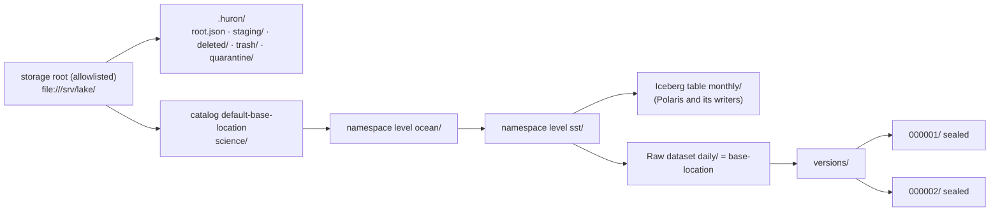

Huron's writes into the catalog tree are exactly these:
- It creates missing namespace directories, the dataset directory and its `versions/`, each mode
  `0755` (D-14, D-18).
- It renames a sealed version into `versions/<NNNNNN>/` (publication).
- It renames a version, or the whole `versions/`, out to `.huron/deleted/` (park), and after a
  dataset park removes the emptied dataset directory with `rmdir` (D-19).
- It quarantines a foreign directory found at a target number.

It never writes anything else inside a dataset root and never removes a namespace directory.
Scratch, verified copies, parked bytes, trash and quarantine live in the root's hidden area, on
the same filesystem, so every move is one `rename(2)` (OD-9 c).

### 9.2 Storage roots: the allowlist

`HURON_RAW__STORAGE_ROOTS` (`RawSettings.storage_roots`) is a JSON list of at most 16 entries (D-11):

```json
[
  {"key": "local-storage", "uri": "file:///Users/dev/huron/.local/polaris/storage/",
   "path": "/Users/dev/huron/.local/polaris/storage"},
  {"key": "local-nasa-storage", "uri": "file:///Users/dev/huron/.local/polaris/nasa-storage/",
   "path": "/Users/dev/huron/.local/polaris/nasa-storage"}
]
```

| Member | Rule (settings validation; any failure stops startup) |
|---|---|
| `key` | `^[a-z][a-z0-9-]{0,62}$`; unique; stored in `raw_datasets.storage_root`; never on the wire or in Polaris |
| `uri` | parses with `StorageLocation.parse`, `file` scheme only (an `s3://` entry fails); stored slash-terminated; no two URIs equal or nested |
| `path` | absolute; no two paths equal or nested; the mount where `uri` is visible to the API (containers may differ from the URI path) |
| `require_mount` | optional boolean, default `false`. When `true`, `open` creates a sentinel only when `os.path.ismount(path)`; otherwise the root is UNAVAILABLE (`not_mounted`). Deployments that mount their roots set it; the operator docs say volumes are mounted before the API starts (D-172) |

- The default is `[]`, which fails closed: every create answers `422 STORAGE_LOCATION_REFUSED`
  (`outside_storage_roots`).
- The local stack sets the two roots above through `scripts/polaris_dev.py raw_environment()`.
  They are the two that `web/.env.example` lists in `HURON_ICECHUNK_READ_ROOTS`.
- `HURON_DATA_ROOT` stays for Catalog generation documents only.
- **URI to local path.** For a dataset `(root, path)`, the local directory is
  `Path(root.path) / path`. `path` is `base_location` minus the root `uri` and its trailing `/`.
  Huron refuses `%` in every location and name (D-12), so a URI path and its filesystem path are
  the same string, and no percent-decoding exists anywhere.
- **Core never sees `path`.** `PlacementPolicy` gets `StorageRoot(key, uri)`. Only
  `PosixStorageRoots` maps a key to a mount (D-16).

**The root sentinel.** `PosixStorageRoots.open` (§9.8.6) runs once at startup. `recorded` is
`MaintenanceStore.storage_roots()`, the identity (`uri`, `root_id`) that `raw_storage_roots` holds
for every key ever initialized (D-172). `referenced` is `MaintenanceStore.referenced_roots()`, and
`sentinels` maps each key to candidate bytes of
`root_sentinel(root, root_id=uuid4(), created_at=clock.now())` (§9.6.5), used only for a key with
no record. Each root becomes AVAILABLE or UNAVAILABLE (D-17):

| `path` | `.huron/root.json` | Recorded in `raw_storage_roots`, or referenced by an unpurged dataset | `path`, `.huron/` and its four children on one device | Result |
|---|---|---|---|---|
| missing or not a real directory | — | — | — | UNAVAILABLE; Huron never creates a root's `path` |
| directory; a mount point when `require_mount` is set | absent | neither | yes, after creating `.huron/{staging,deleted,trash,quarantine}` (`0700`) | publish the candidate sentinel atomically (§9.6.5, D-173), AVAILABLE; the wiring records its identity |
| directory that is not a mount point, with `require_mount` set | absent | neither | — | UNAVAILABLE (`not_mounted`) |
| directory | absent | either | — | UNAVAILABLE: an unmounted root looks empty, and a recorded root is never initialized again without the operator (D-172) |
| directory | present; `schema`, `key` and `uri` equal the configuration, and `root_id` equals the recorded one | — | yes | AVAILABLE |
| directory | present and equal to the configuration, with no record | — | yes | AVAILABLE; the sentinel is adopted, and the wiring records its `root_id` |
| directory | present but different (another `root_id` included), unreadable or not JSON | — | — | UNAVAILABLE: a swapped or remapped mount |
| directory | present and equal | — | no | UNAVAILABLE: publication could not be one rename, and absence could not be trusted (D-174) |

`StorageSweeper.root_available(key)` re-runs the read-only rows of this table (never the create
row) on every call. It updates the cached state in both directions. Every operation on an
UNAVAILABLE root raises `StorageRootUnavailableError`, which answers `503
RAW_STORAGE_UNAVAILABLE` with `Retry-After: 60`, and maintenance skips the root. Reads served
from PostgreSQL alone still answer. `/readyz` fails while a referenced root is UNAVAILABLE.

**Free space** is measured per root: `free_bytes(key)` is `statvfs(<path>/.huron/staging)`,
`f_bavail × f_frsize`. The root is the catalog's own filesystem (OD-9 c), so Iceberg and Icechunk
writers share it, and `STORAGE_RESERVE_BYTES` is kept for them as well as for Huron (D-162):
- **Session start** requires, on the dataset's own root,
  `free ≥ 2 × total_bytes + outstanding(root) + STORAGE_RESERVE_BYTES`. `outstanding(root)` is what
  the root's other live OPEN sessions still need: for each of their files, `size − upload_offset`
  bytes of scratch not yet received, plus `size` for its verified copy while it is not yet
  `VERIFIED`. A session that has received nothing counts `2 × its total`, the need its own start
  was charged, and a byte leaves the sum once its chunk is recorded or its copy verified, so no
  byte is counted twice except one in flight, which errs toward refusing. The sum runs in the start
  transaction under
  `pg_advisory_xact_lock(hashtextextended('raw-space:' || root, 0))`, with `free` measured again
  inside it, so concurrent starts on one root serialize and the second sees the first (§13.3
  guard 13). An unlocked check without `outstanding` runs first, before staging is created (D-24).
- **Each chunk** is refused before any byte is written when `free − length < STORAGE_RESERVE_BYTES`
  (`UploadArea.write_chunk`, one `statvfs` per chunk), with `507`. Admitted sessions do not trip
  it in the ordinary course, because start admitted their whole need; it trips when other writers
  took the space.
- **Each verified copy** keeps the per-copy reservation (`CompletionAdmission`, one per root) as the
  hard guard. `ENOSPC` anywhere answers `507`.

### 9.3 The hidden area of each root (`.huron/`)

Each allowlisted root holds one Huron-only directory, `.huron/`, beside the catalog trees. Everything
Huron writes that is not a sealed version lives there: the sentinel, scratch, verified copies,
parked bytes, trash and quarantine. It sits on the root's own filesystem, so every move between it
and a catalog location is one `rename(2)` (OD-9 c, D-14).

```text
<root path>/.huron/                     0700  created once by PosixStorageRoots.open (§9.2)
  root.json                             0444  root sentinel (§9.6.5), linked from a candidate, never rewritten
  root.json.<uuid4 hex>                 0444  a candidate sentinel; only during open, removed by open (D-173)
  staging/                              0700
    <session hex>/                      0700  one upload session of a dataset on this root
      upload/                           0700
        <tus upload hex>                0600  scratch input of one tus upload; only PATCH writes it
      completion/                       0700
        <uuid4 hex>                     0600, then 0444: a candidate copy or control document
      envelope/                         0700  becomes versions/<NNNNNN>/ by one rename
        payload/…                       files 0444 (verified independent copies); dirs 0700, 0555 sealed
        manifest.json  metadata.json  schema.json  version.json     0444, written at publication
  deleted/                              0700
    <dataset hex>/                      a DELETED dataset's parked versions/ tree (D-19)
    <dataset hex>.<NNNNNN>/             a DELETED version's parked directory (D-19)
  trash/                                0700
    <uuid4 hex>                         a file or tree claimed by rename; removed by EmptyTrash
  quarantine/                           0700
    <uuid4 hex>                         foreign content moved aside by publication (D-39)
```

| Entry | Created by | Written by | Leaves by | When |
|---|---|---|---|---|
| `.huron/` and its four children | `PosixStorageRoots.open`, on an unreferenced root without a sentinel | — | never | — |
| `root.json` | the same call, last: `link(2)` of a fsynced candidate (D-173) | never | never (an operator re-keys or re-initializes a root only by the runbook, D-172) | — |
| `staging/<session hex>/` | `UploadArea.open_staging`, before the session row exists (D-42) | `write_chunk` (`upload/`), `materialize` (`completion/`, `envelope/payload/`), `publish` (the documents) | `envelope/` by publication; the rest by rename into `trash/` (`ReapStaging`, `SweepOrphanStaging`) | one staging grace after the session ends, or after the grace with no row |
| `upload/<tus upload hex>` | the chunk at offset 0 (`O_CREAT`, never truncated) | positional chunk writes | `discard_input` renames it into `trash/` after verification, or it leaves with its tree | — |
| `completion/<uuid4 hex>` | `candidate()` in `materialize` and `publish` | its own call | installed by exclusive rename, or unlinked by that call | within one call |
| `deleted/<dataset hex>/`, `deleted/<dataset hex>.<NNNNNN>/` | park (D-19) | never | `PurgeDeleted` renames it into `trash/` | after `purge_after` (30 days) |
| `trash/<uuid4 hex>` | the renames above | never | `EmptyTrash` (`remove_tree`, §18.4 duty 8) | the next pass |
| `quarantine/<uuid4 hex>` | `publish` | never | an operator | never automatically |

Rules:
- **Unlinking.** `EmptyTrash` is the only code that removes anything a row or a published path ever
  named (D-65 point 1). Two narrower removals name nothing durable: `candidate()` unlinks its own
  uninstalled temporary file in `completion/` (today's behaviour), and park removes the emptied
  dataset directory with `rmdir` (D-19). `discard_input` therefore renames the scratch input into
  `trash/` rather than unlinking it.
- **Fixed name formats.** `<… hex>` is `UUID.hex`, 32 lowercase hex digits, and `<NNNNNN>` is the
  six-digit number (D-14). Maintenance acts only on names of those formats: `SweepOrphanStaging`
  logs and skips any other name in `staging/`, and nothing lists `deleted/` (park and purge work
  from rows). `EmptyTrash` removes every trash entry, whatever its name.
- **No links followed.** Every traversal below a root is descriptor-relative with `O_NOFOLLOW`
  (`materialize.directory`, `descendant`). A symlink where a directory or file is expected is
  refused, never followed. A checked file is used through the descriptor the check opened, never
  re-opened by path: a download streams `StoredObject.fd` (D-158), because a name can be swapped
  for a link between a check and a later open.
- **One device.** The root `path`, `.huron/` and its four children share `st_dev`, or the root is
  UNAVAILABLE (§9.2). A dataset directory on another device is refused at creation
  (`cross_device`, §9.8.4). A catalog or namespace directory can still become, or stop being, a
  mount point later, which no root-level probe sees. So every absence answer and every directory
  creation under a placement first checks that the nearest existing ancestor of the path has the
  `st_dev` of `.huron/staging`, and `EXDEV` or a failed check at publication, a park or a purge
  answers `503` with the finding `RAW_CROSS_DEVICE_PLACEMENT`, without marking the root
  UNAVAILABLE (D-174).
- **Private.** `0700` keeps scratch, parked bytes and quarantine readable only by the API's service
  user. No dataset may live under `.huron/` (`reserved_path`, D-13).
- **Operator rule: catalogs sit below a root.** Give every catalog a `default-base-location`
  strictly below its storage root, as the local stack does (`<root>/<catalog>`). If a catalog's base
  equals a root URI, a Polaris namespace named `.huron` maps onto the hidden area. Huron refuses a
  Raw dataset there (`reserved_path`), but it cannot stop another table format's writer. The
  operator docs carry the rule.
- **A referenced root keeps its key and URI.** Every stored `base_location` starts with the root's
  `uri`, so neither `key` nor `uri` may change while an unpurged dataset names the key. The sentinel
  turns such a change into UNAVAILABLE, never into writes elsewhere (D-17). Moving the mount (`path`)
  is allowed: the sentinel travels with the storage.

### 9.4 The dataset root and its versions

Below a dataset's `base-location`, Huron owns exactly `versions/` and its contents (D-14):

```text
<base-location>                         0755  dataset root, created by ensure_dataset_root
  versions/                             0755  created by ensure_dataset_root
    000001/                             0555  one version; appears only by exclusive rename
      version.json                      0444  urn:huron:raw-version:1, the publication marker
      manifest.json                     0444  urn:huron:manifest:1
      metadata.json                     0444  the validated metadata (JCS)
      schema.json                       0444  the pinned schema version (JCS)
      payload/                          0555
        2020/01/01.nc                   0444  one manifest file: an independent inode, nlink 1
    000003/                             (version 2 was deleted: parked, so absent here)
    <anything else>                     foreign: never written or moved by Raw; a park reports it (D-178)
  <anything else>                       foreign: never read, written or removed by Raw
```

- **What a version directory is.** A directory `versions/<NNNNNN>/` whose `version.json` decodes
  (§9.6.1) and names this dataset and this number. Its inventory is exactly the four control
  documents, `payload/`, and the manifest's files with their parent directories (D-23). All of it is
  owned by the API's service user; files are `0444` with `nlink == 1`, directories `0555`.
- **How one appears.** Only by `publish`, as one exclusive rename of a sealed envelope (D-23, D-39).
  Huron never creates a version directory with `mkdir`, never writes into one and never replaces
  one. A directory at a number with no row and no COMMITTING session is foreign: `ReportOrphans`
  reports it, and the next publication at that number quarantines it (D-66).
- **How one leaves.** A version delete parks it as `.huron/deleted/<dataset hex>.<NNNNNN>/`. A
  dataset delete parks the whole `versions/` as `.huron/deleted/<dataset hex>/` when it holds only
  the dataset's versions, and otherwise moves each of them into that directory and leaves the rest
  (D-178); then it removes the emptied dataset directory (D-19). Every park first reads the
  directory's `version.json` and moves only what names this dataset and number (D-168). Nothing
  else moves or changes a version.
- **Gaps are normal.** Deleted versions keep their numbers (D-45), so storage listings show gaps;
  rows never do. A number released by a FAILED commit has no directory and goes to the next commit.
- **Modes and owners.** Catalog readers (Polaris clients and other engines) do not run as the
  API's user, so the dataset root and `versions/` are `0755` and every sealed entry is
  world-readable. Directories Huron creates belong to the API's service user. If other table
  writers in the same namespaces run as different users, the operator gives them a shared group
  with write access to the namespace directories (operator docs). Outside `versions/`, Huron never
  changes the mode or owner of a directory it did not create. Write access to a namespace directory
  lets such a writer rename the dataset directories inside it, so Huron never trusts a path it
  checked earlier: downloads serve the checked descriptor (D-158), reached through real
  directories only. A link can then no longer point a download at scratch, parked bytes or any
  other file the service user can read. It does not stop such a writer from swapping two Huron
  dataset directories of one namespace, which D-91's shared group already lets it do; a client
  detects swapped bytes through the `ETag` digest.
- **Payload names.** Manifest paths keep their `payload/` prefix and the NFC, traversal, separator
  and collision rules (`validate_manifest_path`). One rule is added: each path segment is at most
  255 UTF-8 bytes (`NAME_MAX` on ext4, XFS and APFS). A longer segment is refused as
  `400 PATH_TOO_LONG` at session start, so it can never fail the verified copy later.

### 9.5 The base-location URI

One string names a dataset's storage everywhere: the generic table's `base-location`, the property
`huron.raw.dataset-root`, `raw_datasets.base_location` and `RawDatasetView.base_location`.
`PlacementPolicy.derive` (§8.3.1) computes it once, at creation; nothing recomputes it later
(D-16).

```text
base_location = StorageLocation.parse(catalog_storage.default_base_location)
                  .join(namespace level 1, …, namespace level n, table name)
                  .as_directory()
```

**Parity with Polaris.** It is the location the fork gives an Iceberg table of the same name
(`~/repo/polaris`, verified at HEAD `0cc22f0bbe`):
- `LocalIcebergCatalog.defaultWarehouseLocation`
  (`runtime/service/src/main/java/org/apache/polaris/service/catalog/iceberg/LocalIcebergCatalog.java:526-545`)
  returns `SLASH.join(namespaceLocation, name)`. The name is joined raw, never percent-encoded.
- `resolveLocationForPath` (`:759-775`) starts from the leaf namespace's stored `location`. Each
  segment is passed through `stripLeadingTrailingSlash` (`:806-815`) and the segments are joined with
  `/`. A namespace created without a custom location gets `<parent location>/<level>` from
  `resolveNamespaceLocation` (`:744-757`).
- Two non-default modes change the layout: `DEFAULT_LOCATION_OBJECT_STORAGE_PREFIX_ENABLED` (a hash
  prefix and URL-encoded segments) and `DEFAULT_UNIQUE_TABLE_LOCATION_ENABLED` (a suffix). Both are
  off by default. A catalog that enables either is out of scope: the signed `catalog_storage`
  claim does not carry these flags, so the operator docs state the limit, and the `-m polaris`
  parity test (D-82) pins the default layout.
- `StorageLocation` (`polaris-core/src/main/java/org/apache/polaris/core/storage/StorageLocation.java:55-63`)
  rewrites a leading `file:/+` or `/+` to `file:///`. `isChildOf` (`:129-137`) adds one trailing
  slash to both sides and runs a string prefix test. Huron's `StorageLocation` mirrors both.

Polaris writes a table location without the trailing slash. Huron writes exactly one, as OD-9 spells
the root. Both name the same directory.

**Normal form and limits.** The result is `file:///`, an absolute path, then one `/`. Segments are
joined with `/` and never encoded. It holds no query, fragment, host, `%` or `\`, and no empty, `.`
or `..` segment.

| Property of the result | Enforced by |
|---|---|
| `base_location == root.uri + storage_path + "/"` | `derive`, at creation; `PosixStorageRoots`, against the configured `uri`, before every placement-addressed operation (`placement_mismatch`, D-175). `DatasetPlacement.__post_init__` (§9.8.1) and CHECK `raw_datasets_placement_shape` (§10.5) enforce only the suffix, `base_location` ending with `"/" + storage_path + "/"`, because the root URI is not stored on the row |
| inside one `allowed_locations` entry, by Polaris `isChildOf` | guard 6, `outside_catalog_allowed_locations` |
| inside exactly one root `uri` | guard 7, `outside_storage_roots` |
| `storage_path` not empty, first segment not `.huron` | guard 8, `reserved_path` |
| `base_location` ≤ 4096 characters, `storage_path` ≤ 4096 UTF-8 bytes | guard 4 re-parses the joined result: `invalid_location` (§10.8) |
| each namespace level and the table name ≤ 255 UTF-8 bytes | `PolarisName.parse`: `TARGET_NAME_UNSUPPORTED` |

The last row is a Huron rule. Polaris sets no length limit, but each segment becomes one directory
name, and `NAME_MAX` is 255 bytes on ext4, XFS and APFS. Without the rule, a long name would pass
every check and then fail inside `ensure_dataset_root` with `ENAMETOOLONG`.

**Worked derivations** (root `local-storage` = `file:///srv/lake/` at `/srv/lake`; the catalog's
`allowedLocations` = `[file:///srv/lake/science]`):

| Catalog `default-base-location` | Locator (namespace … name) | Result |
|---|---|---|
| `file:///srv/lake/science` | `ocean.sst` … `daily` | `file:///srv/lake/science/ocean/sst/daily/`; `storage_path` = `science/ocean/sst/daily` |
| `file:/srv/lake/science/` | `ocean.sst` … `daily` | the same |
| `/srv/lake/science` | `ocean.sst` … `daily` | the same |
| `file:///srv/lake/science` | `océan` … `jour` | `file:///srv/lake/science/océan/jour/` (UTF-8 bytes on disk, unencoded) |
| `file:///srv/lake/science` | `ocean` … `a%b` | `422 TARGET_NAME_UNSUPPORTED` (`context.segment` = `a%b`) |
| `file:///srv/lake/science` | `ocean` … `my table` | `422 TARGET_NAME_UNSUPPORTED` (whitespace) |
| `file://host/srv/lake/science` | `ocean` … `daily` | `host` becomes the first path segment, as in the fork: `outside_catalog_allowed_locations` |
| `file:///data/other` | `ocean` … `daily` | `outside_catalog_allowed_locations`; with a matching `allowedLocations`, `outside_storage_roots` |
| `file:///srv/lake`, equal to the root (its `allowedLocations` likewise) | `.huron` … `trash` | `reserved_path` (see the operator rule of §9.3) |

**Local path.** The dataset directory is `Path(root.path) / storage_path` (§9.2). No
percent-decoding exists anywhere: Huron refuses `%` in every name and location, so the URI path and
the filesystem path are the same string. Names are used exactly as Polaris stores them, without
Unicode normalization. On a volume that normalizes names (APFS) or folds case (APFS's default,
SMB, ext4 with casefold), two Polaris names can therefore map to one directory. The create
transaction refuses the second whatever the directory holds, because the overlap check compares
`placement_key`, the case-folded NFC form of `storage_path` (D-164, R13); the directory claim
(§9.8.4) is not needed for that.

**Where the URI is not used.** Version documents carry only the dataset-relative
`location` (`versions/000042/`), never the base location, so they stay valid wherever the dataset's
files are read from. PostgreSQL stores the base location once per dataset and root-relative paths
everywhere else (`storage_path`, `raw_versions.path`). No absolute local path is stored (D-16).

**A catalog that changes later.** A dataset keeps the location it was created with, and
`catalog_base_location` records the catalog's base at that time. If a catalog admin changes
`default-base-location` after namespaces exist, those namespaces keep their old `location`, so new
datasets in them answer `namespace_location_mismatch` with the remedy in the problem context (D-13,
R2). A changed `allowedLocations` affects only new datasets.

**Object stores later.** An `s3://bucket/prefix/` root would use the same formula once an
object-store adapter exists. Three places relax together: `StorageLocation.parse`, the
`RawSettings` root validator (both refuse every scheme but `file` today) and the `base_location`
CHECK, which admits only `file:///` (D-67).

### 9.6 Immutable documents

Every version directory holds four control documents beside `payload/`, and every root holds one
sentinel. Each is the RFC 8785 (JCS) form of one JSON object (`foundation.canonical.canonical_bytes`),
written once with mode `0444` and never rewritten. PostgreSQL holds the same bytes or their SHA-256,
so no immutable fact lives only in storage or only in a mutable row (C14, D-69).

| File | `schema` member / `$id` | Packaged JSON Schema | Bytes held in PostgreSQL | Digest checked against | Composed by |
|---|---|---|---|---|---|
| `version.json` | `urn:huron:raw-version:1` | `raw-version-v1.json` (new) | `raw_upload_sessions.version_document`, then `raw_versions.document` | `raw_versions.document_sha256` | `VersionDocument.compose`, at freeze |
| `manifest.json` | `urn:huron:manifest:1` | `manifest-v1.json` (unchanged) | `raw_upload_sessions.manifest` | `manifest_sha256` (session row, version row, `version.json`) | `manifest_bytes`, at session start |
| `metadata.json` | none; the pinned schema decides its shape | the pinned schema version | `raw_upload_sessions.metadata` | `metadata_sha256` (session row, version row, `version.json`) | `SchemaVersion.validate`, at session start |
| `schema.json` | the document's own optional `$id` | the 2020-12 metaschema plus §16.6 | `raw_schema_versions.document` | `document_sha256`; `version.json` `schema_ref.sha256` | `SchemaDocument.parse`, at registration |
| `.huron/root.json` | `urn:huron:raw-root:1` | `raw-root-v1.json` (new) | none; `raw_storage_roots` holds its `key`, `uri` and `root_id` (D-172) | — (`root_id` compared) | `root_sentinel()`, at startup |

How the documents of one version reference each other:

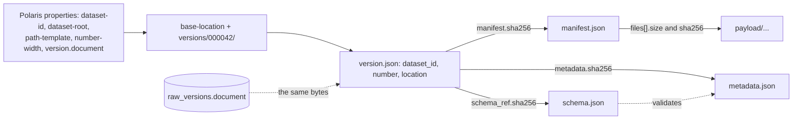

#### 9.6.1 `version.json`

The publication marker and the only per-version descriptor (D-69). Its bytes are frozen at freeze
(`raw_upload_sessions.version_document`), published unchanged, and copied into
`raw_versions.document` by the record transaction. Packaged schema
`src/huron/schema/documents/raw-version-v1.json`, closed, with every member required:

```json
{
  "$schema": "https://json-schema.org/draft/2020-12/schema",
  "$id": "urn:huron:raw-version:1",
  "type": "object",
  "additionalProperties": false,
  "required": ["schema", "dataset_id", "version_id", "number", "location", "session_id",
               "manifest", "metadata", "schema_ref", "committed_by", "committed_at"],
  "properties": {
    "schema": {"const": "urn:huron:raw-version:1"},
    "dataset_id": {"$ref": "#/$defs/uuid"},
    "version_id": {"$ref": "#/$defs/uuid"},
    "number": {"$ref": "#/$defs/number"},
    "location": {"type": "string", "pattern": "^versions/[0-9]{6}/$"},
    "session_id": {"$ref": "#/$defs/uuid"},
    "manifest": {
      "type": "object", "additionalProperties": false,
      "required": ["name", "sha256", "file_count", "total_bytes"],
      "properties": {
        "name": {"const": "manifest.json"},
        "sha256": {"$ref": "#/$defs/sha256"},
        "file_count": {"type": "integer", "minimum": 1, "maximum": 10000},
        "total_bytes": {"type": "integer", "minimum": 0, "maximum": 9007199254740991}
      }
    },
    "metadata": {
      "type": "object", "additionalProperties": false,
      "required": ["name", "sha256"],
      "properties": {"name": {"const": "metadata.json"}, "sha256": {"$ref": "#/$defs/sha256"}}
    },
    "schema_ref": {
      "type": "object", "additionalProperties": false,
      "required": ["name", "subject_id", "subject", "number", "schema_version_id", "sha256"],
      "properties": {
        "name": {"const": "schema.json"},
        "subject_id": {"$ref": "#/$defs/uuid"},
        "subject": {"type": "string", "pattern": "^(platform|catalog)/[a-z0-9][a-z0-9._-]{0,127}$"},
        "number": {"$ref": "#/$defs/number"},
        "schema_version_id": {"$ref": "#/$defs/uuid"},
        "sha256": {"$ref": "#/$defs/sha256"}
      }
    },
    "committed_by": {"type": "string", "minLength": 1, "maxLength": 256},
    "committed_at": {"type": "string", "format": "date-time"}
  },
  "$defs": {
    "uuid": {"type": "string", "format": "uuid",
             "pattern": "^[0-9a-f]{8}-[0-9a-f]{4}-[0-9a-f]{4}-[0-9a-f]{4}-[0-9a-f]{12}$"},
    "number": {"type": "integer", "minimum": 1, "maximum": 999999},
    "sha256": {"type": "string", "pattern": "^[0-9a-f]{64}$"}
  }
}
```

Version 2 of the §15.1 example, indented here for reading. On disk it is one line of JCS bytes,
with keys sorted and no whitespace:

```json
{
  "schema": "urn:huron:raw-version:1",
  "dataset_id": "0192f0c4-b7e4-7a3c-9d1e-2f3a4b5c6d7e",
  "version_id": "0192f1d0-5c2a-7d41-8e6b-1a2b3c4d5e6f",
  "number": 2,
  "location": "versions/000002/",
  "session_id": "0192f1a2-3b4c-7d5e-9f60-718293a4b5c6",
  "manifest": {"name": "manifest.json", "sha256": "<64 hex>", "file_count": 366, "total_bytes": 52613349376},
  "metadata": {"name": "metadata.json", "sha256": "<64 hex>"},
  "schema_ref": {"name": "schema.json", "subject_id": "018f0000-0000-7000-8000-000000000001",
                 "subject": "platform/huron.raw.metadata", "number": 1,
                 "schema_version_id": "018f0000-0000-7000-8000-000000000002", "sha256": "<64 hex>"},
  "committed_by": "huron-web:5f0c2a1e-8b7d-4c3e-9a10-2b3c4d5e6f70",
  "committed_at": "2026-10-14T12:00:00.123456Z"
}
```

Rules the schema cannot express, held by `VersionDocument` (§8.5):
- **Canonical bytes.** `decode` refuses bytes that are not their own JCS form, so a pretty-printed
  or hand-edited file is caught at its first read (today's `_decode_canonical`).
- **Location.** `location == raw_layout.version_location(number)`, and a reader also checks that it
  equals the directory the file was found in.
- **Instants.** `committed_at` is the `Clock` instant of the freeze, rendered as today's
  `_render_instant`: UTC, a `Z` suffix, microseconds when they are not zero. It parses back to the
  exact value stored in `raw_versions.committed_at`.
- **Lowercase identifiers.** The `uuid` definition pairs D-69's `format: uuid` with a lowercase
  pattern, so one identity has exactly one spelling and therefore one byte sequence.
- **Size.** About 1 KiB; the 64 KiB CHECK on `version_document` and `document` is never approached.

#### 9.6.2 `manifest.json`

The unchanged contract `urn:huron:manifest:1` (`manifest-v1.json`): the JCS bytes of
`{"schema": "urn:huron:manifest:1", "hash_algorithm": "sha256", "files": [...]}`, one entry
`{path, size, sha256, media_type}` per file. `validate_manifest` sorts the entries by path, so two
clients that declare the same files in different orders produce the same bytes and the same
`manifest_sha256`. It names no dataset, number or location: `version.json` binds those. Unlike today,
it is written into the envelope at publication rather than at session open; until then its bytes
live only in `raw_upload_sessions.manifest`. `decode_manifest` moves to `core/raw/manifest.py`
(D-69) and re-applies every path and limit rule on each read. At 10,000 entries with 1,024-byte paths
the file stays under 12 MiB.

#### 9.6.3 `metadata.json`

Exactly the JCS bytes of the metadata object submitted at session start, validated once against the
pinned schema version and stored in `raw_upload_sessions.metadata`, at most 1,048,576 bytes (D-57).
The server adds no member: identity, number, committer, digests and the schema reference all live
in `version.json`. Datasets bound to the PLATFORM subject validate against `raw-metadata-v1.json`
(`urn:huron:raw-metadata:1`, §16.11), for example:

```json
{"creators":["NASA JPL"],"description":"MUR v4.1 daily files, 2020.","tags":["sst"],"title":"Daily SST"}
```

Nothing re-validates it at freeze or publication. A storage-only reader may check it against the
`schema.json` beside it (§9.7.3).

#### 9.6.4 `schema.json`

The exact `raw_schema_versions.document` bytes of the pinned schema version: a JSON Schema 2020-12
document in JCS form, 2..262,144 bytes, top-level `"type": "object"`, local `$ref` and
`$dynamicRef` only (§16.6). Its SHA-256 equals `document_sha256` and `schema_ref.sha256`. Each
version embeds the schema it was validated against, and no separate schema mirror exists in
storage (D-56, §16.5). Its global identity is `schema_ref.schema_version_id`.

#### 9.6.5 `.huron/root.json`

The root sentinel (D-17). Packaged schema `src/huron/schema/documents/raw-root-v1.json`:

```json
{
  "$schema": "https://json-schema.org/draft/2020-12/schema",
  "$id": "urn:huron:raw-root:1",
  "type": "object",
  "additionalProperties": false,
  "required": ["schema", "key", "uri", "root_id", "created_at"],
  "properties": {
    "schema": {"const": "urn:huron:raw-root:1"},
    "key": {"type": "string", "pattern": "^[a-z][a-z0-9-]{0,62}$"},
    "uri": {"type": "string", "maxLength": 4096, "pattern": "^file:///(.*/)?$"},
    "root_id": {"type": "string", "format": "uuid",
                "pattern": "^[0-9a-f]{8}-[0-9a-f]{4}-[0-9a-f]{4}-[0-9a-f]{4}-[0-9a-f]{12}$"},
    "created_at": {"type": "string", "format": "date-time"}
  }
}
```

The exact bytes for the §15.1 root:

```json
{"created_at":"2026-10-14T12:00:00.123456Z","key":"local-storage","root_id":"3f2b6c1e-8d4a-4f7b-9c21-5e6d7a8b9c0d","schema":"urn:huron:raw-root:1","uri":"file:///srv/lake/"}
```

- **Composed in core.** `root_sentinel(root, root_id=uuid4(), created_at=clock.now())`
  (`core/raw/documents.py`) builds and validates the candidate bytes for a key without a record.
  The wiring passes them, with the recorded identities, to `PosixStorageRoots.open`; rawstore
  composes no document (§6.5 rule 4).
- **One identity per initialization (D-172).** `root_id` is a uuid4 minted when a root is first
  initialized, and `raw_storage_roots` records it with the key and `uri`. A recorded key never
  gets a fresh sentinel: a bare mount point, or a volume whose datasets were all purged, stays
  UNAVAILABLE instead of being initialized again on the wrong filesystem. Re-initializing a
  recorded key is a reviewed operator step, as moving a realm's endpoint is (§10.5): with the
  trigger `raw_storage_roots_immutable` disabled, the operator deletes the row and moves the old
  `root.json` aside, and the next start initializes the root again.
- **Written once, atomically (D-173).** Only `open` writes it, for a key with no record whose root
  has no sentinel and no referencing dataset (§9.2). It first creates `.huron/` and its four
  children, then writes the bytes to `.huron/root.json.<uuid4 hex>` (`O_CREAT | O_EXCL |
  O_NOFOLLOW`, mode `0444`) and fsyncs it, publishes it with `link(2)` to `root.json`, unlinks the
  candidate and fsyncs `.huron/`. A reader therefore never sees a partial sentinel. `EEXIST` from
  `link(2)` means another replica won: the loser re-reads the winner's complete file, compares
  `schema`, `key` and `uri`, and adopts its `root_id`, because `created_at` and `root_id` differ
  between candidates. `open` removes stray `root.json.*` candidates left by a crash.
- **Compared on every probe and every absence decision.** Open with `O_NOFOLLOW`, read at most
  4 KiB, parse, validate against `raw-root-v1.json` (rawstore may import `huron.schema`), then
  compare `schema`, `key` and `uri` with the configuration and `root_id` with the recorded
  identity. `created_at` is evidence only. A symlink, a larger file, invalid JSON or a schema
  violation counts as "different".
- **Never rewritten by Huron.** Moving a mount keeps the file. Changing a referenced root's `key`
  or `uri` is not supported (§9.3); the runbook covers an unreferenced root.

#### 9.6.6 Packaged schema files

| File in `src/huron/schema/documents/` | `$id` | Status |
|---|---|---|
| `raw-version-v1.json` | `urn:huron:raw-version:1` | new (§9.6.1) |
| `raw-root-v1.json` | `urn:huron:raw-root:1` | new (§9.6.5) |
| `raw-metadata-v1.json` | `urn:huron:raw-metadata:1` | new; the source of the PLATFORM seed only (§16.11) |
| `raw-table-properties-v2.json` | `urn:huron:raw-table-properties:2` | new (§15.2) |
| `manifest-v1.json` | `urn:huron:manifest:1` | unchanged |
| `generation-v1.json` | `urn:huron:generation:1` | unchanged (Catalog) |
| `committed-v1.json`, `committed-v2.json`, `revision-index-v1.json`, `metadata-v1.json` | — | deleted with the `COMMITTED` marker, `INDEX.json` and server-composed metadata (D-69, D-70 row 12) |
| `protocol-inventory-v1.json`, `protocol-transition-v1.json` | — | deleted with integrity (OD-3, D-70 row 1) |

A contract change is a new file with a new `schema` constant, never an edit of a published file
(the `huron.schema` rule). `tests/unit/test_schema_committed.py` and
`tests/unit/test_schema_revision_index.py` go with their documents.

### 9.7 Reading a version back

#### 9.7.1 What each store vouches for

- **PostgreSQL decides existence.** A version may be served when its row is AVAILABLE and its
  dataset is not DELETED. Storage only supplies bytes. Huron never infers from storage alone that a
  version exists or does not (D-65 point 6).
- **Documents are checked on every read.** Each control document Huron serves from storage must
  match the digest PostgreSQL holds. `version.json` itself is served from `raw_versions.document`,
  never re-read from storage on a request.
- **Payload is not re-hashed.** A payload file was verified once when it was copied, then sealed, and
  it is never written again. It is served after a cheap attribute check. Its `ETag` is the manifest
  SHA-256, so a client can check the bytes end to end.

#### 9.7.2 Huron's own reads (`VersionFiles`, §8.6.5)

| Need | Source | Check | On failure |
|---|---|---|---|
| version facts, `schema_ref` | the `raw_versions` row and its `document` | `VersionDocument.decode` | — (the row is authoritative) |
| `metadata.json`, for single-version reads | `VersionArchive.read_document(placement, n, "metadata.json")` | SHA-256 equals `metadata_sha256` | missing or different on an AVAILABLE root: `500`, logged; `ReportOrphans` records a missing directory |
| `manifest.json`, for the manifest route and payload lookups | `read_document(placement, n, "manifest.json")` | SHA-256 equals `manifest_sha256`, then `decode_manifest`; cached per version id (LRU of 64) | as above |
| a payload file | its `ManifestEntry`, then `open_object(placement, n, path)` | regular file, `nlink == 1`, owned by the service user, mode `0444`, size equal to the entry | a path not in the manifest: `404`; any other mismatch: `500` |
| any of these on an UNAVAILABLE root | — | — | `503 RAW_STORAGE_UNAVAILABLE`, `Retry-After: 60` |

Huron never reads `schema.json`: the registry row holds the same bytes. A read that raced a delete
re-reads PostgreSQL after a storage miss and answers `410` (F12, §18.2).

#### 9.7.3 Storage-only readers

A reader outside Huron needs only `TABLE_READ_PROPERTIES` on the table and read access to the
catalog's storage. It never calls Huron (D-51, §13.7, §15.3). It applies the same checks as
`VersionDocument.decode`, plus the identity checks only it can make.
`test_storage_only_reader_resolves_version` runs this procedure against a published fixture:

1. Load the generic table and require `huron.raw.standard == "2"`. Take the root
   (`huron.raw.dataset-root`), the id (`huron.raw.dataset-id`), the path template, the width and the
   document name.
2. Version n lives at `root + template.replace("{number}", str(n).zfill(width))`. To find the newest
   version, list `root + "versions/"`, keep names of exactly `width` digits, and try them from the
   highest down.
3. Read `version.json`. Accept it only when its bytes are their own JCS form, it validates against
   `raw-version-v1.json`, `dataset_id` equals the id, `number` equals the directory's number, and
   `location` equals the directory's dataset-relative path. Otherwise skip the directory.
4. Read `manifest.json`, `metadata.json` and `schema.json`. Each SHA-256 must equal the digest that
   `version.json` names.
5. Read payload files only through manifest entries, and check each size and SHA-256.
6. Optionally validate `metadata.json` against `schema.json`: Draft 2020-12, format checks on, and an
   empty `referencing.Registry()`, so no remote reference is ever fetched.

What storage alone cannot tell such a reader:
- **Lifecycle.** ARCHIVED leaves no mark in storage, and an archived dataset keeps every version
  readable. A DELETED dataset or version leaves the dataset root when it is parked: at delete time,
  or at the latest when `ParkDeleted` finishes a failed park (F5, F6).
- **Timing.** A version directory appears at the publication rename, before the record transaction
  writes its row. A COMMITTING session always finishes, because archive and delete refuse
  meanwhile (D-40, decided after the row lock, D-167), and publication never fails a session whose
  version it published, nor moves that version aside (D-165, D-166). A storage-only reader can
  therefore be briefly ahead of Huron, but never wrong.
- **Foreign directories.** A directory without a valid `version.json` for this dataset is not a
  version. Readers skip it, and Huron reports it (D-66).

Huron's versions endpoint stays authoritative for state and history. Storage is the
self-describing fallback for clients that cannot call that endpoint today (R14).

### 9.8 The storage port contract

Core addresses storage only by root key, `DatasetPlacement`, ids and numbers, never by a path
(D-20). The three consumer-owned Protocols live in `core/raw/ports.py`. Their shared values and
errors live in `huron.schema.storage`, because `huron.schema` is the only package that both
`core/raw` and `core/rawstore` may import. Every method is synchronous and may block. Services call
it on a worker thread through `asyncify`, with the limiter §8.9 names, and never inside a
PostgreSQL transaction. A method is idempotent unless its row says otherwise.

#### 9.8.1 `huron.schema.storage`

```python
# src/huron/schema/storage.py — pure values and errors; imports the standard library and raw_layout
@dataclass(frozen=True, slots=True)
class DatasetPlacement:
    root: str                  # D-11 storage-root key
    path: str                  # root-relative dataset directory, no leading or trailing "/"
    base_location: str         # the exact Polaris base-location, "file:///…/"
    # __post_init__ raises ValueError unless root matches ^[a-z][a-z0-9-]{0,62}$, path has no
    # empty, "." or ".." segment, raw_layout.is_reserved(path) is false, and base_location ends
    # with "/" + path + "/" (the CHECK raw_datasets_placement_shape, held in memory)
    @property
    def placement_key(self) -> str: ...
        # unicodedata NFC(casefold(NFC(path))): equal for every spelling a case-folding or
        # normalizing filesystem maps to one directory; compared for overlap (D-13, D-164)

@dataclass(frozen=True, slots=True)
class ChunkDigests:
    sha256: bytes              # 32 bytes, of exactly the chunk written
    sha1: bytes                # 20 bytes; both are always computed (D-99)

@dataclass(frozen=True, slots=True)
class MaterializedFile:
    size: int                  # bytes of the verified copy
    sha256: str                # lowercase hex of the verified copy
    fingerprint: str | None    # "<st_ino>:<st_mtime_ns>" of the installed file; None: not installed
    input: str | None = None   # "<st_dev>:<st_ino>" of the scratch input this copy read; None when
                               # an installed file was re-observed instead (D-171)

@dataclass(frozen=True, slots=True)
class FileEvidence:
    path: str                  # the manifest path, "payload/…"
    size: int
    fingerprint: str           # the verified_fingerprint recorded for the file

class PublishOutcome(StrEnum):
    PUBLISHED = "PUBLISHED"; ALREADY_PUBLISHED = "ALREADY_PUBLISHED"; STAGING_LOST = "STAGING_LOST"
    CLAIMED = "CLAIMED"              # the target is another dataset's version; nothing moved (D-164)
    HELD = "HELD"                    # the target holds this session's version.json, but another
                                     # control document differs; nothing moved (D-166)

@dataclass(frozen=True, slots=True)
class PublishResult:
    outcome: PublishOutcome
    quarantined: str | None = None   # root-relative ".huron/quarantine/<uuid4 hex>" a target went to
    damage: str | None = None        # the check the envelope (or, when HELD, the target) failed,
                                     # at most 1024 characters
    claimed_by: str | None = None    # the dataset_id the target's version.json names (CLAIMED only)

@dataclass(frozen=True, slots=True)
class ParkReport:                    # park_dataset's answer (D-178)
    moved: bool                      # this call moved at least one of the dataset's versions
    foreign: tuple[str, ...] = ()    # names left in versions/ that are not the dataset's versions

@dataclass(frozen=True, slots=True)
class RootIdentity:                  # one row of raw_storage_roots (D-172)
    uri: str                         # the root URI recorded at initialization
    root_id: UUID                    # the uuid4 of that initialization, also in .huron/root.json

@dataclass(frozen=True, slots=True)
class StoredObject:
    size: int
    fd: int                    # the one POSIX-shaped value: the verified, open, read-only descriptor
                               # (D-158); the receiver owns it and must close() it exactly once
    def close(self) -> None: ...   # os.close(fd)

class ChunkLengthMismatchError(ValueError): ...   # renamed PartLengthMismatchError
class ScratchInputMissingError(Exception): ...    # offset > 0 and the scratch input is gone
class StagingMissingError(Exception): ...         # the session's staging tree is gone
class DatasetRootOccupiedError(Exception): ...    # a non-empty dataset directory, or a link or file on the path
class CrossDeviceCommitError(OSError): ...        # EXDEV; moved here from rawstore/commit.py
class VersionIdentityError(Exception):            # a park or purge source names another dataset or
    claimed_by: str | None                        # number, or none; nothing moved (D-168)
class StorageRootUnavailableError(Exception):
    def __init__(self, root: str, reason: str) -> None: ...
    # reason: path_missing | sentinel_missing | sentinel_mismatch | cross_device | io_error
    #         | unconfigured | not_mounted | placement_mismatch (§9.8.6, D-172, D-175)
```

- `huron.core.raw.locations` re-exports `DatasetPlacement`, `FileEvidence`, `StoredObject` and
  `RootIdentity` for `metastore` (§6.5 rule 5). `huron.core.rawstore` re-exports `CrossDeviceCommitError` and
  `ChunkLengthMismatchError` beside `PosixRawStore` and `PosixStorageRoots`.
- Every error that reports absence (`ScratchInputMissingError`, `StagingMissingError`, a `False`
  from a sweeper move, `STAGING_LOST`) is raised or returned only after the root's sentinel was
  re-read and matched (§9.8.6). Otherwise the answer is `StorageRootUnavailableError`.

How core maps them (§8.6, §11.11):

| Raised | By | Core's answer |
|---|---|---|
| `ChunkLengthMismatchError` | `write_chunk` | `400 TUS_BODY_INCOMPLETE`; nothing recorded |
| `ScratchInputMissingError` | `write_chunk`, `materialize` | `reset_offset` (`SCRATCH_LOST`), then `409 UPLOAD_OFFSET_CONFLICT`; the verifier records `Verification.lost()` |
| `StagingMissingError` | `write_chunk`, `materialize` | the session is aborted `STAGING_LOST`; the PATCH answers `410 UPLOAD_GONE` |
| `DatasetRootOccupiedError` | `claim_dataset_root`, `ensure_dataset_root` | `409 STORAGE_LOCATION_OCCUPIED` (`context.base_location`) at creation; elsewhere `500`, logged |
| `CrossDeviceCommitError` | `claim_dataset_root` | `422 STORAGE_LOCATION_REFUSED` (`cross_device`) at creation. Elsewhere `EXDEV` never surfaces as this class: §9.8.6 turns it into `StorageRootUnavailableError` (`cross_device`, D-174) |
| `StorageRootUnavailableError` | any method | `503 RAW_STORAGE_UNAVAILABLE`, `Retry-After: 60`; maintenance skips the root. With `cross_device` from publication, a park or a purge (a sub-mount under the placement), the root keeps its recorded state, the lease is released and the caller records `RAW_CROSS_DEVICE_PLACEMENT` (D-174) |
| `VersionIdentityError` | `park_version`, `purge_parked_version` | nothing moved and nothing recorded; the request logs it, and `ParkDeleted` or `PurgeDeleted` records `RAW_ALIASED_VERSION_DIRECTORY` (D-168) |
| `OSError` with `ENOSPC` | writes and copies | `507 INSUFFICIENT_STORAGE`, `Retry-After: 60` |
| `PermissionError` | any method | `503 RAW_STORAGE_UNAVAILABLE` (§8.8); logged at ERROR |
| any other `OSError` (`EIO`, `ESTALE`, `EMFILE`, `ENFILE`) | `publish` | `503 RAW_STORAGE_UNAVAILABLE`, logged at ERROR; the lease is released and the session stays COMMITTING, because an I/O error is no evidence of damage (D-166) |
| `FileNotFoundError` | `publish`, after its one re-observation (D-165) | `409 COMMIT_IN_PROGRESS`, `Retry-After: 5`; the lease is released and the next retry or pass takes over |
| `FileNotFoundError` | `read_document`, `open_object`, on an AVAILABLE root | integrity failure: `500`, logged (§9.7.2) |

`StorageRootUnavailableError.root` and `.reason` are logged, never sent: the root key never leaves
the server (D-11).

#### 9.8.2 `huron.schema.raw_layout`

```python
# src/huron/schema/raw_layout.py — pure, no I/O (D-15); ids render as UUID.hex (§6.5 rule 3)
HIDDEN = ".huron"; ROOT_SENTINEL = ".huron/root.json"; STAGING = ".huron/staging"
DELETED = ".huron/deleted"; TRASH = ".huron/trash"; QUARANTINE = ".huron/quarantine"
VERSIONS = "versions"; PAYLOAD = "payload"
VERSION_DOCUMENT = "version.json"; MANIFEST_DOCUMENT = "manifest.json"
METADATA_DOCUMENT = "metadata.json"; SCHEMA_DOCUMENT = "schema.json"
NUMBER_WIDTH = 6; MAX_NUMBER = 999_999; VERSION_PATH_TEMPLATE = "versions/{number}/"

def version_dir(dataset_path: str, number: int) -> PurePosixPath: ...       # science/…/daily/versions/000042
def version_location(number: int) -> str: ...                              # "versions/000042/"
def staging_dir(session_id: UUID) -> PurePosixPath: ...                    # .huron/staging/<hex>
def scratch_input(session_id: UUID, tus_upload_id: UUID) -> PurePosixPath: ...  # .huron/staging/<s>/upload/<u>
def parked_dataset(dataset_id: UUID) -> PurePosixPath: ...                 # .huron/deleted/<hex>
def parked_version(dataset_id: UUID, number: int) -> PurePosixPath: ...    # .huron/deleted/<hex>.000042
def is_reserved(path: str) -> bool: ...                                    # "" or first segment ".huron"
```

- Every path is root-relative. A number outside `1..MAX_NUMBER` raises `ValueError`, a caller bug.
- `version_location(n)` equals `VERSION_PATH_TEMPLATE.format(number=f"{n:06d}")`, the property rule
  of §15.2. `str(version_dir(storage_path, n))` equals the trigger's
  `storage_path || '/versions/' || lpad(n::text, 6, '0')` (`raw_versions_contiguous`). One unit test
  pins all three spellings to each other, because `metastore` may not import this module.
- `core/raw` uses `version_location`, `version_dir` (for `Version.path` and findings), `is_reserved`
  (guard 8), the document names and the property constants. `core/rawstore` uses the rest. The
  staging children `upload`, `completion` and `envelope` stay private to rawstore.

#### 9.8.3 `UploadArea`

```python
class UploadArea(Protocol):        # consumers: UploadService, FileVerifier, SweepOrphanStaging
    def open_staging(self, root: str, session_id: UUID,
                     empty_paths: Sequence[str]) -> tuple[FileEvidence, ...]: ...
    def write_chunk(self, root: str, session_id: UUID, tus_upload_id: UUID, chunks: Iterable[bytes],
                    *, offset: int, length: int, reserve: int) -> ChunkDigests: ...
    def materialize(self, root: str, session_id: UUID, tus_upload_id: UUID, path: str,
                    *, size: int, sha256: str) -> MaterializedFile: ...
    def discard_input(self, root: str, session_id: UUID, tus_upload_id: UUID, *,
                      input: str | None = None) -> None: ...
    def free_bytes(self, root: str) -> int: ...
    def staging_ids(self, root: str) -> tuple[tuple[UUID, float], ...]: ...
```

| Method | Effect | Durable on return | Answers |
|---|---|---|---|
| `open_staging` | creates `staging/<s>/` with `upload/`, `completion/` and `envelope/payload/` (all `0700`), then installs each zero-byte file of `empty_paths` empty and sealed in the envelope | every created entry and its parent fsynced | the `FileEvidence` of each zero-byte file, in `empty_paths` order. A repeat reuses existing directories and re-observes installed files |
| `write_chunk` | first `statvfs`es the staging area and raises `OSError(ENOSPC)` before opening anything when `free − length < reserve` (`STORAGE_RESERVE_BYTES`, D-162); then opens `upload/<u>` with `O_WRONLY \| O_NOFOLLOW`, adding `O_CREAT` (mode `0600`) only when `offset == 0` and never `O_TRUNC`; writes exactly `length` bytes at `offset` with `pwrite`, hashing SHA-256 and SHA-1 as they land | the file and `upload/` fsynced | `ChunkDigests`; `ChunkLengthMismatchError` on a short or long stream (bytes already written stay unrecorded); `ScratchInputMissingError`; `StagingMissingError`; `ENOSPC`, from the reserve check or the write |
| `materialize` | today's `finish_file`: under `CompletionAdmission.reserve(size)`, copy the input into a fresh `completion/` candidate, seal it `0444`, fsync, re-read it with SHA-256, and install it at `envelope/<path>` by exclusive rename only when size and digest match. An installed file equal to the declaration is re-observed instead of copied again | the candidate and both directories fsynced | `MaterializedFile` with the installed file's fingerprint, or `fingerprint=None` when the copy did not match (nothing installed), and with `input`, the `(st_dev, st_ino)` of the scratch input the copy read (D-171); `ScratchInputMissingError`; `StagingMissingError`; `ENOSPC`; `ValueError` when an installed file differs (an integrity failure) |
| `discard_input` | renames `upload/<u>` into `trash/<uuid4 hex>`; with `input`, only while `upload/<u>` still has that identity, so a newer input created after a reset stays (D-171) | both directories fsynced | nothing; an absent input or tree, or another inode at the name, is a no-op, because no state depends on it |
| `free_bytes` | `statvfs(.huron/staging)`: `f_bavail × f_frsize` | — | bytes |
| `staging_ids` | lists `staging/`; keeps directories named by 32 lowercase hex digits | — | `(session_id, st_mtime)` per kept entry. The mtime is the session directory's own, set when its three children were created; chunk writes do not change it. Other names are logged and skipped |

- `empty_paths` and `path` are manifest paths (`payload/…`), already validated by core. Rawstore
  re-checks each segment (no empty, `.` or `..` segment) before it opens anything.
- `staging_ids` returns a tuple, not the iterator D-20 sketches, so the whole listing runs on the
  worker thread and never on the event loop.

#### 9.8.4 `VersionArchive`

```python
class VersionArchive(Protocol):    # consumers: DatasetService, UploadService, CommitDriver, VersionFiles
    def claim_dataset_root(self, placement: DatasetPlacement) -> None: ...
    def ensure_dataset_root(self, placement: DatasetPlacement) -> None: ...
    def publish(self, placement: DatasetPlacement, session_id: UUID, number: int, *,
                files: Sequence[FileEvidence], documents: Mapping[str, bytes]) -> PublishResult: ...
    def open_object(self, placement: DatasetPlacement, number: int, name: str) -> StoredObject: ...
    def read_document(self, placement: DatasetPlacement, number: int, name: str) -> bytes: ...
```

**`claim_dataset_root`** (D-18, OD-9 d) reads and creates nothing:
1. Re-read the root's sentinel (§9.8.6). An unmounted mount point looks empty, so a decision that
   rests on absence must never be taken there.
2. Walk `placement.path` from the root with one `openat(O_DIRECTORY | O_NOFOLLOW)` per segment.
   `ELOOP` or `ENOTDIR` (a symlink or a file on the path) raises `DatasetRootOccupiedError`. `ENOENT`
   ends the walk: everything below is absent.
3. The nearest existing directory on the path, which is the dataset directory itself when it
   exists, must have the `st_dev` of `.huron/staging`, or `CrossDeviceCommitError` is raised.
4. An existing dataset directory must have no entries at all, or exactly one: an empty directory
   `versions/` owned by the service user, the shape a late `ensure_dataset_root` leaves (D-169).
   Anything else, including a `versions/` with any entry or another owner, raises
   `DatasetRootOccupiedError`.

Step 4 guards against foreign content. It no longer has to guard against aliases among Huron
datasets: the overlap check compares `placement_key` under the `raw-placement:` lock (D-164), so
it refuses every alias that Unicode case folding and NFC describe, including concurrent creates
and a create during another dataset's commit-to-`ensure_dataset_root` window, which this unlocked
step cannot order, whatever the directory holds. An alias whose filesystem folding differs from
`placement_key`'s can pass both checks only while the first dataset has no version, and its first
colliding publication then answers `CLAIMED` (D-164). One accepted window remains: D-18's
check-then-`mkdir` window against foreign writers (R3). Session start adds none, because it never
calls `ensure_dataset_root` (D-149). A late `ensure_dataset_root` adds none either: a commit driver
stalled past its lease can still make its `_drive` call after a takeover published, the session
was recorded, and the dataset was deleted, parked and released (`_drive` skips the call once it
knows its run is lost, but a stalled thread may not know yet). The empty `versions/` it recreates
is removed by the `RELEASED` report when that runs later, and step 4 accepts it otherwise, so it
never blocks reuse of the name (OD-9 e). No operator remedy is needed (D-169). Accepting it keeps
OD-9 d as its parenthesis states it: the refusal protects files that a dropped table left behind,
and an empty directory that Huron's own service user created holds none.

**`ensure_dataset_root`** re-reads the sentinel first, so it never creates directories on a bare
mount point, and checks that the nearest existing directory on the path has the `st_dev` of
`.huron/staging`, so it never creates them on a bare sub-mount either (`cross_device`, D-174). It
then walks the path with `descendant(..., create=True, mode=0o755)`, which gains the
`mode` keyword (default `0o700`, as today). Each directory it creates gets `fchmod(0o755)` right
after `mkdir`, so the process umask cannot narrow it. Existing directories keep their mode and
owner. `versions/` is created the same way. A symlink or file on the path raises
`DatasetRootOccupiedError`. Each created directory and its parent are fsynced.

**`publish`** implements D-23 and the D-39 table. It observes the staged envelope first, then the
target, then dispatches on the pair:

```text
envelope = staging_dir(session_id) / "envelope"       target = version_dir(placement.path, number)
envelope:  PRESENT (a real directory) | ABSENT (ENOENT, confirmed by the sentinel)
target:    ABSENT (ENOENT, confirmed by the sentinel)
           | EQUAL (the four control documents are regular files whose bytes equal `documents`)
           | CLAIMED (a real directory whose version.json parses as JSON and names a dataset_id other
             than the one in documents["version.json"]: another Huron dataset's version, D-164)
           | HELD (a real directory whose version.json equals documents["version.json"] byte for
             byte while another control document is missing or differs: this session's own
             version, damaged after its rename, D-166)
           | DIFFERENT (positive evidence only, D-166: a file, a symlink, an entry the service user
             does not own, or a real directory whose control documents were read, or found
             absent, and are not the four of `documents`)
any other OSError while observing (EIO, ESTALE, EMFILE, ENFILE, EACCES on a service-owned entry)
is no observation: it is raised after the sentinel check, and the driver releases its lease
```

| Envelope | Target | Row function | Outcome |
|---|---|---|---|
| PRESENT | ABSENT | `_publish_new` | `PUBLISHED`; `STAGING_LOST` with `damage` only for a positively damaged envelope (step 5) |
| PRESENT | EQUAL | `_drop_envelope`: rename the envelope into trash, then `_reseal` | `ALREADY_PUBLISHED` |
| PRESENT | DIFFERENT | `_quarantine`, then `_publish_new` | `PUBLISHED` with `quarantined`, or `STAGING_LOST` with both |
| ABSENT | EQUAL | `_reseal` | `ALREADY_PUBLISHED` |
| ABSENT | DIFFERENT | `_quarantine` | `STAGING_LOST` with `quarantined` |
| PRESENT or ABSENT | CLAIMED | `_refuse_claimed`: nothing moves, the envelope stays | `CLAIMED` with `claimed_by` (D-164) |
| PRESENT or ABSENT | HELD | `_hold`: nothing moves, the envelope stays | `HELD` with `damage` naming the differing document (D-166) |
| ABSENT | ABSENT | none; the sentinel is re-read first (§9.8.6) | `STAGING_LOST` |

A `HELD` target is this session's published version: quarantining it would move the session's own
bytes out of the catalog location and release its number for different bytes. The driver instead
records the error finding `RAW_COMMIT_STALLED` (`detail.reason` = `published_version_differs`),
releases its lease and answers `503`. The session stays COMMITTING, so archive and delete stay
refused (E14), until an operator compares the target's documents with the session row and
restores them or moves the directory aside (operator docs, §18.2 E16).

A `CLAIMED` target is never quarantined. Two datasets whose locations alias one directory would
otherwise take turns moving each other's AVAILABLE versions out of the catalog location, recorded
only as warnings. The driver instead fails closed: it records the error finding
`RAW_ALIASED_VERSION_DIRECTORY` (`detail`: `root`, `number`, `claimed_by`), releases its lease and
answers `503 RAW_STORAGE_UNAVAILABLE` until an operator separates the two datasets; the operator
docs carry the steps (§18.2 E15). `placement_key` makes such an alias unreachable through Huron's
own creates (D-164), so this row is the backstop for a filesystem whose folding differs from it.

`_publish_new`:
1. Write the four documents into the envelope, `version.json` last, each as a `completion/`
   candidate installed by exclusive rename. An existing equal file passes (a retry); a different
   one is damage.
2. `verify_envelope(envelope, files, documents, digests=False)` checks the exact inventory. Each
   payload file must be a regular file owned by the service user, with `nlink == 1`, mode `0444`,
   and size and fingerprint equal to its `FileEvidence`. Each document must be byte-equal. No
   payload byte is read.
3. Seal with `flush_tree(seal=True)`: files `0444`, directories below the envelope `0555`, all
   fsynced.
4. `commit_envelope`: an exclusive rename of the envelope to the target, fsync of both parents,
   then `fchmod(target, 0o555)` and fsync. Its marker check reads `version.json` where it read
   `COMMITTED`. It walks to the target's parent with `create=False`, because `_drive`'s
   `ensure_dataset_root` created `versions/` (D-169); at HEAD it walked with `create=True`
   (`commit.py:119`), which creates `0700` directories (`materialize.py:65`).
5. **Damage.** Only a `ValueError`-class mismatch in step 1 or 2 counts as damage: an existing
   control document that differs, or a payload file or inventory entry that differs from its
   evidence (type, owner, link count, mode, size, fingerprint, an extra or missing entry). Even
   then `publish` observes both again first. Only when the envelope is still a real directory at
   `staging/<s>/envelope` and the target is ABSENT or DIFFERENT does it rename the envelope into
   trash and answer `STAGING_LOST` with `damage` (D-39 row 4). Any other pair is dispatched as
   step 6 says.
   HEAD's `_publish_envelope` likewise verified the target on `(OSError, ValueError)` instead of
   failing the session (`core/raw/_impl/ingest.py:756`).
6. **Another driver's move (D-165).** A fenced-out driver cannot be stopped (§8.6.3), so its
   rename can land while this call runs. An `ENOENT` anywhere in steps 1–4 (the envelope or an
   entry in it vanished, or the target's parent is missing), and `ENOENT` or `EEXIST` from the
   step-4 rename, mean storage changed under this call. The loser of two exclusive renames of one
   source gets `ENOENT`, because the kernel looks up the source first; `EEXIST` means a foreign
   entry appeared at the target. `publish` observes again, envelope first, then target, both
   confirmed by the sentinel. An ABSENT envelope dispatches once more through its row: ABSENT/EQUAL
   gives `_reseal` and `ALREADY_PUBLISHED`, ABSENT/ABSENT gives `STAGING_LOST` (E10), and
   DIFFERENT, CLAIMED and HELD run theirs. An envelope still PRESENT (a target parent that
   vanished, or an entry that vanished from a damaged envelope) does not dispatch again: the error
   propagates as `FileNotFoundError`, and so does a change met during the second dispatch. The
   driver then releases its lease (D-106) and answers `409 COMMIT_IN_PROGRESS`, and the next
   retry or pass takes over, where a damaged envelope meets step 5.
7. **No evidence.** Any other `OSError` in steps 1–4 propagates unchanged after the sentinel
   check, and nothing is trashed: `ENOSPC` answers `507` (E12), `EXDEV` answers `503` with
   `RAW_CROSS_DEVICE_PLACEMENT` (D-174), and `EIO`, `ESTALE`, `EMFILE`, `ENFILE` or `EACCES`
   answer `503`, as §9.8.1's `PermissionError` row does (D-166). The driver releases its lease, and
   the session stays COMMITTING.

Two other guards were considered and rejected (D-165). Holding the envelope's descriptor from the
observation through step 3 would follow the envelope into `versions/<N>` after another driver's
rename, so this call would keep writing into a published version. A lease check inside the worker
thread just before the rename is not atomic with the rename and needs a from-thread call into the
event loop. `_drive` only declines to start `ensure_dataset_root` and `publish` once it knows its
run is lost.

`_quarantine` renames the target into `.huron/quarantine/<uuid4 hex>`, fsyncs both parents and sets
`quarantined`. A Huron-owned `0555` directory is made `0755` first, because Linux needs write
permission on a directory to move it to another parent (§9.8.5). A foreign target the service user
cannot move raises `PermissionError`. The driver then releases its lease, and the commit answers
`503` until an operator moves the directory. `_reseal` repeats the tail of step 4 (fsync of both
parents, `0555` on the version root), because a crash between the rename and the `fchmod` leaves the
root at `0700`.

`documents` must hold exactly the four names, and `files` every manifest file; anything else is a
`ValueError` raised before any observation (a caller bug), never damage. `publish` itself observes,
looks up a row function and, after a storage change, observes and dispatches once more, so its
cyclomatic complexity stays ≤ 4, and no row function exceeds 6 (§8.10). `CommitDriver._report`
(§8.6.3) turns the result into findings, with `detail.root` set to the root key in each:

| Result | Finding | `path` (root-relative) | `subject_id` | `detail` |
|---|---|---|---|---|
| `quarantined` set | `RAW_FOREIGN_VERSION_QUARANTINED` (warning) | `version_dir(placement.path, number)` | session id | `root`, `quarantined`, `number` |
| `damage` set, outcome `STAGING_LOST` | `RAW_STAGING_DAMAGED` (error) | `staging_dir(session_id)` + `/envelope` | session id | `root`, `reason` (the damage text) |
| outcome `HELD` | `RAW_COMMIT_STALLED` (error, D-166) | `version_dir(placement.path, number)` | session id | `root`, `number`, `reason` = `published_version_differs`, `damage` |
| `claimed_by` set (outcome `CLAIMED`) | `RAW_ALIASED_VERSION_DIRECTORY` (error, D-164) | `version_dir(placement.path, number)` | session id | `root`, `number`, `claimed_by` |
| a takeover failing after ten commit leases (`resume`) | `RAW_COMMIT_STALLED` (error, D-166) | `staging_dir(session_id)` | session id | `root`, `number`, `reason` = the error class |
| `cross_device` (D-174) | `RAW_CROSS_DEVICE_PLACEMENT` (error) | `placement.path` | session id | `root`, `step` = `publish` |

**`open_object`** takes a manifest path or one of the four document names, re-checks its segments,
walks to `versions/<NNNNNN>/` without following links, opens the file with
`O_RDONLY | O_NOFOLLOW` relative to that walk's descriptor, and `fstat`s the open descriptor. It
must be a regular file owned by the service user, with `nlink == 1` and mode `0444`; anything else
closes the descriptor and raises `ValueError`. It returns `StoredObject(size, fd)`: the very
descriptor it checked, never a path (D-158). Core compares the size with the manifest entry and
closes the descriptor when it refuses. The API's route 24 serves the descriptor and closes it
(§19.5). No path is ever re-opened after the check: Starlette's `FileResponse`, which the design
used before D-158, re-opens its path by name and follows links (`anyio.open_file(self.path)`,
Starlette 1.6.0 `responses.py:394,411`), and a writer with write access to the namespace directory (D-91) could
rename a symlinked tree into the dataset's place between the check and that open. The response
would then stream any file the service user can read, such as another user's `0700` staging or
parked bytes, under the genuine `ETag`. **`read_document`** accepts only the
four document names, applies the same checks, refuses a file above 16 MiB, and returns the exact
bytes. Both raise `FileNotFoundError` for a missing directory or file, after the sentinel check.

#### 9.8.5 `StorageSweeper`

```python
class StorageSweeper(Protocol):    # consumers: the duties, DatasetService, VersionReadService
    def root_available(self, root: str) -> bool: ...
    def trash_staging(self, root: str, session_id: UUID) -> bool: ...
    def park_dataset(self, placement: DatasetPlacement, dataset_id: UUID) -> ParkReport: ...
    def park_version(self, placement: DatasetPlacement, dataset_id: UUID, number: int) -> bool: ...
    def purge_parked_dataset(self, root: str, dataset_id: UUID) -> bool: ...
    def purge_parked_version(self, root: str, dataset_id: UUID, number: int) -> bool: ...
    def remove_empty_root(self, placement: DatasetPlacement) -> bool: ...   # D-169
    def empty_trash(self, root: str, limit: int) -> int: ...
    def version_numbers(self, placement: DatasetPlacement) -> tuple[int, ...]: ...
```

Every move is an exclusive rename within the root, followed by an fsync of both parent directories
before the call returns. `True` means this call moved the source. `False` means the source was
already absent, the sentinel matched and the device check passed (D-174), so the step is done
(D-65 points 5 and 7).

**Identity before a move (D-168).** `park_version`, `purge_parked_version` and each per-entry move
of `park_dataset` open the version directory with `O_DIRECTORY | O_NOFOLLOW`, read its
`version.json` through that descriptor (at most 64 KiB, parsed as JSON), and move it only when it
names this `dataset_id` and this number. After the rename they `fstat` the moved entry at its new
name and compare `(st_dev, st_ino)` with the descriptor; on a mismatch they rename it back and
refuse. A version path can be re-occupied once its dataset is parked and released, because a new
dataset at the same locator publishes `versions/000001…` there, so a move by path alone could take
another dataset's live version. `park_version` and `purge_parked_version` refuse with
`VersionIdentityError`; `park_dataset` leaves such an entry in place and lists it in `foreign`.

| Method | Moves or does | `False` / empty answer |
|---|---|---|
| `root_available` | re-runs the read-only rows of the §9.2 table, records the result and returns it; never creates a sentinel | — |
| `trash_staging` | `staging/<s>` to `trash/<uuid4 hex>` | the tree is absent |
| `park_dataset` | lists `versions/` and checks each six-digit entry's identity. When every entry is a version of this dataset, `<path>/versions` moves whole to `deleted/<dataset hex>`. Otherwise, or when that name already exists from an earlier per-entry pass, each of the dataset's versions gets `fchmod(0o755)` and moves to `deleted/<dataset hex>/<NNNNNN>` (the directory created `0700` when absent), and every other entry stays. Then `rmdir <path>/versions` and `rmdir <path>`, ignoring `ENOTEMPTY` and `ENOENT` (D-19, D-178) | `ParkReport(moved=False)` when `versions/` is absent or holds none of the dataset's versions; the `rmdir`s still run, finishing a park that crashed between its steps; `foreign` names what stayed |
| `park_version` | identity check, `fchmod(0o755)` on `versions/<NNNNNN>`, then the move to `deleted/<dataset hex>.<NNNNNN>` | the version directory is absent; `VersionIdentityError` when it names another dataset or number |
| `purge_parked_dataset` | `deleted/<dataset hex>` to `trash/<uuid4 hex>` | the parked tree is absent |
| `purge_parked_version` | identity check, then `deleted/<dataset hex>.<NNNNNN>` to `trash/<uuid4 hex>` | the parked directory is absent; `VersionIdentityError` when it names another dataset or number |
| `remove_empty_root` | `rmdir <path>/versions` when it is an empty directory the service user owns, then `rmdir <path>`, ignoring `ENOENT` and `ENOTEMPTY` there; `rmdir` cannot remove content (D-169, D-170) | `False` when `versions/` exists and holds an entry or belongs to another owner: nothing is removed. `True` when no `versions/` remains, absence confirmed by the sentinel |
| `empty_trash` | `remove_tree` on the first `limit` trash entries in name order; returns how many were removed (§18.4 duty 8) | `0` for an empty trash |
| `version_numbers` | the sorted numbers of `versions/` entries named by exactly six digits in `1..999999`, whatever their type | `()` when `versions/` is absent |

- **Why the parks change a mode.** Moving a directory to another parent rewrites its `..`
  entry, and Linux requires write permission on the directory for that, even for its owner. A
  sealed version is `0555`. The parked copy keeps `0755`; nothing reads it until purge or a manual
  restore. `park_dataset`'s whole-tree move renames `versions/` itself, which is already `0755`;
  its per-entry moves change each version's mode as `park_version` does.
- **Callers of `park_dataset`.** `DatasetService.delete` records `parked_at` only for a report
  whose `foreign` is empty. Otherwise `ParkDeleted` repeats the park after the lease, records the
  warning finding `RAW_FOREIGN_VERSIONS_ENTRY` (`path` = `<storage_path>/versions/<name>`) for each
  foreign entry, and records `parked_at`, because none of the dataset's versions remains. The
  foreign entries keep `versions/` and the dataset directory in place, so the name stays blocked
  until an operator moves them (OD-9 d, F7).
- **`remove_tree`** is new in `core/rawstore/materialize.py`, as §18.4 duty 8 specifies. It walks
  iteratively without following links, makes each directory it owns `0700` before unlinking its
  entries, and never crosses into another device. `ENOENT` counts as done, and `EACCES` or `EPERM`
  leaves the entry for an operator.
- **`version_numbers` returns a tuple**, not the iterator D-20 sketches, so the listing runs on the
  worker thread. Other names in `versions/` are foreign: `ReportOrphans` ignores them in a live
  dataset, where they harm nothing, and a park reports the ones it leaves behind (D-178).
- **Parked names never collide.** A dataset recreated at the same locator gets a new UUID, so its
  parked names differ. Its source paths are the same, though, which is why every park checks
  identity first (D-168). A version parked before its dataset keeps its own name; one still inside
  its dataset's tree gets `parked_at` from the dataset's park and is purged with that tree (G3,
  §18.2).

#### 9.8.6 The POSIX adapter: `PosixStorageRoots` and `PosixRawStore`

```python
# core/rawstore/roots.py — satisfies UploadArea, VersionArchive and StorageSweeper (6 + 5 + 9 methods)
class PosixStorageRoots:
    @classmethod
    def open(cls, mounts: Mapping[str, Path], *, sentinels: Mapping[str, bytes],
             recorded: Mapping[str, RootIdentity], referenced: Collection[str],
             require_mount: Collection[str], reserve_bytes: int) -> PosixStorageRoots: ...
    def identities(self) -> Mapping[str, RootIdentity]: ...   # per AVAILABLE key, found or written (D-172)

# core/rawstore/store.py — one storage root (evolved in place; clone group, keeps its name)
class PosixRawStore:
    def __init__(self, root: str | Path, *, reserve_bytes: int = 1 << 30) -> None: ...
```

**Wiring** (§6.6 step 4). `mounts` maps each `HURON_RAW__STORAGE_ROOTS` key to its `path`.
`sentinels` maps the same keys to candidate bytes of `root_sentinel(...)`, each with a fresh
`root_id` (§9.6.5). `recorded` is `MaintenanceStore.storage_roots()`, `referenced` is
`MaintenanceStore.referenced_roots()`, `require_mount` holds the keys whose entry sets
`require_mount`, and `reserve_bytes` is `STORAGE_RESERVE_BYTES`. `open` removes stray
`root.json.*` candidates, applies the §9.2 table per key and builds one `PosixRawStore` per key,
each with its own `CompletionAdmission(reserve_bytes)`. A recorded identity whose `uri` differs
from the configured one makes that root UNAVAILABLE (`sentinel_mismatch`). It never raises for an
UNAVAILABLE root: it logs the key and the reason and records the state. Mismatched key sets are a
`ValueError` (a wiring bug). Afterwards `identities()` gives, per AVAILABLE key, the identity
`open` found or wrote, and the wiring records each unrecorded one with
`MaintenanceStore.record_root` (D-172). Catalog
keeps a separate `PosixRawStore` at `HURON_DATA_ROOT`. Its `initialize()` now creates only
`organization/`, and it never calls a Raw method.

**Every port method** except `root_available`, which is the probe, runs the same short sequence:
1. An unknown key, or one recorded UNAVAILABLE, raises `StorageRootUnavailableError`. A key that a
   dataset references but the settings no longer list is UNAVAILABLE with reason `unconfigured`.
   A method that takes a `DatasetPlacement` also requires `placement.base_location` to equal the
   key's configured `uri` + `placement.path` + `/` before any I/O; otherwise it raises
   `StorageRootUnavailableError` with reason `placement_mismatch`, logged at ERROR, and the root
   keeps its state (D-175). The CHECK and `DatasetPlacement.__post_init__` hold only the suffix.
2. `claim_dataset_root` and `ensure_dataset_root` re-read the sentinel first: they decide on, or
   create, directories outside `.huron/`. Both also check the device of the nearest existing
   directory on the path (D-174).
3. The per-root operation runs: a `PosixRawStore` method for `UploadArea` and `VersionArchive`, a
   `sweep.py` function for `StorageSweeper`. `EXDEV` from a rename at publication, a park or a
   purge becomes `StorageRootUnavailableError` with reason `cross_device`, without changing the
   root's recorded state (D-174).
4. Every answer that rests on absence is confirmed before it is returned:
   `ScratchInputMissingError`, `StagingMissingError`, a `False` from a sweeper move, `()` from
   `version_numbers` for an absent `versions/`, `STAGING_LOST` from the ABSENT/ABSENT row, an
   ABSENT observation in `publish`, and `FileNotFoundError` from `read_document` or
   `open_object`. Confirming re-reads the sentinel (§9.6.5) and compares its `root_id` with the
   recorded one (D-172). On a mismatch the root is recorded UNAVAILABLE, and
   `StorageRootUnavailableError` replaces the answer. Confirming an absence under a placement
   also checks that the nearest existing ancestor of the absent path has the `st_dev` of
   `.huron/staging`. A sub-mount at a catalog or namespace directory fails that check, and the
   answer becomes `StorageRootUnavailableError` (`cross_device`) for that call only (D-174).
5. `ENOENT` on `.huron/` or one of its four children has the same effect, with reason
   `sentinel_missing`: a mounted root always has them.

Callers therefore need not confirm absence themselves (D-17, D-65 point 5; §11.11, §18.1).
`discard_input` is the one absence that needs no confirmation, because nothing is recorded from it.

**Availability.**

| From | To | When |
|---|---|---|
| — | AVAILABLE or UNAVAILABLE | `open`, per the §9.2 table |
| AVAILABLE | UNAVAILABLE | a `root_available` probe fails a row; a confirmation finds the sentinel missing or different; `.huron/` or a child is missing |
| UNAVAILABLE | AVAILABLE | only a `root_available` probe that passes every read-only row (the sentinel matches, `root_id` included, and `path`, `.huron/` and its four children share a device) |

- One `threading.Lock` guards the state table. Probes and all other I/O run outside it, and port
  methods run concurrently on worker threads.
- Request paths read the recorded state and never probe. The storage duties probe every
  configured key at the start of each run, and `/readyz` probes every referenced key. Both bound
  the probe with `READINESS_TIMEOUT_SECONDS` (2 s) around `asyncify`, abandoning a wedged worker
  thread as `_raw_store_probe` does today. A timeout counts as UNAVAILABLE for that caller (§18.3).
- `StorageRootUnavailableError.reason` is one of `path_missing`, `sentinel_missing`,
  `sentinel_mismatch`, `cross_device`, `io_error`, `unconfigured`, `not_mounted` (D-172) or
  `placement_mismatch` (D-175). It is logged, never sent. `cross_device` from a placement step and
  `placement_mismatch` refuse one call and leave the root's recorded state alone.

**Module map** (every module stays under about 400 lines and at radon grade A, §8.10):

| Module | Contents | Status |
|---|---|---|
| `rawstore/store.py` | `PosixRawStore`: the `UploadArea` and `VersionArchive` mechanics of one root, plus Catalog's `initialize`, `atomic_replace` and `write_generation` | evolved; `create_staging`, `write_part`, `finish_file`, `discard_file`, `stat_document`, the path-based `read_document`, `write_document`, `seal`, the `verify_envelope` and `commit_envelope` wrappers, `_write_once` and `write_tag_once` go |
| `rawstore/roots.py` | `PosixStorageRoots`: mounts, sentinels, availability, confirmation, dispatch by key | new |
| `rawstore/sweep.py` | the `StorageSweeper` mechanics of one root as module functions | new |
| `rawstore/commit.py` | `publish_version` (observation, dispatch table, row functions); `commit_envelope` with the `version.json` marker; `fsync_dir`, `assert_same_filesystem` | evolved; `CrossDeviceCommitError` moves to `huron.schema.storage` |
| `rawstore/inspection.py` | `verify_envelope(..., digests=False)` compares fingerprints instead of hashing | evolved (D-23) |
| `rawstore/materialize.py` | the descriptor primitives; `descendant(..., mode=)`; `remove_tree` | evolved (clone group, keeps its name) |
| `rawstore/completion.py` | `CompletionAdmission.reserve` only | evolved (§17.3) |
| `rawstore/maintenance.py` | — | deleted (OD-3) |

`applications/api/capabilities.py` asserts at wiring that `PosixStorageRoots` satisfies the three
Protocols (§8.7.5). No module of `core/rawstore` imports anything from Huron but `huron.schema`.

#### 9.8.7 Object storage later (documented, not built)

The ports carry no POSIX shape except `StoredObject.fd` (D-158), so an S3 adapter would replace
`PosixStorageRoots` without touching core (D-20):

| Port method | S3 mapping |
|---|---|
| `open_staging` | `CreateMultipartUpload` per non-empty file under `<root prefix>.huron/staging/<s>/`; zero-byte payload objects by `PutObject` |
| `write_chunk` | `UploadPart` with `ChecksumSHA256`; the part number follows from the offset and `chunk_bytes`, which is at least S3's 5 MiB part minimum |
| `materialize` | `CompleteMultipartUpload`, then a verifying read; the fingerprint becomes the object's ETag and version id |
| `publish` | `CopyObject` of every payload object under `versions/<NNNNNN>/`, the three documents, then `version.json` last with `If-None-Match: *`; a reader sees a version only once its marker exists |
| `park_*`, `purge_*`, `trash_staging`, `empty_trash` | copy, then `DeleteObjects` |
| `claim_dataset_root` | `ListObjectsV2` on the prefix with `MaxKeys = 1`: any key means occupied |
| `free_bytes`; the `cross_device` refusal; `remove_empty_root` (no directories) | not applicable |
| `.huron/root.json` | one object written with `If-None-Match: *` |
| `open_object` | a presigned URL or a proxy stream in place of the descriptor: the one port change this adapter needs |

### 9.9 Tests

| Module | Proves | Layer |
|---|---|---|
| `tests/unit/test_raw_layout.py` (new; takes over the Raw cases of `test_catalog_paths.py`) | every constant and function, the number bounds, `is_reserved`, and agreement of the three spellings of a version path (§9.8.2) | unit |
| `tests/unit/test_raw_locations.py` (new) | the Polaris parity table (≥ 12 cases, D-82) and the §9.5 derivations, including the 255-byte and 4096 limits; Hypothesis: normalization is idempotent, and `derive` never leaves its root | unit |
| `tests/unit/test_raw_documents.py` (renamed from `test_catalog_documents.py`, today's test of `core/raw/documents.py` and the manifest rules, by the orchestrator's `git mv` before slice 1's documents task; its legacy cases leave in the legacy-removal task, D-141) | golden JCS bytes of `version.json` and `root.json`; `decode` refuses non-canonical bytes, schema violations, a `location` that is not the number, and uppercase ids; every packaged schema passes `check_schema` | unit |
| `tests/unit/test_schema_storage.py` (new) | the `DatasetPlacement` invariants and the error classes | unit |
| `tests/unit/test_rawstore_store.py` (evolved) | `open_staging` repeats and zero-byte evidence. `write_chunk`: positional writes, both digests, `O_CREAT` only at offset 0, short and long streams, missing input and tree. `materialize`: match, mismatch (`fingerprint=None`), replay, `ENOSPC` from the reservation. `discard_input` renames into trash, and with `input` leaves a newer inode at the name (D-171). `claim_dataset_root`: absent, empty, an empty service-owned `versions/` (accepted, D-169), an empty `versions/` of another owner or one holding an entry (refused), non-empty, symlink, file, another `st_dev` (stubbed). `ensure_dataset_root`: `0755` under a `0o077` umask; another `st_dev` on the path refused (D-174) | unit, temporary root |
| `tests/unit/test_rawstore_commit.py` (evolved) | each D-39 row and the `HELD` row; the damage path, only for a `ValueError` on an envelope still at its staging name; `test_concurrent_publishers_never_fail_a_published_session` (another driver's rename injected between the observation and step 1, and between step 1 and the step-2 open: `ALREADY_PUBLISHED`, envelope never trashed) and `test_lost_rename_race_is_already_published` (`ENOENT` from the step-4 rename), D-165; `test_io_error_is_not_damage` (`EIO` on a target read and on a step-1 document write: the error propagates, nothing trashed or quarantined) and `test_held_target_is_never_quarantined`, D-166; the `EEXIST` re-observation; `commit_envelope` creates no parent (D-169); `_reseal` after a crash between rename and `fchmod`; today's crash matrix ported to `version.json` | unit |
| `tests/unit/test_rawstore_inspection.py` (evolved) | `digests=False` fingerprint checks and inventory refusals | unit |
| `tests/unit/test_rawstore_sweep.py` (new) | every `StorageSweeper` method and its `False` answer; `park_version`'s mode change; the identity check (`VersionIdentityError` for a directory naming another dataset or number, and the rename back after a swapped entry, D-168); `test_dataset_park_leaves_foreign_entries` (a `versions` table's files and a non-version name stay, the dataset's versions move, `ParkReport.foreign` lists the rest, D-178); `remove_empty_root` against an empty, a foreign-owned and a non-empty `versions/` (D-169); `test_sub_mount_never_counts_as_absence` (a stubbed `st_dev` change at a namespace directory turns an absent source into `cross_device`, D-174); `remove_tree` against links, devices and sealed trees | unit |
| `tests/unit/test_rawstore_open_object.py` (new, D-158) | `open_object` returns the descriptor it checked; a symlink at any segment, a non-regular file, a second link, a foreign owner or a mode other than `0444` closes it and refuses; `test_download_does_not_follow_swapped_dataset_root`: after `open_object` returned, the dataset directory is renamed away and a symlinked tree pointing at a `0700` staging file is put in its place, and reading the returned descriptor still yields the version file's bytes | unit, temporary root |
| `tests/unit/test_rawstore_roots.py` (new) | every row of the §9.2 sentinel table, including a recorded key with no sentinel (never initialized again), adoption of a sentinel without a record, a different `root_id`, and `require_mount` on a directory that is not a mount point (D-172); `test_purged_root_never_gets_a_fresh_sentinel`; `test_sentinel_publication_is_atomic`: a crash between the candidate write and the `link(2)` leaves no `root.json`, the next `open` removes the candidate, and the `link(2)` race leaves one complete sentinel whose `root_id` both replicas adopt (D-173); confirmation of each absence answer, with the `root_id` and device checks; `test_placement_with_foreign_prefix_refused` (D-175); an unconfigured key; every availability transition | unit |
| `tests/unit/test_rawstore_materialize.py` (kept, D-83) | gains the `descendant(mode=)` cases | unit |
| D-83 tests owned here | `test_foreign_version_directory_quarantined`, `test_damaged_envelope_fails_session`, `test_existing_nonempty_dataset_root_refused` (with the normalization case, R13), `test_root_remap_refused_by_sentinel`, `test_unmounted_root_never_fails_sessions`, `test_storage_only_reader_resolves_version`; and, for D-164, `test_publish_never_quarantines_another_datasets_version` (a target whose `version.json` names another dataset id answers `CLAIMED` with nothing moved) and the `placement_key` cases of `test_schema_storage.py` (case, NFC and NFD spellings fold equal; distinct names stay distinct) | unit |
| `tests/integration/test_raw_flow.py` | the D-82 end-to-end run over two temporary roots | integration |
| `tests/integration/test_raw_polaris_parity.py` | the opt-in parity test comparing an Iceberg table's default location with the derived `base_location` | `polaris` only, never `integration`; not a per-task gate (D-143) |

`tests/unit/test_schema_committed.py` and `tests/unit/test_schema_revision_index.py` are deleted with
their documents. `tests/unit/test_rawstore_completion_admission.py` drops its slot cases (§17.3).
Every touched rawstore and schema module reaches 100% line coverage in the unit run (D-84).

## 10. PostgreSQL schema

This section is the complete database contract of the redesign: four forward-only Alembic revisions
on top of `0012_raw_web_catalogs` and Milestone 0's `0013_retire_releases` (D-124), the DDL of the
eight Raw tables (D-67, D-172) and their triggers
(D-68, D-167, D-176), the drop of the legacy Raw tables, the development reset of OD-4 and the
`migrations/schema.sql` map edits that keep `scripts/check_schema_map.py` green. The DDL below is
what each revision executes, statement for statement. Index and trigger rules are justified by the
query or decision they serve.

### 10.1 Conventions every revision follows

| Rule | Reason |
|---|---|
| PostgreSQL 15 or newer. Tests use `postgres:16` testcontainers, and podman stands in for Docker locally. | `UNIQUE NULLS NOT DISTINCT` (D-56) needs 15. `scripts/polaris-dev.sh:132` already demands 15+. |
| Each revision keeps its DDL in one `r"""…"""` block and runs it through `migrations._ddl.execute_sql`. Regex CHECKs contain `\.`, so the block is a raw string. Bodies use only `$$` quotes and never `$n`. | `_ddl._split` splits only at top-level `;` and skips `--`, `'…'` and `$tag$` bodies (`migrations/_ddl.py:39-100`). asyncpg prepares one statement at a time. |
| Every constraint, index and trigger has an explicit name. Adapters map errors by `exc.constraint_name`. | This is the existing idiom (`core/metastore/hierarchy.py:969-1090`, `ingest.py:620`). |
| Triggers refuse through one helper, `raw_refuse(rule, detail)`. It raises SQLSTATE `23514` with `CONSTRAINT = rule`, where `rule` is the trigger's own name (`TG_NAME`). | asyncpg surfaces this as `CheckViolationError` with `constraint_name` set, so a trigger refusal maps like a CHECK. It extends the `0011`/`0012` idiom, which raised 23514 without a name. |
| A `BEFORE` trigger never reads a generated column of `NEW`. It compares the base `bytea` column (`document`, `manifest`, `metadata`, `create_request`) instead. | PostgreSQL computes stored generated columns after the `BEFORE` triggers have run. |
| Columns compared to decide a lease, expiry, grace or retention are written and compared with the database clock (`now()`). These are `expires_at`, `deadline_at`, `work_expires_at`, `stream_expires_at`, `ended_at`, `staging_reaped_at`, `deleted_at` and `purge_after`. Record timestamps come from the injected `Clock`: `created_at`, `committed_at` and `state_changed_at`. | D-63 |
| No `DROP … CASCADE` anywhere. Every `downgrade()` raises `RuntimeError`. | If an unknown dependent exists, the migration fails instead of dropping it silently. `0011`/`0012` already refuse downgrade, so the chain was irreversible past 0012 before this plan (D-79). |
| Revisions 0014–0016 create only `raw_*` objects. They take no lock on an existing table and change no shared row. Only `0017` touches existing objects: the legacy Raw tables. `releases` and the `release.create` capability are gone before the chain starts (`0013_retire_releases`, D-124). | D-79: the blanket-update defect cannot recur. |
| Alembic runs every pending revision in one transaction (`migrations/env.py` `_do_run_migrations` uses one `begin_transaction()`). A refusal anywhere rolls the whole `upgrade` back to the previous head. | `alembic upgrade head` from 0012 or 0013 is all or nothing. |

### 10.2 Object inventory

| Object | Kind | Revision | Holds |
|---|---|---|---|
| `raw_refuse(text, text)` | plpgsql helper | 0014 | the single raise point of every Raw trigger |
| `raw_schema_subjects` | table | 0014 | schema subjects: PLATFORM (seeded) or CATALOG-scoped (D-55, D-56) |
| `raw_schema_versions` | table | 0014 | immutable JCS schema documents, gap-free per subject, content-addressed |
| `raw_realm_bindings` | table | 0015 | realm → endpoint pin (D-7) |
| `raw_storage_roots` | table | 0015 | the identity (`uri`, `root_id`) each storage root was initialized with; immutable (D-172) |
| `raw_datasets` | table | 0015 | dataset identity, locator, placement, create request, lifecycle, `etag`, `latest_number` (D-5, D-16, D-46, D-50) |
| `raw_upload_sessions` | table | 0016 | one manifest, metadata and schema pin; the frozen commit intent; the commit lease (D-36..D-42) |
| `raw_upload_files` | table | 0016 | one tus upload per manifest file: offset ledger, writer epoch, stream lease, verifier lease (D-22, D-28) |
| `raw_versions` | table | 0016 | append-only version records with the exact `version.json` bytes; tombstones (D-45, D-48) |
| 18 triggers: the 10 of D-68, 2 commit backstops (D-167), 1 root-identity guard (D-172) and 5 counter-and-row guards, 4 of them deferred constraint triggers (D-176) | trigger + function of the same name | 0014–0016 | identity, append-only, contiguity, transition and counter rules (§10.6) |
| 9 legacy tables, 4 functions | dropped | 0017 | §10.10 |

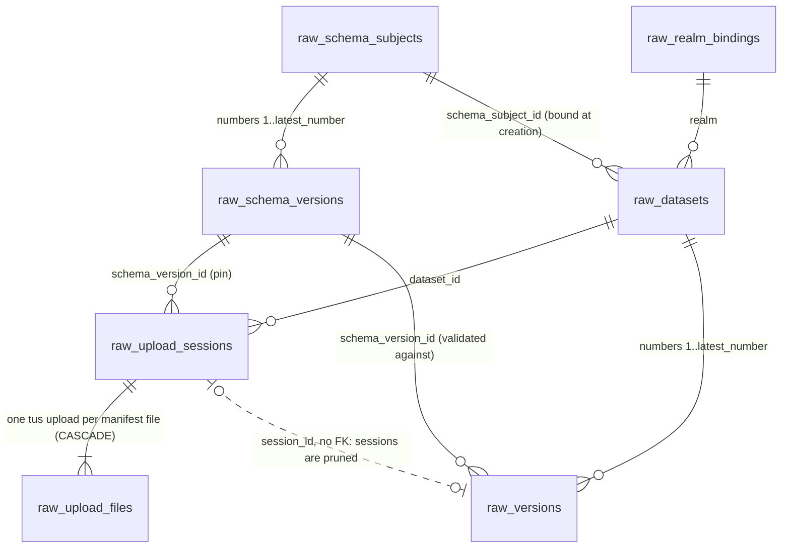

`raw_storage_roots` stands alone: `raw_datasets.storage_root` names a configured key, not a
foreign key, because a root is recorded at its first startup, which a dataset row never waits for
(D-172).

Every foreign key is `ON DELETE RESTRICT`, except `raw_upload_files.session_id`, which is
`ON DELETE CASCADE`: a pruned session takes its file rows with it, and
`raw_upload_files_cascade_only` refuses every other delete of a file row (D-176). `raw_versions.session_id`
deliberately has no foreign key (D-64), so pruning a session never touches its version.

### 10.3 Migration chain

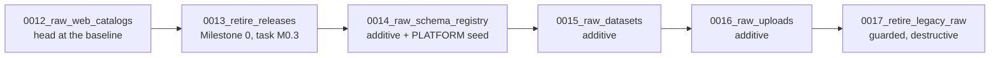

| Revision | Lands with (D-81) | Creates or changes | Data written | Locks on existing tables | `downgrade()` |
|---|---|---|---|---|---|
| `0014_raw_schema_registry` | slice 2, the registry task | `raw_refuse`; `raw_schema_subjects`, `raw_schema_versions`; 5 triggers, 2 of them deferred constraint triggers (D-176) | PLATFORM subject `huron.raw.metadata` and its version 1 | none | raises: a dropped registry would orphan every pinned `schema.json` |
| `0015_raw_datasets` | slice 3, the first dataset task | `raw_realm_bindings`, `raw_storage_roots` (D-172), `raw_datasets`; 4 triggers; 6 indexes | none | none | raises: the rows are the only map from a Polaris table's `huron.raw.dataset-id` to its locator and placement |
| `0016_raw_uploads` | slice 4, its first task after the legacy-removal task (offset ledger, D-137) | `raw_upload_sessions`, `raw_upload_files`, `raw_versions`; 9 triggers, 2 of them deferred constraint triggers and 2 on `raw_datasets`, which read the new tables (D-167, D-176); 12 indexes | none | none | raises: version rows record published bytes that stay in catalog storage |
| `0017_retire_legacy_raw` | slice 7, with `scripts/raw_reset.py`; the code that read the legacy tables left in slice 4's legacy-removal task (D-137) | drops 9 tables and 4 functions | refuses legacy rows unless `-x raw_reset=yes` | `ACCESS EXCLUSIVE` on the 9 dropped tables (unused by then) | raises: irreversible, the rows are discarded (OD-4) |

Each task's contract run must touch only tables that exist at its head, so the store methods arrive
by slice (D-139):

| Slice (head) | Store methods and services it adds (§8.6, §8.7) |
|---|---|
| 2 (`0014`) | `SchemaStore` and `SchemaTransaction` without `bind_realm`, and the registry's PLATFORM half. Every catalog-scoped registry call reads `raw_realm_bindings` (`DatasetStore.realm_endpoint`, D-89), and subject creation writes it (`bind_realm`, D-150), so catalog subjects, their versions and their deprecation land in slice 3, after `0015`. |
| 3 (`0015`) | `DatasetStore`: `transaction`, `dataset`, `dataset_at`, `datasets`, `realm_endpoint`. `DatasetTransaction`: the `RawTransaction` methods, `lock_dataset` without its second statement, the COMMITTING read (it reports `committing = False`, D-167), `transition_dataset` for PENDING → ACTIVE, `bind_realm`, `reserve_placement`, `insert_dataset`, `discard_dataset`. `MaintenanceStore.referenced_roots`, `storage_roots` and `record_root` (D-172). `DatasetService.create`, `get`, `by_target`, `mine`, and `report` for `REGISTERED` and `CONFLICT`. The registry's catalog half, with `SchemaTransaction.bind_realm` (D-150). |
| 4 (`0016`) | In the `0016` task, `lock_dataset`'s second statement, the COMMITTING read (D-167). Then `bump_dataset`, `UploadStore`, `UploadTransaction`, `OffsetLedger` and `ChunkTransaction`, the `VersionStore` reads that commit replay needs, `MaintenanceStore.claim`, `heartbeat` and `complete` for `VERIFY_FILE` and `FINISH_COMMIT`, and `MaintenanceStore.report` for publication's findings. |
| 5 | The rest of `VersionStore` and `VersionTransaction`; `DatasetTransaction.end_open_sessions` and `release_dataset`; `DatasetStore.record_parked`; `DatasetService.archive`, `unarchive`, `delete` and the `RELEASED` report outcome (routes 7–9 and route 6's `RELEASED`). |
| 6 | `MaintenanceStore.expire_sessions`, `inventory` and `prune`, and `claim`/`complete` for `REAP_STAGING`, `PARK_*` and `PURGE_*`. |

`0013_retire_releases` is not part of this design's chain. Milestone 0 task M0.3 adds it after the
baseline head: it drops `releases`, `releases_immutable()` and their indexes, deletes the
`release.create` rows of `role_capabilities` and `capabilities`, and refuses downgrade (D-124).

The chain migrates both databases that run it: the main metastore (`huron`, port 5433,
`make migrate`) and the local Raw service database (`huron_raw`, port 5440,
`scripts/polaris-dev.sh:110`). Neither needs a separate baseline. Each task carries at most one of
these revisions, and the same commit moves the `-- Reflects:` stamp in `migrations/schema.sql`
(§10.12).

One existing test pins the head by name and must change in every task that moves the head.
`tests/contract/test_commit_intents.py:258-260` upgrades to `"head"` and then asserts the head's
name; M0.3 re-pinned it to `"0013_retire_releases"`, so the `0014` task changes it. It switches to
`command.upgrade(_config(url), "0012_raw_web_catalogs")` and asserts that revision. The test is about `0011`'s refusal, so pinning the revision it exercises
is correct, and it keeps passing after `0017`. `0017` would otherwise refuse that test's leftover
FAILED legacy session. Slice 4's legacy-removal task deletes this file together with the rest of
the legacy suites, and `tests/contract/test_raw_commit.py` carries its commit evidence (D-83,
D-137; §21.2 row 9).

### 10.4 `0014_raw_schema_registry`

File `migrations/versions/0014_raw_schema_registry.py`. It has `revision = "0014_raw_schema_registry"`
and `down_revision = "0013_retire_releases"`. `upgrade()` runs `execute_sql(DDL)`, then
`execute_sql(SEED)`. `downgrade()` raises
`RuntimeError("the Raw schema registry cannot be downgraded: versions pin its rows")`.

```sql
-- DDL (r"""…""")
CREATE FUNCTION raw_refuse(rule text, detail text) RETURNS void LANGUAGE plpgsql AS $$
BEGIN
    RAISE EXCEPTION '%: %', rule, detail USING ERRCODE = '23514', CONSTRAINT = rule;
END $$;

CREATE TABLE raw_schema_subjects (
    id uuid PRIMARY KEY,
    scope text NOT NULL CHECK (scope IN ('PLATFORM', 'CATALOG')),
    realm text CHECK (length(realm) BETWEEN 1 AND 256),
    catalog text CHECK (length(catalog) BETWEEN 1 AND 256),
    name text NOT NULL CHECK (name ~ '^[a-z0-9][a-z0-9._-]{0,127}$'),
    description text NOT NULL DEFAULT '' CHECK (length(description) <= 4000),
    latest_number integer NOT NULL DEFAULT 0 CHECK (latest_number BETWEEN 0 AND 999999),
    created_by text NOT NULL,
    created_at timestamptz NOT NULL,
    CONSTRAINT raw_schema_subjects_scope_shape CHECK (
        (scope = 'PLATFORM' AND realm IS NULL AND catalog IS NULL)
        OR (scope = 'CATALOG' AND realm IS NOT NULL AND catalog IS NOT NULL)),
    CONSTRAINT raw_schema_subjects_name UNIQUE NULLS NOT DISTINCT (realm, catalog, name)
);

CREATE TABLE raw_schema_versions (
    id uuid PRIMARY KEY,
    subject_id uuid NOT NULL REFERENCES raw_schema_subjects (id) ON DELETE RESTRICT,
    number integer NOT NULL CHECK (number BETWEEN 1 AND 999999),
    document bytea NOT NULL CHECK (octet_length(document) BETWEEN 2 AND 262144),
    document_sha256 text GENERATED ALWAYS AS (encode(sha256(document), 'hex')) STORED,
    state text NOT NULL DEFAULT 'ACTIVE' CHECK (state IN ('ACTIVE', 'DEPRECATED')),
    created_by text NOT NULL,
    created_at timestamptz NOT NULL,
    deprecated_at timestamptz,
    CONSTRAINT raw_schema_versions_number UNIQUE (subject_id, number),
    CONSTRAINT raw_schema_versions_content UNIQUE (subject_id, document_sha256),
    CONSTRAINT raw_schema_versions_deprecation_shape
        CHECK ((state = 'DEPRECATED') = (deprecated_at IS NOT NULL))
);

CREATE FUNCTION raw_schema_subjects_identity() RETURNS trigger LANGUAGE plpgsql AS $$
BEGIN
    IF TG_OP = 'DELETE' THEN
        PERFORM raw_refuse(TG_NAME, format('subject %s is never deleted', OLD.id));
    END IF;
    IF ROW(NEW.id, NEW.scope, NEW.realm, NEW.catalog, NEW.name, NEW.description,
           NEW.created_by, NEW.created_at)
       IS DISTINCT FROM
       ROW(OLD.id, OLD.scope, OLD.realm, OLD.catalog, OLD.name, OLD.description,
           OLD.created_by, OLD.created_at) THEN
        PERFORM raw_refuse(TG_NAME, 'only latest_number of a subject changes');
    END IF;
    IF NEW.latest_number NOT IN (OLD.latest_number, OLD.latest_number + 1) THEN
        PERFORM raw_refuse(TG_NAME, format('latest_number %s -> %s', OLD.latest_number,
                                           NEW.latest_number));
    END IF;
    RETURN NEW;
END $$;
CREATE TRIGGER raw_schema_subjects_identity BEFORE UPDATE OR DELETE ON raw_schema_subjects
    FOR EACH ROW EXECUTE FUNCTION raw_schema_subjects_identity();

CREATE FUNCTION raw_schema_versions_contiguous() RETURNS trigger LANGUAGE plpgsql AS $$
DECLARE
    latest integer;
BEGIN
    SELECT latest_number INTO latest FROM raw_schema_subjects
     WHERE id = NEW.subject_id FOR SHARE;
    IF NOT FOUND THEN
        RETURN NEW;  -- the foreign key reports the missing subject (23503)
    END IF;
    IF NEW.number <> latest + 1 THEN
        PERFORM raw_refuse(TG_NAME, format('version %s of subject %s follows latest_number %s',
                                           NEW.number, NEW.subject_id, latest));
    END IF;
    IF NEW.state <> 'ACTIVE' THEN
        PERFORM raw_refuse(TG_NAME, 'a schema version is registered ACTIVE');
    END IF;
    RETURN NEW;
END $$;
CREATE TRIGGER raw_schema_versions_contiguous BEFORE INSERT ON raw_schema_versions
    FOR EACH ROW EXECUTE FUNCTION raw_schema_versions_contiguous();

CREATE FUNCTION raw_schema_versions_immutable() RETURNS trigger LANGUAGE plpgsql AS $$
BEGIN
    IF TG_OP = 'DELETE' THEN
        PERFORM raw_refuse(TG_NAME, format('schema version %s is never deleted', OLD.id));
    END IF;
    IF ROW(NEW.id, NEW.subject_id, NEW.number, NEW.document, NEW.created_by, NEW.created_at)
       IS DISTINCT FROM
       ROW(OLD.id, OLD.subject_id, OLD.number, OLD.document, OLD.created_by, OLD.created_at) THEN
        PERFORM raw_refuse(TG_NAME, 'a schema version keeps its identity and bytes');
    END IF;
    IF ROW(NEW.state, NEW.deprecated_at) IS DISTINCT FROM ROW(OLD.state, OLD.deprecated_at)
       AND NOT (OLD.state = 'ACTIVE' AND NEW.state = 'DEPRECATED') THEN
        PERFORM raw_refuse(TG_NAME, format('state %s -> %s; only ACTIVE -> DEPRECATED',
                                           OLD.state, NEW.state));
    END IF;
    RETURN NEW;
END $$;
CREATE TRIGGER raw_schema_versions_immutable BEFORE UPDATE OR DELETE ON raw_schema_versions
    FOR EACH ROW EXECUTE FUNCTION raw_schema_versions_immutable();

-- D-176: the counter and its rows move in one transaction, checked at COMMIT.
CREATE FUNCTION raw_schema_versions_counted() RETURNS trigger LANGUAGE plpgsql AS $$
BEGIN
    PERFORM 1 FROM raw_schema_subjects
     WHERE id = NEW.subject_id AND latest_number >= NEW.number;
    IF NOT FOUND THEN
        PERFORM raw_refuse(TG_NAME, format('version %s of subject %s is not counted by latest_number',
                                           NEW.number, NEW.subject_id));
    END IF;
    RETURN NULL;
END $$;
CREATE CONSTRAINT TRIGGER raw_schema_versions_counted AFTER INSERT ON raw_schema_versions
    DEFERRABLE INITIALLY DEFERRED
    FOR EACH ROW EXECUTE FUNCTION raw_schema_versions_counted();

CREATE FUNCTION raw_schema_subjects_latest_recorded() RETURNS trigger LANGUAGE plpgsql AS $$
BEGIN
    PERFORM 1 FROM raw_schema_versions
     WHERE subject_id = NEW.id AND number = NEW.latest_number;
    IF NOT FOUND THEN
        PERFORM raw_refuse(TG_NAME, format('subject %s counts version %s, which does not exist',
                                           NEW.id, NEW.latest_number));
    END IF;
    RETURN NULL;
END $$;
CREATE CONSTRAINT TRIGGER raw_schema_subjects_latest_recorded
    AFTER UPDATE OF latest_number ON raw_schema_subjects
    DEFERRABLE INITIALLY DEFERRED
    FOR EACH ROW WHEN (NEW.latest_number <> OLD.latest_number)
    EXECUTE FUNCTION raw_schema_subjects_latest_recorded();
```

`SEED` is a second block, built in Python so that the document travels as hex digits and never
needs SQL quoting:

```python
SEED_SUBJECT_ID = "018f0000-0000-7000-8000-000000000001"   # D-56
SEED_VERSION_ID = "018f0000-0000-7000-8000-000000000002"   # the global schema version id
SEED_DOCUMENT: bytes = b'{"$schema":"https://json-schema.org/draft/2020-12/schema",...}'
#   ^ the RFC 8785 bytes of src/huron/schema/documents/raw-metadata-v1.json, frozen here;
#     tests/contract/test_raw_schema.py pins SEED_DOCUMENT == canonical_bytes(packaged file)
SEED = f"""
INSERT INTO raw_schema_subjects (id, scope, name, description, created_by, created_at)
VALUES ('{SEED_SUBJECT_ID}', 'PLATFORM', 'huron.raw.metadata',
        'Descriptive metadata of every Raw version: title, description, creators, tags, source, coverage and extensions.',
        'huron-migration', now());
INSERT INTO raw_schema_versions (id, subject_id, number, document, created_by, created_at)
VALUES ('{SEED_VERSION_ID}', '{SEED_SUBJECT_ID}', 1, decode('{SEED_DOCUMENT.hex()}', 'hex'),
        'huron-migration', now());
UPDATE raw_schema_subjects SET latest_number = 1 WHERE id = '{SEED_SUBJECT_ID}';
"""
```

- The seed goes through the same triggers as every later registration.
  `raw_schema_versions_contiguous` accepts number 1 because `latest_number` is 0, and
  `raw_schema_subjects_identity` accepts 0 → 1. Alembic runs the whole upgrade in one transaction
  (§10.1), so at its `COMMIT` the deferred `raw_schema_versions_counted` finds `latest_number = 1`
  and `raw_schema_subjects_latest_recorded` finds version 1 (D-176).
- The bytes are frozen in the revision instead of being read from the package at migration time.
  A migration is history, so editing `raw-metadata-v1.json` must not change what a fresh database
  receives. The parity test catches any edit to the packaged file. A new PLATFORM schema version is
  a new packaged file and a new migration (D-56).
- `metastore` may not import `huron.schema` (D-77), and the migration does not either. The contract
  test is the only place where the packaged file and the seed meet.
- The application flow is the same as the seed's. `SchemaRegistry.register` locks the subject row
  `FOR UPDATE`, looks up `(subject_id, document_sha256)` for deduplication, inserts number
  `latest_number + 1`, then sets `latest_number = latest_number + 1`, all in one transaction (D-56).
  Two concurrent registrations of the same bytes therefore serialize on the subject row. The second
  one finds the first row and answers `200`. `raw_schema_versions_content` is the backstop.

### 10.5 `0015_raw_datasets`

File `migrations/versions/0015_raw_datasets.py`. It has `down_revision = "0014_raw_schema_registry"`.
`upgrade()` runs `execute_sql(DDL)`. `downgrade()` raises
`RuntimeError("Raw datasets cannot be downgraded: their placements and Polaris tables remain")`.

```sql
CREATE TABLE raw_realm_bindings (
    realm text PRIMARY KEY CHECK (length(realm) BETWEEN 1 AND 256),
    endpoint text NOT NULL CHECK (length(endpoint) BETWEEN 1 AND 2048),
    bound_at timestamptz NOT NULL DEFAULT now()
);
CREATE FUNCTION raw_realm_bindings_immutable() RETURNS trigger LANGUAGE plpgsql AS $$
BEGIN
    PERFORM raw_refuse(TG_NAME, format('realm %s stays bound to its first endpoint', OLD.realm));
    RETURN NULL;
END $$;
CREATE TRIGGER raw_realm_bindings_immutable BEFORE UPDATE OR DELETE ON raw_realm_bindings
    FOR EACH ROW EXECUTE FUNCTION raw_realm_bindings_immutable();

CREATE TABLE raw_storage_roots (       -- D-172: one row per initialized storage root
    key text PRIMARY KEY CHECK (key ~ '^[a-z][a-z0-9-]{0,62}$'),
    uri text NOT NULL CHECK (uri ~ '^file:///' AND uri ~ '/$' AND length(uri) <= 4096),
    root_id uuid NOT NULL UNIQUE,
    initialized_at timestamptz NOT NULL DEFAULT now()
);
CREATE FUNCTION raw_storage_roots_immutable() RETURNS trigger LANGUAGE plpgsql AS $$
BEGIN
    PERFORM raw_refuse(TG_NAME, format('storage root %s keeps the identity it was initialized with',
                                       OLD.key));
    RETURN NULL;
END $$;
CREATE TRIGGER raw_storage_roots_immutable BEFORE UPDATE OR DELETE ON raw_storage_roots
    FOR EACH ROW EXECUTE FUNCTION raw_storage_roots_immutable();

CREATE TABLE raw_datasets (
    id uuid PRIMARY KEY,
    realm text NOT NULL REFERENCES raw_realm_bindings (realm) ON DELETE RESTRICT,
    catalog text NOT NULL CHECK (length(catalog) BETWEEN 1 AND 256),
    namespace text[] NOT NULL CHECK (cardinality(namespace) BETWEEN 1 AND 32),
    name text NOT NULL CHECK (length(name) BETWEEN 1 AND 256),
    title text NOT NULL CHECK (length(title) BETWEEN 1 AND 256),
    description text NOT NULL DEFAULT '' CHECK (length(description) <= 9000),
    schema_subject_id uuid NOT NULL REFERENCES raw_schema_subjects (id) ON DELETE RESTRICT,
    storage_root text NOT NULL CHECK (storage_root ~ '^[a-z][a-z0-9-]{0,62}$'),
    storage_path text NOT NULL CHECK (
        octet_length(storage_path) BETWEEN 1 AND 4096
        AND storage_path !~ '(^/|/$|//|(^|/)\.\.?(/|$))'
        AND storage_path !~ '^\.huron(/|$)'),
    placement_key text NOT NULL CHECK (octet_length(placement_key) BETWEEN 1 AND 16384),
        -- DatasetPlacement.placement_key: NFC(casefold(NFC(storage_path))), computed in Python (D-164)
    base_location text NOT NULL CHECK (
        base_location ~ '^file:///' AND base_location ~ '/$' AND length(base_location) <= 4096),
    catalog_base_location text NOT NULL CHECK (length(catalog_base_location) BETWEEN 1 AND 4096),
    create_request bytea NOT NULL CHECK (octet_length(create_request) <= 65536),
    create_request_sha256 text GENERATED ALWAYS AS (encode(sha256(create_request), 'hex')) STORED,
    state text NOT NULL DEFAULT 'PENDING'
        CHECK (state IN ('PENDING', 'ACTIVE', 'ARCHIVED', 'DELETED')),
    etag bigint NOT NULL DEFAULT 1 CHECK (etag >= 1),
    latest_number integer NOT NULL DEFAULT 0 CHECK (latest_number BETWEEN 0 AND 999999),
    created_by text NOT NULL,
    created_at timestamptz NOT NULL,
    registered_at timestamptz,
    state_changed_by text NOT NULL,
    state_changed_at timestamptz NOT NULL,
    deleted_at timestamptz,
    purge_after timestamptz,
    parked_at timestamptz,
    purged_at timestamptz,
    released_at timestamptz,
    work_token uuid,
    work_expires_at timestamptz,
    CONSTRAINT raw_datasets_placement_shape
        CHECK (right(base_location, length(storage_path) + 2) = '/' || storage_path || '/'),
    CONSTRAINT raw_datasets_registration_shape
        CHECK (state = 'DELETED' OR ((state = 'PENDING') = (registered_at IS NULL))),
    CONSTRAINT raw_datasets_pending_empty CHECK (state <> 'PENDING' OR latest_number = 0),
    CONSTRAINT raw_datasets_deletion_shape CHECK (
        ((state = 'DELETED') = (deleted_at IS NOT NULL))
        AND ((deleted_at IS NULL) = (purge_after IS NULL))),
    CONSTRAINT raw_datasets_tombstone_shape CHECK (
        state = 'DELETED' OR (parked_at IS NULL AND purged_at IS NULL AND released_at IS NULL)),
    CONSTRAINT raw_datasets_purge_shape CHECK (purged_at IS NULL OR parked_at IS NOT NULL),
    CONSTRAINT raw_datasets_work_shape CHECK ((work_token IS NULL) = (work_expires_at IS NULL))
);
CREATE UNIQUE INDEX raw_datasets_live_locator ON raw_datasets (realm, catalog, namespace, name)
    WHERE released_at IS NULL;
CREATE UNIQUE INDEX raw_datasets_placement ON raw_datasets (storage_root, placement_key)
    WHERE state <> 'DELETED' OR parked_at IS NULL;
CREATE INDEX raw_datasets_pending_owner ON raw_datasets (created_by, created_at)
    WHERE state = 'PENDING';
CREATE INDEX raw_datasets_park_due ON raw_datasets (deleted_at)
    WHERE state = 'DELETED' AND parked_at IS NULL;
CREATE INDEX raw_datasets_purge_due ON raw_datasets (purge_after)
    WHERE state = 'DELETED' AND purged_at IS NULL;
CREATE INDEX raw_datasets_schema_subject ON raw_datasets (schema_subject_id);

CREATE FUNCTION raw_datasets_identity() RETURNS trigger LANGUAGE plpgsql AS $$
DECLARE
    counted boolean;
BEGIN
    IF ROW(NEW.id, NEW.realm, NEW.catalog, NEW.namespace, NEW.name, NEW.title, NEW.description,
           NEW.schema_subject_id, NEW.storage_root, NEW.storage_path, NEW.placement_key,
           NEW.base_location, NEW.catalog_base_location, NEW.create_request, NEW.created_by,
           NEW.created_at)
       IS DISTINCT FROM
       ROW(OLD.id, OLD.realm, OLD.catalog, OLD.namespace, OLD.name, OLD.title, OLD.description,
           OLD.schema_subject_id, OLD.storage_root, OLD.storage_path, OLD.placement_key,
           OLD.base_location, OLD.catalog_base_location, OLD.create_request, OLD.created_by,
           OLD.created_at) THEN
        PERFORM raw_refuse(TG_NAME, 'identity, locator, placement and create request are immutable');
    END IF;
    IF NEW.state IS DISTINCT FROM OLD.state AND NOT (
           (OLD.state = 'PENDING'  AND NEW.state IN ('ACTIVE', 'DELETED'))
        OR (OLD.state = 'ACTIVE'   AND NEW.state IN ('ARCHIVED', 'DELETED'))
        OR (OLD.state = 'ARCHIVED' AND NEW.state IN ('ACTIVE', 'DELETED'))) THEN
        PERFORM raw_refuse(TG_NAME, format('state %s -> %s is not a dataset transition',
                                           OLD.state, NEW.state));
    END IF;
    IF (OLD.registered_at IS NOT NULL AND NEW.registered_at IS DISTINCT FROM OLD.registered_at)
       OR (OLD.deleted_at IS NOT NULL AND NEW.deleted_at IS DISTINCT FROM OLD.deleted_at)
       OR (OLD.purge_after IS NOT NULL AND NEW.purge_after IS DISTINCT FROM OLD.purge_after)
       OR (OLD.parked_at IS NOT NULL AND NEW.parked_at IS DISTINCT FROM OLD.parked_at)
       OR (OLD.purged_at IS NOT NULL AND NEW.purged_at IS DISTINCT FROM OLD.purged_at)
       OR (OLD.released_at IS NOT NULL AND NEW.released_at IS DISTINCT FROM OLD.released_at) THEN
        PERFORM raw_refuse(TG_NAME, 'lifecycle facts are written once');
    END IF;
    IF OLD.registered_at IS NULL AND NEW.registered_at IS NOT NULL
       AND NOT (OLD.state = 'PENDING' AND NEW.state = 'ACTIVE') THEN
        PERFORM raw_refuse(TG_NAME, 'registered_at is set only by PENDING -> ACTIVE');
    END IF;
    IF NEW.latest_number <> OLD.latest_number
       AND (NEW.latest_number <> OLD.latest_number + 1
            OR OLD.state <> 'ACTIVE' OR NEW.state <> 'ACTIVE') THEN
        PERFORM raw_refuse(TG_NAME, format('latest_number %s -> %s while %s', OLD.latest_number,
                                           NEW.latest_number, OLD.state));
    END IF;
    counted := NEW.state IS DISTINCT FROM OLD.state
        OR NEW.registered_at IS DISTINCT FROM OLD.registered_at
        OR NEW.released_at IS DISTINCT FROM OLD.released_at
        OR NEW.latest_number <> OLD.latest_number;
    IF (counted AND NEW.etag <> OLD.etag + 1)
       OR (NOT counted AND NEW.etag NOT IN (OLD.etag, OLD.etag + 1)) THEN
        PERFORM raw_refuse(TG_NAME, format('etag %s -> %s', OLD.etag, NEW.etag));
    END IF;
    RETURN NEW;
END $$;
CREATE TRIGGER raw_datasets_identity BEFORE UPDATE ON raw_datasets
    FOR EACH ROW EXECUTE FUNCTION raw_datasets_identity();

CREATE FUNCTION raw_datasets_discard() RETURNS trigger LANGUAGE plpgsql AS $$
BEGIN
    IF NOT (OLD.state = 'PENDING' AND OLD.latest_number = 0) THEN
        PERFORM raw_refuse(TG_NAME, format('dataset %s is %s; only a PENDING dataset is discarded',
                                           OLD.id, OLD.state));
    END IF;
    RETURN OLD;
END $$;
CREATE TRIGGER raw_datasets_discard BEFORE DELETE ON raw_datasets
    FOR EACH ROW EXECUTE FUNCTION raw_datasets_discard();
```

Notes on `raw_datasets`:
- **`etag` rule.** `etag` rises by exactly 1 whenever `state`, `registered_at`, `released_at` or
  `latest_number` changes. It may also rise by exactly 1 with none of them changing; that case is the
  version delete of D-48, which bumps the dataset etag. It never changes otherwise. Maintenance writes
  `parked_at`, `purged_at` and the work columns and leaves `etag` alone, so a user's `If-Match` survives
  park and purge. The flows section (§14.5) settles the same rule.
- **`raw_datasets_placement_shape`.** This CHECK holds the suffix half of D-12's derivation:
  `base_location` ends with `/`, `storage_path` and `/`. It cannot hold the prefix, because the
  root URI is not stored on the row: it lives in settings, `raw_storage_roots` records it per key,
  and the sentinel checks it (D-16, D-17, D-172). A row whose `base_location` names another prefix
  would therefore pass the CHECK. `derive` enforces the prefix at creation, and `PosixStorageRoots`
  refuses such a placement before any I/O (`placement_mismatch`, D-175), so a row can never tell
  Polaris one location while Huron writes another (OD-9 f).
- **`raw_storage_roots` (D-172).** One row per storage root ever initialized, written by the
  lifespan wiring after `PosixStorageRoots.open` found or wrote the root's sentinel, and kept
  immutable by `raw_storage_roots_immutable`. Re-initializing a root is the reviewed operator step
  of §9.6.5, in the same form as moving a realm's endpoint below: disable the trigger, delete the
  row, enable it, and move the old `root.json` aside.
- **Occupation predicate.** `raw_datasets_placement` uses the occupation predicate of D-16 verbatim. It
  backstops exact-path collisions. D-13's nesting check runs in the create transaction under
  `pg_advisory_xact_lock(hashtextextended('raw-placement:' || $root, 0))`, using the statement in §10.7.
- **`placement_key` (D-164).** Both the index and the nesting check compare
  `NFC(casefold(NFC(storage_path)))`, not `storage_path`. Names that differ only in case (APFS's
  default, SMB, ext4 with casefold) or only in Unicode normalization (APFS) name one directory, and
  `storage_path` alone would let two datasets share it. Folding is computed in Python
  (`DatasetPlacement.placement_key`), because PostgreSQL's `lower()` follows the collation and is not
  Unicode case folding; the adapter writes it, and `raw_datasets_identity` keeps it immutable. Its
  CHECK is four times `storage_path`'s 4,096 bytes, a ceiling no input reaches (§10.8): the fold
  expands UTF-8 text at most threefold per code point (measured over every code point, Unicode
  16.0).
- **`raw_datasets_pending_owner`.** This index serves the owner-scoped
  `GET /api/v1/raw/datasets?state=PENDING` list that §13.1 adds for "Finish registration" and
  discard.
- **Moving a realm's endpoint.** D-7's reviewed operator step is the only writer
  `raw_realm_bindings_immutable` allows, and it needs the table owner:
  `BEGIN; ALTER TABLE raw_realm_bindings DISABLE TRIGGER raw_realm_bindings_immutable;
  UPDATE raw_realm_bindings SET endpoint = '<endpoint>' WHERE realm = '<realm>';
  ALTER TABLE raw_realm_bindings ENABLE TRIGGER raw_realm_bindings_immutable; COMMIT;`.
  The operator docs carry it verbatim.

### 10.6 `0016_raw_uploads`

The revision lives in `migrations/versions/0016_raw_uploads.py`, with
`down_revision = "0015_raw_datasets"`. `upgrade()` calls `execute_sql(DDL)`. `downgrade()` raises
`RuntimeError("Raw uploads and versions cannot be downgraded: version rows record published bytes")`.

```sql
CREATE TABLE raw_upload_sessions (
    id uuid PRIMARY KEY,
    dataset_id uuid NOT NULL REFERENCES raw_datasets (id) ON DELETE RESTRICT,
    state text NOT NULL DEFAULT 'OPEN'
        CHECK (state IN ('OPEN', 'COMMITTING', 'COMMITTED', 'ABORTED', 'FAILED')),
    end_reason text CHECK (end_reason IN
        ('CLIENT', 'EXPIRED', 'DATASET_ARCHIVED', 'DATASET_DELETED', 'STAGING_LOST')),
    manifest bytea NOT NULL,
    manifest_sha256 text GENERATED ALWAYS AS (encode(sha256(manifest), 'hex')) STORED,
    metadata bytea NOT NULL CHECK (octet_length(metadata) <= 1048576),
    metadata_sha256 text GENERATED ALWAYS AS (encode(sha256(metadata), 'hex')) STORED,
    schema_version_id uuid NOT NULL REFERENCES raw_schema_versions (id) ON DELETE RESTRICT,
    file_count integer NOT NULL CHECK (file_count BETWEEN 1 AND 10000),
    total_bytes bigint NOT NULL CHECK (total_bytes BETWEEN 0 AND 1099511627776),
    created_by text NOT NULL,
    created_at timestamptz NOT NULL,
    expires_at timestamptz NOT NULL,
    deadline_at timestamptz NOT NULL,
    number integer CHECK (number BETWEEN 1 AND 999999),
    version_id uuid UNIQUE,
    version_document bytea CHECK (octet_length(version_document) <= 65536),
    committing_at timestamptz,
    ended_at timestamptz,
    staging_reaped_at timestamptz,
    work_token uuid,
    work_expires_at timestamptz,
    CONSTRAINT raw_upload_sessions_expiry_shape CHECK (expires_at <= deadline_at),
    CONSTRAINT raw_upload_sessions_open_shape CHECK (state NOT IN ('OPEN', 'ABORTED') OR (
        number IS NULL AND version_id IS NULL AND version_document IS NULL
        AND committing_at IS NULL)),
    CONSTRAINT raw_upload_sessions_commit_shape CHECK (
        state NOT IN ('COMMITTING', 'COMMITTED', 'FAILED') OR (
        number IS NOT NULL AND version_id IS NOT NULL AND version_document IS NOT NULL
        AND committing_at IS NOT NULL)),
    CONSTRAINT raw_upload_sessions_lease_shape CHECK (state <> 'COMMITTING' OR work_token IS NOT NULL),
    CONSTRAINT raw_upload_sessions_end_shape
        CHECK ((state IN ('COMMITTED', 'ABORTED', 'FAILED')) = (ended_at IS NOT NULL)),
    CONSTRAINT raw_upload_sessions_reason_shape CHECK (
        (state = 'ABORTED' AND end_reason IS NOT NULL)
        OR (state = 'FAILED' AND end_reason = 'STAGING_LOST' AND committing_at IS NOT NULL)
        OR (state IN ('OPEN', 'COMMITTING', 'COMMITTED') AND end_reason IS NULL)),
    CONSTRAINT raw_upload_sessions_reap_shape CHECK (staging_reaped_at IS NULL OR ended_at IS NOT NULL),
    CONSTRAINT raw_upload_sessions_work_shape CHECK ((work_token IS NULL) = (work_expires_at IS NULL))
);
CREATE UNIQUE INDEX raw_upload_sessions_one_committing ON raw_upload_sessions (dataset_id)
    WHERE state = 'COMMITTING';
CREATE INDEX raw_upload_sessions_dataset ON raw_upload_sessions (dataset_id, state);
CREATE INDEX raw_upload_sessions_open_owner ON raw_upload_sessions (created_by, created_at DESC)
    WHERE state = 'OPEN';
CREATE INDEX raw_upload_sessions_expiry ON raw_upload_sessions (expires_at) WHERE state = 'OPEN';
CREATE INDEX raw_upload_sessions_committing ON raw_upload_sessions (work_expires_at)
    WHERE state = 'COMMITTING';
CREATE INDEX raw_upload_sessions_reap ON raw_upload_sessions (ended_at)
    WHERE staging_reaped_at IS NULL AND state IN ('COMMITTED', 'ABORTED', 'FAILED');
CREATE INDEX raw_upload_sessions_prune ON raw_upload_sessions (staging_reaped_at)
    WHERE staging_reaped_at IS NOT NULL;

CREATE FUNCTION raw_upload_sessions_frozen() RETURNS trigger LANGUAGE plpgsql AS $$
BEGIN
    IF TG_OP = 'DELETE' THEN
        IF OLD.staging_reaped_at IS NULL THEN
            PERFORM raw_refuse(TG_NAME, format('session %s is pruned only after its staging is reaped',
                                               OLD.id));
        END IF;
        RETURN OLD;
    END IF;
    IF ROW(NEW.id, NEW.dataset_id, NEW.manifest, NEW.metadata, NEW.schema_version_id,
           NEW.file_count, NEW.total_bytes, NEW.created_by, NEW.created_at, NEW.deadline_at)
       IS DISTINCT FROM
       ROW(OLD.id, OLD.dataset_id, OLD.manifest, OLD.metadata, OLD.schema_version_id,
           OLD.file_count, OLD.total_bytes, OLD.created_by, OLD.created_at, OLD.deadline_at) THEN
        PERFORM raw_refuse(TG_NAME, 'manifest, metadata, schema pin, size and deadline are frozen');
    END IF;
    IF NEW.state IS DISTINCT FROM OLD.state AND NOT (
           (OLD.state = 'OPEN' AND NEW.state IN ('COMMITTING', 'ABORTED'))
        OR (OLD.state = 'COMMITTING' AND NEW.state IN ('COMMITTED', 'FAILED'))) THEN
        PERFORM raw_refuse(TG_NAME, format('state %s -> %s is not a session transition',
                                           OLD.state, NEW.state));
    END IF;
    IF (OLD.number IS NOT NULL AND NEW.number IS DISTINCT FROM OLD.number)
       OR (OLD.version_id IS NOT NULL AND NEW.version_id IS DISTINCT FROM OLD.version_id)
       OR (OLD.version_document IS NOT NULL
           AND NEW.version_document IS DISTINCT FROM OLD.version_document)
       OR (OLD.committing_at IS NOT NULL AND NEW.committing_at IS DISTINCT FROM OLD.committing_at)
       OR (OLD.end_reason IS NOT NULL AND NEW.end_reason IS DISTINCT FROM OLD.end_reason)
       OR (OLD.ended_at IS NOT NULL AND NEW.ended_at IS DISTINCT FROM OLD.ended_at)
       OR (OLD.staging_reaped_at IS NOT NULL
           AND NEW.staging_reaped_at IS DISTINCT FROM OLD.staging_reaped_at) THEN
        PERFORM raw_refuse(TG_NAME, 'commit and end facts are written once');
    END IF;
    RETURN NEW;
END $$;
CREATE TRIGGER raw_upload_sessions_frozen BEFORE UPDATE OR DELETE ON raw_upload_sessions
    FOR EACH ROW EXECUTE FUNCTION raw_upload_sessions_frozen();

CREATE TABLE raw_upload_files (
    id uuid PRIMARY KEY,
    session_id uuid NOT NULL REFERENCES raw_upload_sessions (id) ON DELETE CASCADE,
    path text NOT NULL CHECK (path LIKE 'payload/%' AND octet_length(path) <= 1024),
    size bigint NOT NULL CHECK (size BETWEEN 0 AND 10737418240),
    sha256 text NOT NULL CHECK (sha256 ~ '^[0-9a-f]{64}$'),
    media_type text NOT NULL CHECK (length(media_type) BETWEEN 1 AND 255),
    state text NOT NULL DEFAULT 'RECEIVING' CHECK (state IN ('RECEIVING', 'RECEIVED', 'VERIFIED')),
    upload_offset bigint NOT NULL DEFAULT 0,
    writer_epoch bigint NOT NULL DEFAULT 0 CHECK (writer_epoch >= 0),
    stream_owner text,
    stream_expires_at timestamptz,
    verified_fingerprint text CHECK (length(verified_fingerprint) BETWEEN 1 AND 256),
    last_error text CHECK (last_error IN ('DIGEST_MISMATCH', 'SCRATCH_LOST')),
    received_at timestamptz,
    verified_at timestamptz,
    work_token uuid,
    work_expires_at timestamptz,
    CONSTRAINT raw_upload_files_path UNIQUE (session_id, path),
    CONSTRAINT raw_upload_files_offset CHECK (upload_offset BETWEEN 0 AND size),
    CONSTRAINT raw_upload_files_state_shape CHECK (
        (state = 'RECEIVING' AND upload_offset < size AND verified_fingerprint IS NULL
            AND received_at IS NULL AND verified_at IS NULL)
        OR (state = 'RECEIVED' AND upload_offset = size AND verified_fingerprint IS NULL
            AND received_at IS NOT NULL AND verified_at IS NULL)
        OR (state = 'VERIFIED' AND upload_offset = size AND verified_fingerprint IS NOT NULL
            AND verified_at IS NOT NULL)),
    CONSTRAINT raw_upload_files_stream_shape CHECK ((stream_owner IS NULL) = (stream_expires_at IS NULL)),
    CONSTRAINT raw_upload_files_work_shape CHECK ((work_token IS NULL) = (work_expires_at IS NULL))
);
CREATE INDEX raw_upload_files_received ON raw_upload_files (received_at) WHERE state = 'RECEIVED';
CREATE INDEX raw_upload_files_streams ON raw_upload_files (stream_owner, stream_expires_at)
    WHERE stream_owner IS NOT NULL;

CREATE FUNCTION raw_upload_files_frozen() RETURNS trigger LANGUAGE plpgsql AS $$
BEGIN
    IF ROW(NEW.id, NEW.session_id, NEW.path, NEW.size, NEW.sha256, NEW.media_type)
       IS DISTINCT FROM
       ROW(OLD.id, OLD.session_id, OLD.path, OLD.size, OLD.sha256, OLD.media_type) THEN
        PERFORM raw_refuse(TG_NAME, 'a tus upload keeps its manifest entry');
    END IF;
    IF OLD.state = 'VERIFIED'
       AND ROW(NEW.state, NEW.upload_offset, NEW.verified_fingerprint, NEW.verified_at)
           IS DISTINCT FROM
           ROW(OLD.state, OLD.upload_offset, OLD.verified_fingerprint, OLD.verified_at) THEN
        PERFORM raw_refuse(TG_NAME, 'VERIFIED is final');
    END IF;
    IF NEW.state IS DISTINCT FROM OLD.state AND NOT (
           (OLD.state = 'RECEIVING' AND NEW.state = 'RECEIVED')
        OR (OLD.state = 'RECEIVED' AND NEW.state IN ('VERIFIED', 'RECEIVING'))) THEN
        PERFORM raw_refuse(TG_NAME, format('state %s -> %s is not a tus upload transition',
                                           OLD.state, NEW.state));
    END IF;
    IF NEW.writer_epoch < OLD.writer_epoch THEN
        PERFORM raw_refuse(TG_NAME, format('writer_epoch %s -> %s', OLD.writer_epoch,
                                           NEW.writer_epoch));
    END IF;
    IF NEW.upload_offset < OLD.upload_offset AND NEW.upload_offset <> 0 THEN
        PERFORM raw_refuse(TG_NAME, format('upload_offset %s -> %s; it only grows or resets to 0',
                                           OLD.upload_offset, NEW.upload_offset));
    END IF;
    RETURN NEW;
END $$;
CREATE TRIGGER raw_upload_files_frozen BEFORE UPDATE ON raw_upload_files
    FOR EACH ROW EXECUTE FUNCTION raw_upload_files_frozen();
```

```sql
-- 0016_raw_uploads, continued
CREATE TABLE raw_versions (
    id uuid PRIMARY KEY,
    dataset_id uuid NOT NULL REFERENCES raw_datasets (id) ON DELETE RESTRICT,
    number integer NOT NULL CHECK (number BETWEEN 1 AND 999999),
    session_id uuid NOT NULL UNIQUE,
    path text NOT NULL CHECK (octet_length(path) BETWEEN 1 AND 4200),
    manifest_sha256 text NOT NULL CHECK (manifest_sha256 ~ '^[0-9a-f]{64}$'),
    metadata_sha256 text NOT NULL CHECK (metadata_sha256 ~ '^[0-9a-f]{64}$'),
    schema_version_id uuid NOT NULL REFERENCES raw_schema_versions (id) ON DELETE RESTRICT,
    file_count integer NOT NULL CHECK (file_count BETWEEN 1 AND 10000),
    total_bytes bigint NOT NULL CHECK (total_bytes BETWEEN 0 AND 1099511627776),
    document bytea NOT NULL CHECK (octet_length(document) <= 65536),
    document_sha256 text GENERATED ALWAYS AS (encode(sha256(document), 'hex')) STORED,
    committed_by text NOT NULL,
    committed_at timestamptz NOT NULL,
    state text NOT NULL DEFAULT 'AVAILABLE' CHECK (state IN ('AVAILABLE', 'DELETED')),
    deleted_by text,
    deleted_at timestamptz,
    purge_after timestamptz,
    parked_at timestamptz,
    purged_at timestamptz,
    work_token uuid,
    work_expires_at timestamptz,
    CONSTRAINT raw_versions_number UNIQUE (dataset_id, number),
    CONSTRAINT raw_versions_deletion_shape CHECK (
        ((state = 'DELETED') = (deleted_at IS NOT NULL))
        AND ((deleted_at IS NULL) = (deleted_by IS NULL))
        AND ((deleted_at IS NULL) = (purge_after IS NULL))),
    CONSTRAINT raw_versions_tombstone_shape
        CHECK (state = 'DELETED' OR (parked_at IS NULL AND purged_at IS NULL)),
    CONSTRAINT raw_versions_purge_shape CHECK (purged_at IS NULL OR parked_at IS NOT NULL),
    CONSTRAINT raw_versions_work_shape CHECK ((work_token IS NULL) = (work_expires_at IS NULL))
);
CREATE INDEX raw_versions_schema_version ON raw_versions (schema_version_id);
CREATE INDEX raw_versions_park_due ON raw_versions (deleted_at)
    WHERE state = 'DELETED' AND parked_at IS NULL;
CREATE INDEX raw_versions_purge_due ON raw_versions (purge_after)
    WHERE state = 'DELETED' AND purged_at IS NULL;

CREATE FUNCTION raw_versions_contiguous() RETURNS trigger LANGUAGE plpgsql AS $$
DECLARE
    d raw_datasets%ROWTYPE;
BEGIN
    SELECT * INTO d FROM raw_datasets WHERE id = NEW.dataset_id FOR SHARE;
    IF NOT FOUND THEN
        RETURN NEW;  -- the foreign key reports the missing dataset (23503)
    END IF;
    IF d.state <> 'ACTIVE' THEN
        PERFORM raw_refuse(TG_NAME, format('dataset %s is %s', d.id, d.state));
    END IF;
    IF NEW.number <> d.latest_number + 1 THEN
        PERFORM raw_refuse(TG_NAME, format('version %s follows latest_number %s', NEW.number,
                                           d.latest_number));
    END IF;
    IF NEW.path <> d.storage_path || '/versions/' || lpad(NEW.number::text, 6, '0') THEN
        PERFORM raw_refuse(TG_NAME, format('path %s is not the layout path of version %s',
                                           NEW.path, NEW.number));
    END IF;
    IF NEW.state <> 'AVAILABLE' THEN
        PERFORM raw_refuse(TG_NAME, 'a version is recorded AVAILABLE');
    END IF;
    PERFORM 1 FROM raw_upload_sessions s
     WHERE s.id = NEW.session_id AND s.dataset_id = NEW.dataset_id
       AND s.state IN ('COMMITTING', 'COMMITTED')
       AND s.number = NEW.number AND s.version_id = NEW.id
       AND s.version_document = NEW.document
       AND s.manifest_sha256 = NEW.manifest_sha256 AND s.metadata_sha256 = NEW.metadata_sha256
       AND s.schema_version_id = NEW.schema_version_id
       AND s.file_count = NEW.file_count AND s.total_bytes = NEW.total_bytes
       AND s.created_by = NEW.committed_by
       FOR KEY SHARE;
    IF NOT FOUND THEN
        PERFORM raw_refuse(TG_NAME, format('version %s is not the frozen commit of session %s',
                                           NEW.id, NEW.session_id));
    END IF;
    RETURN NEW;
END $$;
CREATE TRIGGER raw_versions_contiguous BEFORE INSERT ON raw_versions
    FOR EACH ROW EXECUTE FUNCTION raw_versions_contiguous();

CREATE FUNCTION raw_versions_append_only() RETURNS trigger LANGUAGE plpgsql AS $$
BEGIN
    IF TG_OP = 'DELETE' THEN
        PERFORM raw_refuse(TG_NAME, format('version %s is never deleted', OLD.id));
    END IF;
    IF ROW(NEW.id, NEW.dataset_id, NEW.number, NEW.session_id, NEW.path, NEW.manifest_sha256,
           NEW.metadata_sha256, NEW.schema_version_id, NEW.file_count, NEW.total_bytes,
           NEW.document, NEW.committed_by, NEW.committed_at)
       IS DISTINCT FROM
       ROW(OLD.id, OLD.dataset_id, OLD.number, OLD.session_id, OLD.path, OLD.manifest_sha256,
           OLD.metadata_sha256, OLD.schema_version_id, OLD.file_count, OLD.total_bytes,
           OLD.document, OLD.committed_by, OLD.committed_at) THEN
        PERFORM raw_refuse(TG_NAME, 'a version record is immutable');
    END IF;
    IF NEW.state IS DISTINCT FROM OLD.state
       AND NOT (OLD.state = 'AVAILABLE' AND NEW.state = 'DELETED') THEN
        PERFORM raw_refuse(TG_NAME, format('state %s -> %s; only AVAILABLE -> DELETED',
                                           OLD.state, NEW.state));
    END IF;
    IF (OLD.deleted_by IS NOT NULL AND NEW.deleted_by IS DISTINCT FROM OLD.deleted_by)
       OR (OLD.deleted_at IS NOT NULL AND NEW.deleted_at IS DISTINCT FROM OLD.deleted_at)
       OR (OLD.purge_after IS NOT NULL AND NEW.purge_after IS DISTINCT FROM OLD.purge_after)
       OR (OLD.parked_at IS NOT NULL AND NEW.parked_at IS DISTINCT FROM OLD.parked_at)
       OR (OLD.purged_at IS NOT NULL AND NEW.purged_at IS DISTINCT FROM OLD.purged_at) THEN
        PERFORM raw_refuse(TG_NAME, 'deletion facts are written once');
    END IF;
    RETURN NEW;
END $$;
CREATE TRIGGER raw_versions_append_only BEFORE UPDATE OR DELETE ON raw_versions
    FOR EACH ROW EXECUTE FUNCTION raw_versions_append_only();

-- D-167: backstops for "a COMMITTING session's dataset is ACTIVE". Each statement in a VOLATILE
-- plpgsql function takes its own READ COMMITTED snapshot, after the caller's row locks are held.
CREATE FUNCTION raw_datasets_commit_guard() RETURNS trigger LANGUAGE plpgsql AS $$
BEGIN
    PERFORM 1 FROM raw_upload_sessions WHERE dataset_id = NEW.id AND state = 'COMMITTING';
    IF FOUND THEN
        PERFORM raw_refuse(TG_NAME, format('dataset %s has a COMMITTING session', NEW.id));
    END IF;
    RETURN NEW;
END $$;
CREATE TRIGGER raw_datasets_commit_guard BEFORE UPDATE OF state ON raw_datasets
    FOR EACH ROW WHEN (OLD.state = 'ACTIVE' AND NEW.state IN ('ARCHIVED', 'DELETED'))
    EXECUTE FUNCTION raw_datasets_commit_guard();

CREATE FUNCTION raw_upload_sessions_freeze_guard() RETURNS trigger LANGUAGE plpgsql AS $$
DECLARE
    dataset_state text;
BEGIN
    SELECT state INTO dataset_state FROM raw_datasets WHERE id = NEW.dataset_id FOR SHARE;
    IF dataset_state IS DISTINCT FROM 'ACTIVE' THEN
        PERFORM raw_refuse(TG_NAME, format('session %s freezes on a %s dataset', NEW.id,
                                           coalesce(dataset_state, 'missing')));
    END IF;
    RETURN NEW;
END $$;
CREATE TRIGGER raw_upload_sessions_freeze_guard BEFORE UPDATE OF state ON raw_upload_sessions
    FOR EACH ROW WHEN (OLD.state = 'OPEN' AND NEW.state = 'COMMITTING')
    EXECUTE FUNCTION raw_upload_sessions_freeze_guard();

-- D-176: only the PruneRows cascade deletes a file row; counters and rows move together.
CREATE FUNCTION raw_upload_files_cascade_only() RETURNS trigger LANGUAGE plpgsql AS $$
BEGIN
    PERFORM 1 FROM raw_upload_sessions WHERE id = OLD.session_id;
    IF FOUND THEN
        PERFORM raw_refuse(TG_NAME, format('file %s leaves only with its pruned session', OLD.id));
    END IF;
    RETURN OLD;
END $$;
CREATE TRIGGER raw_upload_files_cascade_only BEFORE DELETE ON raw_upload_files
    FOR EACH ROW EXECUTE FUNCTION raw_upload_files_cascade_only();

CREATE FUNCTION raw_versions_counted() RETURNS trigger LANGUAGE plpgsql AS $$
BEGIN
    PERFORM 1 FROM raw_datasets WHERE id = NEW.dataset_id AND latest_number >= NEW.number;
    IF NOT FOUND THEN
        PERFORM raw_refuse(TG_NAME, format('version %s of dataset %s is not counted by latest_number',
                                           NEW.number, NEW.dataset_id));
    END IF;
    RETURN NULL;
END $$;
CREATE CONSTRAINT TRIGGER raw_versions_counted AFTER INSERT ON raw_versions
    DEFERRABLE INITIALLY DEFERRED
    FOR EACH ROW EXECUTE FUNCTION raw_versions_counted();

CREATE FUNCTION raw_datasets_latest_recorded() RETURNS trigger LANGUAGE plpgsql AS $$
BEGIN
    PERFORM 1 FROM raw_versions WHERE dataset_id = NEW.id AND number = NEW.latest_number;
    IF NOT FOUND THEN
        PERFORM raw_refuse(TG_NAME, format('dataset %s counts version %s, which has no row',
                                           NEW.id, NEW.latest_number));
    END IF;
    RETURN NULL;
END $$;
CREATE CONSTRAINT TRIGGER raw_datasets_latest_recorded
    AFTER UPDATE OF latest_number ON raw_datasets
    DEFERRABLE INITIALLY DEFERRED
    FOR EACH ROW WHEN (NEW.latest_number <> OLD.latest_number)
    EXECUTE FUNCTION raw_datasets_latest_recorded();
```

The record transaction (D-38 step 4, §13.6) uses exactly the order the triggers expect:
1. Lock the dataset row `FOR UPDATE`.
2. `UPDATE raw_upload_sessions … SET state = 'COMMITTED' … WHERE work_token = $token`. Zero rows
   means stop.
3. `INSERT raw_versions` with the session's frozen values: `version_id`, `number`,
   `version_document`, the manifest and metadata digests, `schema_version_id`, `file_count`,
   `total_bytes`, and `created_by` as `committed_by`.
4. `UPDATE raw_datasets SET latest_number = latest_number + 1, etag = etag + 1`.

`raw_versions_contiguous` reads the dataset row's old `latest_number`, because step 4 has not run
yet. Its `FOR SHARE` is a no-op under step 1's lock, and it still serializes a writer that forgot
step 1. The session cross-check takes over the guard that the legacy schema had in
`ingest_session_revision_guard` (0008), and points it the right way round: a version row can only
be the recording of a session that froze exactly this number, id, `version.json`, manifest,
metadata, schema pin and owner. It accepts COMMITTING as well as COMMITTED, so steps 2 and 3 may
swap without weakening the check. At `COMMIT`, the deferred `raw_versions_counted` finds the new
`latest_number` at the inserted number and `raw_datasets_latest_recorded` finds the row at the new
`latest_number`, so a writer that skipped step 3 or step 4 fails at `COMMIT` instead of leaving a
counter that skips a number or a number that every later freeze would allocate again (D-176). The
adapters map a refusal raised at `COMMIT` like any other trigger refusal, as a `500` caller bug.

#### Trigger rules and their contract proofs

All proofs live in `tests/contract/test_raw_schema.py` (pytest `-m contract`, `postgres:16`).
Each one asserts the trigger's `CheckViolationError.constraint_name` (D-82).

| Trigger | Rule | Contract proof (refused unless noted) |
|---|---|---|
| `raw_realm_bindings_immutable` | no UPDATE, no DELETE | updating `endpoint`, deleting the row; `INSERT … ON CONFLICT DO NOTHING` of a second endpoint keeps the first (allowed) |
| `raw_schema_subjects_identity` | never deleted; only `latest_number` changes, by +1 | DELETE; renaming; `latest_number` +2 |
| `raw_schema_versions_contiguous` | `number = latest_number + 1`; born ACTIVE | number 3 after 1; a DEPRECATED insert; 50 concurrent registrations of distinct bytes give 1..50 (allowed) |
| `raw_schema_versions_immutable` | never deleted; bytes frozen; only ACTIVE → DEPRECATED, `deprecated_at` once | DELETE; byte change; DEPRECATED → ACTIVE; re-stamping `deprecated_at` |
| `raw_datasets_identity` | frozen identity, locator, placement and create request; D-46 edges; lifecycle facts written once; `registered_at` only on PENDING → ACTIVE; `latest_number` +1 only while ACTIVE; the `etag` rule | each frozen column; DELETED → ACTIVE; ACTIVE → PENDING; `parked_at` rewrite; ARCHIVED `latest_number` +1; state change without etag +1; etag +2; etag-only +1 (allowed) |
| `raw_datasets_discard` | DELETE only PENDING with `latest_number = 0` | deleting an ACTIVE or a DELETED row; a PENDING row (allowed) |
| `raw_upload_sessions_frozen` | frozen intake; D-36 edges; commit and end facts written once; DELETE only after the staging reap | COMMITTED → OPEN; ABORTED → COMMITTING; `number` rewrite on FAILED; `end_reason` rewrite; DELETE of an OPEN or unreaped session; DELETE of a reaped one cascades to its files (allowed) |
| `raw_upload_files_frozen` | frozen manifest entry; VERIFIED final; D-36 file edges; epoch never decreases; offset grows or resets to 0 | VERIFIED → RECEIVING; RECEIVING → VERIFIED; epoch −1; offset 64 → 32; RECEIVED → RECEIVING at offset 0 (allowed) |
| `raw_versions_contiguous` | dataset ACTIVE; `number = latest_number + 1`; layout path; born AVAILABLE; matches its frozen session | ARCHIVED dataset; a gap; a wrong path; a DELETED insert; a mismatched document or owner; `test_100_concurrent_commits_gap_free` (D-83) |
| `raw_versions_append_only` | never deleted; record frozen; only AVAILABLE → DELETED; deletion facts written once | DELETE; DELETED → AVAILABLE; `purge_after` rewrite; `document` change |
| `raw_storage_roots_immutable` (D-172) | no UPDATE, no DELETE | updating `root_id` or `uri`, deleting the row; `INSERT … ON CONFLICT DO NOTHING` of a second identity keeps the first (allowed) |
| `raw_datasets_commit_guard` (D-167) | ACTIVE → ARCHIVED or DELETED only while no session of the dataset is COMMITTING | archive and delete of a dataset with a COMMITTING session, written by SQL that skips the service; the same once that session is COMMITTED or FAILED (allowed); the adapter maps it to `409 COMMIT_IN_PROGRESS` |
| `raw_upload_sessions_freeze_guard` (D-167) | OPEN → COMMITTING only on an ACTIVE dataset, read `FOR SHARE` | a freeze on an ARCHIVED or a DELETED dataset; the adapter maps it to `409 DATASET_NOT_ACTIVE` |
| `raw_upload_files_cascade_only` (D-176) | a file row is deleted only after its session row | a direct DELETE of a live session's file row; the `PruneRows` delete of a reaped session cascades (allowed) |
| `raw_versions_counted` (deferred, D-176) | at `COMMIT`, the dataset's `latest_number` has reached the new version's number | an insert without the bump, refused at `COMMIT`; the record transaction (allowed) |
| `raw_datasets_latest_recorded` (deferred, D-176) | at `COMMIT`, a version row exists at the new `latest_number` | a bump without an insert, refused at `COMMIT`; the record transaction (allowed) |
| `raw_schema_versions_counted` (deferred, D-176) | at `COMMIT`, the subject's `latest_number` has reached the new version's number | an insert without the bump, refused at `COMMIT`; a registration and the `0014` seed (allowed) |
| `raw_schema_subjects_latest_recorded` (deferred, D-176) | at `COMMIT`, a schema version exists at the new `latest_number` | a bump without an insert, refused at `COMMIT`; a registration and the `0014` seed (allowed) |

Each named unique constraint and partial unique index gets one more contract case:
- a second COMMITTING session on a dataset;
- a second live dataset at a locator;
- a second occupied placement;
- a duplicate subject name, once in the PLATFORM space and once in a single catalog;
- duplicate schema bytes in one subject;
- a second version with the same number.

Each case asserts the index's or constraint's name as `constraint_name`. The adapter maps that
name (§10.7).

### 10.7 Access paths

Each index serves a statement the adapters run. Every statement lives in `core/metastore`
(`raw_datasets.py`, `ingest.py`, `raw_schemas.py`, D-76).

| Index | Statement it serves | Caller |
|---|---|---|
| `raw_schema_subjects_name` | uniqueness → `409 SCHEMA_SUBJECT_EXISTS`; `WHERE (realm IS NULL AND catalog IS NULL) OR (realm = $1 AND catalog = $2) ORDER BY name, id` | `SchemaStore` |
| `raw_schema_versions_number` | `WHERE subject_id = $1 AND number < $2 ORDER BY number DESC LIMIT $3`; the default pin `WHERE subject_id = $1 AND state = 'ACTIVE' ORDER BY number DESC LIMIT 1` | registry pages, session start |
| `raw_schema_versions_content` | dedup `WHERE subject_id = $1 AND document_sha256 = $2` | `SchemaRegistry.register` |
| `raw_datasets_live_locator` | by-target `WHERE realm = $1 AND catalog = $2 AND namespace = $3 AND name = $4 AND released_at IS NULL`; its violation → `409 DATASET_EXISTS` / `TARGET_RELEASING` (holder read back) | create, `GET …/by-target` |
| `raw_datasets_placement` | the D-13 overlap scan below; its violation → `422 STORAGE_LOCATION_REFUSED` (`overlaps_dataset`) | create |
| `raw_datasets_pending_owner` | `WHERE created_by = $1 AND state = 'PENDING' ORDER BY created_at, id` | §13.1 PENDING list |
| `raw_datasets_park_due`, `raw_versions_park_due` | `ParkDeleted` claim | maintenance |
| `raw_datasets_purge_due`, `raw_versions_purge_due` | `PurgeDeleted` claim (`… AND parked_at IS NOT NULL AND purge_after < now()`) | maintenance |
| `raw_datasets_schema_subject`, `raw_versions_schema_version` | foreign-key support; "which datasets bind / versions used this schema" | registry views |
| `raw_upload_sessions_one_committing` | L6: the freeze `UPDATE … SET state = 'COMMITTING'`; violation → `409 COMMIT_IN_PROGRESS` | `CommitDriver` |
| `raw_upload_sessions_dataset` | `lock_dataset`'s second statement, `SELECT EXISTS (SELECT 1 FROM raw_upload_sessions WHERE dataset_id = $1 AND state = 'COMMITTING')`, issued after the row lock (D-167); `end_open_sessions`' `UPDATE … WHERE dataset_id = $1 AND state = 'OPEN'`; the `raw_datasets_commit_guard` probe (archive and delete refuse COMMITTING and abort OPEN sessions) | `DatasetService`, the trigger |
| `raw_upload_sessions_open_owner` | L5 `SELECT count(*) WHERE created_by = $1 AND state = 'OPEN' AND expires_at > now()` (under the `raw-sessions:` lock); resume list `… ORDER BY created_at DESC, id DESC` | session start, `GET /upload-sessions` |
| `raw_upload_sessions_expiry` | `ExpireSessions`: `state = 'OPEN' AND expires_at < now()`; the D-162 `outstanding_bytes` sum below, over `state = 'OPEN' AND expires_at > now()` (its files through `raw_upload_files_path`, its dataset by primary key) | maintenance, session start |
| `raw_upload_sessions_committing` | `FinishCommits`: `state = 'COMMITTING' AND work_expires_at < now()` | maintenance, commit retry |
| `raw_upload_sessions_reap` | `ReapStaging`: terminal, `staging_reaped_at IS NULL AND ended_at < now() - grace` | maintenance |
| `raw_upload_sessions_prune` | `PruneRows`: `staging_reaped_at < now() - retention` | maintenance |
| `raw_upload_sessions_version_id_key`, `raw_versions_session_id_key` (from the inline `UNIQUE`s) | commit replay: version by `session_id` before any storage access (D-38 step 1) | `CommitDriver` |
| `raw_upload_files_path` | manifest path uniqueness; a session's file list; the `session_id` foreign key | session views, freeze |
| `raw_upload_files_received` | `VerifyFiles` claim | maintenance, `FileVerifier` |
| `raw_upload_files_streams` | L4 `SELECT count(*) WHERE stream_owner = $1 AND stream_expires_at > now() AND id <> $2` | `begin_chunk` |
| `raw_versions_number` | contiguity backstop; page `WHERE dataset_id = $1 AND number < $2 ORDER BY number DESC`; latest `… AND state = 'AVAILABLE' ORDER BY number DESC LIMIT 1` | `VersionReadService`, `ReportOrphans` |

The D-13 overlap scan runs inside the create transaction, after
`pg_advisory_xact_lock(hashtextextended('raw-placement:' || $1, 0))`:

```sql
SELECT id, storage_path FROM raw_datasets
 WHERE storage_root = $1
   AND (state <> 'DELETED' OR parked_at IS NULL)        -- the partial index's own predicate
   AND (placement_key = $2                              -- $2: the new placement's placement_key
        OR starts_with($2, placement_key || '/')        -- an occupied placement contains $2
        OR starts_with(placement_key, $2 || '/'))       -- $2 contains an occupied placement
 LIMIT 1;
```

`starts_with` compares bytes. `LIKE` would treat the `_` that is legal in Polaris names as a
wildcard. The scan reads only the occupied placements of one root. It compares folded keys
(D-164), so a create whose path differs from an occupied one only in case or normalization is
refused `overlaps_dataset`, and because it runs under the `raw-placement:` lock, two such creates
racing each other, or one racing another dataset's window between its commit and
`ensure_dataset_root`, serialize and the second is refused. The unlocked `claim_dataset_root` that
runs before the transaction cannot see either race.

The D-162 space sum runs inside the session-start transaction, after the `raw-sessions:` count
(§13.3 guard 13), as its own statement after the lock:

```sql
SELECT pg_advisory_xact_lock(hashtextextended('raw-space:' || $1, 0));
SELECT coalesce(sum((f.size - f.upload_offset)
                    + CASE WHEN f.state = 'VERIFIED' THEN 0 ELSE f.size END), 0)
  FROM raw_upload_sessions s
  JOIN raw_datasets d ON d.id = s.dataset_id
  JOIN raw_upload_files f ON f.session_id = s.id
 WHERE s.state = 'OPEN' AND s.expires_at > now()        -- raw_upload_sessions_expiry
   AND d.storage_root = $1;
```

A `VERIFIED` file contributes nothing, because its offset equals its size and its copy exists. The
sum reads only the live OPEN sessions, which L5 bounds per principal.

Indexes not built, on purpose:
- `raw_upload_sessions (schema_version_id)`. The parent row is never deleted
  (`raw_schema_versions_immutable`), and nothing filters sessions by schema.
- `raw_datasets (realm)` alone. Bindings are never deleted, and `raw_datasets_live_locator` leads
  with `realm` for live rows.
- Indexes on the shared tables. `0014`–`0016` leave them untouched (D-79). The two that Raw prunes
  or deduplicates stay small: `idempotency_records` is pruned past its 24 h expiry, and findings
  exist only for anomalies.

Startup and readiness read without an index. The D-17 sentinel guard runs
`EXISTS (raw_datasets WHERE storage_root = $1 AND purged_at IS NULL)` or a non-terminal session on
that root, once per root at start, and reads all of `raw_storage_roots`, one row per root (D-172). `/readyz` runs `SELECT DISTINCT storage_root FROM raw_datasets
WHERE purged_at IS NULL`. Both scan the dataset table, which has one row per dataset.

### 10.8 CHECK bounds are ceilings, never the first refusal

A CHECK violation surfaces as an unmapped `500`. Every bound that user input can reach is
therefore refused earlier, with a problem code.

| Database bound | Refused first by | Answer |
|---|---|---|
| `raw_datasets.title` 1..256, `description` ≤ 9000 | `CreateRawDataset` model | `422 REQUEST_INVALID` |
| `realm`, `catalog`, `name` ≤ 256; `namespace` 1..32 segments | `DelegationTarget` (`core/security/raw_delegation.py:43-52`); dataset routes require ≥ 1 segment (D-33) | `401 INVALID_CREDENTIAL` |
| `storage_path` ≤ 4096 bytes, `base_location` ≤ 4096 characters | `PlacementPolicy.derive` (32 segments × 256 characters can exceed both) | `422 STORAGE_LOCATION_REFUSED` (`invalid_location`) |
| `raw_schema_subjects.name` pattern, `description` ≤ 4000 | `CreateSchemaSubject` model | `422 REQUEST_INVALID` |
| `raw_schema_versions.document` 2..262144 bytes | `SchemaDocument.parse`, the publish rules (D-56, §16.6) | `422 SCHEMA_INVALID` |
| `file_count` 1..10000 | manifest validation | `400 EMPTY_VERSION`, `413 TOO_MANY_FILES` |
| `total_bytes` ≤ 1 TiB; file `size` ≤ 10 GiB | manifest validation | `413 VERSION_TOO_LARGE`, `413 FILE_TOO_LARGE` |
| file `path` starts `payload/`, ≤ 1024 bytes | `validate_manifest_path` (`core/raw/manifest.py:124-160`) | the existing `PATH_*` codes |
| file `sha256` 64 hex; `media_type` 1..255 | `ManifestFile` model | `422 REQUEST_INVALID` |
| `raw_upload_sessions.metadata` ≤ 1 MiB of JCS bytes | `UploadService.start`, after schema validation | `422 METADATA_INVALID`, one error `{"pointer": "", "message": "metadata exceeds 1048576 canonical bytes"}` |
| `create_request` ≤ 64 KiB; `version_document` ≤ 64 KiB | bounded by construction: ≤ 9,256 characters of `doc` plus 13 fixed keys; ~1.5 KiB of fixed members | none |

`RawSettings` caps the three limit settings at the database bounds with Pydantic `le=`:
`MAX_FILES ≤ 10000`, `MAX_FILE_BYTES ≤ 10737418240` and `MAX_VERSION_BYTES ≤ 1099511627776`. An
operator may lower a limit. Raising one needs a migration that widens the CHECK first.

### 10.9 Shared tables Raw writes (no DDL change)

| Table | What Raw writes | Statement shape |
|---|---|---|
| `audit_events` | One row per transition, in the transition's own transaction. `kind` is one of the 17 `raw.*` kinds of §14.6; each matches `audit_events_kind_format` (`^[a-z][a-z0-9_]*(\.[a-z][a-z0-9_]*)*$`, ≤ 63 characters). `subject_kind` is `raw_dataset`, `raw_upload_session`, `raw_version`, `raw_schema_subject` or `raw_schema_version` (§14.6). | plain `INSERT` |
| `reconciliation_findings` | The D-66 codes, with severity `warning` or `error`. `detail` always carries `"root": "<storage root key>"`: `path` is root-relative, so two roots can share a path. | deduplicated insert, below |
| `idempotency_records` | Receipts for the four creating POSTs (D-41), through the existing claim and remember path. `PruneRows` deletes expired rows. | prune, below |
| `outbox_events` | nothing; Raw stops writing `revision.committed` (D-71) | — |

```sql
-- MaintenanceStore.report: one transaction, one unresolved finding per (root, code, path)
SELECT pg_advisory_xact_lock(hashtextextended('raw-finding:' || $root || ':' || $code || ':' || $path, 0));
INSERT INTO reconciliation_findings (id, code, severity, path, subject_id, detail, found_at)
SELECT $id, $code, $severity, $path, $subject_id, $detail, $found_at
 WHERE NOT EXISTS (SELECT 1 FROM reconciliation_findings
                    WHERE code = $code AND path = $path AND detail ->> 'root' = $root
                      AND resolved_at IS NULL);

-- PruneRows, two statements, each in its own transaction
DELETE FROM raw_upload_sessions                -- raw_upload_sessions_frozen allows reaped rows only
 WHERE id IN (SELECT id FROM raw_upload_sessions
               WHERE staging_reaped_at < now() - make_interval(days => $retention_days)
               ORDER BY staging_reaped_at LIMIT $batch FOR UPDATE SKIP LOCKED);
DELETE FROM idempotency_records
 WHERE (principal, key) IN (SELECT principal, key FROM idempotency_records
                             WHERE expires_at < now() LIMIT $batch FOR UPDATE SKIP LOCKED);
```

- **Why the lock.** `ReportOrphans` runs on every replica (D-63), so two replicas can find the same
  orphan in the same pass. The advisory lock is transaction-scoped and is held only for the
  two-statement insert. No index is added to the shared table.
- **Deleting expired idempotency rows.** This matches what the claim path already allows: an expired
  key may be claimed again (`core/metastore/hierarchy.py:881-899`). The `ingest_commit` exemption
  there protects only the legacy commit path. That path and its claims are gone once `0017` lands,
  and the new commit takes no key (D-41).

### 10.10 `0017_retire_legacy_raw`

File: `migrations/versions/0017_retire_legacy_raw.py`, with `down_revision = "0016_raw_uploads"`.
It is the only destructive revision. It lands in slice 7 of D-81, together with
`scripts/raw_reset.py` (§10.11). The code that read the dropped tables is already gone by then: slice 4's
legacy-removal task deleted it (D-137), so the preconditions below hold when this task starts.

```python
from alembic import context, op
from migrations._ddl import execute_sql

LEGACY_ROWS = """
EXISTS (SELECT 1 FROM dataset_revisions) OR EXISTS (SELECT 1 FROM ingest_sessions)
OR EXISTS (SELECT 1 FROM raw_external_datasets) OR EXISTS (SELECT 1 FROM raw_catalog_publications)
OR EXISTS (SELECT 1 FROM revision_amendments) OR EXISTS (SELECT 1 FROM purge_records)
"""
REFUSAL = (
    "0017_retire_legacy_raw refuses: legacy Raw rows exist. Run scripts/raw_reset.py --apply "
    "(HURON_ENV=development) first, or pass -x raw_reset=yes to discard them with their tables."
)


def upgrade() -> None:
    """Drop the legacy Raw tables, refusing legacy rows unless the operator consented."""
    if context.get_x_argument(as_dictionary=True).get("raw_reset") != "yes":
        _refuse_legacy_rows()
    execute_sql(DDL)


def _refuse_legacy_rows() -> None:
    if context.is_offline_mode():          # --sql: no connection to ask, so the script refuses itself
        op.execute(f"DO $$ BEGIN IF {LEGACY_ROWS} THEN RAISE EXCEPTION '{REFUSAL}'; END IF; END $$")
        return
    if op.get_bind().exec_driver_sql(f"SELECT {LEGACY_ROWS}").scalar():
        raise RuntimeError(REFUSAL)


def downgrade() -> None:
    raise RuntimeError("legacy Raw tables cannot be restored: 0017 discarded them (OD-4)")
```

```sql
-- DDL (r"""…""")
-- releases, releases_immutable() and the release.create capability are already gone:
-- 0013_retire_releases (Milestone 0, task M0.3) dropped them (D-124).
-- Children before parents; no CASCADE, so an unexpected dependent fails the migration.
DROP TABLE raw_catalog_publications;   -- -> dataset_revisions
DROP TABLE raw_external_datasets;      -- -> datasets (kept)
DROP TABLE ingest_recoveries;          -- -> ingest_sessions
DROP TABLE ingest_commit_intents;      -- -> ingest_sessions
DROP TABLE ingest_files;               -- -> ingest_sessions
DROP TABLE purge_records;              -- -> dataset_revisions
DROP TABLE revision_amendments;        -- -> dataset_revisions
DROP TABLE ingest_sessions;            -- -> datasets; revision_id never had a foreign key
DROP TABLE dataset_revisions;          -- -> datasets

-- Dropping a table drops its triggers but not their functions.
DROP FUNCTION reject_raw_external_mutation();   -- 0012
DROP FUNCTION reject_commit_intent_mutation();  -- 0011
DROP FUNCTION protect_recovery_ownership();     -- 0011
DROP FUNCTION ingest_session_revision_guard();  -- 0008
```

The order was checked against every foreign key in `0001`–`0012`. The legacy tables are
referenced only by each other. No kept table holds a foreign key into them:
- `retention_holds.scope_id`, `lineage_edges.*_id`, `reconciliation_findings.subject_id`,
  `audit_events.subject_id` and `outbox_events.subject_id` are plain columns.
- The `parent_revision_id` foreign key of `0009` was dropped by `0010`.

Indexes, unique constraints and triggers on the dropped tables go with them. These include
`one_open_ingest_per_dataset`, `one_claim_per_revision_number` and
`dataset_revisions_id_dataset_id_unique`. `releases` held a composite foreign key into
`dataset_revisions`; `0013_retire_releases` removed it with its table, so `dataset_revisions` can be
dropped here.

**The guard.** The guard looks at six tables: D-79's seven without `releases`, which no longer
exists. `ingest_files`,
`ingest_commit_intents` and `ingest_recoveries` cannot hold rows unless `ingest_sessions` does,
because of their foreign keys. A fresh database passes without any flag, so every contract test
that runs `upgrade head` on an empty container is unaffected. When the guard refuses, the whole
`alembic upgrade` rolls back (§10.1), and the database stays at its previous head. The dev launcher
runs `alembic upgrade head` on every start (`scripts/polaris-dev.sh:110`). With legacy rows present,
the launcher stops with this message, and the operator docs give the order: reset, then start
again. The order also holds from below `0013`. The main metastore is migrated by an explicit
`make migrate`, so it can still be at `0012` when `0013`–`0017` arrive together; the refusal then
rolls back `0013` as well and leaves `releases` in place, and the reset truncates it with the
legacy tables (§10.11 step 1, D-177).

**What `-x raw_reset=yes` means.** The legacy rows are dropped with their tables, and nothing
else is touched. The shadow hierarchy rows in `organizations`, `projects` and `datasets`, the
legacy bytes under `HURON_DATA_ROOT` and the old Polaris registrations all remain. The reset
script removes them afterwards: it is idempotent and does not need the dropped tables (§10.11). The
override is the documented path for a non-development database that holds legacy rows, where the
script refuses to run.

**Preconditions of the landing task.** The tree stays green only if every reader of a dropped
object is gone in the same task or earlier:
- `rg -n "\b(dataset_revisions|ingest_sessions|ingest_files|ingest_commit_intents|ingest_recoveries|revision_amendments|purge_records|raw_external_datasets|raw_catalog_publications)\b" src/huron/core/metastore`
  prints nothing. SQL lives only in the adapters (D-78), and the scope keeps unrelated prose out of
  the match, such as the docstring at `applications/api/app.py:268`.
- The legacy SQL in `core/metastore/{hierarchy,ingest,rows,raw_web}.py` is deleted or
  rewritten, as rows 2 and 5–11 of D-70 already require (`metastore/legacy.py` left with row 1,
  and the release SQL with row 4, in Milestone 0).
- No test that migrates to `head` names a dropped table. The scenarios in `hierarchy_contract.py`
  that write revisions or sessions are deleted or ported (D-83), and so are
  `test_commit_intents.py`, `test_ingest_process_death.py`, `test_raw_web_postgres.py` and
  `test_verified_raw_ingest.py`. The release tests and `test_integrity_store.py` already left in
  Milestone 0.
- `tests/contract/test_catalog_store.py` may keep its `0010`-pinned assertions. That file
  migrates only to `0010_independent_raw`/`0011_verified_raw`, never to `head`.
- `migrations/schema.sql` receives the 0017 edits of §10.12.

**Contract proofs** (`tests/contract/test_raw_retire_legacy.py`, `postgres:16`):

| Case | Expectation |
|---|---|
| fresh container, `upgrade head` | head is `0017_retire_legacy_raw`; `to_regclass` is NULL for all 9 tables; the 4 functions are absent from `pg_proc` |
| upgrade to `0016`, insert one row into each guarded table in turn, `upgrade head` | `RuntimeError` naming `scripts/raw_reset.py`; `alembic_version` still `0016_raw_uploads`; tables intact |
| the same, with `Config.cmd_opts = Namespace(x=["raw_reset=yes"])` | head reached; tables gone; the shadow rows written by the fixture still present (the override touches nothing else) |
| `upgrade 0012:head --sql` (offline) | the rendered script contains the `DO $$` guard ahead of the first `DROP TABLE` |
| upgrade to `0016`, run the reset (§10.11), `upgrade head` with no flag | head reached |
| at `0012` with a legacy revision and a release, `upgrade head`; then the reset; then `upgrade head` with no flag | the first upgrade refuses and leaves `0012` (and `releases`) in place; the reset truncates `releases` with the legacy tables; head reached (D-177, §10.11 `test_reset_from_below_0013`) |

### 10.11 Local reset (OD-4, OD-10 O-4): `scripts/raw_reset.py`

OD-4 says local Raw data is discarded, not migrated. The script does that for one database and its
data root.

**Interface**

```text
usage: raw_reset.py [--apply] [--drop-polaris-tables] [--polaris-state PATH]

  (no flag)               dry run: print every action as "would …" and change nothing
  --apply                 perform steps 1-2 (database, bytes)
  --drop-polaris-tables   also perform step 3 (Polaris); needs --apply to act
  --polaris-state PATH    directory holding credentials.json (default <repo>/.local/polaris)

environment  HURON_ENV            must be "development", checked before any connection
             HURON_DATABASE_URL   database to reset (required)
             HURON_DATA_ROOT      root of the legacy Raw bytes (required)
exit         0 done or nothing to do · 1 refused or failed (nothing half-applied in the
             database) · 2 usage error
```

How to run it:
- **Local stack.** The Raw database is `huron_raw:5440`, with bytes in `.local/huron/raw`. Polaris
  must be up; the launcher starts it before it migrates the Raw database.
  `python3 scripts/polaris_dev.py raw-command .local/polaris uv run python scripts/raw_reset.py --apply --drop-polaris-tables`
- **Main metastore.** `uv run --env-file dev.env python scripts/raw_reset.py --apply`.

Then run `alembic upgrade head`, or restart the stack. The script is idempotent: every step skips
work that is already done, so it also runs after `0017` was forced with `-x raw_reset=yes`. It
reuses `polaris_dev.request`, so credential payloads are never printed.

**Step 1: database.** One transaction with `SET LOCAL lock_timeout = '5s'`.
1. Truncate the legacy tables that still exist (`to_regclass(name) IS NOT NULL`), all in one
   statement. At `0013` and later the list is the nine tables below; on a database still at
   `0012` it also names `releases` (D-177):
   ```sql
   TRUNCATE raw_catalog_publications, raw_external_datasets, ingest_recoveries,
            ingest_commit_intents, ingest_files, purge_records, revision_amendments,
            ingest_sessions, dataset_revisions
            [, releases];                 -- only while to_regclass('releases') IS NOT NULL
   ```
   D-80 says "delete" the legacy rows. A `DELETE` would fail, though:
   - `raw_external_datasets_immutable`, `raw_catalog_publications_immutable` and
     `ingest_commit_intents_immutable` refuse row deletes (0011, 0012).
   - `TRUNCATE` fires no row trigger.
   - One statement satisfies the foreign keys among the listed tables, so it needs no `CASCADE`.
     `releases` matters below `0013`. `0013_retire_releases` drops it, but a refused upgrade from
     `0012` rolls back to `0012` (§10.1, §10.10), and there `releases` still references
     `dataset_revisions` through `releases_revision_dataset_fk` (`0001_foundations.py:81`, made
     composite by `0008_schema_conformance.py:168-171`). PostgreSQL refuses a `TRUNCATE` of a
     referenced table unless the referencing table is in the same command, even when it holds no
     rows, so a list without `releases` would make "reset, then start again" loop.
2. Delete the receipts and events that point at legacy rows:
   ```sql
   DELETE FROM idempotency_records
    WHERE principal = 'huron-raw-web-provisioner'
       OR response ->> 'kind' IN ('ingest_session', 'ingest_commit', 'revision', 'release');
   DELETE FROM outbox_events WHERE kind = 'revision.committed';
   ```
3. Find the shadow hierarchy. Organizations have no `created_by` column, so the rows are found by
   the provisioner's deterministic slugs (`core/catalog/external.py:158-204`), not by "created by
   the provisioner subject":
   ```sql
   SELECT 'ORGANIZATION' AS scope_type, o.id FROM organizations o
    WHERE o.slug ~ '^pc-[0-9a-f]{48}$'
   UNION ALL
   SELECT 'PROJECT', p.id FROM projects p JOIN organizations o ON o.id = p.organization_id
    WHERE p.slug ~ '^ns-[0-9a-f]{48}$' AND o.slug ~ '^pc-[0-9a-f]{48}$'
   UNION ALL
   SELECT 'DATASET', d.id FROM datasets d JOIN projects p ON p.id = d.project_id
     JOIN organizations o ON o.id = p.organization_id
    WHERE d.slug ~ '^ds-[0-9a-f]{48}$' AND p.slug ~ '^ns-[0-9a-f]{48}$'
      AND o.slug ~ '^pc-[0-9a-f]{48}$';
   ```
   These ids are printed.
4. Delete in this order:
   1. `role_bindings` and `policy_attachments` scoped to those ids. Their `scope_id` has no foreign
      key, so they would otherwise dangle.
   2. `datasets`, then `projects`, then `organizations` `WHERE id = ANY($ids)`.

   If a foreign-keyed row still references a shadow row (`api_keys.project_id`,
   `service_accounts.organization_id`, `snapshots.dataset_id`, `products`), the transaction fails
   with 23503. The script then prints the table and exits 1. It never deletes governance data that
   it did not create.

Ordinary Catalog datasets keep their rows. Only their Raw revisions go, with the truncated tables.

**Step 2: legacy bytes under `HURON_DATA_ROOT`.** This runs only after step 1 commits.
- Targets:
  - `.staging/`
  - every `organization/*/project/*/dataset/*/raw/` and `…/releases/`
  - every `organization/pc-<48 hex>--<32 hex>/`. These are the deleted shadow rows' trees,
    including their now-orphaned generation documents.
- Catalog generation documents of every other entity stay.
- Each target is renamed, without following symlinks, into
  `<HURON_DATA_ROOT>/.raw-reset/<uuid4 hex>/<n>` on the same filesystem. The `.raw-reset` tree is
  then removed bottom-up:
  - Each directory is first `chmod`ed to `0700`, because legacy revision trees are sealed `0555`/`0444`
    (`core/rawstore/commit.py:158`, `materialize.py:187-276`).
  - Symlinks are unlinked and never followed.
- A crash leaves `.raw-reset/` behind, and the next run empties it first.

**Step 3: Polaris (`--drop-polaris-tables`).** This uses the local root principal from
`<polaris-state>/credentials.json` (`admin.clientId` and `admin.clientSecret`), with
`polaris_dev.obtain_token`, `REALM = "POLARIS"` and `BASE_URL`.
- Walk every catalog (`GET /api/management/v1/catalogs`).
- Walk every namespace breadth-first (`GET /api/catalog/v1/{catalog}/namespaces?parent=…`, with
  levels joined by `%1F`).
- List every generic table (`GET /api/catalog/polaris/v1/{catalog}/namespaces/{ns}/generic-tables`,
  following `next-page-token`) and load each one.
- Drop a table when both hold:
  - its `format` is `raw`, or its `huron.dataset-type` is `raw`;
  - it lacks `huron.raw.standard`.

  This covers three kinds of table, as OD-10 O-4 and D-125 require:
  - the beta `huron.raw.service = huron-raw-v1` tables of D-80;
  - the seeded NASA example `heliophysics.solar_wind.ace.ace_source_files`
    (`scripts/seed_catalog_types.py:269-289`);
  - anything made with the retired manual "register Raw collection" action.

  A standard-2 table or any non-Raw table is never dropped.
- `DELETE …/generic-tables/{name}`. A `404` counts as already gone.
- Print each dropped table with its `base-location`. Mark a location that still holds files as
  "left in place": Polaris never deletes files, and the reset never deletes catalog storage. A
  later Raw dataset with that name is refused with `409 STORAGE_LOCATION_OCCUPIED` (D-18) until an
  operator clears the directory.

In the same task, `scripts/seed_catalog_types.py` stops registering its Raw table and keeps its
Iceberg half, so the next seed run does not undo step 3.

**Tests** (`scripts/` is outside `--cov=src/huron`, so these prove behavior and do not count
toward coverage):
- `tests/contract/test_raw_reset.py` uses `postgres:16` and a temporary `HURON_DATA_ROOT`. The
  fixture is a database at `0016` holding:
  - one row in every legacy table that `0017` drops, including the trigger-protected ones;
  - a shadow organization, project and dataset with a role binding;
  - an ordinary Catalog dataset with a sealed `raw/` subtree and generation documents.

  The test asserts:
  - The dry run changes nothing.
  - `--apply` removes exactly the legacy rows, the receipts, the shadow rows and the legacy bytes,
    and keeps the ordinary dataset row and every non-shadow generation document.
  - A second `--apply` reports nothing to do.
  - `upgrade head` then succeeds without `-x`.
  - A `snapshots` row that references the shadow dataset makes the script exit 1 with the database
    unchanged.

  A second case, `test_reset_from_below_0013` (D-177), starts from a database at `0012` holding a
  legacy revision and a release. `upgrade head` refuses and leaves the database at `0012`; the
  reset's dry run changes nothing and `--apply` truncates `releases` with the legacy tables;
  `upgrade head` then succeeds without `-x`.
- `tests/unit/test_raw_reset_script.py` covers the rest:
  - The `HURON_ENV` refusal.
  - The Polaris walk against a stub `request`. The drop rule has a truth table over five tables: a
    beta table, the NASA sample, a manual registration, a standard-2 table and a non-Raw table.

### 10.12 `migrations/schema.sql` map update

`scripts/check_schema_map.py` compares one thing: the map's `-- Reflects:` stamp against the
Alembic head (`check_schema_map.py:99-102`). `make lint` and the `schema-map-current` pre-commit
hook both run it. Each revision therefore edits the map in its own commit:

| Revision | Map edit |
|---|---|
| `0014` | Stamp `-- Reflects: 0014_raw_schema_registry`. Append section "7. Raw storage", with its header and the `raw_schema_subjects` and `raw_schema_versions` blocks below. |
| `0015` | Stamp `0015_raw_datasets`. Add the `raw_realm_bindings`, `raw_storage_roots` and `raw_datasets` blocks. |
| `0016` | Stamp `0016_raw_uploads`. Add the `raw_upload_sessions`, `raw_upload_files` and `raw_versions` blocks. |
| `0017` | Stamp `0017_retire_legacy_raw`. Make the removals and annotations in the list after the blocks. |

The blocks follow the map's own rules (`schema.sql:17-27`). Types are condensed. A constraint
appears where it carries a design rule. Every property comment carries `[db]` with the refusing
object, `[app]` with the maintaining module, or `[spec]`.

```sql
-- ============================================================================
-- 7. Raw storage: schema registry, datasets, upload sessions, versions (0014-0016)
--
--    raw_schema_subjects --< raw_schema_versions
--    raw_realm_bindings --< raw_datasets --< raw_upload_sessions --< raw_upload_files
--                           raw_datasets --< raw_versions
--    raw_storage_roots stands alone: one row per initialized storage root
--    A Raw dataset is keyed by its Polaris locator, not by the hierarchy of
--    section 1: no organization, project, Catalog dataset, role binding or layer
--    belongs to it ([app] huron.core.raw grants come from the BFF's signed
--    Polaris delegation). Version bytes live sealed under the dataset's
--    base_location (versions/<NNNNNN>/); each fact this schema vouches for is
--    also a write-once bytea or digest column. Every trigger refuses through
--    raw_refuse() with SQLSTATE 23514 and CONSTRAINT = the trigger's own name.
-- ============================================================================

CREATE TABLE raw_schema_subjects (     -- a named linear series of metadata schemas
    id uuid PRIMARY KEY,                -- UUIDv7; the PLATFORM seed huron.raw.metadata
                                        -- (0014) is 018f0000-0000-7000-8000-000000000001
    scope text NOT NULL,                -- PLATFORM | CATALOG (CHECK)
    realm text, catalog text,
    -- [db] raw_schema_subjects_scope_shape: both NULL iff PLATFORM
    name text NOT NULL,                 -- ^[a-z0-9][a-z0-9._-]{0,127}$ (CHECK)
    -- [db] raw_schema_subjects_name UNIQUE NULLS NOT DISTINCT (realm, catalog, name):
    -- one name space for PLATFORM, one per (realm, catalog)
    description text NOT NULL DEFAULT '',     -- <= 4000 (CHECK)
    latest_number integer NOT NULL DEFAULT 0, -- 0..999999 (CHECK)
    created_by text NOT NULL, created_at timestamptz NOT NULL
    -- [db] trigger raw_schema_subjects_identity: never deleted; only latest_number
    -- changes, by +1
    -- [db] deferred constraint trigger raw_schema_subjects_latest_recorded: at COMMIT a
    -- version exists at the new latest_number
);

CREATE TABLE raw_schema_versions (     -- immutable JSON Schema 2020-12 documents
    id uuid PRIMARY KEY,                -- the global schema version id; the seed's
                                        -- version 1 is 018f0000-0000-7000-8000-000000000002
    subject_id uuid NOT NULL REFERENCES raw_schema_subjects ON DELETE RESTRICT,
    number integer NOT NULL,            -- 1..999999 (CHECK)
    -- [db] raw_schema_versions_number UNIQUE (subject_id, number)
    -- [db] trigger raw_schema_versions_contiguous: number = the subject's
    -- latest_number + 1, born ACTIVE; [app] huron.core.raw SchemaRegistry holds the
    -- subject row FOR UPDATE and bumps latest_number in the same transaction
    document bytea NOT NULL,            -- RFC 8785 bytes, 2..262144 (CHECK)
    document_sha256 text GENERATED ALWAYS AS (encode(sha256(document), 'hex')) STORED,
    -- [db] raw_schema_versions_content UNIQUE (subject_id, document_sha256): equal
    -- bytes resolve to the existing version, never to a new number
    state text NOT NULL DEFAULT 'ACTIVE',  -- ACTIVE | DEPRECATED (CHECK)
    created_by text NOT NULL, created_at timestamptz NOT NULL, deprecated_at timestamptz
    -- [db] raw_schema_versions_deprecation_shape: deprecated_at iff DEPRECATED
    -- [db] trigger raw_schema_versions_immutable: never deleted; bytes frozen; only
    -- ACTIVE -> DEPRECATED
    -- [db] deferred constraint trigger raw_schema_versions_counted: at COMMIT the
    -- subject's latest_number has reached this number
);

CREATE TABLE raw_realm_bindings (      -- a Polaris realm pinned to one endpoint (D-7)
    realm text PRIMARY KEY,             -- <= 256 (CHECK)
    endpoint text NOT NULL,             -- <= 2048 (CHECK)
    bound_at timestamptz NOT NULL DEFAULT now()
    -- [db] trigger raw_realm_bindings_immutable: no UPDATE, no DELETE; [app]
    -- huron.core.raw DatasetService pins the first verified create's endpoint
    -- (INSERT ... ON CONFLICT DO NOTHING); moving an endpoint is a reviewed
    -- operator step with the trigger disabled
);

CREATE TABLE raw_storage_roots (       -- the identity a storage root was initialized with (D-172)
    key text PRIMARY KEY,               -- HURON_RAW__STORAGE_ROOTS key (CHECK); [app]
                                        -- huron.applications.api never returns it
    uri text NOT NULL,                  -- the root URI at initialization, file:///.../ (CHECK)
    root_id uuid NOT NULL UNIQUE,       -- also in <root>/.huron/root.json; [app]
                                        -- huron.core.rawstore compares it on every probe
    initialized_at timestamptz NOT NULL DEFAULT now()
    -- [db] trigger raw_storage_roots_immutable: no UPDATE, no DELETE; [app] the API
    -- lifespan records a root after its first sentinel; re-initializing a root is a
    -- reviewed operator step with the trigger disabled
);

CREATE TABLE raw_datasets (            -- the Huron identity of one Polaris generic table
    id uuid PRIMARY KEY,                -- UUIDv7; the table's huron.raw.dataset-id
    realm text NOT NULL REFERENCES raw_realm_bindings ON DELETE RESTRICT,
    catalog text NOT NULL, namespace text[] NOT NULL, name text NOT NULL,
    -- the locator; namespace has 1..32 levels (CHECK)
    -- [db] raw_datasets_live_locator: partial unique (realm, catalog, namespace,
    -- name) WHERE released_at IS NULL - a DELETED dataset frees its name only once
    -- the BFF reports its Polaris table dropped
    title text NOT NULL,                -- 1..256 (CHECK)
    description text NOT NULL DEFAULT '',  -- <= 9000 (CHECK)
    schema_subject_id uuid NOT NULL REFERENCES raw_schema_subjects ON DELETE RESTRICT,
    storage_root text NOT NULL,         -- HURON_RAW__STORAGE_ROOTS key; [app]
                                        -- huron.applications.api never returns it
    storage_path text NOT NULL,         -- root-relative; no leading or trailing '/', no
                                        -- '.' or '..' segment, not under .huron (CHECK)
    placement_key text NOT NULL,        -- NFC(casefold(NFC(storage_path))), written by the
                                        -- adapter from DatasetPlacement.placement_key (D-164)
    base_location text NOT NULL,        -- the exact Polaris base-location, file:///.../ (CHECK)
    -- [db] raw_datasets_placement_shape: base_location ends with '/' || storage_path || '/'
    -- [db] raw_datasets_placement: partial unique (storage_root, placement_key) WHERE
    -- state <> 'DELETED' OR parked_at IS NULL; [app] huron.core.raw DatasetService
    -- refuses nesting and case or normalization aliases under the 'raw-placement:'
    -- advisory lock (D-13, D-164)
    catalog_base_location text NOT NULL,  -- the catalog's default-base-location at creation
    create_request bytea NOT NULL,      -- the exact JCS generic-table create body (<= 64 KiB)
    create_request_sha256 text GENERATED ALWAYS AS (encode(sha256(create_request), 'hex')) STORED,
    state text NOT NULL DEFAULT 'PENDING', -- PENDING | ACTIVE | ARCHIVED | DELETED (CHECK)
    etag bigint NOT NULL DEFAULT 1,     -- the Raw CAS counter, sent as ETag / If-Match
    latest_number integer NOT NULL DEFAULT 0,  -- the newest recorded version number
    created_by text NOT NULL, created_at timestamptz NOT NULL,
    registered_at timestamptz,
    -- [db] raw_datasets_registration_shape: registered_at NULL iff PENDING, unless DELETED
    -- [db] raw_datasets_pending_empty: a PENDING dataset has no version
    state_changed_by text NOT NULL, state_changed_at timestamptz NOT NULL,
    deleted_at timestamptz, purge_after timestamptz,
    parked_at timestamptz, purged_at timestamptz, released_at timestamptz,
    -- [db] raw_datasets_deletion_shape, raw_datasets_tombstone_shape and
    -- raw_datasets_purge_shape: deletion facts exist only on DELETED rows, and purge
    -- follows park
    work_token uuid, work_expires_at timestamptz
    -- [db] raw_datasets_work_shape: the maintenance claim, both or neither
    -- [db] trigger raw_datasets_identity: identity, locator, placement and create
    -- request frozen; edges PENDING->ACTIVE|DELETED, ACTIVE->ARCHIVED|DELETED,
    -- ARCHIVED->ACTIVE|DELETED; lifecycle facts written once; registered_at set only
    -- by PENDING->ACTIVE; latest_number +1 only while ACTIVE; etag +1 with every
    -- state, registration, release or latest_number change, +1 alone for a version
    -- delete, otherwise unchanged
    -- [db] trigger raw_datasets_discard: only a PENDING dataset is ever deleted
    -- [db] trigger raw_datasets_commit_guard (0016): ACTIVE -> ARCHIVED|DELETED only
    -- while no session of the dataset is COMMITTING
    -- [db] deferred constraint trigger raw_datasets_latest_recorded (0016): at COMMIT a
    -- version row exists at the new latest_number
);
-- [db] index raw_datasets_pending_owner (created_by, created_at) WHERE state = 'PENDING'
-- [db] index raw_datasets_park_due (deleted_at) WHERE state = 'DELETED' AND parked_at IS NULL
-- [db] index raw_datasets_purge_due (purge_after) WHERE state = 'DELETED' AND purged_at IS NULL
-- [db] index raw_datasets_schema_subject (schema_subject_id)
```

```sql
CREATE TABLE raw_upload_sessions (     -- one attempt to create one version
    id uuid PRIMARY KEY,
    dataset_id uuid NOT NULL REFERENCES raw_datasets ON DELETE RESTRICT,
    -- [db] index raw_upload_sessions_dataset (dataset_id, state)
    state text NOT NULL DEFAULT 'OPEN', -- OPEN | COMMITTING | COMMITTED | ABORTED | FAILED (CHECK)
    end_reason text,                    -- CLIENT | EXPIRED | DATASET_ARCHIVED |
                                        -- DATASET_DELETED | STAGING_LOST (CHECK)
    -- [db] raw_upload_sessions_reason_shape: ABORTED has a reason, FAILED is
    -- STAGING_LOST after a freeze, live and COMMITTED sessions have none
    manifest bytea NOT NULL,            -- JCS urn:huron:manifest:1, published as manifest.json
    manifest_sha256 text GENERATED ALWAYS AS (encode(sha256(manifest), 'hex')) STORED,
    metadata bytea NOT NULL,            -- JCS, <= 1 MiB (CHECK), published as metadata.json
    metadata_sha256 text GENERATED ALWAYS AS (encode(sha256(metadata), 'hex')) STORED,
    schema_version_id uuid NOT NULL REFERENCES raw_schema_versions ON DELETE RESTRICT,
    -- [app] huron.core.raw UploadService validated metadata against this pin at start
    file_count integer NOT NULL,        -- 1..10000 (CHECK)
    total_bytes bigint NOT NULL,        -- 0..1 TiB (CHECK)
    created_by text NOT NULL, created_at timestamptz NOT NULL,
    expires_at timestamptz NOT NULL, deadline_at timestamptz NOT NULL,
    -- [db] raw_upload_sessions_expiry_shape: expires_at <= deadline_at; [app] each
    -- accepted chunk renews expires_at to LEAST(now() + idle, deadline_at)
    number integer, version_id uuid UNIQUE, version_document bytea,  -- <= 64 KiB (CHECK)
    committing_at timestamptz,
    -- the frozen commit intent: version.json bytes composed at freeze
    -- [db] raw_upload_sessions_open_shape and raw_upload_sessions_commit_shape: absent
    -- while OPEN or ABORTED, present once COMMITTING (and after COMMITTED or FAILED)
    ended_at timestamptz,               -- [db] raw_upload_sessions_end_shape: iff terminal
    staging_reaped_at timestamptz,      -- [db] raw_upload_sessions_reap_shape: after the end
    work_token uuid, work_expires_at timestamptz
    -- [db] raw_upload_sessions_lease_shape: COMMITTING holds a work lease;
    -- raw_upload_sessions_work_shape: both or neither
    -- [db] trigger raw_upload_sessions_frozen: intake frozen; edges OPEN->COMMITTING|
    -- ABORTED, COMMITTING->COMMITTED|FAILED; commit and end facts written once;
    -- DELETE (PruneRows) only once staging_reaped_at is set
    -- [db] trigger raw_upload_sessions_freeze_guard: OPEN->COMMITTING only on an
    -- ACTIVE dataset, read FOR SHARE
);
-- [db] raw_upload_sessions_one_committing: partial unique (dataset_id) WHERE
-- state = 'COMMITTING' - at most one commit per dataset (L6)
-- [db] index raw_upload_sessions_open_owner (created_by, created_at DESC) WHERE
-- state = 'OPEN' - the L5 count and the resume list
-- [db] index raw_upload_sessions_expiry (expires_at) WHERE state = 'OPEN'
-- [db] index raw_upload_sessions_committing (work_expires_at) WHERE state = 'COMMITTING'
-- [db] index raw_upload_sessions_reap (ended_at) WHERE staging_reaped_at IS NULL AND
-- state IN ('COMMITTED','ABORTED','FAILED')
-- [db] index raw_upload_sessions_prune (staging_reaped_at) WHERE staging_reaped_at IS NOT NULL

CREATE TABLE raw_upload_files (        -- one tus upload per manifest file
    id uuid PRIMARY KEY,                -- the tus upload id (last URL segment)
    session_id uuid NOT NULL REFERENCES raw_upload_sessions ON DELETE CASCADE,
    path text NOT NULL,                 -- payload/..., <= 1024 bytes (CHECK)
    -- [db] raw_upload_files_path UNIQUE (session_id, path)
    size bigint NOT NULL, sha256 text NOT NULL, media_type text NOT NULL,
    -- the manifest entry: size <= 10 GiB, hex sha256, media type 1..255 (CHECK)
    state text NOT NULL DEFAULT 'RECEIVING',  -- RECEIVING | RECEIVED | VERIFIED (CHECK)
    upload_offset bigint NOT NULL DEFAULT 0,  -- durable, checksum-verified bytes
    -- [db] raw_upload_files_offset: 0..size
    writer_epoch bigint NOT NULL DEFAULT 0,   -- fences concurrent PATCHes; [app]
                                        -- huron.core.raw UploadService: newest writer wins
    stream_owner text, stream_expires_at timestamptz,
    -- [db] raw_upload_files_stream_shape: both or neither; the L4 stream lease
    verified_fingerprint text,          -- adapter-defined, e.g. "<st_ino>:<st_mtime_ns>"
    last_error text,                    -- DIGEST_MISMATCH | SCRATCH_LOST (CHECK)
    received_at timestamptz, verified_at timestamptz,
    -- [db] raw_upload_files_state_shape: RECEIVING below size; RECEIVED at size with
    -- received_at; VERIFIED at size with fingerprint and verified_at
    work_token uuid, work_expires_at timestamptz
    -- [db] raw_upload_files_work_shape: the FileVerifier lease, both or neither
    -- [db] trigger raw_upload_files_frozen: manifest entry frozen; VERIFIED is
    -- final; edges RECEIVING->RECEIVED, RECEIVED->VERIFIED|RECEIVING; writer_epoch
    -- never decreases; upload_offset only grows or resets to 0
    -- [db] trigger raw_upload_files_cascade_only: a file row is deleted only by its
    -- session's cascade (PruneRows)
);
-- [db] index raw_upload_files_received (received_at) WHERE state = 'RECEIVED'
-- [db] index raw_upload_files_streams (stream_owner, stream_expires_at) WHERE
-- stream_owner IS NOT NULL - the L4 count

CREATE TABLE raw_versions (            -- append-only record of each published version
    id uuid PRIMARY KEY,                -- UUIDv7 version id, minted at freeze
    dataset_id uuid NOT NULL REFERENCES raw_datasets ON DELETE RESTRICT,
    number integer NOT NULL,            -- 1..999999 (CHECK)
    -- [db] raw_versions_number UNIQUE (dataset_id, number); also the newest-first page
    session_id uuid NOT NULL UNIQUE,    -- no foreign key: [app] huron.core.raw
                                        -- PruneRows deletes sessions, never versions
    path text NOT NULL,                 -- root-relative <storage_path>/versions/<NNNNNN>
    manifest_sha256 text NOT NULL, metadata_sha256 text NOT NULL,  -- hex (CHECK)
    schema_version_id uuid NOT NULL REFERENCES raw_schema_versions ON DELETE RESTRICT,
    -- [db] index raw_versions_schema_version (schema_version_id)
    file_count integer NOT NULL, total_bytes bigint NOT NULL,
    document bytea NOT NULL,            -- the exact version.json (urn:huron:raw-version:1)
    document_sha256 text GENERATED ALWAYS AS (encode(sha256(document), 'hex')) STORED,
    committed_by text NOT NULL, committed_at timestamptz NOT NULL,
    state text NOT NULL DEFAULT 'AVAILABLE',  -- AVAILABLE | DELETED (CHECK)
    deleted_by text, deleted_at timestamptz, purge_after timestamptz,
    parked_at timestamptz, purged_at timestamptz,
    -- [db] raw_versions_deletion_shape, raw_versions_tombstone_shape and
    -- raw_versions_purge_shape: deletion facts exist only when DELETED; purge follows park
    work_token uuid, work_expires_at timestamptz  -- [db] raw_versions_work_shape
    -- [db] trigger raw_versions_contiguous: the dataset is ACTIVE, number =
    -- latest_number + 1, path is the layout path, the row is born AVAILABLE, and it
    -- matches its session's frozen commit (number, id, document, digests, pin, owner)
    -- [db] trigger raw_versions_append_only: never deleted; the record is frozen;
    -- only AVAILABLE -> DELETED; deletion facts written once
    -- [db] deferred constraint trigger raw_versions_counted: at COMMIT the dataset's
    -- latest_number has reached this number
);
-- [db] index raw_versions_park_due (deleted_at) WHERE state = 'DELETED' AND parked_at IS NULL
-- [db] index raw_versions_purge_due (purge_after) WHERE state = 'DELETED' AND purged_at IS NULL
```

The `0017` map edits, with line numbers against the baseline `schema.sql` (M0.3's
`0013_retire_releases` already removed the `releases` block and its `releases_revision` index line,
so the numbers shift by that block):
1. Change the stamp to `-- Reflects: 0017_retire_legacy_raw`.
2. Line 29: section 1 becomes `-- 1. Catalog hierarchy: Organization -> Project -> Dataset`.
3. Delete the `dataset_revisions` and `revision_amendments` blocks (baseline lines 86-129, minus
   the `releases` block).
4. Delete section `2. Raw ingest workflow` whole (lines 131-202). It covers `ingest_sessions`,
   `ingest_commit_intents`, `ingest_recoveries`, `ingest_files` and their index notes.
5. Delete the `purge_records` block and its index line (lines 346-356). Section 4 becomes
   `Governance: policies, retention, profiles`.
6. On `retention_holds.scope_kind`, append
   `[spec] REVISION names no table since 0017_retire_legacy_raw; nothing writes this table`.
7. On the `lineage_edges` kind note, append
   `[spec] raw_revision names no table since 0017; a Raw lineage writer would cite raw_versions.id`.
   The vocabulary CHECK itself is unchanged (no writer, out of scope).
8. On `outbox_events`, add `-- [spec] no writer since 0017: Raw no longer emits revision.committed`.
9. On `idempotency_records`, add
   `-- [app] huron.core.raw maintenance (PruneRows) deletes rows past expires_at`.
10. On `reconciliation_findings`, add
    `-- [app] huron.core.raw maintenance: at most one unresolved Raw finding per (detail->>'root', code, path), under the transaction-scoped 'raw-finding:' advisory lock`.
11. Delete the trailing `raw_external_datasets` and `raw_catalog_publications` block (lines 512-524).
12. Renumber sections 3–7 to 2–6, so "Raw storage" becomes section 6.

**Map conformance.** The only content check today is a marker assertion in
`tests/contract/test_commit_intents.py:214`, and it leaves with that file (D-83). Its replacement is
`tests/contract/test_raw_schema.py::test_schema_map_names_every_raw_object`. On a database migrated
to head, it collects, for the eight Raw tables named in an explicit list (`raw_schema_subjects`,
`raw_schema_versions`, `raw_realm_bindings`, `raw_storage_roots`, `raw_datasets`,
`raw_upload_sessions`, `raw_upload_files`, `raw_versions`, matched with `relname = ANY($1)`, never
`LIKE 'raw\_%'`):
- every non-internal trigger on those tables, from `pg_trigger`;
- every CHECK and UNIQUE constraint on them whose name does not end in `_check` or `_key`,
  from `pg_constraint`;
- every index on them whose name does not end in `_pkey` or `_key`, from `pg_indexes`.

It asserts that each name occurs in `migrations/schema.sql`. The stamp check already guards the
revision, and this test makes the Raw half of the map drift-proof by name. A new Raw object
without a map line fails the contract run. The explicit list keeps `0012`'s legacy triggers
`raw_external_datasets_immutable` and `raw_catalog_publications_immutable` out of the test: they
match `raw\_%`, stay live until `0017`, and today's map does not name them (D-140). The test lands
with `0014` and sees, at each head, only the tables that exist then. From `0016` on, it checks all
66 objects, which the design's blocks above already name: the 58 of D-140 plus the 8 triggers of
D-167, D-172 and D-176. A constraint trigger is listed once, from `pg_trigger`; its
`pg_constraint` row has type `t` and is neither CHECK nor UNIQUE.

## 11. tus upload protocol

This section is the wire contract for byte transfer. It makes D-25..D-31 exact. "tus" means
tus 1.0.0 (protocol.md at `83541f3`; `map/research_tus.md:39-49`). Deliberate deviations are listed
in §11.13. The end-to-end flow is in §13.4, the BFF leg in §12, and the limits
in §17.

### 11.1 Placement and resources

| Piece | Module | Area skill |
|---|---|---|
| Route handlers `discover`, `describe`, `append`, `terminate`, plus their step helpers | `applications/api/routes/v1/endpoints/raw_tus.py` | fastapi |
| `ChunkHeaders`, `TusPatchHeaders`, `ChunkPolicy`, response-header builders | `applications/api/routes/v1/schema/raw_tus.py` | fastapi |
| `TusResumableHeaders` (pure ASGI middleware) | `applications/api/tus.py` | fastapi |
| tus transport errors (§11.11) | `applications/api/errors.py` | fastapi |
| `body_chunks(request, *, idle_timeout, deadline_seconds)` | `applications/api/streams.py` (evolved) | fastapi |
| `UploadService.describe_file`, `begin_chunk`, `write_chunk`, `finish_chunk`, `release_chunk`, `abort` | `core/raw/_impl/ingestion.py` (evolved) | oop-design |
| `ChunkClaim`, `FileProgress` (frozen values) | `core/raw/ingest.py` | oop-design |
| `OffsetLedger` port (§11.8) | `core/raw/ports.py`; adapter in `core/metastore/ingest.py` | oop-design |
| `UploadArea.write_chunk` (positional write, fsync, digests) | `core/rawstore/store.py` (evolved from `write_part`) | — |

| Resource | Method | Path under `/api/v1/raw` | Success | Notes |
|---|---|---|---|---|
| Discovery | `OPTIONS` | `/tus` | `204` | static capabilities (§11.4) |
| Offset | `HEAD` | `/tus/{tus_upload_id}` | `200` | read-only; no renewal (§11.5) |
| Append | `PATCH` | `/tus/{tus_upload_id}` | `204` | one chunk, whole or nothing (§11.6) |
| Terminate | `DELETE` | `/tus/{tus_upload_id}` | `204` | aborts the whole session (§11.7) |

- `tus_upload_id` is `raw_upload_files.id`, a UUIDv7 that session start mints, one per manifest
  file (D-25). The path parameter is typed `UUID`. A malformed id therefore fails FastAPI
  validation with `422 REQUEST_INVALID` (OD-7 convention). Ids only ever come from
  `UploadSessionView.files[].upload_url`.
- Session start returns `upload_url = "/api/v1/raw/tus/{tus_upload_id}"`. The path is relative to the
  API origin, and the BFF rewrites it (§12.8).
- There is no `POST` (creation is not offered). Any other method gets the router's `405`, which
  still carries `Tus-Resumable` (§11.12).
- Every route sits behind the Raw router's delegation dependency (§12.10). tus routes carry no
  target and are authorized by session ownership (D-34).

### 11.2 Request headers

Headers are evaluated in table order; the first failure wins. Every grammar is anchored. Header
names are case-insensitive (ASGI lowercases them).

| Header | Requests | Grammar and rule | Refusal |
|---|---|---|---|
| `Tus-Resumable` | `HEAD`, `PATCH`, `DELETE` | exactly `1.0.0` (a missing header counts as unsupported). Not required on `OPTIONS`. | `412 TUS_VERSION_UNSUPPORTED` + `Tus-Version: 1.0.0` |
| `Content-Type` | `PATCH` | media type `application/offset+octet-stream`, compared case-insensitively; parameters ignored | `415 TUS_CONTENT_TYPE_INVALID` |
| `Upload-Offset` | `PATCH` | `^[0-9]{1,19}$` and ≤ 9223372036854775807 | `400 TUS_HEADER_INVALID`, `context.header = "upload-offset"` |
| `Content-Length` | `PATCH` | same grammar. Required: a chunked request body is refused, because 413 must be decided before any byte is read. | `400 TUS_HEADER_INVALID`, `context.header = "content-length"` |
| `Upload-Checksum` | `PATCH` | `^(?P<algorithm>[a-z0-9-]{1,32}) (?P<digest>[A-Za-z0-9+/]{1,128}={0,2})$`; absent → refusal 1; `algorithm ∉ {sha256, sha1}` → refusal 2; the digest is standard padded base64 (`b64decode(validate=True)`) of exactly 32 bytes (`sha256`) or 20 bytes (`sha1`), else refusal 3 | 1 `400 CHECKSUM_REQUIRED`; 2 `400 CHECKSUM_ALGORITHM_UNSUPPORTED`; 3 `400 TUS_HEADER_INVALID`, `context.header = "upload-checksum"` |
| `Upload-Length`, `Upload-Metadata`, `Upload-Defer-Length`, `Upload-Concat` | any | ignored: the manifest fixes length and identity. These headers are never bound into the delegation. | — |
| `Authorization` | any | the BFF delegation (§12.3), verified by the router dependency before any rule above | `401 INVALID_CREDENTIAL` |

The parsed result is the API value `ChunkHeaders` (D-75):

```python
@dataclass(frozen=True, slots=True)
class ChunkHeaders:                      # applications/api/routes/v1/schema/raw_tus.py
    offset: int                          # Upload-Offset
    length: int                          # Content-Length
    algorithm: Literal["sha256", "sha1"] # Upload-Checksum algorithm
    digest: bytes                        # decoded Upload-Checksum digest (32 or 20 bytes)
```

### 11.3 Response headers

| Header | Value | Sent on |
|---|---|---|
| `Tus-Resumable` | `1.0.0` | every response under `/api/v1/raw/tus`, including problem documents, router `404`/`405` and the outermost `500` (§11.12) |
| `Tus-Version` | `1.0.0` | `OPTIONS`; every `412` (§11.12) |
| `Tus-Extension` | `checksum,expiration,termination` | `OPTIONS` |
| `Tus-Max-Size` | `RawSettings.max_file_bytes` (default `10737418240`) | `OPTIONS` |
| `Tus-Checksum-Algorithm` | `sha256,sha1` | `OPTIONS` |
| `Upload-Offset` | decimal `upload_offset` | `HEAD 200`, `PATCH 204` |
| `Upload-Length` | decimal manifest `size` | `HEAD 200` |
| `Upload-Expires` | the session's `expires_at` as an RFC 9110 IMF-fixdate: `email.utils.format_datetime(expires_at.astimezone(UTC), usegmt=True)`, e.g. `Wed, 14 Oct 2026 12:00:00 GMT` | `HEAD 200`, `PATCH 204` |
| `Upload-Metadata` | `path <b64(UTF-8 manifest path)>,sha256 <b64(ASCII hex digest)>` (D-27); the path starts `payload/` | `HEAD 200` |
| `Huron-Upload-State` | `RECEIVING`, `RECEIVED` or `VERIFIED` | `HEAD 200` |
| `Cache-Control` | `no-store` | every tus response (§11.12); tus requires it on `HEAD` |
| `Retry-After` | delay-seconds from `DomainError.retry_after` (§17.6) | `429`, `503`, `507` |

Problem documents keep the service-wide shape (`application/problem+json`, `type`, `title`, `status`,
`code`, `detail`, `context`). A `HEAD` problem has headers only; uvicorn drops the body of a
`HEAD` response.

The browser's tus server is the BFF, so the rule covers its answers too. Every response the BFF
originates on a path under `/ingestion/api/v1/raw/tus` (the hook's early refusals, the PATCH
pre-check, an unknown route, `503 DEPENDENCY_UNAVAILABLE`) carries `Tus-Resumable: 1.0.0` and
`Cache-Control: no-store` (§12.8, D-163). Upstream answers keep the API's headers through the
§12.8 allowlist.

### 11.4 OPTIONS — discovery

```http
OPTIONS /api/v1/raw/tus HTTP/1.1
Authorization: Bearer <delegation: method OPTIONS, target null, bound headers {}>

HTTP/1.1 204 No Content
Tus-Resumable: 1.0.0
Tus-Version: 1.0.0
Tus-Extension: checksum,expiration,termination
Tus-Max-Size: 10737418240
Tus-Checksum-Algorithm: sha256,sha1
Cache-Control: no-store
```

- The request is authenticated like every Raw route (D-26). The delegation's `body_sha256` is the
  SHA-256 of the empty body, and the dependency verifies it (§12.4).
- The handler is `discover(limits: RawSettingsDep) -> Response`. Its headers come from the pure
  `discovery_headers(limits)`. It touches neither PostgreSQL nor storage.
- tus-js-client never sends `OPTIONS`. The BFF still forwards it (§12.2), for conformance tests
  and the future SDK.

### 11.5 HEAD — offset

```http
HEAD /api/v1/raw/tus/0192f1d3-8c1e-7a4b-9f00-3b2a1c0d9e8f HTTP/1.1
Tus-Resumable: 1.0.0
Authorization: Bearer <delegation: method HEAD, target null, bound {"tus-resumable":"1.0.0"}>

HTTP/1.1 200 OK
Tus-Resumable: 1.0.0
Upload-Offset: 33554432
Upload-Length: 104857600
Upload-Expires: Thu, 15 Oct 2026 09:12:44 GMT
Upload-Metadata: path cGF5bG9hZC9zc3QvMjAyMC0wMS0wMS5uYw==,sha256 MWY5YTczNTFmOTEzZTk5Nzc0N2FkOGUxYTUwOWRmNmJhZjdiOTJjZGRjZWRmMDk2NDdkMjgyNDgwNjRiYjRlZA==
Huron-Upload-State: RECEIVING
Cache-Control: no-store
```

`describe(tus_upload_id, request, grant, raw) -> Response` runs two steps:

1. `require_tus_version(request.headers)` (412).
2. `await raw.uploads.describe_file(grant, tus_upload_id)`, which returns a `FileProgress`.

`FileProgress` is built from one PostgreSQL read with no row locks: the file row joined to its
session and dataset rows, through `OffsetLedger.progress` (§11.8).

```python
@dataclass(frozen=True, slots=True)
class FileProgress:                         # core/raw/ingest.py — read model of one tus upload
    session_id: UUID
    tus_upload_id: UUID
    path: str                               # "payload/…"
    sha256: str                             # manifest hex digest
    size: int
    upload_offset: int
    state: UploadFileState                  # RECEIVING | RECEIVED | VERIFIED
    expires_at: datetime                    # the session's expires_at (UTC)
    created_by: str                         # session owner (actor subject)
    session_state: UploadSessionState
    end_reason: SessionEndReason | None
    live: bool                              # expires_at > now(), evaluated on the database clock
    dataset_active: bool
    root: str                               # the dataset's storage-root key (D-11); never on the wire

    def require_open(self) -> None: ...                       # 410 UploadGone(context) unless OPEN, live, ACTIVE
    def require_chunk(self, offset: int, length: int) -> None: ...  # 409, then 413 (§11.8)
```

| Check (in order) | Refusal |
|---|---|
| a file row exists and `grant.require_owner(progress.created_by)` passes | `404 NOT_FOUND` (an unknown upload and another actor's look the same) |
| `progress.require_open()`: the session is `OPEN` and `live`, and the dataset is `ACTIVE` | `410 UPLOAD_GONE` with `context {session_id, state, reason}` |

The `reason` in `context` is chosen as follows:
- the session's `end_reason`, when it has one;
- `EXPIRED`, for an `OPEN` session whose `expires_at` has passed but which maintenance has not yet
  aborted (D-64);
- otherwise `null`. A `COMMITTING` or `COMMITTED` session therefore answers
  `410 {state: "COMMITTING" | "COMMITTED", reason: null}`, and the client reads the session view to
  learn the version (D-27).

HEAD reads PostgreSQL only. It never touches storage, so it never answers `503 RAW_STORAGE_UNAVAILABLE`,
and it never renews `expires_at` (D-27). A `RECEIVED` or `VERIFIED` file reports
`Upload-Offset = Upload-Length`, and tus-js-client then completes without a PATCH
(`lib/upload.js` 4.3.1, `_resumeUpload`: `offset === length` → `_emitSuccess`). Zero-byte files are
`VERIFIED` from session start (D-25), so tus-js-client sees `0 = 0` and never sends a PATCH for them.

### 11.6 PATCH — append one chunk

```http
PATCH /api/v1/raw/tus/0192f1d3-8c1e-7a4b-9f00-3b2a1c0d9e8f HTTP/1.1
Tus-Resumable: 1.0.0
Content-Type: application/offset+octet-stream
Content-Length: 33554432
Upload-Offset: 33554432
Upload-Checksum: sha256 <standard base64 of the 32-byte SHA-256 of these 33554432 bytes>
Authorization: Bearer <delegation: body_sha256 = hex of that digest; the five tus headers bound>

<33554432 bytes>

HTTP/1.1 204 No Content
Tus-Resumable: 1.0.0
Upload-Offset: 67108864
Upload-Expires: Thu, 15 Oct 2026 09:13:51 GMT
Cache-Control: no-store
```

A chunk lands entirely or not at all. The ledger records the new offset only after the bytes are
written, fsynced and checksum-proven. Steps 1–5 finish before the first body byte is read.

| # | Unit (owner) | Effect | Refusal |
|---|---|---|---|
| 0 | router dependency `raw_grant` (§12.10) | verifies the token and the five bound headers; it does not read the body | `401 INVALID_CREDENTIAL` |
| 1 | `TusPatchHeaders.parse(request.headers) -> ChunkHeaders` (API, pure; §11.2) | grammar | `412`, `415`, `400 TUS_HEADER_INVALID`, `400 CHECKSUM_REQUIRED`, `400 CHECKSUM_ALGORITHM_UNSUPPORTED` |
| 2 | `grant.require_body_digest(headers.algorithm, headers.digest)` (core value, §12.11) | a delegated grant needs `algorithm == "sha256"` and `digest.hex() == body_sha256`; a grant with `body_sha256 = None` (the later SDK seam) passes | `401 INVALID_CREDENTIAL` |
| 3 | `ChunkPolicy(limits.max_chunk_bytes).check(headers.length)` (API, pure) | `length ≤ HURON_RAW__MAX_CHUNK_BYTES` | `413 CHUNK_TOO_LARGE` |
| 4 | `raw.admission.stream()` (core `UploadAdmission`, L1, §17.3) | takes one per-process stream token, or fails at once | `503 UPLOAD_CAPACITY_EXHAUSTED`, `Retry-After: 2` |
| 5 | `await raw.uploads.begin_chunk(grant, tus_upload_id, offset=, length=) -> ChunkClaim` (core) | the begin transaction (§11.8): ownership, state, offset, bounds, the L4 count, `writer_epoch + 1`, stream lease | `404`; `410 UPLOAD_GONE`; `409 UPLOAD_OFFSET_CONFLICT` (`context.upload_offset`); `413 UPLOAD_LENGTH_EXCEEDED`; `429 UPLOAD_STREAMS_EXHAUSTED`, `Retry-After: 5` |
| 6 | `await raw.uploads.write_chunk(claim, body_chunks(request, idle_timeout=, deadline_seconds=)) -> ChunkDigests` (core, which runs `UploadArea.write_chunk` on the L2 thread limiter) | writes exactly `length` bytes at `[offset, offset+length)` of `.huron/staging/<s>/upload/<u>`; no truncation; SHA-256 and SHA-1 computed together; fsync of the file and its directories | idle 60 s, total deadline, disconnect, short or long body → `400 TUS_BODY_INCOMPLETE`; `ScratchInputMissingError` → file reset to offset 0 (`SCRATCH_LOST`) and `409 UPLOAD_OFFSET_CONFLICT`; `StagingMissingError` with the root sentinel present → session `ABORTED` (`STAGING_LOST`) and `410 UPLOAD_GONE`; sentinel missing → `503 RAW_STORAGE_UNAVAILABLE`, `Retry-After: 60`; `ENOSPC` → `507 INSUFFICIENT_STORAGE`, `Retry-After: 60`; a newer epoch of this upload cancels the stream (on this process when the newer PATCH starts writing, on another replica within `stream_watch`, D-155) → `409 UPLOAD_SUPERSEDED` |
| 7 | `verify_chunk_digest(headers, digests)` (API, pure, `hmac.compare_digest`) | computed digest of the named algorithm equals `Upload-Checksum` | `460 CHECKSUM_MISMATCH`; offset unchanged |
| 8 | `await raw.uploads.finish_chunk(claim, claim.offset + claim.length) -> FileProgress` (core) | the finish transaction (§11.8): renew `expires_at`, CAS the offset under the epoch, `RECEIVED` at `size`, then `VerificationTrigger.wake()` | `410 UPLOAD_GONE`; `409 UPLOAD_SUPERSEDED` |
| 9 | `patch_headers(progress)` (API, pure) | `204` with `Upload-Offset` and `Upload-Expires` | — |

A `finally` clause releases the L1 token. If step 8 did not complete,
`raw.uploads.release_chunk(claim)` clears the stream lease under the epoch fence (§11.8):
- It runs in a shielded cancel scope, so a cancelled request still releases its lease.
- It is best-effort. Its own failure is logged and suppressed, so the original refusal still
  reaches the client, and the lease would lapse on its own anyway (§17.5).

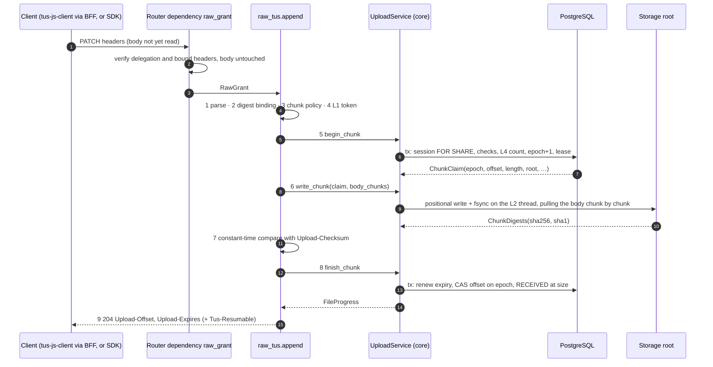

Handler composition. Every function shown has cyclomatic complexity ≤ 4.

```python
# applications/api/routes/v1/endpoints/raw_tus.py
router = APIRouter(prefix="/tus", tags=["raw-tus"])
TusUploadId = Annotated[UUID, Path(description="The tus upload id from UploadSessionView.files[].tus_upload_id")]


@router.patch("/{tus_upload_id}", status_code=204, response_class=Response, responses=TUS_PATCH_ERRORS)
async def append(
    tus_upload_id: TusUploadId, request: Request, grant: RawGrantDep, raw: RawDep, limits: RawSettingsDep
) -> Response:
    headers = TusPatchHeaders.parse(request.headers)                    # 1
    grant.require_body_digest(headers.algorithm, headers.digest)        # 2
    ChunkPolicy(limits.max_chunk_bytes).check(headers.length)           # 3
    if headers.length == 0:
        progress = await _empty_patch(raw.uploads, grant, tus_upload_id, headers)   # §11.6.1
    else:
        progress = await _append_chunk(raw, grant, tus_upload_id, headers, _body(request, limits))
    return Response(status_code=204, headers=patch_headers(progress))   # 9


def _body(request: Request, limits: RawSettings) -> Callable[[], Iterator[bytes]]:
    return lambda: body_chunks(
        request, idle_timeout=limits.body_idle_seconds, deadline_seconds=limits.chunk_deadline_seconds
    )


async def _append_chunk(
    raw: RawRuntime, grant: RawGrant, tus_upload_id: UUID, headers: ChunkHeaders,
    body: Callable[[], Iterator[bytes]],
) -> FileProgress:
    with raw.admission.stream():                                         # 4  (L1, §17.3)
        claim = await raw.uploads.begin_chunk(
            grant, tus_upload_id, offset=headers.offset, length=headers.length
        )                                                                # 5
        finished = False
        try:
            digests = await raw.uploads.write_chunk(claim, body())        # 6  (deadline starts here)
            verify_chunk_digest(headers, digests)                         # 7
            progress = await raw.uploads.finish_chunk(claim, claim.offset + claim.length)  # 8
            finished = True
            return progress
        finally:
            if not finished:
                with anyio.CancelScope(shield=True):
                    await raw.uploads.release_chunk(claim)
```

`body_chunks` (evolved in place, `applications/api/streams.py`) keeps its one-chunk-in-flight
`syncify` bridge and gains two keywords. `deadline = anyio.current_time() + deadline_seconds` is fixed
when the generator is created on the event loop. Each pull runs
`with anyio.fail_after(min(idle_timeout, deadline - anyio.current_time())):` around
`await body.__anext__()`.
- **Error conversion.** The pull converts `TimeoutError` and Starlette's `ClientDisconnect` into
  the core error `TusBodyIncomplete` (400). That error crosses the worker thread and
  `UploadService.write_chunk` unchanged. `write_chunk` maps a short or long stream
  (`ChunkLengthMismatchError`) to the same error. Core never sees a framework exception
  (import-linter "domains exclude frameworks").
- **No thread cancellation.** Both timeouts are enforced inside the pull coroutine, so the design
  never depends on cancelling a worker thread.
- **Supersession.** The pull converts only `TimeoutError` and `ClientDisconnect`. The cancellation
  that ends a superseded stream (D-155, §8.6.2) passes through it; in the worker thread it arrives as
  the `concurrent.futures.CancelledError` that anyio raises from the from-thread call. It passes
  through `UploadArea.write_chunk`, which lets every exception from the chunk iterator propagate
  after its `finally` closed the descriptor, and `UploadService.write_chunk` turns it into
  `UploadSuperseded` because its scope was cancelled. A poll inside the pull could not replace the watcher: an idle or trickling
  stream pulls only when bytes arrive, up to `BODY_IDLE_SECONDS` apart, and cancelling a pending
  `request.stream()` `__anext__` ends Starlette 1.6.0's generator (`requests.py:234-252`), so a pull
  cannot be time-sliced and resumed.

#### 11.6.1 Zero-length PATCH

`Content-Length: 0` runs steps 0–3 and then `_empty_patch`. That step:
1. calls `describe_file` (the same `404`/`410` checks as HEAD);
2. requires `progress.upload_offset == headers.offset`, else `409 UPLOAD_OFFSET_CONFLICT`;
3. runs `verify_chunk_digest(headers, EMPTY_DIGESTS)`. The checksum must be the empty-input digest,
   else `460`.

It answers `204` with the current offset. It takes no L1 token, writes nothing, does not bump the
epoch and does not renew the session (D-28). tus-js-client never sends one; generic clients may.

### 11.7 DELETE — termination

```http
DELETE /api/v1/raw/tus/0192f1d3-8c1e-7a4b-9f00-3b2a1c0d9e8f HTTP/1.1
Tus-Resumable: 1.0.0
Authorization: Bearer <delegation: method DELETE, target null, bound {"tus-resumable":"1.0.0"}>

HTTP/1.1 204 No Content
Tus-Resumable: 1.0.0
Cache-Control: no-store
```

`terminate` composes three units:
1. `require_tus_version`;
2. `progress = await raw.uploads.describe_file(grant, tus_upload_id)`, which applies the HEAD
   `404`/`410` rules;
3. `await raw.uploads.abort(grant, progress.session_id)`, the D-42 abort: the session goes
   `OPEN → ABORTED` with `end_reason = 'CLIENT'`.

Termination is session-wide (D-29). Every tus upload of that session then answers
`410 UPLOAD_GONE {state: "ABORTED", reason: "CLIENT"}`. A repeated DELETE fails at step 2 with
`410`, as tus requires.

Races between steps 2 and 3:
- **A concurrent abort.** `abort` is idempotent on `ABORTED` (D-42), and both DELETEs answer `204`.
- **A concurrent commit freeze.** `abort` raises `409 UPLOAD_SESSION_CLOSED` (`context.state = "COMMITTING"`).
  tus-js-client's `terminate` retries a 409 by default, and the retried DELETE then answers `410`.
- **In-flight PATCHes of the aborted session.** They fail at their finish transaction
  (`410`, §11.8), so nothing more is recorded.

Resources are freed when `ReapStaging` trashes the staging tree after
`HURON_RAW__STAGING_GRACE_SECONDS` (D-64), not inside the request (§11.13).

### 11.8 Offset ledger

The ledger lives in `raw_upload_files`, D-67:

| Column | Role |
|---|---|
| `upload_offset` | bytes durably written and checksum-proven |
| `writer_epoch` | fence |
| `stream_owner`, `stream_expires_at` | stream lease, counted by L4 (§17.4) |
| `state` | `RECEIVING`, `RECEIVED` or `VERIFIED` |
| `received_at` | set when the file reaches `RECEIVED` |
| `last_error` | `DIGEST_MISMATCH` or `SCRATCH_LOST` |

These session columns also take part: `state`, `created_by`, `expires_at`, `deadline_at`.

The ports follow the existing unit-of-work shape (`HierarchyStore.transaction()`). The service
applies every rule; the adapter only reads, locks and writes.

```python
# core/raw/ports.py — consumer: UploadService. Adapter: core/metastore/ingest.py
class OffsetLedger(Protocol):
    def transaction(self) -> AbstractAsyncContextManager[ChunkTransaction]: ...
    async def progress(self, tus_upload_id: UUID) -> FileProgress | None: ...   # HEAD/DELETE; no locks
    async def writer_epoch(self, tus_upload_id: UUID) -> int | None: ...        # the watcher (D-155); no locks


class ChunkTransaction(Protocol):
    async def lock_file(self, tus_upload_id: UUID) -> FileProgress | None: ...
    async def count_streams(self, actor: str, *, excluding: UUID) -> int: ...
    async def open_stream(self, tus_upload_id: UUID, *, actor: str, offset: int, lease_seconds: int) -> int | None: ...
    async def renew_session(self, session_id: UUID, *, idle_seconds: int) -> datetime | None: ...
    async def advance(self, claim: ChunkClaim, new_offset: int) -> UploadFileState | None: ...
    async def close_stream(self, claim: ChunkClaim) -> None: ...
    async def reset_offset(self, claim: ChunkClaim) -> None: ...


@dataclass(frozen=True, slots=True)
class ChunkClaim:                                   # core/raw/ingest.py (D-28 step 5)
    session_id: UUID
    tus_upload_id: UUID
    root: str                                       # D-11 storage-root key of the dataset
    actor: str
    epoch: int
    offset: int
    length: int
```

The SQL below runs in the adapter under PostgreSQL's default `READ COMMITTED` isolation. Locks
follow D-37's order (`raw_datasets`, then `raw_upload_sessions`, then `raw_upload_files`). The
dataset row is only read, never locked.

```sql
-- begin transaction (UploadService.begin_chunk)
-- lock_file: one row, the session locked FOR SHARE
SELECT f.id, f.session_id, f.path, f.sha256, f.size, f.upload_offset, f.state,
       s.created_by, s.state AS session_state, s.end_reason, s.expires_at,
       s.expires_at > now() AS live, d.state = 'ACTIVE' AS dataset_active, d.storage_root
  FROM raw_upload_files f
  JOIN raw_upload_sessions s ON s.id = f.session_id
  JOIN raw_datasets d ON d.id = s.dataset_id
 WHERE f.id = $1
   FOR SHARE OF s;
-- the service applies: require_owner (404), require_open (410), require_chunk (409, then 413)
-- count_streams: L4, exact across replicas (§17.4)
SELECT pg_advisory_xact_lock(hashtextextended('raw-streams:' || $actor, 0));
SELECT count(*) FROM raw_upload_files
 WHERE stream_owner = $actor AND stream_expires_at > now() AND id <> $file;
-- the service refuses: count >= HURON_RAW__PRINCIPAL_STREAMS -> 429 UPLOAD_STREAMS_EXHAUSTED
-- open_stream: the newest writer wins
UPDATE raw_upload_files
   SET writer_epoch = writer_epoch + 1, stream_owner = $actor,
       stream_expires_at = now() + make_interval(secs => $lease_seconds)  -- CHUNK_DEADLINE_SECONDS
 WHERE id = $file AND state = 'RECEIVING' AND upload_offset = $offset
RETURNING writer_epoch;                            -- 0 rows -> 409 UPLOAD_OFFSET_CONFLICT

-- finish transaction (UploadService.finish_chunk)
-- renew_session: 0 rows -> 410 UPLOAD_GONE; the whole transaction rolls back
UPDATE raw_upload_sessions
   SET expires_at = LEAST(now() + make_interval(secs => $idle_seconds), deadline_at)
 WHERE id = $session AND state = 'OPEN' AND deadline_at > now()
RETURNING expires_at;
-- advance: 0 rows -> 409 UPLOAD_SUPERSEDED (rolls back the renewal too)
UPDATE raw_upload_files
   SET upload_offset = $new,
       state = CASE WHEN $new = size THEN 'RECEIVED' ELSE 'RECEIVING' END,
       received_at = CASE WHEN $new = size THEN now() END,
       last_error = NULL, stream_owner = NULL, stream_expires_at = NULL
 WHERE id = $file AND writer_epoch = $epoch AND upload_offset = $old
RETURNING state;

-- close_stream (release_chunk; own transaction; idempotent)
UPDATE raw_upload_files SET stream_owner = NULL, stream_expires_at = NULL
 WHERE id = $file AND writer_epoch = $epoch AND stream_owner IS NOT NULL;

-- reset_offset (write_chunk on ScratchInputMissingError; own transaction)
UPDATE raw_upload_files
   SET upload_offset = 0, last_error = 'SCRATCH_LOST', stream_owner = NULL, stream_expires_at = NULL
 WHERE id = $file AND writer_epoch = $epoch AND state = 'RECEIVING';

-- writer_epoch (the supersession watcher, D-155; autocommit, once per stream_watch per stream)
SELECT writer_epoch FROM raw_upload_files WHERE id = $file;   -- primary key
```

`FileProgress.require_chunk(offset, length)` has two rules:
- `state != RECEIVING` or `upload_offset != offset` → `409 UPLOAD_OFFSET_CONFLICT` with
  `context.upload_offset`. A `RECEIVED` or `VERIFIED` file reports `size`.
- `offset + length > size` → `413 UPLOAD_LENGTH_EXCEEDED` with `context.size`.

The `raw_upload_files_frozen` trigger (D-68) adds two backstops: `writer_epoch` never decreases,
and a `VERIFIED` row never changes its state, offset or fingerprint.

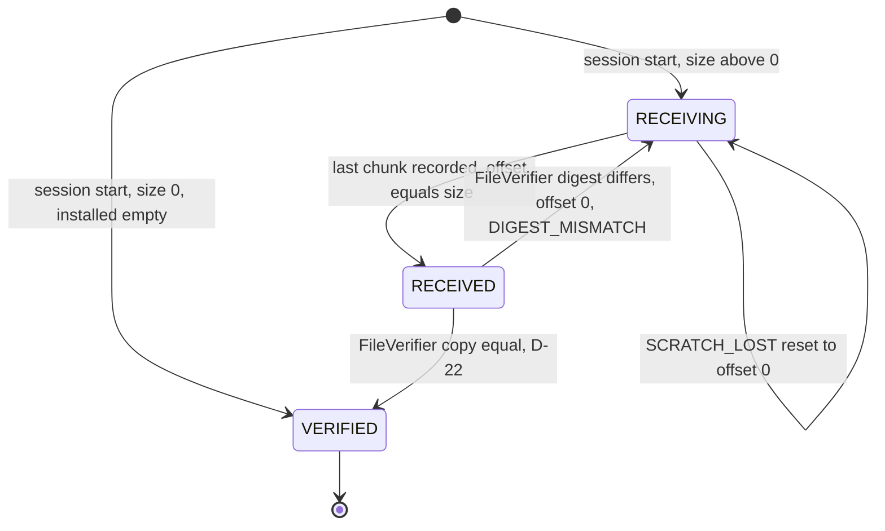

**Durability.** The order is: positional write, then `fsync` of the file and its directories
(`UploadArea.write_chunk`), then the digest proof, then the finish transaction. HEAD reports only
committed offsets, so a reported offset is always durable. The failure cases:
- **A crash after the fsync but before the commit.** Bytes past `upload_offset` are left in the
  scratch input. The client resends the same range, which positionally overwrites identical
  bytes. The scratch file never grows past `size`, because `offset + length ≤ size`.
- **An interrupted, unverifiable partial chunk.** Its bytes stay unrecorded. This deviates from
  the tus SHOULD "store as much as possible"; the checksum extension requires a failed chunk to be
  discarded (§11.13).
- **A PostgreSQL outage between steps 6 and 8.** The finish fails with `500`. The stream lease
  expires after 900 s, and the client retries from HEAD.

### 11.9 Writer fencing

`writer_epoch` makes the newest PATCH on a tus upload the only one that can record. It does so
without a lock that outlives a transaction, and without `423` (D-30).

| Interleaving | Outcome |
|---|---|
| W1 begins (epoch e+1); W2 begins at the same offset (epoch e+2) before W1 finishes | Whichever finishes first, only W2 can record. W1 does not stream on (D-155): on the same process W2's `writer` registration cancels W1's scope as soon as W2 starts writing, and on another replica W1's watcher cancels it within `stream_watch` (5 s). A W1 that reaches its finish first finds its `advance` matching 0 rows (`writer_epoch = e+1` ≠ e+2). Either way W1 answers `409 UPLOAD_SUPERSEDED` and gives back its L1 and L2 tokens, and its `close_stream` is a no-op under the epoch fence. |
| W2 begins at offset X after W1 already recorded X → X+L | `require_chunk`, or under a race `open_stream`, sees `upload_offset = X+L` and answers `409 UPLOAD_OFFSET_CONFLICT` with `context.upload_offset = X+L`. The client resumes from HEAD. |
| W1 (stale, epoch e+1) still writes after W2 completed the file | Bounded by D-155: on W2's process only W1's in-flight write of one received piece can still land, and on another replica W1 writes for at most `stream_watch` after W2's begin. W1 writes into the same scratch inode at its old range. If its bytes differ, the `FileVerifier`'s whole-file SHA-256 catches it: the file goes `RECEIVED → RECEIVING` at offset 0 with `DIGEST_MISMATCH`, and the input is discarded (D-22). If the input was already trashed, W1 writes into an unlinked inode (D-65 point 4). |
| A session abort, expiry, archive or delete lands during a stream | `renew_session` matches 0 rows, so the stream answers `410 UPLOAD_GONE`, and no offset is recorded. |
| A verifier reset while a stream that can still record is open | Impossible. The verifier only acts on `RECEIVED` rows, and `open_stream` admits only `RECEIVING` rows. The only stream that can overlap verification is a stale one, as in the row above. |
| Two replicas, one file | Same as the first two rows. The fence is a database column, so the replica does not matter. No advisory or session lock is held while bytes stream (D-30, D-60). The older stream ends within `stream_watch` through its watcher (D-155). |

**Why a superseded stream must end (D-155).** L4 leaves out the file being claimed (§17.4), so a
legitimate retry of a stuck chunk is never throttled by its own stale lease. Without an end to the
superseded stream, that exclusion would let one principal open any number of concurrent PATCHes on
one tus upload at the current offset. Each would hold an L1 token, an L2 thread and two sockets
until its body ended, stalled for `BODY_IDLE_SECONDS` or hit the 300 s BFF or 900 s API deadline,
even with garbage or trickled bytes that fail only at step 7 or 8, and other users would meet
`503 UPLOAD_CAPACITY_EXHAUSTED`.
`UploadAdmission.writer` keeps, per process, the newest epoch's cancel scope for each tus upload
(§17.3), and the watcher covers the other replicas. A same-file takeover therefore overlaps not at
all on one process, apart from the older stream's write already in flight, and for at most one
`stream_watch` period on another replica.

`begin_chunk` must take the `FOR SHARE` session lock before `count_streams` takes the advisory lock,
and before `open_stream` locks the file row. Every multi-row Raw transaction does the same: lifecycle
transitions, `finish_chunk`, the verifier outcome and the freeze all lock the session row before
any file row (D-37). That shared order is what rules out deadlock cycles.

### 11.10 Chunk size and expiry

| Setting | Default | Validation (`RawSettings`) | Wire |
|---|---|---|---|
| `HURON_RAW__CHUNK_BYTES` | `33554432` (32 MiB) | multiple of 4 MiB; 8 MiB ≤ value ≤ `MAX_CHUNK_BYTES` | `UploadSessionView.chunk_bytes`, `RawLimitsView.chunk_bytes`; the wizard's `chunkSize` |
| `HURON_RAW__MAX_CHUNK_BYTES` | `67108864` (64 MiB) | ≤ 67108864, which is the BFF `BODY_SIZE_LIMIT` (`web/scripts/start.mjs:2`) | `RawLimitsView.max_chunk_bytes`; step 3 |
| `HURON_RAW__BODY_IDLE_SECONDS` | `60` | 1 ≤ value ≤ `CHUNK_DEADLINE_SECONDS` | per-receive timeout in `body_chunks` |
| `HURON_RAW__CHUNK_DEADLINE_SECONDS` | `900` | ≥ 60 | total stream deadline; stream lease length (§17.5) |
| `HURON_RAW__SESSION_IDLE_SECONDS` | `86400` | ≥ 60 | `expires_at` renewal |
| `HURON_RAW__SESSION_MAX_SECONDS` | `604800` | ≥ `SESSION_IDLE_SECONDS` | `deadline_at` |

- **Chunk arithmetic.** The advertised chunk size meets each external bound:
  - A 32 MiB chunk is at least S3's 5 MiB part minimum, so the documented S3 `UploadPart` mapping
    (D-20) holds.
  - A 10 GiB file needs at most 320 PATCHes, within S3's 10,000-part limit.
  - At 2 Mbit/s, a 32 MiB chunk takes about 134 s and a 64 MiB chunk about 268 s. Both fit inside
    Node's default `requestTimeout` of 300 s, which adapter-node 5.5.7 leaves unset
    (`map/research_tus.md:83`).
- **Accepted sizes.** The server accepts any chunk length from 1 to `MAX_CHUNK_BYTES` at the
  current offset, not only `chunk_bytes`. The last chunk is the remainder. A client that sends a
  whole file in one PATCH gets `413 CHUNK_TOO_LARGE` (§11.13).
- **Expiry.** Session start sets `deadline_at = now() + SESSION_MAX_SECONDS` and
  `expires_at = LEAST(now() + SESSION_IDLE_SECONDS, deadline_at)`.
  - Only a recorded chunk renews `expires_at`, in the `renew_session` statement of §11.8.
  - These never renew: HEAD, a zero-length PATCH, DELETE, a failed chunk, verification, and
    commit attempts.
  - `Upload-Expires` on HEAD and PATCH is that `expires_at`. Under the expiration extension its
    value may move forward.
- **After expiry.** Once `expires_at ≤ now()` on the database clock:
  - HEAD and PATCH answer `410 UPLOAD_GONE {reason: "EXPIRED"}` at once.
  - A chunk still streaming when `deadline_at` passes is not recorded (the `deadline_at > now()`
    predicate in `renew_session`).
  - `ExpireSessions` marks the session `ABORTED` (`EXPIRED`) within one maintenance interval, and
    `ReapStaging` trashes the staging tree after the grace (D-64).
  - A commit after expiry answers `409 UPLOAD_SESSION_CLOSED` (D-38).

### 11.11 Status and problem codes

Every refusal is a `DomainError` subclass rendered by the existing handler. `Retry-After` comes from
the class's `retry_after` (D-61, §17.6). Class names mirror their codes, following the repository
convention. Transport classes go in `applications/api/errors.py`. Domain classes go in
`core/raw/errors.py`, because core raises them and core must not import the API (import-linter
layers).

| Status | Code | Class (package) | Raised by | `Retry-After` | tus-js-client policy (D-62, §17.7) |
|---|---|---|---|---|---|
| 400 | `TUS_HEADER_INVALID` | `TusHeaderInvalid` (api) | step 1 | — | fail |
| 400 | `CHECKSUM_REQUIRED` | `ChecksumRequired` (api) | step 1; BFF pre-check (§12.5) | — | fail |
| 400 | `CHECKSUM_ALGORITHM_UNSUPPORTED` | `ChecksumAlgorithmUnsupported` (api) | step 1 | — | fail |
| 400 | `TUS_BODY_INCOMPLETE` | `TusBodyIncomplete` (raw) | `body_chunks` on idle, deadline or disconnect; `write_chunk` on `ChunkLengthMismatchError` | — | retry |
| 401 | `INVALID_CREDENTIAL` | `AuthError` (foundation, with no re-export; §8.2, D-131, D-146), from the dependency and at step 2 | §12.10, step 2 | — | fail; sign in again |
| 403 | `FORBIDDEN` | — | never on tus routes (they carry no permission) | — | fail |
| 404 | `NOT_FOUND` | `ResourceNotFound` (foundation) | `describe_file`, `begin_chunk`; unknown path | — | fail |
| 405 | `METHOD_NOT_ALLOWED` | Starlette router | e.g. `GET`/`POST /tus/{id}` | — | fail |
| 409 | `UPLOAD_OFFSET_CONFLICT` | `UploadOffsetConflict` (raw), `context.upload_offset` | `require_chunk`, `open_stream`, `SCRATCH_LOST` | — | retry (the retry starts with a HEAD) |
| 409 | `UPLOAD_SUPERSEDED` | `UploadSuperseded` (raw) | `advance` matched 0 rows, or `write_chunk`'s stream was cancelled by a newer epoch (D-155) | — | retry (HEAD first) |
| 409 | `UPLOAD_SESSION_CLOSED` | existing D-38 class (raw) | DELETE racing a freeze (§11.7) | — | retry; the next DELETE answers `410` |
| 410 | `UPLOAD_GONE` | `UploadGone` (raw), `context {session_id, state, reason}` | `require_open`, `renew_session`, `STAGING_LOST` | — | fail; read the session view |
| 412 | `TUS_VERSION_UNSUPPORTED` | `TusVersionUnsupported` (api); the middleware adds `Tus-Version` | `require_tus_version`, step 1 | — | fail |
| 413 | `CHUNK_TOO_LARGE` | `ChunkTooLarge` (api) | step 3; BFF pre-check | — | fail |
| 413 | `UPLOAD_LENGTH_EXCEEDED` | `UploadLengthExceeded` (raw), `context.size` | `require_chunk` | — | fail |
| 415 | `TUS_CONTENT_TYPE_INVALID` | `TusContentTypeInvalid` (api) | step 1 | — | fail |
| 422 | `REQUEST_INVALID` | FastAPI validation | a malformed `tus_upload_id` | — | fail |
| 429 | `UPLOAD_STREAMS_EXHAUSTED` | `UploadStreamsExhausted` (raw) | L4 in `begin_chunk` | 5 | retry |
| 460 | `CHECKSUM_MISMATCH` | `ChecksumMismatch` (api), `status_code = 460` | step 7, `_empty_patch` | — | retry, at most 3 times per chunk |
| 500 | `INTERNAL_ERROR` | outermost handler | anything unhandled | — | retry (5xx) |
| 503 | `UPLOAD_CAPACITY_EXHAUSTED` | `UploadCapacityExhausted` (raw) | L1 `UploadAdmission.stream()` | 2 | retry |
| 503 | `RAW_STORAGE_UNAVAILABLE` | `RawStorageUnavailable` (raw) | root UNAVAILABLE (D-17) at step 6 | 60 | retry |
| 507 | `INSUFFICIENT_STORAGE` | `InsufficientStorage` (raw) | `ENOSPC` at step 6 | 60 | retry |

`UploadService.write_chunk` maps storage outcomes with one `try`, five `except` clauses and the
`ENOSPC` test (cyclomatic complexity 7):

| Storage outcome | Mapped to |
|---|---|
| `ScratchInputMissingError` | `reset_offset`, then `UploadOffsetConflict(upload_offset=0)` |
| `StagingMissingError` | session `ABORTED` (`STAGING_LOST`) through the D-42 abort path, then `UploadGone` |
| `StorageRootUnavailableError` | `RawStorageUnavailable` |
| `OSError` with `errno == ENOSPC` | `InsufficientStorage` (any other `OSError` re-raises) |
| `ChunkLengthMismatchError` | `TusBodyIncomplete` |

`UploadArea.write_chunk` re-reads the root sentinel before it raises `StagingMissingError`. A
missing sentinel raises `StorageRootUnavailableError` instead (D-17: absence is never treated as
"done" without the sentinel). A missing root therefore can never abort a session.

### 11.12 `Tus-Resumable` on every tus response

```python
class TusResumableHeaders:            # applications/api/tus.py — pure ASGI, no BaseHTTPMiddleware
    def __init__(self, app: ASGIApp, *, prefix: str = "/api/v1/raw/tus") -> None: ...
    async def __call__(self, scope: Scope, receive: Receive, send: Send) -> None: ...
```

- **Scope.** The middleware applies only to HTTP scopes whose `scope["path"]` equals the prefix or
  starts with `prefix + "/"`. Every other request passes through untouched.
- **Header edits.** It wraps `send`. On `http.response.start` it edits the headers through
  `MutableHeaders(scope=message)` and sets `Tus-Resumable: 1.0.0` and `Cache-Control: no-store`.
  When `status == 412` it also sets `Tus-Version: 1.0.0`.
- **Installation.** `_HuronFastAPI` (app.py) overrides `build_middleware_stack()` to return
  `TusResumableHeaders(super().build_middleware_stack())`. An `add_middleware` layer would not be
  enough: FastAPI and Starlette install the `Exception` (500) handler in `ServerErrorMiddleware`,
  outside every user middleware (`fastapi/applications.py` `build_middleware_stack`;
  `starlette/applications.py:63-83`). Only the outermost wrapper also stamps the `500`, along with
  the router's `404`/`405` and every problem document (D-31).

### 11.13 Deviations from tus 1.0.0

| # | Deviation | Why |
|---|---|---|
| 1 | No `creation`. Upload URLs are server-created at session start. | The manifest pre-creates every upload (D-25); creation is an optional extension. |
| 2 | `Upload-Checksum` is mandatory on every PATCH (`400 CHECKSUM_REQUIRED`). | Per-chunk integrity on every hop, and the delegation binds the digest (§12.4). A stock client must enable checksums; tuspy uses `upload_checksum=True` (sha1). |
| 3 | A chunk larger than `MAX_CHUNK_BYTES` gets `413 CHUNK_TOO_LARGE`. | A 413 is decidable before any read; bounded memory and BFF windows. Clients must set a chunk size. |
| 4 | A partial chunk is never stored. | The checksum extension requires discarding an unverified chunk; the offset stays durable. |
| 5 | `Content-Length` is required on PATCH. | Steps 3 and 5 need the length before any byte is read. |
| 6 | DELETE aborts the whole session. Bytes are freed after the staging grace. | A version needs every manifest file (D-29). The grace keeps forensics (D-64). |
| 7 | HEAD on a session that is not OPEN answers `410` with `context`, even after a commit. | tus allows 404 or 410 for a gone upload. The session view says what happened (D-27). |
| 8 | `OPTIONS` requires the delegation. | Every Raw route sits behind one credential (D-26, D-35). |
| 9 | `Upload-Metadata` comes from the server, on HEAD only. | It lets a resuming client confirm it holds the right file (D-27). Metadata sent by the client is ignored. |

### 11.14 Unit budget

Gates: pyscn (cyclomatic ≤ 10), complexipy (cognitive ≤ 15), radon (no C function; modules grade A).

| Unit | Module | Cyclomatic budget |
|---|---|---|
| `discover`, `describe`, `append`, `terminate` (route handlers) | `endpoints/raw_tus.py` | ≤ 3 each |
| `_append_chunk`, `_empty_patch` | `endpoints/raw_tus.py` | ≤ 4 |
| `TusPatchHeaders.parse`, composing `_version`, `_media_type`, `_decimal(name)`, `_checksum` | `schema/raw_tus.py` | ≤ 4 each |
| `ChunkPolicy.check`, `verify_chunk_digest`, `require_tus_version` | `schema/raw_tus.py` | ≤ 3 |
| `discovery_headers`, `head_headers`, `patch_headers` | `schema/raw_tus.py` | 1–2 |
| `TusResumableHeaders.__call__` and its `send` wrapper | `tus.py` | ≤ 4 |
| `UploadService.describe_file`, `begin_chunk`, `finish_chunk`, `release_chunk` | `_impl/ingestion.py` | ≤ 5 |
| `UploadService.write_chunk` (the five-way mapping plus the `ENOSPC` test) | `_impl/ingestion.py` | 7 |
| `UploadService._supervised_write`, `_watch_epoch` (D-155) | `_impl/ingestion.py` | ≤ 3 each |
| `UploadAdmission.writer` (D-155) | `admission.py` | ≤ 4 |
| `FileProgress.require_open`, `require_chunk` | `ingest.py` | ≤ 4 |
| `ChunkTransaction` adapter methods (one statement each) | `metastore/ingest.py` | ≤ 3 |
| `body_chunks` pull | `streams.py` | ≤ 4 |

### 11.15 Tests

- **Unit** (`-m unit`; 100% line coverage of every touched file):
  - `tests/unit/test_raw_tus_headers.py` is table-driven: every §11.2 row and the evaluation
    order. `ChunkPolicy`, `verify_chunk_digest`, and the header builders, including the IMF-fixdate
    and the `Upload-Metadata` encoding, are also covered here.
  - `tests/unit/test_raw_tus.py` uses the TestClient with fake ports and covers every §11.11 row.
    Named tests:
    - `test_patch_refuses_before_reading_body` (413, 429 and 503 leave `receive` untouched);
    - `test_head_never_renews`;
    - `test_zero_length_patch_is_read_only`;
    - `test_delete_after_abort_is_410`;
    - `test_checksum_mismatch_keeps_offset`;
    - `test_scratch_lost_resets_offset`;
    - `test_staging_lost_aborts_only_with_sentinel`;
    - `test_enospc_maps_to_507` (R8);
    - `test_tus_resumable_on_404_405_and_500`.
- **Hypothesis** (D-82): a `RuleBasedStateMachine` over one tus upload. The rules interleave
  begin and finish from two writers, a verifier reset, abort and expiry. Invariants:
  - the offset is monotone except on a reset;
  - only the newest epoch records;
  - `VERIFIED` is final;
  - `offset ≤ size`.
- **Contract** (`-m contract`, testcontainers `postgres:16`, two pools): every §11.8 statement,
  including `test_concurrent_patch_newest_writer_wins` (D-83),
  `test_finish_rolls_back_renewal_when_superseded` and
  `test_superseded_stream_releases_admission_promptly` (D-155). The last one runs two
  `UploadService`s, each with its own `UploadAdmission`, over the two pools, with `stream_watch`
  shortened to 0.2 s. It opens N concurrent PATCHes on one tus upload at the current offset, some
  of them trickling one byte per second, and asserts that each process holds at most one L1 token
  for that upload at any moment, that only one holds a token cluster-wide one watcher period after
  the last begin, and that every superseded request answered `409 UPLOAD_SUPERSEDED`.
- **Integration and acceptance:**
  - tuspy interop with sha1 checksums against a non-delegated test `RawAuthority` (§12.12);
  - the 9 GiB kill-and-resume run through the real BFF (D-82).

## 12. BFF bridge and authentication

This section fixes the browser → BFF → API leg (D-32..D-35, D-10, D-7) and the credential seam
(OD-6, OD-7). Browsers reach only the same-origin SvelteKit BFF. The BFF evaluates Polaris grants
with the user's own Polaris client and signs one short delegation per API request. The Raw API
accepts that delegation and no other credential. It holds no Polaris credentials (OD-5).

### 12.1 Topology

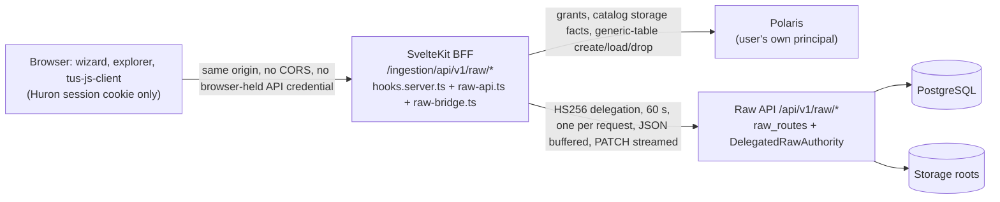

| Invariant | Enforced by |
|---|---|
| The browser holds no API key, OIDC token or delegation (AGENTS.md frontend invariant) | delegations are minted per request inside the BFF and never returned to the browser |
| Every mutation is same-origin | `hooks.server.ts` requires `Origin` = site origin for every method except `GET`, `HEAD` and `OPTIONS` (unchanged) |
| Polaris authority is evaluated only by the BFF, with the user's principal | `requireRawPermissions` and `readCatalogStorage` use `event.locals.polaris` |
| The API trusts only the shared secret | `HURON_RAW_BRIDGE_SECRET` (≥ 32 bytes, both sides, unchanged) |

### 12.2 BFF route table

`web/src/lib/server/raw-api.ts` replaces the regex `allowedOperation` with one typed table,
`RAW_ROUTES`. The browser path is `/ingestion` plus the API path, so D-72's table is mirrored one to
one. Every request carries `?organization=<slug>`, which the hook requires. Targeted routes also carry
`?target=<JSON RawTarget>` (catalog-level routes: `{organization, catalog}` only). The BFF never
forwards either parameter; it forwards only the D-72 query parameters, rebuilt from validated
values.

| Browser method and path (prefix `/ingestion/api/v1/raw`) | Kind | Browser body limit | Authority the BFF checks before signing | Signed `target` | Signed `permissions` |
|---|---|---|---|---|---|
| `POST /datasets` | composite create (D-52; §12.9) | JSON 64 KiB | Polaris `create`, then `readCatalogStorage` | locator + `catalog_storage` | the computed set |
| `GET /datasets/by-target`, `GET /datasets/{id}`, `GET /datasets/{id}/registration` | pass | — | `read` | locator | computed |
| `POST /datasets/{id}/registration` (body `{}`) | composite reconcile: "Finish registration", "Repair registration" and "Finish deletion" (D-52, D-53, D-9) | JSON 1 KiB | `read`, then `create` (state ≠ `DELETED`) or `drop` (state `DELETED`) | locator | computed |
| `POST /datasets/{id}/archive`, `/unarchive` | pass | JSON 1 KiB | `manage` | locator | computed |
| `DELETE /datasets/{id}` | composite delete (D-53) | — | `drop` | locator | computed |
| `POST /datasets/{id}/upload-sessions` | pass + `upload_url` rewrite | JSON 16 MiB | `write` | locator | computed |
| `POST /upload-sessions/{sid}/commit` | pass + rewrite + `Content-Location` | JSON 64 KiB | `write` | locator | computed |
| `GET /datasets?state=PENDING` (`limit`, `after`) | pass | — | the Huron session only | `null` | `[]` |
| `GET /upload-sessions` (`dataset_id`, `state`, `limit`, `after`), `GET /upload-sessions/{sid}`, `POST /upload-sessions/{sid}/abort` | pass + rewrite | JSON 1 KiB | the Huron session only | `null` | `[]` |
| `GET /limits` | pass | — | the Huron session only | `null` | `[]` |
| `OPTIONS /tus`, `HEAD /tus/{uid}`, `DELETE /tus/{uid}` | tus pass | — | the Huron session only | `null` | `[]` |
| `PATCH /tus/{uid}` | tus stream (§12.5) | streamed ≤ `BODY_SIZE_LIMIT` (64 MiB) | the Huron session; `Upload-Checksum: sha256` pre-check | `null` | `[]` |
| `GET /datasets/{id}/versions`, `…/versions/latest`, `…/versions/{n}`, `…/versions/{n}/manifest` | pass | — | `read` | locator | computed |
| `GET /datasets/{id}/versions/{n}/files/{path}` | download stream (§12.8) | — | `read` | locator | computed |
| `DELETE /datasets/{id}/versions/{n}` | pass | — | `drop` | locator | computed |
| `GET /schemas/subjects`, `…/subjects/{sid}`, `…/versions`, `…/versions/{n}`, `GET /schemas/versions/{vid}` | pass | — | catalog visibility ("Catalog-level targets" below), or the Huron session for PLATFORM-only reads | catalog (`name: null`, `namespace: []`) or `null` | computed or `[]` |
| `POST /schemas/subjects`, `…/versions`, `…/versions/{n}/deprecate` | pass | JSON 1 MiB | `schema` | catalog | computed |

- **"The Huron session only".** The hook's existing checks: a signed-in, enabled user whose
  `authVersion` still matches, `?organization=` present, and same origin for mutations. These
  routes make **no Polaris call**. `event.locals.polaris` acquires its token lazily
  (`polaris-client.ts:226`), so the per-chunk BFF cost is the hook's local reads of the account
  and organization stores, one credential decrypt, and one HMAC. Ownership is decided by the API
  (D-34).
- **"Computed".** `rawGrantPermissions(grants, target)` returns all six flags (D-34), with the
  privilege sets and grant levels of §12.11's table (D-159). The BFF signs
  every flag that is true and refuses with `403 FORBIDDEN` when the route's required flag is false.
  There is one Polaris evaluation per browser request (today there are two,
  `raw-api.ts:93-98,235-240`).
- **Catalog-level targets.** `requireRawPermissions` gains a catalog branch: organization pin, then
  `client.catalog(catalog)`. This is the same read `readCatalogStorage` makes; it needs
  `CATALOG_READ_PROPERTIES`, which every Huron catalog role holds. The generic-table and namespace
  probes are skipped, since a catalog target has neither.
- **Body limits.**
  - The session-start limit is 16 MiB because 10,000 files with 1,024-byte paths need about
    11 MB of JSON, plus at most 1 MiB of metadata (D-67).
  - Every other JSON route keeps today's buffered-and-hashed path at the limit shown.
  - A larger declared or streamed body gets `413` before signing.
  - The API enforces the same limits itself, after it has verified the token and before it reads
    past the limit (`body_limit`, §12.10, D-156). The BFF's check is the first refusal; the API's is
    the backstop for any caller that is not the BFF, including the later SDK path (§12.12).
- **Composite actions** sign one fresh delegation per API call. Each carries the same computed
  permissions, which were evaluated once at the start of the browser request.

### 12.3 Delegation claims

`core/security/raw_delegation.py`. `_Claims` keeps `extra="forbid"`, issuer `huron-web`, audience
`huron-raw`, `0 < exp − iat ≤ 60`, HS256 and the `huron-web:<uuid>` subject rule. The changes are
D-10 and D-33. All of them widen a claim, so the `/api/raw-web` routes keep verifying until the task
that deletes them (D-70 row 2).

```python
RawPermissionName = Literal["read", "write", "create", "manage", "drop", "schema"]


class DelegationTarget(BaseModel):                      # frozen, extra="forbid" (unchanged config)
    endpoint: str = Field(min_length=1, max_length=2048)
    realm: str = Field(min_length=1, max_length=256)
    catalog: str = Field(min_length=1, max_length=256)
    namespace: tuple[NamespaceSegment, ...] = Field(max_length=32)
    name: str | None = Field(min_length=1, max_length=256)   # None: catalog-level target
    # model validator: (name is None) == (len(namespace) == 0); a violation is a ValidationError -> 401


class CatalogStorageClaim(BaseModel):                   # new (D-10); frozen, extra="forbid"
    storage_type: Literal["FILE", "S3", "GCS", "AZURE"]
    default_base_location: str = Field(min_length=1, max_length=4096)
    allowed_locations: tuple[Annotated[str, Field(min_length=1, max_length=4096)], ...] = Field(
        min_length=1, max_length=64
    )
    namespace_location: str | None = Field(max_length=4096)


class _Claims(BaseModel):                               # extra="forbid"
    iss: Literal["huron-web"]
    aud: Literal["huron-raw"]
    sub: str
    iat: int
    exp: int
    method: str
    path: str                                           # exact API path plus query, as the API receives it
    body_sha256: str = Field(pattern=r"^[0-9a-f]{64}$") # shape unchanged; meaning per §12.4
    headers: dict[str, str]                             # exactly the bound headers that are present
    target: DelegationTarget | None                     # required key; null on target-less routes
    permissions: frozenset[RawPermissionName]
    catalog_storage: CatalogStorageClaim | None = None  # dataset create only
```

`RawDelegation` (the verified result) becomes
`(actor, target: DelegationTarget | None, permissions, expires_at, body_sha256, catalog_storage)`.
It keeps `verify_body`. These are deleted with the routes that use them: `require` and
`require_scope` (replaced by `RawGrant`, §12.11), `verified_chunks` (part protocol),
`DelegatedBindings` and `raw_dataset_bindings` (D-70 row 13).

The BFF side, `web/src/lib/server/raw-bridge.ts` and `raw-authorization.ts`:

```ts
export type RawPermission = 'read' | 'write' | 'create' | 'manage' | 'drop' | 'schema';
export type RawPermissions = Record<RawPermission, boolean>;   // rawGrantPermissions() result (D-34)
export interface RawBoundCatalog { endpoint: string; realm: string; catalog: string; namespace: []; name: null }
export interface CatalogStorageClaim {
	storage_type: 'FILE' | 'S3' | 'GCS' | 'AZURE';
	default_base_location: string;
	allowed_locations: string[];                 // 1..64
	namespace_location: string | null;
}
export interface RawDelegation {
	user: HuronUser;
	target: RawBoundTarget | RawBoundCatalog | null;  // boundRawTarget() adds endpoint and realm
	permissions: RawPermissions | null;               // null is signed as []
	method: 'GET' | 'HEAD' | 'OPTIONS' | 'POST' | 'PATCH' | 'DELETE';
	path: string;                                     // url.pathname + url.search of the upstream URL
	body: Uint8Array | { sha256: string };            // bytes are hashed; the PATCH digest is signed as given
	headers: Record<string, string>;                  // exactly the present bound headers
	catalogStorage?: CatalogStorageClaim;             // POST /api/v1/raw/datasets only
}
```

`rawBridgeRequest` changes its path guard from `/api/raw-web/` to `/api/v1/raw/`. It keeps
`redirect: 'error'`, gains `signal: AbortSignal.timeout(300_000)`, and no longer converts non-2xx
responses into `PolarisApiError` (§12.8). It carries the JSON routes (through `callRaw`, §20.3.1)
and the tus `HEAD`, `OPTIONS` and `DELETE` pass-through, whose answers are small, so a total
timeout fits them. It signs `headers` and forwards them beside the `Content-Type` and
`Content-Length` it sets itself, which suits those requests, because every header they carry from
the browser is a bound one (§12.4, §12.8). Two transports differ (D-157):
- **The streamed PATCH** uses `rawBridgeStream` (§12.5).
- **Version-file downloads** use `rawBridgeDownload` (§20.3.4). In Node's `fetch` an
  `AbortSignal.timeout` also aborts a response body that is still streaming (measured on Node
  26.6.0: headers after 130 ms, then `TimeoutError` mid-body when the timer fired), and a 10 GiB
  file takes about 14 minutes at 100 Mbit/s. Its 300 s timer therefore covers only the wait for
  the response headers. It also keeps the signed headers apart from the forwarded ones: `Range`,
  `If-Range` and `If-None-Match` travel unsigned, because a `GET` binds only `idempotency-key` and
  `if-match` (`JSON_BOUND`), and a signed `range` would make the claim differ from the API's
  expected bound set (`401`).

Signed PATCH example (the BFF side is `signRawDelegation`):

```json
{"iss":"huron-web","aud":"huron-raw","sub":"huron-web:5f0c2a1e-6b7d-4c3e-9a1b-0c2d3e4f5a6b",
 "iat":1760443200,"exp":1760443260,"method":"PATCH","path":"/api/v1/raw/tus/0192f1d3-8c1e-7a4b-9f00-3b2a1c0d9e8f",
 "body_sha256":"<hex of the 32 bytes in Upload-Checksum>",
 "headers":{"content-length":"33554432","content-type":"application/offset+octet-stream",
            "tus-resumable":"1.0.0","upload-checksum":"sha256 <base64>","upload-offset":"33554432"},
 "target":null,"permissions":[]}
```

### 12.4 Request binding

| Request shape (API `method`, path) | `body_sha256` | Bound headers (lowercase; present ones only) | API body handling |
|---|---|---|---|
| `PATCH /api/v1/raw/tus/{id}` | hex of the base64 digest in `Upload-Checksum: sha256 …` | `content-length`, `content-type`, `tus-resumable`, `upload-checksum`, `upload-offset` | not read by the dependency. Streamed; step 2 proves `body_sha256` = checksum and step 7 proves bytes = checksum (§11.6) |
| `HEAD`, `DELETE /api/v1/raw/tus/{id}` | SHA-256 of the empty body | `tus-resumable` | read, must be empty and verified |
| `OPTIONS /api/v1/raw/tus` | SHA-256 of the empty body | none | read, must be empty and verified |
| any other `/api/v1/raw/...` request | SHA-256 of the exact body bytes (empty for `GET`/`DELETE`) | `idempotency-key`, `if-match` | read only after the token passed, at most `body_limit(method, path)` bytes (`413 REQUEST_BODY_TOO_LARGE` beyond it, D-156), and verified; the BFF has already enforced the same §12.2 limits |

```python
# applications/api/authorization/raw.py — pure functions; each ≤ 3 branches
TUS_PREFIX = "/api/v1/raw/tus"
TUS_PATCH_BOUND = ("content-length", "content-type", "tus-resumable", "upload-checksum", "upload-offset")
TUS_BOUND = ("tus-resumable",)
JSON_BOUND = ("idempotency-key", "if-match")

def bound_header_names(method: str, path: str) -> tuple[str, ...]: ...  # by shape, per the table above
def streams_body(method: str, path: str) -> bool: ...                   # PATCH under TUS_PREFIX
def creates_dataset(method: str, path: str) -> bool: ...                # POST /api/v1/raw/datasets
def body_limit(method: str, path: str) -> int: ...                      # the §12.2 limit of the route (D-156):
    # 16 MiB session start, 1 MiB schema POSTs, 64 KiB dataset create and commit, 1 KiB every other
    # POST, 0 for GET, DELETE, HEAD and OPTIONS; never consulted for the streamed PATCH
```

- **Both sides use the same table.** The BFF's `boundHeaders(kind, request)` mirrors
  `bound_header_names`. The verifier compares the claim's `headers` with the request's present
  bound headers for exact equality (`raw_delegation.py:187-193`, unchanged). A header added,
  dropped or altered after signing therefore yields `401 INVALID_CREDENTIAL`.
- **The signed `path`** is `url.pathname + url.search` of the exact `URL` object the BFF sends. The
  API compares it with `scope["raw_path"]` plus `"?" + query_string` (unchanged). The browser's
  `organization` and `target` parameters are never part of it.

### 12.5 Streamed PATCH through the BFF

The BFF never buffers a chunk. `requestBytes` part buffering and its 64 MiB `MAX_PART_BYTES` are
deleted (D-70 row 15). `+server.ts` exports `GET`, `POST`, `PATCH`, `HEAD`, `DELETE` and `OPTIONS`;
`PUT` goes away. `HEAD` is exported explicitly so that SvelteKit does not fall back to the `GET`
handler (`map/research_tus.md:84`).

```ts
// web/src/lib/server/raw-bridge.ts
export interface TusPatchForwardHeaders {
	'content-length': string;   // copied verbatim from the browser request
	'content-type': string;     // 'application/offset+octet-stream'
	'tus-resumable': string;
	'upload-checksum': string;  // 'sha256 <base64>'
	'upload-offset': string;
}

export interface RawStreamRequest {
	user: HuronUser;
	path: `/api/v1/raw/tus/${string}`;     // exact upstream path; no query string
	headers: TusPatchForwardHeaders;       // exactly the five bound headers (§12.4)
	checksumSha256: string;                // hex of the Upload-Checksum digest, signed as body_sha256
	body: ReadableStream<Uint8Array> | null; // event.request.body (null only when Content-Length is 0)
	signal: AbortSignal;                   // event.request.signal: aborts when the browser disconnects
}

export async function rawBridgeStream(
	request: RawStreamRequest,
	configuration: RawBridgeConfiguration = rawBridgeConfiguration(),
	transport: typeof import('node:http').request = transportFor(configuration.url)
): Promise<Response>;
```

| Step | Behavior | Refusal (BFF problem document, §12.8) |
|---|---|---|
| 1 Pre-check (`handleRawApi`) | `Content-Type` must be `application/offset+octet-stream`. adapter-node yields a `null` body without a content type (`get_raw_body`), and forwarding that with a non-zero length would hang. `Content-Length` must match `^[0-9]{1,19}$` and be ≤ `BODY_SIZE_LIMIT`. `Upload-Checksum` must match `^sha256 [A-Za-z0-9+/]{43}=$`. | `415 TUS_CONTENT_TYPE_INVALID`; `400 TUS_HEADER_INVALID`; `413 CHUNK_TOO_LARGE`; `400 CHECKSUM_REQUIRED` (absent, or an algorithm other than sha256); `400 TUS_HEADER_INVALID` (malformed digest); each with `Tus-Resumable: 1.0.0` and `Cache-Control: no-store` (D-163) |
| 2 Sign | `signRawDelegation({method: 'PATCH', path, body: {sha256: checksumSha256}, headers, target: null, permissions: null})` | — |
| 3 Connect | `transport(origin + path, {method: 'PATCH', headers: {...headers, authorization: 'Bearer …'}, signal: AbortSignal.any([request.signal, AbortSignal.timeout(300_000)])})`. The upstream `Content-Length` is the browser's, so the API binds exactly what it receives. | — |
| 4 Pipe | `stream.pipeline(Readable.fromWeb(body), upstream)`. Backpressure comes from SvelteKit's `req.pause()`/`resume()` (`get_raw_body`). A browser disconnect errors the source and destroys the upstream request, and the API sees `ClientDisconnect` (`400 TUS_BODY_INCOMPLETE`). | — |
| 5 Respond | On `response`, the BFF reads at most 64 KiB of upstream body (a problem document, or empty) and returns `new Response(bytes ?? null, {status, headers: allowlisted(TUS_RESPONSE_HEADERS)})`. Any status from 200 to 599 passes, including `460`. | — |
| 6 Early answer | If the API answers before the body is consumed (any refusal from steps 0–5 of §11.6, such as `401`, `409`, `410`, `413`, `429` or `503`, or a mid-stream `409 UPLOAD_SUPERSEDED` once a newer PATCH took the upload, D-155), the BFF stops piping and destroys the upstream request, then returns the answer. Cancelling the browser body destroys the browser socket (`get_raw_body` `cancel` → `req.destroy`), so the browser may see a network error instead of the status. tus-js-client retries, starting with a HEAD (§17.7), but `Retry-After` is lost (D-62). | — |
| 7 Failure | Connection refused, a reset before the response, or the 300 s timeout. | `503 DEPENDENCY_UNAVAILABLE`, `Retry-After: 5`, with `Tus-Resumable: 1.0.0` and `Cache-Control: no-store` (D-163) |

- **Why `node:http` and not `fetch`.** `node:http` sends exactly the declared `Content-Length` with no
  re-framing. Re-framing an undici `fetch` stream body (`duplex: 'half'`) to chunked encoding is
  unverified, and the API requires `Content-Length` (§11.2).
- **No BFF semaphore.** Each in-flight PATCH costs one socket pair and about one 64 KiB buffer, so
  admission stays with the API (D-61; §17).
- **Matching time windows.** The 300 s total matches Node's own `requestTimeout` on the
  browser → BFF leg, so neither leg outlives the other.

### 12.6 Token lifetime and long streams

| Time | Event | Authority consulted |
|---|---|---|
| t₀ | The BFF signs (`iat = t₀`, `exp = t₀ + 60`) and connects | the hook's Huron-session check (and Polaris grants for targeted JSON routes) |
| t₀ + ε | `raw_grant` verifies the token, then steps 1–5 run (§11.6), all before the first body byte | the delegation; ownership; session `OPEN`; dataset `ACTIVE` |
| t₀ + ε … t₀ + 300 s (BFF) or + 900 s (direct) | the body streams | none |
| end | `finish_chunk`: CAS fenced by `writer_epoch`; the session must still be `OPEN` | the epoch and the session state only; never the token (D-33) |

- **Expiry mid-stream does not matter.** A token that expires while bytes are streaming is never
  consulted again. Every authority decision is taken before streaming (judge: "all correctly avoid
  re-authorizing after the stream").
- **What revocation stops.**
  - Revoking a Polaris grant stops no tus traffic, because tus routes carry no target. It does
    stop publication: `commit` re-checks `write` on the target (D-34, R10,
    `test_commit_rechecks_write`).
  - Disabling the Huron account, or a password change that bumps `authVersion`, stops the next
    request in the hook.
  - Aborting, archiving or deleting fails the in-flight chunk at its finish (§11.9).
- **Clock skew.** PyJWT verifies `exp` (and rejects a future `iat`) with zero leeway, so BFF and API
  hosts must keep synchronized clocks. Skew fails closed with `401`; this requirement is unchanged.

### 12.7 Replay

Tokens carry no `jti`, and no nonce store is added (D-33). A token is visible only on the BFF → API
hop. That hop must be the loopback or private network, or `https://` via `HURON_RAW_API_URL`. Within
its 60 s life, a token replays only the identical request, with the same method, path, bound headers
and body digest.

| Replayed request | Effect |
|---|---|
| `PATCH` | Same offset, same checksum. If the original succeeded, the offset has moved and the replay gets `409`. If it failed, the replay is a legitimate retry of identical bytes. Different bytes fail with `460` (step 7). |
| `HEAD`, `OPTIONS`, every `GET` | read-only |
| `DELETE /tus/{id}` | the first one aborts; replays get `410` |
| creating `POST` (dataset, session, subject, schema version) | the bound `Idempotency-Key` plus `idempotency_records` returns the first response; a different body cannot match the signed digest |
| `commit` | answered from PostgreSQL with the recorded version (D-41) |
| archive, unarchive, delete, version delete | `If-Match` is bound. A replay finds the etag moved (`412 PRECONDITION_FAILED`), or the target state already held (`200`, D-46). |
| registration report | conditional on the expected state (D-52): a no-op or `409 REGISTRATION_STATE_CONFLICT` |

### 12.8 Pass-through, rewriting and Location handling

**Forwarded request headers.** The BFF builds upstream headers from an allowlist; it never copies
browser headers wholesale.

| Request kind | Forwarded headers |
|---|---|
| `PATCH` | the five bound headers |
| tus `HEAD`, `DELETE` | `Tus-Resumable` |
| JSON | `Content-Type: application/json`, `Content-Length`, and `Idempotency-Key` and `If-Match` when present |
| downloads | `Range`, `If-Range` and `If-None-Match`, sent by `rawBridgeDownload` outside the signed `RawDelegation.headers` (D-157). These are not bound: they cannot widen authority beyond the authorized file. |

The BFF always adds `Authorization: Bearer <delegation>`. `Cookie`, `Host`, `Origin` and every
`X-Forwarded-*` header are never forwarded.

**Returned response headers** (allowlist):

| Response kind | Returned headers |
|---|---|
| tus | `Tus-Resumable`, `Tus-Version`, `Tus-Extension`, `Tus-Max-Size`, `Tus-Checksum-Algorithm`, `Upload-Offset`, `Upload-Length`, `Upload-Expires`, `Upload-Metadata`, `Huron-Upload-State`, `Retry-After`, `Cache-Control` (D-32) |
| JSON | `Content-Type`, `ETag`, `Retry-After`, `Content-Location` (rewritten), plus `Cache-Control: private, no-store` |
| downloads | `Content-Type`, `Content-Length`, `Content-Range`, `Accept-Ranges`, `ETag`, `Last-Modified`, `Content-Disposition`, plus `Cache-Control: private, no-store` and `X-Content-Type-Options: nosniff`. `206`, `304` and `416` pass through. |

**Problem documents.** Every API status and `application/problem+json` body passes through
verbatim, for JSON and tus routes alike. Nothing is rewrapped as `PolarisApiError`, so the wizard
switches on `code` and `context` (`LATEST_VERSION_CHANGED`, `VERIFICATION_PENDING`, `DATASET_EXISTS`,
…). The BFF's own refusals use the same shape and the API vocabulary, built by the `rawProblem()`
helper, which also covers the hook's three early refusals on `/ingestion/api/v1/raw/` paths.

| BFF-originated failure | Status | Code |
|---|---|---|
| signed out, disabled account or `authVersion` drift | 401 | `INVALID_CREDENTIAL` |
| cross-origin mutation; Polaris lacks the route's permission | 403 | `FORBIDDEN` |
| unknown route, organization pin mismatch, target not visible | 404 | `NOT_FOUND` |
| missing `?organization`, malformed target or JSON | 400 | `REQUEST_INVALID` |
| PATCH pre-check (§12.5 step 1) | 400 / 413 / 415 | as listed there |
| JSON body over its route limit (§12.2) | 413 | `REQUEST_TOO_LARGE` (BFF-only, like `TARGET_TAKEN`) |
| Polaris or the Raw API unreachable, timed out, redirected or malformed | 503 | `DEPENDENCY_UNAVAILABLE`, `Retry-After: 5` |
| create: the name is held by a foreign table (D-52 `CONFLICT`) | 409 | `TARGET_TAKEN` |

**tus headers on BFF answers (D-163).** The BFF is the tus server the browser talks to, and tus
1.0.0 requires `Tus-Resumable` on every response except to `OPTIONS`. `rawProblem(status, code,
detail, {path})` therefore adds `Tus-Resumable: 1.0.0` and `Cache-Control: no-store` whenever the
browser path is `/ingestion/api/v1/raw/tus` or lies below it, and the hook's three early refusals
pass the path. Every row of the table above that can occur on a tus path (`401`, `403` for a
cross-origin mutation, `404`, `400`, the PATCH pre-check, `503`) gets both headers, and so does an
`OPTIONS` refusal, which tus permits. Responses relayed from the API keep the API's own headers,
which `TusResumableHeaders` set (§11.12). §11.13 needs no deviation row.

**URL rewriting.** These are pure functions in `raw-api.ts`, each unit-tested.

| Item | Rewrite |
|---|---|
| `files[].upload_url` in every `UploadSessionView` the BFF returns (start, get, list items, abort, and `CommitView.session`) | `/api/v1/raw/tus/{id}` becomes `/ingestion/api/v1/raw/tus/{id}?organization=<slug>`. Any other shape fails closed with `503 DEPENDENCY_UNAVAILABLE`. |
| `Content-Location` on commit `200` (D-41) | `/api/v1/raw/datasets/{id}/versions/{n}` becomes `/ingestion/api/v1/raw/datasets/{id}/versions/{n}?organization=<slug>&target=<the request's target>` |
| `Location` | None exists: there is no creation extension, and the BFF builds exact paths, so FastAPI's `redirect_slashes` never fires. Any `3xx` is refused (`redirect: 'error'`; `node:http` never follows) and answered with `503 DEPENDENCY_UNAVAILABLE`. |
| absolute API URLs inside bodies (`registry_url`, the stored `create_request` properties `huron.raw.versions-url` and `huron.raw.schema.registry-url`) | untouched. They are data that must equal the Polaris properties (D-51), and the UI navigates by id. |

The tus URL keeps only `organization`. tus routes carry no target, and tus-js-client uses
`uploadUrl` verbatim with `storeFingerprintForResuming: false`, so no URL or token reaches Web
Storage (D-74).

### 12.9 Catalog storage configuration on dataset creation

The Raw API cannot read Polaris (OD-5). The BFF therefore asserts the catalog's storage facts in
the signed create delegation, in the same way it asserts `target` and `permissions` (D-10). The full
create-and-register flow is §13.1. This section fixes how the BFF reads the facts and how they are
signed.

```ts
// web/src/lib/server/raw-authorization.ts — uses the user's own client (event.locals.polaris)
export async function readCatalogStorage(client: PolarisClient, target: RawTarget): Promise<CatalogStorageClaim>;
```

| Claim member | Read | Mapping rule |
|---|---|---|
| `storage_type` | `client.catalog(catalog)`: `GET /api/management/v1/catalogs/{catalog}`, which needs `CATALOG_READ_PROPERTIES`; every Huron catalog role holds it (`huron-catalog-admin.ts:20-50`) | `storageConfigInfo.storageType`; `storageConfig()` already rejects anything other than `FILE`, `S3`, `GCS` and `AZURE` |
| `default_base_location` | same response | `properties["default-base-location"]`. It must be a string of 1–4096 characters; Polaris requires one (`CatalogEntity.java:319-320`). Otherwise `503 DEPENDENCY_UNAVAILABLE`. |
| `allowed_locations` | same response | `storageConfigInfo.allowedLocations` when non-empty. Otherwise `[default_base_location]`, which is Polaris's own default when none were given (`CatalogEntity.java:354-358`). More than 64 entries gets `422 STORAGE_LOCATION_REFUSED` (`reason: "invalid_location"`). |
| `namespace_location` | `client.namespaceProperties(catalog, namespace)`: `GET /api/catalog/v1/{prefix}/namespaces/{ns}` | `properties.location` when it is a string, else `null` |

- **Verbatim values.** The BFF neither normalizes nor validates locations. Huron parses,
  normalizes, derives and refuses (D-12, D-13), so the rules live in one place, which the
  `PlacementPolicy` parity table tests.
- **Polaris refusals.** A `403` or `404` from either read makes the BFF answer `403` or `404`,
  and it signs nothing (D-10).
- **Order** within the composite create, after organization pinning:
  1. `requireRawPermissions(…, 'create')`;
  2. `readCatalogStorage`;
  3. sign `{target: locator, permissions, catalogStorage}` and call `POST /api/v1/raw/datasets`
     with the browser's `Idempotency-Key`;
  4. on `201`, run the Polaris create and the registration report (D-52), each API call under a
     fresh delegation.
- **Where the claim is honored.** Only `POST /api/v1/raw/datasets` reads `catalog_storage`.
  - Absent → `422 STORAGE_LOCATION_REFUSED {reason: "catalog_storage_missing"}`.
  - Every other route ignores it.
  - The claim itself is never stored. The derived `base_location` and the normalized
    `catalog_base_location` are stored instead (D-16).
- **Idempotency.** The idempotency fingerprint is the body digest under the actor and key. A
  replayed create therefore returns the first response even if the catalog changed in between,
  because an existing dataset never moves (D-10).

### 12.10 How the v1 Raw routes accept the delegation (OD-7)

**Router composition.** The existing `/api/v1` aggregate declares `Depends(current_principal)`
(`routes/v1/__init__.py:30-34`). That resolver treats any non-`hk_` bearer as an OIDC JWT
(`authorization/credentials.py:28-36`), so it refuses a delegation with `401`. FastAPI applies an
enclosing router's dependencies to every included route, so the Raw routers cannot be nested
inside it. `routes/v1/__init__.py` therefore turns `/api/v1` into a dependency-free router with two
children, `principal_routes` and `raw_routes`, and each child declares its credential exactly once
(OD-7). §19.1 gives the composition in full (D-126):

```python
# applications/api/routes/v1/__init__.py (abridged; §19.1)
principal_routes = APIRouter(dependencies=[Depends(current_principal)], responses=AUTHENTICATED_ERRORS)
raw_routes = APIRouter(prefix="/raw", dependencies=[Depends(raw_grant)], responses=RAW_ERRORS)
router = APIRouter(prefix="/api/v1")
router.include_router(principal_routes)
router.include_router(raw_routes)
```

- **Mounting.** `app.py` includes `auth_routes.router` and `v1.router`, as today. The
  `routes/raw_web.py` include and `applications/api/raw_web.py` are deleted (D-70 row 2).
- **Error responses.** `RAW_ERRORS` (`problems.py`) is `UNIVERSAL_ERRORS` plus `401`, `403` and
  `404` (§19.1). No Raw endpoint module redeclares these (test below).
- **Path matching.** No Huron route starts with `/api/v1/raw`, so the two children cannot collide.

**The dependency** (`applications/api/authorization/raw.py`; the package `__init__`, the only entry
point import-linter allows routes and `app.py`, exports `raw_grant`, `RawGrantDep`, `raw_body`,
`RawAuthority` and `DelegatedRawAuthority`, D-145, D-156):

```python
async def raw_grant(request: Request, runtime: Runtime) -> RawGrant:
    if runtime.raw_authority is None:                      # HURON_RAW_BRIDGE_SECRET empty
        raise ResourceNotFound("Raw storage is not configured")
    return await runtime.raw_authority.grant(request)

RawGrantDep = Annotated[RawGrant, Depends(raw_grant)]       # endpoints declare this parameter
```

FastAPI caches a dependency's result per request. The router-level declaration and each endpoint's
`RawGrantDep` therefore share one verification.

**`DelegatedRawAuthority.grant(request) -> RawGrant`.** Each check is its own helper of cyclomatic
complexity ≤ 4.

| # | Check | Refusal |
|---|---|---|
| 1 | `Authorization: Bearer <token>` is present | `401 INVALID_CREDENTIAL` (`AuthError`, with `WWW-Authenticate: Bearer`) |
| 2 | `verifier.verify(token, method=request.method, path=signed_path(request), headers={n: v for each present n in bound_header_names(method, scope["path"])})`. `signed_path` is `raw_path`, plus `"?" + query_string` when the query is non-empty (as `raw_web.py:46-49` does today). This is the existing `RawDelegationVerifier`, built once at startup instead of once per request (`raw_web.py:55`). | `401 INVALID_CREDENTIAL` |
| 3 | unless `streams_body(method, path)`: `delegation.verify_body(await read_capped(request, body_limit(method, path)))`. `read_capped` (`applications/api/streams.py`, D-156) refuses a declared `Content-Length` above the limit before it reads, and a streamed body as soon as its count passes the limit; it caches the bytes on `request.state` for the endpoint's `raw_body` parse. The PATCH body is never read here. | `413 REQUEST_BODY_TOO_LARGE`; `401 INVALID_CREDENTIAL` |
| 4 | map to `RawGrant` (§12.11), copying the delegated `endpoint` beside the target. `body_sha256` is carried only for streamed requests, whose body step 2 of §11.6 must prove; for every other request the body was verified at check 3. | a target shape that is neither a locator nor a catalog → `401` (already refused by the model validator) |

- **The realm binding is a core rule** (D-89, §6.5 rule 2). The authority reads no database. The
  services compare `RawGrant.endpoint` with the realm's pinned endpoint: a dataset row carries it
  (joined from `raw_realm_bindings`), and catalog-level and create calls read it with
  `DatasetStore.realm_endpoint` (`SELECT endpoint FROM raw_realm_bindings WHERE realm = $1`, no
  cache; the rows are immutable). An unbound realm answers `404` except on dataset creation and
  catalog subject creation, whose transactions pin it (D-150, OD-12 O-6); a different endpoint
  answers `409 REALM_BINDING_CONFLICT` (`RealmBindingConflict`, `core/raw/errors.py`). Target-less
  tus traffic never reaches the read.
- **Wiring.** `ApiRuntime.raw_authority: RawAuthority | None` is built in `_build_runtime` as
  `DelegatedRawAuthority(RawDelegationVerifier(settings.raw_bridge_secret))` when the secret is set,
  and is `None` otherwise. `app.py` imports `DelegatedRawAuthority` from
  `huron.applications.api.authorization`, never from `authorization.raw`, and `runtime.py` names
  `RawAuthority` only under `TYPE_CHECKING`: `authorization/credentials.py` imports `..runtime` at
  module level, so a runtime import in the other direction would be a cycle (D-145). `RawSettings.public_api_url` becomes required whenever the secret is set
  (D-51; an `ApiSettings` model validator).

**No Raw route declares a FastAPI body parameter (D-156).** For a route with a body field,
FastAPI 0.141.1 reads the whole body and parses it as JSON before it solves any dependency, the
router-level `raw_grant` included (`fastapi/routing.py`: `await request.body()`, then
`await request.json()`, then `solve_dependencies`). A body field would therefore let a caller with
no credential make the API buffer and parse a body of any size, since uvicorn caps none, and would
answer malformed JSON with `422 REQUEST_INVALID` before `401`. Routes 1, 6, 10, 14, 27 and 30
(§19.3) take their request through a dependency instead:

```python
# applications/api/authorization/raw.py, exported with raw_grant (D-145)
def raw_body[T](shape: type[T]) -> Callable[[Request, RawGrant], Awaitable[T]]:
    adapter = TypeAdapter(shape)

    async def parse(request: Request, _grant: RawGrantDep) -> T:      # runs after the grant
        data = await read_capped(request, body_limit(request.method, request.scope["path"]))
        try:
            return adapter.validate_json(data)
        except ValidationError as exc:
            raise RequestValidationError(exc.errors()) from None       # 422 REQUEST_INVALID

    return parse

# routes/v1/endpoints/raw_datasets.py: one alias per request model, in its endpoint module
CreateRawDatasetBody = Annotated[CreateRawDataset, Depends(raw_body(CreateRawDataset))]
```

- **Order.** Checks 1 and 2 read only headers, so an absent or wrong credential answers `401`
  before any body byte is read, and a body over its limit answers `413` before the API reads past
  the limit. `parse` reads the bytes `read_capped` cached at check 3, so the body is read once.
- **OpenAPI.** Without a body field FastAPI documents no request body, so each of the six routes
  passes `openapi_extra=json_request_body(Model)` (`problems.py`, beside `problem_response`), as
  the tus PATCH documents its binary body (D-129). It references `#/components/schemas/<Model>`, and
  `_HuronFastAPI.openapi()` registers those schemas, `$defs` hoisted, as it already registers
  `Problem` (`app.py`). Route 30's body is documented as a JSON object.

**Credentials on Raw routes.** The delegation is the only accepted credential (D-35):

| Presented | Result |
|---|---|
| BFF delegation (HS256, `iss huron-web`, `aud huron-raw`) | accepted |
| API key `hk_…`, OIDC JWT, any other bearer | `401 INVALID_CREDENTIAL` (HS256 verification fails) |
| Huron session cookie and no `Authorization` | `401`. Cookies are never read on Raw routes, so CSRF does not apply. |
| nothing | `401` with `WWW-Authenticate: Bearer` |
| any credential while `HURON_RAW_BRIDGE_SECRET` is empty | `404 NOT_FOUND`. The routes stay mounted, so the OpenAPI document is stable. |

Why the delegation is the only credential, as OD-7 requires the design to decide:
- API keys, OIDC tokens and cookies carry Huron identities. Raw authority is Polaris grants, which
  the API cannot evaluate without Polaris credentials it must not hold (OD-5).
- Scripted uploads are retired (OD-8).
- API-key scopes never influence a decision (correctness judge, `security/_impl/access.py`), so
  admitting keys would open an unenforced-scope hole.
- One credential keeps one authorization matrix to test.

The seam in §12.12 keeps a later programmatic path additive.

### 12.11 `RawGrant`: what the services see

Services take a `RawGrant` and never a token (D-35). `core/raw` imports neither `security` nor any
framework (D-77; the import-linter "domains exclude frameworks" contract).

```python
# core/raw/grants.py
class RawPermission(StrEnum):
    READ = "read"
    WRITE = "write"
    CREATE = "create"
    MANAGE = "manage"
    DROP = "drop"
    SCHEMA = "schema"


@dataclass(frozen=True, slots=True)
class CatalogRef:
    realm: str
    catalog: str


@dataclass(frozen=True, slots=True)
class RawGrant:                                    # the full contract is §8.3.2 (D-89)
    actor: str                                     # "huron-web:<uuid>"; compared with created_by
    target: DatasetLocator | CatalogRef | None     # DatasetLocator from core/raw/locations.py (D-2)
    endpoint: str | None                           # the Polaris endpoint the delegation bound (D-7)
    permissions: frozenset[RawPermission]
    catalog_storage: CatalogStorage | None         # dataset creation only (D-10)
    body_sha256: str | None                        # streamed requests only (§12.10 check 4)

    def require(self, permission: RawPermission) -> None: ...
    def dataset_target(self) -> DatasetLocator: ...
    def require_target(self, locator: DatasetLocator, *, endpoint: str) -> None: ...
    def require_catalog(self, catalog: CatalogRef, *, endpoint: str | None) -> None: ...
    def require_owner(self, created_by: str) -> None: ...
    def require_body_digest(self, algorithm: str, digest: bytes) -> None: ...
```

| Method | Passes when | Refusal |
|---|---|---|
| `require(p)` | `p in permissions` | `403 FORBIDDEN` (`Forbidden`, moved to `core/foundation/errors.py`, §8.2, D-131) |
| `dataset_target()` | the target is a `DatasetLocator` | `401 INVALID_CREDENTIAL` (`AuthError`, foundation) |
| `require_target(x, endpoint=e)` | `target == x` and the delegated endpoint equals `e`, the realm's pinned endpoint | `404 NOT_FOUND` (`ResourceNotFound`, foundation) when the target differs; `409 REALM_BINDING_CONFLICT` when only the endpoint differs |
| `require_catalog(c, endpoint=e)` | the target's catalog is `c`, `e` is not `None` and equals the delegated endpoint | `404` when the catalog differs or the realm is unbound; `409 REALM_BINDING_CONFLICT` on a different endpoint |
| `require_owner(c)` | `actor == c` | `404 NOT_FOUND` |
| `require_body_digest(a, d)` | `body_sha256 is None`, or `a == "sha256"` and `hmac.compare_digest(d.hex(), body_sha256)` | `401 INVALID_CREDENTIAL` (`AuthError`, foundation; its handler adds `WWW-Authenticate: Bearer`) |

- **Check order.** Every service checks scope before permission: `require_target`,
  `require_catalog` and `require_owner` first, `require` second. A resource outside the grant is
  therefore `404` even when the permission is missing too (D-8). The call patterns, following D-34:

| Operation | Calls |
|---|---|
| tus routes | `require_owner` |
| session start | `require_target(locator, endpoint=…)`, then `require(WRITE)` |
| commit | `require_target`, then `require_owner`, then `require(WRITE)` |
| schema registration | `require_catalog(CatalogRef(realm, catalog), endpoint=…)`, then `require(SCHEMA)` |
| schema subject creation | the grant's catalog (`404` without a target), the realm's pinned endpoint compared when one exists (`409`), then `require(SCHEMA)`; the create transaction pins an unbound realm and compares again, without `require_catalog` (D-150) |
| dataset create | `dataset_target()`, then `require(CREATE)`; the realm's pinned endpoint is compared in the create transaction, which pins an unbound realm; `catalog_storage` is required (else `422`, D-10) |

- **Where the mapping happens.** `DelegatedRawAuthority` maps `DelegationTarget`,
  `CatalogStorageClaim` and the permission strings onto these core values. Only the API sees both
  packages.

**Which Polaris privileges confer each permission (D-34, D-159).** The BFF's `rawGrantPermissions`
(`web/src/lib/server/raw-authorization.ts`) evaluates every grant along the native Polaris parent
hierarchy, with today's `applies()`: a catalog grant applies to everything in the catalog, a
namespace grant to that namespace and everything below it, and a table grant to that table only.
A permission is true when at least one applying grant at an allowed level names one of its
privileges:

| Permission | Polaris privileges that confer it | Grant levels that count |
|---|---|---|
| `read` | `TABLE_READ_DATA`, `TABLE_WRITE_DATA`, `CATALOG_MANAGE_CONTENT` (unchanged) | catalog, namespace, table |
| `write` | `TABLE_WRITE_DATA`, `CATALOG_MANAGE_CONTENT` (unchanged) | catalog, namespace, table |
| `create` | `TABLE_CREATE`, `TABLE_FULL_METADATA`, `CATALOG_MANAGE_METADATA`, `CATALOG_MANAGE_CONTENT` (unchanged) | catalog, namespace; a table-level grant never counts, as today |
| `manage` | the fork's super-privilege set of `TABLE_WRITE_PROPERTIES`: `TABLE_WRITE_PROPERTIES`, `TABLE_WRITE_DATA`, `TABLE_FULL_METADATA`, `CATALOG_MANAGE_METADATA`, `CATALOG_MANAGE_CONTENT` | catalog, namespace, table |
| `drop` | the fork's super-privilege set of `TABLE_DROP`: `TABLE_DROP`, `TABLE_FULL_METADATA`, `CATALOG_MANAGE_METADATA`, `CATALOG_MANAGE_CONTENT` | catalog, namespace, table |
| `schema` | `CATALOG_MANAGE_METADATA`, `CATALOG_MANAGE_CONTENT` | catalog only (§16.3) |

- **Source.** The `manage` and `drop` sets are Polaris's own `SUPER_PRIVILEGES` for
  `TABLE_WRITE_PROPERTIES` and `TABLE_DROP` (`polaris-core/.../auth/PolarisAuthorizerImpl.java`,
  lines 273-280 and 202-204 of the local fork at `0cc22f0bbe`), so Huron never grants an action on a
  Raw table that Polaris would refuse on the same table. `manage` has no privilege of its own;
  `TABLE_WRITE_PROPERTIES` is the closest Polaris action, since archive changes how the table may
  be used without dropping it.
- **`write` implies `manage`.** `TABLE_WRITE_DATA` alone confers `manage`, so every principal that
  may upload may also archive and unarchive, and an archive aborts every user's OPEN sessions of
  that dataset (§13.8). This follows from Polaris's own set and is accepted: archive is reversible
  and removes no version, although the aborted uploads must start again, because unarchive does
  not revive them. An organization that wants archive restricted grants `TABLE_READ_DATA`
  instead of `TABLE_WRITE_DATA` to those who must not upload either.
- **Pinned by tests.** `raw-authorization.test.ts` runs this table as a truth table: each privilege
  at each grant level against each permission, plus the non-applying grants of `applies()`
  (§12.14, §22.6).

### 12.12 The seam for a later API-key / SDK path (OD-6, OD-8)

```python
# applications/api/authorization/raw.py
class RawAuthority(Protocol):
    async def grant(self, request: Request) -> RawGrant: ...
```

Today there is exactly one implementation, `DelegatedRawAuthority`. The follow-up SDK plan adds a
second one and changes nothing in `core/raw`, the routes, the wire contract or the problem codes.
The second authority must:

1. Verify a programmatic credential (an API key, or a Polaris-issued token) through
   `core/security`, the only package allowed to perform credential HTTP (import-linter "only
   security performs credential HTTP directly").
2. Evaluate the caller's Polaris grants for the request's target, using D-34's privilege sets
   and grant levels (§12.11's table, D-159). This
   is a port of `rawGrantPermissions` and `applies` (`raw-authorization.ts:31-55`) into
   `core/security`.
3. For dataset creation, obtain `CatalogStorage` from Polaris itself, never from client input
   (D-10).
4. Return `RawGrant(body_sha256=None)`. Chunk integrity then rests on the mandatory
   `Upload-Checksum` (§11.6 step 7), and the SDK uses `sha256`.

`ApiRuntime.raw_authority` then becomes a dispatcher that chooses an authority by credential type.
The seam is exercised from day one. `test_raw_tus.py` and the tuspy interop test (§11.15) run the
real routes behind a fake `RawAuthority` that returns non-delegated grants. A second authority is
therefore not a new code path for the services.

### 12.13 Residual risks

| Risk | Mitigation | Test |
|---|---|---|
| A captured delegation replays one identical request for at most 60 s | the BFF → API hop is loopback, private or `https://`; §12.7 bounds every replay | `test_bound_header_tamper_is_401` |
| A revoked Polaris `write` still lets the owner upload scratch bytes | commit re-checks `write` (R10); session expiry and maintenance reclaim the bytes | `test_commit_rechecks_write` |
| Early API refusals surface as browser network errors | tus retries start with a HEAD (§17.7); D-62 documents the lost `Retry-After` | Vitest `retries a network error from HEAD` |
| BFF/API clock skew | NTP; verification fails closed with `401` | `test_delegation_lifetime_rules` |
| Bridge secret leakage | ≥ 32 bytes; held only in server environments; never sent to browsers (unchanged) | existing `raw_bridge_key` tests |

### 12.14 Tests

- **Python, unit:**
  - `tests/unit/test_raw_delegation.py` covers what remains of the delegation tests in
    `test_raw_web.py`, which is deleted:
    - six permissions;
    - a `null` target;
    - catalog targets;
    - the `name`/`namespace` shape rule (`401`);
    - `catalog_storage` bounds (0 and 65 locations, and 4097-character values, are refused);
    - unknown claims refused (`extra="forbid"`);
    - lifetime rules.
  - `tests/unit/test_raw_authority.py`:
    - the `bound_header_names`, `streams_body` and `creates_dataset` truth table;
    - `test_patch_body_not_read_by_dependency`;
    - `test_head_and_delete_bodies_verified_empty`;
    - `test_unauthenticated_oversized_body_refused_before_read` (D-156): a request without a
      delegation, or with a wrong one, and a 32 MiB body answers `401` after `receive` yielded no
      body message, on each of routes 1, 6, 10, 14, 27 and 30; with a valid delegation the same
      body answers `413 REQUEST_BODY_TOO_LARGE`, both for a declared `Content-Length` and for a
      chunked body, after at most the route's limit was read;
    - `test_malformed_json_without_credential_is_401` (D-156): malformed JSON with no
      `Authorization` answers `401 INVALID_CREDENTIAL` with `WWW-Authenticate: Bearer`, never
      `422`;
    - the `body_limit` truth table, one row per §12.2 route class;
    - `test_bound_header_tamper_is_401` (each of the five PATCH headers);
    - the credential matrix (API key, OIDC bearer and cookie get `401`; every route answers `404`
      while the bridge secret is empty) is `test_raw_routes_accept_only_the_delegation` in
      `test_api_router_composition.py` (§19.7);
    - `test_long_patch_outlives_token` (R7): `exp` passes between begin and finish, and the chunk
      still records.
  - `tests/unit/test_raw_grants.py`: the §12.11 table, the 404-before-403 order, the digest
    rule (sha1 under a delegated grant gets `401`; any algorithm passes under `body_sha256=None`),
    and the D-7 realm rule as core enforces it (D-89): `test_realm_binding_conflict_409` and
    `test_unbound_realm_404_except_create`, the latter also run through `DatasetService` and
    `SchemaRegistry.create_subject`, the two calls that pin a realm, in `test_raw_services.py`
    (D-150). The contract case `test_subject_creation_pins_an_unbound_realm` runs in
    `tests/raw_store_contract.py` against both schema stores.
  - `tests/unit/test_api_router_composition.py`:
    - The tags gain `raw-datasets`, `raw-uploads`, `raw-tus`, `raw-versions` and `raw-schemas`,
      and lose `ingest-sessions`, `transfer`, `revisions` and `raw-web`.
    - New: `test_every_raw_route_depends_on_raw_grant_and_not_current_principal`.
    - The no-redeclaration test extends to the five `raw_*` endpoint modules against `RAW_ERRORS`.
- **Web, Vitest:**
  - `raw-bridge.test.ts`:
    - `signs body_sha256 from Upload-Checksum`;
    - `streams PATCH without buffering` (the fake transport sees the first chunk before the source
      ends);
    - `destroys the upstream request on browser abort`;
    - `answers 503 DEPENDENCY_UNAVAILABLE on connect failure`;
    - `passes 460 and tus headers through`;
    - `ranged download is signed without range and returns 206` (D-157): the claim's `headers`
      is `{}`, the fake fetch sees `Range` and `If-Range`, and the `206` with `Content-Range`
      passes through;
    - `a download streaming past 300 s is not aborted` (D-157): under fake timers the body
      yields one chunk every 30 s for 400 s and arrives whole;
    - `a download whose upstream stalls 60 s is aborted` and `a slow reader never trips the idle
      timer` (D-157).
  - `raw-api.test.ts`:
    - the `RAW_ROUTES` allowlist (every D-72 row; anything else `404`);
    - `refuses PATCH without a sha256 checksum before contacting the API`;
    - `BFF tus refusals carry Tus-Resumable` (D-163): every pre-check refusal, an unknown tus
      route and `503 DEPENDENCY_UNAVAILABLE` on a tus path carry `Tus-Resumable: 1.0.0` and
      `Cache-Control: no-store`, and a JSON-route refusal carries neither;
    - `target-less routes make no Polaris call`;
    - `rewrites upload_url and Content-Location`;
    - `passes problem documents through`;
    - per-route body limits.
  - `src/hooks.server.test.ts` (new, D-163): the hook's three early refusals (signed out, a
    cross-origin mutation, a missing `?organization`) on `/ingestion/api/v1/raw/tus/{id}` carry
    `Tus-Resumable: 1.0.0` and `Cache-Control: no-store`; on a JSON path they do not.
  - `raw-authorization.test.ts`:
    - the six-permission mapping as a truth table over §12.11's privilege table (D-159): each
      listed privilege at catalog, namespace and table level against each permission, including
      `TABLE_WRITE_DATA` conferring `manage`, a table-level `TABLE_CREATE` conferring no `create`
      and no namespace- or table-level grant conferring `schema`;
    - catalog-level targets;
    - `readCatalogStorage` mapping and its `allowedLocations` fallback;
    - `403`/`404` from Polaris sign nothing.
- **Playwright:** `e2e/ingestion.test.ts` (D-74) drives create, upload through the real streaming
  bridge, reload-resume and commit, against the FastAPI test app and `polaris-mock.mjs`.

## 13. Flows

Each diagram names the module that owns a step, the transaction boundaries and the refusal each
guard produces. Conventions for every flow in this section:

- Participants: `W` is the browser (wizard or explorer). `B` is the SvelteKit BFF, which holds the
  user's Polaris client and signs delegations (D-33). `P` is Polaris, always called with the
  signed-in user's own principal (OD-5). `A` is the Raw API under `/api/v1/raw`, which turns the
  delegation into a `RawGrant` through `DelegatedRawAuthority` (D-35). `D` is PostgreSQL through
  the metastore adapters. `F` is the dataset's storage root through `PosixStorageRoots`.
- Browser paths are the API paths under `/ingestion`, plus `?organization=<slug>`. JSON routes
  that need a target also carry today's `target` query parameter, parsed by `parseRawTarget`. The
  BFF evaluates the permission named in D-34 with `requireRawPermissions`, binds the target with
  `boundRawTarget` and signs a fresh 60 s delegation for every `B→A` call.
- `tx` marks one PostgreSQL transaction. Row locks are taken in the D-37 order
  (`raw_datasets` → `raw_upload_sessions` → `raw_upload_files` → `raw_versions`).
- Every refusal is problem+json carrying the D-73 code. Diagrams avoid angle brackets, so
  `versions/000042` stands for any `versions/<NNNNNN>`.

### 13.1 Create a dataset and register its Polaris table

Registration happens at creation, by the BFF, under the user's principal (OD-5, D-52). Huron
validates and claims the placement before the row exists, and stores the exact create request
it wants Polaris to receive.

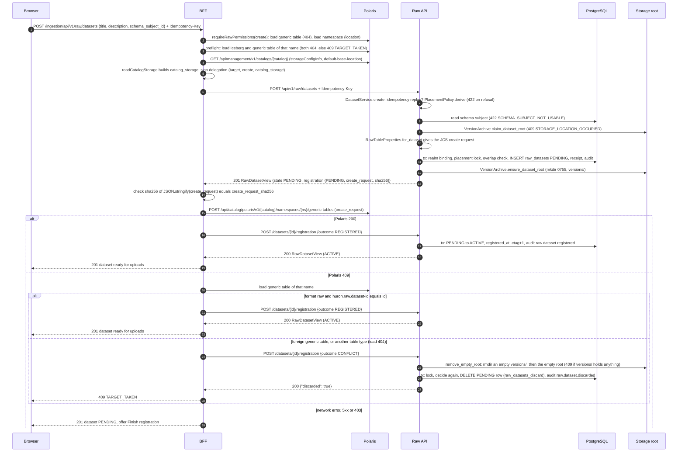

Guards in `DatasetService.create`, in order (each is a small function; the service composes them):

| # | Guard (owner) | Refusal |
|---|---|---|
| 1 | The target is a dataset locator (≥ 1 namespace segment and a name, D-33); `grant.require(CREATE)` | `401 INVALID_CREDENTIAL`; `403 FORBIDDEN` (as `RawDelegation.require` answers today) |
| 2 | Realm binding (D-7): an existing `raw_realm_bindings` row must name the delegated endpoint | `409 REALM_BINDING_CONFLICT` |
| 3 | Replay check before any storage access: a short transaction calls `RetryTransaction.claim((sub, Idempotency-Key, fingerprint))` and rolls back; a receipt answers `201` with the dataset's current view. The create transaction claims the key again, so a concurrent duplicate that wins in between is answered from its receipt | `409 IDEMPOTENCY_KEY_REUSED` |
| 4 | `PolarisName` on every namespace segment and the name (D-12) | `422 TARGET_NAME_UNSUPPORTED` |
| 5 | `PlacementPolicy.derive(locator, grant.catalog_storage)` (D-12, D-13 reasons except `overlaps_dataset`) | `422 STORAGE_LOCATION_REFUSED` |
| 6 | Subject usable: PLATFORM, or CATALOG with the locator's realm and catalog (D-55), and with an ACTIVE version (D-151) | `422 SCHEMA_SUBJECT_NOT_USABLE` |
| 7 | Root available (D-17) | `503 RAW_STORAGE_UNAVAILABLE` |
| 8 | `claim_dataset_root(placement)`: absent, or an empty real directory, or one whose only entry is an empty, service-owned `versions/` (D-18, D-169) | `409 STORAGE_LOCATION_OCCUPIED` |
| 9 | In the transaction: live locator free (D-6) | `409 DATASET_EXISTS` (`context.dataset_id`) or `409 TARGET_RELEASING` |
| 10 | In the transaction, under `pg_advisory_xact_lock(hashtextextended('raw-placement:' \|\| root, 0))`: no occupying placement equals, contains or lies inside this one, compared by `placement_key`, so spellings that differ only in case or normalization overlap (D-164) | `422 STORAGE_LOCATION_REFUSED` (`overlaps_dataset`) |

Guard 8 reads storage before the transaction and outside every lock, so it cannot order two
creates: both can find an alias absent, and so can a create during another dataset's window
between its commit and `ensure_dataset_root` (the second crash row below). Guard 10 is therefore
the alias guard among Huron datasets. It compares `placement_key` under the `raw-placement:` lock,
so the second of two aliasing creates is refused whatever their timing (D-164). Guard 8 remains
the guard against foreign content in the location (D-18).

The create transaction claims the idempotency key, inserts `raw_realm_bindings` with
`ON CONFLICT DO NOTHING` and re-reads it, inserts the `raw_datasets` row (`state = 'PENDING'`,
`etag = 1`, placement columns, `create_request`), remembers the receipt
(`Replay(kind="raw_dataset", resource_id=id)`) and writes the `raw.dataset.created` audit row. The
replay check must precede the storage claim: after a successful create the dataset root can hold
versions, so a replay reaching guard 8 could be refused as occupied. Guard 8 accepts a dataset
directory whose only entry is an empty, service-owned `versions/` (D-169); occupancy among Huron
datasets is guard 10's decision. The
BFF's preflight in step 3 of the diagram is today's `preflightRawTarget`, kept as a fast path;
correctness does not depend on it, because Polaris refuses a name held by any table type with
`409` (`PolarisGenericTableCatalog.createGenericTable` resolves `ANY_SUBTYPE`), and the
CONFLICT branch discards the row.

Crash windows and what heals them:

| Crash after | State left | Healing |
|---|---|---|
| the claim, before the transaction | nothing; the claim only reads | the client retries with the same key |
| the transaction, before `ensure_dataset_root` | PENDING row, no directory | publication calls `ensure_dataset_root` before its rename (D-18, D-149); a retry replays the `201` |
| the `201`, before the Polaris create | PENDING row | "Finish registration" (§15.4) |
| the Polaris create, before the report | PENDING row and our table | "Finish registration" loads our table and reports `REGISTERED` |
| the CONFLICT storage cleanup, before the row delete | PENDING row, no directory | the BFF repeats `CONFLICT` (`remove_empty_root` is idempotent and removes only empty directories, D-170), or the creator deletes the dataset |

A PENDING dataset never expires (D-52). Its creator finds it through the owner-scoped list
`GET /api/v1/raw/datasets?state=PENDING` (§19.3 route 2, D-128), and anyone with
`create` who targets the same name gets `409 DATASET_EXISTS` with its `dataset_id`.

### 13.2 Get the dataset for a new version

A new version always targets an existing ACTIVE dataset. The wizard keeps the `latest_number` it
was shown, so commit can refuse a lost update (D-44).

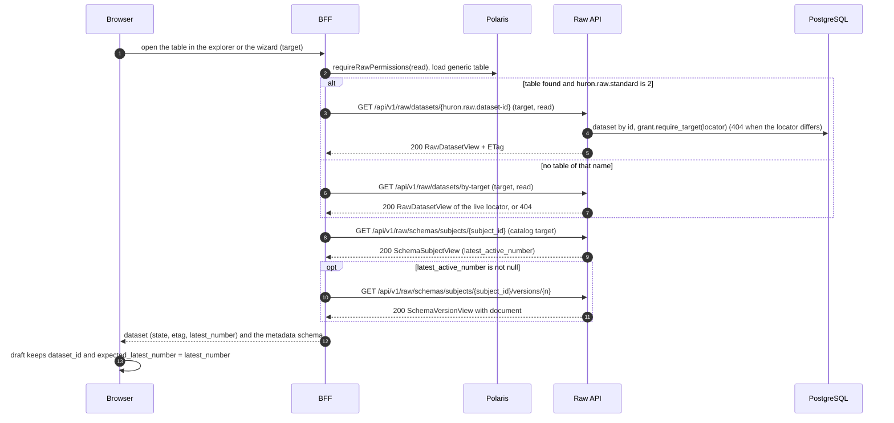

What the wizard offers for each answer:

| Answer | Wizard action |
|---|---|
| ACTIVE, Polaris table ours | "Upload a new version" (§13.3) |
| ACTIVE, subject without an ACTIVE version (`latest_active_number` null, every version deprecated after binding) | "No active metadata schema": uploads disabled, since every session start would answer `422 SCHEMA_VERSION_NOT_USABLE`; `schema` holders get a link to the catalog's Metadata schemas tab (§20.6), where publishing a new version (new content: identical content answers the deprecated one) recovers the dataset (D-151) |
| ACTIVE or ARCHIVED, Polaris table absent | "Repair registration" (§15.4); uploads stay allowed while ACTIVE |
| PENDING | "Finish registration" (§15.4); uploads refused (`409 DATASET_NOT_ACTIVE`) |
| ARCHIVED | "Unarchive" for `manage` holders (§13.8) |
| DELETED, not released | "Finish deletion" for `drop` holders (§13.9) |
| `404` with a standard-2 table | the table is foreign (D-9); shown read-only as "Unmanaged Raw table" |
| `404` and no table | "Create Raw dataset" for `create` holders (§13.1) |

### 13.3 Start an upload session

The session carries the whole manifest and the metadata, validated once against a pinned schema
version (D-42, D-57). Staging is created before the row; a refusal or crash between the two leaves
a row-less staging tree that `SweepOrphanStaging` trashes after the grace (C13).

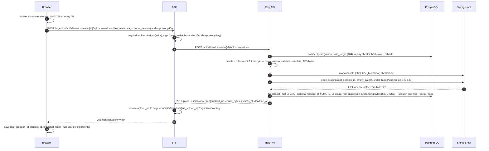

Guards in `UploadService.start`, in order:

| # | Guard | Refusal |
|---|---|---|
| 1 | The dataset exists and `grant.require_target(dataset.locator, endpoint=dataset.endpoint)`, then `grant.require(WRITE)` (scope before permission, D-89) | `404 NOT_FOUND`, `409 REALM_BINDING_CONFLICT`; `403 FORBIDDEN` |
| 2 | Replay check, as in §13.1 guard 3; a receipt answers `201` with the session's current view | `409 IDEMPOTENCY_KEY_REUSED` |
| 3 | Dataset ACTIVE (D-47) | `409 DATASET_NOT_ACTIVE` (`context.state`), `410 DATASET_DELETED` |
| 4 | Manifest (`core/raw/manifest.py` `validate_manifest`): at least one file, existing path rules, no collisions, zero-byte digest equals the empty-input SHA-256 (D-25) | `400 EMPTY_VERSION`, `400 PATH_*`, `409 PATH_COLLISION`, `400 MANIFEST_MISMATCH` |
| 5 | L7 size limits (D-60) | `413 TOO_MANY_FILES`, `413 FILE_TOO_LARGE`, `413 VERSION_TOO_LARGE` |
| 6 | Pin: `schema_version` within the dataset's subject, or its highest ACTIVE version (D-57) | `422 SCHEMA_VERSION_NOT_USABLE` |
| 7 | Metadata valid against the pinned document; canonical bytes ≤ 1 MiB (§16.6) | `422 METADATA_INVALID` (`context.errors`) |
| 8 | Root available (D-17) | `503 RAW_STORAGE_UNAVAILABLE`, `Retry-After: 60` |
| 9 | `free_bytes(root) ≥ 2 × total_bytes + HURON_RAW__STORAGE_RESERVE_BYTES` (D-24), unlocked, before staging is created | `507 INSUFFICIENT_STORAGE`, `Retry-After: 60` |
| 10 | In the transaction: dataset row `FOR SHARE` still ACTIVE | `409 DATASET_NOT_ACTIVE`, `410 DATASET_DELETED` |
| 11 | In the transaction: pinned version row `FOR SHARE` still ACTIVE | `422 SCHEMA_VERSION_NOT_USABLE` |
| 12 | In the transaction, under `pg_advisory_xact_lock(hashtextextended('raw-sessions:' \|\| actor, 0))`: the actor's OPEN sessions `< HURON_RAW__PRINCIPAL_OPEN_SESSIONS` | `429 TOO_MANY_OPEN_SESSIONS`, `Retry-After: 60` |
| 13 | In the transaction, under `pg_advisory_xact_lock(hashtextextended('raw-space:' \|\| root, 0))`: `free_bytes(root)`, measured again, `≥ 2 × total_bytes + outstanding(root) + HURON_RAW__STORAGE_RESERVE_BYTES`, where `outstanding(root)` is what the root's other live OPEN sessions still need (§9.2, D-162) | `507 INSUFFICIENT_STORAGE`, `Retry-After: 60` |

The transaction then claims the key, inserts the session (`state = 'OPEN'`, the manifest and
metadata JCS bytes, `schema_version_id`, `file_count`, `total_bytes`, `created_by`, `created_at`
from the injected `Clock`, `expires_at = now() + HURON_RAW__SESSION_IDLE_SECONDS`,
`deadline_at = now() + HURON_RAW__SESSION_MAX_SECONDS`), inserts one `raw_upload_files` row per
manifest file (`RECEIVING`; zero-byte files `VERIFIED` with their evidence), remembers
`Replay(kind="upload_session", resource_id=session_id)` and writes `raw.session.started`.

The dataset row is read `FOR SHARE` so that session start serializes with archive and delete,
which lock it `FOR UPDATE` and abort the dataset's OPEN sessions in the same transaction (§13.8,
§13.9). Without the lock, a start racing an archive could leave an OPEN session on an ARCHIVED
dataset. The pinned version is read `FOR SHARE` so that a session started after a deprecation
committed can never pin the deprecated version (§16.6).

### 13.4 Upload and resume (tus)

Bytes travel browser → BFF → API as streamed PATCH bodies (D-32). Each PATCH is authorized
before its first byte and fenced by the writer epoch at its end (D-28, D-33).

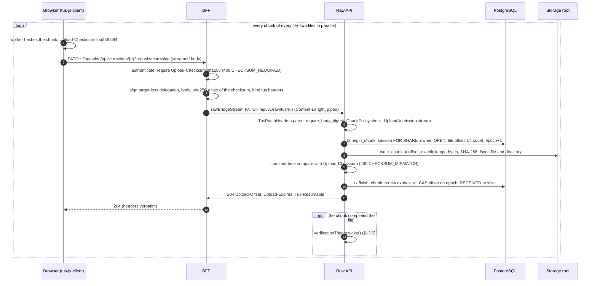

Resume after a reload, a crash or a network loss. The draft holds no token and no URL (D-74).

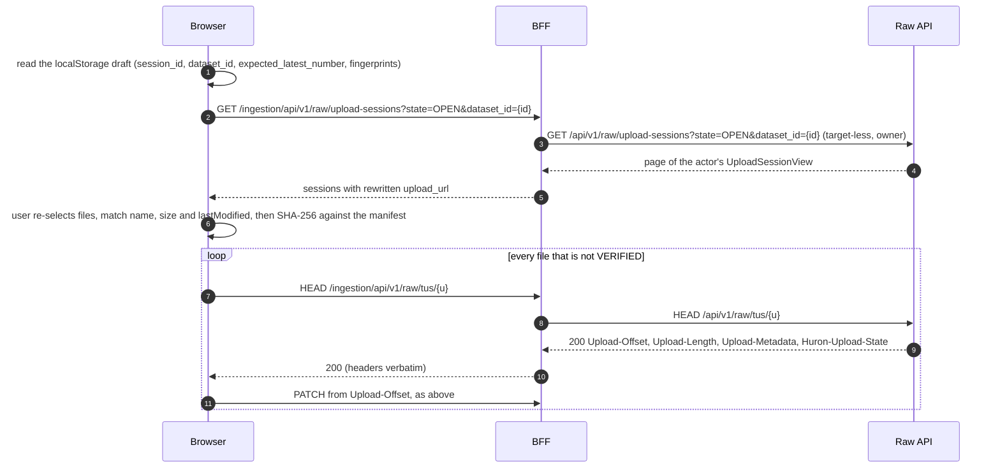

Flow-specific outcomes (the status-to-reaction table is D-31; retry policy D-62):

| Answer | Meaning in this flow | Wizard action |
|---|---|---|
| `204` | the chunk is durable and verified; `Upload-Offset` advanced | next chunk |
| `409 UPLOAD_OFFSET_CONFLICT` | another writer advanced the offset, the scratch input was lost (offset reset to 0, `last_error = 'SCRATCH_LOST'`), or the file is already RECEIVED or VERIFIED (`context.upload_offset` = size) | HEAD, then resume from the reported offset, or skip a finished file |
| `409 UPLOAD_SUPERSEDED` | a newer PATCH on the same tus upload won the epoch | HEAD, then resume |
| `460 CHECKSUM_MISMATCH` | the chunk arrived corrupted; offset unchanged | resend the chunk, at most 3 times |
| `410 UPLOAD_GONE` | the session is not OPEN or the dataset is not ACTIVE (`context.state`) | read the session: ABORTED (`EXPIRED`, `STAGING_LOST`, `DATASET_*`) starts a new session; COMMITTED shows the version |
| `429`, `503`, `507` | admission, capacity or space | retry with the D-62 delays |

A HEAD on a file in `RECEIVED` or `VERIFIED` reports `Upload-Offset = Upload-Length`, so
tus-js-client sends nothing more for it. A file whose whole-file verification failed is back in
`RECEIVING` at offset 0 with `last_error = 'DIGEST_MISMATCH'` (§13.5); the resume loop resends it.

Abort: `POST /api/v1/raw/upload-sessions/{session_id}/abort` (owner) or tus `DELETE` on any of the
session's uploads ends the whole session `ABORTED` with `end_reason = 'CLIENT'` (D-29, D-42). The
wizard deletes its draft. The staging tree is trashed by `ReapStaging` after the grace.

### 13.5 Verification of a received file

The PATCH that completes a file returns at once. A leased `FileVerifier` makes the verified
independent copy afterwards (D-22). No PATCH and no commit hashes a whole file.

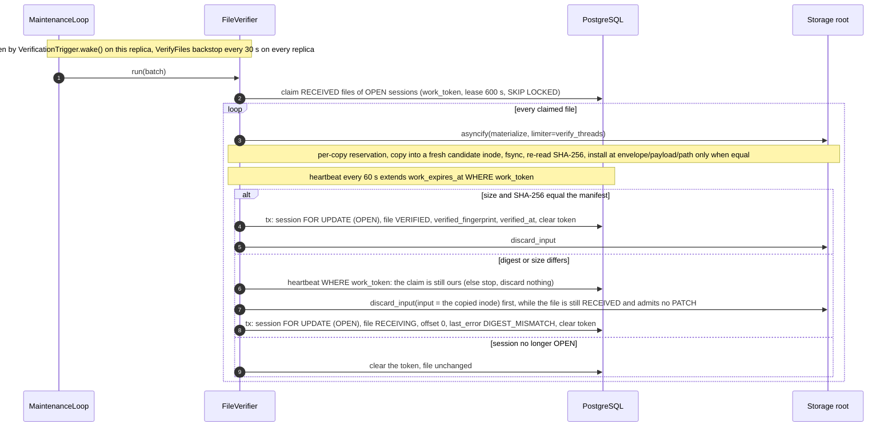

Outcomes of one claimed file:

| Observation | Recorded (one transaction, session row `FOR UPDATE` first, file fenced `WHERE work_token = $t`) | Storage |
|---|---|---|
| copy equals the manifest | `state = 'VERIFIED'`, `verified_fingerprint = '<st_ino>:<st_mtime_ns>'`, `verified_at` | scratch input discarded |
| copy differs | `state = 'RECEIVING'`, `upload_offset = 0`, `last_error = 'DIGEST_MISMATCH'` | nothing installed; scratch input discarded before the record (D-96), only after a heartbeat confirmed the claim and only while `upload/<u>` is the inode the copy read (D-171) |
| copy differs, but the heartbeat finds the claim lost | nothing: another verifier holds the file or already reset it | nothing discarded, so a resumed upload's new input survives (D-171) |
| payload already installed (a crash after install, before the record) | as "equal" | `materialize` re-observes the installed copy instead of copying again (today's `finish_file` replay path) |
| `ScratchInputMissingError` | `state = 'RECEIVING'`, `upload_offset = 0`, `last_error = 'SCRATCH_LOST'` | — |
| `StagingMissingError` with the root sentinel present | session `ABORTED`, `end_reason = 'STAGING_LOST'` (as a PATCH does, D-28) | — |
| `StagingMissingError` with the sentinel missing, or `ENOSPC` | nothing; the claim lapses and the file is retried | — |
| the session is no longer OPEN | nothing; the token is cleared | `ReapStaging` owns the bytes |

The session row lock makes the verifier's outcome and a commit freeze serialize (D-37): a freeze
never sees a file that a concurrent verifier is about to reset. `VERIFIED` is final; the
`raw_upload_files_frozen` trigger refuses any later change of its state, offset or fingerprint.

### 13.6 Commit

Commit is synchronous and answers the version (D-41). The session id is the idempotency identity,
so commit takes no `Idempotency-Key`: it transitions a session the caller names, one session yields
at most one version, and a retry answers the same `200 CommitView`. It takes no `If-Match` either,
because its dataset precondition is `expected_latest_number` (`409 LATEST_VERSION_CHANGED`, D-44)
and a session has no etag (D-3). This is OD-7's rule applied by its criterion, not an exception
(§19.5, D-147).

```mermaid
sequenceDiagram
  autonumber
  participant W as Browser
  participant B as BFF
  participant A as Raw API (CommitDriver)
  participant D as PostgreSQL
  participant F as Storage root
  W->>B: POST /ingestion/api/v1/raw/upload-sessions/{s}/commit {expected_latest_number}
  B->>B: requireRawPermissions(write), sign (target, write)
  B->>A: POST /api/v1/raw/upload-sessions/{s}/commit
  A->>D: read session and dataset, target and owner (404), then require WRITE (403)
  alt COMMITTED
    A-->>B: 200 CommitView, the recorded version (replay)
  else ABORTED or FAILED
    A-->>B: 409 UPLOAD_SESSION_CLOSED (context.state, context.reason)
  else COMMITTING with a live lease
    A-->>B: 409 COMMIT_IN_PROGRESS, Retry-After 5
  else COMMITTING with a lapsed lease
    A->>D: claim the session, rotate work_token
  else OPEN
    A->>D: freeze tx: dataset FOR UPDATE, session FOR UPDATE, all files VERIFIED, preconditions
    A->>D: number = latest_number+1, version_id, version.json bytes, COMMITTING, work_token, lease 120 s
  end
  A->>F: ensure_dataset_root, publish(placement, s, number, files, documents)
  Note over A,D: heartbeat every 30 s extends work_expires_at WHERE work_token, a lost heartbeat stops the next step, not a running one
  alt PUBLISHED or ALREADY_PUBLISHED
    A->>D: record tx: dataset FOR UPDATE, session COMMITTED WHERE token, INSERT raw_versions, latest_number, etag+1, audit
    A-->>B: 200 CommitView + Content-Location
    B-->>W: 200, the wizard shows the version
  else STAGING_LOST
    A->>D: tx: session FAILED (STAGING_LOST) WHERE token, audit raw.session.failed
    A-->>B: 409 UPLOAD_SESSION_CLOSED
    B-->>W: upload again in a new session
  else CLAIMED, HELD or a storage error that is no evidence
    A->>D: finding, release the lease WHERE token; the session stays COMMITTING
    A-->>B: 503 RAW_STORAGE_UNAVAILABLE (507 for ENOSPC; 409 COMMIT_IN_PROGRESS after a second storage change)
  end
```

Freeze guards, in order, inside one transaction (D-38 step 2):

| # | Guard | Refusal |
|---|---|---|
| 1 | dataset row `FOR UPDATE` is ACTIVE | `409 DATASET_NOT_ACTIVE` (`context.state`), `410 DATASET_DELETED` |
| 2 | session row `FOR UPDATE` is OPEN; when `expires_at ≤ now()` it is aborted `EXPIRED` in this transaction | `409 UPLOAD_SESSION_CLOSED` |
| 3 | every file `VERIFIED` | `409 VERIFICATION_PENDING`, `Retry-After: 2`, `context.pending` (count) |
| 4 | `expected_latest_number`, when given, equals `latest_number` | `409 LATEST_VERSION_CHANGED` (`context.latest_number`) |
| 5 | no other COMMITTING session on the dataset (backstop: `raw_upload_sessions_one_committing`) | `409 COMMIT_IN_PROGRESS`, `Retry-After: 5` |
| 6 | `latest_number < 999999` | `409 VERSION_LIMIT_REACHED` |

The wizard polls on `409 VERIFICATION_PENDING`, showing "verifying k of n" from the session
view, and on `409 COMMIT_IN_PROGRESS`; both carry `Retry-After`. On `409 LATEST_VERSION_CHANGED`
it shows the new latest number and asks the user to confirm, then retries with that value
(D-44). Publication follows the D-39 decision table; it compares the four control documents byte
for byte and never re-hashes payload (D-23).

Takeover of a commit whose driver died (D-40). Any replica can finish it from the frozen bytes in
the row, and every completion is fenced by the rotated token:

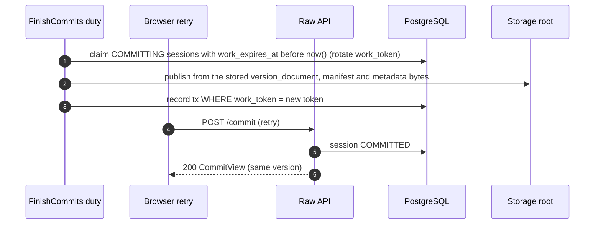

A driver whose heartbeat finds the token rotated starts no further storage step and answers
`409 COMMIT_IN_PROGRESS`; its own record transaction would match zero rows anyway. It cannot stop
a step already running: `publish` runs on a worker thread, which always runs to completion
(§8.6.3), so the old driver's rename can still land after the new holder observed the envelope.
The new holder then meets `ENOENT`, observes again, finds the envelope ABSENT and the target
EQUAL, and records the version as `ALREADY_PUBLISHED`; the old driver records nothing (D-165,
`test_concurrent_publishers_never_fail_a_published_session`). A commit retry is always answered
from PostgreSQL before any storage access, so it returns the same version even after
`ReapStaging` trashed the staging tree.

### 13.7 Read and download

Two readers exist: a signed-in user through the BFF, and any storage-only reader that can load the
Polaris table and read the catalog's storage (D-51).

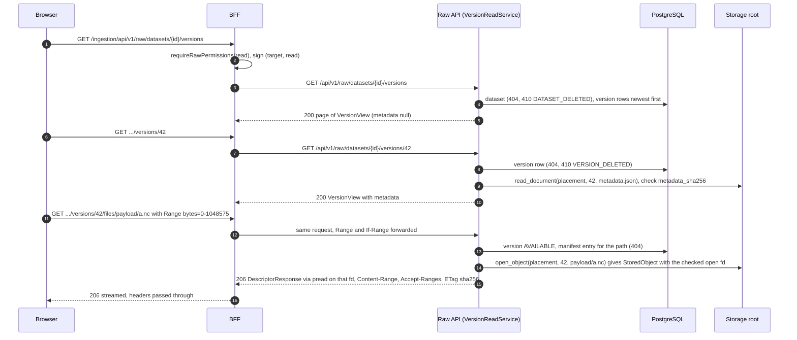

| Route (D-72) | Source of truth | Storage touched |
|---|---|---|
| `GET …/versions` (page, newest first) | `raw_versions` rows; `schema_ref` from the stored `version.json` bytes | no; `metadata` is `null` in list items |
| `GET …/versions/latest` | highest `AVAILABLE` number (`404` when none) | `metadata.json` |
| `GET …/versions/{number}` | the row; `metadata` read from `metadata.json` and checked against `metadata_sha256` | `metadata.json` |
| `GET …/versions/{number}/manifest` | `manifest.json` bytes, checked against `manifest_sha256`, served verbatim as `application/json` | `manifest.json` |
| `GET …/versions/{number}/files/{path}` | the manifest entry; `ETag: "<sha256>"`; `206`/`416 REQUESTED_RANGE_NOT_SATISFIABLE` | the payload file |

A read whose root is UNAVAILABLE answers `503 RAW_STORAGE_UNAVAILABLE`; list pages still answer
from PostgreSQL. An AVAILABLE version whose directory or document is missing, or whose document
does not match its recorded digest, is an integrity failure: the read answers `500` and logs it,
and `ReportOrphans` records `RAW_VERSION_DIRECTORY_MISSING` (D-66); nothing is repaired
automatically. The BFF forwards `Range` and
`If-Range` and passes back the status, `Content-Range`, `Accept-Ranges`, `Content-Length`,
`ETag`, `Content-Type` and `Content-Disposition`, streaming the body through `rawBridgeDownload`
(§20.3.4): the range headers travel unsigned, and no total timeout cuts a long body (D-157).

Storage-only reader. It needs only the table's properties and read access to the catalog's
storage; it never calls Huron:

```mermaid
sequenceDiagram
  autonumber
  participant R as Reader
  participant P as Polaris
  participant F as Catalog storage
  R->>P: load generic table (TABLE_READ_PROPERTIES)
  R->>R: huron.raw.standard is 2, root = huron.raw.dataset-root
  R->>F: list root versions/, pick the highest NNNNNN directory that holds version.json
  R->>F: read version.json, check dataset_id equals huron.raw.dataset-id and number equals the directory
  R->>F: read manifest.json, metadata.json and schema.json, check each SHA-256 named in version.json
  R->>F: read payload files, check size and SHA-256 against manifest.json
  R->>R: optional, validate metadata.json against schema.json (Draft 2020-12, no remote refs)
```

Storage listings may show gaps: a DELETED version keeps its number but its directory is parked
out of the dataset root (D-45). A `versions/<NNNNNN>/` without a valid `version.json` for this
dataset is not a version; readers skip it.

### 13.8 Archive and unarchive

Archive blocks new versions and is reversible. It touches neither storage nor Polaris: the table
and its immutable properties stay as they are, and readers keep reading every version.

```mermaid
sequenceDiagram
  autonumber
  participant W as Browser
  participant B as BFF
  participant A as Raw API (DatasetService)
  participant D as PostgreSQL
  W->>B: POST /ingestion/api/v1/raw/datasets/{id}/archive, If-Match etag
  B->>B: requireRawPermissions(manage), sign (target, manage, if-match)
  B->>A: POST /api/v1/raw/datasets/{id}/archive, If-Match
  A->>D: tx: dataset FOR UPDATE, If-Match, state ACTIVE, then no COMMITTING session (read after the lock, D-167)
  A->>D: OPEN sessions to ABORTED (DATASET_ARCHIVED), dataset ARCHIVED, etag+1, audit
  A-->>B: 200 RawDatasetView + ETag
  B-->>W: archived, uploads disabled
  W->>B: POST .../unarchive, If-Match etag
  B->>A: POST /api/v1/raw/datasets/{id}/unarchive, If-Match (manage)
  A->>D: tx: dataset FOR UPDATE, If-Match, ARCHIVED to ACTIVE, etag+1, audit
  A-->>B: 200 RawDatasetView + ETag
```

| Guard (in the transaction) | Refusal |
|---|---|
| `If-Match` equals `etag` | `412 PRECONDITION_FAILED` |
| archive: state is ACTIVE (ARCHIVED answers `200` unchanged); unarchive: state is ARCHIVED (ACTIVE answers `200` unchanged) | `409 DATASET_NOT_ACTIVE` (PENDING), `410 DATASET_DELETED` |
| archive: no session of the dataset is COMMITTING, read in a statement issued after the row lock; backstop: trigger `raw_datasets_commit_guard` (D-167) | `409 COMMIT_IN_PROGRESS`, `Retry-After: 5` |

The aborted sessions' staging trees are trashed by `ReapStaging` after the grace; their files'
`VERIFIED` copies are discarded with them. Unarchive does not revive aborted sessions.

### 13.9 Delete and purge

Delete is irreversible. It parks the bytes out of the catalog location at once, so the name can
be reused as soon as the BFF has dropped the Polaris table (D-19, D-53).

```mermaid
sequenceDiagram
  autonumber
  participant W as Browser
  participant B as BFF
  participant P as Polaris
  participant A as Raw API (DatasetService)
  participant D as PostgreSQL
  participant F as Storage root
  W->>B: DELETE /ingestion/api/v1/raw/datasets/{id}, If-Match etag
  B->>B: requireRawPermissions(drop), sign (target, drop, if-match)
  B->>A: DELETE /api/v1/raw/datasets/{id}, If-Match
  A->>D: tx: dataset FOR UPDATE, If-Match, no COMMITTING session (read after the lock), OPEN sessions ABORTED (DATASET_DELETED)
  A->>D: DELETED, deleted_at, purge_after = now() + 30 days, etag+1, audit raw.dataset.deleted
  A->>F: park_dataset: move the dataset's own versions (all of versions/ when nothing else is there) to .huron/deleted/HEX, rmdir the dataset directory
  A->>D: parked_at, also on its unparked DELETED versions (only when the park left nothing foreign)
  A-->>B: 200 RawDatasetView (DELETED)
  B->>P: load generic table of that name
  alt ours (format raw and huron.raw.dataset-id equals id)
    B->>P: DELETE generic table (user principal)
    B->>A: POST /datasets/{id}/registration {outcome RELEASED} (drop)
  else 404
    B->>A: POST /datasets/{id}/registration {outcome RELEASED}
  else foreign table
    B->>A: POST /datasets/{id}/registration {outcome RELEASED}, never drop it
  end
  A->>D: released_at, audit raw.dataset.released, the live locator is free
  A->>F: remove_empty_root: an empty versions/ a late ensure_dataset_root left, then the empty root (D-169)
  A-->>B: 200 RawDatasetView
  B-->>W: deleted, the name can be reused
```

If the BFF stops before the `RELEASED` report, the dataset view offers "Finish deletion" (`drop`),
which repeats the load, drop and report; until then a create at that locator answers
`409 TARGET_RELEASING`. Deleting a version follows the same shape without Polaris:
`DELETE /api/v1/raw/datasets/{id}/versions/{number}` (`drop`, `If-Match` on the dataset etag,
dataset ACTIVE or ARCHIVED) sets the version `DELETED` with `deleted_by`, `deleted_at` and
`purge_after`, bumps the dataset etag, then `park_version` renames `versions/<NNNNNN>` to
`.huron/deleted/<hex>.<NNNNNN>` and records `parked_at` (D-48). `park_version` first reads the
directory's `version.json` and moves it only when it names this dataset and number; otherwise it
raises `VersionIdentityError`, nothing is recorded, and `ParkDeleted` reports the directory
(D-168).

Maintenance finishes every deletion on every replica (D-64), each step a claimed row fenced by its
`work_token`:

```mermaid
sequenceDiagram
  autonumber
  participant M as RawMaintenance
  participant D as PostgreSQL
  participant F as Storage root
  M->>D: ParkDeleted claims DELETED datasets and versions with parked_at null (versions only of an unparked dataset)
  M->>F: root sentinel present, then park_dataset or park_version (identity checked; absent source is done)
  M->>D: parked_at WHERE work_token (a dataset's also stamps its unparked DELETED versions); findings for foreign or misidentified entries
  M->>D: PurgeDeleted claims parked rows with purge_after before now() and purged_at null
  M->>F: root sentinel present, then rename the parked directory into .huron/trash/UUID
  M->>D: purged_at WHERE work_token, audit raw.dataset.purged or raw.version.purged
  M->>F: EmptyTrash removes trash entries by a no-follow descriptor walk
```

Purge does not wait for `released_at`: the bytes left the catalog location at delete time, so a
Polaris table that still exists points at an empty location (D-49). Rows stay as tombstones.
Within the 30 days an operator can restore parked bytes by hand (operator runbook); there is no
undelete route.

## 14. Lifecycles

Four state machines carry Raw: the dataset, the upload session, the tus upload (one manifest
file) and the version. Each is an enum plus a transition table in `core/raw`, keyed by source
state like today's `TRANSITIONS` in `core/raw/ingest.py` (D-78), and each is mirrored by a trigger
that enforces the same edges in SQL (D-68). Timestamps such as `parked_at` or `released_at` are
facts recorded on a row, not states.

### 14.1 Dataset

```mermaid
stateDiagram-v2
  [*] --> PENDING: create (create)
  PENDING --> ACTIVE: report REGISTERED (create)
  PENDING --> [*]: report CONFLICT, row discarded (create)
  PENDING --> DELETED: delete (drop)
  ACTIVE --> ARCHIVED: archive (manage)
  ARCHIVED --> ACTIVE: unarchive (manage)
  ACTIVE --> DELETED: delete (drop)
  ARCHIVED --> DELETED: delete (drop)
  DELETED --> DELETED: report RELEASED sets released_at (drop)
  note right of DELETED
    irreversible, row kept as a tombstone
    facts parked_at, released_at, purged_at
  end note
```

Every edge runs under the dataset row lock and writes one `audit_events` row. Lifecycle routes
require `If-Match` on `etag`; the registration reports are guarded by their state precondition
instead (D-46).

| From | Event | To | Who (D-34) | Guards | Same transaction | Afterwards |
|---|---|---|---|---|---|---|
| — | `POST /datasets` | PENDING | `create` on the locator | §13.1 | insert, `etag = 1`, `create_request` | `ensure_dataset_root`; the BFF creates the table |
| PENDING | report `REGISTERED` | ACTIVE | `create` | — | `registered_at`, `etag + 1` | — |
| ACTIVE, ARCHIVED | report `REGISTERED` | unchanged | `create` | — | none (repair after an out-of-band drop, D-9) | — |
| PENDING | report `CONFLICT` | row discarded | `create` | `latest_number = 0` (trigger `raw_datasets_discard`); an empty or absent `versions/` | `DELETE` | storage cleanup runs first and removes only empty directories (§13.1, D-170) |
| ACTIVE | archive | ARCHIVED | `manage` | no COMMITTING session, read after the row lock (D-167) | OPEN sessions → ABORTED (`DATASET_ARCHIVED`); `etag + 1` | `ReapStaging` later |
| ARCHIVED | unarchive | ACTIVE | `manage` | — | `etag + 1` | — |
| PENDING, ACTIVE, ARCHIVED | delete | DELETED | `drop` | no COMMITTING session, read after the row lock (D-167) | OPEN sessions → ABORTED (`DATASET_DELETED`); `deleted_at = now()`, `purge_after = now() + retention`, `etag + 1` | `park_dataset`, then `parked_at` on the dataset and its unparked DELETED versions (D-168, D-178); the BFF drops the table |
| DELETED | report `RELEASED` | DELETED | `drop` | `released_at` null (set: `200` unchanged) | `released_at`, `etag + 1` | the live locator is free (D-6); `remove_empty_root` (D-169) |
| DELETED, parked | `PurgeDeleted` | DELETED | `RawMaintenance` | `purge_after < now()` | `purged_at` | parked directory → trash |

Any registration report that matches no row of this table answers
`409 REGISTRATION_STATE_CONFLICT` with `context.state`. Repeating a lifecycle route into the
state the dataset already holds answers `200` with the unchanged view when `If-Match` matches.

The registration view is derived from the facts, never stored:

| `registered_at` | `released_at` | `RegistrationView.state` |
|---|---|---|
| null | null | `PENDING` |
| set | null | `REGISTERED` |
| any | set | `RELEASED` |

`RawDatasetView.registration` carries `create_request` only while the state is `PENDING`;
`GET /datasets/{id}/registration` always carries it, for the repair flow (§15.4).

Gating by dataset state (D-47):

| Operation | PENDING | ACTIVE | ARCHIVED | DELETED |
|---|---|---|---|---|
| dataset view, registration view, by-target | yes | yes | yes | yes (tombstone; by-target only until released) |
| start session, commit | `409 DATASET_NOT_ACTIVE` | yes | `409 DATASET_NOT_ACTIVE` | `410 DATASET_DELETED` |
| tus requests of its sessions | — (no sessions) | yes | `410 UPLOAD_GONE` | `410 UPLOAD_GONE` |
| version list, latest, view, manifest, file | yes (empty) | yes | yes | `410 DATASET_DELETED` |
| delete version | — (no versions) | yes | yes | `410 DATASET_DELETED` |
| archive | `409 DATASET_NOT_ACTIVE` | yes | `200` unchanged | `410 DATASET_DELETED` |
| unarchive | `409 DATASET_NOT_ACTIVE` | `200` unchanged | yes | `410 DATASET_DELETED` |
| delete | yes | yes | yes | `200` unchanged |

What is physically removed, and when:

| Moment | Dataset root (`base_location`) | `.huron/deleted/<dataset hex>/` | `.huron/trash/` | Rows |
|---|---|---|---|---|
| delete commits, park runs | the dataset's versions moved out, as the whole `versions/` when it holds nothing else; the dataset directory removed if empty. Foreign content stays, also inside `versions/`, and a park reports it (D-178) | holds the versions | — | DELETED, `parked_at` (also on its unparked DELETED versions, D-168) |
| BFF reports `RELEASED` | empty, after `remove_empty_root` removes an empty `versions/` a late `ensure_dataset_root` left (D-169); the name can be created again with a new UUID | unchanged | — | `released_at` |
| `purge_after` passes (30 days) | — | renamed into trash | emptied by `EmptyTrash` | `purged_at` |
| forever | — | — | — | tombstone row, its version rows and audit rows |

Python (`core/raw/datasets.py`):

```python
class DatasetState(StrEnum):
    PENDING = "PENDING"
    ACTIVE = "ACTIVE"
    ARCHIVED = "ARCHIVED"
    DELETED = "DELETED"


DATASET_TRANSITIONS: Mapping[DatasetState, frozenset[DatasetState]] = {
    DatasetState.PENDING: frozenset({DatasetState.ACTIVE, DatasetState.DELETED}),
    DatasetState.ACTIVE: frozenset({DatasetState.ARCHIVED, DatasetState.DELETED}),
    DatasetState.ARCHIVED: frozenset({DatasetState.ACTIVE, DatasetState.DELETED}),
    DatasetState.DELETED: frozenset(),
}
```

`RawDataset` decides and `DatasetStore` applies. Each decision returns the target state, or
`None` when the request leaves the dataset unchanged, and raises the domain error of the gating
table otherwise: `register() -> DatasetState | None`, `discard() -> None`,
`archive() -> DatasetState | None`, `unarchive() -> DatasetState | None`,
`delete() -> DatasetState | None`, `release() -> bool` (true when `released_at` must be set),
`require_active() -> None` (session start and commit), and the derived property
`registration_state`. The store writes the state, the facts with PostgreSQL `now()` and
`etag = etag + 1` in one `UPDATE … WHERE id = $id AND etag = $expected` (lifecycle routes) or
`… AND state = $from` (reports).

### 14.2 Upload session

```mermaid
stateDiagram-v2
  [*] --> OPEN: start (write on the target)
  OPEN --> COMMITTING: freeze (owner with write)
  OPEN --> ABORTED: abort, expiry, archive, delete or staging lost
  COMMITTING --> COMMITTED: record (lease holder)
  COMMITTING --> FAILED: staging lost (lease holder)
  COMMITTED --> [*]
  ABORTED --> [*]
  FAILED --> [*]
  note right of COMMITTING
    never aborted and never expired
    archive and delete refuse while it exists
  end note
```

| From | To | Trigger | Who | `end_reason` |
|---|---|---|---|---|
| — | OPEN | `POST /datasets/{id}/upload-sessions` | `write` on the target | — |
| OPEN | COMMITTING | commit freeze (D-38 step 2) | owner (`created_by`) with `write` on the target | — |
| OPEN | ABORTED | `POST /upload-sessions/{id}/abort`, tus `DELETE` | owner | `CLIENT` |
| OPEN | ABORTED | `ExpireSessions`, or a freeze that finds `expires_at ≤ now()` | `RawMaintenance`; the committing owner | `EXPIRED` |
| OPEN | ABORTED | archive | `manage` holder, in the archive transaction | `DATASET_ARCHIVED` |
| OPEN | ABORTED | delete | `drop` holder, in the delete transaction | `DATASET_DELETED` |
| OPEN | ABORTED | a PATCH or the verifier finds the staging tree gone (root sentinel present) | the owner's PATCH; `FileVerifier` | `STAGING_LOST` |
| COMMITTING | COMMITTED | record transaction (D-38 step 4) | the holder of the commit lease (the request's driver or `FinishCommits`) | — |
| COMMITTING | FAILED | publication outcome `STAGING_LOST` (D-39) | the holder of the commit lease | `STAGING_LOST` |

After a terminal state, `ReapStaging` trashes the staging tree once `ended_at` is older than
`HURON_RAW__STAGING_GRACE_SECONDS` and sets `staging_reaped_at`; `PruneRows` deletes the row (and,
by cascade, its file rows) `HURON_RAW__SESSION_ROW_RETENTION_DAYS` after that. The version row
keeps `session_id` without a foreign key, so pruning never touches a version.

Gating by session state (owner-scoped routes answer `404` to anyone but `created_by`):

| Operation | OPEN | COMMITTING | COMMITTED | ABORTED | FAILED |
|---|---|---|---|---|---|
| `GET /upload-sessions/{id}`, the owner's list | yes | yes | yes | yes | yes |
| tus `HEAD` | `200` (`410 UPLOAD_GONE` once `expires_at` passed or the dataset is not ACTIVE) | `410 UPLOAD_GONE` | `410` | `410` | `410` |
| tus `PATCH` | yes (same `410` rules) | `410 UPLOAD_GONE` | `410` | `410` | `410` |
| tus `DELETE` | `204`, session ABORTED | `410 UPLOAD_GONE` | `410` | `410` | `410` |
| `POST …/abort` | `200`, ABORTED | `409 UPLOAD_SESSION_CLOSED` | `409` | `200` unchanged | `409` |
| `POST …/commit` | freeze | `409 COMMIT_IN_PROGRESS`, or takeover of a lapsed lease | `200` replay | `409 UPLOAD_SESSION_CLOSED` | `409 UPLOAD_SESSION_CLOSED` |

Python (`core/raw/ingest.py`, evolved in place; `IngestState` becomes `UploadSessionState`):

```python
class UploadSessionState(StrEnum):
    OPEN = "OPEN"
    COMMITTING = "COMMITTING"
    COMMITTED = "COMMITTED"
    ABORTED = "ABORTED"
    FAILED = "FAILED"


class SessionEndReason(StrEnum):
    CLIENT = "CLIENT"
    EXPIRED = "EXPIRED"
    DATASET_ARCHIVED = "DATASET_ARCHIVED"
    DATASET_DELETED = "DATASET_DELETED"
    STAGING_LOST = "STAGING_LOST"


_S = UploadSessionState
UPLOAD_SESSION_TRANSITIONS: Mapping[UploadSessionState, frozenset[UploadSessionState]] = {
    _S.OPEN: frozenset({_S.COMMITTING, _S.ABORTED}),
    _S.COMMITTING: frozenset({_S.COMMITTED, _S.FAILED}),
    _S.COMMITTED: frozenset(),
    _S.ABORTED: frozenset(),
    _S.FAILED: frozenset(),
}
```

### 14.3 tus upload (one manifest file)

```mermaid
stateDiagram-v2
  [*] --> RECEIVING: session start, size above 0
  [*] --> VERIFIED: session start, size 0
  RECEIVING --> RECEIVING: chunk accepted, or offset reset to 0 (SCRATCH_LOST)
  RECEIVING --> RECEIVED: chunk reaches size
  RECEIVED --> VERIFIED: verified copy equals the manifest
  RECEIVED --> RECEIVING: copy differs (DIGEST_MISMATCH) or scratch lost
  VERIFIED --> [*]
```

| From | To | Trigger | Who | Row change |
|---|---|---|---|---|
| — | RECEIVING | session start, `size > 0` | session start transaction | `upload_offset = 0`, `writer_epoch = 0` |
| — | VERIFIED | session start, `size = 0`; the empty payload file is installed by `open_staging` | session start transaction | `upload_offset = 0`, `verified_fingerprint`, `verified_at` |
| RECEIVING | RECEIVING | `finish_chunk` of an accepted PATCH | the owner's PATCH holding the newest epoch | `upload_offset = $new`; stream lease cleared |
| RECEIVING | RECEIVING | `ScratchInputMissingError` in a PATCH | the owner's PATCH | `upload_offset = 0`, `last_error = 'SCRATCH_LOST'` |
| RECEIVING | RECEIVED | `finish_chunk` reaching `size` | the owner's PATCH | `received_at`; wakes the verifier |
| RECEIVED | VERIFIED | verified copy equal | `FileVerifier` holding the file's `work_token` | `verified_fingerprint`, `verified_at`; scratch input discarded |
| RECEIVED | RECEIVING | copy differs, or the scratch input is missing | `FileVerifier` holding the token | `upload_offset = 0`, `last_error = 'DIGEST_MISMATCH'` or `'SCRATCH_LOST'` |

- `writer_epoch` only grows: each `begin_chunk` adds 1, and `finish_chunk` succeeds only for the
  epoch it began with and the offset it started from (D-28, D-30). The newest PATCH wins, and the
  stream it supersedes ends with `409 UPLOAD_SUPERSEDED` instead of streaming on (D-155).
- A PATCH is accepted only in RECEIVING. A PATCH for a RECEIVED or VERIFIED file answers
  `409 UPLOAD_OFFSET_CONFLICT` with `context.upload_offset = size`; HEAD shows
  `Upload-Offset = Upload-Length` and `Huron-Upload-State`.
- File states move only while the session is OPEN. When the session ends, its file rows stay as
  they are until `PruneRows` removes them with the session.
- `VERIFIED` is final (`raw_upload_files_frozen`). A commit freeze requires every file VERIFIED
  under the session row lock (D-38), so the frozen set can no longer change.

Python (`core/raw/ingest.py`; today's `FileState` becomes `UploadFileState`):

```python
class UploadFileState(StrEnum):
    RECEIVING = "RECEIVING"
    RECEIVED = "RECEIVED"
    VERIFIED = "VERIFIED"


class FileResetReason(StrEnum):
    DIGEST_MISMATCH = "DIGEST_MISMATCH"
    SCRATCH_LOST = "SCRATCH_LOST"


UPLOAD_FILE_TRANSITIONS: Mapping[UploadFileState, frozenset[UploadFileState]] = {
    UploadFileState.RECEIVING: frozenset({UploadFileState.RECEIVED}),
    UploadFileState.RECEIVED: frozenset({UploadFileState.VERIFIED, UploadFileState.RECEIVING}),
    UploadFileState.VERIFIED: frozenset(),
}
```

### 14.4 Version

```mermaid
stateDiagram-v2
  [*] --> AVAILABLE: record transaction of a commit
  AVAILABLE --> DELETED: delete version (drop)
  note right of DELETED
    parked at once, purged after 30 days
    the row and its number stay forever
  end note
```

| From | To | Trigger | Who | Guards | Effects |
|---|---|---|---|---|---|
| — | AVAILABLE | record transaction (D-38 step 4) | commit lease holder | `raw_versions_contiguous`: dataset ACTIVE, `number = latest_number + 1`, path | row with the frozen `version.json` bytes; dataset `latest_number`, `etag + 1` |
| AVAILABLE | DELETED | `DELETE /datasets/{id}/versions/{number}` | `drop` on the locator | `If-Match` on the dataset etag; dataset ACTIVE or ARCHIVED (DELETED: `410 DATASET_DELETED`); an already DELETED version answers `200` unchanged when `If-Match` matches, as datasets do | `deleted_by`, `deleted_at`, `purge_after`; dataset `etag + 1`; then `park_version` and `parked_at` |
| DELETED | DELETED | `PurgeDeleted` after `purge_after` | `RawMaintenance` | `parked_at` set | parked directory → trash; `purged_at` |

- Reads of a DELETED version answer `410 VERSION_DELETED`. `GET …/versions/latest` returns the
  highest AVAILABLE number, so deleting the newest version moves "latest" back without changing
  `latest_number`, which only counts commits.
- A number is never reused once its row exists (D-45). Gaps appear in storage listings only.
- Deleting a dataset does not rewrite its version rows: the dataset's DELETED state gates their
  reads (`410 DATASET_DELETED`) and the dataset's own park and purge move their bytes. The one
  exception is the dataset park's completion: it sets `parked_at` on versions already DELETED and
  not yet parked, whose bytes left with `versions/`, so no later version park can move a path that
  a recreated dataset may then occupy (D-168).
- Python (`core/raw/versions.py`): `class VersionState(StrEnum)` with `AVAILABLE` and `DELETED`;
  `Version.delete() -> bool` returns false when it is already DELETED (the actor goes to the store, §8.6.5). One edge needs no
  table.

### 14.5 Invariants across the machines

| Invariant | Enforced by |
|---|---|
| A COMMITTING session's dataset is ACTIVE | the freeze requires ACTIVE under the dataset row lock; archive and delete refuse while a session is COMMITTING (`409 COMMIT_IN_PROGRESS`), read in a statement issued after the row lock; backstops `raw_upload_sessions_freeze_guard` and `raw_datasets_commit_guard` (D-167) |
| No OPEN session exists on a dataset that is not ACTIVE | session start re-reads the dataset `FOR SHARE` in its insert transaction; archive and delete abort every OPEN session in their own transaction |
| At most one COMMITTING session per dataset | partial unique index `raw_upload_sessions_one_committing` |
| A PENDING dataset has no session and no version | start and commit require ACTIVE; CHECK `raw_datasets_pending_empty`; `raw_versions_contiguous` requires ACTIVE |
| `latest_number` is the highest number ever recorded | the record transaction inserts the row and bumps the counter together; `raw_datasets_identity` (only `OLD + 1`) and `raw_versions_contiguous` check each step, and the deferred `raw_versions_counted` and `raw_datasets_latest_recorded` refuse at `COMMIT` a row without its bump or a bump without its row (D-176). The registry's subjects and versions have the same pair |
| A file row leaves only with its session | `PruneRows` deletes reaped sessions, whose files cascade; `raw_upload_files_cascade_only` refuses every other delete (D-176) |
| A version row exists only for a published directory | the record transaction runs after `publish` returned `PUBLISHED` or `ALREADY_PUBLISHED` |
| A DELETED dataset's bytes leave the catalog location | `park_dataset` right after the delete transaction; `ParkDeleted` finishes a crashed park |
| One live dataset per locator; a DELETED one frees it only when released | partial unique index `raw_datasets_live_locator … WHERE released_at IS NULL` |
| A pinned schema version cannot disappear | `ON DELETE RESTRICT` foreign keys and `raw_schema_versions_immutable` |

`raw_datasets_identity` must allow the version-delete etag bump: D-48 increments the dataset
`etag` when a version is deleted, while D-68 lets `etag` change only with `state`,
`registered_at`, `released_at` or `latest_number`. The trigger rule becomes "`etag` increases by
exactly 1 whenever those columns change, may increase by exactly 1 with no other change (version
delete), and is otherwise unchanged" (D-108).

### 14.6 Audit rows

Every transition writes one `audit_events` row in its own transaction (`audit_events` columns
`kind`, `actor`, `subject_kind`, `subject_id`, `payload`). Maintenance writes as the fixed actor
`huron-raw-maintenance`.

| `kind` | `subject_kind` / `subject_id` | `payload` |
|---|---|---|
| `raw.dataset.created`, `.registered`, `.archived`, `.unarchived`, `.deleted`, `.released` | `raw_dataset` / dataset id | `{"from", "to", "etag"}`; `created` adds `{"base_location", "schema_subject_id"}`; `archived`/`deleted` add `{"aborted_sessions": [ids]}` |
| `raw.dataset.discarded` | `raw_dataset` / dataset id | `{"realm", "catalog", "namespace", "name"}` |
| `raw.dataset.purged` | `raw_dataset` / dataset id | `{"parked_path"}` (root-relative) |
| `raw.session.started` | `raw_upload_session` / session id | `{"dataset_id", "file_count", "total_bytes", "schema_version_id"}` |
| `raw.session.aborted`, `raw.session.failed` | `raw_upload_session` / session id | `{"dataset_id", "end_reason"}` |
| `raw.version.committed`, `raw.version.deleted`, `raw.version.purged` | `raw_version` / version id | `{"dataset_id", "number"}`; `committed` adds `{"session_id", "document_sha256"}` |
| `raw.schema.subject_created` | `raw_schema_subject` / subject id | `{"subject"}` (qualified name) |
| `raw.schema.version_registered`, `raw.schema.version_deprecated` | `raw_schema_version` / version id | `{"subject_id", "number", "sha256"}` |

## 15. Polaris property standard

### 15.1 Raw storage inside the Polaris namespace tree

A Raw dataset is one Polaris generic table (OD-1). Its `base-location` is the location Polaris
itself uses for a table of that name: the catalog's `default-base-location`, then one directory
per namespace level, then the table name (OD-9, D-12). Versions sit directly under it as
`versions/000001/`, `versions/000002/`, and so on. There is no `datasets/<id>/` segment. OD-9
supersedes the Huron-owned `datasets/<id>/` root, so the dataset UUID appears in the table
property `huron.raw.dataset-id`, in PostgreSQL and in every `version.json`, never in a path. Raw
datasets therefore sit next to the catalog's Iceberg and Icechunk tables, in the same directory
tree.

Worked example (realm `huron`, catalog `science`, one operator-allowlisted root):

```text
HURON_RAW__STORAGE_ROOTS   [{"key": "local-storage", "uri": "file:///srv/lake/", "path": "/srv/lake"}]
catalog science            default-base-location file:///srv/lake/science
                           allowedLocations      [file:///srv/lake/science]
namespace ocean.sst        location              file:///srv/lake/science/ocean/sst/ (the default)

/srv/lake/                                  storage root "local-storage"
  .huron/                                   Huron-only: root.json, staging/, deleted/, trash/, quarantine/
  science/                                  catalog default-base-location
    ocean/                                  namespace level "ocean"
      sst/                                  namespace level "sst"
        monthly/                            Iceberg table ocean.sst.monthly (Polaris default location)
          metadata/  data/
        daily/                              Raw dataset ocean.sst.daily = its Polaris base-location
          versions/
            000001/                         version 1, sealed (directories 0555, files 0444)
              version.json  manifest.json  metadata.json  schema.json
              payload/2020/01/01.nc  …
            000002/                         version 2, a complete independent copy
```

| Fact | Value for `ocean.sst.daily` |
|---|---|
| Polaris default location of an Iceberg table named `daily` here (`LocalIcebergCatalog.defaultWarehouseLocation`) | `file:///srv/lake/science/ocean/sst/daily` |
| Polaris `base-location` and `huron.raw.dataset-root` | `file:///srv/lake/science/ocean/sst/daily/` |
| `raw_datasets.storage_root`, `raw_datasets.storage_path` | `local-storage`, `science/ocean/sst/daily` |
| `raw_versions.path` of version 2 | `science/ocean/sst/daily/versions/000002` |
| `version.json` member `location` of version 2 | `versions/000002/` (dataset-relative) |
| upload scratch of a session on this dataset | `/srv/lake/.huron/staging/<session hex>/` (same filesystem as the root, so publication is one rename) |

Who owns what:

| Thing | Owner and authority | Huron's part |
|---|---|---|
| catalog, namespaces, grants | Polaris, through users and catalog admins | reads the catalog's storage facts in the signed create delegation (D-10); refuses a namespace whose `location` was customized (D-13) |
| the generic table entity | Polaris; created and dropped by the BFF under the user's principal (OD-5) | generates the exact create request; records the registration reports |
| directories on disk for namespace levels, the dataset root and `versions/` | Huron, created `0755` when the first Raw dataset needs them (D-14) | never removes a namespace directory |
| everything under `versions/` | Huron only, by exclusive rename of a staged envelope (publication) and by park at delete | — |
| anything else inside a dataset root (for example files of a table in a nested namespace) | foreign | never touched (D-14) |

Polaris neither validates a generic table's `base-location` nor deletes files when a table is
dropped (`PolarisGenericTableCatalog.createGenericTable` stores it verbatim; `dropGenericTable`
calls `dropEntityIfExists(..., cleanup=false)`). Huron's placement checks (D-13) and park on
delete (D-19) supply what Polaris does not, and the derived location already satisfies the
catalog's `allowedLocations`, so it stays valid if Polaris adds generic-table location validation
(upstream PR #5748).

### 15.2 The create request

At dataset creation `RawTableProperties.for_dataset` (`core/raw/properties.py`) builds the exact
generic-table create body. Huron validates it against the packaged closed schema
`raw-table-properties-v2.json`, stores its JCS bytes in `raw_datasets.create_request` (with the
generated `create_request_sha256`) and returns it in the dataset view. The BFF sends exactly that
object on every attempt (D-50).

```json
{
  "name": "daily",
  "format": "raw",
  "base-location": "file:///srv/lake/science/ocean/sst/daily/",
  "doc": "Daily SST\n\nMUR v4.1 daily files, 2020.",
  "properties": {
    "huron.dataset-type": "raw",
    "huron.raw.standard": "2",
    "huron.raw.dataset-id": "0192f0c4-b7e4-7a3c-9d1e-2f3a4b5c6d7e",
    "huron.raw.dataset-root": "file:///srv/lake/science/ocean/sst/daily/",
    "huron.raw.version.path-template": "versions/{number}/",
    "huron.raw.version.number-width": "6",
    "huron.raw.version.document": "version.json",
    "huron.raw.version.model": "full-copy-linear",
    "huron.raw.versions-url": "http://127.0.0.1:8080/api/v1/raw/datasets/0192f0c4-b7e4-7a3c-9d1e-2f3a4b5c6d7e/versions",
    "huron.raw.schema.subject": "platform/huron.raw.metadata",
    "huron.raw.schema.subject-id": "018f0000-0000-7000-8000-000000000001",
    "huron.raw.schema.registry-url": "http://127.0.0.1:8080/api/v1/raw/schemas/subjects/018f0000-0000-7000-8000-000000000001",
    "huron.raw.created-at": "2026-10-14T12:00:00Z"
  }
}
```

| Field or key | Value rule | Source | A reader uses it to |
|---|---|---|---|
| `name` | the locator's table name | signed target | — (Polaris identity) |
| `format` | `raw` | constant | recognize a Raw table (explorer, unchanged) |
| `base-location` | `DatasetPlacement.base_location`, one trailing `/` | D-12 derivation | find every version's files |
| `doc` | `title`, a blank line, `description`; `title` alone when the description is empty; ≤ 10,000 characters | `CreateRawDataset` | describe the table |
| `huron.dataset-type` | `raw` | constant | keep today's explorer recognition working |
| `huron.raw.standard` | `2` | constant | know which key set follows |
| `huron.raw.dataset-id` | lowercase hyphenated UUID | `raw_datasets.id` | identify the dataset in Huron and in `version.json` |
| `huron.raw.dataset-root` | byte-equal to `base-location` | same | find the root even if a future Polaris normalizes `base-location` |
| `huron.raw.version.path-template` | `versions/{number}/` (RFC 6570 level 1, relative to the root) | `raw_layout.VERSION_PATH_TEMPLATE` | locate version *n* |
| `huron.raw.version.number-width` | `6` | `raw_layout.NUMBER_WIDTH` | zero-pad `{number}`: `versions/000042/` |
| `huron.raw.version.document` | `version.json` | `raw_layout.VERSION_DOCUMENT` | open the per-version descriptor (manifest, metadata and schema digests) |
| `huron.raw.version.model` | `full-copy-linear` | constant | know every version is complete and independent, numbered linearly, without branches, tags or releases |
| `huron.raw.versions-url` | `<public_api_url>/api/v1/raw/datasets/<id>/versions` | `RawSettings.public_api_url` | list versions through Huron (newest first) |
| `huron.raw.schema.subject` | `platform/<name>` or `catalog/<name>` | the bound subject | name the metadata schema series |
| `huron.raw.schema.subject-id` | subject UUID | `raw_datasets.schema_subject_id` | look the subject up in the registry |
| `huron.raw.schema.registry-url` | `<public_api_url>/api/v1/raw/schemas/subjects/<subject id>` | settings | read the subject and its versions |
| `huron.raw.created-at` | RFC 3339 UTC, whole seconds, `Z` | `raw_datasets.created_at` truncated | provenance |

Encoding rules:
- Every property value is a string (Polaris properties are a string-to-string map); numbers are
  decimal strings.
- `public_api_url` is `HURON_RAW__PUBLIC_API_URL` without a trailing `/` (D-51).
- No key starts with `polaris.`: Polaris reserves that prefix (`ReservedProperties.prefixes()`
  defaults to `polaris.` and `GenericTableCatalogAdapter` refuses it on create).
- Not in the properties, on purpose: per-version facts (the latest number, any version's location,
  digests or schema version; OD-1), actor identity (every `TABLE_READ_PROPERTIES` holder could
  read it), the storage-root key and local paths (operator-internal), `huron.layer` (Raw has no
  layers) and the beta marker `huron.raw.service` (not carried forward).
- The JCS bytes are at most 65,536 bytes (`raw_datasets.create_request` CHECK). With a 256-character
  title and a 9,000-character description, `doc` stays under 10,000 characters.

Packaged schema `src/huron/schema/documents/raw-table-properties-v2.json`:

```json
{
  "$schema": "https://json-schema.org/draft/2020-12/schema",
  "$id": "urn:huron:raw-table-properties:2",
  "type": "object",
  "additionalProperties": false,
  "required": ["name", "format", "base-location", "doc", "properties"],
  "properties": {
    "name": {"type": "string", "minLength": 1, "maxLength": 256},
    "format": {"const": "raw"},
    "base-location": {"$ref": "#/$defs/directory"},
    "doc": {"type": "string", "minLength": 1, "maxLength": 10000},
    "properties": {
      "type": "object",
      "additionalProperties": false,
      "required": [
        "huron.dataset-type", "huron.raw.standard", "huron.raw.dataset-id", "huron.raw.dataset-root",
        "huron.raw.version.path-template", "huron.raw.version.number-width",
        "huron.raw.version.document", "huron.raw.version.model", "huron.raw.versions-url",
        "huron.raw.schema.subject", "huron.raw.schema.subject-id", "huron.raw.schema.registry-url",
        "huron.raw.created-at"
      ],
      "properties": {
        "huron.dataset-type": {"const": "raw"},
        "huron.raw.standard": {"const": "2"},
        "huron.raw.dataset-id": {"$ref": "#/$defs/uuid"},
        "huron.raw.dataset-root": {"$ref": "#/$defs/directory"},
        "huron.raw.version.path-template": {"const": "versions/{number}/"},
        "huron.raw.version.number-width": {"const": "6"},
        "huron.raw.version.document": {"const": "version.json"},
        "huron.raw.version.model": {"const": "full-copy-linear"},
        "huron.raw.versions-url": {"type": "string", "maxLength": 2048,
          "pattern": "^https?://[^?#]+/api/v1/raw/datasets/[0-9a-f]{8}-[0-9a-f]{4}-[0-9a-f]{4}-[0-9a-f]{4}-[0-9a-f]{12}/versions$"},
        "huron.raw.schema.subject": {"type": "string",
          "pattern": "^(platform|catalog)/[a-z0-9][a-z0-9._-]{0,127}$"},
        "huron.raw.schema.subject-id": {"$ref": "#/$defs/uuid"},
        "huron.raw.schema.registry-url": {"type": "string", "maxLength": 2048,
          "pattern": "^https?://[^?#]+/api/v1/raw/schemas/subjects/[0-9a-f]{8}-[0-9a-f]{4}-[0-9a-f]{4}-[0-9a-f]{4}-[0-9a-f]{12}$"},
        "huron.raw.created-at": {"type": "string",
          "pattern": "^[0-9]{4}-[0-9]{2}-[0-9]{2}T[0-9]{2}:[0-9]{2}:[0-9]{2}Z$"}
      }
    }
  },
  "$defs": {
    "uuid": {"type": "string", "pattern": "^[0-9a-f]{8}-[0-9a-f]{4}-[0-9a-f]{4}-[0-9a-f]{4}-[0-9a-f]{12}$"},
    "directory": {"type": "string", "maxLength": 4096, "pattern": "^file:///.*/$"}
  }
}
```

The schema checks shape; `RawTableProperties` checks the relations the schema cannot express:
`huron.raw.dataset-root == base-location == placement.base_location`, `name == locator.name`,
the dataset id inside `versions-url` equals `huron.raw.dataset-id`, the subject id inside
`registry-url` equals `huron.raw.schema.subject-id`, and both URLs start with `public_api_url`.

```python
@dataclass(frozen=True, slots=True)
class RawTableProperties:
    """The standard-2 generic-table create request of one Raw dataset."""

    name: str
    base_location: str
    doc: str
    properties: Mapping[str, str]

    @classmethod
    def for_dataset(
        cls,
        *,
        dataset_id: UUID,
        locator: DatasetLocator,
        placement: DatasetPlacement,
        title: str,
        description: str,
        subject: SchemaSubject,
        public_api_url: str,
        created_at: datetime,
    ) -> RawTableProperties: ...

    def request(self) -> dict[str, object]:
        """Return the Polaris create body: name, format, base-location, doc, properties."""

    def encode(self) -> bytes:
        """Return the JCS bytes of request(), validated against raw-table-properties-v2.json."""
```

### 15.3 Reading the standard

The explorer (`web/src/lib/server/polaris-raw.ts`) classifies every loaded generic table before
it shows Raw features. `DISPLAY_PROPERTIES` gains the thirteen standard-2 keys.

| Loaded table | Classification | Explorer behaviour |
|---|---|---|
| `format` is not `raw`/`huron.raw` and `huron.dataset-type` is not `raw` | not Raw | the generic-table view, unchanged |
| Raw-like and no `huron.raw.standard` | Unmanaged Raw table | read-only properties and `base-location`; no versions, no upload |
| `huron.raw.standard` is `2` and `huron.raw.dataset-id` is a lowercase UUID | managed, standard 2 | resolve with `GET /api/v1/raw/datasets/{dataset-id}` under the table's target; a `404` means foreign (D-9) and is shown as Unmanaged Raw table |
| `huron.raw.standard` is a decimal integer above 2 | managed, unsupported standard | show the table and `huron.raw.versions-url` as plain copyable text, never as an anchor (§20.5.2, D-160) |
| anything else (a non-integer standard, or standard 2 with an invalid id) | Unmanaged Raw table | as unmanaged |

**Property values are untrusted text (D-160).** Huron validates the properties only of the
create requests it builds (the standard-2 schema of §15.2). Any principal with `TABLE_CREATE` can
create a generic table with `format: raw`, `huron.raw.standard: "3"` and a `huron.raw.versions-url`
of `javascript:…`, and Svelte does not neutralize a `javascript:` URL in a dynamic `href`
(Svelte 5.56.10 checks only static `href`s, in a compile-time accessibility warning). The explorer
therefore renders `base-location`, `doc` and every property value as text, never as an `href` or
`src`, and HEAD's `web/svelte.config.js` sets no CSP that would stop such a link. A future link
from a property must first pass `new URL(value)` with protocol `http:` or `https:`. A component
test, `RawDatasetDetail.test.ts` (with `@testing-library/svelte` and `jsdom`, already in the web
package's dev dependencies), pins this: an `unsupported` inspection whose `versionsUrl` is
`javascript:alert(1)` renders that string as text, and the rendered page holds no element with a
`javascript:` `href` or `src`.

Readers ignore unknown `huron.raw.*` keys. From a standard-2 table to the bytes of version `n`:

1. `root = properties["huron.raw.dataset-root"]`.
2. `location = root + properties["huron.raw.version.path-template"].replace("{number}",
   str(n).zfill(int(properties["huron.raw.version.number-width"])))`, for example
   `…/daily/versions/000042/`.
3. Read `location + properties["huron.raw.version.document"]` (`version.json`). Check that its
   `dataset_id` equals `huron.raw.dataset-id`, its `number` equals `n` and its `location` equals
   the relative path.
4. Follow `manifest`, `metadata` and `schema_ref` in `version.json` and check each named SHA-256.
5. The newest version is the highest AVAILABLE number behind `huron.raw.versions-url`, or, for a
   storage-only reader, the highest `versions/<NNNNNN>/` holding a valid `version.json` (D-51).

### 15.4 Registration timing and the BFF handshake

Registration happens at dataset creation (OD-5): a failure surfaces while the user is still in the
dialog, and uploads stay refused until the table exists (`409 DATASET_NOT_ACTIVE` while PENDING).
Only the BFF calls Polaris, always under the signed-in user's principal; the API records what the
BFF reports and never calls Polaris itself. There is no server-side reconciler. A PENDING dataset
never expires (D-52), because expiring it could orphan a table the BFF created but never reported.

The BFF (`web/src/lib/server/raw-registration.ts`) decides every registration action from two
inputs: the dataset view and a fresh load of the Polaris table. A table is "ours" when its
`name` equals the locator's name, its `format` is `raw` and its `huron.raw.dataset-id` equals the
dataset id; any other generic table of that name, or a `404` from the generic-table load after a
create answered `409`, is "foreign".

| Dataset | Registration | Polaris load | BFF action | Report | UI (permission) |
|---|---|---|---|---|---|
| PENDING | PENDING | `404` | check `create_request_sha256`, then create with the stored request; on `409` load again and use the rows below | `REGISTERED` after `200` | "Finish registration" (`create`) |
| PENDING | PENDING | ours | none | `REGISTERED` | done automatically |
| PENDING | PENDING | foreign | none | `CONFLICT`; the row is discarded | `409 TARGET_TAKEN` |
| ACTIVE, ARCHIVED | REGISTERED | ours | none | — | normal view |
| ACTIVE, ARCHIVED | REGISTERED | `404` (dropped out of band) | create with the stored request (`GET …/registration`) | `REGISTERED` (no state change, D-9) | "Repair registration" (`create`) |
| ACTIVE, ARCHIVED | REGISTERED | foreign | none | — | "Name held by another table"; offer Delete (`drop`) |
| DELETED | REGISTERED or PENDING | ours | drop the table | `RELEASED` | "Finish deletion" (`drop`) |
| DELETED | REGISTERED or PENDING | `404` | none | `RELEASED` | done automatically |
| DELETED | REGISTERED or PENDING | foreign | none; Huron never drops a table it does not own | `RELEASED` | done automatically |
| DELETED | RELEASED | ours (created after the delete's load, D-179) | drop the table | `RELEASED` (`200`, unchanged) | "Finish deletion" (`drop`) |
| DELETED | RELEASED | `404` or foreign | none | — | tombstone |

A "Finish registration" or "Repair registration" create can land after a concurrent delete
loaded the table, found `404` and reported `RELEASED`. Our table then points at a tombstone and
holds the name, so every later create there would end in `409 TARGET_TAKEN`. The BFF closes that
gap at once when it can (D-179): when the `REGISTERED` report that follows its own create answers
`409 REGISTRATION_STATE_CONFLICT` with `context.state = "DELETED"`, it loads the table again. If
the table is ours and the user holds `drop`, it drops the table and reports `RELEASED`. If the user
holds only `create`, it answers that problem with the text "This dataset was deleted while it was
being registered. A user with drop permission must finish the deletion." Later, the explorer
reaches the tombstone through the table's `huron.raw.dataset-id`, because by-target lookups stop at
release, and offers "Finish deletion" to a `drop` holder through the new row above. R4's
load-compare-drop window applies unchanged.

`POST /api/v1/raw/datasets/{dataset_id}/registration` with
`RegistrationReport {outcome: "REGISTERED" | "CONFLICT" | "RELEASED"}` applies a report only when
its precondition holds; every other combination answers `409 REGISTRATION_STATE_CONFLICT` with
`context.state`:

| Outcome (permission) | PENDING | ACTIVE, ARCHIVED | DELETED, not released | DELETED, released |
|---|---|---|---|---|
| `REGISTERED` (`create`) | → ACTIVE, `200 RawDatasetView` | `200`, unchanged | `409` | `409` |
| `CONFLICT` (`create`) | row discarded, `200 {"discarded": true}` | `409` | `409` | `409` |
| `RELEASED` (`drop`) | `409` | `409` | `released_at`, `200 RawDatasetView` | `200`, unchanged |

Properties of the handshake:
- Every step is idempotent: create requests are byte-identical, `409` on create resolves by load,
  reports are conditional on state, and a replayed dataset-create answers the current view, so the
  BFF simply restarts from this table.
- The BFF never alters the stored request. It sends `JSON.stringify(create_request)` only after
  checking that the SHA-256 of those bytes equals `create_request_sha256`. JCS orders keys and
  escapes strings exactly as ECMAScript does, so a parsed JCS object of string values serializes
  back to the same bytes.
- Polaris answers `409` for a name held by any table type, because `createGenericTable` resolves
  the name with `ANY_SUBTYPE`. The generic-table load resolves only generic tables, so an Iceberg
  or Icechunk table of that name loads as `404` after the `409`, and the BFF reports `CONFLICT`.
- Creators find their PENDING datasets through the owner-scoped
  `GET /api/v1/raw/datasets?state=PENDING` list; anyone with `create` who targets the same name
  gets `409 DATASET_EXISTS` with the holder's `dataset_id`, and the UI offers Finish registration or
  Delete.

### 15.5 Delete behaviour

1. `DELETE /api/v1/raw/datasets/{dataset_id}` (`drop`, `If-Match`) makes the dataset DELETED,
   aborts its OPEN sessions and parks `versions/` out of the catalog location (§13.9, D-19).
2. The BFF loads the table: ours → drop it with the user's client, then report `RELEASED`; `404` →
   report `RELEASED`; foreign → report `RELEASED` without dropping.
3. Huron sets `released_at`; the live locator is free (D-6). Until then a create at that locator
   answers `409 TARGET_RELEASING` (no `Retry-After`: release needs a user with `drop`, not time).

What Polaris does on drop: it removes the table entity and, on the JDBC metastore, every grant on
it; it never deletes files. A later table of the same name is a new entity with a new id and no
grants. Because Huron parked the bytes at step 1, the location is empty, so the next create at that
name passes the dataset-root claim (D-18) with a new UUID and numbers from 1. An empty
`versions/` that a stalled commit driver recreated later does not change that: step 3's report
removes it, and the claim accepts it (D-169). Foreign entries inside `versions/` stay and keep the
name blocked until an operator moves them (OD-9 d, D-178). A registration create that lands after
step 2's load is dropped by the flow that created it, or later through "Finish deletion" on the
tombstone (§15.4, D-179).

Residual risk (C20 R4): Polaris has no conditional drop, so "load, compare, drop by name" is not
atomic. Between the BFF's load and its drop, another user with `drop` and `create` would have to
drop our table and create a new one of the same name; the BFF's drop would then remove that new
table. The window is one round trip; it is accepted and documented, and outside it the BFF never
drops a table whose loaded identity is not ours.

Archive and unarchive never touch Polaris: properties are immutable, so the table looks the same in
every lifecycle state, and the explorer reads the state from Huron.

### 15.6 Versioning the standard; legacy tables

- A table keeps its standard forever: properties are set once at creation and Polaris offers no
  property update for generic tables (OD-1). Huron never rewrites, drops or re-creates a table to
  change its standard.
- Any change to the key set or to a key's meaning requires a new standard number, a new packaged
  schema (`raw-table-properties-v<N>.json`) and reader support for both. Adding a key is a change.
- New datasets get the newest standard Huron writes; readers support every standard they know and
  show higher ones as "managed, unsupported standard" (§15.3).
- `HURON_RAW__PUBLIC_API_URL` may change after a table was created. Old tables keep old URLs;
  readers treat `huron.raw.dataset-id` as identity and the URLs as locators (D-51).
- Tables without `huron.raw.standard` are Unmanaged Raw tables: the beta `huron.raw.service =
  huron-raw-v1` registrations and the example registration seeded by
  `scripts/seed_catalog_types.py` (`heliophysics`, `solar_wind.ace`, `ace_source_files`, which
  carries `huron.dataset-type = raw` and `huron.layer = bronze` but no `huron.raw.service`).
  OD-10 (O-4) says the OD-4 reset clears the existing example registrations, so the local reset
  drops that table too, not only the `huron-raw-v1` tables. Its files stay in place, because the
  reset never deletes catalog storage, and they block a Raw dataset of that name until an operator
  clears them (D-125, §10.11). The manual "Register a Raw collection" action is retired (O-4).

## 16. Schema registry

### 16.1 Model

The registry is Raw-owned (`core/raw`) and holds one kind of schema: **version-metadata schemas**,
JSON Schema 2020-12 documents that validate each version's `metadata.json` (D-55). Payload and
data schemas are out of scope: commit never reads payload bytes (D-23), so such a schema could not
be enforced.

- A **schema subject** is a named, linear series of schema versions in one scope.
- A **schema version** is one immutable member of that series: exact JCS bytes, a gap-free number
  within the subject, a global id and a SHA-256 content address.
- A dataset binds exactly one subject at creation (`raw_datasets.schema_subject_id`, immutable);
  the default is the PLATFORM subject `huron.raw.metadata`.
- An upload session pins one schema version of that subject at start; the version it becomes
  records that pin forever.
- Compatibility policy is `NONE`: a new version may change anything. A dataset's next version may
  pin any ACTIVE version of its subject.

```mermaid
erDiagram
  raw_schema_subjects ||--o{ raw_schema_versions : "versions 1..n, gap-free"
  raw_schema_subjects ||--o{ raw_datasets : "bound at creation"
  raw_schema_versions ||--o{ raw_upload_sessions : "pinned at start"
  raw_schema_versions ||--o{ raw_versions : "validated against"
```

### 16.2 Identifiers

| Identifier | Form | Example | Unique within |
|---|---|---|---|
| subject id | UUIDv7 (`foundation.identifiers.uuid7`) | `018f0000-0000-7000-8000-000000000001` | everything |
| subject name | `^[a-z0-9][a-z0-9._-]{0,127}$` | `huron.raw.metadata` | its realm and catalog (`UNIQUE NULLS NOT DISTINCT (realm, catalog, name)`, so PLATFORM names are unique among PLATFORM subjects) |
| qualified subject | `platform/<name>` or `catalog/<name>` | `platform/huron.raw.metadata` | the subject's scope, plus its catalog for CATALOG subjects |
| schema version id | UUIDv7, the global schema version id | `0192f1c0-…` | everything |
| version number | integer 1..999999, gap-free per subject | `1` | its subject |
| content address | lowercase hex SHA-256 of the JCS bytes (`document_sha256`, generated) | `9b1e…` | its subject (`raw_schema_versions_content`) |

The qualified form appears in `version.json` (`schema_ref.subject`) and in the Polaris property
`huron.raw.schema.subject`. A CATALOG subject's qualified name omits its realm and catalog,
because a Raw dataset may only bind a subject of its own catalog (§16.3), so the table's own
catalog completes the name.

### 16.3 Scopes and authority

| | PLATFORM | CATALOG |
|---|---|---|
| Created by | migrations only (`0014` seeds `huron.raw.metadata`) | `POST /api/v1/raw/schemas/subjects`, `schema` on a catalog target; the first creation in an unbound realm pins its endpoint, as dataset creation does (D-150) |
| Columns | `realm` and `catalog` null | `realm` and `catalog` from the signed target |
| Read by | any valid delegation | a delegation whose target (catalog-level or dataset-level) names the subject's realm and catalog |
| New versions, deprecation | migrations only; the API answers `403 FORBIDDEN` | `schema` on the subject's catalog |
| Bindable by | every dataset | datasets in the same realm and catalog; otherwise `422 SCHEMA_SUBJECT_NOT_USABLE` |
| Bindable when | it has an ACTIVE version (`latest_active_number` not null), else `422 SCHEMA_SUBJECT_NOT_USABLE` (D-151) | the same |

`schema` is conferred by `CATALOG_MANAGE_METADATA` or `CATALOG_MANAGE_CONTENT` granted at the
catalog (D-34; §12.11 gives all six permissions, D-159). A subject the delegation may not read answers `404`, never `403` (D-8).

### 16.4 Version states

```mermaid
stateDiagram-v2
  [*] --> ACTIVE: register (schema), or migration for PLATFORM
  ACTIVE --> DEPRECATED: deprecate (schema), or migration for PLATFORM
  note right of DEPRECATED
    readable forever, never deleted
    existing pins still commit
  end note
```

- Bytes never change and rows are never deleted (`raw_schema_versions_immutable`); there is no
  WITHDRAWN state. A schema published in error is deprecated, and a corrected document is
  registered as the next number.
- A DEPRECATED version cannot be pinned by a session that starts after the deprecation committed
  (`422 SCHEMA_VERSION_NOT_USABLE`). Sessions already holding the pin still commit, because the
  pin is an immutable schema version id and nothing is re-validated at commit (D-57).
- Deprecation is idempotent: deprecating a DEPRECATED version answers `200` unchanged.

### 16.5 Storage: rows plus embedded copies, no mirror

- PostgreSQL holds the authoritative bytes: `raw_schema_versions.document` (`bytea`, 2..262,144
  bytes) with the generated `document_sha256` (D-67).
- Every version directory embeds the exact bytes of its pinned schema version as `schema.json`,
  next to `metadata.json`, and names their digest in `version.json` (`schema_ref.sha256`). A
  version can therefore be re-validated from storage alone, which is the goal of the storage
  mirror in design decision 16.
- There is no separate mirror (`_platform/schemas/…`): a mirror written outside the publishing
  transaction can orphan bytes on rollback (judge finding on evolve), and a schema version that no
  version has pinned is needed by nothing in storage.
- The packaged `src/huron/schema/documents/raw-metadata-v1.json` is the source of the PLATFORM
  seed only. It never changes: a new platform version would be a new packaged file and a new
  migration inserting version 2.

### 16.6 Validation points

| When | What is checked | Against | Refusal |
|---|---|---|---|
| version register | the submitted schema document | the publish rules below | `422 SCHEMA_INVALID` (`context.errors`) |
| dataset create | the chosen subject | the scope rule, and at least one ACTIVE version (§16.3, D-151) | `422 SCHEMA_SUBJECT_NOT_USABLE` |
| session start | the pin: `schema_version` within the dataset's subject, or the highest ACTIVE version | ACTIVE and existing | `422 SCHEMA_VERSION_NOT_USABLE` |
| session start | the submitted metadata | the pinned document | `422 METADATA_INVALID` (`context.errors`) |
| session start transaction | the pinned row, re-read `FOR SHARE` | still ACTIVE | `422 SCHEMA_VERSION_NOT_USABLE` |
| freeze, publication, commit | nothing is re-validated; the frozen metadata bytes are published as they are | — | — |
| storage-only reader (optional) | `metadata.json` | `schema.json` of the same version | reader's choice |

Publish rules (D-56). Each is one small function; `SchemaDocument.parse` composes them (§8.4.4):

1. The body is a JSON object, and its RFC 8785 bytes (`foundation.canonical.canonical_bytes`) are
   2..262,144 bytes long. An integer outside ±(2^53 − 1) fails canonicalization.
2. `$schema` is exactly `https://json-schema.org/draft/2020-12/schema`.
3. The top-level `type` is `"object"`.
4. `Draft202012Validator.check_schema(document)` passes.
5. Every member named `$ref` or `$dynamicRef` whose value is a string starts with `#`. `$id` is
   allowed and never resolved.
6. Every regex in the document compiles under RE2 and is at most 1,024 characters long (D-161).
   The regexes are each string value of a `pattern` keyword and each member name of a
   `patternProperties` keyword, wherever the keyword sits, under `propertyNames`, `items` or `$defs`
   included. RE2 refuses backreferences and lookaround, which Python's `re` and ECMA-262 accept;
   such a schema answers `422 SCHEMA_INVALID` at the regex's pointer. The length cap bounds the
   size of the compiled program, and so the factor by which a long pattern multiplies RE2's linear
   matching time.

A violation answers `422 SCHEMA_INVALID` with `context.errors`: at most 20 entries
`{"pointer": "<JSON pointer into the submitted document>", "message": "<text>"}`, ordered by
pointer.

Metadata validation at session start:
- The validator is `RawMetadataValidator(document, format_checker=FormatChecker(),
  registry=referencing.Registry())`, built once per schema version id (an in-process cache of 64
  entries; the bytes behind an id never change).
- **Tenant regexes run under RE2 (D-161).** CATALOG schemas are written by catalog admins, and
  jsonschema 4.26.0 evaluates `pattern` and `patternProperties` with Python's `re.search`
  (`_keywords.py:22,218`), which backtracks exponentially on patterns such as `^(a|aa)+$`.
  Measured with this validator configuration: `check_schema` accepts that pattern, and validating
  `"a" * n + "b"` took 0.001 s, 0.007 s and 0.047 s at n = 20, 24 and 28, about seven times longer
  per four characters, so 60 characters would run for days. Any uploader with `write` on a dataset
  bound to such a subject could then freeze the API process for every realm. `RawMetadataValidator`
  therefore extends `Draft202012Validator` with two keyword functions that keep jsonschema's error
  messages and semantics but match with `re2.search`; `propertyNames` reaches the same `pattern`
  keyword. Rule 6 guarantees every stored regex compiles there.
- Passing an empty `referencing.Registry()` is required, not cosmetic: jsonschema 4.26.0 otherwise
  falls back to `_REMOTE_WARNING_REGISTRY`, whose retrieve function fetches any remote `$ref` over
  HTTP with only a `DeprecationWarning` (`jsonschema/validators.py:108-133`). Rule 5 already
  refuses such references; the empty registry makes a missed one fail closed instead of fetching.
- Errors are collected with `iter_errors`, ordered by `json_path`, cut to 20, and reported as
  `{"pointer": "/creators/0", "message": "1 is not of type 'string'"}`.
- The accepted metadata is stored as its JCS bytes (`raw_upload_sessions.metadata`, at most
  1,048,576 bytes; a larger document answers `422 METADATA_INVALID` with pointer `""`) and
  published byte-identically as `metadata.json`.
- `CONTRACT_MISMATCH` is no longer raised by Raw (D-57); Catalog keeps it.
- **Off the event loop, but not for safety.** `UploadService.start` runs `validate` through
  `asyncify` (§8.6.2), so the pure-Python walk of up to 1 MiB never blocks the loop. A worker thread
  alone would not have saved it from `re`: CPython's `re` holds the GIL for a whole match (measured
  on CPython 3.12.11: during a 0.32 s `re.search` on a worker thread the main thread ran once
  instead of about 250 times). Process isolation with a hard timeout was rejected: RE2 removes the
  cause at a fraction of the cost.
- **Dependency.** The registry task adds `google-re2` to `[project].dependencies`; `core/raw` imports
  `re2` in `schemas.py` only (amends D-77). If the package ships no type information, the task adds
  one mypy and ty override for the module `re2` and keeps every use behind two typed functions.
- **Tests** (`tests/unit/test_raw_schemas.py`): `test_backtracking_pattern_validates_in_linear_time`
  publishes a CATALOG schema whose string member has `pattern: "^(a|aa)+$"`, then validates
  metadata holding `"a" * 1_000_000 + "b"` within a fixed bound of 2 s, and the same through a
  `patternProperties` key and through `propertyNames`; `test_regex_outside_re2_is_schema_invalid`
  refuses a backreference and a lookahead with their pointers; `test_overlong_regex_is_schema_invalid`
  refuses a 1,025-character pattern.

### 16.7 How a version records its schema

| Where | What | Written |
|---|---|---|
| `raw_upload_sessions.schema_version_id` | the pin | session start |
| `raw_upload_sessions.metadata`, `metadata_sha256` | the validated metadata bytes | session start |
| `raw_versions.schema_version_id`, `metadata_sha256` | the pin and the digest, copied | record transaction |
| `version.json` `schema_ref` | `{"name": "schema.json", "subject_id", "subject", "number", "schema_version_id", "sha256"}` | freeze (frozen bytes), published |
| `version.json` `metadata` | `{"name": "metadata.json", "sha256"}` | freeze, published |
| `versions/<NNNNNN>/schema.json` | the exact `raw_schema_versions.document` bytes | publication |
| `versions/<NNNNNN>/metadata.json` | the exact session metadata bytes | publication |
| Polaris properties | the dataset's subject only: `huron.raw.schema.subject`, `huron.raw.schema.subject-id`, `huron.raw.schema.registry-url` | dataset creation |

The Polaris table never names a schema version: versions of one dataset may pin different schema
versions, and properties are fixed at creation (OD-1). `VersionView.schema_ref` repeats the
`version.json` member, and `UploadSessionView.schema` shows the pin as
`{subject_id, number, schema_version_id}`.

```json
"schema_ref": {
  "name": "schema.json",
  "subject_id": "018f0000-0000-7000-8000-000000000001",
  "subject": "platform/huron.raw.metadata",
  "number": 1,
  "schema_version_id": "018f0000-0000-7000-8000-000000000002",
  "sha256": "<64 hex: SHA-256 of schema.json>"
}
```

### 16.8 Core types, service and port

`core/raw/schemas.py` (aggregate and values), `core/raw/_impl/schemas.py` (`SchemaRegistry`),
`core/raw/ports.py` (`SchemaStore`, `SchemaTransaction`) and `core/metastore/raw_schemas.py` (the
adapter). The type-level contract is §8: `SchemaScope`, `SchemaVersionState`, `SubjectDraft`,
`SchemaDocument`, `SchemaSubject` and `SchemaVersion` are §8.4.4, `SchemaRegistry` is §8.6.6, and
the store ports are §8.7.2 (D-110). This section adds only how the registry rules map onto them.

| Rule | Where it lives |
|---|---|
| publish rules 1–5 (§16.6), the JCS bytes and the content address | `SchemaDocument.parse(document)`, raising `SchemaInvalid` (`422`) |
| a subject the grant may not read is `404`, never `403` (§16.3) | `SchemaSubject.require_readable(grant, endpoint=…)`; PLATFORM passes, CATALOG calls `grant.require_catalog` |
| PLATFORM is read-only through the API; CATALOG needs `schema` on its catalog | `SchemaSubject.require_publishable(grant, endpoint=…)`: `403 FORBIDDEN` for PLATFORM, then `require(SCHEMA)` and `require_catalog` |
| a dataset may bind only PLATFORM or its own catalog's subjects, and only one with an ACTIVE version | `SchemaSubject.require_bindable(locator)`: `422 SCHEMA_SUBJECT_NOT_USABLE` (D-151) |
| a catalog subject creation pins an unbound realm | `SchemaRegistry.create_subject`: `realm_endpoint`, then `SchemaTransaction.bind_realm` in the create transaction (D-150) |
| identical content answers the existing version (`200`) | `SchemaRegistry.register`: `SchemaTransaction.find_schema_version(subject_id, sha256)` before `SchemaSubject.next_version(...)` |
| gap-free numbering | `next_version` takes `latest_number + 1` under `lock_subject`; `insert_schema_version` also sets the subject's `latest_number`; the triggers of §10.4 are the backstop |
| the default pin is the highest ACTIVE version | `SchemaStore.pinnable_version(subject_id, None)`; a given number returns that version in any state, and the caller applies `require_pinnable()` |
| deprecation is idempotent | `SchemaVersion.deprecate()` returns `False` when it is already DEPRECATED; the route then answers `200` unchanged |
| metadata validation at session start | `SchemaVersion.validate(metadata)`, with the cache of 64 validators (§16.6), returning the JCS bytes or raising `MetadataInvalid` |

`SchemaRegistry` takes a `RawGrant` on every public method (§8.6.6). Its list methods return
`Window[…]`, now in `huron.core.foundation.paging` (§8.2, D-131), which the routes render with
`pagination.page()` like every other v1 list; subjects page by `(name, id)` and versions newest
first by number (§19.5, D-128). `UploadService.start` pins through `SchemaStore.pinnable_version`
and re-reads the pinned row `FOR SHARE` in its own transaction (`SchemaVersionRows`).

### 16.9 Store statements

Register, in one transaction after the idempotency claim (D-56 numbering and deduplication):

```sql
SELECT id, scope, realm, catalog, name, description, latest_number, created_by, created_at
  FROM raw_schema_subjects WHERE id = $1 FOR UPDATE;          -- serializes registrations
SELECT * FROM raw_schema_versions
 WHERE subject_id = $1 AND document_sha256 = $2;              -- same content: answer it (200)
INSERT INTO raw_schema_versions (id, subject_id, number, document, created_by, created_at)
VALUES ($3, $1, $4, $5, $6, $7);                              -- raw_schema_versions_contiguous
UPDATE raw_schema_subjects SET latest_number = latest_number + 1
 WHERE id = $1;                                               -- raw_schema_subjects_identity
```

Pin and its re-check:

```sql
SELECT * FROM raw_schema_versions WHERE subject_id = $1 AND number = $2;      -- explicit pin
SELECT * FROM raw_schema_versions WHERE subject_id = $1 AND state = 'ACTIVE'
 ORDER BY number DESC LIMIT 1;                                                 -- default pin
SELECT state FROM raw_schema_versions WHERE id = $1 FOR SHARE;                 -- start transaction
```

`FOR SHARE` conflicts with the row lock a deprecating `UPDATE` takes, so a start and a deprecation
of the same version serialize, and the start re-reads the committed state.

Deprecate and the subject read model:

```sql
UPDATE raw_schema_versions SET state = 'DEPRECATED', deprecated_at = now()
 WHERE subject_id = $1 AND number = $2 AND state = 'ACTIVE'
RETURNING *;                         -- 0 rows: re-read; DEPRECATED is 200 unchanged, absent is 404
SELECT s.*, (SELECT max(v.number) FROM raw_schema_versions v
              WHERE v.subject_id = s.id AND v.state = 'ACTIVE') AS latest_active_number
  FROM raw_schema_subjects s WHERE s.id = $1;
```

Subjects list by name, then id (a PLATFORM and a CATALOG subject may share a name), cursor = the
last `(name, id)`; versions list newest first, cursor = the last number (§19.5, D-128):

```sql
SELECT … FROM raw_schema_subjects
 WHERE ((realm IS NULL AND catalog IS NULL) OR (realm = $1 AND catalog = $2))
   AND ($3::text IS NULL OR (name, id) > ($3, $4))
 ORDER BY name, id LIMIT $5 + 1;
SELECT … FROM raw_schema_versions
 WHERE subject_id = $1 AND ($2::integer IS NULL OR number < $2)
 ORDER BY number DESC LIMIT $3 + 1;
```

### 16.10 API

Routes (`routes/v1/endpoints/raw_schemas.py`, models in `routes/v1/schema/raw_schemas.py`,
router tag `raw-schemas`, delegation-only like every Raw route, D-58). Lists take the existing
`limit` (`PageLimit`, 1..200, default 50) and `after` (`PageCursor`, the previous `next_cursor`)
and answer the `Page` envelope `{items, next_cursor}`.

| Method and path (under `/api/v1/raw`) | Authority | Request | Success | Refusals |
|---|---|---|---|---|
| `GET /schemas/subjects` | any delegation; a catalog or dataset target adds that catalog's subjects | — | `200 Page[SchemaSubjectView]` | `400 INVALID_CURSOR` |
| `POST /schemas/subjects` | `schema`, catalog target; pins an unbound realm (D-150) | `CreateSchemaSubject` + `Idempotency-Key` | `201 SchemaSubjectView` | `409 SCHEMA_SUBJECT_EXISTS` (`context.subject_id`), `409 IDEMPOTENCY_KEY_REUSED`, `409 REALM_BINDING_CONFLICT`, `422 REQUEST_INVALID` |
| `GET /schemas/subjects/{subject_id}` | read rule (§16.3) | — | `200 SchemaSubjectView` | `404` |
| `GET /schemas/subjects/{subject_id}/versions` | read rule | — | `200 Page[SchemaVersionView]`, newest first, `document: null` | `404` |
| `POST /schemas/subjects/{subject_id}/versions` | `schema` on the subject's catalog | the JSON Schema document itself + `Idempotency-Key` | `201` new, `200` same content or a replay, `SchemaVersionView` with `document` | `403 FORBIDDEN` (PLATFORM), `404`, `409 IDEMPOTENCY_KEY_REUSED`, `422 SCHEMA_INVALID` |
| `GET /schemas/subjects/{subject_id}/versions/{number}` | read rule | — | `200 SchemaVersionView` with `document` | `404` |
| `GET /schemas/versions/{schema_version_id}` | read rule of its subject | — | `200 SchemaVersionView` with `document` | `404` |
| `POST /schemas/subjects/{subject_id}/versions/{number}/deprecate` | `schema` on the subject's catalog | empty body | `200 SchemaVersionView`, idempotent | `403 FORBIDDEN` (PLATFORM), `404` |

```python
class CreateSchemaSubject(BaseModel):
    model_config = ConfigDict(extra="forbid")

    name: Annotated[str, Field(pattern=r"^[a-z0-9][a-z0-9._-]{0,127}$")]
    description: Annotated[str, Field(max_length=4000)] = ""


class SchemaSubjectView(BaseModel):
    id: UUID
    scope: Literal["PLATFORM", "CATALOG"]
    realm: str | None
    catalog: str | None
    name: str
    subject: str  # qualified name
    description: str
    latest_number: int  # 0 before the first version
    latest_active_number: int | None
    registry_url: str  # <public_api_url>/api/v1/raw/schemas/subjects/<id>
    created_by: str
    created_at: datetime


class SchemaVersionView(BaseModel):
    id: UUID  # the global schema version id
    subject_id: UUID
    subject: str
    number: int
    state: Literal["ACTIVE", "DEPRECATED"]
    sha256: str
    document: dict[str, JsonValue] | None  # null in list pages
    created_by: str
    created_at: datetime
    deprecated_at: datetime | None
```

The register route takes the body as
`document: Annotated[dict[str, JsonValue], Depends(raw_body(dict[str, JsonValue]))]` (no
`RootModel`, per the FastAPI skill, and no `Body()` parameter, so that `raw_grant` authenticates
before any byte is read, D-156) and returns `200` instead of the declared `201` when nothing was
created. Idempotency fingerprints are §8.9's `raw_claim`, which wraps the existing
`request_sha256`: `raw_claim("schema_subject", actor, key, realm, catalog, name, description)` and
`raw_claim("schema_version", actor, key, str(subject_id), document_sha256)`; receipts are
`Replay(kind="schema_subject" | "schema_version", resource_id=…)` (D-105). Audit kinds:
`raw.schema.subject_created`, `raw.schema.version_registered`, `raw.schema.version_deprecated`.

Through the browser, the catalog settings page "Metadata schemas" (D-74) calls the same paths under
`/ingestion/api/v1/raw/schemas/...`. The BFF signs a catalog-level target (`name` null, empty
`namespace`) and evaluates `schema` from catalog-level grants only. Subject creation is the one
registry call that pins an unbound realm (OD-12 O-6, D-150); every catalog-target read of an unbound
realm still answers `404`, so the first catalog subject can exist before the organization's first Raw
dataset.


### 16.11 PLATFORM seed (`0014_raw_schema_registry`)

The seed statements are §10.4's `SEED` block: subject `huron.raw.metadata`
(`018f0000-0000-7000-8000-000000000001`), its version 1 (`018f0000-0000-7000-8000-000000000002`),
`created_by = 'huron-migration'`, `created_at = now()`, and `latest_number` set to 1 through the
same triggers as every later registration. The document travels as the RFC 8785 bytes frozen in the
revision (`SEED_DOCUMENT`), not computed from the package at migration time, because a migration is
history; `tests/contract/test_raw_schema.py` pins `SEED_DOCUMENT == canonical_bytes(packaged file)`
(D-111). The packaged `raw-metadata-v1.json` holds the user-supplied members of today's
`metadata-v1.json`; its server-composed members move to `version.json` or disappear (D-56):

```json
{
  "$schema": "https://json-schema.org/draft/2020-12/schema",
  "$id": "urn:huron:raw-metadata:1",
  "type": "object",
  "additionalProperties": false,
  "required": ["title"],
  "properties": {
    "title": {"type": "string", "minLength": 1, "maxLength": 256},
    "description": {"type": "string", "maxLength": 10000},
    "creators": {"type": "array", "items": {"type": "string"}},
    "tags": {"type": "array", "items": {"type": "string"}},
    "source": {"type": "object"},
    "coverage": {"type": "object"},
    "extensions": {"type": "object"}
  }
}
```

### 16.12 Relation to design decision 16 (ADR 0003)

Design decision 16 (design/catalog-search.html "The schema registry"; design/api.html:232-234)
plans one registry for every structured document, with PLATFORM/ORGANIZATION/PROJECT scopes,
`(namespace, name, semver)` identity, DRAFT/PUBLISHED/DEPRECATED/WITHDRAWN states and a storage
mirror. ADR `docs/adr/0003-raw-metadata-schema-registry.md` (accepted, OD-10 O-3) narrows it for
Raw:

| Decision 16 | Raw registry | Why |
|---|---|---|
| all document kinds | version-metadata schemas only | the only Raw document a user writes; payload is never parsed |
| PLATFORM / ORGANIZATION / PROJECT | PLATFORM / CATALOG | Raw has no Huron project hierarchy; a Polaris catalog is the governance unit, and its managers publish |
| `(namespace, name, semver)` | `(realm, catalog, name)` plus gap-free integer numbers | linear series with no compatibility policy; semver would promise compatibility nothing checks |
| DRAFT, PUBLISHED, DEPRECATED, WITHDRAWN | ACTIVE, DEPRECATED | registration publishes at once; a mistake is deprecated and superseded |
| mirror at `_platform/schemas/…` | `schema.json` embedded in each version directory | self-describing versions; no cross-store write outside the publishing transaction |
| `/schemas` routes | `/api/v1/raw/schemas/...` | OD-6/OD-7 Raw API layout |

ORGANIZATION and PROJECT scopes, `extends` composition and the non-Raw kinds remain future work of
decision 16. The documentation task points both design pages at the ADR.

## 17. Rate limiting with semaphores

Owner requirement 1 asks for semaphores. This section fixes each limiter of D-60: what it limits,
where, its size and setting, its refusal, and how clients react. Admission is fail-fast: no request
ever queues for an admission slot. Thread limiters only size worker pools.

### 17.1 Principles

1. **Fail fast, let the client retry.** A queued PATCH would hold a browser socket, a BFF socket,
   part of a 300 s window and possibly a thread. tus clients already retry from HEAD. Admission
   therefore uses `acquire_nowait()` and answers at once, with `503` (this process is full) or
   `429` (this principal is at its cluster-wide cap) and `Retry-After`.
2. **Per process, in memory, where only the process matters.** Concurrent streams per process (L1)
   and worker-thread pools (L2, L3, L10) are protected by AnyIO primitives in one `UploadAdmission`
   object per process.
3. **Cluster-wide, in PostgreSQL, where fairness matters.** Streams per principal (L4) and open
   sessions per principal (L5) are counted in short transactions under transaction-scoped advisory
   locks. No lock or connection is held while bytes stream: no session-level advisory lock (asyncpg
   resets it on release; PgBouncer transaction pooling never supports it), and no open transaction
   across a stream.
4. **Structural limits stay structural.** One `COMMITTING` session per dataset is a partial unique
   index (L6). Size, space and chunk caps are plain validations (L7–L9).
5. **Correctness never rests on a limiter.** Offsets are fenced by `writer_epoch` (§11.9),
   numbering by locks and triggers (D-43..D-45). Limiters bound load only.

### 17.2 The limiters

| # | What is limited | Primitive and where | Size: setting (default) | Refusal | Client behavior (§17.7) |
|---|---|---|---|---|---|
| L1 | concurrent PATCH streams in one API process | `anyio.Semaphore`, `acquire_nowait()` in `UploadAdmission.stream()`, entered by `raw_tus._append_chunk` around steps 5–8 (§11.6) | `HURON_RAW__PROCESS_STREAMS` (16) | `503 UPLOAD_CAPACITY_EXHAUSTED`, `Retry-After: 2` | tus: retried as a 5xx, starting from HEAD. It may arrive as a network error (§12.5 step 6), which is also retried. |
| L2 | worker threads writing chunks | `anyio.CapacityLimiter` `UploadAdmission.write_threads`, passed to `asyncify(UploadArea.write_chunk, limiter=…)` inside `UploadService.write_chunk` | equal to L1 (no own setting) | none. Only L1 holders acquire it and the two sizes are equal, so it never waits. | — |
| L3 | worker threads making verified copies | `anyio.CapacityLimiter` `UploadAdmission.verify_threads`, passed to `asyncify(UploadArea.materialize, limiter=…)` by `FileVerifier`. It replaces `CompletionAdmission.slot()`, a `threading.BoundedSemaphore` that pinned a default-pool thread while waiting (`rawstore/completion.py:43-54`). | `HURON_RAW__PROCESS_VERIFIERS` (2; replaces `completion_max_concurrent`) | none (background) | commit answers `409 VERIFICATION_PENDING` (`Retry-After: 2`, `context.pending`) until every file is `VERIFIED` |
| L4 | concurrent PATCH streams per principal, cluster-wide | count of live stream leases under `pg_advisory_xact_lock(hashtextextended('raw-streams:' \|\| actor, 0))` in `begin_chunk` (§11.8). The count leaves out the file being claimed, so a same-file takeover is not counted; the stream it supersedes ends instead, on the same process at once and on another replica within `stream_watch` (D-155, §17.5) | `HURON_RAW__PRINCIPAL_STREAMS` (4) | `429 UPLOAD_STREAMS_EXHAUSTED`, `Retry-After: 5` | tus: retried, through `onShouldRetry` (tus-js-client never retries 429 by default) |
| L5 | `OPEN` upload sessions per principal, cluster-wide | count under `pg_advisory_xact_lock(hashtextextended('raw-sessions:' \|\| actor, 0))` in the session-start insert transaction, plus an unlocked pre-check before staging is created (§17.4) | `HURON_RAW__PRINCIPAL_OPEN_SESSIONS` (8) | `429 TOO_MANY_OPEN_SESSIONS`, `Retry-After: 60` | the wizard shows the user's open sessions (resume or abort, D-74) and retries only within its wait budget |
| L6 | `COMMITTING` sessions per dataset | a freeze-transaction check (D-38 step 2), backed by the partial unique index `raw_upload_sessions_one_committing`; a unique violation maps to the same refusal | 1 (structural) | `409 COMMIT_IN_PROGRESS`, `Retry-After: 5` | the commit is retried after `Retry-After` within the commit wait budget |
| L7 | session size | manifest validation at session start (`core/raw/manifest.py`) | `HURON_RAW__MAX_FILES` (10000), `HURON_RAW__MAX_FILE_BYTES` (10737418240; also `Tus-Max-Size`), `HURON_RAW__MAX_VERSION_BYTES` (1099511627776) | `413 TOO_MANY_FILES`, `413 FILE_TOO_LARGE`, `413 VERSION_TOO_LARGE` | fail. The wizard checks the same limits from `GET /limits` before hashing. |
| L8 | free space per storage root, which the catalog's other writers share (OD-9 c) | at session start, an unlocked `UploadArea.free_bytes(root) ≥ 2 × total_bytes + reserve` (D-24), then in the start transaction, under `pg_advisory_xact_lock(hashtextextended('raw-space:' \|\| root, 0))`, `free ≥ 2 × total_bytes + outstanding(root) + reserve` over the root's other live OPEN sessions (D-162, §9.2); before each chunk, `free − length ≥ reserve` in `UploadArea.write_chunk`; during each verified copy, `CompletionAdmission.reserve` (the hard guard); `ENOSPC` anywhere | `HURON_RAW__STORAGE_RESERVE_BYTES` (1073741824; replaces `completion_reserve_bytes`) | `507 INSUFFICIENT_STORAGE`, `Retry-After: 60` | tus: retried as a 5xx. Session start: retried within its wait budget, then shown. |
| L9 | chunk size | `ChunkPolicy.check` before any body byte (§11.6 step 3); the BFF pre-check (§12.5) | `HURON_RAW__MAX_CHUNK_BYTES` (67108864) | `413 CHUNK_TOO_LARGE` | fail. It signals a misconfigured client, since the wizard sends `chunk_bytes`. |
| L10 | worker threads reading version files for downloads | `anyio.CapacityLimiter` `UploadAdmission.read_threads`, passed to `anyio.to_thread.run_sync(os.pread, …, limiter=…)` by route 24's `DescriptorResponse` (D-158) | equal to L1 (no own setting) | none. It only sizes the pool; a download waits for a thread between 64 KiB reads. | — |

What is deliberately **not** limited:
- **HEAD, OPTIONS, DELETE and JSON reads.** None streams; each costs one short query and runs at
  human pace.
- **Bytes per second.** There is no token bucket. The stream caps and TCP fairness bound each
  principal's share. The bound holds because a superseded stream ends (D-155): at any moment a
  principal streams to at most `PRINCIPAL_STREAMS` files, with at most one stream per file on each
  API process, and a stream superseded from another process ends within `stream_watch`.
- **Streams per dataset.** Many `OPEN` sessions per dataset are allowed (D-43); fairness is per
  principal.
- **The BFF.** It holds no bodies, so it has no semaphore (D-61). Tus traffic makes no Polaris
  calls (§12.2).
- **Database connections.** The asyncpg pool (10 per process) is an implicit, short queue. Each
  PATCH holds a connection only during its two short transactions, never while streaming.

### 17.3 `UploadAdmission`: the per-process object (L1–L3, L10)

```python
# core/raw/admission.py — anyio and asyncer are permitted in core (template:
# core/security/_impl/password_authentication.py:26,77 — a dedicated CapacityLimiter passed to asyncify)
class UploadAdmission:
    """Fail-fast admission for tus streams plus dedicated worker-thread pools, one per process."""

    def __init__(self, *, streams: int, verifiers: int) -> None:
        if streams < 1 or verifiers < 1:
            raise ValueError("admission sizes must be positive")
        self._streams = anyio.Semaphore(streams)                 # L1: a counting gate held across awaits
        self._write_threads = anyio.CapacityLimiter(streams)     # L2: equal to L1, so it never waits
        self._verify_threads = anyio.CapacityLimiter(verifiers)  # L3
        self._read_threads = anyio.CapacityLimiter(streams)      # L10: download reads (D-158)
        self._writers: dict[UUID, tuple[int, anyio.CancelScope]] = {}   # newest stream per tus upload (D-155)

    @contextmanager
    def stream(self) -> Iterator[None]:                          # AbstractContextManager[None] (D-61)
        try:
            self._streams.acquire_nowait()
        except anyio.WouldBlock:
            raise UploadCapacityExhausted() from None            # 503, retry_after = 2
        try:
            yield
        finally:
            self._streams.release()

    @contextmanager
    def writer(self, tus_upload_id: UUID, epoch: int) -> Iterator[anyio.CancelScope]:
        scope = anyio.CancelScope()
        held = self._writers.get(tus_upload_id)
        if held is not None and held[0] > epoch:
            scope.cancel()                                       # already superseded on this process
        else:
            if held is not None:
                held[1].cancel()                                 # the older stream of this upload ends now
            self._writers[tus_upload_id] = (epoch, scope)
        try:
            yield scope
        finally:
            if self._writers.get(tus_upload_id) == (epoch, scope):
                del self._writers[tus_upload_id]

    @property
    def write_threads(self) -> anyio.CapacityLimiter:
        return self._write_threads

    @property
    def verify_threads(self) -> anyio.CapacityLimiter:
        return self._verify_threads

    @property
    def read_threads(self) -> anyio.CapacityLimiter:
        return self._read_threads
```

- **Why a `Semaphore` for L1.** An AnyIO `CapacityLimiter` lets one borrower (task) hold only one
  token. `asyncify(…, limiter=…)` acquires on behalf of the calling task, so a `CapacityLimiter`
  used for admission would collide with the thread limiter's borrower rule. L1 is a plain counting
  `Semaphore`; L2, L3 and L10 are `CapacityLimiter`s because that is the type `asyncify` and
  `anyio.to_thread.run_sync` take (D-61).
- **Lifetime.** One instance per process. The API lifespan builds it from `RawSettings`
  (`streams = process_streams`, `verifiers = process_verifiers`) and injects it into `RawRuntime`,
  which exposes it as `admission`.
- **Thread affinity.** `stream()` and `writer()` are entered and exited only on the event loop: the
  async handler and `UploadService.write_chunk` hold them, never a worker thread. The `_writers`
  registry is therefore a plain dict with no lock.
- **The supersession registry (D-155).** `writer()` keeps, per tus upload, the newest epoch that
  writes on this process and its cancel scope. A newer epoch cancels the older scope; an older epoch
  that registers late (it lost the race between `begin_chunk` and `write_chunk`) starts cancelled. An
  entry leaves when its own stream ends, so the dict holds at most one entry per L1 token. Across
  replicas the watcher of §8.6.2 does the same job within `stream_watch`.
- **The verifier claims only free slots.** `FileVerifier` claims
  `min(HURON_RAW__MAINTENANCE_BATCH, floor(verify_threads.available_tokens))` `RECEIVED` files per
  claim (the C13 claim primitive). No claimed file therefore waits in-process while its 600 s
  `work_expires_at` lease ticks, and another replica can pick up whatever this one cannot run now.
- **Cleanup of the old gate.** `CompletionAdmission` loses `slot()` and its `max_concurrent`
  argument and keeps `reserve()`. `tests/unit/test_rawstore_completion_admission.py` drops its
  slot cases.

### 17.4 Cluster-wide caps: L4 and L5

Both caps use the same shape inside an existing short transaction:
1. take the actor's transaction-scoped advisory lock;
2. in a separate statement, count;
3. refuse, or write.

```sql
-- L4: inside begin_chunk, after the session row is locked FOR SHARE (§11.8)
SELECT pg_advisory_xact_lock(hashtextextended('raw-streams:' || $actor, 0));
SELECT count(*) FROM raw_upload_files                         -- index raw_upload_files_streams
 WHERE stream_owner = $actor AND stream_expires_at > now() AND id <> $file;
-- count >= HURON_RAW__PRINCIPAL_STREAMS  -> UploadStreamsExhausted (429, retry_after 5); the transaction rolls back
-- otherwise open_stream sets stream_owner = $actor, stream_expires_at = now() + CHUNK_DEADLINE_SECONDS

-- L5: inside the session-start insert transaction (D-42), after the dataset row is locked
SELECT pg_advisory_xact_lock(hashtextextended('raw-sessions:' || $actor, 0));
SELECT count(*) FROM raw_upload_sessions                      -- index raw_upload_sessions_open_owner
 WHERE created_by = $actor AND state = 'OPEN' AND expires_at > now();
-- count >= HURON_RAW__PRINCIPAL_OPEN_SESSIONS -> TooManyOpenSessions (429, retry_after 60); the transaction rolls back
-- otherwise INSERT raw_upload_sessions …; INSERT raw_upload_files … (one row per manifest file)
```

- **Exactness under `READ COMMITTED`** (the verified default). The advisory lock serializes every
  begin (or start) of one actor. A waiter acquires it only after the holder commits or rolls back.
  The count runs as its own statement after the lock is held, so under `READ COMMITTED` its
  snapshot includes the holder's committed lease or session. The lock and the count must never be
  merged into one statement: a single statement's snapshot can predate the end of the lock wait.
- **Key collisions.** Two actors whose keys collide under `hashtextextended` only serialize with
  each other. Correctness is unaffected.
- **Exclusions in the counts.**
  - L4 excludes the file being claimed (`id <> $file`). A client retrying a stuck chunk replaces
    its own stale lease and is never throttled by it (§17.5). The exclusion stays, because the
    stream it lets a newer PATCH supersede is ended rather than counted (D-155): without that end,
    concurrent PATCHes on one tus upload would each take an L1 token past the cap.
  - L5 counts only live `OPEN` sessions (`expires_at > now()`), so a lapsed session that
    maintenance has not yet aborted never blocks its owner (D-64 runs every 30 s).
- **L5 pre-check.** Session start runs the same count without the lock before
  `UploadArea.open_staging` (D-42), so a refused start usually creates no staging tree. The locked
  count is authoritative. A start refused there leaves a row-less staging tree, which
  `SweepOrphanStaging` removes after the grace (D-64).
- **Lock order.** Start transactions lock the dataset row, then the actor key, then the root's
  `raw-space:` key (D-162). Begin transactions lock the session row, then the actor key, then the
  file row. Lifecycle and verifier transactions never take actor or space keys, and only start
  transactions take space keys, so no cycle can form (D-37).

### 17.5 Stream lease lifecycle (L4)

```mermaid
stateDiagram-v2
  [*] --> Free: file row created, stream_owner NULL
  Free --> Leased: begin_chunk, epoch plus 1, lease of 900 s
  Leased --> Free: finish_chunk records the offset
  Leased --> Free: release_chunk after any failure, same epoch only
  Leased --> Leased: newer begin_chunk on the same file replaces the lease and ends the older stream
  Leased --> Lapsed: stream_expires_at passed, the process died mid-stream
  Lapsed --> Leased: begin_chunk
```

- **No cleanup duty.** A lapsed lease stops counting by predicate alone, so nothing sweeps stream
  columns.
- **Crashed replicas.** A crashed replica's leases count against their actor for at most
  `HURON_RAW__CHUNK_DEADLINE_SECONDS` (900 s). This is R9, pinned by
  `test_expired_stream_leases_stop_counting`.
- **Counting, not fencing.** The lease only counts streams; `writer_epoch` is the fence (§11.9).
  A lease that lapses while its stream continues can at worst admit one extra concurrent stream for
  the actor. It can never admit a second recorder.
- **Superseded streams end (D-155).** A newer `begin_chunk` on the same file takes over the lease,
  and the older stream stops holding admission: on the same process when the newer stream starts
  writing (`UploadAdmission.writer`), apart from the write already in flight, and on another replica
  within one `stream_watch` period (the watcher, §8.6.2). A same-file takeover therefore never
  multiplies a principal's streams beyond one per file per process, and only briefly beyond one per
  file cluster-wide.

### 17.6 `Retry-After` plumbing

```python
# core/foundation/errors.py (D-61)
class DomainError(Exception):
    code: str
    status_code: ClassVar[int]
    retry_after: ClassVar[int | None] = None       # delay-seconds; None means no header


# applications/api/problems.py — the domain_error handler passes headers=_problem_headers(exc)
def _problem_headers(exc: DomainError) -> dict[str, str] | None:
    if exc.retry_after is None:
        return None
    return {"Retry-After": str(exc.retry_after)}
```

Every `401` from a Raw route is an `AuthError` (moved to `core/foundation/errors.py`, D-131), and
its existing handler already adds `WWW-Authenticate: Bearer` (`problems.py:137-151`), as RFC 9110
§15.5.2 requires. No `DomainError` answers `401`, so `_problem_headers` adds only `Retry-After`.

| Class (package) | Status, code | `retry_after` |
|---|---|---|
| `UploadCapacityExhausted` (raw) | 503 `UPLOAD_CAPACITY_EXHAUSTED` | 2 |
| `UploadStreamsExhausted` (raw) | 429 `UPLOAD_STREAMS_EXHAUSTED` | 5 |
| `TooManyOpenSessions` (raw) | 429 `TOO_MANY_OPEN_SESSIONS` | 60 |
| the D-38 commit classes (raw) | 409 `COMMIT_IN_PROGRESS`; 409 `VERIFICATION_PENDING` | 5; 2 |
| `InsufficientStorage` (raw) | 507 `INSUFFICIENT_STORAGE` | 60 |
| `RawStorageUnavailable` (raw) | 503 `RAW_STORAGE_UNAVAILABLE` | 60 |

The values are class constants, so `tests/unit/test_error_contract.py` pins them next to the codes
(D-73).

### 17.7 Client behavior

tus-js-client 4.3.1 retries only 409, 423, non-4xx statuses and network errors. It ignores
`Retry-After`, and every retry calls `start()`, which issues a HEAD first (`lib/upload.js`:
`_emitError` → `start()` → `_resumeUpload`). Its attempt counter resets when the offset advances.
The wizard therefore supplies its own policy (D-62):

```ts
// web/src/lib/ingestion/tus.ts
export const RETRY_DELAYS = [0, 1000, 3000, 5000, 10000, 30000, 60000];   // about 109 s without progress
const NEVER = new Set([401, 403, 404, 410, 412, 413, 415]);

export function shouldRetry(error: DetailedError, checksumFailures: () => number): boolean {
	const status = error.originalResponse?.getStatus() ?? 0;
	if (status === 0) return navigator.onLine;            // network error, including early refusals (§12.5 step 6)
	if (status === 460) return checksumFailures() <= 3;  // incremented per 460; reset by onChunkComplete
	if (status === 400) return problemCode(error) === 'TUS_BODY_INCOMPLETE';
	if (NEVER.has(status)) return false;
	return status === 409 || status === 429 || status >= 500;   // 409: the retry's HEAD gives the true offset
}
```

`new tus.Upload(file, {...})` is created once per file, with two uploads running in parallel. Its
options:
- `uploadUrl`: the rewritten URL; there is no `endpoint`.
- `chunkSize: chunk_bytes`.
- `retryDelays: RETRY_DELAYS`.
- `storeFingerprintForResuming: false`.
- `httpStack`: the checksum stack, which sends `Upload-Checksum: sha256 <base64>` on every PATCH
  (D-74).
- `onChunkComplete`: resets the 460 counter.
- `onShouldRetry: (e) => shouldRetry(e, () => ++checksumFailures)`.

When the retries run out, `onError` marks the file "paused" with a Resume action. The session
stays `OPEN` until it expires.

JSON calls go through `requestWithRetry(call, budgetMs)`. It honors `Retry-After` on
`409 COMMIT_IN_PROGRESS`, `409 VERIFICATION_PENDING`, `429`, `503` and `507` (D-62). It sleeps
`min(Retry-After, 60)` seconds (2 s when the header was lost), and retries until the budget is
spent. The budget is 600,000 ms for commit and 120,000 ms for session start. After that the code is
shown to the user:
- For `TOO_MANY_OPEN_SESSIONS`, the user's open sessions (resume or abort).
- For `VERIFICATION_PENDING`, "verifying *k* of *n*" from `context.pending`. While the pending
  count keeps falling, the commit budget restarts.

### 17.8 Sizing and operations

- **Cluster capacity.** The per-process limits multiply:
  cluster stream capacity = `PROCESS_STREAMS × replicas × uvicorn workers`. To get a cluster
  target, set `PROCESS_STREAMS ≈ target / processes`. L4 and L5 are exact cluster-wide.
- **Principal caps.** Keep `PRINCIPAL_STREAMS ≥ 2`, because the wizard uploads two files at once.
  `PRINCIPAL_OPEN_SESSIONS` bounds the scratch space one person can hold open.
- **Threads per process.**
  - L2 (= `PROCESS_STREAMS`), L3 (`PROCESS_VERIFIERS`) and L10 (= `PROCESS_STREAMS`, D-158) are
    dedicated pools.
  - AnyIO's default 40-thread limiter is left for Starlette's sync work and every other `asyncify`.
  - Upload I/O no longer drains it: today `write_part` and `finish_file` use the default pool
    (`_impl/ingest.py:518,599`). Download reads do not either: today's `FileResponse` reads through
    `anyio.open_file`, which uses the default pool.
- **Memory.** About one receive chunk (≤ 64 KiB) per stream in the API and in the BFF. Nothing
  buffers a whole chunk.
- **Settings validation** (`RawSettings`, all `ge=1`): `process_streams ≤ 1024`,
  `process_verifiers ≤ 64`, `principal_streams ≤ 1024`, `principal_open_sessions ≤ 1024`.

### 17.9 Rejected

- **BFF semaphores** (evolve L5). The BFF no longer buffers anything (D-61).
- **Per-process principal limits and a soft open-session count** (simplify). They are not exact
  across replicas.
- **Quota tables and Prometheus metrics** (operate). Beyond "use semaphores" for a beta.
- **Waiting admission (queues).** It holds sockets, windows and threads while clients already
  retry.
- **Session-level advisory locks as stream slots.** They pin pooled connections, are released by
  asyncpg's reset, and are unsupported by PgBouncer.
- **Bandwidth token buckets.** Not requested.

### 17.10 Tests

- **Unit, `tests/unit/test_upload_admission.py`:**
  - fail-fast at capacity (`503`, `Retry-After: 2`);
  - release on exception and on cancellation;
  - `write_threads` never blocks while L1 tokens are held;
  - the verifier claims `≤ available_tokens`;
  - `writer()`: a newer epoch cancels the older scope of the same tus upload, a late older epoch
    starts cancelled, other uploads are untouched, and an exit removes only its own entry (D-155).
- **Unit, `tests/unit/test_raw_services.py`:** `test_superseded_write_releases_admission` drives
  `UploadService.write_chunk` with an in-memory ledger and a pull that never yields, moves the
  epoch, and asserts `UploadSuperseded`, both tokens returned and the worker thread finished.
- **Unit:** `test_problem_headers_carry_retry_after` and a Raw `401` that carries `WWW-Authenticate`; error-contract rows with
  `retry_after` (D-73).
- **Contract** (`-m contract`, two pools, testcontainers `postgres:16`):
  - `test_principal_stream_cap_exact_across_pools` and `test_open_session_cap_exact_across_pools`
    (D-83);
  - `test_expired_stream_leases_stop_counting` (R9);
  - `test_retry_on_same_file_not_counted`;
  - `test_superseded_stream_releases_admission_promptly` (D-155, §11.15);
  - `test_lapsed_open_session_not_counted`;
  - `test_start_counts_outstanding_bytes_of_open_sessions` (D-162, R8): two starts on one root from
    the two pools, each fitting alone but not together beside a stubbed `free_bytes`, admit exactly
    one; a partly received, a RECEIVED and a VERIFIED file each contribute what §9.2 says, and an
    expired OPEN session contributes nothing.
- **Unit:** `test_chunk_refused_below_reserve` (`tests/unit/test_rawstore_store.py`, D-162, R8): a
  stubbed `statvfs` with `free − length < reserve` makes `write_chunk` raise `ENOSPC` before the
  scratch input is opened, and the PATCH answers `507 INSUFFICIENT_STORAGE`.
- **Web, Vitest:**
  - the `shouldRetry` truth table for every status in §11.11 plus status 0;
  - the 460 counter reset on chunk completion;
  - `requestWithRetry` honoring `Retry-After` under fake timers, and its budgets.

## 18. Failure handling, cleanup and TTLs

This section states, for every failure point of the Raw write path, what stays durable, what
repairs it and when, and what the client sees (§18.2). It then fixes the maintenance loop that
does the repairing (§18.3), each duty's contract and safety argument per storage root (§18.4), and
every TTL with its setting (§18.5). It applies D-17, D-19, D-22, D-36..D-42, D-46..D-53 and
D-63..D-66 and adds nothing they forbid. Its refinements are registered as D-106 and D-114 to D-118.

### 18.1 Conventions

- **Clocks.** Every lease, expiry, grace and retention decision is stamped and compared with
  PostgreSQL `now()` (D-63). Record timestamps (`created_at`, `committed_at`, `found_at`) use the
  injected `Clock`. Two documented exceptions: the delegation lifetime and the idempotency window
  are the existing application-clock checks (§18.5), and `SweepOrphanStaging` compares a directory's
  mtime with the host clock (the grace dominates any NFS skew).
- **Absence is never "done" without the sentinel.** Every step that would record success because
  something is absent re-reads its root's `.huron/root.json` first (D-17). `StorageSweeper` and
  `UploadArea` methods that report "absent" do so only after that check; a missing or different
  sentinel (its `root_id` included, D-172) raises `StorageRootUnavailableError` instead, the step
  changes nothing, and the root is marked UNAVAILABLE until a later refresh reads a matching
  sentinel. An absence under a placement also requires the nearest existing ancestor to be on the
  root's device; a sub-mount there refuses the step without marking the root (D-174).
- **A failed observation is not evidence.** Publication treats only `ENOENT` confirmed by the
  sentinel as absence, and only positive evidence as foreign content or damage. Any other
  `OSError` releases the lease and is retried (D-166).
- **Nothing is unlinked in place.** Storage leaves Huron's hands only by an exclusive rename into
  `.huron/trash/` on the same filesystem; `EmptyTrash` is the only code that unlinks (D-65.1).
  `.huron/quarantine/` is never emptied automatically.
- **Claims.** A *claim* is the D-63 statement: `FOR UPDATE SKIP LOCKED`, a fresh `work_token` and
  `work_expires_at = now() + lease`. Every completion is `WHERE id = $id AND work_token = $token`
  plus the duty's predicate, so a driver that lost its lease records nothing.
- **Actors.** User-driven steps write audit rows as the delegation's actor. Maintenance writes as
  the fixed actor `huron-raw-maintenance` (§14.6). A commit finished by takeover keeps the frozen
  `committed_by` of its `version.json`.
- **BFF action** below means a repair a signed-in user starts in the web UI with the permission
  named. The API never calls Polaris (OD-5), so no Polaris failure has a server-side repairer.
- **"Pass"** means the next maintenance pass on any replica: at most
  `HURON_RAW__MAINTENANCE_INTERVAL_SECONDS` (30 s) after a condition becomes due, plus any verified
  copy that replica's current run is still finishing (§18.3), provided the dataset's storage root is
  AVAILABLE then.

### 18.2 Failure matrix

Codes are the §19.6 problem codes; `Retry-After` values are in §19.6. Rows are grouped by the
step that fails. Each row names one failure point; "nothing" means no durable change.

#### A. Dataset creation and registration (§13.1, §15.4; D-6, D-7, D-10, D-12..D-18, D-52)

| # | Failure point | Durable state left | Repairer and when | Client-visible result |
|---|---|---|---|---|
| A1 | Delegation missing, expired (> 60 s), bound to another method/path/body/headers, or Raw disabled (`HURON_RAW_BRIDGE_SECRET` empty) | nothing | — | `401 INVALID_CREDENTIAL`; `404 NOT_FOUND` when Raw is disabled |
| A2 | Delegation lacks `create` | nothing | — | BFF `403` before signing; API `403 FORBIDDEN` |
| A3 | Endpoint differs from the realm's pinned binding | nothing | operator rewrites `raw_realm_bindings` in a reviewed SQL step (D-7) | `409 REALM_BINDING_CONFLICT` on every targeted Raw route of that realm |
| A4 | Name rule, placement refusal (claim missing, not `FILE`, outside `allowedLocations` or the storage roots, namespace-location mismatch, reserved path, cross-device) | nothing; a first-use `raw_realm_bindings` row may stay (it is the correct pin) | catalog admin fixes the catalog (for example resets the namespace `location`) or the operator adds a root | `422 TARGET_NAME_UNSUPPORTED` (`context.segment`) or `422 STORAGE_LOCATION_REFUSED` (`context.reason`) |
| A5 | Dataset's root is UNAVAILABLE | nothing | operator remounts; the next refresh marks it AVAILABLE | `503 RAW_STORAGE_UNAVAILABLE` |
| A6 | Dataset directory exists and is not empty (a dropped table's files, R13); an empty, service-owned `versions/` alone does not count (D-169) | nothing | an operator or catalog admin empties or moves it | `409 STORAGE_LOCATION_OCCUPIED` (`context.base_location`) |
| A7 | Locator held by a live dataset, or by a DELETED one not yet released | nothing | for the second case: BFF action "Finish deletion" (`drop`) | `409 DATASET_EXISTS` (`context.dataset_id`) or `409 TARGET_RELEASING` |
| A8 | Two creates race on one locator, or on nested paths of one root | the winner's row | — | loser: `409 DATASET_EXISTS` (index `raw_datasets_live_locator`) or `422 STORAGE_LOCATION_REFUSED` `overlaps_dataset` (the `raw-placement:<root>` lock serializes the overlap check) |
| A9 | Crash or disconnect before the create transaction commits | nothing (`claim_dataset_root` only reads) | — | network error or `5xx`; a same-key retry runs afresh |
| A10 | Crash after the create transaction, before `ensure_dataset_root` or the `201` | PENDING row, receipt, `raw.dataset.created`; directory possibly missing | a same-key retry replays `201` from PostgreSQL before any storage access (§13.1 guard 3); the directory is created by the next `ensure_dataset_root`, which publication calls before its rename (D-18, D-149) | `201` with the same id on retry |
| A11 | Foreign files appear in the dataset root between the claim and `mkdir` (R3) | foreign entries beside `versions/` | none needed: Raw touches only `versions/`, and a version directory appears only by exclusive rename | none |
| A12 | The BFF never reaches Polaris (tab closed, BFF crash), or Polaris create fails (`5xx`, timeout, `403`) | PENDING row; it never expires (D-52) | BFF action "Finish registration" (`create`) re-sends the stored create request; or "Discard" (`DELETE`, `drop`) | the creator's PENDING list (§19.3) shows it; session start answers `409 DATASET_NOT_ACTIVE` |
| A13 | Polaris create succeeded; the `REGISTERED` report was lost | PENDING row; our table exists | "Finish registration": Polaris `409`, load, `format = raw` and our id, report `REGISTERED` | as A12 until then |
| A14 | Polaris answers `409` with a foreign table | the row is discarded: storage first (`remove_empty_root`, which removes only an empty `versions/` and an empty dataset directory, D-170), then, under the row lock and a second decision, the PENDING row is deleted (`raw_datasets_discard`). A `versions/` holding anything aborts the discard: nothing is removed | — | `200 {"discarded": true}`, and the BFF shows `409 TARGET_TAKEN`; or `409 REGISTRATION_STATE_CONFLICT` when `versions/` was not empty |
| A15 | Crash inside the A14 discard, after the storage step; or a stale repeat of `CONFLICT` | PENDING row, no directory; or, for a stale repeat, whatever the dataset or a newer dataset at that placement holds | the BFF repeats `CONFLICT` (`remove_empty_root` is idempotent), or the creator deletes the dataset. A stale repeat can remove at most empty directories, which a later publication recreates (D-170) | the repeat answers `200 {"discarded": true}`; a stale one `409 REGISTRATION_STATE_CONFLICT` |
| A16 | `CONFLICT` report while the root is UNAVAILABLE | PENDING row unchanged | the BFF repeats the report later | `503 RAW_STORAGE_UNAVAILABLE` |
| A17 | `REGISTERED` report races a `DELETE` that won | DELETED row; our table exists | the BFF's delete flow drops the table and reports `RELEASED` when its load sees the table (D-53). When the create landed after that load, so the delete flow found `404` and released the name, the BFF that created the table loads it again on this `409` and, for a user with `drop`, drops it and reports `RELEASED` (`200`, unchanged); otherwise "Finish deletion" on the released tombstone does (D-179) | report: `409 REGISTRATION_STATE_CONFLICT` (`context.state = "DELETED"`); for a `create`-only user, the problem says a user with `drop` must finish the deletion |
| A18 | Same-key retry of a create whose row A14 discarded (within the 24 h window) | receipt naming a deleted row | — | `404 NOT_FOUND`; the BFF mints a new key per user action, so a fresh create is unaffected |
| A19 | A live dataset's table is dropped out of band | ACTIVE or ARCHIVED row, no table | BFF action "Repair registration" (`create`); Huron never recreates tables (OD-5) | Raw routes unaffected; the explorer marks the dataset unregistered until repaired |

#### B. Session start (§13.3; D-24, D-42, D-57, D-60)

| # | Failure point | Durable state left | Repairer and when | Client-visible result |
|---|---|---|---|---|
| B1 | A pre-check refuses: dataset state, manifest rules, sizes, schema pin, metadata, open-session cap, free space, root availability, reused key | nothing | — | `409 DATASET_NOT_ACTIVE`, `410 DATASET_DELETED`, `400 EMPTY_VERSION` / `PATH_*` / `MANIFEST_MISMATCH`, `409 PATH_COLLISION`, `413 TOO_MANY_FILES` / `FILE_TOO_LARGE` / `VERSION_TOO_LARGE`, `422 SCHEMA_VERSION_NOT_USABLE` / `METADATA_INVALID`, `429 TOO_MANY_OPEN_SESSIONS`, `507 INSUFFICIENT_STORAGE`, `503 RAW_STORAGE_UNAVAILABLE`, `409 IDEMPOTENCY_KEY_REUSED` |
| B2 | `open_staging` fails (`ENOSPC`, `EIO`) | a partial staging tree with no session row | `SweepOrphanStaging`, the first pass after `STAGING_GRACE_SECONDS` (1 h) | `507 INSUFFICIENT_STORAGE` or `500` |
| B3 | The start transaction's authoritative re-check refuses (the dataset was archived or deleted meanwhile; a concurrent start used the last L5 slot; the root's free space no longer covers this session beside the bytes its other OPEN sessions still need, D-162) | staging tree with no row | `SweepOrphanStaging` after the grace | `409` / `410` / `429` / `507` as in B1 |
| B4 | Crash between `open_staging` and the start transaction | staging tree with no row | `SweepOrphanStaging` after the grace | network error; a same-key retry finds no receipt and starts a new session |
| B5 | Crash after the start transaction, before the `201` | OPEN session, file rows, receipt, `raw.session.started` | a same-key retry replays `201` with the current view (§13.3) | `201` on retry |
| B6 | A start stalls longer than the grace between `open_staging` and its transaction | OPEN session whose staging tree was swept | the first PATCH or verification finds the tree gone with the sentinel present and aborts the session `STAGING_LOST`; a session of zero-byte files only reaches commit, whose publication fails it `STAGING_LOST` (D-39). No published bytes are involved | `410 UPLOAD_GONE`, or `409 UPLOAD_SESSION_CLOSED` from commit; the user starts again |
| B7 | The client abandons the session | OPEN session | `ExpireSessions` once `expires_at` passes (≤ 24 h idle, ≤ 7 d total) → ABORTED `EXPIRED`; `ReapStaging` one grace later; `PruneRows` 30 d after the reap | HEAD and PATCH `410 UPLOAD_GONE` after expiry; the resume list shows the session until then |

#### C. tus PATCH (§11.6, §13.4; D-28, D-30)

| # | Failure point | Durable state left | Repairer and when | Client-visible result |
|---|---|---|---|---|
| C1 | A pipeline step before streaming refuses: version, content type, headers, checksum presence, digest binding, chunk size, process gate, ownership, state, offset, length, principal streams | nothing; no epoch bump | — | `412` / `415` / `400` / `401` / `413` / `503` / `404` / `410` / `409` / `429` as §11.11 lists |
| C2 | The body ends short, the client disconnects, or one receive idles past `BODY_IDLE_SECONDS` (60) | bytes past `upload_offset` in the scratch input, not counted; the handler's `finally` clears the stream lease | none needed: the resend overwrites them positionally (D-30) | `400 TUS_BODY_INCOMPLETE` or a dropped connection; tus-js-client retries with a HEAD first |
| C3 | The stream passes `CHUNK_DEADLINE_SECONDS` (900) | as C2 | — | `400 TUS_BODY_INCOMPLETE` |
| C4 | The replica dies mid-stream | as C2, but `stream_owner` and `stream_expires_at` stay set | the owner's next PATCH on that file replaces the lease (epoch + 1); otherwise it stops counting toward L4 at `stream_expires_at` (≤ 900 s, R9) | network error; HEAD, then resend |
| C5 | Crash after the chunk's fsync, before the finish transaction | offset unchanged; durable bytes past it | the resend rewrites identical bytes | HEAD shows the old offset |
| C6 | Crash after the finish transaction, before the `204` | offset advanced; on the last chunk the file is RECEIVED and its wake is lost | `VerifyFiles` on the next pass of any replica | HEAD shows the new offset |
| C7 | The chunk's digest differs from `Upload-Checksum` | offset unchanged; garbage past it | — | `460 CHECKSUM_MISMATCH`; retried at most 3 times per chunk |
| C8 | Two writers on one tus upload (two tabs, a stale retry) | the newest epoch's chunk | the stale stream is cancelled, on the same process when the newer one starts writing and on another replica within `stream_watch` (D-155); a stale finish that comes first matches 0 rows | the stale request gets `409 UPLOAD_SUPERSEDED`; its client HEADs (`test_concurrent_patch_newest_writer_wins`, `test_superseded_stream_releases_admission_promptly`) |
| C9 | The session ends during the stream (expiry, abort, archive, delete) | session terminal; bytes in scratch | `ReapStaging` after the grace | `410 UPLOAD_GONE`; nothing is recorded |
| C10 | The scratch input is gone while `offset > 0` | file RECEIVING at 0, `last_error = 'SCRATCH_LOST'` | the client re-sends the file from 0 | `409 UPLOAD_OFFSET_CONFLICT` (`context.upload_offset = 0`) |
| C11 | The staging tree is gone and the sentinel is present | session ABORTED `STAGING_LOST` | `ReapStaging` records the reap; nothing is left to move | `410 UPLOAD_GONE` |
| C12 | The staging tree is gone and the sentinel is missing or different (unmounted or remapped root) | nothing; the root is marked UNAVAILABLE | the operator remounts; the next refresh marks it AVAILABLE | `503 RAW_STORAGE_UNAVAILABLE` (`test_unmounted_root_never_fails_sessions`) |
| C13 | `ENOSPC` while writing, or free space would fall below `STORAGE_RESERVE_BYTES` before the write (D-162) | offset unchanged; nothing written in the reserve case | `PurgeDeleted` with `EmptyTrash`, or the operator | `507 INSUFFICIENT_STORAGE` |
| C14 | PostgreSQL unavailable at begin or finish | begin: nothing; finish: offset unchanged, durable bytes past it | the client resends after recovery | `500 INTERNAL_ERROR`; tus-js-client retries `5xx` |
| C15 | PATCH on a file that is already RECEIVED or VERIFIED | nothing | — | `409 UPLOAD_OFFSET_CONFLICT`, `context.upload_offset` = size |

#### D. Verification (§13.5; D-22, D-24)

| # | Failure point | Durable state left | Repairer and when | Client-visible result |
|---|---|---|---|---|
| D1 | The verifier's process dies mid-copy | file RECEIVED under a lease; a candidate inode in `completion/` | `VerifyFiles` on any replica once `VERIFY_LEASE_SECONDS` (600) lapse; the stale candidate leaves with the staging tree | commit answers `409 VERIFICATION_PENDING` (`context.pending`) meanwhile |
| D2 | The copy differs from the manifest (size or SHA-256) | after a heartbeat confirms the claim, the scratch input is discarded first, only while it is the inode the copy read, then the file is RECEIVING at 0 with `last_error = 'DIGEST_MISMATCH'` (the order keeps a fast client's new chunk out of the discard, D-171) | the client re-sends the file | HEAD shows 0; the session view shows `last_error` |
| D3 | `ENOSPC` at the per-copy reservation or during the copy | file RECEIVED; candidate removed; claim released | the next pass retries; purge and trash free space, or the operator | commit `409 VERIFICATION_PENDING` |
| D4 | The scratch input is gone, staging present | file RECEIVING at 0, `SCRATCH_LOST` | the client re-sends the file | HEAD shows 0 |
| D5 | The staging tree is gone, sentinel present | session ABORTED `STAGING_LOST` | `ReapStaging` | `410 UPLOAD_GONE` on the next tus request; the session view shows ABORTED |
| D6 | The staging tree is gone, sentinel missing | nothing; root UNAVAILABLE; claim released | `VerifyFiles` resumes once the root is AVAILABLE | commit `503 RAW_STORAGE_UNAVAILABLE` |
| D7 | The session ends (abort, expiry, archive, delete) while a copy runs | the heartbeat, fenced by `work_token` and by an OPEN session, matches 0 rows: the copy is cancelled, its candidate removed, the claim cleared; the file row is unchanged | `ReapStaging` | none; the session is already terminal |
| D8 | A verifier misses two heartbeats and another replica claims the file | two copies may run; the exclusive install admits one payload, and a later `materialize` re-observes the installed payload (today's `finish_file` behaviour). The stale verifier's thread runs to completion, but its mismatch heartbeat fails, so it discards nothing, and its inode check would spare a resumed upload's new input anyway (D-171) | only the token holder records or discards | none (`test_stale_verifier_never_discards_a_resumed_input`) |
| D9 | The wake is lost (the PATCH's replica died after its finish transaction) | file RECEIVED, unclaimed | `VerifyFiles` on the next pass of any replica | commit `409 VERIFICATION_PENDING` until then |

#### E. Commit (§13.6; D-38..D-41)

| # | Failure point | Durable state left | Repairer and when | Client-visible result |
|---|---|---|---|---|
| E1 | The `200` of a COMMITTED commit is lost | — | the retry is answered from PostgreSQL before any storage access, also after `ReapStaging` | `200 CommitView`, the same body (`test_commit_retry_after_staging_reap_returns_same_version`) |
| E2 | The freeze refuses: dataset not ACTIVE, session closed or expired, a file not VERIFIED, stale `expected_latest_number`, another COMMITTING session, number 999999 reached | nothing, except that an expired OPEN session is aborted `EXPIRED` in the freeze transaction | — | `409 DATASET_NOT_ACTIVE`, `410 DATASET_DELETED`, `409 UPLOAD_SESSION_CLOSED`, `409 VERIFICATION_PENDING`, `409 LATEST_VERSION_CHANGED` (`context.latest_number`), `409 COMMIT_IN_PROGRESS`, `409 VERSION_LIMIT_REACHED` |
| E3 | Crash after the freeze, before the rename | COMMITTING with the frozen bytes and a lease | the client's retry once the lease lapses, or `FinishCommits` after `COMMIT_LEASE_SECONDS` (120) | `409 COMMIT_IN_PROGRESS` until then, then `200` |
| E4 | Crash after the rename, before the record transaction | `versions/<NNNNNN>` sealed; COMMITTING | takeover: envelope absent, target byte-equal → `ALREADY_PUBLISHED` → record. An I/O error while the takeover reads the target (`EIO`, `ESTALE`, `EMFILE`) is no evidence: it releases the lease and the next takeover observes again, never quarantining the session's own version (D-166, `test_io_error_is_not_damage`) | as E3 |
| E5 | Crash after the record transaction | COMMITTED, version row, audit; staging leftovers | `ReapStaging` after the grace | the retry gets E1's answer |
| E6 | The request's driver misses its heartbeat and another holder claims the lease | COMMITTING under the new holder; the old driver's publish thread cannot be stopped and may still rename the envelope | the new holder finishes: an envelope that vanished under it, or a rename it lost (`ENOENT`), is observed again and recorded as `ALREADY_PUBLISHED`, never failed (D-165); the old driver records nothing | `409 COMMIT_IN_PROGRESS`, then `200` (`test_commit_lease_takeover_fences_old_driver`, `test_concurrent_publishers_never_fail_a_published_session`) |
| E7 | A commit of very many files outlives the BFF's 300 s window | the API keeps driving to COMMITTED | the driver itself, or a takeover | the browser sees a gateway error; the wizard's retry gets `409 COMMIT_IN_PROGRESS`, then `200` (R6) |
| E8 | A foreign or different directory occupies the target number, on positive evidence (D-166) | target moved to `.huron/quarantine/<uuid4 hex>`; finding `RAW_FOREIGN_VERSION_QUARANTINED` | an operator inspects the quarantine | `200`; publication proceeds (`test_foreign_version_directory_quarantined`) |
| E9 | The staged envelope fails D-23 verification with a `ValueError`-class mismatch, it is still at its staging name, and the target is absent or different | envelope trashed; finding `RAW_STAGING_DAMAGED`; session FAILED `STAGING_LOST`; the number is released | the user uploads again | `409 UPLOAD_SESSION_CLOSED` (`context.state = "FAILED"`, `context.reason = "STAGING_LOST"`; `test_damaged_envelope_fails_session`) |
| E10 | Envelope and target both absent, sentinel present | session FAILED `STAGING_LOST` | the user uploads again | `409 UPLOAD_SESSION_CLOSED` (`test_staging_lost_decision_never_races_publisher`) |
| E11 | Envelope and target both absent, sentinel missing | nothing; the driver releases its lease | a retry or `FinishCommits` once the root is AVAILABLE | `503 RAW_STORAGE_UNAVAILABLE` |
| E12 | `ENOSPC`, or another `OSError` that is no evidence (`EIO`, `ESTALE`, `EMFILE`, `ENFILE`, `EACCES` on a service-owned entry), while observing, writing the control documents, verifying or renaming | COMMITTING; envelope and target untouched; the driver releases its lease and logs at ERROR; after ten commit leases `FinishCommits` records `RAW_COMMIT_STALLED` (D-166) | the client's retry or `FinishCommits` | `507 INSUFFICIENT_STORAGE`, or `503 RAW_STORAGE_UNAVAILABLE` |
| E13 | PostgreSQL unavailable at the record transaction | target published; COMMITTING whose lease lapses | takeover → `ALREADY_PUBLISHED` → record | `500`, then `409 COMMIT_IN_PROGRESS` or `200` on retry |
| E14 | Archive or delete arrives while a session is COMMITTING, also when the freeze commits while they wait for the dataset row lock | nothing: the COMMITTING read runs after the lock (D-167) | — (the commit finishes first) | `409 COMMIT_IN_PROGRESS` (`test_archive_and_delete_refused_while_committing`, with the lock-wait interleaving) |
| E15 | The target number holds another dataset's version: two placements alias one directory (D-164) | COMMITTING; the envelope and the other dataset's version untouched; finding `RAW_ALIASED_VERSION_DIRECTORY`; the driver releases its lease | an operator separates the two datasets (operator docs), then a retry or `FinishCommits` publishes | `503 RAW_STORAGE_UNAVAILABLE` until then (`test_publish_never_quarantines_another_datasets_version`) |
| E16 | The target holds this session's `version.json`, but another control document is missing or differs (`HELD`) | COMMITTING; nothing moved; finding `RAW_COMMIT_STALLED` (`published_version_differs`); the driver releases its lease | an operator compares the target's documents with the session row and restores them or moves the directory aside (operator docs), then a retry or `FinishCommits` records | `503 RAW_STORAGE_UNAVAILABLE` until then (`test_held_target_is_never_quarantined`, D-166) |
| E17 | A directory on the placement's path is on another device: a catalog or namespace directory became a mount point (D-174) | COMMITTING; nothing moved; finding `RAW_CROSS_DEVICE_PLACEMENT`; the driver releases its lease | the operator removes or fixes the sub-mount, then a retry or `FinishCommits` publishes | `503 RAW_STORAGE_UNAVAILABLE` until then |

"Releases its lease" (E11, E12, E15–E17) means `UPDATE raw_upload_sessions SET work_expires_at = now()
WHERE id = $s AND work_token = $token`. A driver that stops for any reason other than a lost lease
does this, so the next retry or pass takes over at once instead of after 120 s. The token stays set,
as `raw_upload_sessions_lease_shape` requires for COMMITTING.

#### F. Archive, delete and release (§13.8, §13.9; D-19, D-46..D-48, D-53)

| # | Failure point | Durable state left | Repairer and when | Client-visible result |
|---|---|---|---|---|
| F1 | Stale `If-Match` | nothing | — | `412 PRECONDITION_FAILED` |
| F2 | The transition is not allowed: archive or unarchive of a PENDING dataset, any transition of a DELETED one | nothing | — | `409 DATASET_NOT_ACTIVE` or `410 DATASET_DELETED`; a repeated `DELETE` answers `200` unchanged |
| F3 | Archive or delete while OPEN sessions exist | those sessions ABORTED (`DATASET_ARCHIVED` / `DATASET_DELETED`) in the same transaction | `ReapStaging` after the grace | their owners' next PATCH `410 UPLOAD_GONE`; commit `409 UPLOAD_SESSION_CLOSED` |
| F4 | Dataset or version delete while the root is UNAVAILABLE | nothing (availability is checked before the transaction) | the operator remounts | `503 RAW_STORAGE_UNAVAILABLE` |
| F5 | Crash after the delete transaction, before or during the park rename | DELETED, `parked_at` NULL, and the park lease the delete transaction stamped | `ParkDeleted` once that lease (120 s) lapses | the retried `DELETE` answers `200` and runs the park again while `parked_at` is NULL |
| F6 | The park rename fails (`EIO`, `EACCES`) | DELETED, `parked_at` NULL | `ParkDeleted` on every pass; each failure is logged | `200` already returned. Until the park succeeds, a create at the same path answers `422 STORAGE_LOCATION_REFUSED` (`overlaps_dataset`) |
| F7 | `rmdir` of the dataset directory finds foreign content, beside `versions/` or inside it (a table or namespace whose default location lies there) | the dataset's versions parked, `parked_at` set by `ParkDeleted`; the foreign entries stay, and `versions/` with any inside it; a `RAW_FOREIGN_VERSIONS_ENTRY` warning per entry inside `versions/` (D-178) | none automatic; an operator moves the foreign content | a later create at that locator answers `409 STORAGE_LOCATION_OCCUPIED` (`test_dataset_park_leaves_foreign_entries`) |
| F14 | A version park still pending when its dataset is deleted, parked, released and recreated at the same locator | the old version row's `parked_at` was stamped by the dataset park, so no claim selects it; were one to run, its identity check would find the new dataset's `version.json` | nothing to repair: the new dataset's `versions/<N>` stays in place (D-168) | none (`test_version_park_never_moves_a_recreated_datasets_version`) |
| F15 | A commit driver stalled past its lease makes its `_drive` call to `ensure_dataset_root` after a takeover recorded the version and the dataset was deleted, parked and released | an empty, service-owned `versions/` in the deleted dataset's location | the `RELEASED` report removes it when it runs later; otherwise a create at that locator accepts it (D-169) | none: the name can be reused (`test_late_ensure_never_blocks_name_reuse`) |
| F8 | The BFF stops before reporting `RELEASED` (drop failed, tab closed) | DELETED, `released_at` NULL; the table may still exist and points at an empty location | BFF action "Finish deletion" (`drop`) | creates at the locator answer `409 TARGET_RELEASING`; the dataset view offers "Finish deletion" |
| F9 | The BFF's load-then-drop races a foreign create of the same name (R4) | the foreign table survives; Huron never drops a table it does not own | — | `RELEASED` is reported without a drop; a later create meets Polaris `409` and reports `CONFLICT` |
| F10 | A version delete runs while another number is being published | two different directories under `versions/` | — | none; numbers are never reused once a row exists (D-45) |
| F11 | A download opened its file before the park | the reader holds its descriptor; the bytes live until `EmptyTrash` after the retention | — | the download completes |
| F12 | A read starts after the park | — | the read path re-reads PostgreSQL after a storage miss | `410 DATASET_DELETED` or `410 VERSION_DELETED`, never `500` |
| F13 | A version delete repeats on an already DELETED version | nothing | — | `200` unchanged when `If-Match` matches |

#### G. Purge and trash (§13.9; D-49, D-64..D-66)

| # | Failure point | Durable state left | Repairer and when | Client-visible result |
|---|---|---|---|---|
| G1 | Crash after the purge rename into trash, before `purged_at` | the parked tree under `.huron/trash/<uuid4 hex>`; `purged_at` NULL | `PurgeDeleted` after the rename lease lapses: the parked directory is absent, the sentinel is present, so it records `purged_at` and a `RAW_PARKED_DIRECTORY_MISSING` warning. That warning is expected after a logged purge crash; `EmptyTrash` removes the tree | none |
| G2 | A parked directory is missing at purge for any other reason | — | `PurgeDeleted`: sentinel check, then `purged_at` and `RAW_PARKED_DIRECTORY_MISSING` (warning) | none |
| G3 | A DELETED version was never parked on its own, because its dataset was deleted first and its versions were parked with the dataset's | the version's bytes inside `.huron/deleted/<dataset hex>/`; the dataset park's completion set the version's `parked_at` (D-168) | `PurgeDeleted` records the version's `purged_at` without a finding (its dataset is DELETED); the bytes leave with the dataset's purge | none |
| G4 | The root is UNAVAILABLE when purge is due | DELETED, parked, unpurged | `PurgeDeleted` resumes when the root is AVAILABLE | none |
| G5 | `EmptyTrash` dies mid-walk | a partly removed tree in trash | the next pass of any replica continues it | none |
| G6 | A late writer created a name in a trashed tree during the walk (it held a directory descriptor from before the trash rename) | `rmdir` fails `ENOTEMPTY` | the next pass walks the tree again | none |
| G7 | A trash entry cannot be removed (`EACCES`, `EPERM`: a foreign owner inside a parked `versions/` tree) | the entry stays | logged at ERROR on every pass; an operator removes it | none |
| G8 | Two replicas empty the same entry | — | `ENOENT` is tolerated | none |

#### H. Storage roots, PostgreSQL, replicas and reads (D-17, D-63, D-65, D-66)

| # | Failure point | Durable state left | Repairer and when | Client-visible result |
|---|---|---|---|---|
| H1 | A root is unmounted or remapped while the API runs | nothing; the root becomes UNAVAILABLE at the next refresh or absence decision | the operator; the next refresh that reads a matching sentinel | storage-touching routes `503 RAW_STORAGE_UNAVAILABLE`; PostgreSQL-only reads keep working; `/readyz` `503 DEPENDENCY_UNAVAILABLE`; maintenance skips the root (`test_root_remap_refused_by_sentinel`) |
| H2 | A root is UNAVAILABLE at startup (no matching sentinel, or `.huron/staging` on another device) | nothing | as H1 | as H1 |
| H3 | PostgreSQL is unavailable | nothing changes: every duty fails closed, and nothing is inferred from storage alone (D-65.6) | — | `500 INTERNAL_ERROR` on routes that need it; `/readyz` `503` |
| H4 | A replica dies holding claims | leases that lapse: stream ≤ 900 s, verification ≤ 600 s, commit ≤ 120 s, rename ≤ 120 s | other replicas claim after the lapse | delay only |
| H5 | A maintenance duty raises | logged with its traceback; the next duty still runs | the next pass | none |
| H6 | An AVAILABLE version's directory or file is missing under an AVAILABLE root (data loss) | — | `ReportOrphans` writes `RAW_VERSION_DIRECTORY_MISSING` (error); an operator restores from backup | single-version reads, manifest and file downloads answer `500 INTERNAL_ERROR` (the integrity rule of §13.7); version lists keep working |
| H7 | `versions/<NNNNNN>` has no row and no COMMITTING session at that number | — | `ReportOrphans` writes `RAW_UNRECORDED_VERSION_DIRECTORY` (warning); the next commit at that number quarantines it (D-39) | none |
| H8 | Replica clocks are skewed | — | none needed: leases, expiry and retention use the database clock | none |
| H9 | A catalog or namespace directory under a root becomes, or stops being, a mount point after its datasets were created (D-174) | nothing: an absence under it fails the device check, so no park, purge or publication records "done" or creates directories on the bare mount point | `ParkDeleted`, `PurgeDeleted` and publication record `RAW_CROSS_DEVICE_PLACEMENT` and retry each pass; the operator fixes the mount; the root itself stays AVAILABLE for its other datasets | `503 RAW_STORAGE_UNAVAILABLE` for that dataset's storage steps (`test_sub_mount_never_counts_as_absence`) |
| H10 | The API starts before a root's volume is mounted, or every dataset on a root was purged | nothing: a root recorded in `raw_storage_roots` never gets a fresh sentinel, and a sentinel with another `root_id` does not match (D-172); with `require_mount`, an unrecorded root is not initialized on a bare mount point either | the operator mounts the volume; the next probe reads the matching sentinel | as H1 (`test_purged_root_never_gets_a_fresh_sentinel`) |
| H11 | A crash or a lost race while the first sentinel is written | at most a `.huron/root.json.<uuid4 hex>` candidate; never a partial `root.json` (D-173) | the next `open` removes the candidate and publishes again; a loser adopts the winner's `root_id` | none (`test_sentinel_publication_is_atomic`) |

### 18.3 The maintenance loop

One loop per API replica. No leader election, no separate worker deployable. Replicas cooperate
only through claims, token-fenced completions and exclusive renames (D-63).

```python
# core/raw/maintenance.py  (new, §8.6.7; oop-design: one Protocol, small duty classes, no State pattern)
class MaintenanceDuty(Protocol):
    name: str                               # the duty's class name, e.g. "PurgeDeleted"
    async def run(self, batch: int) -> DutyReport: ...   # DutyReport(name, claimed, done, failed), §8.7.3


class RawMaintenance:
    def __init__(self, duties: Sequence[MaintenanceDuty], *, batch: int) -> None: ...
    async def run_pass(self) -> tuple[DutyReport, ...]: ...  # D-64 order, each duty isolated
    async def verify_now(self) -> DutyReport: ...            # VerifyFiles alone, on wake()


# applications/api/maintenance.py  (new, succeeding expiry.py, which the legacy-removal task
#                                   deletes with ExpirySweep; D-137, D-141)
class MaintenanceLoop:                      # satisfies core/raw/ports.VerificationTrigger
    def __init__(self, *, interval_seconds: float) -> None: ...
    def wake(self) -> None: ...             # sets the wake event; never blocks, never raises
    def running(self, maintenance: RawMaintenance) -> AbstractAsyncContextManager[None]: ...
```

- **Construction order (§6.6).** The lifespan builds `MaintenanceLoop` first, hands it to `RawRuntime`
  as the `VerificationTrigger`, and enters `loop.running(runtime.raw.maintenance)` after wiring and
  the conformance asserts. A `wake()` before `running` is harmless: the first pass starts at once.
- **One task.** `running` starts one task, `raw-maintenance` (§8.9). It runs `run_pass()` at once,
  then waits for whichever comes first: the wake event, or `MAINTENANCE_INTERVAL_SECONDS` after the
  last pass ended. A wake runs `verify_now()` and clears the event; the interval runs `run_pass()`.
  A wake that arrives during a run is served right after it. Runs on one replica therefore never
  overlap.
- **Copies inside a run.** `VerifyFiles` delegates to `FileVerifier.run(batch)`. It claims at most
  `min(batch, floor(verify_threads.available_tokens))` files (§17.3, D-96) and copies them
  concurrently, one task per file, so no claimed file waits for an L3 thread (D-60) and each one
  heartbeats while its copy runs. A run that claimed copies ends when they end. A long copy
  therefore delays this replica's later duties, which affects liveness only: other replicas keep
  passing, and a commit request drives its own publication.
- **Isolation.** `run_pass` calls each duty inside its own `try`: a raising duty is logged with its
  traceback, counted as failed in its report, and the next duty runs (D-63). Only cancellation ends
  the task. Leaving `running` cancels the task and awaits it, so no pass or copy outlives the pool,
  as `ExpirySweep` guarantees today.
- **Logging.** A run logs one INFO line when any report has `claimed` or `failed` above zero.

Pass order. It is D-64's order:

| # | Duty | Touches storage | On an UNAVAILABLE root |
|---|---|---|---|
| 1 | `ExpireSessions` | no | runs; it only changes PostgreSQL |
| 2 | `VerifyFiles` | yes | not claimed |
| 3 | `FinishCommits` | yes | rows of that root are not claimed; a commit retry answers `503` |
| 4 | `ReapStaging` | yes | not claimed |
| 5 | `SweepOrphanStaging` | yes | the root is skipped |
| 6 | `ParkDeleted` | yes | not claimed |
| 7 | `PurgeDeleted` | yes | not claimed |
| 8 | `EmptyTrash` | yes | the root is skipped |
| 9 | `ReportOrphans` | yes | the root is skipped |
| 10 | `PruneRows` | no | runs; it deletes only sessions whose staging was reaped (the `raw_upload_sessions_frozen` trigger refuses any other delete), so rows of an unavailable root wait with their staging |

**Root availability.** Each storage duty, at the start of its run, asks
`StorageSweeper.root_available(key)` for every configured key. The call re-reads that root's
sentinel on a worker thread, bounded by `READINESS_TIMEOUT_SECONDS` (2 s); a timeout counts as
UNAVAILABLE. `PosixStorageRoots` records each answer. Request paths read the recorded state and never
block on a probe. A root returns to AVAILABLE only through a call that reads a matching sentinel.
Only `PosixStorageRoots.open()` at startup may create a missing sentinel, and only for a key that
`raw_storage_roots` does not record (D-17, D-172).

#### Claims of the leased duties

Every leased duty uses the one D-63 statement shape. A claim locks only the claimed table's rows
(`FOR UPDATE OF <alias> SKIP LOCKED`) and filters by the available roots through a join on
`raw_datasets.storage_root = ANY($available)`. The lease clause is
`(work_expires_at IS NULL OR work_expires_at < now())`.

| Duty | Rows claimed (predicate besides root and lease) | Order (partial index) | Claim size | Lease, heartbeat |
|---|---|---|---|---|
| `VerifyFiles` | `raw_upload_files f`: `f.state = 'RECEIVED'` and its session `s.state = 'OPEN'` | `f.received_at` (`raw_upload_files_received`) | `min(batch, free L3 threads)` per run | `VERIFY_LEASE_SECONDS` (600); 60 s, fenced by the token and an OPEN session |
| `FinishCommits` | `raw_upload_sessions s`: `s.state = 'COMMITTING'` | `s.work_expires_at` (`raw_upload_sessions_committing`) | 1 per claim, at most `batch` claims per pass | `COMMIT_LEASE_SECONDS` (120); 30 s by `CommitDriver` |
| `ReapStaging` | `s.state IN ('COMMITTED','ABORTED','FAILED') AND s.staging_reaped_at IS NULL AND s.ended_at < now() - make_interval(secs => $grace)` | `s.ended_at` (`raw_upload_sessions_reap`) | `batch` | 120 s, none |
| `ParkDeleted` (datasets) | `raw_datasets d`: `d.state = 'DELETED' AND d.parked_at IS NULL` | `d.deleted_at` (`raw_datasets_park_due`) | `batch` | 120 s, none |
| `ParkDeleted` (versions) | `raw_versions v` joined to its dataset `d`: `v.state = 'DELETED' AND v.parked_at IS NULL AND (d.state <> 'DELETED' OR d.parked_at IS NULL)` (D-168) | `v.deleted_at` (`raw_versions_park_due`) | `batch` | 120 s, none |
| `PurgeDeleted` (datasets) | `d.state = 'DELETED' AND d.parked_at IS NOT NULL AND d.purged_at IS NULL AND d.purge_after < now()` | `d.purge_after` (`raw_datasets_purge_due`) | `batch` | 120 s, none |
| `PurgeDeleted` (versions) | `v.state = 'DELETED' AND v.parked_at IS NOT NULL AND v.purged_at IS NULL AND v.purge_after < now()` | `v.purge_after` (`raw_versions_purge_due`) | `batch` | 120 s, none |

- The 120 s rename lease is the constant `RENAME_LEASE_SECONDS` in `core/raw/maintenance.py`. Each
  of those steps is one rename and, at most, one `rmdir`, so it needs no heartbeat.
- `FinishCommits` claims one session at a time, and `VerifyFiles` never claims more files than it
  has free threads. A claimed row therefore never waits behind another row's copy or publication
  while its lease runs.
- `DELETE /datasets/{id}` and `DELETE …/versions/{n}` stamp the same park lease (a fresh
  `work_token`, `now() + RENAME_LEASE_SECONDS`) in their own transaction. The request is then the
  park's single driver, and `ParkDeleted` takes over only if the request dies.
- The SQL lives once, in `MaintenanceStore` (`core/metastore/raw_datasets.py`), keyed by a closed
  enum of claim kinds whose members carry constant SQL fragments. No per-duty copy of the statement
  exists. That keeps the duty classes small and alike, but it does not by itself keep the
  duplication guard quiet: pyscn reports structural silhouettes, so ten similar duty classes can
  still form a new clone group, which the task accepts only through §22.5 (D-84, D-142).

Completions, each `AND work_token = $token`. A completion that matches 0 rows records nothing, and
the duty counts the row as claimed but not done.

| Duty | Completion | Audit and finding |
|---|---|---|
| `VerifyFiles` | the D-22 transaction: session row `FOR UPDATE`. If it is not OPEN, only the claim is cleared. Otherwise the file becomes VERIFIED (`verified_fingerprint`, `verified_at`) or RECEIVING at 0 (`last_error`) | none |
| `FinishCommits` | D-38 step 4: COMMITTED with the version row, `latest_number + 1` and `etag + 1`; or FAILED (`STAGING_LOST`) | `raw.version.committed` (actor: the frozen `committed_by`) or `raw.session.failed` |
| `ReapStaging` | `staging_reaped_at = now()`, work columns cleared, `WHERE staging_reaped_at IS NULL` | none |
| `ParkDeleted` | `parked_at = now()`, work columns cleared, `WHERE parked_at IS NULL`; for a dataset, the same statement also stamps its DELETED versions whose `parked_at` is NULL (D-168). Nothing is completed after `VersionIdentityError` or a `cross_device` refusal | `RAW_FOREIGN_VERSIONS_ENTRY` per foreign entry a dataset park left (D-178); `RAW_ALIASED_VERSION_DIRECTORY` after `VersionIdentityError` (D-168); `RAW_CROSS_DEVICE_PLACEMENT` (D-174) |
| `PurgeDeleted` | `purged_at = now()`, work columns cleared, `WHERE purged_at IS NULL`. Nothing is completed after `VersionIdentityError` or a `cross_device` refusal | `raw.dataset.purged` or `raw.version.purged`; `RAW_PARKED_DIRECTORY_MISSING` for an absent parked directory, except in case G3; `RAW_ALIASED_VERSION_DIRECTORY` or `RAW_CROSS_DEVICE_PLACEMENT` as for `ParkDeleted` |

### 18.4 Duties and their safety arguments

Each duty is one small class implementing `MaintenanceDuty`, composed of steps with cyclomatic
complexity ≤ 10 (D-84). Every duty acts per storage root, as §18.3 describes. The arguments
below are what the named tests (D-83, plus the tests §18.6 adds) pin.

#### 1. `ExpireSessions`

```sql
-- one transaction
UPDATE raw_upload_sessions SET state = 'ABORTED', end_reason = 'EXPIRED', ended_at = now()
WHERE id IN (SELECT id FROM raw_upload_sessions
             WHERE state = 'OPEN' AND expires_at < now()
             ORDER BY expires_at LIMIT $batch FOR UPDATE SKIP LOCKED)   -- raw_upload_sessions_expiry
RETURNING id, dataset_id;
-- then one audit row per returned id: raw.session.aborted, actor huron-raw-maintenance,
-- payload {"dataset_id", "end_reason": "EXPIRED"}
```

- It acts only on OPEN rows past `expires_at` on the database clock. COMMITTING is never selected,
  so a frozen commit always finishes (D-36).
- A renewal (`renew_session`, §11.8) and an expiry serialize on the session row. `SKIP LOCKED`
  passes over a row that a freeze, an archive or a renewal holds. A renewal that waited behind an
  expiry re-checks `state = 'OPEN'`, matches 0 rows, and its PATCH answers `410`.
- It writes no storage, so it is correct on an UNAVAILABLE root. The tree waits for `ReapStaging`.

#### 2. `VerifyFiles` (`FileVerifier`)

Steps: claim RECEIVED files of OPEN sessions, never more than the free L3 threads (§18.3). For each
claimed file, run `UploadArea.materialize(root, session_id, tus_upload_id, path, size=…, sha256=…)`
on `UploadAdmission.verify_threads`, with a heartbeat task beside it. Record the outcome in the
D-22 transaction.

| Copy outcome | Order of effects |
|---|---|
| equal to the manifest | record VERIFIED, then `discard_input` when the record matched a row |
| different | a heartbeat confirms the claim; `discard_input(input=…)`, then record RECEIVING at 0 (`DIGEST_MISMATCH`). A lost claim discards and records nothing (D-171) |
| `ScratchInputMissingError` | record RECEIVING at 0 (`SCRATCH_LOST`) |
| `StagingMissingError` (raised only with the sentinel present) | abort the session `STAGING_LOST` through the D-42 abort path |
| `StorageRootUnavailableError`, or `ENOSPC` | release the claim; no state change |

- VERIFIED is final (`raw_upload_files_frozen`). A verifier changes a file only under the session
  row lock, which the freeze also takes (D-37), so a freeze never sees a file the verifier is
  resetting (`test_freeze_and_verifier_reset_serialize`).
- Discard before reset, by the claim holder only. While the row is still RECEIVED, `begin_chunk`
  admits no PATCH, because it requires RECEIVING. The claim holder's discard therefore never
  unlinks an input that a new chunk is writing. After a match the row is VERIFIED before the
  discard, and VERIFIED admits no PATCH either. The guarantee holds for the claim holder: a
  verifier whose lease lapsed mid-copy keeps running (worker threads are never cancelled, D8),
  and by the time it finishes, another verifier may have reset the file and the client may have
  resumed with a new `upload/<u>`. Its mismatch heartbeat then fails, so it discards nothing, and
  `discard_input` renames only the inode its copy read, so a newer input is never trashed (D-171,
  `test_stale_verifier_never_discards_a_resumed_input`).
- It writes only inside its own session's staging tree: a candidate under `completion/` and an
  exclusive install under `envelope/payload/`. A duplicate copy never installs twice (D8).
- The heartbeat is fenced by the token and by an OPEN session. A copy stops within 60 s of its
  session ending, and leaves only a candidate that the staging reap removes.

#### 3. `FinishCommits`

Steps: claim one COMMITTING session whose lease lapsed. `CommitDriver.resume(item)` then runs
D-38 steps 3–4 from the frozen bytes in the row: `version_document`, `manifest`, `metadata` and the
pinned schema version's `document`.

- One driver records at a time: every claim rotates the token, and every record or failure is
  fenced by it. A fenced-out driver's storage step is not: its `publish` thread runs to completion
  (§8.6.3) and may still rename the envelope after the new holder observed it.
- Publication is idempotent by the D-39 table. The envelope is observed before the target, so "both
  absent" means lost, never in flight. FAILED is chosen only on ABSENT/ABSENT after the sentinel
  check, on ABSENT/DIFFERENT with positive evidence, or for a `ValueError`-class mismatch in an
  envelope still at its staging name while the target is ABSENT or DIFFERENT. An envelope that vanished
  under the call, a lost rename race or an I/O error is observed again or retried, never failed
  (D-165, D-166; `test_staging_lost_decision_never_races_publisher`,
  `test_concurrent_publishers_never_fail_a_published_session`, `test_io_error_is_not_damage`).
- A takeover that fails is logged at ERROR. Once the session has been COMMITTING for more than ten
  commit leases (20 minutes by default), each failed takeover also records `RAW_COMMIT_STALLED`
  with the error class, deduplicated like every finding, so an operator sees a session that holds
  archive and delete refused (D-166).
- Archive and delete refuse while COMMITTING (E14), deciding it in a statement issued after the
  dataset row lock, with the triggers `raw_datasets_commit_guard` and
  `raw_upload_sessions_freeze_guard` behind it (D-167). The record transaction therefore always
  finds an ACTIVE dataset, as `raw_versions_contiguous` requires.
- A COMMITTED session is answered from PostgreSQL (E1), so reaping its staging never changes the
  answer to a commit.

#### 4. `ReapStaging`

Step: `StorageSweeper.trash_staging(root, session_id)` renames `.huron/staging/<hex>` into
`.huron/trash/<uuid4 hex>`. It returns `False` for an absent tree, after the sentinel check.

- Terminal sessions only, and terminal states have no outgoing edges (`raw_upload_sessions_frozen`).
- No API path writes a terminal session's staging. `begin_chunk` requires OPEN under `FOR SHARE`;
  the verifier records only for an OPEN session; staging is created only before its session row
  exists (D-42).
- Writers admitted before the session ended live at most `CHUNK_DEADLINE_SECONDS` (a PATCH) or one
  heartbeat interval (a copy). Both are shorter than the grace (relation T3, §18.5). A straggler
  past that writes into the moved tree, then into an unlinked inode, and records nothing (D-65.4).
- An absent tree is recorded only after the sentinel check (`test_unmounted_root_never_fails_sessions`).

#### 5. `SweepOrphanStaging`

Steps, per AVAILABLE root:
1. `UploadArea.staging_ids(root)` returns `(session_id, mtime)` for each `.huron/staging/` entry
   whose name is 32 lowercase hex digits. Any other name is logged and left alone.
2. Keep the entries with `mtime < time.time() - STAGING_GRACE_SECONDS`, oldest first, at most
   `batch`.
3. One query returns those ids that have no `raw_upload_sessions` row, or whose row already has
   `staging_reaped_at` set.
4. Call `trash_staging(root, id)` for each id returned.

- A tree lacks a row only before its start transaction commits, or after a refused or crashed start
  (B2–B4). Session rows are pruned only after `staging_reaped_at`, which follows the trashing of
  their tree.
- The grace is far longer than a start request; the BFF bounds browser requests at 300 s. A start
  that stalls longer than the grace loses its tree, and its session then fails safely (B6).
- A row with `staging_reaped_at` set belongs to a terminal session that was already reaped, so a
  tree under its name is garbage.
- Step 3 must succeed: without PostgreSQL nothing is trashed (D-65.6). The duty only renames into
  trash.

#### 6. `ParkDeleted`

Steps:
- **Dataset.** `park_dataset(placement, dataset_id)` renames `<path>/versions` to
  `.huron/deleted/<dataset hex>` when it holds only the dataset's versions, and otherwise moves
  each of them into that directory and leaves the rest (D-178). It then runs `rmdir` on
  `<path>/versions` and `<path>`, ignoring `ENOTEMPTY` and `ENOENT`. The duty records
  `RAW_FOREIGN_VERSIONS_ENTRY` for each name in `ParkReport.foreign`, then `parked_at`, whose
  statement also stamps the dataset's DELETED versions that have none (D-168).
- **Version.** `park_version(placement, dataset_id, number)` checks that `versions/<NNNNNN>` names
  this dataset and number, then renames it to `.huron/deleted/<dataset hex>.<NNNNNN>`. The claim
  takes no version of a dataset that is DELETED and parked (D-168).
- An absent source answers `False` (or an empty report), after the sentinel and device checks, and
  the duty records `parked_at` either way. `VersionIdentityError` records
  `RAW_ALIASED_VERSION_DIRECTORY` (`detail.step` = `park`) and nothing else; a `cross_device`
  refusal records `RAW_CROSS_DEVICE_PLACEMENT` (D-174).

Safety:
- DELETED is irreversible, and no undelete route exists (D-46). `deleted_at`, `purge_after` and
  `parked_at` are write-once (`raw_datasets_identity`, `raw_versions_append_only`). The predicate
  can never turn false again, so no resurrection can race the move.
- Reads of a DELETED dataset or version answer `410` from PostgreSQL before they touch storage. A
  read that already opened its file keeps the descriptor (F11, F12).
- No publication can target a parked tree. Delete refuses while COMMITTING, decided after the row
  lock (D-167), and a number is never reused once a row exists (D-45).
- The move stays on the root's filesystem and lands in the Huron-only area. Nothing is unlinked.
- A version delete followed by a dataset delete can race the two renames. Their source paths
  differ while no other dataset can occupy the placement, so exactly one of them moves the
  version's directory, and purge rule G3 keeps the accounting exact either way. Once the dataset
  is parked and released, a dataset recreated at the same locator can publish at the same paths.
  The dataset park's completion has stamped every unparked DELETED version, the version claim
  excludes a parked DELETED dataset, and every park reads `version.json` before it moves anything,
  so no pending version park, stalled request thread or path alias moves the new dataset's
  version (D-168, `test_version_park_never_moves_a_recreated_datasets_version`).
- Foreign entries inside `versions/`, such as a table or namespace whose default location falls
  there, stay where they are; the park reports them and the name stays blocked until an operator
  moves them (D-178, F7).

#### 7. `PurgeDeleted`

Step: rename the parked directory into `.huron/trash/<uuid4 hex>` with `purge_parked_dataset` or
`purge_parked_version`, then complete.

- **Due only when parked and past retention.** Purge requires `parked_at`, so the bytes have already
  left the catalog location. It also requires `purge_after < now()` on the database clock. Both
  columns are write-once and DELETED is irreversible, so purge can race neither a commit nor an
  undelete (D-65.2). This removes the undelete/purge race found in one proposal
  (`test_purge_never_touches_live_dataset`).
- **No wait for release.** Purge does not wait for `released_at`. A Polaris table that still exists
  already points at an empty location (D-49).
- **Absent parked directory.** The duty checks the sentinel, then writes a finding (G1, G2). The
  exception is G3: a DELETED version of a DELETED dataset, whose directory may have travelled with
  the dataset's tree, gets `purged_at` without a finding.
- **Identity.** `purge_parked_version` reads the parked directory's `version.json` first and
  refuses one that names another dataset or number with `VersionIdentityError`: nothing is
  trashed, and the duty records `RAW_ALIASED_VERSION_DIRECTORY` (`detail.step` = `purge`) (D-168).

#### 8. `EmptyTrash`

Step, per AVAILABLE root: for the first `batch` entries of `.huron/trash/`, sorted by name, call
`remove_tree(trash_fd, entry)`. This is a new function in `core/rawstore/materialize.py`; the source
has no recursive delete today.
- **Walk.** It is iterative (an explicit stack, not recursion), descriptor-relative and opened with
  `O_NOFOLLOW`. It unlinks symlinks and files without following them.
- **Unsealing.** It runs `fchmod(0o700)` on a directory Huron owns before unlinking that
  directory's entries, because sealed trees are `0555`/`0444`.
- **Mounts.** It never descends into a directory whose `st_dev` differs from the trash directory's.
- **Errors.**
  - `ENOENT` counts as success: another replica got there first (G8).
  - `ENOTEMPTY` leaves the entry for the next pass (G6).
  - `EACCES` or `EPERM` logs the entry at ERROR and skips it (G7).

Safety:
- Only `.huron/trash/` is ever unlinked (D-65.1), and entries reach it only by rename from
  Huron-owned areas.
- No row and no reader names a trash path.
- The walk cannot leave the entry: it follows no links and crosses no devices.

#### 9. `ReportOrphans`

Each replica keeps an in-memory cursor per AVAILABLE root and scans at most `batch` datasets per
pass, in id order. A new cycle starts once `ORPHAN_SCAN_INTERVAL_SECONDS` have passed since the
previous cycle started; the first cycle starts with the first pass.

For each dataset that is not DELETED, the duty reads in this order:
1. its AVAILABLE version numbers, from PostgreSQL;
2. `version_numbers(placement)`, from storage;
3. every number that has a version row in any state, plus the number of a COMMITTING session, from
   PostgreSQL.

It then finds two kinds of candidate:
- **Unrecorded** = the numbers listed in step 2 minus those read in step 3. A publication renames
  before it records, and a COMMITTING session holds its number from the freeze. A legitimate
  directory listed in step 2 is therefore recorded or COMMITTING by step 3. Each candidate is
  checked again for presence, then reported as `RAW_UNRECORDED_VERSION_DIRECTORY` (warning;
  `path` = `<storage_path>/versions/<NNNNNN>`, `subject_id` = the dataset id).
- **Missing** = the numbers from step 1 minus those listed in step 2. Each candidate is read again.
  It becomes `RAW_VERSION_DIRECTORY_MISSING` (error; `subject_id` = the version id) only when the
  version is still AVAILABLE, its dataset is not DELETED, and the sentinel is present. A concurrent
  delete followed by a park explains every other absence.

Findings:
- Each carries `detail.root`. One is inserted only when no unresolved finding has the same `code`,
  `path` and `detail.root`.
- Across replicas the check is exact, as D-66 requires: the insert first takes the
  transaction-scoped `'raw-finding:' || root || ':' || code || ':' || path` advisory lock (§10.9).
- Maintenance never resolves or deletes findings; an operator sets `resolved_at`.

Safety: the duty only reports. It never moves or deletes anything (D-66).

#### 10. `PruneRows`

Two statements, each in its own transaction, each touching at most `batch` rows:

```sql
DELETE FROM raw_upload_sessions WHERE id IN (
  SELECT id FROM raw_upload_sessions
  WHERE staging_reaped_at < now() - make_interval(days => $session_row_retention_days)
  ORDER BY staging_reaped_at LIMIT $batch FOR UPDATE SKIP LOCKED);  -- raw_upload_sessions_prune; files cascade
DELETE FROM idempotency_records WHERE (principal, key) IN (
  SELECT principal, key FROM idempotency_records
  WHERE expires_at < now() ORDER BY expires_at LIMIT $batch FOR UPDATE SKIP LOCKED);
```

Safety:
- **Sessions.** A session is deleted only after its staging was reaped;
  `raw_upload_sessions_frozen` refuses any other delete. By then it is terminal and immutable.
  `raw_versions.session_id` has no foreign key, so the version row keeps the version. A commit
  retry that arrives after the retention answers `404` instead of `200`.
- **Idempotency records (shared with Catalog).**
  - A record is deleted only after its 24 h window. The claim already ignores expired records, so
    deleting one changes no replay outcome, except within clock skew at the boundary.
  - The claim's `ON CONFLICT DO UPDATE` locks the conflicting row even when its `WHERE` fails, and
    `SKIP LOCKED` passes over that row. The "claim vanished" branch of
    `_PostgresTransactionWriter.claim()` (`core/metastore/hierarchy.py`) therefore stays unreachable.
  - That method's docstring changes from "nothing in this design deletes an `idempotency_records`
    row" to "only `PruneRows` deletes, and only expired rows". Wherever the Raw adapters' claim SQL
    ends up (shared helper or not, D-77), the same lock argument holds for it.
- **No new index.** With no index on `expires_at`, the subselect scans the table. At beta volume the
  table holds about one day of creating POSTs. An index can come later, as its own migration, if
  volume demands it.
- **Never pruned.** `raw_datasets`, `raw_versions` and schema rows (tombstones), `audit_events`,
  `reconciliation_findings`, `raw_realm_bindings` and `raw_storage_roots` are never pruned. Raw
  writes no `outbox_events`.

### 18.5 TTLs

Settings are `RawSettings` fields at `ApiSettings.raw`, set as `HURON_RAW__<NAME>`. A *stamped* bound
is written into a row when the event happens, so changing the setting moves only future stamps: a
shorter retention does not bring existing purge dates forward. An *evaluated* bound is compared at
selection time and applies at once.

| Bound | Setting or source | Default | Clock | Stamped or evaluated | Enforced by | Why it is safe |
|---|---|---|---|---|---|---|
| Session idle; tus `Upload-Expires` | `SESSION_IDLE_SECONDS` | 86400 (24 h) | database | stamped: `expires_at = LEAST(now() + idle, deadline_at)` at start and by each recorded chunk | HEAD and PATCH `410`; `ExpireSessions` | only OPEN sessions expire; a renewal and an expiry serialize on the session row |
| Session deadline | `SESSION_MAX_SECONDS` | 604800 (7 d) | database | stamped: `deadline_at` at start | caps `expires_at` (`raw_upload_sessions_expiry_shape`) | bounds how long one session holds staging |
| Body idle | `BODY_IDLE_SECONDS` | 60 | process monotonic | evaluated per receive | `body_chunks` (`anyio.fail_after`) | an incomplete chunk is never recorded |
| Chunk deadline; stream lease | `CHUNK_DEADLINE_SECONDS` | 900 | monotonic (stream); database (`stream_expires_at`) | per PATCH | PATCH step 6; L4 count | a dead replica's lease stops counting; a fenced finish records nothing |
| Verification lease | `VERIFY_LEASE_SECONDS` | 600; heartbeat 60 s (fixed) | database | stamped per claim and heartbeat | `VerifyFiles` | token-fenced outcome; one install per path |
| Commit lease | `COMMIT_LEASE_SECONDS` | 120; heartbeat 30 s (fixed) | database | stamped per claim and heartbeat | commit requests; `FinishCommits` | token-fenced record; idempotent publication |
| Rename lease | constant `RENAME_LEASE_SECONDS` (`core/raw/maintenance.py`) | 120 | database | stamped per claim, and by the delete requests | `ReapStaging`, `ParkDeleted`, `PurgeDeleted` | every step is one idempotent rename |
| Staging grace | `STAGING_GRACE_SECONDS` | 3600 (1 h) | database (`ended_at`); host clock against the directory mtime for trees without a row | evaluated | `ReapStaging`, `SweepOrphanStaging` | longer than any admitted writer (T3) and any start request |
| Deleted retention | `DELETED_RETENTION_DAYS` | 30 | database | stamped: `purge_after` at delete | `PurgeDeleted` | DELETED is irreversible; parked bytes stay restorable by hand until the purge |
| Session row retention | `SESSION_ROW_RETENTION_DAYS` | 30 | database | evaluated from `staging_reaped_at` | `PruneRows` | rows are terminal and reaped; versions do not depend on them |
| Idempotency replay window | existing `_CLAIM_TTL` (`core/metastore/hierarchy.py`), not a Raw setting | 24 h | application clock at the claim; database clock when pruning | stamped: `expires_at` at the claim | the claim; `PruneRows` | an expired record no longer replays, so deleting it changes nothing |
| Delegation lifetime | existing check (`core/security/raw_delegation.py`), not a setting | ≤ 60 s | application clock | per request | `RawDelegationVerifier` | checked before the first body byte; a PATCH's finish consults no token (D-33) |
| Maintenance cadence | `MAINTENANCE_INTERVAL_SECONDS` | 30 | process monotonic | evaluated | `MaintenanceLoop` | affects liveness only |
| Work per pass | `MAINTENANCE_BATCH` | 100 | — | evaluated | every duty | bounds a pass; leases cover what a pass does not reach |
| Orphan scan cycle | `ORPHAN_SCAN_INTERVAL_SECONDS` | 86400 | process monotonic | evaluated per replica and root | `ReportOrphans` | report-only |
| Root availability | not a setting: each storage duty's run and each `/readyz` probe | sentinel read ≤ 2 s (`READINESS_TIMEOUT_SECONDS`) | — | evaluated | `StorageSweeper.root_available` | a timeout counts as UNAVAILABLE |
| Trash entries | none | removed by the next pass | — | — | `EmptyTrash` | only rename-claimed garbage enters |
| Quarantine entries | none | never removed automatically | — | — | an operator | evidence of a foreign writer |
| PENDING datasets | none | never expire (D-52) | — | — | the creator finishes or discards | they hold no bytes, and expiring one could orphan a Polaris table |
| Dataset, version and schema tombstones; audit events; findings; realm bindings; root identities | none | kept forever | — | — | — | — |

Relations the `RawSettings` validators enforce. The safety arguments of §18.4 rely on them:

| # | Relation | Why |
|---|---|---|
| T1 | `SESSION_IDLE_SECONDS ≤ SESSION_MAX_SECONDS` | the `raw_upload_sessions_expiry_shape` CHECK (also in §11.10) |
| T2 | `BODY_IDLE_SECONDS ≤ CHUNK_DEADLINE_SECONDS` | §11.10 |
| T3 | `CHUNK_DEADLINE_SECONDS ≤ STAGING_GRACE_SECONDS` | every PATCH admitted before its session ended has finished before `ReapStaging` trashes the tree |
| T4 | `VERIFY_LEASE_SECONDS ≥ 180` and `COMMIT_LEASE_SECONDS ≥ 90` | a lease covers at least three heartbeats, so it is lost only after two consecutive failed heartbeats |
| T5 | `5 ≤ MAINTENANCE_INTERVAL_SECONDS ≤ COMMIT_LEASE_SECONDS` | a takeover starts within one lease plus one interval (150 s by default), plus any copy that replica's run is finishing (§18.1) |
| T6 | `SESSION_ROW_RETENTION_DAYS ≥ 1` | a session-start replay inside the 24 h idempotency window always finds its session row |
| T7 | `DELETED_RETENTION_DAYS ≥ 1` | an accidental delete stays restorable by hand for at least a day |
| T8 | `ORPHAN_SCAN_INTERVAL_SECONDS ≥ MAINTENANCE_INTERVAL_SECONDS` and `1 ≤ MAINTENANCE_BATCH ≤ 1000` | bounded passes |

### 18.6 Safety rules and their tests

| Rule (D-65) | Where it holds | Tests (D-83 names; new ones marked +) |
|---|---|---|
| 1. Only `.huron/trash/` is unlinked | `EmptyTrash`; every other duty renames | + `test_empty_trash_never_follows_links_or_crosses_devices` |
| 2. Every destructive step is a claimed row, re-checked under its token; DELETED is irreversible; archive and delete refuse while COMMITTING | §18.3 claims and completions | `test_purge_never_touches_live_dataset`, `test_archive_and_delete_refused_while_committing`, `test_commit_lease_takeover_fences_old_driver`; + `test_two_replicas_purge_once` |
| 3. Staging is trashed only for a terminal session, or with no row past the grace | `ReapStaging`, `SweepOrphanStaging` | + `test_reap_waits_for_terminal_state_and_grace`, + `test_orphan_sweep_spares_young_and_recorded_trees` |
| 4. A late writer recreates no names and records nothing | `ReapStaging`, `EmptyTrash`; fenced finishes | + `test_late_patch_after_reap_records_nothing` |
| 5. Every absence-means-done decision re-reads the sentinel, `root_id` included, and checks the device under a placement (D-172, D-174) | `StorageSweeper`, `UploadArea`, `VersionArchive` | `test_unmounted_root_never_fails_sessions`, `test_root_remap_refused_by_sentinel`; + `test_sub_mount_never_counts_as_absence` |
| 6. Without PostgreSQL every duty fails closed | each duty | + `test_maintenance_fails_closed_without_database` |
| 7. One driver records per step; a fenced-out driver's storage step may still complete, so every storage step is idempotent, publication re-observes a changed envelope, and a park checks identity before it moves (D-165, D-168, D-171) | claims; renames; identity checks | `test_staging_lost_decision_never_races_publisher`, `test_commit_retry_after_staging_reap_returns_same_version`; + `test_concurrent_publishers_never_fail_a_published_session`, + `test_lost_rename_race_is_already_published`, + `test_stale_verifier_never_discards_a_resumed_input`, + `test_version_park_never_moves_a_recreated_datasets_version` |
| Refinements of this section | §18.4 | + `test_expire_sessions_never_selects_committing`, + `test_verifier_stops_when_its_session_ends`, + `test_digest_mismatch_discards_input_before_reset`, + `test_version_purge_after_dataset_park_has_no_finding`, + `test_orphan_report_ignores_concurrent_commit_and_delete`, + `test_prune_rows_keeps_live_idempotency_records`, + `test_settings_refuse_broken_ttl_relations` |
| Crash-safety review (§3.7) | §9.8, §10.6, §18.4 | + `test_io_error_is_not_damage`, + `test_held_target_is_never_quarantined` (D-166); `test_archive_and_delete_refused_while_committing` with the lock-wait interleaving (D-167); + `test_late_ensure_never_blocks_name_reuse` (D-169); + `test_purged_root_never_gets_a_fresh_sentinel` (D-172); + `test_sentinel_publication_is_atomic` (D-173); + `test_sub_mount_never_counts_as_absence` (D-174); + `test_placement_with_foreign_prefix_refused` (D-175); + `test_dataset_park_leaves_foreign_entries` (D-178) |

Layers: duty decisions are unit tests on a temporary POSIX root with the in-memory stores. Claims,
`SKIP LOCKED`, token fences, the prune trigger and `PruneRows` against concurrent claims are
`pytest -m contract` tests (testcontainers PostgreSQL). The two-process takeover is the D-82
integration test.

## 19. API surface

Raw has one HTTP surface: `/api/v1/raw/...`, in the v1 layout (OD-6, OD-7, D-72). Endpoints live in
`routes/v1/endpoints/raw_{datasets,upload_sessions,tus,versions,schemas}.py`, with their models in
`routes/v1/schema/` files of the same names. This section lists what is removed (§19.2) and added
(§19.3), the models (§19.4), the HTTP conventions and tus exceptions (§19.5), the problem-code
edits to design/api.html §7 (§19.6), and the tag, OpenAPI, readiness and documentation changes
(§19.7). The tus protocol itself is §11, the BFF mirror is §12.2, and the registry's routes are
§16.10, repeated here only in the route table.

### 19.1 Router composition and the one Raw credential

The delegation is the only credential the Raw routes accept (D-35). Today
`routes/v1/__init__.py:30-34` puts `Depends(current_principal)` on the `/api/v1` router itself, so a
delegation-only request would fail there with 401. The router therefore splits into two children,
each declaring its credential once (§6.5 rule 1):

```python
# routes/v1/__init__.py
principal_routes = APIRouter(dependencies=[Depends(current_principal)], responses=AUTHENTICATED_ERRORS)
# … the existing include_router calls, minus revisions.router and the four ingest_sessions routers

raw_routes = APIRouter(prefix="/raw", dependencies=[Depends(raw_grant)], responses=RAW_ERRORS)
raw_routes.include_router(raw_datasets.router)                 # /datasets                               raw-datasets
raw_routes.include_router(raw_upload_sessions.dataset_sessions) # /datasets/{dataset_id}/upload-sessions  raw-uploads
raw_routes.include_router(raw_upload_sessions.router)          # /upload-sessions                        raw-uploads
raw_routes.include_router(raw_upload_sessions.limits)          # /limits                                 raw-uploads
raw_routes.include_router(raw_tus.router)                      # /tus                                    raw-tus
raw_routes.include_router(raw_versions.router)                 # /datasets/{dataset_id}/versions         raw-versions
raw_routes.include_router(raw_schemas.router)                  # /schemas                                raw-schemas

router = APIRouter(prefix="/api/v1")
router.include_router(principal_routes)
router.include_router(raw_routes)
```

```python
# applications/api/problems.py, next to AUTHENTICATED_ERRORS
#: What every Raw route can answer. The signed BFF delegation is its only credential (D-35).
RAW_ERRORS: dict[int | str, dict[str, object]] = {
    **UNIVERSAL_ERRORS,
    401: problem_response("no valid signed delegation for this exact request"),
    403: problem_response("the delegation does not carry the permission this route requires"),
    404: problem_response("no such resource for this delegation's target or actor, or Raw is off"),
}
```

- **Tags and prefixes.** Each endpoint module's own `APIRouter` declares its prefix and tag, as the
  existing modules do. `raw_routes` adds only `/raw`, the dependency and the error set.
- **Declaration order.** Inside `raw_datasets.py`, `GET /by-target` is declared before
  `GET /{dataset_id}`. Inside `raw_versions.py`, `GET /latest` is declared before `GET /{number}`.
  Otherwise the typed path parameter would match first and answer `422`.
- **`raw_grant`** lives in `applications/api/authorization/raw.py` and is exported from
  `authorization/__init__.py` (§6.5). Endpoints that need the grant take
  `RawGrantDep = Annotated[RawGrant, Depends(raw_grant)]` (§12.10). FastAPI's per-request dependency
  cache runs the router-level and parameter-level uses once, as
  `test_router_and_parameter_share_one_guard_and_core_rechecks` already pins for principals.
  `raw_grant` runs `DelegatedRawAuthority.grant(request)` in this order:
  1. When `HURON_RAW_BRIDGE_SECRET` is empty, it answers `404 NOT_FOUND`: Raw is undiscoverable,
     as `/api/raw-web` is today.
  2. Anything but `Authorization: Bearer <delegation>` answers `401 INVALID_CREDENTIAL`. This
     includes an `hk_` API key, an OIDC JWT and the session cookie; no CSRF check applies, because
     no cookie is ever accepted.
  3. It verifies the token against the method, the raw path plus query, and the bound headers of
     §12.4.
  4. Except for a tus `PATCH`, it reads the body, at most the route's `body_limit` (`413
     REQUEST_BODY_TOO_LARGE` beyond it), and verifies `body_sha256`. No byte is read before steps
     1–3 pass: no Raw route declares a FastAPI body parameter, because FastAPI reads and parses a
     declared body before any dependency runs. Routes 1, 6, 10, 14, 27 and 30 parse the cached
     bytes through `raw_body(Model)` (§12.10, D-156).
  5. It returns `RawGrant(actor, target, endpoint, permissions, catalog_storage, body_sha256)`.

  Permission, target, ownership and the D-7 realm binding are enforced in core (§6.5 rule 2). A
  missing permission answers `403`, and a target or owner mismatch answers `404` (D-8).
- **Settings coupling.** When the secret is set, `HURON_RAW__PUBLIC_API_URL` is required (D-51). It
  is validated at startup, never per request.
- **Composition tests.** `test_no_v1_operation_redeclares_a_status_the_v1_router_already_covers`
  gains a Raw twin over the five Raw modules and `{401, 403, 404, 422, 500}`.
  `test_a_route_two_routers_below_v1_still_requires_a_credential` holds unchanged for
  `principal_routes`. A new test proves that an API key, an OIDC bearer and a cookie session each
  get `401 INVALID_CREDENTIAL` on a Raw route.

### 19.2 Removed routes

| Method | Path | Module | Replaced by |
|---|---|---|---|
| POST | `/api/v1/datasets/{dataset_id}/ingest-sessions` | `endpoints/ingest_sessions.py` (`dataset_ingest_sessions`) | `POST /api/v1/raw/datasets/{dataset_id}/upload-sessions` |
| POST | `/api/v1/projects/{project_id}/ingest-sessions` | same (`project_ingest_sessions`) | `POST /api/v1/raw/datasets`, then a session start |
| GET | `/api/v1/ingest-sessions/{session_id}` | same (`router`) | `GET /api/v1/raw/upload-sessions/{session_id}` |
| POST | `/api/v1/ingest-sessions/{session_id}/heartbeat` | same | none: a recorded chunk renews the session (§11.10) |
| POST | `/api/v1/ingest-sessions/{session_id}/abort` | same | `POST /api/v1/raw/upload-sessions/{session_id}/abort`, or tus `DELETE` |
| POST | `/api/v1/ingest-sessions/{session_id}/verify` | same | none: verification is automatic (D-22) |
| POST | `/api/v1/ingest-sessions/{session_id}/commit` | same | `POST /api/v1/raw/upload-sessions/{session_id}/commit` |
| PUT | `/api/v1/transfer/uploads/{file_id}/parts/{part}` | same (`transfer`) | `PATCH /api/v1/raw/tus/{tus_upload_id}` |
| POST | `/api/v1/transfer/uploads/{file_id}/complete` | same (`transfer`) | none: the last chunk makes the file RECEIVED |
| GET | `/api/v1/revisions/{revision_id}` | `endpoints/revisions.py` | `GET /api/v1/raw/datasets/{dataset_id}/versions/{number}` |
| GET | `/api/v1/revisions/{revision_id}/manifest` | same | `GET …/versions/{number}/manifest` |
| GET | `/api/v1/revisions/{revision_id}/files/{path}` | same | `GET …/versions/{number}/files/{path}` |
| POST | `/api/v1/datasets/{dataset_id}/releases` | `endpoints/datasets.py` (these routes only) | none (requirement 3) |
| GET | `/api/v1/datasets/{dataset_id}/releases` | same | none |
| GET | `/api/v1/datasets/{dataset_id}/releases/{tag}` | same | none |
| POST | `/api/raw-web/uploads` | `routes/raw_web.py` | `POST /api/v1/raw/datasets`, then `…/upload-sessions` |
| GET | `/api/raw-web/uploads/{session_id}` | same | `GET /api/v1/raw/upload-sessions/{session_id}` |
| PUT | `/api/raw-web/uploads/{session_id}/files/{file_id}/parts/{part}` | same | tus `PATCH` |
| POST | `/api/raw-web/uploads/{session_id}/files/{file_id}/complete` | same | none |
| POST | `/api/raw-web/uploads/{session_id}/commit` | same | `POST /api/v1/raw/upload-sessions/{session_id}/commit` |
| POST | `/api/raw-web/uploads/{session_id}/registration` | same | `POST /api/v1/raw/datasets/{dataset_id}/registration` |
| POST | `/api/raw-web/uploads/{session_id}/{action}` (heartbeat, verify, abort) | same | abort as above; none for the other two |
| GET | `/api/raw-web/datasets/{dataset_id}/revisions` | same | `GET /api/v1/raw/datasets/{dataset_id}/versions` |
| GET | `/api/raw-web/revisions/{revision_id}` | same | `GET …/versions/{number}` |
| GET | `/api/raw-web/revisions/{revision_id}/manifest` | same | `GET …/versions/{number}/manifest` |
| GET | `/api/raw-web/revisions/{revision_id}/files/{path}` | same | `GET …/versions/{number}/files/{path}` |

OD-6's four route families map onto this table as follows. The ingest-session, revision and release
routes are its rows. The "Raw layer routes" are the routes Huron RBAC gated by Raw's layer qualifier,
`data.write@raw` or `data.read@raw`, through the guards `dataset_raw_writer`, `project_intake`,
`session_overseer`, `session_owner`, `upload_owner` and `revision_raw_reader`: the v1 ingest, transfer
and revision rows above. All of them are removed. `GET /api/v1/datasets/{dataset_id}/layers` is not one of
them and stays: it lists Catalog's layer vocabulary (§21.3, D-153). Those routes were the only writers of a
Catalog dataset's raw layer, so Catalog's default `entry_layer = "raw"` is left with no writer; §21.3
records that consequence.

Also removed with these routes:
- **Request and response models.**
  - `schema/ingest_sessions.py`, the whole file: `CreateIngestSession`, `CreateIngestSessionInProject`,
    `NewDataset`, `CommitIngestSession`, `IngestFileView`, `IngestSessionView`. `ManifestFile` moves
    to `schema/raw_upload_sessions.py` and lands only once this file is gone (§7.5).
  - `schema/revisions.py`, the whole file: `RevisionView` and its `MetadataSubmission` re-export
    (§21.2 row 12, D-111).
  - From `schema/datasets.py`: `CreateRelease` and `ReleaseView`. Catalog's `CreateDataset`,
    `PatchDataset`, `DatasetView`, `LayerView` and `LayerCapabilities` stay.
  - From `routes/raw_web.py`, the whole file: `CreateUpload`, `UploadView`, `CommitView`,
    `RegisterRevision`, `RevisionPage`.
- **Dependencies.**
  - `applications/api/raw_web.py`: `signed_request`, `operations`, `Delegation`, `Operations`.
  - `dependencies.py`: `catalog_releases` / `ReleaseWorkflow`, `raw_ingestion_service` /
    `RawIngestion`, `revision_service` / `Revisions`.
  - `authorization/guards.py`: `_raw_write`, `dataset_raw_writer`, `project_intake`,
    `session_overseer`, `session_owner`, `upload_owner`, `revision_raw_reader`, and their result
    types `IngestDrive`, `UploadTarget`, `RevisionRead`.
- **Other helpers.**
  - `pagination.py`: `tag_cursor_key`.
  - `capabilities.py`: `RawWebPersistence`, and the Raw and Release views of `HierarchyStore`.
  - `app.py`: the `/api/raw-web` include.
- **design/api.html §3.** Every ingest, revision and release row is deleted, including the
  documented but unimplemented `GET /datasets/{id}/revisions` and `POST /revisions/{id}:amend`, and
  §2's three release rows (`/datasets/{id}/releases`, `…/releases/{tag}`, `…/releases/{tag}:withdraw`).
  §19.7 gives the replacement text.

### 19.3 New routes

All paths are under `/api/v1/raw`. Authority follows D-34:
- "*perm* + target" means the grant carries *perm*, its target equals the dataset's locator, and
  its endpoint passes the realm binding.
- "owner" means the actor is the session's `created_by`.
- "own" means rows the actor created.

Every route can also answer the `RAW_ERRORS` set (401, 403, 404, 422, 500), and every targeted
route can answer `409 REALM_BINDING_CONFLICT`. Neither is repeated below.

`raw_datasets.py`: `router = APIRouter(prefix="/datasets", tags=["raw-datasets"])`

| # | Method | Path | Authority | Request | Success | Route-specific problems |
|---|---|---|---|---|---|---|
| 1 | POST | `/datasets` | `create` + dataset target + `catalog_storage` claim | `CreateRawDataset`, `Idempotency-Key` | `201 RawDatasetView`, `ETag` | `409 DATASET_EXISTS`, `TARGET_RELEASING`, `STORAGE_LOCATION_OCCUPIED`, `IDEMPOTENCY_KEY_REUSED`; `422 STORAGE_LOCATION_REFUSED`, `TARGET_NAME_UNSUPPORTED`, `SCHEMA_SUBJECT_NOT_USABLE`; `503 RAW_STORAGE_UNAVAILABLE` |
| 2 | GET | `/datasets?state=&limit=&after=` | own (target-less) | — | `200 Page[RawDatasetView]`, newest first | `400 INVALID_CURSOR` |
| 3 | GET | `/datasets/by-target` | `read` + dataset target (no query parameters) | — | `200 RawDatasetView`, `ETag` | — (`404` when no dataset holds the live locator) |
| 4 | GET | `/datasets/{dataset_id}` | `read` + target | — | `200 RawDatasetView`, `ETag` | — |
| 5 | GET | `/datasets/{dataset_id}/registration` | `read` + target | — | `200 RegistrationView` | — |
| 6 | POST | `/datasets/{dataset_id}/registration` | `create` + target for `REGISTERED` and `CONFLICT`; `drop` + target for `RELEASED` | `RegistrationReport` | `200 RawDatasetView` with `ETag`, or `200 RegistrationDiscarded` | `409 REGISTRATION_STATE_CONFLICT` (`context.state`); `503 RAW_STORAGE_UNAVAILABLE` (`CONFLICT` only) |
| 7 | POST | `/datasets/{dataset_id}/archive` | `manage` + target | `If-Match` | `200 RawDatasetView`, `ETag` | `409 DATASET_NOT_ACTIVE`, `COMMIT_IN_PROGRESS`; `410 DATASET_DELETED`; `412 PRECONDITION_FAILED` |
| 8 | POST | `/datasets/{dataset_id}/unarchive` | `manage` + target | `If-Match` | `200 RawDatasetView`, `ETag` | `409 DATASET_NOT_ACTIVE`; `410 DATASET_DELETED`; `412 PRECONDITION_FAILED` |
| 9 | DELETE | `/datasets/{dataset_id}` | `drop` + target | `If-Match` | `200 RawDatasetView`, `ETag` | `409 COMMIT_IN_PROGRESS`; `412 PRECONDITION_FAILED`; `503 RAW_STORAGE_UNAVAILABLE` |

`raw_upload_sessions.py` has three routers, all tagged `raw-uploads`:
`dataset_sessions` (prefix `/datasets/{dataset_id}/upload-sessions`), `router` (prefix
`/upload-sessions`) and `limits` (prefix `/limits`).

| # | Method | Path | Authority | Request | Success | Route-specific problems |
|---|---|---|---|---|---|---|
| 10 | POST | `/datasets/{dataset_id}/upload-sessions` | `write` + target | `StartUploadSession`, `Idempotency-Key` | `201 UploadSessionView` (`files[].upload_url`, `chunk_bytes`, `expires_at`, `deadline_at`) | `400 EMPTY_VERSION`, `PATH_*`, `MANIFEST_MISMATCH`; `409 DATASET_NOT_ACTIVE`, `PATH_COLLISION`, `IDEMPOTENCY_KEY_REUSED`; `410 DATASET_DELETED`; `413 TOO_MANY_FILES`, `FILE_TOO_LARGE`, `VERSION_TOO_LARGE`; `422 SCHEMA_VERSION_NOT_USABLE`, `METADATA_INVALID`; `429 TOO_MANY_OPEN_SESSIONS`; `503 RAW_STORAGE_UNAVAILABLE`; `507 INSUFFICIENT_STORAGE` |
| 11 | GET | `/upload-sessions?dataset_id=&state=&limit=&after=` | own (target-less) | — | `200 Page[UploadSessionView]`, newest first, each `files: null` | `400 INVALID_CURSOR` |
| 12 | GET | `/upload-sessions/{session_id}` | owner | — | `200 UploadSessionView` | — |
| 13 | POST | `/upload-sessions/{session_id}/abort` | owner | empty body | `200 UploadSessionView`; `200` again when already ABORTED | `409 UPLOAD_SESSION_CLOSED` (COMMITTING, COMMITTED, FAILED) |
| 14 | POST | `/upload-sessions/{session_id}/commit` | `write` + target + owner | `CommitUploadSession` | `200 CommitView`, `Content-Location: /api/v1/raw/datasets/{dataset_id}/versions/{number}`; a replay answers the same | `409 UPLOAD_SESSION_CLOSED`, `COMMIT_IN_PROGRESS`, `DATASET_NOT_ACTIVE`, `VERIFICATION_PENDING`, `LATEST_VERSION_CHANGED`, `VERSION_LIMIT_REACHED`; `410 DATASET_DELETED`; `503 RAW_STORAGE_UNAVAILABLE`; `507 INSUFFICIENT_STORAGE` |
| 15 | GET | `/limits` | any delegation | — | `200 RawLimitsView` | — |

`raw_tus.py`: `router = APIRouter(prefix="/tus", tags=["raw-tus"])`. The headers, steps and codes
are §11.

| # | Method | Path | Authority | Request | Success | Route-specific problems |
|---|---|---|---|---|---|---|
| 16 | OPTIONS | `/tus` | any delegation | — | `204`, discovery headers (§11.4) | — |
| 17 | HEAD | `/tus/{tus_upload_id}` | owner | `Tus-Resumable` | `200`, `Upload-Offset`, `Upload-Length`, `Upload-Expires`, `Upload-Metadata`, `Huron-Upload-State` (§11.5) | `410 UPLOAD_GONE` |
| 18 | PATCH | `/tus/{tus_upload_id}` | owner | `application/offset+octet-stream` body; `Tus-Resumable`, `Upload-Offset`, `Content-Length`, `Upload-Checksum` | `204`, `Upload-Offset`, `Upload-Expires` | the §11.11 table |
| 19 | DELETE | `/tus/{tus_upload_id}` | owner | `Tus-Resumable` | `204` (aborts the session `CLIENT`) | `410 UPLOAD_GONE`; `409 UPLOAD_SESSION_CLOSED` (racing a freeze, §11.7) |

`raw_versions.py`: `router = APIRouter(prefix="/datasets/{dataset_id}/versions", tags=["raw-versions"])`.
`number` is `Annotated[int, Path(ge=1, le=999_999)]`.

| # | Method | Path | Authority | Request | Success | Route-specific problems |
|---|---|---|---|---|---|---|
| 20 | GET | `/datasets/{dataset_id}/versions?state=&limit=&after=` | `read` + target | — | `200 Page[VersionView]`, newest first, each `metadata: null`; DELETED versions are tombstones unless `state=AVAILABLE` | `400 INVALID_CURSOR`; `410 DATASET_DELETED` |
| 21 | GET | `…/versions/latest` | `read` + target | — | `200 VersionView`: the highest AVAILABLE number | `404` when none; `410 DATASET_DELETED`; `503 RAW_STORAGE_UNAVAILABLE` |
| 22 | GET | `…/versions/{number}` | `read` + target | — | `200 VersionView`, `metadata` loaded from `metadata.json` and checked against `metadata_sha256` | `410 VERSION_DELETED`, `DATASET_DELETED`; `503 RAW_STORAGE_UNAVAILABLE` |
| 23 | GET | `…/versions/{number}/manifest` | `read` + target | — | `200`, the exact `manifest.json` bytes after the `manifest_sha256` check, `application/json`, `ETag: "<manifest_sha256>"` (no `Range`: at most 12 MiB, D-129) | `410 VERSION_DELETED`, `DATASET_DELETED`; `503 RAW_STORAGE_UNAVAILABLE` |
| 24 | GET | `…/versions/{number}/files/{path:path}` | `read` + target | `Range` optional | `200`/`206`, the file bytes with the manifest's `media_type`, `ETag: "<sha256>"`, `Accept-Ranges: bytes`; only manifest-listed `payload/…` paths | `404` (path not listed); `410 VERSION_DELETED`, `DATASET_DELETED`; `416`; `503 RAW_STORAGE_UNAVAILABLE` |
| 25 | DELETE | `…/versions/{number}` | `drop` + target | `If-Match` (dataset etag) | `200 VersionView`; `200` unchanged when it is already DELETED | `410 DATASET_DELETED`; `412 PRECONDITION_FAILED`; `503 RAW_STORAGE_UNAVAILABLE` |

`raw_schemas.py`: `router = APIRouter(prefix="/schemas", tags=["raw-schemas"])`, as §16.10 specifies.

| # | Method | Path | Authority | Request | Success | Route-specific problems |
|---|---|---|---|---|---|---|
| 26 | GET | `/schemas/subjects?limit=&after=` | any delegation; a target adds its catalog's subjects | — | `200 Page[SchemaSubjectView]`, by qualified name | `400 INVALID_CURSOR` |
| 27 | POST | `/schemas/subjects` | `schema` + catalog target; pins an unbound realm (D-150) | `CreateSchemaSubject`, `Idempotency-Key` | `201 SchemaSubjectView` | `409 SCHEMA_SUBJECT_EXISTS`, `IDEMPOTENCY_KEY_REUSED` |
| 28 | GET | `/schemas/subjects/{subject_id}` | the §16.3 read rule | — | `200 SchemaSubjectView` | — |
| 29 | GET | `/schemas/subjects/{subject_id}/versions?limit=&after=` | read rule | — | `200 Page[SchemaVersionView]`, newest first, each `document: null` | `400 INVALID_CURSOR` |
| 30 | POST | `/schemas/subjects/{subject_id}/versions` | `schema` on the subject's catalog | the JSON Schema document, `Idempotency-Key` | `201 SchemaVersionView`; `200` for identical content or a replay | `403 FORBIDDEN` (PLATFORM); `409 IDEMPOTENCY_KEY_REUSED`; `422 SCHEMA_INVALID` |
| 31 | GET | `/schemas/subjects/{subject_id}/versions/{number}` | read rule | — | `200 SchemaVersionView` with `document` | — |
| 32 | GET | `/schemas/versions/{schema_version_id}` | the read rule of its subject | — | `200 SchemaVersionView` with `document` | — |
| 33 | POST | `/schemas/subjects/{subject_id}/versions/{number}/deprecate` | `schema` on the subject's catalog | empty body | `200 SchemaVersionView`; idempotent | `403 FORBIDDEN` (PLATFORM) |

Route 2 is the creator's PENDING list that §13.1 needs ("Finish registration" and "Discard"). D-52
promises that list, but D-72 has no route for it; it mirrors route 11. The BFF's `RAW_ROUTES`
(§12.2) gains the matching target-less row.

### 19.4 Models

Request models use `extra="forbid"`. Views are rendered from core records with
`from_attributes=True` where names match, otherwise by one small builder per view in the same
schema module. A JSON member named `schema` is the attribute `schema_binding` or `schema_pin` with
`Field(alias="schema")` and `ConfigDict(validate_by_name=True, validate_by_alias=True)`, because a
field named `schema` shadows `BaseModel.schema` and warns. FastAPI serializes by alias, so the wire
shows `schema` (probed with FastAPI 0.141.1 and Pydantic 2.13.4, warnings as errors). Class names
avoid the live Catalog names (§7.5).

```python
# routes/v1/schema/raw_datasets.py
class CreateRawDataset(BaseModel):            # POST /datasets; the locator is the signed target, never the body
    model_config = ConfigDict(extra="forbid")
    title: Annotated[str, Field(min_length=1, max_length=256)]
    description: Annotated[str, Field(max_length=9000)] = ""
    schema_subject_id: UUID | None = None     # null: the PLATFORM subject huron.raw.metadata


class RegistrationReport(BaseModel):          # POST /datasets/{dataset_id}/registration
    model_config = ConfigDict(extra="forbid")
    outcome: Literal["REGISTERED", "CONFLICT", "RELEASED"]


class RegistrationView(BaseModel):
    state: Literal["PENDING", "REGISTERED", "RELEASED"]  # RELEASED if released_at, else REGISTERED if registered_at
    create_request: dict[str, JsonValue] | None           # always on GET …/registration; in RawDatasetView only while PENDING
    create_request_sha256: str


class DatasetSchema(BaseModel):
    subject_id: UUID
    subject: str                              # "platform/<name>" or "catalog/<name>"
    registry_url: str                         # <public_api_url>/api/v1/raw/schemas/subjects/<subject_id>


class RawDatasetView(BaseModel):
    model_config = ConfigDict(validate_by_name=True, validate_by_alias=True)
    id: UUID
    realm: str
    catalog: str
    namespace: list[str]
    name: str
    title: str
    description: str
    state: Literal["PENDING", "ACTIVE", "ARCHIVED", "DELETED"]
    etag: int                                 # also the ETag header: "<etag>"
    latest_number: int                        # 0 before the first version
    base_location: str
    catalog_base_location: str
    schema_binding: DatasetSchema = Field(alias="schema")
    registration: RegistrationView
    created_by: str
    created_at: datetime
    registered_at: datetime | None
    deleted_at: datetime | None
    purge_after: datetime | None
    released_at: datetime | None


class RegistrationDiscarded(BaseModel):       # the CONFLICT answer; the route returns RawDatasetView | RegistrationDiscarded
    discarded: Literal[True] = True
```

```python
# routes/v1/schema/raw_upload_sessions.py
class ManifestFile(BaseModel):                # moved from schema/ingest_sessions.py; media_type gains §10.8's bound
    path: str                                 # payload/…; the PATH_* rules are the domain's
    size: int = Field(ge=0)
    sha256: str = Field(pattern=r"^[0-9a-f]{64}$")
    media_type: Annotated[str, Field(min_length=1, max_length=255)] = "application/octet-stream"


class StartUploadSession(BaseModel):          # POST /datasets/{dataset_id}/upload-sessions
    model_config = ConfigDict(extra="forbid")
    files: list[ManifestFile]                 # no length bounds here: the domain answers EMPTY_VERSION / TOO_MANY_FILES
    metadata: dict[str, JsonValue]            # validated against the pinned schema version (METADATA_INVALID)
    schema_version: Annotated[int, Field(ge=1, le=999_999)] | None = None  # null: the subject's highest ACTIVE


class CommitUploadSession(BaseModel):         # POST /upload-sessions/{session_id}/commit
    model_config = ConfigDict(extra="forbid")
    expected_latest_number: Annotated[int, Field(ge=0, le=999_999)] | None = None  # the wizard always sends it


class UploadFileView(BaseModel):
    tus_upload_id: UUID
    upload_url: str                           # /api/v1/raw/tus/<tus_upload_id>; the BFF rewrites it (§12.2)
    path: str
    size: int
    sha256: str
    media_type: str
    state: Literal["RECEIVING", "RECEIVED", "VERIFIED"]
    upload_offset: int
    last_error: Literal["DIGEST_MISMATCH", "SCRATCH_LOST"] | None


class SessionSchema(BaseModel):
    subject_id: UUID
    number: int
    schema_version_id: UUID


class UploadSessionView(BaseModel):
    model_config = ConfigDict(validate_by_name=True, validate_by_alias=True)
    id: UUID
    dataset_id: UUID
    state: Literal["OPEN", "COMMITTING", "COMMITTED", "ABORTED", "FAILED"]
    end_reason: Literal["CLIENT", "EXPIRED", "DATASET_ARCHIVED", "DATASET_DELETED", "STAGING_LOST"] | None
    created_by: str
    created_at: datetime
    expires_at: datetime                      # also the Upload-Expires of its tus uploads
    deadline_at: datetime
    chunk_bytes: int
    manifest_sha256: str
    file_count: int
    total_bytes: int
    schema_pin: SessionSchema = Field(alias="schema")
    number: int | None                        # set from COMMITTING on
    version_id: UUID | None
    files: list[UploadFileView] | None        # null in list pages (route 11); read the session for the files


class CommitView(BaseModel):                  # lands only after routes/raw_web.py is deleted (§7.5)
    session: UploadSessionView
    version: VersionView


class RawLimitsView(BaseModel):
    chunk_bytes: int
    max_chunk_bytes: int
    max_file_bytes: int
    max_files: int
    max_version_bytes: int
    session_idle_seconds: int
    session_max_seconds: int
    checksum_algorithms: list[Literal["sha256", "sha1"]]
```

```python
# routes/v1/schema/raw_versions.py
class SchemaRef(BaseModel):                   # the version.json member, repeated
    name: Literal["schema.json"]
    subject_id: UUID
    subject: str
    number: int
    schema_version_id: UUID
    sha256: str


class VersionView(BaseModel):
    dataset_id: UUID
    version_id: UUID
    number: int
    state: Literal["AVAILABLE", "DELETED"]
    location: str                             # "versions/000042/", relative to the dataset's base_location
    file_count: int
    total_bytes: int
    manifest_sha256: str
    metadata: dict[str, JsonValue] | None     # single AVAILABLE reads and CommitView only; null in lists and when DELETED
    schema_ref: SchemaRef
    committed_by: str
    committed_at: datetime
    deleted_at: datetime | None
    purge_after: datetime | None
    purged_at: datetime | None
```

`routes/v1/schema/raw_tus.py` holds `ChunkHeaders`, `TusPatchHeaders` and the header builders of
§11.14. It has no JSON bodies. `routes/v1/schema/raw_schemas.py` holds `CreateSchemaSubject`,
`SchemaSubjectView` and `SchemaVersionView` exactly as §16.10 gives them. The version-register body
is `document: Annotated[dict[str, JsonValue], Depends(raw_body(dict[str, JsonValue]))]`, with no
`RootModel` and no `Body()` parameter (D-156). The other five JSON request models are taken the
same way, each through one `Annotated` alias in its endpoint module.

`CommitView.version` carries `metadata`, because the frozen bytes are at hand. `VersionView.metadata`
is otherwise loaded from `metadata.json`: `raw_versions` stores only `metadata_sha256`, and the
session row that holds the bytes is pruned after `SESSION_ROW_RETENTION_DAYS`.

### 19.5 HTTP conventions and tus exceptions

The Raw routes keep the conventions design/api.html states for `/api/v1` (OD-7): UUIDv7 ids,
RFC 3339 timestamps, versioned keyset cursors, problem+json errors with stable codes, `If-Match`
preconditions, `Idempotency-Key` on creating POSTs and declared response types. A creating POST is
one that creates a resource whose identity the caller cannot name in advance, so that a retry could
otherwise create a second one (D-147). The JSON routes
(1–15 and 20–33 of §19.3) apply them as the tables below say. The four tus routes (16–19) depart
from them only where tus 1.0.0 requires it, and the last table lists each departure.

#### JSON routes

| Convention | Raw rule |
|---|---|
| Credential | The delegation only (§19.1). Every `401` carries `WWW-Authenticate: Bearer` (§17.6). No cookie is read, so no CSRF header applies. |
| Identifiers | Path ids are typed `UUID`: `dataset_id`, `session_id`, `subject_id` and `schema_version_id`. `number` is `Annotated[int, Path(ge=1, le=999_999)]`. A malformed value answers `422 REQUEST_INVALID`. A well-formed id outside the grant's target or owner answers `404 NOT_FOUND` (D-8). |
| Timestamps | Every `datetime` member is timezone-aware UTC and serializes as RFC 3339. |
| Request bodies | `application/json`. Request models forbid extra members (`422 REQUEST_INVALID`). No route declares a FastAPI body parameter: routes 1, 6, 10, 14, 27 and 30 take their model through `raw_body(Model)`, which validates the bytes `raw_grant` already read and verified, and document it through `openapi_extra` (§12.10, D-156). Routes without a request model (abort, archive, unarchive, deprecate, every `GET` and `DELETE`) parse no body; `raw_grant` still verifies the digest of whatever was sent. The register route takes the JSON Schema document itself (§16.10). |
| Body size | Each route has a cap, `body_limit(method, path)`, equal to its §12.2 BFF limit: 16 MiB for session start, 1 MiB for the schema POSTs, 64 KiB for dataset create and commit, 1 KiB for every other POST and 0 for `GET` and `DELETE`. `raw_grant` verifies the token from headers alone first, so a request without a valid delegation answers `401` before any body byte is read, malformed JSON included. It then reads at most the cap: a larger `Content-Length` answers `413 REQUEST_BODY_TOO_LARGE` before the read, and a streamed body as soon as its count passes the cap (D-156). The BFF's own `413 REQUEST_TOO_LARGE` stays the first refusal for browser traffic. |
| Responses | Declared return types: `RawDatasetView`, `RegistrationView`, `UploadSessionView`, `CommitView`, `VersionView`, `RawLimitsView`, `SchemaSubjectView`, `SchemaVersionView` and `Page[…]`. Route 6 declares `RawDatasetView \| RegistrationDiscarded`. Route 24 returns `DescriptorResponse` (`applications/api/downloads.py`), which serves the descriptor `open_object` opened and checked and never a path (D-158); route 23 returns a `Response` of the verified manifest bytes. A `201` carries no `Location`, like Catalog's creates today. |
| Errors | `application/problem+json` with `type`, `title`, `status`, `code`, `detail`, plus `context` when the code defines one (§19.6). `Retry-After` comes from the error class (§17.6). |

**Pagination.** All five lists take `limit: PageLimit = 50` (1..200) and `after: PageCursor = None`.
They answer the existing `Page[…]` envelope `{items, next_cursor}` through `pagination.page()`.
`INVALID_CURSOR`'s §7 meaning names `after`. D-72's `?before=` names the same keyset position, so it
is not a second parameter, and §12.2 forwards `limit` and `after`.

| Route | Rows | Order | Cursor key | Index (§10.7) |
|---|---|---|---|---|
| 2 `GET /datasets` | the actor's own (`created_by`); `state` accepts only `PENDING`, which is also its default | `created_at DESC, id DESC` | `(created_at, id)` | `raw_datasets_pending_owner` |
| 11 `GET /upload-sessions` | the actor's own; optional `dataset_id` and `state` | `created_at DESC, id DESC` | `(created_at, id)` | `raw_upload_sessions_open_owner` for `state=OPEN`; otherwise a scan of the actor's rows, which `PruneRows` keeps bounded |
| 20 `GET …/versions` | optional `state`; `AVAILABLE` hides tombstones (D-48) | `number DESC` | `(number,)` | `raw_versions_number` |
| 26 `GET /schemas/subjects` | the PLATFORM subjects, plus the target catalog's | `name, id` | `(name, id)` | `raw_schema_subjects_name` |
| 29 `GET …/subjects/{subject_id}/versions` | one subject's versions | `number DESC` | `(number,)` | `raw_schema_versions_number` |

- **Cursor helpers.** The cursor is the existing `encode_cursor(key)` of the last item's key.
  `pagination.py` gains `created_cursor_key()` (`(datetime, UUID)`) and `number_cursor_key()`
  (`int`), next to `slug_cursor_key`, in place of the deleted `tag_cursor_key`. Subject pages reuse
  `slug_cursor_key` for `(name, id)`. A cursor that does not decode to its list's key shape answers
  `400 INVALID_CURSOR`.
- **Store calls.** The Raw list ports return `Window`, which moves to `huron.core.foundation.paging`
  (§8.2, D-131), and the route renders it with `pagination.page()`.
- **List items come from PostgreSQL only.** `UploadSessionView.files`, `VersionView.metadata` and
  `SchemaVersionView.document` are `null` in list items, so a page never touches storage and never
  answers `503`.

**Idempotency.** `Idempotency-Key` goes on the creating POSTs: those that create a resource whose
identity the caller cannot name in advance, so that a retry without a key could create a second
one. They are routes 1, 10, 27 and 30 (D-41, D-147). Every other mutation has its own retry
identity. Commit (route 14) also creates something, a version, but it is a transition of a session
the caller names, and one session yields at most one version: a retry finds the session COMMITTED
and answers the same `200 CommitView`, so a key would add nothing. It answers `200` on the first
call and on every replay. Commit takes no `If-Match` either: its dataset precondition is
`expected_latest_number`, refused with `409 LATEST_VERSION_CHANGED` (D-44), and a session has no
etag (D-3). This is OD-7's convention applied by its criterion, not a further exception; the only
documented exceptions are the tus ones below.

| Route | `Idempotency-Key` | A repeat answers |
|---|---|---|
| 1 create dataset | required | `201` with the dataset's current view and `ETag`, checked before any storage access (§13.1) |
| 10 start session | required | `201` with the session's current view, checked before `open_staging` (§13.3) |
| 27 create subject | required | `201` with the subject's current view |
| 30 register schema version | required | `200` with the version; identical content without a receipt also answers `200` (§16.10) |
| 6 registration report | none (the state precondition, D-46) | `REGISTERED` and `RELEASED`: `200` unchanged. `CONFLICT`: `200 {"discarded": true}` while the row exists (A15), `404` once it is gone |
| 7, 8, 9, 25 lifecycle | none (`If-Match`) | `200` unchanged when the target state already holds and `If-Match` matches |
| 13 abort, 33 deprecate | none | `200` unchanged |
| 14 commit | none (the session is the identity, D-41, D-147); no `If-Match` (`expected_latest_number` instead) | the same `200 CommitView` once COMMITTED, from PostgreSQL |

- The header is the existing `IdempotencyHeader`, a required header of at least one character. A
  missing key answers `422 REQUEST_INVALID`. The key is a bound header of the delegation (§12.4).
- Records live in `idempotency_records` under `(actor, key)`, where the actor is the delegation's
  `sub`. They replay for 24 hours (`_CLAIM_TTL`). Reusing a key with a different request answers
  `409 IDEMPOTENCY_KEY_REUSED`. Fingerprints are §8.9's `raw_claim`.
- The BFF mints a fresh key per user action, so a discarded create never shadows a new one (A18).

**Preconditions and entity tags.**

| Header | Routes | Rule |
|---|---|---|
| `If-Match` (request) | 7, 8, 9, 25: required | The existing `IfMatchHeader`, parsed by the existing `expected_version()` (`"N"`, `W/"N"` or a bare `N`). The number is compared with the dataset `etag`. A missing or malformed header answers `422 REQUEST_INVALID`; a stale one answers `412 PRECONDITION_FAILED`. |
| `ETag: "<etag>"` | every response whose body is a `RawDatasetView`: 1, 3, 4, 6 (unless discarded), 7, 8, 9 | the value an `If-Match` echoes |
| `ETag: "<manifest_sha256>"` | 23 | content identity of `manifest.json` |
| `ETag: "<sha256>"`, `Accept-Ranges: bytes` | 24 | content identity of the file |
| `Range`, `If-Range` (request) | 24 | `ByteSpan.select(headers, size=, etag=)` (pure, `downloads.py`, D-158) runs before the response starts. One `bytes=` range answers `206` with `Content-Range`. An unsatisfiable range raises Starlette's `HTTPException(416)` with `Content-Range: bytes */<size>`, which `http_error` renders as the problem document `REQUESTED_RANGE_NOT_SATISFIABLE`; the `FRAMEWORK_STATUSES` comment in `problems.py` then names route 24 instead of `FileResponse`. Several ranges or a malformed header serve the whole file, which RFC 9110 §14.2 permits. `If-Range` must equal the strong `ETag`, else the whole file is served (RFC 9110 §13.1.5); no `Last-Modified` is sent |
| `If-None-Match` (request) | — | not evaluated; the API never answers `304` |
| `Content-Location` | 14 | `/api/v1/raw/datasets/{dataset_id}/versions/{number}`, a path the BFF rewrites (§12.8) |

- **Version delete.** Route 25 advances the dataset `etag` (D-48) but answers a `VersionView`
  without an `ETag`, because the header would describe the dataset rather than the version. The
  explorer re-reads the dataset (route 4) before its next lifecycle call.
- **Downloads.** Route 24 passes the manifest path's last segment as `filename`, and
  `DescriptorResponse` sends `Content-Disposition: attachment`, in RFC 5987 form for a non-ASCII
  name, built as Starlette's `FileResponse` builds it and as the revision download does today
  (`revisions.py:105-114`). It reads the descriptor with `os.pread` in 64 KiB pieces on
  `raw.admission.read_threads` (L10), so downloads never drain AnyIO's shared thread pool, and it
  closes the descriptor in a `finally`, also when the client disconnects. A refusal raised after
  `open_file` returned and before the response exists (the `416`) closes it first (D-158).
- **Caching.** The API sets `Cache-Control` only on tus responses (`no-store`, §11.12). The BFF adds
  `private, no-store` to every JSON and download response it returns (§12.8).

#### tus routes: the documented exceptions (OD-7)

| v1 convention | On the tus routes instead | Why |
|---|---|---|
| JSON bodies and declared response models | Answers are headers only: `OPTIONS 204`, `HEAD 200`, `PATCH 204`, `DELETE 204`. The handlers return `Response` (`response_class=Response`) with §11.3's headers, built by `discovery_headers`, `head_headers` and `patch_headers`. | tus 1.0.0 carries its state in headers |
| JSON request bodies | `PATCH` streams `application/offset+octet-stream`. The body is never parsed or buffered, and the delegation binds the `Upload-Checksum` digest instead of a body digest (§12.4). OpenAPI documents the body through `openapi_extra` (`type: string`, `format: binary`). | tus core protocol; the BFF cannot hash a streamed body |
| `Idempotency-Key` | none. A resend is safe: `Upload-Offset` is compared and set, the checksum binds the bytes, and the writer epoch fences the record (D-30). | tus resumes by resending |
| `If-Match` and `ETag` | none. `Upload-Offset` is the precondition (`409 UPLOAD_OFFSET_CONFLICT`, §11.8). | tus core protocol |
| standard statuses | `460 CHECKSUM_MISMATCH` (checksum extension). `412 TUS_VERSION_UNSUPPORTED` carries `Tus-Version`. `409`, `410`, `413` and `415` mean what tus assigns them (§11.11). Every refusal is still a problem document with a stable code. | tus 1.0.0 |
| RFC 3339 timestamps | `Upload-Expires` is an RFC 9110 IMF-fixdate | expiration extension |
| one header policy for all routes | `Tus-Resumable: 1.0.0` and `Cache-Control: no-store` on every tus response, including problem documents, the router's `404`/`405` and the outermost `500` (`TusResumableHeaders`, §11.12), and on every tus answer the BFF originates (§12.8, D-163) | tus requires `Tus-Resumable` on every response and `no-store` on `HEAD` |
| `OPTIONS` is not an operation | `OPTIONS /tus` is an authenticated discovery route. No CORS middleware exists, so nothing else answers `OPTIONS`. | tus discovery (D-26) |
| problem bodies | A `HEAD` problem carries headers only, because uvicorn drops `HEAD` bodies | HTTP |
| standard headers only | Huron's own `Huron-Upload-State` on `HEAD` | D-27 |

- **Declared responses.** Each tus operation declares its route-specific statuses with
  `problem_response(...)`: for `PATCH`, `400`, `409`, `410`, `412`, `413`, `415`, `429`, `460`,
  `503` and `507`. It never redeclares the router's `401`, `403`, `404`, `422` or `500` (§19.1).
- **Probe.** FastAPI 0.141.1 was checked with a throwaway app, warnings as errors. A declared `460`
  appears in the OpenAPI document. `@router.head` and `@router.options` operations appear. An
  `openapi_extra` request body documents the binary `PATCH` body. `GET …/versions/latest` declared
  before `GET …/versions/{number}` matches first, and `number` 0 or 1000000 answers `422`.

### 19.6 Problem codes: the design/api.html §7 edits

`table#error-codes` and `tests/unit/test_error_contract.py` stay in bijection with the raisable
classes, so every edit below lands in the same task as the class change behind it (D-73): a row is
added with its first raiser, renamed with its class, and removed with its last class. The table
gains one column, `Retry-After`, between "Live/reserved" and "Meaning". It holds the delay-seconds
the class declares (§17.6), or `—`.

#### Rows added

Every added row is `live` when it lands, because it lands with its raiser. "Routes" are the §19.3
numbers. `context` lists the members the problem document carries.

| Code | Status | Class (package) | Routes | `context` | `Retry-After` | §7 meaning |
|---|---|---|---|---|---|---|
| `TUS_HEADER_INVALID` | 400 | `TusHeaderInvalid` (api) | 18 | `header` | — | a tus request header is malformed; `context.header` names it |
| `TUS_BODY_INCOMPLETE` | 400 | `TusBodyIncomplete` (raw) | 18 | — | — | a PATCH body ended short, stalled past the idle limit or ran past the chunk deadline; nothing was recorded |
| `CHECKSUM_REQUIRED` | 400 | `ChecksumRequired` (api) | 18 | — | — | a PATCH carried no `Upload-Checksum` |
| `CHECKSUM_ALGORITHM_UNSUPPORTED` | 400 | `ChecksumAlgorithmUnsupported` (api) | 18 | — | — | `Upload-Checksum` names an algorithm other than `sha256` or `sha1` |
| `DATASET_EXISTS` | 409 | `DatasetExists` (raw) | 1 | `dataset_id` | — | a live Raw dataset already holds this Polaris table name |
| `TARGET_RELEASING` | 409 | `TargetReleasing` (raw) | 1 | — | — | a deleted Raw dataset holds this name until its Polaris table is reported dropped |
| `REALM_BINDING_CONFLICT` | 409 | `RealmBindingConflict` (raw) | every targeted route | — | — | the delegation's Polaris endpoint differs from the endpoint pinned for its realm |
| `STORAGE_LOCATION_OCCUPIED` | 409 | `StorageLocationOccupied` (raw) | 1 | `base_location` | — | the dataset's storage location exists and is not an empty directory |
| `REGISTRATION_STATE_CONFLICT` | 409 | `RegistrationStateConflict` (raw) | 6 | `state` | — | the registration report does not apply to the dataset's state, or a `CONFLICT` discard found content in the dataset's `versions/` (D-170) |
| `DATASET_NOT_ACTIVE` | 409 | `DatasetNotActive` (raw) | 7, 8, 10, 14 | `state` | — | the operation needs an ACTIVE Raw dataset; archive and unarchive refuse a PENDING one |
| `COMMIT_IN_PROGRESS` | 409 | `CommitInProgress` (raw) | 7, 9, 14 | — | 5 | a session of this dataset is publishing a version |
| `VERIFICATION_PENDING` | 409 | `VerificationPending` (raw) | 14 | `pending` | 2 | files of the session are still being verified; `context.pending` counts them |
| `LATEST_VERSION_CHANGED` | 409 | `LatestVersionChanged` (raw) | 14 | `latest_number` | — | `expected_latest_number` is not the dataset's latest version number |
| `VERSION_LIMIT_REACHED` | 409 | `VersionLimitReached` (raw) | 14 | — | — | the dataset already holds version 999999 |
| `UPLOAD_SESSION_CLOSED` | 409 | `UploadSessionClosed` (raw) | 13, 14, 19 | `state`, `reason` | — | the upload session is no longer OPEN |
| `UPLOAD_OFFSET_CONFLICT` | 409 | `UploadOffsetConflict` (raw) | 18 | `upload_offset` | — | `Upload-Offset` is not the stored offset, or the file is already complete |
| `UPLOAD_SUPERSEDED` | 409 | `UploadSuperseded` (raw) | 18 | — | — | a newer PATCH took over this tus upload; this chunk was not recorded |
| `SCHEMA_SUBJECT_EXISTS` | 409 | `SchemaSubjectExists` (raw) | 27 | `subject_id` | — | the catalog already has a metadata schema subject of this name |
| `UPLOAD_GONE` | 410 | `UploadGone` (raw) | 17, 18, 19 | `session_id`, `state`, `reason` | — | the tus upload's session is closed or expired, or its dataset is no longer ACTIVE |
| `DATASET_DELETED` | 410 | `DatasetDeleted` (raw) | 7, 8, 10, 14, 20–25 | — | — | the Raw dataset is DELETED; only its record remains |
| `VERSION_DELETED` | 410 | `VersionDeleted` (raw) | 22, 23, 24 | — | — | the version is DELETED; its bytes are parked or purged |
| `TUS_VERSION_UNSUPPORTED` | 412 | `TusVersionUnsupported` (api) | 17, 18, 19 | — | — | `Tus-Resumable` is missing or not `1.0.0`; the answer carries `Tus-Version` |
| `CHUNK_TOO_LARGE` | 413 | `ChunkTooLarge` (api) | 18 | — | — | a PATCH `Content-Length` exceeds the maximum chunk size |
| `REQUEST_BODY_TOO_LARGE` | 413 | `RequestBodyTooLarge` (api) | every route except 18 | `limit` | — | a Raw request body is larger than the route accepts; `context.limit` is its cap in bytes (D-156) |
| `UPLOAD_LENGTH_EXCEEDED` | 413 | `UploadLengthExceeded` (raw) | 18 | `size` | — | the chunk would end past the file size the manifest declares |
| `TUS_CONTENT_TYPE_INVALID` | 415 | `TusContentTypeInvalid` (api) | 18 | — | — | a PATCH body is not `application/offset+octet-stream` |
| `STORAGE_LOCATION_REFUSED` | 422 | `StorageLocationRefused` (raw) | 1 | `reason` | — | Huron may not write the dataset's derived storage location; `context.reason` is one of the nine D-13 reasons |
| `TARGET_NAME_UNSUPPORTED` | 422 | `TargetNameUnsupported` (raw) | 1 | `segment` | — | a namespace or table name cannot be used as a storage path segment |
| `METADATA_INVALID` | 422 | `MetadataInvalid` (raw) | 10 | `errors` | — | the metadata does not validate against the pinned schema version; at most 20 `{pointer, message}` errors |
| `SCHEMA_INVALID` | 422 | `SchemaInvalid` (raw) | 30 | `errors` | — | the document is not an acceptable JSON Schema 2020-12 metadata schema |
| `SCHEMA_SUBJECT_NOT_USABLE` | 422 | `SchemaSubjectNotUsable` (raw) | 1 | — | — | the chosen schema subject is unknown, scoped to another catalog, or has no ACTIVE version |
| `SCHEMA_VERSION_NOT_USABLE` | 422 | `SchemaVersionNotUsable` (raw) | 10 | — | — | the pinned schema version is unknown or DEPRECATED |
| `UPLOAD_STREAMS_EXHAUSTED` | 429 | `UploadStreamsExhausted` (raw) | 18 | — | 5 | the principal already streams its maximum number of chunks |
| `TOO_MANY_OPEN_SESSIONS` | 429 | `TooManyOpenSessions` (raw) | 10 | — | 60 | the principal already holds its maximum number of OPEN upload sessions |
| `CHECKSUM_MISMATCH` | 460 | `ChecksumMismatch` (api), `status_code = 460` | 18 | — | — | the chunk's digest differs from `Upload-Checksum`; nothing was recorded |
| `UPLOAD_CAPACITY_EXHAUSTED` | 503 | `UploadCapacityExhausted` (raw) | 18 | — | 2 | this API process has no free upload stream |
| `RAW_STORAGE_UNAVAILABLE` | 503 | `RawStorageUnavailable` (raw) | 1, 6, 9, 10, 14, 18, 21–25 | — (the root key and reason are logged, never sent, D-11) | 60 | the dataset's storage root is not mounted, or its sentinel is missing or different |
| `INSUFFICIENT_STORAGE` | 507 | `InsufficientStorage` (raw) | 10, 14, 18 | — | 60 | the storage root lacks the free space this upload or copy needs |

That is 38 codes: 30 raised from `core/raw/errors.py` and 8 from `applications/api/errors.py`,
the 7 tus transport codes and `REQUEST_BODY_TOO_LARGE` (§8.8, §11.11, D-156).

#### Rows renamed

| Today | After | Class | Meaning after |
|---|---|---|---|
| `EMPTY_REVISION` (400) | `EMPTY_VERSION` (400) | `EmptyRevision` → `EmptyVersion` | the manifest declares no files |
| `REVISION_TOO_LARGE` (413) | `VERSION_TOO_LARGE` (413) | `RevisionTooLarge` → `VersionTooLarge` | the version exceeds the byte limit |

Each rename changes the class, its `ERROR_CODES` entry and the row in one task. Any route that
still raises the class answers the new code from then on.

#### Rows removed

| Code | Status | §7 today | Class (`core/raw/errors.py`) | Removed with (D-70 row) |
|---|---|---|---|---|
| `TAG_EXISTS` | 409 | live | `TagExists` | releases (4) |
| `TAG_WITHDRAWN` | 410 | reserved | `TagWithdrawn` | releases (4) |
| `AMENDMENT_FIELD_FORBIDDEN` | 400 | live | `AmendmentFieldForbidden` | amendments (7) |
| `ILLEGAL_INGEST_TRANSITION` | 409 | live | `IllegalIngestTransition` | the old session model (10) |
| `INGEST_SESSION_EXPIRED` | 409 | live | `IngestSessionExpired` | the old session model (10) |
| `DATASET_LOCKED` | 409 | live | `DatasetLocked` | the old session model (10) |

The "Planned P3 error codes" table (`#planned-p3-error-codes`) loses its four rows:
`INGEST_RECOVERY_IN_PROGRESS` (D-70 row 9), and `RAW_REMOVAL_PENDING`, `RAW_CONTENT_REMOVED` and
`REVISION_DEGRADED` (row 8). The heading, its table and the "P3 integrity read admission (planned)"
section (`#p3-read-admission`) are deleted with them, because their subjects (RECOVERING, removal
intents, revision integrity) are gone (OD-3). No class backs these rows and the test does not
parse that table, so the deletion can land in any task. The documentation task (D-81 step 8) is
the latest one.

#### Rows kept, with new text or disposition

| Code | Change | Why |
|---|---|---|
| `CONTRACT_MISMATCH` (409) | `live` becomes `reserved`. The meaning keeps "payload violates its registered schema contract (§6 schema registry)" and drops the P2 clause about `metadata-v1.json`. | Raw is its only raiser today (`core/raw/documents.py:247,788`). Once those sites go (D-70 row 16), `test_live_rows_have_a_raise_site_and_reserved_rows_have_none` fails unless the row says `reserved`. Catalog keeps the class (D-73), as `LAYER_NOT_MATERIALIZED` is kept today. |
| `MANIFEST_MISMATCH` (400) | "a zero-byte manifest entry's `sha256` is not the SHA-256 of empty input" | its only raiser left (D-25). Uploaded bytes that differ from the manifest are now `460` per chunk, or the file state `DIGEST_MISMATCH` |
| `TOO_MANY_FILES` (413) | "version exceeds the file-count limit" | vocabulary (§7.2) |
| `PRECONDITION_FAILED` (412) | adds "; on Raw routes the number is the dataset's `etag`" | Raw `If-Match` (§19.5) |
| `FORBIDDEN` (403) | "role bindings, or a Raw delegation's permissions, do not allow this here" | D-34 |
| `NOT_FOUND` (404) | adds "; on Raw routes also a resource outside the delegation's target or owner, and every Raw route while Raw is disabled" | D-8, §19.1 |
| `DEPENDENCY_UNAVAILABLE` (503) | "`/readyz`: a probed dependency did not answer, or a storage root that an unpurged Raw dataset references is UNAVAILABLE" | D-17, §19.7 |

Every other row is unchanged. This includes the `PATH_*` codes, `PATH_COLLISION`, `FILE_TOO_LARGE`,
`IDEMPOTENCY_KEY_REUSED`, `INVALID_CREDENTIAL`, `INVALID_CURSOR`, `REQUEST_INVALID`, `BAD_REQUEST`
and `REQUESTED_RANGE_NOT_SATISFIABLE`. `LAYER_WRITE_FORBIDDEN` and `LAYER_WORKFLOW_VIOLATION` also
stay `live`: Raw stops calling `ensure_layer_writable`, but the raise sites stay in
`core/catalog/layers.py`, which D-71 keeps. The §7 note gains one sentence: "`Retry-After` is the
delay in seconds the service sends with the code; `—` means none."

#### Vocabularies and classes

- `core/raw/errors.py` `ERROR_CODES` = `PATH_ERROR_CODES` ∪ {`MANIFEST_MISMATCH`, `PATH_COLLISION`,
  `FILE_TOO_LARGE`, `TOO_MANY_FILES`, `EMPTY_VERSION`, `VERSION_TOO_LARGE`} ∪ the 30 Raw codes of
  the added rows.
- `applications/api/errors.py` `ERROR_CODES` = {`INVALID_CURSOR`, `DEPENDENCY_UNAVAILABLE`,
  `REQUEST_BODY_TOO_LARGE`} ∪ the 7 tus transport codes (§11.11). `RequestBodyTooLarge` is raised
  literally in `read_capped` (D-156). It is not the BFF's `REQUEST_TOO_LARGE`, which no Python class
  raises and §7 does not list (§12.8, §19.7).
- `FORBIDDEN` and `INVALID_CREDENTIAL` keep one class each. §8.2 moves `Forbidden` and `AuthError`
  to `core/foundation/errors.py`, and every importer moves with them, with no re-export left in
  `core/security` (D-146), so `core/raw` raises them without importing `security`. `FORBIDDEN`
  moves from security's `ERROR_CODES` to foundation's. No second class with either code is added in `core/raw`, so
  `_class_name_by_code()` never depends on walk order (§8.8).
- `ChecksumMismatch.status_code = 460` reaches the wire through the `domain_error` handler, which
  passes the class status to `JSONResponse` unchanged (`problems.py:119-135`). No code path applies
  `http.HTTPStatus` to it (D-31). It is not added to `FRAMEWORK_STATUSES`.

#### `tests/unit/test_error_contract.py`

1. **The new column.** `_ErrorTableParser` reads four cells per row. `_ErrorTableRow` gains
   `retry_after: int | None`, where `—` reads as `None`.
2. **A new test.** `test_domain_error_rows_document_their_retry_after` maps every `DomainError`
   subclass's `code` to its `retry_after` (the `_status_by_domain_error_code` walk) and requires
   each row to state that value. Rows of `AuthError`, `RoleError` and framework codes must say `—`.
   This is the pin that §17.6 and D-73 call for.
3. **Literal raise sites.** The live-row test finds raise sites by reading source, not by
   reachability. Every added class therefore needs at least one literal `raise ClassName(...)`. A
   class raised only through a lookup table, such as `raise ERRORS[kind](...)`, would fail the test.
   The tus header guards and `write_chunk`'s mapping (§11.11) raise each class by name.
4. **No reserved Raw rows.** No added code is reserved, and none is added before its raiser.
   `CONTRACT_MISMATCH` flips to `reserved` in the task that deletes its last raise site.
5. **Unchanged tests.** `test_public_vocabularies_match_independent_classes_and_path_raise_sites`
   keeps its `PathRuleViolation` walk over `core/raw/manifest.py`, which stays. The uniform-shape
   tests need no change.

#### Landing

- **The column.** The `Retry-After` column and the parser change land with the first added row,
  and every existing row gets `—` in that edit.
- **Each later row** lands with its first raiser, and each removal with its last class (D-73).
- **During the transition** the old and new problem codes coexist; the bijection holds after every
  task. Only codes coexist, not engines: the old engine leaves in slice 4's legacy-removal task,
  which also removes the rows whose last raiser it deletes (D-137).
- **Text-only rows.** The changed meanings land with the behaviour that changes them:
  - `MANIFEST_MISMATCH`: when the part protocol goes;
  - `FORBIDDEN` and `NOT_FOUND`: with `raw_grant`;
  - `DEPENDENCY_UNAVAILABLE`: with the `/readyz` root probe;
  - `PRECONDITION_FAILED`: with the first Raw lifecycle route.

### 19.7 Tags, OpenAPI, readiness and documentation

#### Tags

Each endpoint module's own `APIRouter` declares its tag (§19.1). The OpenAPI tag set goes from 16
to 17:

| | Tags |
|---|---|
| Kept (12) | `organizations`, `projects`, `datasets` (Catalog), `roles`, `role-bindings`, `service-accounts`, `policies`, `policy-attachments`, `api-keys`, `users`, `search`, `authentication` |
| Added (5) | `raw-datasets`, `raw-uploads` (all three routers of `raw_upload_sessions.py`), `raw-tus`, `raw-versions`, `raw-schemas` |
| Removed (4) | `ingest-sessions`, `transfer`, `revisions`, `raw-web` |

`test_the_openapi_document_carries_sixteen_resource_grained_tags` becomes
`test_the_openapi_document_carries_seventeen_resource_grained_tags`, with this set. Its docstring
says that Raw tags one group per resource, as the rest of the surface does. Each task that adds or
removes a router updates the set, so the test passes after every task; the 17 tags are the end
state. The app declares no `openapi_tags` metadata today, and none is added.

#### Composition tests (`tests/unit/test_api_router_composition.py`)

- **Two-level tests.** `test_a_route_two_routers_below_v1_still_requires_a_credential` and
  `test_router_level_responses_are_inherited_two_levels_deep` keep their assertions. Their
  docstrings now count three levels: `v1.router`, then `principal_routes`, then the endpoint router.
- **New: `test_raw_operations_carry_a_raw_tag_and_the_raw_error_set`.**
  - Every operation under `/api/v1/raw` has exactly one of the five Raw tags, and its responses
    include 401, 403, 404, 422 and 500 (inherited from `RAW_ERRORS`).
  - No operation outside `/api/v1/raw` carries a Raw tag.
- **New: `test_raw_routes_accept_only_the_delegation`** (§19.1). An API key, an OIDC bearer and a
  cookie session each get `401 INVALID_CREDENTIAL`. Every Raw route answers `404 NOT_FOUND` while
  the bridge secret is empty.
- **New: `test_raw_routes_declare_no_body_parameter`** (D-156). No operation under `/api/v1/raw`
  has a FastAPI body field, and routes 1, 6, 10, 14, 27 and 30 still document their request body in
  the OpenAPI document, each with a schema that resolves under `components.schemas`.
- **Unchanged.** `test_hierarchy_keeps_named_patch_and_response_schemas` holds, because the Raw
  models avoid Catalog's component names (§7.5). So do
  `test_every_declared_error_response_refs_the_shared_problem_schema` and
  `test_the_problem_schema_is_registered_exactly_once`. Every tus problem response is declared with
  `problem_response(...)`.

#### Mounting

- `app.py` includes `auth_routes.router` and `v1.router`. The `/api/raw-web` include and its import
  go (D-70 row 2).
- The one app-level addition is `_HuronFastAPI.build_middleware_stack()`, which returns
  `TusResumableHeaders(super().build_middleware_stack())` (§11.12).
- The Raw routes are mounted whether or not `HURON_RAW_BRIDGE_SECRET` is set; they answer `404`
  while it is empty (§19.1). The OpenAPI document is therefore the same in every deployment.
- `/healthz` is unchanged.

#### `/readyz`

The route keeps its shape: `200 {"status": "ready"}`, or `503 DEPENDENCY_UNAVAILABLE` with
`context.checks` mapping each failed check to its reason. Its checks become:

| Check | Probe | Fails when |
|---|---|---|
| `data_root` (renamed from `raw_store`) | `stat` of `HURON_DATA_ROOT` on a worker thread, as today, through `ApiRuntime.catalog_store` (renamed from `raw_store` in the same task, D-144) | Catalog's generation-document root is missing or does not answer within 2 s |
| `database` | `SELECT 1`, as today | the pool does not answer within 2 s |
| `raw_root:<key>`, one per key | `StorageSweeper.root_available(key)` for each key of `SELECT DISTINCT storage_root FROM raw_datasets WHERE purged_at IS NULL` (§10.7) | the root's sentinel is missing or different, or the read does not answer within 2 s (`READINESS_TIMEOUT_SECONDS`) |

- `raw_store` is renamed because that store no longer holds Raw data (D-70 row 14): the check
  becomes `data_root`, and the `ApiRuntime` field it probes becomes `catalog_store`, which
  Catalog's collections keep using (D-144).
- The root checks run only when the database check passed, because they need the query.
- A configured root that no unpurged dataset references never gates readiness (D-17).
- A referenced key that is no longer configured counts as UNAVAILABLE. An operator who drops a root
  from `HURON_RAW__STORAGE_ROOTS` while datasets still live on it therefore gets a failing probe,
  not a silent gap.
- A probe is an ordinary `root_available` call, so it also records the root's availability for
  request paths and maintenance (§18.3).

#### design/api.html outside §7

| Place | Edit |
|---|---|
| Preamble | The `If-Match` clause gains "(a Raw dataset's `etag`)". The clause "Idempotency-Key on mutating posts" becomes "Idempotency-Key on POSTs that create a resource whose identity the caller cannot name in advance", which is the rule the routes follow: several mutating POSTs, Raw's abort, commit, archive, unarchive, deprecate and registration report among them, take none (D-147). New sentence: "Raw routes (§3) accept only the BFF's signed delegation, and their tus routes follow tus 1.0.0 where it differs from these conventions." |
| §1 | One sentence under the table: the Raw routes accept none of these credentials (D-35). |
| §2 | The three release rows go: `/datasets/{id}/releases`, `…/releases/{tag}` and `…/releases/{tag}:withdraw`. |
| §3 | It becomes "3. Raw storage" (`id="raw"`). It has one row per §19.3 route, giving method, path under `/api/v1/raw` and notes on authority, request and success; the commit row says that commit takes neither `Idempotency-Key` nor `If-Match`, that its precondition is `expected_latest_number` (`409 LATEST_VERSION_CHANGED`), and that it answers `200` on the first call and on a replay (D-147). Three notes follow. The delegation is the only credential, and every Raw route answers `404` while `HURON_RAW_BRIDGE_SECRET` is empty. The tus routes take the exceptions of §19.5, condensed. `TARGET_TAKEN` (409) and `REQUEST_TOO_LARGE` (413) are codes only the BFF produces (§12.8); the API never raises them, so they are not §7 rows. The API's own body cap answers `REQUEST_BODY_TOO_LARGE`, a §7 row (D-156). The `_session_view` paragraph is deleted. |
| §4 | Catalog's rows stay (D-71). The planned Bronze intake rows lose their references to the `/transfer` surface and to "the same session shape as raw ingest", because both are gone. |
| §6 | - The `/schemas` rows point to ADR 0003 and `/api/v1/raw/schemas/...` (§16.12).<br>- The two-person purge row (`/admin/revisions/{id}:request-purge` · `/admin/purges/{id}:approve`) goes with `purge_records` (D-70 row 8).<br>- The reconciliation-report row drops "core integrity.read required. Maintenance mutations use lakectl; no HTTP :apply in P3." (OD-3), and notes that Raw writes its `RAW_*` findings to the same table (§18.4).<br>- The `/readyz` row reads "PostgreSQL, Catalog's data root and every storage root an unpurged Raw dataset references; never LanceDB or Polaris". |

When each edit lands:
- **§3.** Each row lands with its route. The old rows go in D-70 row 2's task.
- **§7.** As §19.6 says.
- **Everything else.** The documentation task (D-81 step 8). `tests/unit/test_error_contract.py`
  parses only `table#error-codes`, so these edits cannot break a gate.

## 20. Web changes

This section fixes the `web/` work: the BFF modules, the wizard, the explorer, the catalog
settings page and the local launcher. The BFF route table, the delegation claims, the streamed
PATCH and the catalog-storage read are §12; the flows are §13; the classification table and the
registration handshake are §15.3 and §15.4; the client retry policy is §17.7. This section names
the modules, the user-visible states and the contracts between them, and does not restate those
sections.

### 20.1 Rules every web task follows

- **Baseline.** Every web task builds on the owner's multi-realm work, committed as the baseline
  on branch `raw-storage` before task 1 (OD-10 O-1). No web task reverts or reshapes it.
- **Order (D-137).** The web tasks follow slice 5, because they need the dataset, upload and
  version routes: first the BFF bridge with its tus and download proxies (§20.3), then the
  wizard, whose tus task completes the Playwright harness (§22.6) and first runs the browser
  acceptance (D-138), then the explorer and lifecycle UI (§20.5), then the catalog settings page
  (§20.6). Slice 4's legacy-removal task already touches `web/`: it points Playwright at the
  first `tests/raw_e2e_support.py` and deletes the e2e scenarios that drove `/api/raw-web`. From
  then until the wizard's task the web has no working Raw upload path, and nothing is merged into
  `main` (OD-12 O-7).
- **Skills.** Svelte work loads `svelte-core-bestpractices` and `svelte-code-writer`, and runs
  `npx @sveltejs/mcp svelte-autofixer <file> --svelte-version 5` on every changed `.svelte` and
  `.svelte.ts` file. Styling loads `tailwind-design-system`. The applied rules:
  - Runes mode only. API views (`RawDatasetView`, `UploadSessionView`, `VersionView`) are held
    in `$state.raw` and replaced, never mutated. Progress, gating and labels are `$derived`.
    Data never flows through `$effect`: user events and tus-js-client callbacks drive every
    action.
  - Shared upload state is a class with `$state` fields in a `.svelte.ts` module, not a store.
    Protocol logic (tus options, the checksum stack, retries, drafts, problem messages) lives
    in plain `.ts` modules that Vitest runs without a DOM.
  - `{#each}` blocks are keyed by stable ids (`tus_upload_id`, `version_id`, dataset `id`,
    subject `id`), never by index. Event attributes (`onclick`), snippets and `{@attach}`
    replace legacy syntax.
  - Tailwind uses the existing token mapping only (`app.css` `@theme inline`: `app-*`,
    `brand-*`, `app-danger`, `app-success`) and the existing components `Badge`, `Callout`,
    `EmptyState` and `PolarisForm`. No new token, no one-off colour. Dark mode follows the
    tokens and needs no per-component override.
- **Invariants** (AGENTS.md frontend section). The browser holds no credential, delegation or
  upload capability. Web Storage holds only the draft of §20.4.6, never a token or a URL. An
  undiscoverable dataset renders as 404. Version lists keep the keyset envelope and its opaque
  cursor. Retention consequences (park now, purge after `purge_after`) are stated wherever a
  delete is offered.
- **Gates per web task.** `npm run check`, `npm test`, `npm run lint`, `npm run build` and
  `npm run test:e2e` (Playwright, §22.6), plus the autofixer and the visual QA pass of
  AGENTS.md: a narrow mobile width, about 816 px and a wide desktop, each in light and dark,
  keyboard-only, with the loading, empty, error and long-content states this section lists.

### 20.2 Module map

Paths are relative to `web/`. "Rewritten" keeps the file name; "renamed" changes it in the same
task. `$lib` is `src/lib`.

| Path | Change | Contract |
|---|---|---|
| `package.json`, `package-lock.json` | `"tus-js-client": "4.3.1"` added to `dependencies`, pinned exactly. `hash-wasm` stays. | D-74 |
| `$lib/server/raw-bridge.ts` | `rawBridgeRequest` path guard `/api/v1/raw/`, 300 s timeout, problem pass-through; `rawBridgeStream` added; `rawBridgeDownload` added (unsigned range headers, a 300 s wait for headers only, a 60 s upstream idle timer, D-157); `signRawDelegation` signs `target: null`, `permissions: []`, `catalog_storage` and a given `{sha256}` body | §12.3, §12.5, §20.3.4 |
| `$lib/server/raw-api.ts` | rewritten: the `RAW_ROUTES` table, `handleRawApi`, the URL rewrites and `callRaw()`, the one server-side entry that signs and calls a Raw route (§20.3.1). `requestBytes` and `MAX_PART_BYTES` are deleted. | §12.2, §12.8 |
| `$lib/server/raw-authorization.ts` | `RawPermissions` gains `manage`, `drop`, `schema`; catalog-level targets; `readCatalogStorage` added | D-34, §12.9 |
| `$lib/server/raw-registration.ts` | rewritten: `createRawDataset`, `reconcileRawRegistration`, `deleteRawDataset`, `classifyRawTable` (§20.3.2). `registerCommittedRawDataset`, `managedRawDatasetId` and the `huron-raw-v1` constants are deleted. | D-52, D-53 |
| `$lib/server/raw-targets.ts` | rewritten: destination browsing classifies each Raw table by its property standard | §15.3 |
| `$lib/server/raw-inspection.ts` | rewritten under its own name: `loadRawInspection` resolves a standard-2 table to its dataset, permissions, version page, selected version and manifest | §20.5.2 |
| `$lib/server/raw-schemas.ts` | new: subject and version reads and writes for the catalog settings page, built on `callRaw` | §16.10, §20.6 |
| `$lib/server/polaris-raw.ts` | `rawTable()` returns the classification fields; `DISPLAY_PROPERTIES` gains the 13 standard-2 keys and hides `huron.layer` on Raw tables | §15.3, §20.7 |
| `$lib/server/polaris-raw-actions.ts` | deleted (its only export is `registerRawTable`) | OD-10 O-4 |
| `$lib/server/polaris-actions.ts`, `src/routes/browse/+page.server.ts` | `registerRawTable` leaves the action list and the switch; the Raw lifecycle actions of §20.5.3 join `/browse` | O-4, §20.5.3 |
| `src/hooks.server.ts` | early refusals on `/ingestion/api/v1/raw/` paths become problem documents, with `Tus-Resumable` and `Cache-Control: no-store` on tus paths (D-163); the `/ingestion/api/uploads` `uploadNotStarted` special case is deleted | §12.8 |
| `src/routes/ingestion/api/[...path]/+server.ts` | exports `GET`, `POST`, `PATCH`, `HEAD`, `DELETE`, `OPTIONS`; `PUT` removed | §12.5 |
| `src/routes/ingestion/+page.server.ts` | loads the destination's dataset, the actor's OPEN sessions for it and `RawLimitsView` | §20.4 |
| `src/routes/settings/catalog/+page.server.ts`, `+page.svelte` | the "Metadata schemas" tab: load and three form actions | §20.6 |
| `$lib/api/raw-ingestion-types.ts` | rewritten: the D-72 views as `RawDatasetView`, `RawRegistrationView`, `RawUploadSessionView`, `RawUploadFileView`, `RawCommitView`, `RawVersionView`, `RawLimitsView`, `RawSchemaSubjectView`, `RawSchemaVersionView`, `RawPage<T>` and `RawProblem` | D-72 |
| `$lib/api/raw-ingestion-client.ts` | rewritten: one parser per view, `RawApiError` carrying `status`, `code`, `context` and `retryAfter`, `requestWithRetry`, and the browser functions of §20.4 | §17.7 |
| `$lib/api/client.ts`, `$lib/api/types.ts` | export lists follow the two files above; `uploadRawPart`, `completeRawFile`, `operateRawUpload`, `registerRawUpload`, `listRawRevisions` and the `RawRevision*` types leave | — |
| `$lib/api/polaris-raw-types.ts`, `polaris-browse-types.ts` | `PolarisRawTable` gains `management`, `standard` and `datasetId`; `PolarisBrowseData` gains `rawPending` | §20.5 |
| `$lib/api/catalog-datasets.ts` | `datasetTypeLabel` returns "Raw dataset", "Unmanaged Raw table", "Raw (newer standard)" or "Generic"; `datasetLayer` is unchanged and no longer called for Raw | §20.7 |
| `$lib/ingestion/tus.ts` | new: `RETRY_DELAYS`, `shouldRetry`, `checksumHttpStack`, `checksumHeader` and `uploadOptions` | §17.7, §20.4.4 |
| `$lib/ingestion/chunk-hash.ts`, `chunk-hash.worker.ts` | new: `ChunkHasher`, one module Worker per running upload, reusing `hashBlob` | §20.4.5 |
| `$lib/ingestion/drafts.ts` | new: read, write and prune the localStorage drafts | §20.4.6 |
| `$lib/ingestion/problems.ts` | new: problem code and `context` to user text, including every `STORAGE_LOCATION_REFUSED` reason | §20.4.8 |
| `$lib/ingestion/upload.ts` | rewritten: the session driver (`startSession`, `transferFiles`, `commitSession`, `resumeSession`, `discardSession`) over injected API and `Upload` factories | §20.4 |
| `$lib/ingestion/upload-run.svelte.ts` | new: `UploadRun`, the reactive phase and per-file progress the wizard renders | §20.4 |
| `$lib/ingestion/files.ts`, `hash.ts`, `hash.worker.ts`, `hash-file.ts` | kept; `sourceError` says "version" | — |
| `$lib/design/components/ingestion/RawIngestWizard.svelte` | rewritten around §20.4 | §20.4 |
| `…/ingestion/IngestDestinationPicker.svelte` | selects standard-2 datasets only and hosts `RawDatasetCreate` | §20.4.2 |
| `…/ingestion/RawDatasetCreate.svelte` | new: the create-and-register form and its outcomes | §20.4.2 |
| `…/ingestion/RawMetadataForm.svelte` | new: the structured form or the JSON editor, chosen by the pinned subject | §20.4.3 |
| `…/ingestion/RawUploadProgress.svelte`, `RawResumeList.svelte` | new: per-file transfer and commit state; the open sessions of the destination | §20.4.7 |
| `…/ingestion/RawRevisionBrowser.svelte` | renamed `RawVersionBrowser.svelte` and rewritten | §20.5.2 |
| `…/polaris/RawDatasetDetail.svelte` | rewritten header, tabs and states; every Polaris property value renders as text, never as an `href` (D-160) | §20.5, §15.3 |
| `…/polaris/RawDatasetActions.svelte` | new: lifecycle and registration forms with confirmations, used by the detail page and the pending callout | §20.5.3 |
| `…/polaris/NamespaceContents.svelte` | Raw rows carry no layer; the "Register a Raw collection" block is deleted; the pending callout is added | §20.5.1, §20.7 |
| `…/polaris/DatasetGovernance.svelte` | Raw datasets add a "Raw operations" row of the six permissions | §20.5.2 |
| `…/polaris/MetadataSchemasPanel.svelte` | new: the settings tab of §20.6 | §20.6 |
| `scripts/start.mjs`, `.env.example`, `README.md`, `$lib/api/README.md` | text only: 64 MiB is the largest tus chunk; tus, versions and standard 2 replace parts, revisions and `huron-raw-v1` | §20.8 |
| `playwright.config.ts`, `e2e/*` | §22.6 | §22.6 |

### 20.3 BFF

#### 20.3.1 One server-side entry for JSON: `callRaw`

Every server-side JSON call to the Raw API goes through one function in `raw-api.ts`. The other
traffic has its own entry points, because `RawCall` admits neither `HEAD`, `OPTIONS` nor `PATCH`, nor
any header beyond the two JSON bound headers (D-157):
- the tus `HEAD`, `OPTIONS` and `DELETE` pass-through calls `rawBridgeRequest` directly; its only
  forwarded browser headers are the ones §12.4 binds (`Tus-Resumable` on `HEAD` and `DELETE`, none
  on `OPTIONS`, §12.8);
- the streamed `PATCH` calls `rawBridgeStream` (§12.5);
- version-file downloads call `rawBridgeDownload` (§20.3.4).

Each of them signs through the same `signRawDelegation`, so the signing logic still exists once.

```ts
export interface RawCall {
	method: 'GET' | 'POST' | 'DELETE';
	path: `/api/v1/raw/${string}`;          // exact API path and query, as signed
	target: RawTarget | RawCatalogTarget | null;
	required: RawPermission | null;         // null: target-less, Huron session only
	body?: unknown;                         // JSON; serialized once, hashed, sent byte-identically
	headers?: { 'idempotency-key'?: string; 'if-match'?: string };
	catalogStorage?: CatalogStorageClaim;   // POST /api/v1/raw/datasets only
}
export async function callRaw(context: RawContext, call: RawCall): Promise<Response>;
```

It evaluates `requireRawPermissions` once for a targeted call (refusing with `403 FORBIDDEN`
when `required` is false), binds the target with `boundRawTarget`, signs, and calls
`rawBridgeRequest`. The JSON pass-through rows of `RAW_ROUTES`, the composite routes, the
explorer load, the explorer form actions and the settings page all use it, so the signing and
forwarding logic exists once. `RawContext` is `{user, client, organization}` taken from
`event.locals`.

#### 20.3.2 Registration handshake (`raw-registration.ts`)

Three composite operations implement §15.4 under the user's own Polaris client. Each API call
inside them is a fresh `callRaw`.

| Export | Browser route (`RAW_ROUTES`) | Steps | Browser answer |
|---|---|---|---|
| `createRawDataset(context, target, body, idempotencyKey)` | `POST /ingestion/api/v1/raw/datasets` | 1. Preflight: load the Iceberg, Icechunk and generic table of that name with the user's client; any hit answers `409 TARGET_TAKEN` without calling Huron (§13.1). 2. `requireRawPermissions(…, 'create')`. 3. `readCatalogStorage` (§12.9). 4. `callRaw` `POST /api/v1/raw/datasets` with `catalogStorage` and the browser's `Idempotency-Key`. 5. `registerStoredRequest` (below). | `201 RawDatasetView`: `ACTIVE`, or `PENDING` when the Polaris create failed (the UI then offers Finish registration, whose own failure is reported as a problem document); or the problem document of steps 1–4 |
| `reconcileRawRegistration(context, target, datasetId)` | `POST /ingestion/api/v1/raw/datasets/{id}/registration` (body `{}`) | Reads `GET …/registration` and loads the Polaris table, then applies the one §15.4 row that matches: create from the stored request and report `REGISTERED` (Finish or Repair registration, `create`), report `CONFLICT`, or drop our table and report `RELEASED` (Finish deletion, `drop`, also on a released tombstone whose table is still ours, D-179) | `200 RawDatasetView`, or `409 TARGET_TAKEN` after a discard |
| `deleteRawDataset(context, target, datasetId, ifMatch)` | `DELETE /ingestion/api/v1/raw/datasets/{id}` | `callRaw` `DELETE` with `If-Match`, then the load-compare-drop-report of D-53 | `200 RawDatasetView`: `RELEASED` when the release finished, else `DELETED` with `registration.state` unchanged so the UI offers Finish deletion |

- **`registerStoredRequest(context, dataset)`** sends `JSON.stringify(create_request)` only after
  its SHA-256 equals `create_request_sha256` (§15.4). A mismatch is a malformed upstream answer:
  `503 DEPENDENCY_UNAVAILABLE`, and nothing is created.
- **A create that lost to a delete (D-179).** When the `REGISTERED` report after
  `registerStoredRequest`'s own create answers `409 REGISTRATION_STATE_CONFLICT` with
  `context.state = "DELETED"`, the create landed after a concurrent delete's load. The function
  loads the table again with the user's client. If `classifyRawTable` answers `ours` and
  `requireRawPermissions(…, 'drop')` passes, it drops the table and reports `RELEASED`, which
  answers `200` whether or not the dataset was already released, and returns that view. Otherwise
  it returns the API's problem with the detail "This dataset was deleted while it was being
  registered. A user with drop permission must finish the deletion." The explorer later offers
  "Finish deletion" on the released tombstone, reached through the table's `huron.raw.dataset-id`
  (§20.5.3).
- **Ownership test.** `classifyRawTable(loaded, dataset)` returns `ours` when the loaded table's
  `name`, `format = raw` and `huron.raw.dataset-id` all match, `absent` on 404, else `foreign`. It
  is the only place that decides a drop, and R4's Vitest case pins it (§23).
- **No hidden retries.** A Polaris failure ends the composite call and leaves the state the API
  holds. The user repeats the action; every step is idempotent (§15.4).

#### 20.3.3 Destination browsing (`GET /ingestion/api/targets`)

This is the one BFF-only Raw route that is not a mirror of an API path: it browses Polaris with
the user's client for the wizard's destination picker and calls the Raw API only for standard-2
tables. Its response `RawTargetBranch` changes:

```ts
export interface RawTargetBranch {
	catalog: string;
	namespace: string[];
	folders: string[][];
	datasets: { name: string; kind: 'managed' | 'unmanaged' | 'unsupported'; datasetId: string | null }[];
	canCreate: boolean;            // rawGrantPermissions(catalog and namespace grants).create
	nextNamespacePageToken: string | null;
	nextDatasetPageToken: string | null;
}
```

`kind` comes from the table's properties alone (§15.3), so a page of 100 tables costs no Huron
call. Only `managed` rows are selectable; the picker shows the other two disabled with their
label. `canCreate` gates the "New dataset" control; the API still enforces `create`.

#### 20.3.4 Downloads

Version files stream through the `RAW_ROUTES` download row (§12.8); the manifest is a JSON
pass-through of at most 12 MiB (§19.3 route 23). The explorer links
`/ingestion/api/v1/raw/datasets/{id}/versions/{n}/files/{path}?organization=…&target=…` with the
`download` attribute; `Range` and `If-Range` pass through, so a browser resumes a large download
itself.

The download row evaluates `read` once with `requireRawPermissions`, binds the target and calls
its own transport (D-157):

```ts
// web/src/lib/server/raw-bridge.ts
export interface RawDownloadRequest {
	delegation: RawDelegation;   // method 'GET', headers {}: a GET binds no header (§12.4)
	forward: { range?: string; 'if-range'?: string; 'if-none-match'?: string };  // unsigned (§12.8)
	signal: AbortSignal;         // event.request.signal: aborts when the browser goes away
}

export async function rawBridgeDownload(
	request: RawDownloadRequest,
	configuration: RawBridgeConfiguration = rawBridgeConfiguration(),
	fetcher: typeof fetch = fetch
): Promise<Response>;
```

- **Signing.** It signs `delegation` exactly as `rawBridgeRequest` does, so the claim's `headers`
  equal the API's expected bound set for a `GET` (none present). It sends the `forward` members
  beside `Authorization`, unsigned, and nothing else from the browser.
- **Waiting for headers.** The fetch signal is
  `AbortSignal.any([request.signal, headersTimer.signal, idle.signal])`, where `headersTimer` is an
  `AbortController` aborted by a 300 s timer that is cleared as soon as the response headers
  arrive. A slow API therefore still fails within 300 s with `503 DEPENDENCY_UNAVAILABLE`, but no
  total timer runs while the body streams.
- **While the body streams.** The body is passed through a `ReadableStream` whose `pull` arms a
  60 s idle timer (a BFF constant, equal to the API's default `BODY_IDLE_SECONDS`) while it waits
  for the next upstream chunk and clears it when the chunk arrives. When the timer fires it aborts
  `idle`, which ends the upstream fetch, and the browser sees a truncated download it can resume
  with `Range`. A browser that reads slowly applies backpressure and stops pulling, so it never
  trips the timer. A browser disconnect aborts through `request.signal`.
- **Answer.** `200`, `206`, `304` and `416` and every problem document pass through, with the
  download header allowlist plus `Cache-Control: private, no-store` and
  `X-Content-Type-Options: nosniff` (§12.8). A refused redirect, a connect failure or the 300 s
  header wait answers `503 DEPENDENCY_UNAVAILABLE`, `Retry-After: 5`.

### 20.4 Wizard

The ingest page keeps its four steps, Destination, Source, Metadata and Review, followed by the
transfer and commit panel. The page URL carries the destination
(`?organization=&catalog=&namespace=&table=`); once the user picks a destination the wizard
writes it into the URL with `replaceState`, so a reload returns to the same dataset. That URL is
what scopes resume (§20.4.7); the draft never holds a locator or a URL.

#### 20.4.1 States the page renders

| State | Source | Rendering |
|---|---|---|
| Raw disabled | `rawBridgeConfiguration()` throws, or the API answers `404` on `/limits` | `Callout` "Raw storage is not configured for this Huron deployment"; no steps |
| Loading | server load in flight; client fetches | step content `aria-busy`, controls disabled |
| No destination | no `table` in the URL | step 1 |
| Dataset `ACTIVE` | `GET …/datasets/by-target` | steps 1–4; "Unfinished uploads" list when the actor has OPEN sessions for it |
| Dataset `PENDING` | same | "Finish registration" (`create`) or "Discard" (`drop`); uploads refused |
| Dataset `ARCHIVED` | same | "Archived: uploads are disabled" and an explorer link where unarchive lives |
| Dataset `DELETED` | same | not selectable; "Finish deletion" when the name is still held |
| Undiscoverable | `404` | the SvelteKit 404 page, as today |

#### 20.4.2 Destination and dataset creation

`IngestDestinationPicker` lists catalogs, namespaces and the `managed` Raw datasets of each
namespace. Choosing one loads its `RawDatasetView`; the Review step shows the number this upload
expects to become (`latest_number + 1`), and the `latest_number` shown there is recorded as
`expected_latest_number` when the session starts (D-44). "New dataset" opens `RawDatasetCreate` in place: table name,
title (1..256), description (≤ 9000) and metadata schema (only subjects with an ACTIVE version,
`latest_active_number` not null, D-151: the PLATFORM subjects from a target-less
`GET …/schemas/subjects`, plus the catalog's subjects from a catalog-target call; a `404` there means
the realm is not bound yet, by a Raw dataset or a catalog subject (D-150), and lists none). Submitting calls
`createRawDataset`, so the dataset exists and is registered before any file is chosen (OD-5:
registration failures surface at creation).

| Outcome | Shown |
|---|---|
| `201`, `ACTIVE` | the dataset becomes the destination; step 2 |
| `201`, `PENDING` | "The dataset exists but Polaris did not register it" with the Polaris error and "Finish registration" |
| `409 TARGET_TAKEN` | "Another table already uses this name" |
| `409 DATASET_EXISTS` | "A Raw dataset already holds this name"; it is selected, and when its Polaris table is missing the dialog offers "Repair registration" (§13.2) |
| `409 TARGET_RELEASING` | "A deleted dataset still holds this name until its Polaris table is unregistered"; "Finish deletion" for `drop` holders (D-148) |
| `409 STORAGE_LOCATION_OCCUPIED` | "Files already exist at `<base_location>`; an operator must empty that directory" |
| `422 STORAGE_LOCATION_REFUSED` | one sentence per `context.reason`, with `expected`/`actual` and the reset-the-namespace remedy for `namespace_location_mismatch` (§20.4.8) |
| `422 TARGET_NAME_UNSUPPORTED` | the offending `context.segment` |
| `422 SCHEMA_SUBJECT_NOT_USABLE` | "This metadata schema cannot be used here: it has no active version or belongs to another catalog"; the subject list reloads (D-151) |
| `403`, `503` | permission text; "Polaris or Raw storage is unavailable; retry" |

#### 20.4.3 Metadata

The pinned schema decides the form. The wizard reads the dataset's subject and its
`latest_active_number`, fetches that version's document and sends it as `schema_version` at
session start, so the version the user saw is the one validated (D-57).

- **No ACTIVE version.** When `latest_active_number` is null, because every version of the bound
  subject was deprecated after the dataset bound it, the wizard fetches no document. It shows
  "No active metadata schema", disables Start, and gives `schema` holders a link to the catalog's
  Metadata schemas tab (§20.6), where publishing a new version (new content: identical content answers the deprecated one) recovers the dataset (D-151). The binding
  is immutable (D-55), so there is no other remedy.

- **PLATFORM `huron.raw.metadata` v1.** A structured form: title (required), description,
  creators (one per line), tags (comma-separated, deduplicated) and source description (sent as
  `source.description`). `coverage` and `extensions` are not offered; the schema allows their
  absence.
- **Any other subject.** A JSON editor (a monospace `textarea`, initially `{}`) beside the
  read-only schema document. The browser checks only that the text parses as a JSON object of at
  most 1 MiB; the API validates.
- `422 METADATA_INVALID` returns the user to this step with `context.errors` listed as
  "pointer: message", focus on the list. `422 SCHEMA_VERSION_NOT_USABLE` (deprecated between load
  and start) reloads the subject and asks the user to review.

#### 20.4.4 tus-js-client 4.3.1

One `Upload` per manifest file that is still `RECEIVING`; files that start `VERIFIED` (zero
bytes) or are already `RECEIVED` or `VERIFIED` on resume get none. Two run at a time (D-74), which
`HURON_RAW__PRINCIPAL_STREAMS` (4) admits. `uploadOptions` builds the options object, and Vitest
pins it field by field:

```ts
// $lib/ingestion/tus.ts
import { defaultOptions, type DetailedError, type UploadOptions } from 'tus-js-client';

export function uploadOptions(file: RawUploadFileView, session: RawUploadSessionView,
		hooks: UploadHooks, hasher: ChunkHasher): UploadOptions {
	let checksumFailures = 0;
	return {
		uploadUrl: file.upload_url,              // /ingestion/api/v1/raw/tus/{id}?organization=<slug>
		endpoint: null,                          // a 404 or 410 surfaces; nothing is ever created
		chunkSize: session.chunk_bytes,          // refused unless 8 MiB ≤ chunk_bytes ≤ 64 MiB
		retryDelays: RETRY_DELAYS,               // §17.7
		onShouldRetry: (error: DetailedError) => shouldRetry(error, () => ++checksumFailures),
		onChunkComplete: (chunk, sent, total) => { checksumFailures = 0; hooks.chunk(file, sent, total); },
		onProgress: (sent, total) => hooks.progress(file, sent, total),
		onSuccess: () => hooks.received(file),   // offset = size; verification follows server-side
		onError: (error) => hooks.paused(file, error),
		storeFingerprintForResuming: false,      // no upload URL in Web Storage (D-74)
		removeFingerprintOnSuccess: false,
		parallelUploads: 1,                      // no concatenation extension (D-26)
		metadata: {},                            // the server ignores client Upload-Metadata
		httpStack: checksumHttpStack(defaultOptions.httpStack, hasher)
	};
}
```

- `shouldRetry` and `RETRY_DELAYS` are §17.7's: status 0 while online, 409 (the retry's HEAD
  gives the true offset), 429, 460 at most three times per chunk, 5xx and
  `400 TUS_BODY_INCOMPLETE` are retried; 401, 403, 404, 410, 412, 413 and 415 are not.
- `onError` marks the file "Paused" with a Resume control that calls `upload.start()` again,
  which begins with a HEAD. A `410` instead reads the session view and shows its state and
  `end_reason` (§20.4.7). The session stays `OPEN` until it expires.

#### 20.4.5 The checksum `httpStack`

tus-js-client 4.3.1 sends no `Upload-Checksum`, and its `onBeforeRequest` hook never sees the
body. The wizard therefore wraps the default stack (`defaultOptions.httpStack`, the XHR stack) so
that `send(body)` hashes the exact Blob it is about to send:

```ts
export function checksumHttpStack(inner: HttpStack, hasher: ChunkHasher): HttpStack {
	return {
		getName: () => `HuronChecksum(${inner.getName()})`,
		createRequest(method, url) {
			const request = inner.createRequest(method, url);
			return method === 'PATCH' ? new ChecksumRequest(request, hasher) : request;
		}
	};
}

class ChecksumRequest implements HttpRequest {
	#aborted = false;
	async send(body: Blob | null): Promise<HttpResponse> {
		const hex = await this.hasher.digest(body ?? new Blob());     // empty body: e3b0…b855
		if (this.#aborted) throw new Error('tus: request aborted while hashing');
		this.request.setHeader('Upload-Checksum', checksumHeader(hex)); // "sha256 <base64>"
		return this.request.send(body);
	}
	abort(): Promise<void> { this.#aborted = true; return this.request.abort(); }
	// getMethod, getURL, setHeader, getHeader, setProgressHandler, getUnderlyingObject: delegate
}
```

- The header is set before `send`, so `XMLHttpRequest.setRequestHeader` precedes the transfer.
  Every PATCH carries it, including an empty one, because the API refuses a PATCH without a
  checksum (`400 CHECKSUM_REQUIRED`, D-28) and the BFF refuses it before signing (§12.5).
- There is no digest cache: a retried chunk is read and hashed again, so a source file changed
  on disk produces a `460`, never a stale checksum.
- HEAD, DELETE and OPTIONS pass through unchanged.
- **`ChunkHasher`** (`chunk-hash.ts`) owns one module Worker (`chunk-hash.worker.ts`) for one
  running `Upload` and is disposed with it. A request is `{id, blob}` and the answer is
  `{id, sha256}` (hex), computed by the existing `hashBlob` in 4 MiB windows, so memory stays at
  one window per worker however large the chunk. `checksumHeader(hex)` base64-encodes the 32
  bytes. Two workers exist at most, one per parallel file.

#### 20.4.6 Drafts in localStorage

`drafts.ts` keeps one key per OPEN session, `huron.raw-upload.v1:<session_id>`, whose JSON value
has exactly the members D-74 allows:

```json
{"session_id": "0192f1d3-…", "dataset_id": "0192f0c4-…", "expected_latest_number": 41,
 "files": [{"name": "sst_20200101.nc", "size": 734003200, "lastModified": 1760400000000}]}
```

- Written right after `201` from session start; `expected_latest_number` is rewritten when the
  user confirms a new value after `409 LATEST_VERSION_CHANGED`; removed after `COMMITTED`, after
  an abort and whenever the session is absent from the OPEN list.
- Every access is wrapped in `try`/`catch`; a storage failure leaves the wizard working without
  drafts. Without a draft, resume still works (the server lists the sessions), and before commit
  the wizard shows the dataset's current `latest_number` and asks the user to confirm "commit as
  version N + 1" before sending it.
- A Vitest case asserts the exact key set, so no token, URL, locator or File object can enter.

#### 20.4.7 Transfer, commit, resume and abort

`upload.ts` drives one session through injected `api` and `createUpload` factories, and
`UploadRun` (`upload-run.svelte.ts`) exposes `$state` fields `phase`, `files` (per file: state,
sent bytes, last error) and `problem` to `RawUploadProgress`:

1. **Hash.** The existing `hashFile` worker computes each file's SHA-256 ("Calculating checksums
   k of n").
2. **Start.** `POST …/datasets/{id}/upload-sessions` with `files`, `metadata`, `schema_version` and
   an `Idempotency-Key` held in memory for retries of this request (`requestWithRetry`, 120 s).
   On `201` the draft is written. `429 TOO_MANY_OPEN_SESSIONS` lists all of the user's OPEN
   sessions (`GET …/upload-sessions?state=OPEN`, target-less) with Discard for each and Resume
   for those of this dataset.
3. **Transfer.** The `Upload`s of §20.4.4, two at a time, with per-file and total progress. A
   `navigator.locks` lock named `huron-raw-upload:<session_id>` (requested `ifAvailable`) keeps a
   second tab from driving the same session; that tab says "This upload is running in another
   tab". Without the Web Locks API the server's writer epoch still fences the tabs.
4. **Commit.** When every file is received the wizard calls commit with `expected_latest_number`
   through `requestWithRetry` (600 s): "Verifying k of n" from `context.pending` on
   `409 VERIFICATION_PENDING`, then "Publishing", and "Another request is finishing this commit"
   on `409 COMMIT_IN_PROGRESS`. On every `VERIFICATION_PENDING` it also reads the session view;
   a file back in `RECEIVING` with `last_error` `DIGEST_MISMATCH` or `SCRATCH_LOST` is sent again
   from its HEAD offset before the commit is retried ("File x failed verification and is being
   sent again").
5. **Outcome.** `200 CommitView`: "Version N committed" with a link to its explorer detail, focus
   on the message, draft removed. `409 LATEST_VERSION_CHANGED`: a confirmation naming
   `context.latest_number`, then a retry with the new value. `409 UPLOAD_SESSION_CLOSED` or
   `410 UPLOAD_GONE`: the session's state and reason in words (expired, staging lost, dataset
   archived or deleted, aborted), draft removed, "Start a new upload". `409 DATASET_NOT_ACTIVE`
   and `410 DATASET_DELETED`: the dataset's state.

**Resume after a reload** (§13.4). The ingest page's server load lists
`GET …/upload-sessions?state=OPEN&dataset_id=<id>` for the destination in the URL, and
`RawResumeList` shows each session (started, files, bytes, expires). "Resume" loads the session
view and asks for the same files or directory again. Each re-selected file maps to a manifest
entry by `sourcePath`; its name, size and `lastModified` must match a draft fingerprint when a
draft exists; files still `RECEIVING` with `upload_offset < size` are hashed again and must equal
the manifest SHA-256, else the file is refused ("This is not the file this upload started
with"). Then their `Upload`s start from `uploadUrl`, and tus-js-client's HEAD returns the durable
offset. "Discard" calls `POST …/upload-sessions/{id}/abort`, after `upload.abort(false)` stops
local transfers; the wizard never sends tus `DELETE`.

**Leaving the page.** While a transfer runs, `beforeNavigate` and `beforeunload` ask for
confirmation: "Leaving pauses this upload; it can be resumed from this dataset until
<expires_at>".

#### 20.4.8 Problem texts

`problems.ts` maps each D-73 code the wizard can receive, plus the BFF-only `TARGET_TAKEN`,
`REQUEST_TOO_LARGE` and `DEPENDENCY_UNAVAILABLE`, to one sentence, using `context` where it
exists (`latest_number`, `pending`, `upload_offset`, `segment`, `base_location`, `reason`,
`expected`, `actual`, `errors`). Unknown codes fall back to the problem's `title`; nothing
upstream that is not in the problem document is shown. A Vitest table covers every row.

### 20.5 Explorer

#### 20.5.1 Namespace view

- **Classification per row** from the loaded properties (§15.3), without a Huron call. Type
  labels: "Raw dataset" (standard 2), "Unmanaged Raw table" (no standard, or a standard-2 table
  whose id resolves to nothing), "Raw (newer standard)" (a standard above 2) and "Generic"
  (non-Raw formats).
- **No layer for Raw.** Raw rows show "—" in the Layer column (title "Raw datasets have no
  processing layer"); a bronze, silver or gold filter excludes them; the footnote says so (§20.7).
- **Pending callout.** `GET /api/v1/raw/datasets?state=PENDING` (the actor's own, target-less,
  §19.3 route 2), filtered to this catalog and namespace, lists the user's unfinished datasets
  with "Finish registration" and "Discard" (`RawDatasetActions`). Nothing renders when the list
  is empty or Raw is disabled.

#### 20.5.2 Dataset detail

`browse/+page.server.ts` calls `loadRawInspection(client, user, target, {version, versionsAfter})`
for a loaded generic table. The URL parameters `version` (a number) and `versionsAfter` (the
opaque cursor) replace today's `revision` and `rawBefore`. The result type becomes:

```ts
export type RawInspection =
	| { state: 'unmanaged' }                              // no standard, or a standard-2 id that resolves to 404 (D-9)
	| { state: 'unsupported'; standard: number; versionsUrl: string | null }   // untrusted text, rendered inert (D-160)
	| { state: 'managed'; dataset: RawDatasetView; permissions: RawPermissions;
	    versions: RawPage<RawVersionView>; selected: RawVersionView | null;
	    manifest: RawManifest | null; openSessions: RawUploadSessionView[]; error: string | null };
```

One `requireRawPermissions` evaluation per page load yields all six flags, which only gate
controls; the API enforces each action. `GET …/datasets/{id}` runs under the table's own target,
so a table carrying another locator's id is foreign and shown as unmanaged (D-9).

| Tab | Managed dataset | Unmanaged / newer standard |
|---|---|---|
| Header | title, `Badge` with the state (`PENDING` warn, `ACTIVE` ok, `ARCHIVED` neutral, `DELETED` danger), "Polaris table: registered / pending / unregistered" (the `RELEASED` state shows as "unregistered", D-148), latest version number; "Upload a new version" (ACTIVE, `write`) linking to `/ingestion?…&table=`; "Resume upload" when `openSessions` is not empty; `RawDatasetActions` | name, type label; no Huron actions |
| Overview | description, `base_location`, `catalog_base_location` only when it differs from the catalog's current base (D-16), schema subject with a link to its settings tab, the standard-2 properties in a "Catalog properties" disclosure | Polaris metadata only: format, `base-location`, `doc` and the display properties; "Not managed by Huron: it has no versions. Create a Raw dataset under a new name to publish versions." For a newer standard, `huron.raw.versions-url` as plain copyable text, never an anchor (§15.3, D-160) |
| Files | the selected version (default: the highest AVAILABLE) through `RawVersionBrowser`: manifest rows with size, SHA-256 and download, a path filter, at most 500 rows rendered | "Files are not listed for tables Huron does not manage" |
| History | `RawVersionBrowser` in history mode: newest first, 20 per page with "Older versions" from `next_cursor`; each row number, committed by and at, files, bytes; a DELETED version is a tombstone ("Deleted …, purged after …" or "Purged …"); the selected version shows its metadata, `schema_ref` (subject, number, schema version id, SHA-256) and "Delete version" for `drop` holders | "No Huron versions" |
| Permissions | today's governance panel plus a "Raw operations" row: Read versions, Upload versions, Create datasets, Archive, Delete, Publish metadata schemas, each Granted or Not granted from `permissions` | unchanged |
| Policies, Lineage | unchanged | unchanged |

States beyond the table: a dataset whose root is unavailable shows the PostgreSQL facts with
"Files are temporarily unavailable" (`503 RAW_STORAGE_UNAVAILABLE`); an integrity failure (`500`)
shows "This version cannot be read; an operator has been notified" without upstream detail.

#### 20.5.3 Lifecycle and registration actions

`RawDatasetActions` renders `PolarisForm`s posting SvelteKit actions on `/browse`. Each action
calls the shared server functions of §20.3 through `callRaw`, sends the dataset's `etag` from the
loaded view as `If-Match`, and reports through the existing notice cookie.

| Action | Shown when | Calls | Confirmation |
|---|---|---|---|
| `archiveRawDataset` | ACTIVE, `manage` | `POST …/archive` | none; the form says open uploads are cancelled |
| `unarchiveRawDataset` | ARCHIVED, `manage` | `POST …/unarchive` | none |
| `deleteRawDataset` | PENDING, ACTIVE or ARCHIVED, `drop` | `deleteRawDataset` (§20.3.2) | type the dataset name; the text states that versions leave the catalog location now, are purged after 30 days, and that delete cannot be undone in Huron |
| `deleteRawVersion` | an AVAILABLE version, dataset ACTIVE or ARCHIVED, `drop` | `DELETE …/versions/{n}` | type the version number; the same retention text |
| `reconcileRawRegistration` | PENDING ("Finish registration", `create`); ACTIVE or ARCHIVED with no Polaris table ("Repair registration", `create`); DELETED and not released ("Finish deletion", `drop`); DELETED and released while the loaded table is still ours, reached through the table's `huron.raw.dataset-id` ("Finish deletion", `drop`, D-179) | `reconcileRawRegistration` (§20.3.2) | none |

`412 PRECONDITION_FAILED` reloads the view and says "This dataset changed; review and retry".
`409 COMMIT_IN_PROGRESS` says "A version is being published; retry in a few seconds".

### 20.6 Catalog settings: "Metadata schemas"

`/settings/catalog?tab=schemas` adds a fourth tab, shown when `rawGrantPermissions` for the
catalog target yields `schema` (catalog administrators: `CATALOG_MANAGE_METADATA` or
`CATALOG_MANAGE_CONTENT`). The server load lists the PLATFORM subjects (target-less) and the
catalog's subjects (catalog target) through `raw-schemas.ts`, and `MetadataSchemasPanel` renders:

- **Subjects.** Qualified name, description, latest number and latest ACTIVE number. PLATFORM
  subjects are read-only and say "Maintained by Huron". A subject without an ACTIVE version says
  "Not bindable: publish a version first" (D-151), and the confirmation of a deprecation that
  would leave none warns that datasets bound to the subject cannot start uploads until a new
  version is published.
- **Versions of the selected subject.** Newest first, with state, short SHA-256, creator and
  date; the selected version's document as formatted read-only JSON.
- **Create subject** (`createSchemaSubject`): name (`^[a-z0-9][a-z0-9._-]{0,127}$`, checked as
  feedback only) and description; `409 SCHEMA_SUBJECT_EXISTS` names the existing subject.
- **Publish version** (`publishSchemaVersion`): a `.json` file input or pasted text, parsed as a
  JSON object of at most 256 KiB in the browser; `422 SCHEMA_INVALID` lists `context.errors`;
  `200` says "Identical to version n; no new version was created".
- **Deprecate** (`deprecateSchemaVersion`) on an ACTIVE catalog version, after a confirmation that
  sessions already pinned to it can still commit.
- The forms' `Idempotency-Key` is a hidden value rendered by the load, so a double submission
  replays instead of creating twice.
- A catalog whose realm is not bound yet answers the catalog-target reads with `404` (D-7). The
  tab then shows the PLATFORM subjects and no catalog subjects, and keeps the "Create subject"
  form: the first subject created pins the realm, as a dataset creation would, so catalog
  schemas can exist before the organization's first Raw dataset (OD-12 O-6, D-150).

### 20.7 Raw without layers; manual registration retired (requirement 5, OD-10 O-4)

- `polaris-raw-actions.ts` is deleted; `registerRawTable` leaves `polaris-actions.ts`
  (`POLARIS_ACTION_NAMES` and its switch case) and the `/browse` `allowedActions`.
- `NamespaceContents.svelte` loses the "Register a Raw collection" disclosure, including its
  "Processing layer" select and the text about bronze, silver and gold agreement. The Layer
  column and filter skip Raw rows (§20.5.1); the footnote becomes "Layer comes from namespace
  placement or loaded `huron.layer` metadata. Raw datasets have no processing layer."
- `RawDatasetDetail.svelte` loses its "Processing layer" row; `polaris-raw.ts` no longer shows
  `huron.layer` for a Raw table. `datasetLayer` and the layer badges stay for Iceberg, Icechunk
  and other generic tables (Catalog's vocabulary, D-71).
- Raw tables come only from dataset creation (§20.4.2). Existing standard-less tables, such as
  the polaris-mock's `source_files` and anything created outside Huron, remain visible as
  "Unmanaged Raw table"; the local reset drops the seeded ones (§10.11).

### 20.8 Local launcher and environment

- **`scripts/polaris_dev.py` `raw_environment()`** adds two defaults beside today's:
  - `HURON_RAW__STORAGE_ROOTS`: the JSON list of D-11 with the keys `local-storage` and
    `local-nasa-storage`, whose `uri` is `Path(...).as_uri() + "/"` and whose `path` is the same
    directory, for `<repo>/.local/polaris/storage` and `<repo>/.local/polaris/nasa-storage`;
  - `HURON_RAW__PUBLIC_API_URL`: the value of `HURON_RAW_API_URL` (`http://127.0.0.1:8080`).
  `setdefault` keeps an operator's own values. The web process still receives only
  `HURON_RAW_API_URL`, `HURON_RAW_POLARIS_AUTHORIZATION` and `HURON_RAW_BRIDGE_SECRET`.
- **`scripts/polaris-dev.sh`** creates `.local/polaris/storage` (mode 0755) before it starts the
  Raw API, because `PosixStorageRoots.open()` needs each root directory to exist (D-17), and its
  status line "Committed Raw revisions: .local/huron/raw" becomes "Raw storage roots:
  .local/polaris/storage, .local/polaris/nasa-storage". `HURON_DATA_ROOT` stays for Catalog
  generation documents.
- **`web/.env.example` and `web/scripts/start.mjs`**: the `BODY_SIZE_LIMIT` comments say that
  64 MiB is the largest tus chunk the Raw API accepts (`HURON_RAW__MAX_CHUNK_BYTES`), not a part
  size. The value is unchanged (D-32).
- **The catalogs the launcher seeds** already place their `default-base-location` under
  `.local/polaris/nasa-storage` (`import_nasa_samples.py`); catalogs created in the web admin
  should use `file://<repo>/.local/polaris/storage/<catalog>/`, which `web/README.md` states.
  A catalog elsewhere is refused at dataset creation with `outside_storage_roots`.

## 21. Deletions

This is the complete inventory of what the change removes, by file, symbol, SQL object, test,
document and script. Row numbers follow D-70, so a plan task can cite "D-70 row n"; rows 2a and
2b split D-70 row 2, and rows 17–18 list what D-70 implies without naming. `src/`, `raw/`,
`rawstore/`, `metastore/` and `api/` abbreviate `src/huron/`, `src/huron/core/raw/`,
`src/huron/core/rawstore/`, `src/huron/core/metastore/` and `src/huron/applications/api/`.

### 21.1 Rules

1. **When.** A row is deleted in the task that replaces its behaviour. Where the replacement
   needs more than two tasks, the old behaviour and its tests are deleted first (D-81), so no
   task carries two live implementations beyond a declared two-task transition. Rows that
   replace nothing (1, 3, 4 and 7) are deleted as early as their dependants allow. The Raw engine
   is the long replacement: slice 4 rewrites its modules under their own names (D-1), so slice 4
   opens with the **legacy-removal task** (D-137). That task deletes the code, tests and API
   document rows of rows 2a, 2b, 5, 9, 10, 13 and 17 and the code halves of rows 6, 11, 12, 14
   and 16, with every symbol those deletions leave without callers. Slice 7 keeps their SQL and
   data halves, with `0017_retire_legacy_raw` and the reset. Row 15 goes with the web tasks,
   which follow slice 5, and row 18 with the documentation task.
2. **Who deletes.** Implementation subagents cannot delete tracked files, because the
   permission system refuses it (execution constraint, 2026-10-15). The orchestrator therefore
   removes every whole file and directory a task deletes, with `git rm`. It does so before the
   implementation pass when the task deletes first (rule 1). It does so after the pass when a
   file must stay live until its replacement lands in that same pass. Tasks still list every
   whole-file deletion explicitly, by path, as the rows below do. The orchestrator acts on that
   list, and the verifier checks it against `git status`. Deletions inside surviving files stay
   with the implementer: symbols, routes, SQL statements, test cases and document lines. An
   implementer that finds another whole file to delete reports it and stops. It never empties
   or stubs a file in place of a deletion. A module whose content a task removes entirely is a
   whole-file deletion even when a later task writes a file of the same name (D-137).
   **Renames.** A file that a task evolves under a new name is a rename, which the orchestrator
   also performs, with `git mv`, before that task's pass; the implementer then edits the new path.
   A file whose successor is written fresh, in the same or another task, is a whole-file
   deletion, not a rename. Each row lists such a path as `old → successor` with its action
   (D-141).
3. **History stays.** Migrations `0001`–`0012` and Milestone 0's `0013_retire_releases` are never edited; `0017_retire_legacy_raw` drops
   the legacy tables (§10.10). `docs/history.md` keeps its past receipts and only gains a
   superseded note where it links a deleted page.
4. **Owner's work.** The multi-realm baseline (OD-10 O-1) is committed before task 1; after that,
   its files are edited like any other.
5. **Closing check.** Each row ends with a symbol grep that must print nothing outside
   `migrations/versions/`, `docs/history.md` and the design documents. The D-1 gate
   (`rg -n -i "revision" …`, §7.3) closes the vocabulary.
6. **Gates.** Deleting or renaming a module shrinks clone groups, but it can also leave part of a
   known group behind as a file signature the baseline lacks, which the guard reports as a new
   clone group and `--update-baseline` refuses to record. The task then follows §22.5: the
   baseline is bootstrapped after the orchestrator's `git rm`, or edited by hand, and the
   verifier traces every new signature to the deletion before accepting it (D-142). Deleting
   fully covered code lowers the unit coverage total; OD-11 lets the deleting task reset
   `fail_under` to the new total (§22.4).

### 21.2 Inventory

**Row 1. Integrity and lakectl (OD-3).** Reason: owner decision; the cutover is pinned to
alembic `0010` and cannot run on head `0012` (§4 row 4). Milestone 0 task M0.2 executes this row
(D-124).
- Files: `src/huron/core/integrity/` (`__init__`, `cutover`, `generations`, `models`, `ports`,
  `verification`, `_impl/__init__`, `_impl/controller`); `src/huron/applications/lakectl/`
  (`__init__`, `controller`, `engine`, `exclusion`, `main`, `server`, `settings`, `wiring`);
  `metastore/legacy.py`, `metastore/maintenance.py` (`PostgresRoleExclusion` and the legacy
  maintenance adapters); `rawstore/maintenance.py`; `src/huron/schema/documents/`
  `protocol-inventory-v1.json` and `protocol-transition-v1.json`; `deploy/controlled/`
  (`compose.json.example`, `controller.json.example`, `controller.service`, `engine.service`,
  `maintenance.json.example`, `roles.sql`), which holds the controller and engine units, their
  example configurations and the role SQL. The roles that `roles.sql` creates
  (`huron_app_legacy`, `huron_app_verified`, `huron_cutover`) are not migration objects. They
  exist only where an administrator ran that file, and dropping them stays with that
  administrator.
- Symbols left without callers, which pyscn reports as dead code: `parse_revision_dir`,
  `RevisionPath` and their private helpers (`raw/paths.py`), and `split_component`
  (`src/huron/core/foundation/names.py`). Row 12 lists them too, but they leave with this row,
  together with their cases in `test_catalog_paths.py` and `test_catalog_properties.py`.
- Configuration: `[project.scripts] lakectl` in `pyproject.toml`; import-linter: `integrity` in
  the exhaustive layers string, the contracts "integrity uses catalog raw foundation and schema
  only" and "integrity implementations are private to their owner", the contract "Applications
  are independent of one another" (only `api` remains), and every `huron.core.integrity` entry
  in the other contracts; the `OWNERS` tuple in `tests/unit/test_domain_import_contracts.py`.
- Tests: `tests/controlled_deployment.py`; `tests/unit/test_{lakectl_main,lakectl_wiring,
  integrity_storage,integrity_controller,integrity_generations,integrity_cutover,controller_epoch,
  controller_settings,controller_engine,controller_transport,managed_controller,
  maintenance_adapters,legacy_verification,protocol_documents}.py`;
  `tests/contract/test_{integrity_store,maintenance_ownership}.py`; and two D-70 does not name:
  `tests/integration/test_protocol_cutover.py` (it drives the controlled deployment) and
  `tests/contract/test_writer_exclusion.py`, whose subject `PostgresRoleExclusion` is deleted
  here; D-83's "epoch fencing" replacement is the ledger contract suite of §22.3.
- Documents: `docs/operations/controlled-cutover.md` and its `zensical.toml` nav entry (replaced
  by `docs/operations/raw-storage.md`, §21.4); ADR-0001 status "Superseded (integrity cutover
  removed)"; the links and lines that name integrity, lakectl or the cutover in `README.md:11-12`,
  `AGENTS.md:30-31,87`, `docs/history.md:66`, `docs/getting-started/testing.md:39,76`,
  `docs/getting-started/repository-layout.md:7-8,26,31`, `design/roadmap.html:368-382`,
  `design/core-map.html` and `design/architecture.html`, and the header comment of
  `docker-compose.yml`, which links the cutover page. The UML atlases
  (`design/{metastore,rawstore}-uml.md` and their HTML editions) are dated implementation
  snapshots. They stay unchanged here, and row 18 re-renders them.
- Check: `test ! -e deploy/controlled && rg -n "huron\.core\.integrity|applications\.lakectl|lakectl|PostgresRoleExclusion|parse_revision_dir|split_component" src tests pyproject.toml`.

**Row 2a. The v1 Raw routes (OD-6, OD-7).** Reason: one Raw API, keyed by Polaris; Huron
identities cannot carry Polaris grants. §19.2 lists every removed route with its replacement.
OD-6's "Raw layer routes" are this row's routes that Huron RBAC gated by `data.write@raw` or
`data.read@raw`: the ingest, transfer and revision routes. `/api/v1/datasets/{dataset_id}/layers`
stays as Catalog vocabulary (§19.2, §21.3, D-153). Slice 4's legacy-removal task executes this row
(D-137).
- Files (`git rm` before the legacy-removal task's pass): `api/routes/v1/endpoints/ingest_sessions.py`
  (routers `dataset_ingest_sessions`, `project_ingest_sessions`, `router`, `transfer`),
  `api/routes/v1/schema/ingest_sessions.py`, `api/routes/v1/endpoints/revisions.py`,
  `api/routes/v1/schema/revisions.py`.
- Symbols: in `api/routes/v1/endpoints/datasets.py` the routes `create_release`, `list_releases`,
  `resolve_release` and `_release_key`; in `api/routes/v1/schema/datasets.py` `CreateRelease` and
  `ReleaseView`; `tag_cursor_key` in `api/routes/v1/pagination.py`; in `api/dependencies.py`
  `catalog_releases`/`ReleaseWorkflow`, `raw_ingestion_service`/`RawIngestion` and
  `revision_service`/`Revisions`; in `api/authorization/guards.py` `_raw_write`,
  `dataset_raw_writer`, `project_intake`, `session_overseer`, `session_owner`, `upload_owner`,
  `revision_raw_reader` and their result types `IngestDrive`, `UploadTarget` and `RevisionRead`
  (also leaving `authorization/__init__.py`); the router includes in `api/routes/v1/__init__.py`.
  The comment on Catalog's `CreateDataset.entry_layer` in `api/routes/v1/schema/datasets.py`
  stays but is reworded: "… so no raw revision will ever exist" becomes "… so its raw layer never
  receives data", the one D-1 gate hit outside the Raw files (D-152).
- Tests, whole files: the orchestrator `git rm`s them before the legacy-removal task's pass, and
  each successor is written by the task that builds its mechanism (§22.7, D-141):
  `tests/unit/test_api_ingest_sessions.py` → `test_raw_upload_sessions_api.py` and
  `test_raw_tus.py`; `test_api_ingest_expiry.py` → `test_raw_maintenance.py`;
  `test_api_revisions.py` and `test_api_raw_revisions.py` → `test_raw_versions_api.py`;
  `test_api_ingest_crash_matrix.py` → `test_raw_commit_crash_matrix.py`; `tests/ingest_client.py`
  → `tests/raw_client.py`; `tests/acceptance/test_raw_ingest_gate.py`, which imports `PART_BYTES`
  and `tests/ingest_client.py` and would break collection even under `-m unit`, → the same path,
  rewritten by the wizard's tus task (§22.8, D-138).
- Tests, inside surviving files: the release cases of `test_api_catalog_hierarchy.py` and
  `test_api_visibility.py`, the `tag_cursor_key` cases of `test_api_pagination.py` and the Raw
  guard cases of `test_authorization_guards.py`; the three
  `POST /api/v1/datasets/{dataset_id}/ingest-sessions` requests of
  `tests/unit/test_api_rbac.py::test_rbac_delegation_and_layer_writes` (bob's `201`, alice's
  `403 FORBIDDEN` and the service account's `403 LAYER_WRITE_FORBIDDEN`), whose service-account,
  layer-listing and dataset-creation assertions stay; the OpenAPI tags `ingest-sessions`,
  `transfer` and `revisions` in `test_api_router_composition.py`.
- Documents: every ingest, transfer, revision and release row of design/api.html §2 and §3,
  including the unimplemented `GET /datasets/{id}/revisions` and `POST /revisions/{id}:amend`.
- Check: `rg -n "ingest_sessions|IngestSessionView|RevisionView|CreateRelease|ReleaseView|tag_cursor_key|dataset_raw_writer|session_overseer|revision_raw_reader" src tests --glob '!tests/contract/test_catalog_store.py'`.

**Row 2b. `/api/raw-web` (OD-6, OD-7).** Reason: the BFF calls the one Raw API with the same
delegation; the separate tree and its shadow provisioning go. Slice 4's legacy-removal task executes
this row (D-137).
- Files (`git rm` before the legacy-removal task's pass): `api/routes/raw_web.py` (`CreateUpload`, `UploadView`, `CommitView`, `RegisterRevision`,
  `RevisionPage` and the routes), `api/raw_web.py` (`signed_request`, `operations`, `Delegation`,
  `Operations`), `raw/web.py` (`RawWebOperations`), `raw/web_ports.py` (`RawRegistration`,
  `RawPublicationStore`), `metastore/raw_web.py` (`PostgresRawWebStore`),
  `src/huron/core/catalog/external.py` (`ExternalDataset`, `ExternalDatasetStore`, `target_key`,
  `ExternalCatalog`, `PROVISIONER_SUBJECT`).
- Symbols: the `/api/raw-web` include in `api/app.py`; `RawWebPersistence` in
  `api/capabilities.py`; `ApiRuntime.raw_web` and `ApiStores.raw_web` (D-144); in
  `src/huron/core/security/raw_delegation.py` `RawDelegation.require`, `require_scope`,
  `verified_chunks`, `DelegatedBindings` and `raw_dataset_bindings` (D-70 row 13).
- Tests, whole files (`git rm` before the legacy-removal task's pass, D-141):
  `tests/integration/test_raw_web_postgres.py` (no successor, §22.7); `tests/raw_web_client.py` →
  `tests/raw_client.py`; `tests/unit/test_raw_web.py`, whose delegation cases the task moves into
  `test_raw_delegation.py` (§12.14); `tests/raw_web_support.py` → `tests/raw_e2e_support.py`, which
  the task writes (§22.6). All of them import modules this row deletes, so none can stay live during
  the pass, where collection and the type checkers would fail on them; the implementer reads them
  at the task's base commit (`git show`). Web: `web/e2e/ingestion.test.ts`, a whole file whose
  successor the wizard's tus task writes at the same path (§22.6).
- Tests, inside surviving files: the `raw-web` tag in `test_api_router_composition.py`; every other
  e2e scenario that reaches `/api/raw-web`, such as the Raw-upload test of
  `web/e2e/organizations.test.ts`, whose successor the wizard's tus task writes; and the web server
  of `web/playwright.config.ts`, which starts `tests.raw_e2e_support:raw_e2e_app` (D-137).
- Check: `rg -n "raw_web|raw-web|RawWebOperations|ExternalCatalog|PROVISIONER_SUBJECT|DelegatedBindings" src tests web/src web/e2e web/playwright.config.ts`.
  Its `web/src` operand passes only after the BFF bridge task moves `raw-bridge.ts`, `raw-api.ts`
  and `raw-inspection.ts` to `/api/v1/raw/` (row 15, D-137); until then their `/api/raw-web` calls
  answer `404`.

**Row 3. Scripted uploads (OD-8).** Reason: owner decision; programmatic uploads return with the
SDK path behind `RawAuthority` (D-35). Milestone 0 task M0.2 executes this row (D-124).
- Files: `scripts/main.py` (the Books uploader against the v1 ingest routes with
  `HURON_API_KEY`) and `tests/unit/test_books_upload_script.py`.
- Data: the Books dataset uploaded through it is discarded by the reset (OD-4, §10.11).
- Check: `test ! -e scripts/main.py && rg -n "upload_books|scripts\.main" tests`.

**Row 4. Releases (requirement 3).** Reason: full versions only; no tags or releases. Milestone 0
task M0.3 executes this row, with its own revision `0013_retire_releases` (D-124).
- Files: `raw/_impl/releases.py` (`Releases`), `tests/catalog_release_support.py`,
  `tests/integration/test_catalog_releases.py`.
- Symbols: `Releases` in `raw/__init__.py`; `Release` (`raw/types.py`); `ReleaseStore` and
  `ReleaseTransaction` (`raw/ports.py`); `insert_release`, `release` and `releases` in both
  hierarchy stores (`metastore/hierarchy.py`) and the row mapper `release` (`metastore/rows.py`);
  `write_tag_once` (`rawstore/store.py`); `release_tag_file` (`raw/paths.py`); `validate_tag` and
  `TAG` (`src/huron/core/foundation/names.py`), whose only callers are these; `TagExists`,
  `TagWithdrawn` and codes `TAG_EXISTS`, `TAG_WITHDRAWN` (`raw/errors.py`); the `release` replay
  kind (`src/huron/core/foundation/retry.py`); the capability `release.create` in
  `src/huron/core/security/roles.py` (`CAPABILITIES` and three role grants).
- SQL: table `releases`, function `releases_immutable()`, index `releases_revision`, and the
  `release.create` rows of `role_capabilities` and `capabilities`. Exactly one forward revision
  drops them: Milestone 0 task M0.3's `0013_retire_releases`, which lands before the Raw chain,
  so `0017_retire_legacy_raw` leaves them out (§10.10, D-124). M0.3 executes this whole row.
- Tests: scenario 5 and the release halves of scenarios 2, 6 and 8 in
  `tests/hierarchy_contract.py`; the release cases of `test_repository_hierarchy.py`,
  `test_hierarchy_store_memory.py`, `tests/contract/test_hierarchy_store.py`,
  `test_core_workflows.py`, `tests/unit/test_rbac_roles.py:115` and
  `tests/contract/test_rbac_store.py` (seed parity); the `write_tag_once` case of
  `test_rawstore_generation.py` and the `release_tag_file` cases of `test_catalog_paths.py`.
- Documents: decision 14 and invariant M in design/index.html; the release rows of
  design/roadmap.html (P1, T1 m7); the release sections of design/layer-raw.html.
- Check, on the tag symbols only (D-148): `rg -n "class Releases?\b|_impl\.releases|ReleaseStore|ReleaseTransaction|release_tag_file|write_tag_once|validate_tag|TagExists|TagWithdrawn|TAG_EXISTS|TAG_WITHDRAWN|release\.create" src tests`.
  A bare word match such as `\bReleases?\b` would also hit **Locator release** names and
  docstrings like "Release the stream lease" (`release_chunk`), which stay (§7.3).

**Row 5. The part protocol (requirement 2).** Reason: tus replaces numbered 64 MiB parts. Slice 4's
legacy-removal task takes the Python symbols and their tests (D-137), `0017` the SQL, and the web
tasks the Web line (row 15), so the check's `web/src` operand passes only after them.
- Symbols: `PART_BYTES`, `LEASE_TTL`, `UploadAction`, `UploadPlanEntry` and
  `compute_upload_plan` (`raw/ingest.py`); `write_part` and `_stream_part` (`rawstore/store.py`,
  replaced by `UploadArea.write_chunk`); `PartLengthMismatchError` (`src/huron/schema/storage.py`,
  renamed `ChunkLengthMismatchError`); `completed_parts` and `part_bytes` in every model and row
  mapper; `IngestService.receive_part`, `_authorize_part`, `_observe_part`, `_record_part` and
  `_MeasuredChunks` (`raw/_impl/ingest.py`).
- SQL: table `ingest_files` (`0017`).
- Web: `uploadRawPart`, `completeRawFile`, `parseRawFile`, `RawIngestFile`, `confirmedBytes` and
  the part loop of `upload.ts`; `requestBytes` and `MAX_PART_BYTES` in `raw-api.ts`; the `PUT`
  export of `src/routes/ingestion/api/[...path]/+server.ts`.
- Check: `rg -n -i "part_bytes|completed_parts|PART_BYTES|write_part|uploadRawPart|MAX_PART_BYTES" src tests web/src`.

**Row 6. Layers in Raw (requirement 5).** Reason: Raw has no bronze, silver or gold; Catalog's
layer vocabulary stays (D-71).
- Symbols: the `entry_layer = raw` gate for Raw (`raw/_impl/ingest.py:154-156`); the `raw/`
  segment of `revision_dir` (`raw/paths.py`); Raw's `ensure_layer_writable(Layer.RAW, …)` and
  `data.*@raw` checks (`raw/_impl/ingestion.py:74,118`, `raw/_impl/revisions.py`,
  `api/authorization/guards.py:226-227,477`).
- Web: the "Register a Raw collection" form and its "Processing layer" select, `huron.layer` on
  Raw rows and in Raw detail, and `datasetLayer` for Raw (§20.7).
- Tests: `e2e/dataset-types.test.ts` "Raw registration rejects conflicting processing stages
  before creating a catalog asset"; the Raw rows of its layer-filter test (rewritten, §22.6).
- Documents: design/polaris.html:103, design/frontend.html:100, `web/README.md:219-223`.
- Check: `rg -n "Layer\.RAW|entry_layer|ensure_layer_writable" src/huron/core/raw src/huron/applications/api/routes/v1/endpoints/raw_*.py src/huron/applications/api/authorization/guards.py` prints nothing (Catalog's `entry_layer` in `routes/v1/{endpoints,schema}/datasets.py` stays), and the Vitest case "a Raw table shows no huron.layer" passes (§22.6).

**Row 7. Amendments.** Reason: a version is immutable; a correction is a new version. Nothing
writes amendments today (§4 row 5).
- Files: `raw/amendments.py` (`Amendment`, `validate_amendment`, `fold_amendments`);
  `tests/unit/test_raw_amendments.py`.
- Symbols: `AmendmentFieldForbidden` and `AMENDMENT_FIELD_FORBIDDEN` (`raw/errors.py`).
- SQL: table `revision_amendments` (`0017`).
- Documents: the P5 amendment row of design/roadmap.html:401-410; `POST /revisions/{id}:amend`
  (row 2a).
- Check: `rg -n -i "amendment" src tests`.

**Row 8. Removal intents.** Reason: replaced by DELETED, park and purge (C9). Nothing writes
`purge_records` today.
- SQL: table `purge_records` (`0017`); the map annotates `retention_holds.scope_kind` value
  `REVISION`, which names no table afterwards (§10.12).
- Documents: CONTEXT.md **Removal intent** and **Pending removal** with their relationship line
  (D-4, §7.1); the planned codes `RAW_REMOVAL_PENDING`, `RAW_CONTENT_REMOVED` and
  `REVISION_DEGRADED` in design/api.html §7.
- Tests: none remain outside `tests/contract/test_catalog_store.py`, which migrates only to
  `0010`/`0011` and stays (§21.3).
- Check: `rg -n "purge_records|RAW_REMOVAL_PENDING|RAW_CONTENT_REMOVED|REVISION_DEGRADED" src design/api.html`.

**Row 9. RECOVERING and the recovery machinery.** Reason: lease takeover (D-40) finishes a
COMMITTING session from the frozen bytes on its own row; RECOVERING never had a driver.
- Symbols: `IngestState.RECOVERING` and its transition-table entries (`raw/ingest.py:40-75`);
  `INGEST_RECOVERY_IN_PROGRESS`. `CommitIntent` leaves `raw/documents.py` and returns as the
  D-75 Command in `raw/ingest.py`.
- SQL: tables `ingest_recoveries` and `ingest_commit_intents`; functions
  `reject_commit_intent_mutation()` and `protect_recovery_ownership()` (`0017`).
- Tests, whole files (`git rm` before the legacy-removal task's pass, D-137, D-141):
  `tests/contract/test_commit_intents.py` → `tests/contract/test_raw_commit.py` and
  `tests/contract/test_ingest_process_death.py` → `tests/contract/test_raw_commit_crash.py`, both
  written by the commit task in slice 4. Their evidence is ported, not lost (§22.7).
- Check: `rg -n "RECOVERING|ingest_recoveries|ingest_commit_intents|INGEST_RECOVERY" src`.

**Row 10. The old session model.** Reason: C7's OPEN → COMMITTING → COMMITTED/ABORTED/FAILED
with allocation at commit replaces it. Slice 4's legacy-removal task executes this row's code and
tests (D-137).
- Files (`git rm` before the legacy-removal task's pass, D-141): `raw/_impl/ingest.py`
  (`IngestService`), `raw/_impl/ingestion.py` (`RawIngestionService`), `raw/ingest.py`
  (`IngestSession`, `IngestState`) and `metastore/ingest.py` (`InMemoryIngestWriter`,
  `PostgresIngestWriter` and their readers), whose content at HEAD is entirely legacy; slice 4
  re-creates all four under the same names (D-1). `api/expiry.py` (`ExpirySweep`) →
  `api/maintenance.py`, a new file of slice 4 that holds `MaintenanceLoop` (D-114).
- Symbols: `IngestState.PREPARING`, `UPLOADING`, `VERIFYING`; `IngestLease`, the `heartbeat` and
  `verify` operations (`raw/_impl/ingest.py`) and their routes; `expire_lapsed`
  (`raw/runtime.py`) and `ExpiryReport` (`raw/types.py`), replaced by the `ExpireSessions` duty;
  `ExpirySweep` (`api/expiry.py`, deleted with its file; `MaintenanceLoop` succeeds it);
  `session_claim` (`raw/retry.py`, replaced by `raw_claim`); the replay kinds `ingest_session`,
  `ingest_commit` and `revision` (`src/huron/core/foundation/retry.py`); `IllegalIngestTransition`,
  `IngestSessionExpired`, `DatasetLocked` and their codes `ILLEGAL_INGEST_TRANSITION`,
  `INGEST_SESSION_EXPIRED`, `DATASET_LOCKED`; `ingest_session` and `ingest_file` row mappers
  (`metastore/rows.py`) and the legacy SQL of `metastore/ingest.py`.
- SQL: tables `ingest_sessions` and `dataset_revisions`; function
  `ingest_session_revision_guard()`; with them the indexes `one_open_ingest_per_dataset`,
  `one_claim_per_revision_number` and `dataset_revisions_id_dataset_id_unique` (`0017`).
- Tests, whole files (`git rm` before the legacy-removal task's pass; each successor is written by
  the task that builds its mechanism, §22.7, D-141): `tests/unit/test_api_expiry.py` →
  `test_api_maintenance.py`; `test_catalog_ingest.py` → `test_raw_upload_session.py`;
  `tests/integration/test_verified_raw_ingest.py` → `tests/integration/test_raw_flow.py`, which the
  first task able to read a version back writes (slice 5) and slice 6 extends to park and purge;
  `test_api_ingest_expiry.py` is row 2a's.
- Tests, inside a surviving file: scenarios 10–16 of `tests/hierarchy_contract.py` →
  `tests/contract/test_raw_numbering.py`.
- Check: `rg -n "PREPARING|UPLOADING|VERIFYING|ExpirySweep|expire_lapsed|DATASET_LOCKED" src`.

**Row 11. The shadow hierarchy and the raw-web tables.** Reason: a Raw dataset is keyed by its
Polaris locator (D-5); a hashed org/project/dataset per catalog contradicts CONTEXT.md.
- SQL: tables `raw_external_datasets` and `raw_catalog_publications`; function
  `reject_raw_external_mutation()` (`0017`).
- Data (local reset, §10.11): the `pc-`/`ns-`/`ds-` + 48-hex organization, project and dataset
  rows, their role bindings and policy attachments, the receipts of principal
  `huron-raw-web-provisioner`, the `organization/pc-…--…/` trees, and the generic tables marked
  Raw without `huron.raw.standard` (the beta `huron.raw.service = huron-raw-v1` tables, the
  seeded `heliophysics.solar_wind.ace.ace_source_files` and any manual registration). The reset
  never deletes catalog storage, so the seeded example's files stay in place (§10.11).
- Symbols: `ExternalCatalog`, `PROVISIONER_SUBJECT` and the `raw-web` classification
  (`RoleBindingAuthorizer((Classification("raw-web", 0, True),))` in `api/raw_web.py`), deleted
  with row 2b; `scripts/seed_catalog_types.py` stops registering its Raw table and keeps its
  Iceberg half, with `scripts/test_catalog_types.py` and `web/README.md:59-81` updated.
- Check: `rg -n "raw_external_datasets|raw_catalog_publications|huron-raw-v1|huron\.raw\.service" src scripts web/src`
  prints only `scripts/raw_reset.py`.

**Row 12. Revision documents and paths.** Reason: `version.json` is the publication marker and
self-description (D-69); the layout lives in `huron.schema.raw_layout` (D-15). Slice 4's
legacy-removal task executes this row's code and tests (D-137).
- Files (`git rm` before the legacy-removal task's pass): `raw/paths.py` (`revision_dir`,
  `parse_revision_dir`, `RevisionPath`, `release_tag_file`; its staging helpers move to
  `raw_layout`); `raw/metadata.py` (`MetadataSubmission`; metadata is an object checked by the
  pinned schema, §16.6);
  `src/huron/schema/documents/{revision-index-v1,committed-v1,committed-v2,metadata-v1}.json`;
  `tests/unit/test_schema_committed.py`, `test_schema_revision_index.py`. The revision read path:
  `raw/_impl/revisions.py` (`RevisionReadService`) → `raw/_impl/versions.py` and
  `raw/_impl/reader.py` (`RevisionService`) → `raw/_impl/version_reader.py`, both successors new
  files of slice 5 (§8.2, D-141). `parse_revision_dir`, `RevisionPath` and `split_component` leave
  earlier, with row 1, whose deletions leave them without callers.
- Symbols: in `raw/documents.py` `MetadataDocument`, `CommitRecord`, `RevisionIndex`,
  `IndexEntry`, `revision_from_storage`, `METADATA_SCHEMA`, `COMMITTED_SCHEMA` and
  `INDEX_SCHEMA`; in `raw/types.py` `RevisionRef`, `RevisionRecord`, `PayloadFile`,
  `SessionLedger` and `LedgerEntry`; `IngestService._write_index`; `split_component`
  (`src/huron/core/foundation/names.py`), whose only caller is `parse_revision_dir`; the
  `revision_ref` and `revision_record` row mappers; the `COMMITTED` marker and best-effort
  `INDEX.json` writes in `rawstore/store.py`.
- Tests: the Raw half of `test_catalog_paths.py` (moved to `test_raw_layout.py`, which slice 1
  writes); `tests/unit/test_catalog_documents.py` → `tests/unit/test_raw_documents.py`, a rename
  the orchestrator performs with `git mv` before slice 1's documents task, which adds the
  `version.json` and `root.json` cases, while the legacy-removal task deletes its legacy document
  cases (D-141); the `LedgerEntry` case of `test_stores_ports.py`; the revision and ingest cases
  of `test_stores_rows.py`.
- Check: `rg -n "INDEX\.json|COMMITTED_SCHEMA|RevisionIndex|MetadataSubmission|split_component" src tests`.

**Row 13. Huron RBAC for Raw.** Reason: Polaris grants are Raw's authority (D-8). Slice 4's
legacy-removal task executes this row (D-137).
- Symbols: `raw_dataset_bindings` and `DelegatedBindings` (row 2b); Raw's `AccessPolicy`
  parameters in `raw/runtime.py` and `raw/_impl/{ingestion,revisions}.py` (both files leave whole,
  rows 10 and 12); the Raw guards of row 2a. The RBAC `raw` layer qualifier stays (§21.3).
- Check: `rg -n "AccessPolicy|RoleBindingAuthorizer|huron\.core\.(security|catalog)" src/huron/core/raw`
  prints nothing (D-77: `core/raw` imports neither package).

**Row 14. Raw use of `HURON_DATA_ROOT`.** Reason: Raw bytes live in each catalog's storage
(OD-9). Slice 4's legacy-removal task executes the settings, `slot()` and test lines (D-137).
- Symbols: `ApiSettings.completion_max_concurrent`, `completion_reserve_bytes`,
  `ingest_sweep_interval_seconds` and `ingest_sweep_limit` (replaced by `HURON_RAW__*`);
  `CompletionAdmission.slot()` (`rawstore/completion.py`; `reserve` stays);
  `ApiRuntime.raw_store` as a Raw store: the field is renamed `catalog_store` and keeps only
  Catalog's `PosixRawStore`, in the task that renames the `/readyz` check to `data_root` (D-144).
- Data: `.staging/` and `organization/**/raw/` and `…/releases/` trees under `HURON_DATA_ROOT`
  (reset step 2).
- Text: `scripts/polaris-dev.sh:172` and `web/README.md:189-195` (`.local/huron/raw`), §20.8.
- Tests: the slot cases of `tests/unit/test_rawstore_completion_admission.py`;
  `tests/unit/test_api_completion_capacity.py`, a whole file that imports `tests/ingest_client.py`
  (`git rm` before the legacy-removal task's pass) → `tests/unit/test_raw_capacity_settings.py`,
  which proves the configured capacity settings against `RawSettings` and the new upload path and
  is written with the verifier in slice 4 (§22.7, D-141).
- Check: `rg -n "completion_max_concurrent|completion_reserve_bytes|ingest_sweep|\.slot\(" src tests`.

**Row 15. Web.** Reason: D-32 (streamed tus), D-52 (registration at creation), OD-10 O-4,
requirement 3.
- Files: `$lib/server/polaris-raw-actions.ts`; `RawRevisionBrowser.svelte` (renamed, §20.2);
  the fixture-backed release pages `src/routes/[org]/[project]/[dataset]/[release]/` (with its
  `[revision]` child), which M0.3 leaves for the web work (D-124). Every signed-in request to them
  already redirects to `/browse`, but they still present releases and revisions.
- Symbols: `registerRawTable` and its form; `registerCommittedRawDataset`,
  `managedRawDatasetId`, `RAW_SERVICE_PROPERTY`, `RAW_SERVICE_ID` and the `huron.raw.service`
  display key; `registerReceipt`, `forward`, `allowedOperation`, `requestBytes` and
  `MAX_PART_BYTES` (`raw-api.ts`); the `/ingestion/api/uploads` `uploadNotStarted` handling in
  `hooks.server.ts`, `RawErrorResponse.uploadNotStarted` and `canReleaseRejectedDraft`;
  `submitRawUpload`, `discardRawUpload`, `confirmedBytes` and `UploadDraft` (`upload.ts`);
  `beginRawUpload`, `getRawUpload`, `uploadRawPart`, `completeRawFile`, `operateRawUpload`,
  `commitRawUpload`, `registerRawUpload`, `listRawRevisions` and their parsers; the types
  `RawIngestFile`, `RawRegistration`, `RawIngestSession`, `RawRevision`, `RawCommitReceipt`,
  `RawRevisionPage`, `RawRevisionManifest` and `RawRevisionMetadata`; with the release pages, the
  release table of the fixture `[dataset]` page and the fixture helpers that only they use
  (`listReleases`, `getRelease`, `listRevisions`, `getRevision`, `getManifest`, the `Release` and
  `Revision` types and the fixture `releases` and `revisions` data), each confirmed with `rg`.
- Tests: the `registerRawTable` cases of `polaris-raw.test.ts`; `e2e/dataset-types.test.ts`
  "a Writer registers a persistent Raw collection while files and revision publication remain
  explicit" and "Raw registration rejects conflicting processing stages before creating a
  catalog asset". The other Raw suites are rewritten (§22.6).
- Check: `rg -n "registerRawTable|huron-raw-v1|uploadNotStarted|RawRevision|/api/raw-web|/ingestion/api/uploads|getRelease|listReleases" web/src web/e2e` and `test ! -e 'web/src/routes/[org]/[project]/[dataset]/[release]'`.

**Row 16. Raw `CONTRACT_MISMATCH` and retired problem codes.** Reason: metadata validation
answers `422 METADATA_INVALID` (D-57); the codes below have no raiser.
- Removed from design/api.html §7 and `tests/unit/test_error_contract.py`: `TAG_EXISTS`,
  `TAG_WITHDRAWN`, `AMENDMENT_FIELD_FORBIDDEN`, `ILLEGAL_INGEST_TRANSITION`,
  `INGEST_SESSION_EXPIRED`, `DATASET_LOCKED`, `INGEST_RECOVERY_IN_PROGRESS`,
  `RAW_REMOVAL_PENDING`, `RAW_CONTENT_REMOVED`, `REVISION_DEGRADED`. Renamed: `EMPTY_REVISION` →
  `EMPTY_VERSION`, `REVISION_TOO_LARGE` → `VERSION_TOO_LARGE`. Raw's raise sites of
  `ContractMismatch` go; the class and code stay for Catalog (`core/catalog/errors.py`).

**Row 17. Outbox writes and the Raw halves of the composition protocols** (implied by D-71 and
D-76). Reason: Raw stops writing `outbox_events` (it has no consumer); D-76's ports replace the
wide persistence protocols.
- Symbols: `OutboxEvent` (`raw/types.py`); `insert_outbox_event` in both hierarchy stores and in
  `HierarchyWriter`; `insert_revision`, `revision_ref`, `revision` and
  `latest_committed_revision` in both hierarchy stores; `HierarchyWriter`, `RevisionStore`,
  `HierarchyStore` and `RawStore` in `raw/ports.py`; in `api/capabilities.py` the Raw parts of
  `Mutation`, `HierarchyStore` and `Storage`.
- Data: the `revision.committed` outbox rows (reset step 1). The table stays (§21.3).

**Row 18. Documents of the retired model.** Reason: D-81 step 8 reconciles every statement this
inventory makes false. The documentation task removes them from CONTEXT.md (D-4), AGENTS.md
(:30-31, 87, 111, 120-122), README.md (:11-12), `docs/backend-design.md:36`, design/api.html (§2,
§3, §7), design/polaris.html (:92-94, 98 "and Raw identities", 102-103, 136), design/frontend.html
(:87, 94, 100, 105), design/layer-raw.html (:93-98 and the layout, part protocol, release and
layer sections), design/index.html (decisions 7, 14, 15 for Raw, 16 and a note on 17),
design/roadmap.html (the Raw rows, :114, :143-145, :368-382), design/catalog-search.html
(decision 16 points to ADR 0003), `web/README.md` and `web/src/lib/api/README.md:19-27`. The UML
atlases are re-rendered from their edited `design/*-uml.md` sources.

### 21.3 Kept on purpose

| Kept | Why |
|---|---|
| `jobs`, `outbox_events`, `retention_holds`, `science_profiles`, `reconciliation_findings`, `idempotency_records`, `audit_events` | D-71; Raw writes the last three and annotates the others in `schema.sql` (§10.12). M0.2's execution notes list `reconciliation_findings` among the objects only deleted code used; it stays, because Raw writes its findings there (D-66, D-124), and no migration drops it |
| Catalog `datasets`, `Layer`, `entry_layer`, `/api/v1/datasets/{id}/layers`, `datasetLayer` for non-Raw tables, the RBAC `raw` layer qualifier | Catalog is out of scope; removing the qualifier would let `decide(layer=None)` match every layer (`core/security/rules.py:546`) |
| Catalog's default `entry_layer = "raw"` (`routes/v1/schema/datasets.py`) and the raw layer's `accepts_direct_entry` and `caller_may.write` in `LayerView` | Kept with a known gap (D-153). Row 2a removes the v1 ingest and transfer routes, the only writers of a Catalog dataset's raw layer. A Catalog dataset created with the default afterwards declares an entry layer that no route fills, until a Catalog ingestion path exists. Catalog is out of scope, so this design builds none and changes neither the default nor the listing; only the field's comment is reworded (D-152) |
| `HURON_DATA_ROOT` and Catalog's `PosixRawStore` (`write_generation`, `atomic_replace`) | Catalog generation documents (D-11) |
| `manifest-v1.json`, `rawstore/{materialize,commit,inspection,completion}.py`, `web/src/lib/ingestion/{files,hash,hash-file,hash.worker}.ts` | reused or evolved in place (D-71) |
| Migrations `0001`–`0012`; `tests/contract/test_catalog_store.py` | history; that suite migrates only to `0010`/`0011` (§10.10) |
| `P3_DESIGN.md`, `P3_IMPLEMENTATION_PLAN.md` | the owner's planning record. OD-3 retires their subject; this plan does not delete owner plans (the owner removed earlier plans himself, `4ddcfa5`). README.md's "Remaining integrity work" link is replaced by a note that they are superseded (row 18). |
| the rest of the legacy fixture tree, `web/src/routes/[org]/…` (organization, project and dataset pages) | fixture views that already redirect every signed-in request to `/browse` (`hooks.server.ts`, `e2e/smoke.test.ts`); not Raw. Their `[release]` subtree goes with row 15 (D-124) |
| The import-linter edge `raw → catalog` | declared but unused; no contract churn (D-5) |

### 21.4 Replacement documents

`docs/operations/raw-storage.md` replaces `controlled-cutover.md` in the `zensical.toml` nav. It
holds the operator procedures the decisions point at: configuring `HURON_RAW__STORAGE_ROOTS` and
reading a root's sentinel (D-11, D-17); the local reset and its order, reset then upgrade
(§10.11); restoring parked bytes by hand within the retention period (D-49); inspecting
`.huron/quarantine/` and the Raw findings (D-66); and rewriting a `raw_realm_bindings` row in a
reviewed SQL step (D-7). `make docs` (`zensical build --strict`) must pass.

## 22. Testing strategy

Tests follow AGENTS.md "Verification by boundary": domain rules by deterministic unit and
Hypothesis tests, adapters by contract tests against real PostgreSQL and real temporary
filesystems, workflows with injected ports, and transport, wiring and lifecycle at the API.
§11.15, §12.14, §17.10 and §18.6 name the protocol, bridge, limiter and safety tests; this
section places them, adds the rest, and fixes the gates, the fate of today's suites and the
acceptance run.

### 22.1 Gates per task

| Command | Runs in | Pass condition |
|---|---|---|
| `make lint` | every task touching Python | exit 0: Ruff, pydoclint, mypy strict, ty, import-linter, the schema-map check, radon (no C function, no B module), complexipy ≤ 15, pyscn (cyclomatic ≤ 10, no dead code), the duplication guard (§22.5) |
| `uv run pytest --cov=src/huron --cov-report=term-missing` | every task | all pass, no new skip or xfail; every touched file at 100 % (adapters: §22.3); the total at or above `fail_under` (§22.4) |
| `uv run pytest -m contract` | every task touching `core/metastore`, `migrations/` or SQL behaviour | all pass on Docker (§22.3) |
| `uv run pytest -m integration` | every task touching the composed flow, the maintenance loop or the API wiring | all pass; run explicitly, because the CI job accepts "no tests collected" |
| `uv run pytest -m acceptance -k rehearsal` | the wizard's tus task, the first in which the wizard, the BFF tus and download proxies, route 24 and `MaintenanceLoop`'s wake path all exist, and every later task touching the upload path (D-138) | passes on this host (§22.8) |
| `uv run pytest -m acceptance` | the wizard's tus task's closing gate (D-138) | passes on an APFS or ext4 volume with ≥ 25 GiB free, or in the `Acceptance` workflow (§22.8, OD-12 O-7); otherwise reported as not run, with the reason |
| `npm run check`, `npm test`, `npm run lint`, `npm run build`, `npm run test:e2e` (in `web/`) | every task touching `web/` or `tests/raw_e2e_support.py`, including slice 4's legacy-removal task (D-137) | all pass, plus the Svelte autofixer and the visual QA of §20.1 |
| `make docs` | every task touching `docs/` or `zensical.toml` | the strict build passes |

Slice-4 and slice-5 tasks run no browser acceptance: they prove the upload path with the unit,
contract and integration suites of §22.2, because the rehearsal drives the wizard and downloads
through route 24 and the BFF, which exist only from the web tasks on (D-138).

**The Polaris parity check is not a per-task gate** (D-143). `uv run pytest -m polaris` runs
`tests/integration/test_raw_polaris_parity.py`, the only module with the `polaris` marker, which
`pyproject.toml` registers beside `unit`, `contract`, `integration` and `acceptance`. The module
carries no `integration` marker, so `pytest -m integration` never collects it. It needs the owner's
local stack (`scripts/polaris-dev.sh`), which no implementer or orchestrator starts or stops. The
placement task runs it only if the stack is already up. Otherwise the task records "not run: stack
not available" in the plan's execution notes, which is neither a skip nor a failure. The owner, or a
CI job with the stack, runs it before `raw-storage` is merged into `main` and before every Polaris
fork upgrade (R1).

### 22.2 Tests per boundary

| Boundary | What is proved | Layer | Files (new unless noted) |
|---|---|---|---|
| `huron.schema` | layout names and padding; packaged documents validate their golden instances | unit | `test_raw_layout.py` (takes the Raw half of `test_catalog_paths.py`), `test_raw_documents_schema.py` |
| `core/raw` values and aggregates | the placement parity table (≥ 12 cases from the fork's rules) and every D-13 reason; the four transition tables cell by cell; `RawGrant` scope-before-permission; the standard-2 golden create request; `version.json` and root-sentinel JCS bytes; registry rules (JCS, dedup, local `$ref`, 256 KiB, RE2 regexes and their linear-time validation, D-161) | unit; Hypothesis: normalization is idempotent and `derive` never leaves its root | `test_raw_locations.py`, `test_raw_transitions.py`, `test_raw_grants.py`, `test_raw_properties.py`, `test_raw_documents.py` (renamed from `test_catalog_documents.py` by `git mv` in slice 1, D-141), `test_raw_schemas.py`, `test_upload_admission.py` |
| `core/raw` services | every workflow with injected in-memory stores and temporary POSIX roots: permission denials, wrong targets (404), idempotent replays, incomplete transfers, conflicts, the D-39 table, verifier outcomes, each maintenance duty and the D-65 safety rules | unit | `test_raw_services.py`, `test_raw_commit_driver.py`, `test_raw_verifier.py`, `test_raw_maintenance.py`, `test_raw_upload_session.py` (rewritten from `test_catalog_ingest.py`) |
| tus offset state | offset monotone except on reset, only the newest epoch records, VERIFIED final, offset ≤ size | Hypothesis `RuleBasedStateMachine` | `test_raw_upload_machine.py` |
| `core/metastore` PostgreSQL adapters | every statement, trigger (SQLSTATE 23514), partial unique index, the claim primitive, the L4/L5 caps with two pools, gap-free numbering | contract (§22.3) | `tests/raw_store_contract.py` (shared scenarios), `tests/contract/test_raw_stores_postgres.py`, `test_raw_upload_ledger.py`, `test_raw_numbering.py`, `test_raw_maintenance_claims.py`, `test_raw_commit.py`, `test_raw_commit_crash.py` (both ported), and §10's `test_raw_schema.py`, `test_raw_retire_legacy.py`, `test_raw_reset.py` |
| in-memory adapters | the same shared scenarios | unit | `tests/unit/test_raw_stores_memory.py` |
| `core/rawstore` | chunk writes, verified copies, publication at each crash point, park, purge, trash, quarantine, sentinels, cross-device refusal | unit on real temporary roots | `test_rawstore_store.py` (rewritten), `test_rawstore_roots.py`, `test_rawstore_sweep.py`, `test_rawstore_inspection.py` (adds `digests=False`); `test_rawstore_commit.py` (evolved: each D-39 row and the crash matrix on `version.json`) and `test_rawstore_materialize.py` (gains the `descendant(mode=)` cases), as §9.9 lists |
| `core/security` delegation | claims, binding and lifetime | unit | `test_raw_delegation.py` (§12.14) |
| `applications/api` | routes, problem codes, `Retry-After`, tus headers, the one credential, wiring, `MaintenanceLoop`, `RawSettings` relations T1–T8 | unit (TestClient) | `test_raw_tus_headers.py`, `test_raw_tus.py`, `test_raw_authority.py`, `test_raw_datasets_api.py`, `test_raw_upload_sessions_api.py`, `test_raw_versions_api.py`, `test_raw_downloads.py` (new, D-158: the `ByteSpan.select` truth table, `206`, the `416` problem document with `Content-Range`, `If-Range` against the `ETag`, several ranges served whole, and the descriptor closed after success, after a client disconnect and after a `416`), `test_raw_schemas_api.py`, `test_api_maintenance.py` (from `test_api_expiry.py`), `test_raw_commit_crash_matrix.py` (ported), `test_raw_capacity_settings.py` (from `test_api_completion_capacity.py`); `test_error_contract.py`, `test_api_router_composition.py`, `test_api_settings.py`, `test_api_rbac.py` updated |
| composed application | create → register → start → PATCH → verify → commit → read and Range download → archive → delete → park → purge; two-process takeover; tuspy interop (sha1, non-delegated test authority); placement parity with a real Polaris | integration; the parity module is marked `polaris` only, never `integration`, and is not a per-task gate (§22.1, D-143) | `tests/integration/test_raw_flow.py` (from `test_verified_raw_ingest.py`), `test_raw_takeover.py`, `test_raw_tus_interop.py`, `test_raw_polaris_parity.py` |
| web | §22.6 | Vitest, Playwright | §22.6 |
| end to end at scale | §22.8 | acceptance | `tests/acceptance/test_raw_ingest_gate.py` (rewritten at the same path by the wizard's tus task, after the legacy-removal task deletes the old gate; D-137, D-138) |

The D-83 race and safety tests live where their mechanism is proved: the commit races in
`test_raw_commit.py` and `test_raw_commit_driver.py`, including the concurrent-publisher and
I/O-error cases of D-165 and D-166 and the lock-wait interleaving of
`test_archive_and_delete_refused_while_committing` (D-167, against PostgreSQL in
`test_raw_commit.py`); `test_version_park_never_moves_a_recreated_datasets_version` (D-168),
`test_late_ensure_never_blocks_name_reuse` (D-169) and
`test_stale_verifier_never_discards_a_resumed_input` (D-171) in `test_raw_maintenance.py` and
`test_raw_verifier.py`; `test_100_concurrent_commits_gap_free` in
`test_raw_numbering.py`; the lifecycle and cleanup tests in `test_raw_maintenance.py` (decisions)
and `test_raw_maintenance_claims.py` (claims); the cap tests and
`test_concurrent_patch_newest_writer_wins` in `test_raw_upload_ledger.py`; the placement tests in
`test_raw_services.py` (unit) and `test_raw_stores_postgres.py` (the placement lock, including
`test_concurrent_alias_creates_refuse_the_second`, D-164: two creates whose paths differ only in
case, and two that differ only in normalization, race from the two pools and the second answers
`overlaps_dataset`, as does a create during the first one's commit-to-`ensure_dataset_root` window);
`test_storage_only_reader_resolves_version` in `test_raw_flow.py`. `tuspy==1.1.0` joins the `dev`
dependency group for the interop test only.

### 22.3 Contract tests on Docker

- **Engine.** testcontainers `postgres:16` on Docker, which the owner allowed for these suites on
  2026-10-14. Podman remains the fallback with `TESTCONTAINERS_RYUK_DISABLED=true`. No contract
  test touches the compose database or the launcher's `huron_raw` database.
- **Shape.** Each module starts one container, runs `alembic upgrade head` (or the revision a
  migration test needs) and drops it. Race tests open two asyncpg pools so that two sessions
  really contend. Shared scenarios in `tests/raw_store_contract.py` run against the in-memory
  adapters (unit) and the PostgreSQL adapters (contract), so a fake cannot drift from the
  adapter it stands for.
- **Adapter coverage (D-84 restated).** The PostgreSQL halves of `core/metastore/raw_datasets.py`,
  `raw_schemas.py`, `ingest.py` and the `rows.py` mixins cannot run in the unit suite. Their
  100 % is measured over the unit and contract runs together:
  `uv run pytest -m "unit or contract" --cov=src/huron/core/metastore --cov-report=term-missing --cov-fail-under=0`,
  read for the touched adapter files only. It is an inspection run, not the total gate (§22.4),
  which is why it disables the total threshold. The verifier accepts it as their coverage.

### 22.4 Coverage: the total floor (OD-11)

The per-file rule holds as stated (§22.1; adapters per §22.3). The total floor follows the
owner's decision OD-11 (2026-10-15), quoted exactly:

> When a task deletes code, `fail_under` may be reset to the newly measured total coverage
> (rounded down to two decimals), provided the verifier confirms the drop comes entirely from
> deleted covered statements and every new or modified file is at 100% line coverage; the
> ratchet rises again as the redesign adds tests. Coverage stays measured on the unit run as
> configured.

The baseline unit run measures 96.25 % (7,521 statements, 282 missed) against
`fail_under = 96.01`.

| Change | Effect on the unit-run total | Floor |
|---|---|---|
| M0.2 (rows 1 and 3, D-124) deleted 1,435 statements, every one covered: 1,390 in the deleted files (`core/integrity`, `applications/lakectl`, `metastore/{legacy,maintenance}.py`, `rawstore/maintenance.py`), 36 in `core/raw/paths.py` and 9 in `core/foundation/names.py` | measured: 7,239 of 7,521 → 5,804 of 6,086 covered (96.25 % → 95.366 %) | reset from 96.01 to 95.36 (M0.2's execution notes) |
| the whole files of rows 2a, 2b, 4, 7 and 12 delete about 620 more statements, 25 of them uncovered (estimated at the baseline) | lowers the total by a few hundredths | each deleting task that lowers the total resets it (OD-11) |
| the PostgreSQL halves of the new adapters add statements the unit run cannot reach (D-84) | lower still | each such task resets it too, under OD-12 O-8 (step 2's exemption, D-154) |

A deleting task applies OD-11 in five steps:

1. **Measure.** Run the unit gate (`uv run pytest --cov=src/huron --cov-report=term-missing`;
   `addopts` selects `-m unit`) on the task's starting commit and on its result. Keep both
   per-file reports.
2. **Confirm the cause.** The verifier confirms two facts. First, every new or modified file is
   at 100 %: on the unit run, or over unit and contract for the D-84 adapter modules (§22.3).
   Second, the task adds no missed statement to the unit run. A new file has none there. A file
   the task did not modify keeps its missed lines within those it had before. A modified D-84
   adapter module's missed count does not grow, and any other modified file is already at 100 %
   by the first check. Together these mean the whole drop comes from deleted covered statements.
   A deleted test that leaves surviving code uncovered fails the second check. OD-12 O-8 adds one
   exemption: a D-84 adapter module, new or modified, may add missed statements to the unit run
   when `uv run pytest -m "unit or contract" --cov=src/huron` covers every new adapter statement,
   which the verifier confirms from that run's per-file report (D-154). The drop may then come
   from deleted covered statements, from such adapter statements, or from both.
3. **Reset.** Compute the new floor from the statement counts, not from the printed percentage,
   which coverage rounds to the nearest hundredth:
   `fail_under = floor(10000 × covered / statements) / 100`. For example, M0.2's 5,804 covered of
   6,086 statements gives 95.36.
4. **Record.** The plan's execution notes record, for each resetting task, the statements,
   missed statements and total before and after, the new `fail_under`, and the files whose
   counts changed.
5. **Comment.** The first resetting task rewrites the `pyproject.toml` comment above
   `fail_under`, which said "Never lower it". The new comment states the rule: the floor is the
   measured unit total at the last change, rounded down; it rises as coverage climbs; and it is
   lowered only when deleted code removes covered statements. It names no plan, task or decision
   id. M0.2, the first resetting task, made this edit.

**Raising.** The gate's ratchet still applies: a task whose measured total climbs raises
`fail_under` to that total, rounded down the same way (implement-markdown: "raise it when
coverage climbs"). That rule is OD-11's "the ratchet rises again"; no separate schedule exists.

**New adapter statements (OD-12 O-8).** A task that adds PostgreSQL statements to a D-84 adapter
module lowers the unit total without deleting anything. Today's adapters show the pattern. In the
baseline unit run `metastore/ingest.py` is at 65.33 % and `metastore/hierarchy.py` at 74.44 %:
their in-memory halves are covered, and their `Postgres*` method bodies are not. Because the
floor tracks the measured total, such a task would fail the gate with no test lost; the first is
the registry's PostgreSQL store (D-81 slice 2). OD-11 alone did not cover this case. The owner's
answer to O-8 (OD-12) extends the reset to it: the task resets `fail_under` to the new unit total
under step 2's exemption, and the execution notes record the counts as in step 4 (D-154).

### 22.5 The duplication baseline (OD-10 O-2)

The guard (`scripts/check_duplication.py src`, similarity 0.80, baseline 144 clones in 48
groups) fails when total clones grow, when a scanned group has a file signature the baseline
lacks ("new clone group"), or when a known signature grows. Its clones are type-2/type-4
structural silhouettes, not copied statements. Sharing SQL through `metastore/rows.py` mixins
(D-77) therefore lowers the risk without ruling it out: a new adapter module, an in-memory store
or a `raw_*` route module can form a new signature, and so can a deletion or rename that leaves
part of a known group behind as a subset of its files. `--update-baseline` writes only when the
scan adds no clone and shows no new or grown signature. Otherwise it exits 1 and leaves the file
untouched, which `tests/unit/test_check_duplication.py::test_update_baseline_refuses_to_raise`
pins. It bootstraps a baseline only when the file is absent (D-142).
- **Ratchet down.** A scan with fewer clones and no new or grown signature: the task runs
  `uv run --locked python scripts/check_duplication.py src --update-baseline`, as the gate allows,
  and logs the new totals.
- **Accept a new or changed signature.** Refactoring the duplicate away comes first. Otherwise the
  baseline is replaced in one of the two ways the tool supports. Either the orchestrator `git rm`s
  `scripts/duplication_baseline.json`, because implementers cannot delete tracked files, and the
  implementer bootstraps it with `--update-baseline`; or the implementer rewrites the file by hand
  from the scan, as the script's docstring prescribes for raising it ("a reviewed manual edit").
  The verifier then compares the result with the previous committed baseline under OD-10 O-2:
  1. total clones ≤ 144;
  2. every signature present in both keeps a size ≤ its old maximum;
  3. a signature absent from the old baseline is accepted only when the verifier traces it either
     to a deletion or rename (its files, after the rename, are a subset of an old group's files and
     its size is ≤ that group's) or to a module the task adds, reviewed for a duplicate the task
     could refactor away;
  4. the plan's execution notes record the edit, the totals before and after, and each accepted
     signature with its trace.

  The same review applies to a ratchet-down that follows a deletion, and to the changed
  signatures that slice 4's legacy-removal task causes when it deletes `raw/_impl/ingest.py`,
  `raw/_impl/ingestion.py` and `metastore/ingest.py` whole (D-137).
- **Budget.** M0.3 measured 123 clones in 41 groups against the cap of 144, a headroom of 21
  clones. Slices 2–6 add the new adapters, stores and routes, and each gets at most four new
  clones from that headroom, one staying in reserve. Clones that a deletion frees return to the
  pool. A task that would exceed its slice's share refactors first, and the execution notes keep a
  running total.
- **Rename rule (D-1).** Files in baseline clone groups keep their names (`raw/_impl/ingest.py`,
  `raw/_impl/ingestion.py`, `raw/ports.py`, `metastore/ingest.py`, `rawstore/store.py`,
  `rawstore/materialize.py`), so their signatures stay known wherever their content survives. New
  modules share SQL through `metastore/rows.py` mixins rather than copies (D-77).
- No exclusion, threshold change or test-only workaround is allowed.

### 22.6 Web tests

**Vitest** (`web/src/**/*.test.ts`, run by `npm test`):

| File | Cases |
|---|---|
| `$lib/server/raw-bridge.test.ts` (extended) | §12.14's stream and download cases (D-157); `rawBridgeRequest` refuses any path outside `/api/v1/raw/` |
| `src/hooks.server.test.ts` (new, D-163) | the hook's early refusals on a tus path carry `Tus-Resumable` and `Cache-Control: no-store`; on a JSON path they do not |
| `$lib/server/raw-api.test.ts` (rewritten) | every `RAW_ROUTES` row and a `404` for anything else; PATCH without a sha256 checksum refused before contacting the API; BFF-originated tus refusals carry `Tus-Resumable` (D-163); target-less routes make no Polaris call; `upload_url` and `Content-Location` rewriting; problem pass-through; body limits; `callRaw` signs exactly one delegation per call |
| `$lib/server/raw-authorization.test.ts` (extended) | the six permissions by privilege and grant level, as the §12.11 truth table (D-159); catalog-level targets; `readCatalogStorage` mapping and its `allowedLocations` fallback; Polaris `403`/`404` signs nothing |
| `$lib/server/raw-registration.test.ts` (rewritten) | create: Polaris `200` reports REGISTERED; `409` with ours reports REGISTERED; `409` with a foreign table or an Iceberg name reports CONFLICT and answers `409 TARGET_TAKEN`; `5xx` leaves PENDING without a report; a create request whose SHA-256 mismatches is never sent. Every §15.4 reconcile row. Delete: ours is dropped then RELEASED, `404` is RELEASED, foreign is RELEASED without a drop (`drops only its own table`, R4). `drops an own table created after a released delete` (D-179): a Finish registration whose create lands after the delete's `404` load meets `409 REGISTRATION_STATE_CONFLICT` (`DELETED`) on its report, loads its table again, drops it and reports RELEASED for a `drop` holder, and answers the "must finish the deletion" problem for a `create`-only user; the released tombstone's reconcile row drops our table |
| `$lib/server/polaris-raw.test.ts` (extended) | the §15.3 classification rows; the 13 display keys; "a Raw table shows no huron.layer"; the `registerRawTable` cases are deleted |
| `$lib/server/raw-targets.test.ts`, `raw-inspection.test.ts` (new) | branch kinds and `canCreate`; managed, unmanaged (including a standard-2 id answering `404`) and unsupported inspections; version paging by cursor; permission flags |
| `$lib/api/raw-ingestion-client.test.ts` (rewritten) | one parser per view, refusing malformed members; `RawApiError` from problem documents with `code`, `context` and `Retry-After`; `requestWithRetry` under fake timers (§17.10) |
| `$lib/ingestion/tus.test.ts` (new) | `uploadOptions` field by field (no `endpoint`, `chunkSize` bounds, `storeFingerprintForResuming: false`); the `shouldRetry` truth table for every §11.11 status plus status 0; the 460 counter reset; `checksumHttpStack` sets `Upload-Checksum: sha256 <base64>` from the exact Blob on PATCH, the empty-input digest on an empty PATCH, nothing on HEAD and DELETE, and sends nothing after an abort during hashing |
| `$lib/ingestion/chunk-hash.test.ts`, `drafts.test.ts`, `problems.test.ts` (new) | worker protocol through a fake `Worker`; the exact draft key set, corrupt JSON ignored, storage exceptions tolerated, pruning; one sentence per problem code and `STORAGE_LOCATION_REFUSED` reason |
| `$lib/ingestion/upload.test.ts` (rewritten) | the driver with fake API and `Upload` factories: start, transfer, commit; `VERIFICATION_PENDING` with a `DIGEST_MISMATCH` reset re-sends that file; `LATEST_VERSION_CHANGED` asks, then retries with the new number; resume matching by path, fingerprint and SHA-256, refusing a different file; abort |
| `$lib/api/catalog-datasets.test.ts` (extended) | the four type labels |
| `$lib/design/components/polaris/RawDatasetDetail.test.ts` (new, D-160) | with `@testing-library/svelte`: a `javascript:` `huron.raw.versions-url` on a newer-standard table renders as inert text, and no rendered element carries a `javascript:` `href` or `src` |

**Playwright harness.** `playwright.config.ts` replaces the `tests.raw_web_support:raw_web_app`
web server with `tests.raw_e2e_support:raw_e2e_app` (`uv run uvicorn … --factory`, port 8099).
The swap lands in two steps (D-137). `tests/raw_web_support.py` imports row 2b's modules and drives
the old engine, so slice 4's legacy-removal task must replace it, or every Playwright run fails at
start-up. That task writes a first `raw_e2e_support.py` from what slices 1–3 provide (the registry
and dataset stores and `PosixStorageRoots`), and deletes the e2e scenarios that drove the old engine
(`e2e/ingestion.test.ts`, the Raw-upload test of `e2e/organizations.test.ts`, §21.2 row 2b). The
wizard's tus task completes the harness below with the upload and version stores and the
maintenance loop, and writes the specs that follow.
The factory builds `create_app` with the in-memory Raw stores, `PosixStorageRoots` over two roots
(`e2e-storage` at `HURON_E2E_STORAGE_ROOT`, where the mock's `huron-local` catalog lives, and
`e2e-tmp` at `/tmp/huron-browser-test`, where the organization tests create catalogs),
`HURON_RAW__CHUNK_BYTES=8388608` so a 20 MiB file takes three PATCHes, and
`HURON_RAW__PUBLIC_API_URL=http://127.0.0.1:8099`. The maintenance loop runs in its lifespan, so
files are verified as in production. `e2e/polaris-mock.mjs` already stores generic-table create
bodies, answers `409` for a name held by any table type and drops tables; it gains one test hook,
`POST /__mock/fail-next-generic-table-create` (a single `503`), for the PENDING path.

**Playwright specs** (`npm run test:e2e` builds adapter-node first, so the streamed bridge runs
exactly as in production):

| Spec | Scenarios |
|---|---|
| `e2e/ingestion.test.ts` (rewritten) | create a dataset in the wizard and see the Polaris table carry standard 2 and a `base-location` under the storage root; upload a directory with a zero-byte file and commit version 1; browse history and manifest and download exact bytes, including a `Range` request; a second version holds only its own files; an uncertain commit response retried gives the same version; `LATEST_VERSION_CHANGED` confirmation; conflicting paths and missing metadata are refused; a name held by the Iceberg table `observations` answers "Another table already uses this name"; the S3 catalog `ocean-data` answers the `unsupported_storage_type` text; the page at mobile, about 816 px and desktop widths in both themes |
| `e2e/ingestion.test.ts`, "resumes an interrupted upload after a reload" | a 20 MiB file. A route handler lets the first PATCH through, then aborts every later PATCH; the test reloads as soon as the first `204` arrives, removes the handler, opens "Resume", re-selects the same file and waits for completion. It asserts that the resume HEAD returned `Upload-Offset: 8388608`, that exactly two PATCHes followed, that the draft held only the four allowed members, and that the committed file's SHA-256 equals the source |
| `e2e/raw-lifecycle.test.ts` (new) | archive (the open session's next PATCH answers `410` and the wizard names the archived dataset), unarchive, delete a version (tombstone; its download answers `410`), delete the dataset with typed confirmation (the Polaris table is dropped), create the same name again (a new dataset, numbering from 1); "Finish registration" after the mock's injected `503`; a Reader sees history and downloads but no upload, archive or delete control, and a forged POST answers `403`; the Metadata schemas tab: create a subject, publish a version, see `200` for identical content, deprecate, create a dataset bound to that subject, and see `METADATA_INVALID` errors listed |
| `e2e/dataset-types.test.ts` | the type-and-layer filter test keeps Raw rows out of every layer and labels `source_files` "Unmanaged Raw table"; the two manual-registration tests are deleted (§21 row 15); the Reader test becomes "a Reader cannot create a Raw dataset or register an Iceberg table and cannot discover another catalog's Raw datasets" |
| `e2e/organizations.test.ts` | "Raw uploads with identical catalog paths remain separate across organization realms" creates a dataset and a version in each realm (distinct `base_location`s from distinct catalog bases), and a cross-realm download answers `404` |

### 22.7 Existing Python tests

| Fate | Tests |
|---|---|
| Kept unchanged | `test_rawstore_generation.py` (minus its `write_tag_once` case), `test_catalog_layers.py`, `test_schema_loading.py`, `test_check_schema_map.py`, `test_check_duplication.py`, `test_acceptance_capacity.py`, `tests/contract/test_catalog_store.py`, `tests/contract/test_auth_store.py` |
| Updated in place | `test_error_contract.py`, `test_api_router_composition.py`, `test_api_settings.py`, `test_api_problems.py` (`Retry-After`, `WWW-Authenticate`), `test_api_app.py` (lifespan wiring), `test_api_rbac.py` (row 2a: its three ingest-session requests go; the rest of `test_rbac_delegation_and_layer_writes` stays), `test_domain_import_contracts.py` (OWNERS), `test_rbac_roles.py` and `tests/contract/test_rbac_store.py` (`release.create`), `test_rawstore_commit.py` (evolved, §9.9), `test_rawstore_materialize.py` (gains the `descendant(mode=)` cases, §9.9), `test_rawstore_inspection.py`, `test_rawstore_completion_admission.py` (reserve only), `test_execution_model.py` (which Raw operations run on the event loop and which in the L2, L3 and L10 limiters), `test_stores_rows.py`, `test_stores_ports.py`, `test_catalog_ports.py` (the three storage Protocols instead of `RawStore`), `test_core_workflows.py` (Raw cases move to `test_raw_services.py`), `test_api_pagination.py`, `test_api_visibility.py`, `test_authorization_guards.py`, `test_api_catalog_hierarchy.py`, `test_repository_hierarchy.py`, `test_hierarchy_store_memory.py`, `tests/contract/test_hierarchy_store.py`, `tests/hierarchy_contract.py` (scenario 5 and the release halves of 2, 6 and 8 deleted; Catalog scenarios kept); the fixtures that build an `ApiRuntime` or `RepositoryFixture` with a Raw store (`tests/unit/support.py`, `tests/repository_fixture.py`, `test_authorization_credentials.py`, `test_authorization_decisions.py`, `test_repository_rbac.py`, `test_catalog_lifecycle.py`) follow the new runtime |
| Ported (evidence kept, protocol changed) | `tests/contract/test_commit_intents.py` → `test_raw_commit.py`; `tests/contract/test_ingest_process_death.py` → `test_raw_commit_crash.py`; `test_api_ingest_crash_matrix.py` → `test_raw_commit_crash_matrix.py`; scenarios 10–16 of `tests/hierarchy_contract.py` → `test_raw_numbering.py`; `tests/contract/test_writer_exclusion.py` → the epoch-fencing cases of `test_raw_upload_ledger.py`; `test_api_ingest_sessions.py` → `test_raw_upload_sessions_api.py` and `test_raw_tus.py` (keeping "a replayed commit returns the same version"); `test_api_revisions.py` and `test_api_raw_revisions.py` → `test_raw_versions_api.py` (independent copies, Range); `test_api_ingest_expiry.py` → `test_raw_maintenance.py`; `test_api_expiry.py` → `test_api_maintenance.py`; `test_catalog_ingest.py` → `test_raw_upload_session.py`; `test_catalog_documents.py` → `test_raw_documents.py` (a `git mv` rename); `test_catalog_paths.py` (Raw half) → `test_raw_layout.py`; `test_api_completion_capacity.py` → `test_raw_capacity_settings.py`; `integration/test_verified_raw_ingest.py` → `test_raw_flow.py`; `tests/ingest_client.py` and `tests/raw_web_client.py` → `tests/raw_client.py` (a delegation-signing client); `tests/raw_web_support.py` → `tests/raw_e2e_support.py`; the acceptance gate (§22.8). Every old path here that names a whole file appears, with the orchestrator's action, in the §21.2 row that removes it (D-141): rows 2a, 2b, 9, 10, 12 and 14 |
| Deleted, without a successor | §21 rows 1, 2b, 3, 4, 7 and 12: the integrity, lakectl and controller suites, `tests/controlled_deployment.py`, `integration/test_protocol_cutover.py`, `test_raw_web.py`, `integration/test_raw_web_postgres.py`, `test_books_upload_script.py`, `integration/test_catalog_releases.py`, `tests/catalog_release_support.py`, `test_raw_amendments.py`, `test_schema_committed.py`, `test_schema_revision_index.py` |

### 22.8 Acceptance: 9 GiB through the real BFF

D-82's gate uploads a 9 GiB file through the real BFF with the wizard's tus stack, kills and
restarts the API mid-upload, resumes, commits and verifies the bytes. `tests/acceptance/
test_raw_ingest_gate.py` is rewritten around a shared harness, `tests/raw_resume_harness.py`.
Python owns the infrastructure; Playwright drives the real wizard. Both runs therefore need the
wizard's tus work, the BFF's tus and download proxies, route 24 (slice 5) and `MaintenanceLoop`'s
wake path (slice 4), so they first run in the wizard's tus task, which writes this file anew after
the legacy-removal task deleted the old gate (D-137, D-138):

1. Refuse early (a `RuntimeError`, never a skip) when the storage filesystem lacks the capacity,
   through `tests/acceptance_support.require_upload_capacity`, which gains a `minimum` parameter
   whose default stays `MINIMUM_FREE_BYTES` (25 GiB).
2. Start `postgres:16` on Docker and run `alembic upgrade head`.
3. Start the API (`uvicorn huron.applications.api.main:app`) as a subprocess with one storage
   root under the test's base directory, the bridge secret and the public URL; start
   `node e2e/polaris-mock.mjs` and the built BFF (`node scripts/start.mjs`).
4. Create a sparse source file and launch `npx playwright test -c playwright.acceptance.config.ts`
   (spec `web/e2e-acceptance/raw-resume.acceptance.ts`) without waiting. The spec signs in,
   creates a catalog whose base lies in that root, creates the dataset, selects the file and
   starts the upload.
5. Poll `raw_upload_files.upload_offset` in PostgreSQL; past half the size, `SIGKILL` the API,
   wait three seconds and start it again on the same port. The BFF answers
   `503 DEPENDENCY_UNAVAILABLE` meanwhile, which tus-js-client retries (§20.4.4); after the
   restart its HEAD resumes from the durable offset.
6. The spec commits, downloads the file through the BFF and streams it into SHA-256; the
   harness checks the digest against the sparse source's, the published `version.json` and the
   manifest. Timings go to `record_testsuite_property` as today.

| Test | File | Capacity precheck | Where it runs |
|---|---|---|---|
| `test_a_nine_gib_file_resumes_through_the_bff_across_an_api_restart` | 9 GiB | 25 GiB (`MINIMUM_FREE_BYTES`, unchanged): scratch and the verified copy coexist at 18 GiB, and session start alone requires `2 × 9 + 1` GiB free (D-24) | the wizard's tus task's closing gate (D-138), on a local APFS or ext4 volume with ≥ 25 GiB free, and in the `Acceptance` workflow once the branch is pushed (OD-12 O-7) |
| `test_a_two_gib_rehearsal_resumes_through_the_bff_across_an_api_restart` | 2 GiB | 8 GiB | this host, from the wizard's tus task on, in every task that touches the upload path |

This host has about 12 GiB free, so the full gate cannot run here, and lowering
`MINIMUM_FREE_BYTES` would weaken it. The rehearsal runs the identical harness at a size this host
can hold. The 9 GiB run happens where the space exists, as the owner decided (OD-12 O-7): pytest's
`--basetemp` on a local APFS or ext4 volume with 25 GiB free, which the owner provides by freeing
space or attaching a volume, and the `Acceptance` workflow once the branch is pushed. The workflow
gains Node 22, `npm ci`, `npx playwright install --with-deps chromium` and `npm run build`, and runs
pytest with `--basetemp` on the runner volume its existing `df -h .` step shows to have room. Until
a recorded green run exists, the 2 GiB rehearsal runs locally, a task that cannot run the full gate
reports it as not run with the reason, and `raw-storage` is not merged into `main`.

## 23. Risks

D-85's register keeps its numbers, R1–R14, because §3, §9, §11, §12, §15, §17, §18, §20 and
§22 cite them. This section adds what D-85 lacks. For each risk it gives the **symptom** that
shows the risk is happening. It also gives the **fallback decision point**: the observable
condition at which the plan stops relying on the mitigation, and the action taken then.
Mitigations and named tests are D-85's unless a row says otherwise. §23.1 covers the five risks
that can lose data, break an owner decision or stall the plan, and the implementation plan's
risk register draws its entries from them. §23.2 tabulates the rest. R15 and R16 are new.

One rule holds in every row. An intermittent failure of a named race or safety test (D-83, §18.6,
§12.14, §17.10) counts as a failure. No task re-runs such a test until it passes.

### 23.1 Top risks

#### R11. A gate fails on arithmetic rather than on a defect

- **What can happen.** Coverage, the duplication guard or a complexity limit stops a task whose
  code and tests are correct. Coverage was the near-certain case: the D-84 adapter modules add
  statements the unit run cannot reach, and OD-11 alone resets the floor only for deletions;
  OD-12 O-8 now covers those adapter statements too (§22.4). The duplication guard reports
  structural silhouettes, so a new module or a deletion can change a signature (§22.5).
- **Symptom.** `Coverage failure: total of X is less than fail-under=Y` while every touched file
  passes the per-file rule. Or `check_duplication.py` reports a changed signature of a known clone
  group after a rename or deletion. Or radon reports a C-grade function, complexipy a score above
  15, or pyscn a cyclomatic complexity above 10.
- **Mitigation.** OD-11 and OD-12 O-8 resets (§22.4); the OD-10 O-2 review of a replaced baseline
  and the clone budget (§22.5, D-142); clone-group files keep their names (D-1); transition
  tables and small composed steps (D-84); the full gate in every task.
- **Fallback decision point.**
  - Coverage: when the verifier's comparison (§22.4 step 2) attributes the whole shortfall to
    deleted covered statements, to new statements in D-84 adapter modules that the
    unit-and-contract run covers in full, or to both, the task resets the floor (OD-11,
    OD-12 O-8) and records the counts.
  - Any other coverage shortfall is a missing test, and the task adds it.
  - Duplication: the task first refactors the duplicate away. Otherwise the baseline is replaced
    as §22.5 says, by a bootstrap after the orchestrator's `git rm` or by a reviewed hand edit,
    and the verifier accepts it only under §22.5's four checks. When the result would exceed 144
    clones, grow a known signature or keep a new one the verifier cannot trace, and refactoring
    does not fit the task's attempts, the task escalates under implement-markdown.
  - Complexity: the task splits the function. It never adds a suppression.

#### R15 (new). A race that no named test pins

- **What can happen.** Two drivers interleave in a way that no D-83 or §18.6 test reproduces:
  a commit and the verifier, a commit and a maintenance duty, or two replicas. The result is a
  refused commit, an orphan directory or, at worst, a version whose row and bytes disagree.
- **Symptom.** API logs show SQLSTATE 23514 from `raw_versions_contiguous` or another D-68
  trigger, surfacing as a `500`, or from a deferred counter trigger at `COMMIT` (D-176). Or
  `reconciliation_findings` gains a `RAW_UNRECORDED_VERSION_DIRECTORY`,
  `RAW_VERSION_DIRECTORY_MISSING`, `RAW_STAGING_DAMAGED` or `RAW_COMMIT_STALLED` row. Or a named
  race test fails intermittently.
- **Mitigation.** The D-83 tests. Claims with database-clock leases and fencing tokens (§18.3).
  Partial unique indexes and triggers as the last guard (§10): they turn a race into a refusal,
  never into a gap or a duplicate. Version directories appear only by exclusive rename (§9).
- **Fallback decision point.** The first intermittent failure of a named race test, or the first
  trigger refusal or finding outside tests, stops the slice that owns the mechanism. The fix
  lands with a new named test that reproduces the interleaving, before any later task of that
  slice starts. If the same mechanism fails again after a fix, `/architectural-review` examines
  it, and no later task of that slice starts until the review reports.

#### R5. A storage root is unmounted or remapped

- **What can happen.** An unmounted mount point looks empty, and a remapped one holds another
  root's files. A duty that trusted absence would fail live sessions, or park and purge the wrong
  bytes.
- **Symptom.** `/readyz` fails while a referenced root is UNAVAILABLE. Raw routes for that root's
  datasets answer `503 RAW_STORAGE_UNAVAILABLE` with `Retry-After: 60`. Maintenance logs skip the
  root. After a remount, `RAW_VERSION_DIRECTORY_MISSING` or `RAW_PARKED_DIRECTORY_MISSING`
  findings appear.
- **Mitigation.** The per-root sentinel holds the root's key, URI and `root_id`, which
  `raw_storage_roots` records, and is re-read before every absence-means-done decision (D-65
  rule 5). A recorded root never gets a fresh sentinel, even when all its datasets were purged, and
  `require_mount` keeps a first initialization off a bare mount point (D-172). The sentinel
  appears only whole (D-173), and absence under a placement also checks the device (D-174).
  Nothing is unlinked outside `.huron/trash/` (rule 1). Tests:
  `test_unmounted_root_never_fails_sessions`, `test_root_remap_refused_by_sentinel`,
  `test_purged_root_never_gets_a_fresh_sentinel` and `test_sub_mount_never_counts_as_absence`.
- **Fallback decision point.** The maintenance slice lands the duties that move or remove bytes
  last: `ReapStaging`, `SweepOrphanStaging`, `ParkDeleted`, `PurgeDeleted` and `EmptyTrash`.
  Each lands only when both named tests and its own §18.6 test pass on a real temporary root,
  including a root directory swapped for an empty one between two passes. A finding that a duty
  acted on a root whose sentinel did not verify removes that duty from `MaintenanceLoop`. It
  returns only with a fix and a named test. Meanwhile the operator restores parked bytes by hand
  within the retention period (§21.4).

#### R16 (new). The streamed PATCH proxy buffers or stalls under adapter-node

- **What can happen.** Every upload byte passes the BFF (§12.5). Three of the proxy's parts are
  new to this repository: `node:http` with the browser's `Content-Length`, `Readable.fromWeb`,
  and adapter-node's `get_raw_body` backpressure. §12.5 also records that re-framing an undici
  stream is unverified. If backpressure fails, the BFF holds whole chunks in memory. If an early
  answer or a disconnect is mishandled, PATCHes hang until the 300 s timeout.
- **Symptom.** In the 2 GiB rehearsal (§22.8), the BFF's resident memory grows with the chunk
  size or with the number of parallel uploads. Or PATCHes end in `503 DEPENDENCY_UNAVAILABLE`
  after 300 s. Or the API logs `400 TUS_BODY_INCOMPLETE` for streams the browser completed. Or
  the resume spec's assertion that exactly two PATCHes followed fails (§22.6).
- **Mitigation.** The five stream cases of §12.14; Playwright against the adapter-node build
  (§22.6); the rehearsal in every upload-path task. New here: the rehearsal samples the BFF
  process's resident memory once a second and records the idle and peak values beside its
  timings (`record_testsuite_property`).
- **Fallback decision point.** Two findings trigger it: a recorded peak more than one chunk per
  in-flight PATCH above the idle value, or a hang that the §12.14 cases do not reproduce. The
  BFF then switches to buffering. It reads each chunk into memory (at most
  `HURON_RAW__MAX_CHUNK_BYTES`) and forwards it with the same headers and delegation, so neither the
  API contract nor the wizard changes. The decision is taken in the wizard's tus task, the first
  task in which the rehearsal can run, because the rehearsal drives the wizard (D-138). If it
  triggers, the switch lands in that task or the next web task, before any later task relies on
  the measurement. `web/README.md` then states the cost: at most one chunk of memory per in-flight
  PATCH.

#### R4. The BFF drops a table it does not own

- **What can happen.** Polaris has no conditional drop, so "load, compare, drop by name" (D-53)
  is not atomic. Another principal could drop our table and create one of the same name within
  that one round trip. The BFF would then drop the new table, and on the JDBC metastore every
  grant on it (§15.5).
- **Symptom.** A table created at a Raw dataset's former name disappears seconds after that
  dataset's delete or "Finish deletion". Its owner reports lost grants.
- **Mitigation.** `classifyRawTable` decides every drop from the loaded name, `format` and
  `huron.raw.dataset-id` (§20.3.2). A foreign table is never dropped. Vitest:
  `drops only its own table`. The window is one round trip.
- **Fallback decision point.** If a Polaris release offers a conditional drop (by entity id or
  ETag), the next web task adopts it in `deleteRawDataset`. The first observed foreign drop goes
  to the owner. OD-5 has the BFF drop the table, so only the owner can either move that step to
  the user, who would drop the table by hand in Polaris, or accept the window.

### 23.2 The rest of the register

| # | Risk (named test) | Symptom | Fallback decision point |
|---|---|---|---|
| R1 | Polaris starts validating generic-table `base-location`, upstream PR #5748 (parity table; `-m polaris` parity) | after a Polaris upgrade, Raw creates stay PENDING with a Polaris `400` or `403` on the location; the `-m polaris` parity test fails | every Polaris fork upgrade runs `pytest -m polaris` first, and so does the merge of `raw-storage` into `main`; the owner or a CI job with the stack runs it, never a per-task gate (D-143). A failure keeps the old fork deployed until placement passes parity again. Existing datasets keep their immutable `base_location` (OD-9 f) |
| R2 | A catalog's base moves after its namespaces exist (`test_namespace_location_mismatch_refused`) | creates answer `422 STORAGE_LOCATION_REFUSED`, reason `namespace_location_mismatch`, with `expected` and `actual` | the refusal and its remedy are the design. The first catalog whose namespaces keep their own `location` on purpose goes to the owner: should Raw place datasets under a namespace's `location` instead of refusing? |
| R3 | A foreign writer creates files in a dataset root between the check and `mkdir` (`test_foreign_version_directory_quarantined`) | `RAW_FOREIGN_VERSION_QUARANTINED` findings; entries under `.huron/quarantine/` | the first such finding outside tests means another tool writes into Raw dataset roots. The operator restricts write access there to the account the Raw API runs as. The design does not change |
| R6 | A 10,000-file commit approaches the BFF's 300 s window (integration timing at 10,000 files; `test_commit_lease_takeover_fences_old_driver`) | the 10,000-file timing exceeds 300 s, so the browser first sees a gateway error and then "Another request is finishing this commit" | up to 600 s, the budget of the wizard's `requestWithRetry`, this retry path is the design. Beyond 600 s at `MAX_FILES`, the operator lowers `HURON_RAW__MAX_FILES` until the timing fits, and the owner decides whether commit becomes asynchronous (`202` and polling), which C7 rejected |
| R7 | The 60 s token is shorter than a long PATCH (`test_long_patch_outlives_token`) | a `401` after a PATCH's bytes were sent; or, on a slow link, the same offset retried after `503` at 300 s while HEAD shows no progress | a mid-stream `401` is a defect, fixed in the task, because no authority is consulted after the first byte. An incomplete chunk is never recorded, so a link slower than one chunk per 300 s cannot progress: about 0.9 Mbit/s at 32 MiB. The operator lowers `HURON_RAW__CHUNK_BYTES` to 8 MiB, which reaches about 0.22 Mbit/s. Slower links go to the owner, because accepting partial chunks changes C5 |
| R8 | `ENOSPC` mid-chunk or mid-copy, or the shared catalog filesystem filling up (`test_enospc_maps_to_507`, `test_start_counts_outstanding_bytes_of_open_sessions`, `test_chunk_refused_below_reserve`) | `507` at session start, when free space is below `2 × total_bytes + outstanding(root) + STORAGE_RESERVE_BYTES` (D-24, D-162), or during a chunk or a copy. The root is the catalog's own filesystem (OD-9 c): start admission counts the bytes every OPEN session on the root still needs, and each chunk keeps the reserve, so concurrent sessions cannot over-commit the root and Raw never writes into the reserve that Iceberg and Icechunk writers rely on. Writers outside Huron can still fill the filesystem; Raw then answers `507` and the other formats meet their own `ENOSPC` | a `507` mid-transfer is retried by the client and resolved by freeing space. Start refusals for uploads that the root could hold once but not twice go to the owner. Removing the transient double footprint means verifying the scratch file in place and renaming it into the envelope, which changes C4 and CONTEXT.md's **Verified payload** rule |
| R9 | A crashed replica's stream leases count for up to 900 s (`test_expired_stream_leases_stop_counting`) | after an API restart, the user's PATCHes on other files answer `429` until the dead leases expire | while the BFF is the only client, no PATCH outlives its 300 s window. The operator may then set `HURON_RAW__CHUNK_DEADLINE_SECONDS` to 300; T2 and T3 still hold. A direct client, on the later SDK path, needs 900 again |
| R10 | A revoked grant still lets the owner finish PATCHes (`test_commit_rechecks_write`) | scratch bytes keep arriving for a user whose Polaris `write` was revoked, and that user's commit answers `403` | expiry and maintenance reclaim the bytes, so nothing changes unless the owner requires revocation to stop the transfer itself. That would put a target on tus routes and a grant check on every PATCH, a change to D-33 |
| R12 | The owner's uncommitted web work collides with web tasks (baseline gate) | — | closed: the baseline commit `8b6f270` on `raw-storage` holds that work (OD-10 O-1) |
| R13 | Two names that differ only in Unicode normalization (APFS) or only in case (APFS's default, SMB, ext4 with casefold) collide on one directory, created one after the other or concurrently (`test_existing_nonempty_dataset_root_refused`, normalization case; `test_concurrent_alias_creates_refuse_the_second`; `test_publish_never_quarantines_another_datasets_version`) | `422 STORAGE_LOCATION_REFUSED` (`overlaps_dataset`) for a name whose `placement_key` equals or nests with a live dataset's, including names a case-sensitive root would keep apart (D-164); `409 STORAGE_LOCATION_OCCUPIED` for a name with no Raw dataset whose directory already holds content. An alias that Python's folding misses but a filesystem's own table catches surfaces as `503` at commit with `RAW_ALIASED_VERSION_DIRECTORY`, never as a quarantined version | the refusals are the fallback. If users meet the case refusal on a case-sensitive root, the owner decides whether to fold per root from a probe at `PosixStorageRoots.open` instead. Separately, and unchanged by D-164, if users meet the normalization refusals the owner decides whether creation should refuse names that are not in NFC, a new D-13 reason that Polaris itself does not apply |
| R14 | Non-browser clients cannot call the property URLs (`test_storage_only_reader_resolves_version`) | a script or engine that follows `huron.raw.versions-url` gets `401` | storage self-description serves readers now. The first consumer that needs the API schedules the SDK and API-key follow-up (OD-8); this plan does not change |

## 24. Open questions

OD-1 to OD-12 are decided and are not repeated. OD-10 answered D-86's O-1 to O-4, OD-11
answered O-5, the coverage floor on deletions, and OD-12 (2026-10-15) answered O-6 to O-8, each
as this section recommended (D-154). Those numbers are not reused, and no question remains open:
the three reviews logged in §25 settled every finding as a design decision (§3.5 to §3.7) and
opened none. The table records each answer and where the design applies it; §24.1 to §24.3 keep
the context and the options the owner chose between.

| # | Question | Owner's answer (OD-12) | Applied in | First needed by |
|---|---|---|---|---|
| O-6 | May publishing a catalog schema subject pin its realm's Polaris binding, so that catalog schemas can exist before an organization's first Raw dataset? | yes, with the same validation as dataset creation | D-150: D-7, D-89, §8.3.2, §8.6.6, §8.7.2, §12.10, §12.11, §16.3, §16.10, §19.3 route 27, §20.6 | the task that builds catalog subject creation (`POST /schemas/subjects`, slice 3, D-139) |
| O-7 | Where does the 9 GiB acceptance gate run? | on a local APFS or ext4 volume with at least 25 GiB free, and in the `Acceptance` workflow once the branch is pushed; until then the 2 GiB rehearsal runs locally and the branch is not merged into `main` | §22.1, §22.8 | the wizard's tus task (D-138) |
| O-8 | Does OD-11's reset also cover a drop caused only by new PostgreSQL adapter statements that the contract run covers? | yes, under the same checks, the verifier confirming 100 % of the new adapter statements with `uv run pytest -m "unit or contract" --cov=src/huron` | §22.4 step 2, R11 (D-154) | the registry's PostgreSQL store (D-81 slice 2) |

### 24.1 O-6: Catalog schemas before an organization's first Raw dataset

- **Context.** D-7 pinned a realm's Polaris endpoint on first use, and only dataset creation
  could pin it; every other route answers `404` for an unbound realm. D-55 binds a dataset's
  subject at creation, and the binding is immutable. In a new organization the first Raw dataset
  could therefore bind only a PLATFORM subject, and catalog subjects could be published only
  after that dataset existed (§20.4.2, §20.6).
- **Options.**
  1. Keep D-7. The first dataset of each organization uses `huron.raw.metadata`, or it is
     deleted and created again once a catalog subject exists (name reuse after release, OD-9 e).
  2. Let `POST /api/v1/raw/schemas/subjects` with a catalog target pin the binding as dataset
     creation does: the same `bind_realm` statement inside `create_subject`'s transaction,
     followed by the same endpoint comparison. Reads do not change. An unbound realm still
     answers `404` to catalog-target reads, which the web already shows as "no catalog
     subjects".
- **Answer: option 2 (OD-12 O-6), as recommended.** The binding guards against an endpoint
  change. A subject creation carries the same signed realm and endpoint as a dataset creation and
  is verified the same way, so pinning there is equally safe; without it, the first dataset of
  every new organization would be stuck with the PLATFORM schema or have to be recreated.
- **Applied (D-150).** D-7's "accepted only by dataset creation" becomes "accepted only by
  dataset creation and catalog subject creation". `create_subject` reads `realm_endpoint`,
  compares it, and pins an unbound realm with `bind_realm` inside its transaction, never calling
  `require_catalog` (§8.6.6, §12.11). §20.6 drops its notice and keeps the "Create subject" form
  when the catalog-target read answers `404`. §20.4.2 is unchanged. The contract case is
  `test_subject_creation_pins_an_unbound_realm` (§12.14).

### 24.2 O-7: Where the 9 GiB acceptance gate runs

- **Context.** D-82's gate uploads 9 GiB through the real BFF, kills and restarts the API
  mid-upload, resumes, commits and verifies the bytes (§22.8). It needs 25 GiB free
  (`MINIMUM_FREE_BYTES`), because session start alone requires `2 × 9 + 1` GiB (D-24). This host
  has far less than that (§22.8). The `Acceptance` workflow runs nightly and on manual dispatch,
  on `ubuntu-latest` with a 30-minute job timeout. A CI run of `raw-storage` needs the branch
  pushed, and only the owner asks for a push.
- **Options.**
  1. A local volume with at least 25 GiB free, passed to pytest as `--basetemp`. It must be a
     POSIX filesystem such as APFS or ext4, not exFAT, because publication seals file modes (§9).
  2. Push `raw-storage` and dispatch the `Acceptance` workflow, after the wizard's tus task adds
     Node 22, `npm ci`, Playwright Chromium and `npm run build` to it (§22.8). The existing
     `df -h .` step has not yet shown whether the hosted runner's volume has 25 GiB free. The
     30-minute timeout may need raising once the rehearsal's timings are known.
  3. Shrink the gate to what this host holds. Rejected: it weakens D-82, and the 2 GiB rehearsal
     already runs here.
- **Answer: options 1 and 2 (OD-12 O-7), as recommended.** The 9 GiB gate runs on a local APFS
  or ext4 volume with at least 25 GiB free, which the owner provides by freeing space or
  attaching a volume, and in the `Acceptance` workflow once the branch is pushed.
- **Applied (§22.1, §22.8).** The first task that needs it is the wizard's tus task, the first in
  which the gate can run at all (D-138). Until a recorded green run exists, every upload-path
  task from that task on runs the 2 GiB rehearsal locally, a task that cannot run the full gate
  reports it as not run with the reason, and `raw-storage` is not merged into `main`.

### 24.3 O-8: The coverage floor when a task adds PostgreSQL adapter statements

- **Context.** OD-11 resets the floor only when the whole drop comes from deleted covered
  statements, and it keeps the total on the unit run. The unit run cannot execute PostgreSQL
  method bodies: in the baseline, `metastore/ingest.py` is at 65.33 % and
  `metastore/hierarchy.py` at 74.44 % (§22.4). D-84 measures those modules over the unit and
  contract runs, but only per file. Every task that adds adapter statements therefore lowers the
  unit total. Since the floor tracks the measured total, the first such task would fail the gate
  with no test lost.
- **Options.**
  1. Extend OD-11's reset to a drop that comes entirely from deleted covered statements and from
     new statements in the D-84 adapter modules, provided the `-m "unit or contract"` run covers
     each such module in full. The second check of §22.4 step 2 then exempts only those modules,
     new or modified: they may add missed statements to the unit run.
  2. Keep OD-11 as worded and create headroom instead: no task raises `fail_under`, and every
     slice lands its fully covered code before its adapter. This contradicts the gate's "raise
     it when coverage climbs", and a large adapter can still fail.
  3. Cover the adapters in the unit run with a fake `asyncpg` connection. Rejected: the lines
     would run without their SQL being tested, and AGENTS.md puts adapters in contract tests.
- **Answer: option 1 (OD-12 O-8), as recommended.** It follows OD-11's own principle: a drop
  that reflects where code is measured, rather than a lost test, may reset the floor. It reuses
  the per-file evidence D-84 already requires, and it changes no configuration.
- **Applied (D-154).** §22.4 step 2 exempts a D-84 adapter module, new or modified, from the
  no-new-missed-statement check when `uv run pytest -m "unit or contract" --cov=src/huron` covers
  every new adapter statement, which the verifier confirms. `fail_under` is then reset to the new
  unit total under the same checks, and R11 no longer stops a task on this case.

## 25. Review log

Three reviews checked the assembled design against the committed code, the owner decisions and
its own claims: the codebase and owner-fit review (CG, OC; §3.5), the security and protocol review
(SP; §3.6) and the crash-safety review (CS; §3.7). A skeptic pass confirmed or refuted each
finding before an editor applied it. Each row gives the confirmed severity, the problem in one
line and the outcome; the named D-row carries the contract, and the section it lists governs.

- **Refuted.** SP-9 is the only refuted finding. The codebase and owner-fit review refuted none,
  and the crash-safety review handed over confirmed findings only; its skeptic lowered CS-04 to
  minor and rejected one sub-claim of CS-1.
- **Empty lenses.** Every crash-safety lens produced at least one result; none came back empty.
- **Overlaps.** CS-01 and CS-2 describe one defect, and so do CS-11 and SP-11; CS-04 and CS-5
  overlap OC-4. Each pair shares one decision.
- **Owner decisions.** No fix conflicted with OD-1 to OD-12, and no review opened an owner
  question (§24).

| Id | Severity | Problem | Outcome |
|---|---|---|---|
| CG-1 | major | D-81 and §10.3 deleted the legacy code in slice 7 and §19.6 let old and new coexist, yet slice 4 rewrites the same files under their names: two incompatible landing models | applied: D-137 (a legacy-removal task opens slice 4, with its whole-file list and the two-step Playwright harness) |
| CG-2 | major | The 2 GiB rehearsal and the 9 GiB gate were scheduled before the wizard, the download proxy and the wake path they drive existed | applied: D-138 (both first run in the wizard's tus task) |
| CG-3 | major | Slice-3 ports had to run SQL against tables that `0016` creates only in slice 4 | applied: D-139 (store methods by slice) |
| CG-4 | major | The map test collected every `raw\_%` trigger and would fail on the legacy `0012` triggers until `0017` | applied: D-140 (an explicit list of tables) |
| CG-5 | major | The whole-file deletion inventory missed renamed and replaced modules and tests | applied: D-141 (renames by `git mv`, `old → successor` pairs) |
| CG-6 | minor | The duplication plan assumed shared SQL prevents new clone groups and relied on a baseline update the tool refuses | applied: D-142 (bootstrap or reviewed edit; a 21-clone budget) |
| CG-7 | minor | The `-m polaris` gate needed a stack that no agent may start, with no defined outcome | applied: D-143 (run when the stack is up, else "not run: stack not available") |
| CG-8 | minor | Sections disagreed about what happens to `ApiRuntime.raw_store` | applied: D-144 (renamed `catalog_store`) |
| CG-9 | minor | Building `DelegatedRawAuthority` in `app.py` broke the authorization package's import contract | applied: D-145 (public exports; `TYPE_CHECKING` import) |
| CG-10 | minor | D-131 kept compatibility re-exports that the clean-sweep rule forbids | applied: D-146 (every importer updated, no re-export) |
| OC-1 | major | Files the design renames or replaces were missing from the whole-file deletion list the execution constraint requires | applied with CG-5: D-141 |
| OC-2 | major | Commit broke OD-7's `Idempotency-Key` and `If-Match` conventions without declaring why | applied: D-147 (OD-7's criterion, not an exception) |
| OC-3 | minor | "Release" was retired as a Raw term and then reused for freeing a locator | applied: D-148 (canonical names kept as Locator release; the UI says "unregistered") |
| OC-4 | minor | A session start racing a delete could recreate `versions/` and keep the deleted name blocked (OD-9 e) | applied: D-149; the stalled-driver window it left closed with D-169 |
| OC-5 | minor | O-6 was posed to the owner although it changed only D-7, and its default had a known defect | applied per OD-12 O-6: D-150, D-154 |
| OC-6 | minor | A dataset could bind a schema subject with no ACTIVE version and then refuse every upload | applied: D-151 |
| OC-7 | minor | The D-1 closing gate covered a Catalog file in `routes/v1` that no task edits | applied: D-152 |
| OC-8 | minor | OD-6's "Raw layer routes" were undefined, and removing them leaves Catalog's raw entry layer unfilled | applied: D-153 (named; the gap recorded, nothing built) |
| OC-9 | minor | A task's gate depended on a stack agents may not start, with no fallback | applied with CG-7: D-143 |
| SP-1 | major | A superseded PATCH kept its L1 and L4 tokens, so one principal could exhaust L1 on every replica | applied: D-155 (the newer epoch cancels the older stream) |
| SP-2 | major | FastAPI reads a declared body before `raw_grant` authenticates, so unauthenticated bodies had no cap | applied: D-156 (no body parameters; `read_capped` after the token) |
| SP-3 | major | Downloads through the BFF could not work: the 300 s signal aborted streaming bodies, and a signed `Range` broke the claim | applied: D-157 (`rawBridgeDownload`) |
| SP-4 | major | Downloads re-opened a checked path, so a renamed symlinked tree could serve any readable file (TOCTOU) | applied: D-158 (the checked descriptor is served) |
| SP-5 | major | The Polaris privileges that confer `manage` and `drop` were never stated | applied: D-159 (the privilege table) |
| SP-6 | major | A newer-standard table's `versions-url` could be rendered as a link: stored XSS | applied: D-160 (inert text) |
| SP-7 | major | Tenant regexes ran on the event loop and could backtrack exponentially | applied: D-161 (RE2) |
| SP-8 | minor | Free-space admission ignored other sessions' outstanding bytes and the shared filesystem's reserve | applied: D-162 |
| SP-9 | minor | A link slower than about 0.9 Mbit/s can never finish a 32 MiB chunk within 300 s | refuted: R7 already states this limit and its fallback (8 MiB chunks; slower links go to the owner, because partial chunks change C5), and exhausted retries pause the file with Resume rather than for good |
| SP-10 | minor | BFF-originated answers on tus paths lacked `Tus-Resumable` | applied: D-163 |
| SP-11 | minor | The alias guard raced, and losing the race destroyed data | applied: D-164 (`placement_key`, `CLAIMED`) |
| CS-01 | major | A fenced-out driver's rename could make the valid driver fail a session whose version was already published | applied: D-165 (re-observation after `ENOENT` or `EEXIST`; damage only for a `ValueError` on an envelope still staged) |
| CS-02 | major | Publication counted a failed observation (`EIO`, `ESTALE`) as damage or foreign content and could quarantine its own version | applied: D-166 (positive evidence only, `HELD`, `RAW_COMMIT_STALLED`) |
| CS-03 | major | A pending version park could move, and later purge, a recreated dataset's live version | applied: D-168 (dataset park stamps its versions, claim join, identity check) |
| CS-04 | minor (lowered from major) | Late `ensure_dataset_root` calls, from a stale driver and from `commit_envelope`'s `create=True`, recreated `versions/` and blocked the name | applied: D-169 (the start-time call was already gone by D-149; the claim's acceptance of an empty, service-owned `versions/` reads OD-9 d as its parenthesis states, so no owner decision changes) |
| CS-05 | minor | The `CONFLICT` discard parked and purged `versions/` before it held its decision | applied: D-170 (`remove_empty_root` only) |
| CS-06 | minor | A stale verifier could trash a resumed upload's new scratch input | applied: D-171 (lease check plus inode check; generation-named inputs rejected) |
| CS-07 | minor | Once no dataset referenced a root, the sentinel could not tell the volume from a bare mount point | applied: D-172 (`root_id`, `raw_storage_roots`, `require_mount`) |
| CS-08 | minor | The sentinel was created before its bytes were written, so a crash left a partial `root.json` forever | applied: D-173 (candidate plus `link(2)`) |
| CS-09 | minor | A sub-mount below a root turned absence into "done" and `EXDEV` into a `500` retried forever | applied: D-174, except that the root is not marked UNAVAILABLE: a root-level probe cannot see a sub-mount and would flip it back each pass, while a per-call `503` and the finding leave the root's other datasets working |
| CS-10 | minor | The placement CHECK enforces only the suffix, while §9.5 and §10.5 claimed the whole URI | applied: D-175 (prose corrected; `PosixStorageRoots` checks the prefix per call); the startup scan and a stored URI per row were not added, because the per-call check precedes every placement-addressed operation |
| CS-11 | minor | On case-insensitive or normalizing volumes, aliases were refused only if the first dataset's directory already existed | applied before this pass by D-164 (SP-11); this pass corrected §9.5's "Local path". Item 2, re-running `ensure_dataset_root` on a create replay and on the `REGISTERED` report, was not applied: `placement_key` refuses aliases whatever the directory holds, and more unlocked calls would reopen the window D-169 closes |
| CS-1 | major | Archive and delete read COMMITTING in the snapshot taken before their lock wait and could miss a concurrent freeze | applied: D-167 (a second statement after the lock; `raw_datasets_commit_guard` and `raw_upload_sessions_freeze_guard`). Its sub-claim that delete then answers `409` forever was refuted: a DELETED row answers `200` |
| CS-2 | major | Two drivers could publish one envelope after a takeover, and the valid one recorded FAILED | applied with CS-01: D-165 |
| CS-3 | minor | The triggers never tied `latest_number` to its rows, and file rows had no delete guard | applied: D-176 (four deferred constraint triggers and `raw_upload_files_cascade_only`) |
| CS-4 | minor | From below `0013`, "reset, then start again" looped, because `releases` blocked the reset's `TRUNCATE` | applied: D-177 |
| CS-5 | minor | Session start and create's step 9 called `ensure_dataset_root` without the row lock, so a racing delete kept the name blocked | applied: session start by D-149 (OC-4), the rest by D-169; create's step 9 keeps its call, whose race leaves only an empty `versions/` that the claim accepts |
| CS-6 | minor | A dataset delete moved, and later purged, other tables whose default location falls inside its `versions/` | applied: D-178 |
| CS-7 | minor | A registration create landing after a released delete left our table pointing at a tombstone, blocking the name | applied: D-179 |
