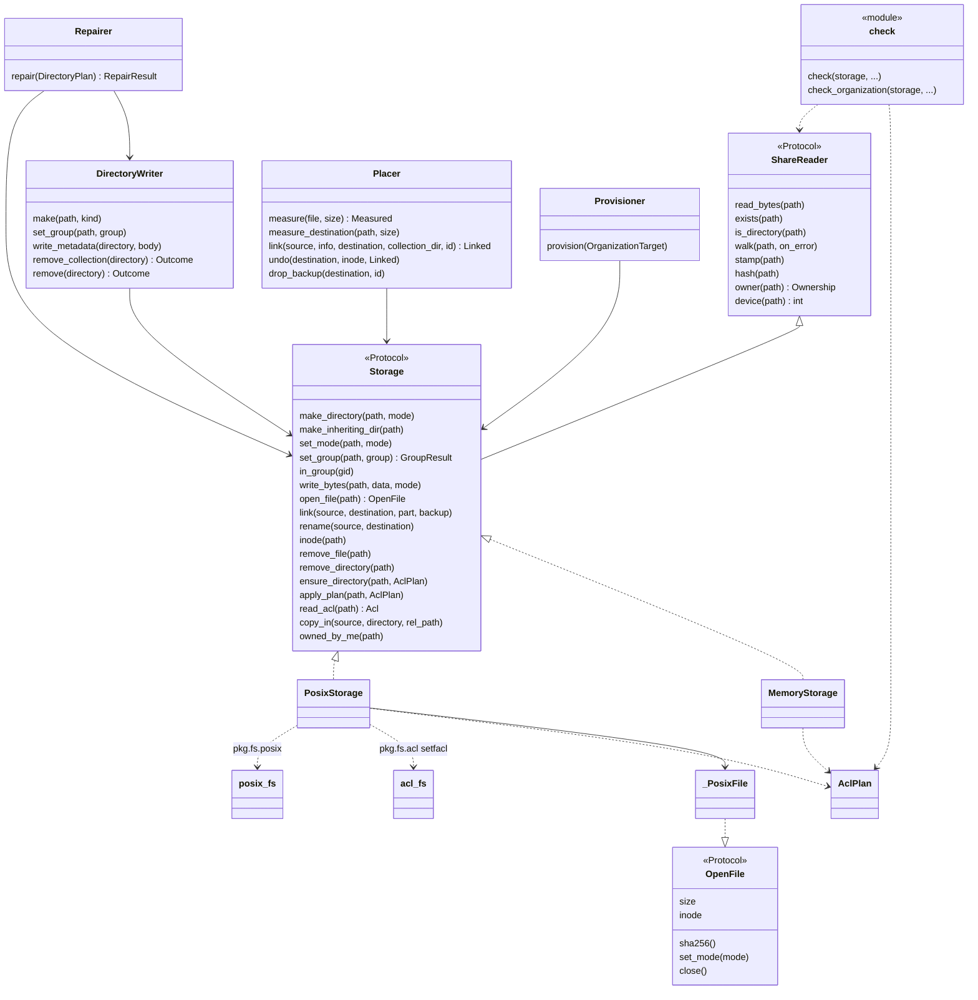
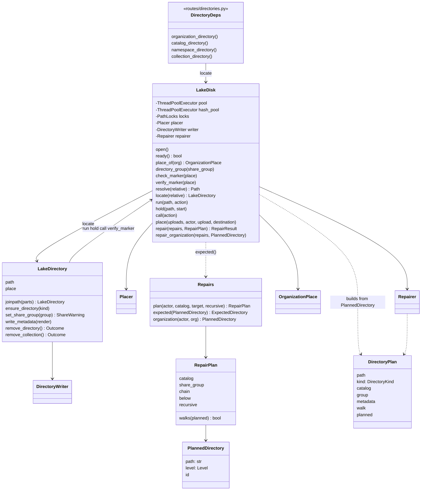
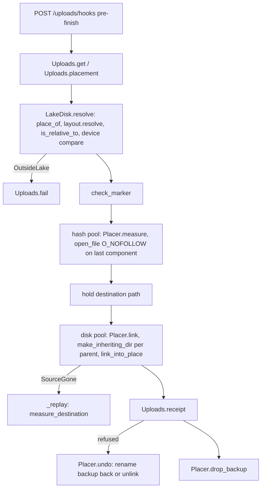
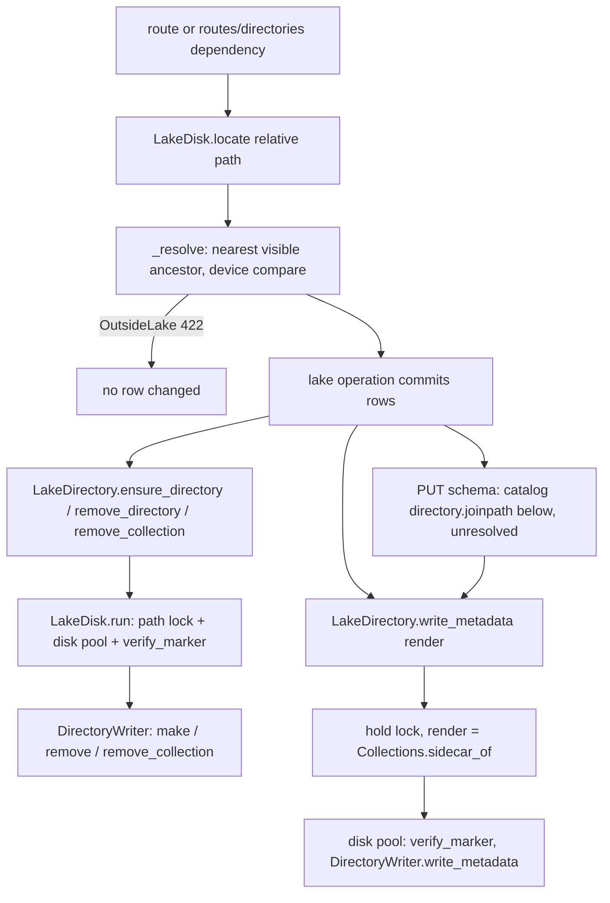
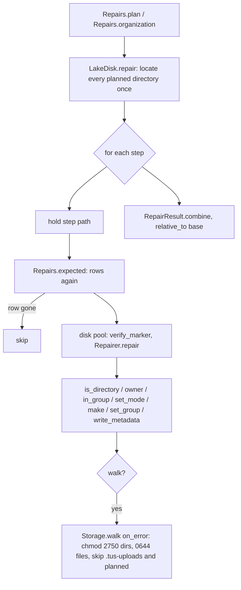
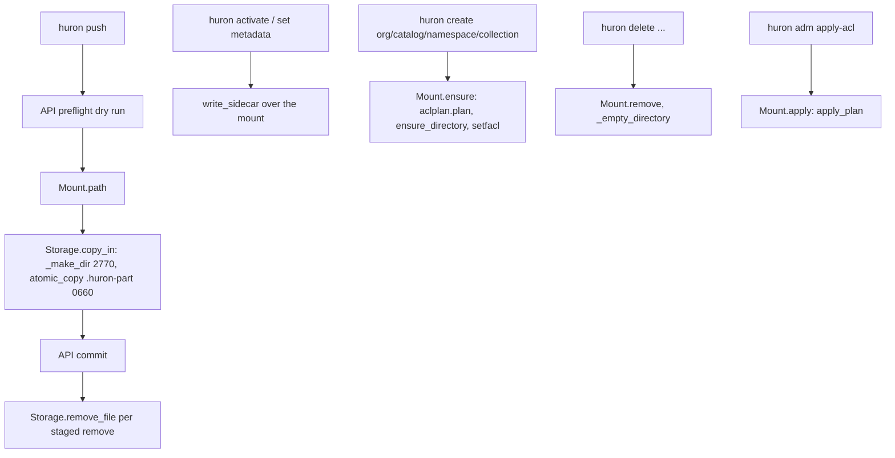

# Architectural review: lake disk work

- Date: 2026-11-07
- Target: the "lake" disk-work area of Huron in this worktree (uncommitted M11.5 code on top of
  commit 5800e25a, gate green): `src/huron/applications/api/disk.py`,
  `applications/api/routes/directories.py`, the v1 endpoints that do disk work
  (`organizations.py`, `catalogs.py`, `namespaces.py`, `collections.py`, `uploads.py`,
  `repairs.py`), all of `src/huron/core/storage/`, `src/huron/pkg/fs/posix.py` (and `acl.py`),
  `src/huron/core/lake/repairs/`, and the CLI's old disk-write path (`cli/sync.py`, `cli/mount.py`,
  `cli/commands/{create,delete,change,common,context,adm}.py`, `cli/inventory.py`).
- Seed: `IMPLEMENTATION_PLAN.md`, "## Escalation (M11.5, 2026-11-07)" with its "Resolution
  input", the 2026-11-06 amendment bullets ("Facts about the storage", "Lake path", "Upload flow",
  "Catalog share group and directory modes", "Directory verbs in the API", "Removals and the inode
  guard", "Lock order", "Version 1 directories") and the task texts of M11.5 to M11.10.
- Binding decisions (the user's, 2026-11-07): Huron never creates a symbolic link; placement uses
  hard links only. No symbolic link may exist in, or be followed inside, the lake, and data is
  never outside it. There are no version 1 directories: production starts from scratch, so the
  whole "Version 1 directories" migration is dropped. The lake's mount point never changes, so no
  `st_dev` or mount-point check per write: containment comes from building every path from
  validated names below `lake_path` and refusing symbolic links. M11.5 is split. The old NFS-copy
  write path is removed, not kept.
- Goal: composability. Find the common abstractions, duplicated concepts and domain boundaries to
  move into core or shared modules: (1) one simple containment model that every disk write and
  walk uses; (2) the directory verbs, the repair walker, placement and removal on one disk-access
  abstraction instead of overlapping helpers; (3) deletion of the NFS-copy path, the ACL plan code
  and the version 1 paths; (4) a split of M11.5 into tasks that each verify on their own.
- Clean-sweep rule: no backwards compatibility. Remove obsolete paths, shims, legacy behaviour,
  duplicate abstractions, stale types, unused helpers, transitional code and needless
  indirection. Prefer a simple, cohesive, direct, idiomatic design with clear domain boundaries,
  deletion over accommodation, explicit contracts over implicit behaviour, and good names over
  comments. No TODOs, temporary names, debug statements, commented-out code, speculative
  abstractions or partial migrations, and no comments that refer to the review, phases or tasks.

## Codebase map

### Modules and their roles

| Module | Role | Main types and functions |
| --- | --- | --- |
| `pkg/fs/posix.py` | Path-based POSIX primitives, no Huron words | `make_dir` (mkdir + chmod), `make_inheriting_dir` (mkdir 0750 + lstat check of setgid/group, rmdir on failure), `link_into_place` (link, or part + backup + rename), `atomic_copy`, `atomic_write`, `remove_file`, `remove_empty_dir`, `walk` (scandir, sorted, `Entry.kind` = file/dir/other, `is_symlink`), `stat`, `exists`, `is_dir`, `inode`, `InheritanceError`, `PART_SUFFIX` |
| `pkg/fs/acl.py` | `getfacl`/`setfacl` through a subprocess runner | `Acl`, `AclEntry`, `read_acl`, `write_acl`, `render_acl`, `SubprocessRunner`, `AclError` |
| `core/storage/ports.py` | The storage seam | `ShareReader` (read_bytes, exists, is_directory, walk, stamp, hash, owner, device), `Storage(ShareReader)` (make_directory, set_mode, set_group, in_group, make_inheriting_dir, write_bytes, open_file, link, rename, inode, remove_file, remove_directory, ensure_directory, apply_plan, read_acl, copy_in, owned_by_me), `OpenFile`, `FileStamp`, `Ownership`, `GroupOutcome`, `GroupResult`, `ShareWarning` |
| `core/storage/posix.py` | Production adapter | `PosixStorage(acl_backend, runner)`, `_PosixFile` (fstat, pread hash, fchmod), `_guard`/`_storage_error` (OSError to `StorageError`), `_make_dir` (mode `2770`, copy path), `_AUTH_SYS_GROUPS` |
| `core/storage/memory.py` | Test adapter | `MemoryStorage` over `dict[Path, Node]`, with `denied`, `unreadable`, `mounts`/`device` (`ROOT_DEVICE`), `inherits`, `member_of`, ACL fields on `Node`, `calls` log; no symbolic links |
| `core/storage/layout.py` | Where things live | modes (`ORGANIZATION_MODE 2751`, `DIRECTORY_MODE 2750`, `FILE_MODE 0644`, `UPLOAD_DIR_MODE 0700`), `MARKER_FILE`, `UPLOAD_DIR`, `DirectoryKind` (incl. `NAMESPACE_WITH_COLLECTIONS`), `mode_of`, `resolve(prefix, relative)` (refuses empty, `.`, `..`), `OrganizationPlace` (`base`, `directory`, `marker_directory`, `resolve`), `place_of`, `is_reserved_entry` |
| `core/storage/marker.py` | The `.huron` marker | `Marker`, `MarkerState`, `render_marker`, `read_marker`, `verify_marker`, `marker_state` |
| `core/storage/directories.py` (new) | Directory verbs and repair on disk | `DirectoryWriter` (make, set_group, write_metadata, remove_collection, remove), `Outcome`, `DirectoryPlan`, `Repairer`, `RepairResult`, `RepairFailure`, `MODE_DRIFT`, `_Report`, `_EntryGuard`, `_empty`, `_skipped`, `_huron_file` |
| `core/storage/placement.py` | Placement disk steps | `Placer` (upload_file, info_file, measure, measure_destination, backup_file, link, drop_backup, undo), `Measured`, `Linked`, `CollectionDirectoryMissing`, `_empty` |
| `core/storage/errors.py` | Storage errors | `StorageError` (`STORAGE_FAILED` 500), `OutsideLake` (422), `LakeUnavailable` (503), `InheritanceFailed`, `SourceGone` |
| `core/storage/locks.py` | In-process path locks | `PathLocks.hold(path)` |
| `core/storage/check.py` | `huron adm check` findings | `check`, `check_organization`, `Expected{Directory,Collection,Organization}` with `plan: AclPlan`, `_acl` (`acl_drift`) |
| `core/storage/provision.py` | `provision-orgs` | `Provisioner.provision` (uses `ensure_directory(dir, AclPlan)`), `provision_script(targets, acls=)`, `OrganizationTarget(plan, marker, place)` |
| `core/storage/aclplan.py` | ACL plans | `EffectiveGroups`, `AclPlan`, `plan(kind, groups)`, `diff` |
| `core/storage/factory.py` | Adapter construction | `storage_for(acl_backend)`; the API calls `storage_for("none")`, the CLI `storage_for(config.acl_backend)` |
| `core/lake/repairs/` (new) | Repair plans from rows | `Repairs.plan`, `Repairs.expected`, `Repairs.organization`, `RepairPlan` (`chain`, `below`, `walks`), `PlannedDirectory(path, level, id)`, `Level`, `ExpectedDirectory(metadata)`, `_Tree` |
| `applications/api/disk.py` | The API's hold on the lake | `LakeDisk` (pools `DISK_WORKERS 8` and `HASH_WORKERS 4`, `open`, `ready` probe, `place_of`, `directory_group`, `check_marker`, `verify_marker`, `resolve`, `run`, `hold`, `call`, `locate`, `repair`, `repair_organization`, `place`, `_settle`, `_replay`, `_resolve` with the `device` check, `_visible`), `LakeDirectory` (`joinpath`, `ensure_directory`, `set_share_group`, `write_metadata(render)`, `remove_directory`, `remove_collection`), `_Placement`, `_KINDS` (`Level` to `DirectoryKind`) |
| `applications/api/routes/directories.py` (new) | FastAPI dependencies | `{Organization,Catalog,Namespace,Collection}DirectoryDep`: read the row with the caller's privilege, then `disk.locate(...)`; `None` without a lake |
| `applications/cli/mount.py` | The CLI's view of the share | `Mount` (place, verify, path, `ensure`/`apply` with ACL plans, `remove`, `report`, `catalog_groups`, `organization_groups`) |
| `applications/cli/sync.py` | Working copies and push | `push` (preflight, `_copy_files` via `Storage.copy_in`, commit, `remove_file` of removes), `write_sidecar` |

### Dependency directions

- `core.lake` imports neither `core.storage` nor `applications` (import-linter). `core.lake.repairs`
  therefore hands out paths as strings (`PlannedDirectory.path`, `<organization>/<catalog>/…`) and
  its own `Level` enum; `applications/api/disk.py` maps `Level` to `DirectoryKind` (`_KINDS`).
- `core.storage` imports `core.lake` in one place: `placement.py` raises
  `core.lake.uploads.errors.UploadSizeMismatch`.
- `applications/api/disk.py` is the only module that joins rows (through `Uploads`, `Repairs`,
  `Collections.sidecar_of` callables) with disk work. The CLI reaches the share through `Mount`
  and the same `core.storage` adapters.

### Who calls what, per disk operation

**Placement** (`POST /uploads/hooks`, `pre-finish`): `endpoints/uploads._finish` reads the
upload (`Uploads.get`), gets `Destination` from `Uploads.placement`, then `LakeDisk.place`:
`resolve(destination.path)` (`OutsideLake` fails the upload) and `check_marker`; the hash pool
runs `Placer.measure` (`Storage.open_file` with `O_NOFOLLOW` on the final component only,
`fstat`, `pread` hash, `fchmod 0644`); under `hold(path)`, `_settle` runs `Placer.link` in the
disk pool (`is_directory(collection_dir)`, `make_inheriting_dir` per missing intermediate,
`Storage.link` = `posix.link_into_place`, `remove_file` of tusd's two files), then
`Uploads.receipt`, then `drop_backup`; a refused receipt runs `Placer.undo` (inode compare,
`rename` backup back or `remove_file`, `_remove_empty`); a vanished source runs `_replay`
(`measure_destination`). The collection directory is `path.parents[depth - 1]`, computed from the
upload's `rel_path`.

**Directory make** (create organization, catalog, namespace; activate collection): the route
builds the relative path inline (`organizations.py`: `name`; `catalogs.py`:
`f"{owner.name}/{name}"`; `namespaces.py`: `catalog.disk_path` + segments) or through a
`routes/directories.py` dependency, then `LakeDisk.locate` = `resolve` (`place_of`,
`OrganizationPlace.resolve` = `layout.resolve`, `is_relative_to(lake_path)`, `_require_lake`,
walk up to the nearest `_visible` ancestor, `Storage.device` compare) and returns a
`LakeDirectory`. After the lake operation commits, `LakeDirectory.ensure_directory(kind)` runs
`LakeDisk.run(path)` (path lock + disk pool), `verify_marker`, `DirectoryWriter.make`
(`exists`, `is_directory`, `_empty` via `walk`, then `make_directory(path, 2751)` for an
organization, else `make_inheriting_dir`).

**Share group** (create catalog with a share group, `PATCH /catalogs/{catalog}`):
`LakeDirectory.set_share_group` maps `None` to the service gid (`LakeDisk.directory_group`) and
runs `DirectoryWriter.set_group` = `Storage.set_group` (`grp.getgrnam`, `lchown`), returning a
`SHARE_GROUP_PENDING` warning through `GroupResult.warning`.

**`metadata.json`** (`PATCH /collections/{id}`, activate): `LakeDirectory.write_metadata(render)`
holds the path lock, awaits `render` = `Collections.sidecar_of(id)` (a new read), then in the disk
pool `verify_marker` and `DirectoryWriter.write_metadata` (`read_bytes`, compare,
`write_bytes(path, body, 0644)` = `posix.atomic_write` through `metadata.json.huron-part`, then
`chmod`). Schema assignment (`PUT /catalogs/{catalog}/schema`) locates only the catalog directory
and, for each settled collection returned by `Catalogs.assign_schema`, calls
`directory.joinpath(*below.parts).write_metadata(...)`: the joined path is never resolved
(verification 3, finding 1).

**Removal of a directory** (delete organization, catalog, namespace): dependency `locate`, lake
delete, `LakeDirectory.remove_directory` = `DirectoryWriter.remove` (`remove_directory`, on
`StorageError` check `is_directory` + `_empty` to answer `KEPT`). **Collection delete**: the route
calls `collection_directory` unless dry run, `Collections.delete`, then
`LakeDirectory.remove_collection` = `DirectoryWriter.remove_collection` (full `walk`, reversed;
remove empty subdirectories and `_huron_file` entries; then `remove`). The claimed removal rows
wait for M11.6 (`Unlinker`, `drain`).

**Repair** (`POST /catalogs/{catalog}/repair`, `POST /organizations/{org}/repair`):
`Repairs.plan` (authorize, `_Tree`, `_chain`, `below`) or `Repairs.organization`; then
`LakeDisk.repair` locates every planned directory once (before any disk work), builds a
`DirectoryPlan` per step (`catalog`, `group`, `walk`, `planned`), and per step `_repair_planned`:
`hold(path)`, `Repairs.expected` (rows again), disk pool `verify_marker` + `Repairer.repair`
(`is_directory`, `owner`, `_drifted`, `in_group`, `set_mode`, `DirectoryWriter.make`,
`set_group`, `write_metadata`, and with `walk` a `Storage.walk(path, on_error)` that `chmod`s
directories to `2750` and files to `0644`, skipping `.tus-uploads` and planned directories).
Results are made relative to `place.base`.

**Startup and readiness**: `LakeDisk.open` = `_require_lake` + `make_directory(.tus-uploads,
0700)`; `LakeDisk.ready` runs `_writable` (write and remove a probe file) in the disk pool with a
2 s bound and a 10 s cache.

**The CLI's copy path (version 1)**: `sync.push` runs the API preflight, `Mount.path`, then
`_copy_files` = `Storage.copy_in` (`PosixStorage._make_dir` mode `2770` for parents,
`posix.atomic_copy` through `.huron-part`, mode `0660`), commits, then `Storage.remove_file` for
each staged remove. `write_sidecar` (called by `commands/common.activate` and
`commands/change`) writes `metadata.json` over the mount. `commands/create` and `common` call
`Mount.ensure(relative, kind, groups)` = `ensure_directory(path, aclplan.plan(kind, groups))`
(mkdir + chmod + chgrp + `setfacl`); `commands/change` and `adm apply-acl` call `Mount.apply`
(`apply_plan`); `commands/delete` calls `Mount.remove` and `_empty_directory` (the unrecorded-file
check). The CLI and, with a lake, the API now both make and remove the same directories.

**Check and provision (CLI, read side and storage administrator)**: `adm check` builds
`Expected*` with `AclPlan` from `inventory.py` and runs `check.check`/`check_organization`
(`walk`, `read_bytes`, `read_acl` + `diff` for `acl_drift`/`org_acl_drift`); `walk` reports a
symbolic link as kind `other`, which `_files` and `_directory` skip silently. `adm provision-orgs`
runs `Provisioner.provision` (`ensure_directory` with an organization `AclPlan`, marker write) or
`provision_script(acls=)` (`chgrp`, `chmod`, `setfacl`). `huron status`
(`commands/context.py`) walks the collection directory read-only.

### Structural facts the reviewers start from

- Path building has four spellings: `layout.resolve(prefix, relative)`,
  `OrganizationPlace.resolve`, `LakeDisk._resolve` (adds `is_relative_to(lake_path)`,
  `_require_lake`, the nearest-visible-ancestor walk and the `device` compare) and the CLI's
  `Mount.path`. `LakeDirectory.joinpath` and `Placer.link` (`collection_dir / parent`) and
  `Repairer._walk` (`plan.path.joinpath(...)`) join further names onto a located path with no check.
- Symbolic links: every primitive in `pkg/fs/posix.py` is path-based. `lstat`, `O_NOFOLLOW`,
  `follow_symlinks=False` protect only the final component; an intermediate symbolic link is
  followed by `mkdir`, `open`, `link`, `rename`, `unlink`, `rmdir` and `scandir`. `walk` never
  descends into a link but yields it as `other`, and no caller refuses or reports it.
  `MemoryStorage` cannot model a symbolic link at all; it models mount points (`mounts`,
  `device`) instead, which the decisions make unnecessary.
- Five directory-making functions: `posix.make_dir`, `posix.make_inheriting_dir`,
  `PosixStorage.make_directory` (mkdir + chmod), `PosixStorage.ensure_directory` (ACL plan) and
  `PosixStorage._make_dir` (`2770`, copy path); `MemoryStorage` mirrors three of them.
- Two identical `_empty(storage, directory)` helpers (`directories.py`, `placement.py`), both a
  full `walk` generator used for its first item; `DirectoryWriter.remove`, `remove_collection`,
  `Placer._remove_empty` and `make` all ask "is it an empty directory".
- Two enums for one concept: `core.lake.repairs.models.Level` and `core.storage.layout.DirectoryKind`
  (which still carries the ACL-only `NAMESPACE_WITH_COLLECTIONS`).
- The `Storage` port has 25 methods. Of these, `ensure_directory`, `apply_plan`, `read_acl`,
  `owned_by_me` (ACL) and `copy_in` (copy path) serve only the code the decisions remove, and
  `device` serves only the `st_dev` check the decisions drop. `DirectoryWriter.set_group` is a
  pass-through to `Storage.set_group`.
- `LakeDisk` holds the pools, the probe, the locks, path resolution, the marker check, placement
  orchestration and repair orchestration (535 lines with `LakeDirectory`); `LakeDirectory` is a
  handle that calls back into `LakeDisk.run/hold/call/verify_marker/directory_group`.
- The marker is checked per disk call (`verify_marker` in the worker), by path, also through
  whatever symbolic links lie on the way.
- Repair rules exist for version 1 conditions (entries not owned by `U` with `EPERM`, `in_group`
  with the 16-group AUTH_SYS limit before `chmod`, `mode_drift` with a foreign group), for
  unreadable/unsearchable directories, vanishing entries and non-directory entries at planned
  paths (`_Report.gone`, `_EntryGuard` with an anchor).

## Diagrams

### Storage seam and adapters (current)



### The API's disk layer and the repair domain (current)



### Placement (current)



### Directory verb and `metadata.json` (current)



### Repair (current)



### The CLI's version 1 write path (to be removed)



## Review plan

Each task is one reviewer's work (30k to 50k tokens). A reviewer reads the files of its task, the
seed sections named in the header and the earlier tasks' sections of this file, then appends its
own section (`## R<n>: <title>`) with findings, the target design for its area, a prioritized
change list and the deletions. Reviewers do not edit source, tests or the plan.

### R1: The containment model and the path and traversal primitives

- Scope: one containment model for every lake path. Inventory each place a lake path is built,
  joined or followed (`layout.resolve`, `place_of`, `OrganizationPlace.resolve`,
  `LakeDisk._resolve`/`resolve`/`locate`/`_visible`/`_require_lake`, `LakeDirectory.joinpath`,
  `Placer.link`'s parents, `Repairer._walk`'s joins, `Mount.path` on the read side). Evaluate the
  primitive: traversal from a directory descriptor of `lake_path`, one validated name per step,
  with `O_NOFOLLOW | O_DIRECTORY` and the `dir_fd` / `follow_symlinks=False` forms of the `os`
  calls, against Linux `openat2(RESOLVE_BENEATH | RESOLVE_NO_SYMLINKS)` (not in the stdlib) and
  against keeping path strings. Weigh NFSv3 behaviour (`hard` mount, descriptors across a long
  hash, `link`/`rename` with `dir_fd`). Decide what replaces `OutsideLake` (a symbolic link met
  during traversal, an invalid name) and what goes: `Storage.device`, the `device` compare,
  `MemoryStorage.mounts`/`ROOT_DEVICE`, the nearest-visible-ancestor walk. Decide how
  `MemoryStorage` models a symbolic link so the refusal is testable in both adapters, and whether
  `mount_prefix` and declared organization roots stay (every root must lie below `lake_path`).
  Decide where the marker check sits in the model.
- Acceptance criteria: the section names one value type (or module) that turns validated names
  into a lake location and is the only way to reach the disk; it lists every current call site
  and its replacement; it states the refusal rule for symbolic links in writes, walks and reads,
  with the error code and status; it says which `pkg/fs/posix.py` functions become descriptor
  based, which are deleted, and which `Storage` methods change signature; it proposes tests that
  plant an intermediate symbolic link on a real temporary filesystem for every write operation
  (directory make, `metadata.json`, link, rename, unlink, rmdir, walk) and the same over
  `MemoryStorage`; it shows that verification 3's two findings cannot occur under the model.
- Likely files: `src/huron/pkg/fs/posix.py`, `src/huron/core/storage/{ports,posix,memory,layout,marker,errors}.py`,
  `src/huron/applications/api/disk.py`, `src/huron/applications/api/settings.py`,
  `src/huron/schema/naming.py`, `tests/unit/pkg/test_posix.py`, `tests/unit/storage/test_storage.py`,
  `tests/unit/api/test_lake_disk.py`, `tests/support/disk.py`.

### R2: The directory verbs and the `metadata.json` writes, schema assignment included

- Scope: `LakeDirectory`, `DirectoryWriter` (make, set_group, write_metadata, remove,
  remove_collection), `routes/directories.py`, the disk parts of `organizations.py`,
  `catalogs.py`, `namespaces.py`, `collections.py`, and the reads they use
  (`Collections.sidecar_of`, `Catalogs.assign_schema` / `SchemaAssignment`,
  `lookups.rendered_sidecar`, `CollectionView.directory`, `NamespaceStore.list_in_catalog`).
  Check the located-before-commit rule, the inline locate in the create routes against the
  dependencies, `joinpath` in schema assignment, the without-lake branches (`None` handles in
  every route), the post-commit error mapping, the adopt-an-empty-directory rule, compare-and-write
  of `metadata.json`, and whether `LakeDirectory` and `DirectoryWriter` are two shallow layers
  over one concept (deletion test on `DirectoryWriter.set_group`, `LakeDirectory._run/_checked`).
- Acceptance criteria: the section gives one pattern by which every verb obtains a located
  directory (organization, catalog, namespace, collection, and a collection below a catalog for
  schema assignment) on R1's model; it decides where the `Level`/`DirectoryKind` and the
  organization-versus-inheriting make rule live; it lists the methods that merge or go; it states
  the behaviour without a lake in one place; it lists the tests of `test_directory_verbs.py` and
  `test_directories.py` that stay, change or go (replace, don't layer).
- Likely files: `src/huron/applications/api/disk.py`, `src/huron/applications/api/routes/directories.py`,
  `src/huron/applications/api/routes/v1/endpoints/{organizations,catalogs,namespaces,collections}.py`,
  `src/huron/core/storage/directories.py`, `src/huron/core/lake/{collections,catalogs,namespaces}/`,
  `src/huron/core/lake/lookups.py`, `tests/unit/api/test_directory_verbs.py`,
  `tests/unit/api/test_catalog_share_group.py`, `tests/unit/storage/test_directories.py`.

### R3: The repair walker and the Repairs domain

- Scope: `Repairer`, `DirectoryPlan`, `RepairResult`, `RepairFailure`, `_Report`, `_EntryGuard`,
  `_skipped`, `MODE_DRIFT`; `LakeDisk.repair`, `_repair_planned`, `_repair_checked`,
  `repair_organization`, `_KINDS`; `core/lake/repairs/` (`Repairs`, `RepairPlan`, `chain`,
  `below`, `walks`, `PlannedDirectory`, `Level`, `ExpectedDirectory`, `_Tree`); the repair
  endpoint and schema. With no version 1 trees and no symbolic links, decide which walker rules
  still earn their keep (`EPERM` on entries not owned by `U`, `in_group` with the 16-group limit,
  a foreign directory group, unreadable and unsearchable directories, vanishing entries, a
  non-directory at a planned path) and which become a plain `STORAGE_FAILED` or a reported
  symbolic link. Decide whether the recursive walk and `remove_collection`, `_empty` and the
  check's walks share one traversal (R1's primitive). Decide where locating happens (once before
  the work, as now, or per step under the lock from the planned names) and whether `RepairPlan`
  should carry names instead of joined path strings.
- Acceptance criteria: the section lists the walker rules that stay, each with the condition
  that can still occur in a from-scratch lake, and the rules that go; it gives the walker's
  target interface on R1's model, with the symbolic-link rule (reported in `failed`, never
  followed, never changed); it removes the `Level`/`DirectoryKind` duplication or justifies it
  across the `core.lake`/`core.storage` contract; it lists the tests of `test_repair.py`,
  `test_repairs.py` and `test_directories.py` that stay, change or go.
- Likely files: `src/huron/core/storage/directories.py`, `src/huron/core/lake/repairs/{models,operations}.py`,
  `src/huron/applications/api/disk.py`, `src/huron/applications/api/routes/v1/endpoints/repairs.py`,
  `src/huron/applications/api/routes/v1/schema/repairs.py`, `src/huron/core/storage/layout.py`,
  `tests/unit/api/test_repair.py`, `tests/unit/lake/test_repairs.py`,
  `tests/unit/storage/test_directories.py`.

### R4: Placement, removal and one disk-access abstraction

- Scope: placement and the overwrite backup were verified; review them only for containment and
  shared abstractions. `Placer`, `Measured`, `Linked`, `CollectionDirectoryMissing`,
  `posix.link_into_place`/`_replace`/`_link_afresh`, `LakeDisk.place`/`_settle`/`_replay`, the
  two pools and `PathLocks`; `DirectoryWriter.remove`/`remove_collection`, `Placer._remove_empty`,
  the two `_empty` helpers; the M11.6 plan for `Unlinker`, `drain` and `Sweeper`. Decide the one
  module through which placement, the directory verbs, repair and removal reach the disk (its
  name, its interface, what it hides: traversal, symbolic-link refusal, inheritance check,
  emptiness, error mapping), and how `Storage` shrinks to the operations that module needs, with
  `PosixStorage` and `MemoryStorage` as the two adapters. Decide how `LakeDisk` splits (pools,
  probe and locks against path-to-location and the operation orchestration) and whether
  `LakeDirectory` stays a handle. Check that the collection directory of a placement is located
  from the collection's names, not from `parents[depth - 1]`.
- Acceptance criteria: the section gives the target interface of the disk-access module with
  each current caller mapped onto it; the reduced `Storage` port, method by method, with the
  adapters' changes; the `LakeDisk` decomposition with each public method's new home; how
  M11.6's `Unlinker` and the empty-directory cleanup use the same module; and a statement that
  the placement behaviour verified in M11.4 and the backup (sub-steps 5 to 7) is unchanged, with
  the tests that prove it.
- Likely files: `src/huron/core/storage/{placement,directories,ports,posix,memory,locks}.py`,
  `src/huron/pkg/fs/posix.py`, `src/huron/applications/api/disk.py`,
  `src/huron/applications/api/routes/v1/endpoints/uploads.py`,
  `tests/unit/storage/test_placement.py`, `tests/unit/api/test_upload_hooks.py`,
  `tests/unit/api/test_lake_disk.py`, `tests/support/{disk,tusd}.py`.

### R5: Deleting the NFS-copy path, the ACL plan code and the version 1 migration

- Scope: inventory and classify every piece of the three obsolete areas. NFS copy:
  `Storage.copy_in` and both adapters, `posix.atomic_copy`, `PosixStorage._make_dir` and
  `_COPY_DIRECTORY_MODE`, `posix.make_dir`, `sync.push`'s copy and unlink steps, `write_sidecar`,
  `Mount.ensure`/`apply`/`remove`/`report`, `commands/delete._empty_directory` and
  `_refuse_unrecorded`, `common.kind_of`, the CLI `Storage` write type. ACL: `aclplan.py`,
  `pkg/fs/acl.py`, `EffectiveGroups`, `DirectoryKind.NAMESPACE_WITH_COLLECTIONS`, the plan
  methods and `owned_by_me`, `read_acl`, the `Node.acl`/`owner`/`group` names in
  `MemoryStorage`, `factory.storage_for(acl_backend)`, `acl_backend` config, `adm apply-acl`,
  `_remind`, `check.py`'s `plan` fields and `acl_drift`, `provision.py`'s `AclPlan` and `acls=`,
  `inventory.py`'s groups, `ACL_FAILED`, `tests/acl/`. Version 1: the plan's "Version 1
  directories" bullet and every reference to it (the `chown -R` steps of `provision-orgs` and
  `init-root.sh`, the `0660` file repair line of `provision-catalogs`, `EPERM` on entries not
  owned by `U`, the `null`-inode "version 1 file" case, the risk register row, M11.12's migration
  order), and the code that exists only for it. Check what `provision-catalogs` and
  `provision-orgs` still need in a from-scratch lake (the `chgrp` of share groups stays a
  storage-administrator step).
- Acceptance criteria: a table of every item with its decision (delete now in the M11.5 split,
  delete in M11.7, M11.8 or M11.9, or keep with a reason), and the order constraints (for example
  the CLI must stop writing directories before or when the API starts making them, since both
  write the same paths today); the list of plan-text changes (bullets and task texts to drop or
  rewrite); a grep-style check per area that proves the deletion is complete; nothing kept for
  compatibility.
- Likely files: `src/huron/applications/cli/{sync,mount,inventory,config,errors,main}.py`,
  `src/huron/applications/cli/commands/{create,delete,change,common,adm,context}.py`,
  `src/huron/core/storage/{aclplan,check,provision,factory,posix,memory,ports,layout,__init__}.py`,
  `src/huron/pkg/fs/{acl,posix}.py`, `scripts/init-root.sh`, `IMPLEMENTATION_PLAN.md`,
  `AGENTS.md`, `tests/acl/`, `tests/unit/cli/`, `tests/unit/pkg/test_acl.py`.

### R6: The split of M11.5 and its effect on M11.6 to M11.10

- Scope: the uncommitted M11.5 tree (directory verbs, repair, the hash pool, the overwrite
  backup, the `StorageError` mapping of every query) against R1 to R5's designs. Propose the
  tasks that replace M11.5, each small enough for one implementation pass and one verification,
  and map each part of the current tree to a task (kept as is, reworked, or dropped). Then check
  M11.6 (removals on the disk-access module, `Unlinker` with the symbolic-link rule), M11.7 (push
  through tusd, `copy_in` removal), M11.8 (CLI without disk writes), M11.9 (check and
  provisioning without ACLs and without version 1), and M11.10 (stacks and integration) for
  steps that move, merge or go, and for references to dropped concepts.
- Acceptance criteria: an ordered list of replacement tasks with, for each, its intent, its
  files, its tests (including the symbolic-link refusal tests of R1 on a real temporary
  filesystem), its verification commands and its dependencies; every replacement task is
  verifiable on its own with a green gate; the already-verified parts (hash pool, backup) get
  their own task so they can be committed first; the changes to M11.6 to M11.10's texts are
  listed; no task leaves a partial migration in the tree at its end.
- Likely files: `IMPLEMENTATION_PLAN.md` (M11.5 to M11.10 and the escalation), `git diff HEAD
  --stat` of the tree, the files named in R1 to R5.

### S: Synthesis (synthesis task)

- Scope: R1 to R6's sections.
- Acceptance criteria: a section `## Synthesis` with the target design (the containment model,
  the disk-access module and the reduced `Storage` port, the API disk layer, the repair walker,
  the module boundaries and import rules), a prioritized change list, the full list of
  deletions, and the proposed M11.5 split with each task's scope and verification, plus the
  changes to M11.6 to M11.10, ready as the seed for `/design-plan`. Conflicts between reviewer
  sections are resolved and named.
- Likely files: `architectural_review.md`, `IMPLEMENTATION_PLAN.md`.

## Progress ledger

| Id | Title | Status |
| --- | --- | --- |
| R1 | The containment model and the path and traversal primitives | complete |
| R2 | The directory verbs and the `metadata.json` writes, schema assignment included | complete |
| R3 | The repair walker and the Repairs domain | complete |
| R4 | Placement, removal and one disk-access abstraction | complete |
| R5 | Deleting the NFS-copy path, the ACL plan code and the version 1 migration | complete |
| R6 | The split of M11.5 and its effect on M11.6 to M11.10 | complete |
| S | Synthesis | complete |

## R1: The containment model and the path and traversal primitives

### Findings

1. Five spellings of "a path in the lake", none of them a type. `layout.resolve`
   (`core/storage/layout.py:57`), `OrganizationPlace.resolve` (`layout.py:97`), `place_of`
   (`layout.py:107`), `LakeDisk._resolve` (`api/disk.py:392`) and the CLI's `Mount.path`
   (`cli/mount.py:142`) each turn a string into an absolute `Path`. Then `LakeDirectory.joinpath`
   (`disk.py:450`), `Placer.link` (`placement.py:123-126`, `collection_dir / parent`),
   `LakeDisk.place` (`disk.py:319-320`, `path.parents[depth - 1]`), `Repairer._walk`
   (`directories.py:277`), `_skipped` (`directories.py:367`), `DirectoryWriter.write_metadata`
   and `remove_collection` (`directories.py:90,106`) and `read_marker` (`marker.py:74`) join more
   names onto that `Path` with no check. Containment is a property of one call
   (`_resolve`), not of the values that flow to the disk. That is the root of verification 3.
2. The check is made before the work, by path, and the work runs later by path again.
   `_resolve` compares `st_dev` of the nearest visible ancestor (`disk.py:402-409`). The kernel
   then resolves the same string again on every `mkdir`, `open`, `link`, `rename`, `unlink`,
   `rmdir` and `scandir` (`pkg/fs/posix.py`), and follows each intermediate symbolic link.
   `O_NOFOLLOW`, `lstat` and `follow_symlinks=False` protect only the last name.
3. `link_into_place` can create a symbolic link in the lake. `os.link(source, destination,
   follow_symlinks=False)` (`posix.py:128`) and `_link_afresh` (`posix.py:267`) hard-link a
   symbolic link itself when `source` (or the replaced `destination`, for the backup) is one.
   `Placer.measure` opens the source with `O_NOFOLLOW`, but in the hash pool and outside every
   lock, so nothing ties the linked name to the measured inode.
4. The marker is not checked at the link. `LakeDisk.place` checks it before the hash
   (`disk.py:316`); `_settle` links and removes tusd's files with no marker check after a hash
   that can take most of an hour. `LakeDirectory._checked` does check per step.
5. Configuration errors are reported per request. A declared root or a `mount_prefix` outside
   `lake_path` passes `Settings` (`settings.py:212-217` checks only "absolute, no `..`") and then
   answers `OUTSIDE_LAKE` 422 on every request (`disk.py:399`; tests
   `test_a_mount_prefix_outside_the_lake_puts_unrooted_organizations_outside`, the `elsewhere`
   fixture of `test_directory_verbs.py:347`). The API's `mount_prefix` is a second base for
   unrooted organizations with no use in a from-scratch deployment (it is not the web's
   `HURON_WEB_MOUNT_PREFIX` or the CLI's prefix).
6. `MemoryStorage` models mount points (`mounts`, `mount`, `ROOT_DEVICE`, `device`,
   `memory.py:28,76,87,180`) and cannot model a symbolic link, so no test over it can prove a
   refusal. `Entry.is_symlink` exists, but every walker treats a link as an unnamed `other`.
7. `_require_lake` (`disk.py:423`) and `_visible` (`disk.py:412`) exist only for the `st_dev`
   compare; `LakeDisk.resolve` exists only for `locate` and `place`.

### Decision on the primitive

Descriptor traversal from `lake_path`, one validated name per step. Each step is
`os.open(name, O_PATH | O_DIRECTORY | O_NOFOLLOW | O_CLOEXEC, dir_fd=parent)`; the last step
uses the `dir_fd=` form of the operation (`mkdir`, `link` with `src_dir_fd`/`dst_dir_fd` and
`follow_symlinks=False`, `rename` with both dir fds, `unlink`, `rmdir`, `stat` with
`follow_symlinks=False`, `open` with `O_NOFOLLOW`, `chown` with `follow_symlinks=False`).
A step that fails with `ELOOP` or `ENOTDIR` is classified by `os.stat(name, dir_fd=parent,
follow_symlinks=False)`: `S_ISLNK` is a symbolic link, anything else "not a directory".

- Against `openat2(RESOLVE_BENEATH | RESOLVE_NO_SYMLINKS)`: same guarantee, but not in the
  stdlib (a `ctypes` syscall with a per-architecture number and `struct open_how`), it cannot
  name the offending component for the message, and `RESOLVE_BENEATH` adds nothing once every
  name is validated (no `..`, no `/`). Rejected.
- Against path strings with a check: any check by path is a time-of-check to time-of-use gap,
  which is what verifications 1 to 3 kept finding. Rejected.
- NFSv3 (`hard`, `vers=3`, no OPEN RPC in v3): a per-name `openat` costs the same LOOKUPs the
  client makes for a path walk, plus a GETATTR at open (close-to-open). `O_PATH` needs only
  search permission and reads nothing. `O_NOFOLLOW` is decided by the client from the file type
  (`NF3LNK`). `linkat`, `renameat`, `unlinkat`, `mkdirat` and `fchownat` are the same LINK,
  RENAME, REMOVE, MKDIR and SETATTR RPCs by file handle, with the same atomicity. Directory
  descriptors are never held across a hash: the hash reads the upload's own descriptor (as now),
  and the link step traverses again under the path lock, so a directory removed meanwhile is a
  plain `ENOENT`, not an `ESTALE` on an old handle.
- No `st_dev` compare anywhere (binding decision): the lake's mount point never changes and
  Huron makes no mount points. A mount point below `lake_path` is outside the model and is not
  checked; that is accepted, not a gap.

### Target design

**`LakePath`, the one way to name a place on the disk** (`core/storage/lakepath.py`, exported
from `core.storage`; `core.lake` keeps producing strings and names, it never imports it):

```python
@dataclass(frozen=True, slots=True, order=True)
class LakePath:
    names: tuple[str, ...]                       # below the storage root; () is the root
    @classmethod
    def of(cls, *names: str) -> LakePath: ...    # check_lake_name on each name
    @classmethod
    def parse(cls, text: str) -> LakePath: ...   # "a/b/c", the API path form
    def joinpath(self, *names: str) -> LakePath: ...
    @property
    def parent(self) -> LakePath: ...
    @property
    def name(self) -> str: ...
    def relative_to(self, base: LakePath) -> str: ...   # API form, for results and messages
    def __str__(self) -> str: ...                # "/".join(names)
```

- `huron.schema.naming.check_lake_name` is the filesystem rule (not empty, not `.` or `..`, no
  `/` or NUL, at most 255 bytes); a refusal is `NamingError` rule `lake_name`, `NAME_INVALID`
  422. The domain rules (`check_segment`, `check_rel_path`) stay as they are and already imply
  it; the lake rule is the guard at the disk seam, so a corrupted row cannot become a path.
- There is no constructor from `Path`, no `__truediv__` with strings that skips the check, and
  no absolute form. `PathLocks` keys become `LakePath`.

**`OrganizationPlace` on names** (`layout.py`): `OrganizationPlace(name, base: LakePath,
own_marker: bool)` with `directory`, `marker_directory` and `locate(api_path) -> LakePath`
(refuses a first name other than `name` with `NAME_INVALID`, then `base.joinpath(*parse(...))`).
`rooted`, `declared` and `export` leave the type: `own_marker` is the only rule the disk needs,
and `export` is CLI hint data (R5). `layout.resolve` and `place_of` are deleted.
The API builds one place per declared organization once, at construction: `base` is
`LakePath.of(*Path(root).relative_to(lake_path).parts)`; an unrooted organization has
`base = LakePath()` and shares the marker at `lake_path`.

**Startup containment, not per request** (`api/settings.py`): a model validator refuses a
declared root that is not `lake_path` or below it ("the root R of organization O is not below
lake_path L"). The API setting `mount_prefix` is deleted with its validator and the
`settings.mount_prefix or lake_path` argument (`runtime.py:176`): unrooted organizations lie
directly below `lake_path`.

**The `Storage` port on `LakePath`** (`ports.py`): every method takes `LakePath` where it takes
`Path` today, and `link` returns `LakePath | None`. `walk(location, on_error)` yields `Entry`
with `names: tuple[str, ...]` (replacing `rel_path` string joins) and `kind` in
`"file" | "dir" | "symlink" | "other"`; `Entry.is_symlink` goes. `on_error` receives the
`LakePath` of the failed directory. `device` is deleted. The ACL and copy methods are not
migrated; R5 deletes them. Whether `exists`, `is_directory`, `inode` and `owner` merge into one
`entry(location)` is R4's call; R1 fixes only their parameter type.

**`PosixStorage(root: Path)`** (`posix.py`) is the only code that turns a `LakePath` into
syscalls. Each call opens `root` with `O_PATH | O_DIRECTORY` (a failure is `LakeUnavailable`,
which replaces `_require_lake`), walks `location.parent.names` with `pkg.fs.posix.open_beneath`,
and runs the last step with the `dir_fd` form. The API passes `root=lake_path`; the CLI read side
passes the organization's base on that machine and locates with `base = LakePath()` (see the call
sites). `factory.storage_for` takes the root (its `acl_backend` goes with R5).

**`MemoryStorage(root)` models links, not mounts** (`memory.py`): nodes are keyed by `LakePath`;
`Node` gets `kind` (`dir`, `file`, `symlink`) and `target: str` for a link; a test plants one with
`symlink(location, target)`. One private `_parent(location)` walks `location.parent.names` and
raises `SymlinkInLake` for a link on the way, `StorageError` for a file on the way and
`permission denied` for an `unreadable` directory, which is what the POSIX traversal does. Every
operation starts with it; a final name that is a link refuses writes and reads, and `walk` yields
it as `symlink` without entering it. `mounts`, `mount`, `ROOT_DEVICE` and `device` are deleted;
`add_root` becomes `add_directory(location, owner)` for the fixtures' declared roots.

**Errors** (`errors.py`): `OutsideLake` and `OUTSIDE_LAKE` are deleted. New
`SymlinkInLake(StorageError)`, code `SYMLINK_IN_LAKE`, status 409, message "<path> is a symbolic
link. The lake must not contain symbolic links. Remove it" (STE100), context
`{"path": "<lake path of the link>"}`. It is never re-wrapped: `LakeDisk.verify_marker`'s
`StorageError` to `LakeUnavailable` mapping (`disk.py:187`) lets it pass unchanged. A file where
a directory must be stays `STORAGE_FAILED` 500. Messages name lake paths in the API form, not
absolute server paths.

**The marker check** stays the first action of every unit of disk work, in the worker, under the
path lock, and reads `place.marker_directory.joinpath(MARKER_FILE)` through the same traversal,
so a link on the way to the marker is refused like any other. It is not part of the `Storage`
port. `read_marker`/`verify_marker` take a `LakePath`. Placement gets it at the link step
(finding 4): the pre-hash `check_marker` call in `LakeDisk.place` goes, and the locked link,
undo and backup-drop steps run through the same checked-worker wrapper as `LakeDirectory`.

### The symbolic-link rule

Huron never creates, follows, changes or removes a symbolic link in the lake.

| Operation | Link on the way (intermediate name) | Link as the last name |
| --- | --- | --- |
| Write: make directory, `chmod`/`chgrp`, `metadata.json`, link, rename, unlink, rmdir | `SYMLINK_IN_LAKE` 409, nothing changed | `SYMLINK_IN_LAKE` 409, nothing changed (the link is not removed or replaced) |
| Read: open for the hash, `read_bytes` (marker, `metadata.json`), stat, inode | `SYMLINK_IN_LAKE` 409 | `SYMLINK_IN_LAKE` 409 |
| Walk: repair, `remove_collection`, emptiness, `huron adm check` | the walk never opens it | yielded as `kind="symlink"`, never entered or changed |

- A walker reports a yielded link: repair adds it to `failed` with reason `symbolic_link`
  (R3); `remove_collection` keeps the directory (`KEPT`, log `disk.symlink_found` with the path);
  an emptiness test counts it as an entry; `huron adm check` reports a `symbolic_link` finding
  (M11.9). The directory verbs adopt only an empty directory, so a link refuses adoption.
- Placement: the source in `.tus-uploads` and the replaced destination are checked with
  `stat(follow_symlinks=False)` on their parent descriptors in the locked step; the source must
  be a regular file whose inode is the measured inode (`Measured.inode`), else the link is not
  made. A link at the destination refuses the placement with `SYMLINK_IN_LAKE`, and the upload is
  failed with that code, as `OUTSIDE_LAKE` and `CollectionDirectoryMissing` fail it today. In a
  tusd hook the refusal is the 409 problem document (a 4xx, so tusd does not retry).
- After a commit, the error mapping of the verbs (post-commit `STORAGE_FAILED` or the error's own
  code) is R2's decision; R1 requires only that `SYMLINK_IN_LAKE` keeps its code and path.

### `pkg/fs/posix.py`, function by function

Descriptor based (each takes a parent descriptor and one name, never a `Path` below the root):

| Today | Target |
| --- | --- |
| (none) | `open_beneath(root: Path, names) -> int` context manager: `O_PATH` steps with `O_NOFOLLOW | O_DIRECTORY`, closes the intermediate descriptors, raises `SymlinkError(OSError)` naming the component |
| `make_dir(path, mode)` (chmods an existing one) | `make_dir(parent_fd, name, mode)`: `mkdir(dir_fd)`, then `fchmod` on the new directory opened `O_RDONLY | O_NOFOLLOW | O_DIRECTORY`; an existing directory is not changed |
| `make_inheriting_dir(path)` | same contract on `(parent_fd, name)`; parent's gid from `fstat(parent_fd)`, `rmdir(dir_fd)` on failure |
| `atomic_write(path, data, part_suffix)` | `atomic_write(parent_fd, name, data, mode, part_name)`: `O_CREAT | O_EXCL | O_WRONLY | O_NOFOLLOW` with `dir_fd`, `fchmod`, `fsync`, `rename` with both dir fds |
| `link_into_place`, `_replace`, `_link_afresh`, `_sync_directory` | `link_into_place(source_fd, source_name, inode, parent_fd, name, part_name, backup_name)` with `src_dir_fd`/`dst_dir_fd`, the type and inode checks above, `fsync(parent_fd)` (the final parent opened `O_RDONLY`) |
| `remove_file(path)`, `remove_empty_dir(path)` | `(parent_fd, name)`, both refuse a link as the last name |
| `walk(root, on_error)`, `_walk`, `_listing`, `_kind` | `walk(directory_fd, on_error)`: `scandir(fd)`, children opened with `O_RDONLY | O_NOFOLLOW | O_DIRECTORY` relative to the parent fd; `Entry(names, kind, size, mtime_ns)` |
| `stat`, `exists`, `is_dir`, `inode`, `_lstat` | one `entry(parent_fd, name) -> os.stat_result | None` (`follow_symlinks=False`) |
| `Entry.is_symlink`, `EntryKind` "other" for links | `EntryKind` gains `"symlink"` |

Deleted: `atomic_copy` and `PART_SUFFIX` (copy path, R5; part names come from
`schema.naming` through the caller), the path forms listed above, and the module docstring's
"Nothing here follows symbolic links" claim, which becomes true by construction.
`PosixStorage.device`, `_make_dir`, `_COPY_DIRECTORY_MODE` and the `os.lstat(path)`/`os.chmod(path)`
calls in `set_group`, `set_mode`, `owner`, `make_directory` move onto the traversal.

### Every call site and its replacement

| Call site | Today | Replacement |
| --- | --- | --- |
| `layout.resolve` (`layout.py:57`) | prefix + checked string | deleted; `LakePath.parse` |
| `place_of` (`layout.py:107`), `LakeDisk.place_of` (`disk.py:162`) | builds a place per call, refuses a bad root | places built once from `Declarations` at `LakeDisk` construction; a bad root fails `Settings` |
| `OrganizationPlace.resolve` (`layout.py:97`) | absolute `Path` | `OrganizationPlace.locate(api_path) -> LakePath` |
| `LakeDisk.resolve`, `_resolve`, `_visible`, `_require_lake` (`disk.py:190,392,412,423`) | containment check, `st_dev` compare | deleted; the traversal and the root open do the work |
| `LakeDisk.locate` (`disk.py:228`) | async, one disk call before the transaction | synchronous `locate(api_path) -> LakeDirectory`, no disk call; `NAME_INVALID` before the transaction, `LAKE_UNAVAILABLE` and `SYMLINK_IN_LAKE` from the disk work |
| `routes/directories.py:37,46,55,64`, `organizations.py:40`, `catalogs.py:81`, `namespaces.py:70` | `await disk.locate(string)` | `disk.locate(string)` (R2 sets the one pattern) |
| `LakeDirectory.joinpath` (`disk.py:450`), `catalogs.py:166-168` | unchecked `Path.joinpath` after `relative_to` | `disk.locate(settled.directory)` per settled collection; `joinpath` on `LakeDirectory` is deleted |
| `LakeDisk.repair` (`disk.py:246-258`), `repair_organization` (`disk.py:271`) | every planned path resolved once, absolute `planned` set | `locate` per planned directory (pure); `DirectoryPlan.path`, `catalog` and `planned` are `LakePath`; each step traverses again under its lock |
| `RepairResult.relative_to(base: Path)` (`directories.py:173`) | `Path.relative_to` | `LakePath.relative_to(place.base)` |
| `LakeDisk.place` (`disk.py:312-320`) | `resolve` + `path.parents[depth - 1]` | `collection = place.locate(destination.directory)`, `target = collection.joinpath(*rel_path.split("/"))`; `Destination` carries `directory` and `rel_path`, not one joined `path` |
| `Placer.upload_file`, `info_file`, `backup_file` (`placement.py:67-102`), `LakeDisk.upload_dir` (`disk.py:127`), `_writable` (`disk.py:382`) | `lake_path / UPLOAD_DIR / …`, `with_name` | `UPLOADS = LakePath.of(UPLOAD_DIR)`, `UPLOADS.joinpath(str(id))`, `target.parent.joinpath(backup_name)`; `Placer` no longer takes `lake_path` |
| `Placer.link` (`placement.py:121-127`) | `collection_dir / parent` from `relative_to(...).parents` | `link(source, collection: LakePath, rel_names, upload_id, inode)`; intermediate directories `collection.joinpath(*rel_names[:i])` |
| `Repairer._walk` (`directories.py:277`), `_skipped` (`directories.py:361-368`) | `plan.path.joinpath(rel_path parts)` | `plan.path.joinpath(*entry.names)`; `_skipped` compares `LakePath` prefixes |
| `DirectoryWriter.write_metadata` (`directories.py:90`), `remove_collection` (`directories.py:106`), both `_empty` | `directory / name`, `directory / entry.rel_path` | `directory.joinpath(METADATA_FILE)`, `directory.joinpath(*entry.names)` |
| `read_marker` (`marker.py:73-74`), `LakeDisk.verify_marker` (`disk.py:182-188`) | `directory / MARKER_FILE` by path | `LakePath` marker directory through the traversal |
| `PosixStorage.copy_in`, `MemoryStorage.copy_in` (`posix.py:127`, `memory.py:222`) | joins below a directory | deleted (R5) |
| CLI `Mount.path` (`mount.py:142-145`) | `resolve` + `place.resolve` | write callers (`sync.py:156,162,172`, `delete.py:92,103,141,153,157`, `change.py:183`, `adm.py:179`) go with R5; the read callers (`context.unrecorded_files`, `context.py:154`, and `check.py:262`) use a `PosixStorage(root=<organization base on this machine>)` and `LakePath.parse` |
| `runtime._disk` (`runtime.py:169-176`) | `storage_for("none")`, `lake_path`, `mount_prefix or lake_path` | `PosixStorage(root=lake_path)`, `lake_path` only for the readiness message, places from `settings.declarations` |
| Test fixtures `tests/support/disk.py` (`memory_lake`, `lake_disk(mount_prefix=…)`, `StalledStorage.write_bytes`, `PausingStorage.open_file`) | `Path` overrides, `mount_prefix` | `LakePath` overrides, no `mount_prefix`, a `plant_symlink(storage, location)` helper for both adapters |

### Why verification 3's findings cannot occur

1. Schema assignment wrote `metadata.json` through a symbolic link onto another filesystem.
   Under the model the route locates each settled collection with `disk.locate(directory)`; no
   located `Path` exists to join onto. The write runs in the worker under the collection's lock
   and opens `lake_path`, then every name of the collection's `LakePath` with `O_NOFOLLOW`. A link
   at the collection directory or at any ancestor fails that open with `ELOOP` and the write
   raises `SYMLINK_IN_LAKE`; the part file is created with `O_EXCL | O_NOFOLLOW` in, and renamed
   within, the parent descriptor that traversal produced. No check precedes the write, so no
   check can go stale: the open is the check. Another filesystem is reachable only through a link
   or a mount point, and the decisions exclude both.
2. A recursive repair made an unsearchable ancestor searchable and then wrote below it. Planned
   directories are names, not resolved paths, and each step traverses from `lake_path` at the
   time of the step. The nearest-visible-ancestor fallback is gone: a directory below one that
   cannot be searched fails its own step with permission denied, and the step after the `chmod`
   opens every name again with `O_NOFOLLOW`, so a link planted below the repaired directory is
   refused. The walk enters a child only through `openat(parent_fd, name, O_NOFOLLOW)`, so it
   cannot step through a link either. The two residual risks: a mount point below a target is
   excluded by decision, and a link to another organization on the same filesystem is refused
   whatever it points to.

### Tests

Add (each over a real temporary filesystem, `lake = tmp_path / "lake"`, `outside = tmp_path /
"outside"`, a snapshot of `outside` (names, modes, bytes) equal before and after):

- `tests/unit/pkg/test_posix.py`: for `make_dir`, `make_inheriting_dir`, `atomic_write`,
  `link_into_place` (link on the source side and on the destination side), `remove_file`,
  `remove_empty_dir`, `entry` and `walk`, parametrize the planted link as an intermediate
  directory and as the last name: `SymlinkError` naming the component, `outside` unchanged; `walk`
  yields the link as `symlink` and nothing from its target. `link_into_place` refuses a source
  whose inode is not the measured one and a source that is a link.
- `tests/unit/storage/test_containment.py`: one suite parametrized over `PosixStorage(root=lake)`
  and `MemoryStorage`, with `plant_symlink` from `tests/support/disk.py`. For `make_directory`,
  `make_inheriting_dir`, `set_mode`, `set_group`, `write_bytes`, `link`, `rename`, `remove_file`,
  `remove_directory`, `open_file`, `read_bytes`, `owner`, `inode` and `walk`, with the link
  intermediate and last: `(code, status) == ("SYMLINK_IN_LAKE", 409)`, `context["path"]` is the
  link's lake path, `outside` unchanged (the memory variant asserts no node changed and
  `calls` holds no write).
- `tests/unit/storage/test_lakepath.py`: `parse` and `of` refuse `""`, `.`, `..`, `a//b`, `/a`,
  `a/`, NUL and a 256-byte name with `NAME_INVALID` 422; `relative_to` and `str` give the API
  form.
- API (real tmp lake): verification 3's two reproductions as regression tests (schema assignment
  with a settled collection directory replaced by a link; recursive repair with an unsearchable
  namespace holding a linked collection), plus a tusd `pre-finish` with a linked namespace: hook
  refusal 409 `SYMLINK_IN_LAKE`, upload failed with that code, `.tus-uploads` file kept.
- `Settings`: a declared root outside `lake_path` refuses to load; `mount_prefix` is unknown.

Delete or replace: `test_a_path_on_another_filesystem_is_refused`,
`test_a_mount_prefix_outside_the_lake_puts_unrooted_organizations_outside` and the `mount` case
at `test_lake_disk.py:493`; `test_a_path_outside_the_lake_is_refused` becomes the `LakePath` test;
the `elsewhere` fixture and its two tests (`test_directory_verbs.py:346-404`) become the
`Settings` test; the `OUTSIDE_LAKE` hook case (`test_upload_hooks.py:343`) becomes the linked
namespace case; `test_memory_device_follows_the_mount_points` and the `device` half of
`test_posix_owner_and_device`; `test_make_dir_refuses_files_and_symlinks` moves to the new
`make_dir` contract.

### Deletions

`OutsideLake`, `OUTSIDE_LAKE`, `Storage.device` and both adapters' `device`, `LakeDisk.resolve`,
`_resolve`, `_visible`, `_require_lake`, `LakeDirectory.joinpath`, `layout.resolve`, `place_of`,
`OrganizationPlace.rooted`/`declared`/`export`/`resolve`, the API `mount_prefix` setting,
`MemoryStorage.mounts`/`mount`/`ROOT_DEVICE`, `Entry.is_symlink`, the path forms of
`pkg/fs/posix.py` listed above, and the pre-hash `check_marker` in `LakeDisk.place`. Proof of
completeness: `grep -rnE "OUTSIDE_LAKE|OutsideLake|\.device\(|ROOT_DEVICE|is_symlink|mount_prefix|_visible|_require_lake" src/huron/core src/huron/applications/api tests/unit/api tests/unit/storage tests/support docs/openapi.json web/src/lib/api`
prints nothing, and `grep -nE "\bPath\b" src/huron/core/storage/{directories,placement}.py`
prints nothing.

### Prioritized changes

1. `LakePath`, `check_lake_name`, `SymlinkInLake`; `Settings` root validation and removal of
   `mount_prefix` (pure, testable alone).
2. `pkg/fs/posix.py` descriptor primitives with their link tests.
3. `Storage` on `LakePath`; `PosixStorage(root)` on the traversal; `MemoryStorage` with links and
   without mounts; the shared containment suite.
4. `OrganizationPlace` on names; `LakeDisk.locate` synchronous; the call sites above; the marker
   check inside the locked placement step; deletion of `OutsideLake` and its tests.
These are R6's input; steps 2 and 3 must land together with step 4's callers in one task, or the
tree carries two path models.

## R2: The directory verbs and the `metadata.json` writes, schema assignment included

### Findings

1. Every verb reads its row twice. The dependencies in `routes/directories.py:31-64` read the
   organization, catalog, namespace or collection in their own transaction with the caller's
   read privilege, only to get an API path for `disk.locate`. The lake operation then reads the
   same row again under its lock. `Catalogs.delete` (`catalogs/operations.py:143-170`) and
   `Namespaces.delete` (`namespaces/operations.py:119-140`) already return the directory they
   had, and `Collections.delete` returns `DeletedCollection.disk_path`, as the plan bullet
   requires; the routes ignore the first two answers (`catalogs.py:136`, `namespaces.py:110`).
2. The create routes locate inline and duplicate the domain's validation for it.
   `organizations.py:39` and `catalogs.py:77` call `check_segment(body.name)`, and
   `namespaces.py:66` calls `namespace_path`, which the M11.5 diff moved out of
   `Namespaces.create` into `namespaces/models.py` only so that the route can build the path
   before the transaction. `catalogs.py:78-81` reads the organization a third time for its name.
   The other verbs use a dependency. Two patterns for one job.
3. The located-before-commit rule exists only for `OUTSIDE_LAKE` (the module docstring of
   `routes/directories.py`). Under R1, `locate` is pure and can fail only with `NAME_INVALID`
   for a name that the domain rules already accepted when the row was written, so the rule
   protects nothing and costs finding 1 and 2. It also forced `CollectionView.directory`
   (`collections/models.py:100`, new): a draft's future directory, needed only because the
   activation dependency locates before the draft is settled.
4. Schema assignment joins onto a located handle: `catalogs.py:165-168` takes
   `PurePosixPath(settled.directory).relative_to(view.disk_path)` and
   `LakeDirectory.joinpath` (`disk.py:450`), which is verification 3's finding 1. R1 removes
   `joinpath`; the route still needs a pattern for "each collection below a catalog".
   `SchemaAssignment.settled` (`catalogs/operations.py:37-46,260-267`) builds full
   `CollectionView`s with the catalog's `SchemaRef`, not the collection's effective schema, so
   the views it hands out are wrong in their `schema` field; the route uses only `id` and the
   directory.
5. The without-lake rule is spread over eleven `if directory is not None` / `if disk is not None`
   branches in five route modules, four `None` returns in the dependencies, and the repair
   route's own `_lake` (`repairs.py:44-47`), which duplicates `require_uploads`
   (`dependencies.py:60-64`) with another code.
6. `LakeDirectory` (`disk.py:435-506`) and `DirectoryWriter` (`directories.py:56-124`) are two
   layers over one concept. Deletion test: `DirectoryWriter.set_group` (`directories.py:81`) is
   a pass-through to `Storage.set_group`, nothing reappears; `LakeDirectory._run`/`_checked`
   (`disk.py:495-500`) re-implement "lock, pool, marker, action", which placement
   (`LakeDisk._settle`) and repair (`_repair_planned`) each spell again. `LakeDirectory` keeps a
   back reference to `LakeDisk` and calls five of its public methods (`run`, `hold`, `call`,
   `verify_marker`, `directory_group`), which exist publicly only for it.
7. The make rule needs a `DirectoryKind` (`layout.py:42`) that the verbs pass and `_KINDS`
   (`disk.py:519`) maps from `Level`, but the only distinction used on disk is "the organization's
   own directory (`2751`, `make_directory`) or a directory below a catalog (inherit)"
   (`directories.py:77-79`, `mode_of` at `layout.py:52`). That is a property of the location:
   `OrganizationPlace.directory` is `base / name` (`layout.py:83-85`). `CATALOG`, `NAMESPACE`,
   `NAMESPACE_WITH_COLLECTIONS` and `COLLECTION` differ only for the ACL plan (R5).
8. Post-commit errors pass through unchanged today: `InheritanceFailed` and an existing entry are
   `STORAGE_FAILED` 500, a bad marker `LAKE_UNAVAILABLE` 503. The plan bullet says these are "the
   only errors after the commit"; R1 adds `SYMLINK_IN_LAKE` 409.
9. The adopt rule (`directories.py:72-75`) is `exists`, `is_directory`, then `_empty` (a whole
   `walk` generator used for one item), three path resolutions before the `mkdir`. The
   compare-and-write of `metadata.json` (`directories.py:85-94`) is correct in intent: the
   render runs inside the path lock in a new read (`disk.py:468-482`,
   `Collections.sidecar_of`, `lookups.rendered_sidecar`), so commit order is write order.

### Decision: the verb locates after the commit, from the operation's answer

One pattern for every verb: the lake operation commits and returns the directory's API path
(the `disk_path` of the view it already builds); the route passes that string to one
`Directories` verb; the verb locates it (`OrganizationPlace.locate`, R1, pure) and does the
disk work under the location's lock. No route reads a row for the disk, builds a path, or
validates a name for the disk. Why it is safe: every name in an API path was accepted by
`check_segment`/`check_rel_path` when its row was written, and those rules imply R1's
`check_lake_name`, so `locate` cannot refuse a path that a committed row produced; if it ever
does (a corrupted row), the answer is `NAME_INVALID` with the rows kept, which is the same
contract as any other post-commit failure and is repaired the same way.

| Verb | Lake operation answers | Disk verb |
| --- | --- | --- |
| create organization | `OrganizationView` (path = `organization.name`) | `make(path)` |
| delete organization | the name it deleted (`Organizations.delete` returns `str`, like the catalog and namespace deletes) | `remove(path)` |
| create catalog | `CatalogView.disk_path` | `make(path)`, then `set_group(path, share_group)` when one is given |
| set share group | `CatalogView.disk_path` | `set_group(path, view.catalog.share_group)` |
| delete catalog / namespace | the returned `disk_path` | `remove(path)` |
| create namespace | `NamespaceView.disk_path` | `make(path)` |
| activate collection | `CollectionView.disk_path` (settled now) | `make(path)`, then `write_metadata(path, render)` |
| update collection | `CollectionView.disk_path` (`None` for a draft) | `write_metadata(path, render)` when not `None` |
| assign schema | `SchemaAssignment.settled` | `write_metadata(c.disk_path, render_of(c.id))` per settled collection, in order |
| delete collection | `DeletedCollection.disk_path` (`None` for a draft or a dry run) | `remove_collection(path)` when not `None` (M11.6 drains first) |

`render` is always `partial(lake.collections.sidecar_of, id)`; it stays as it is, with
`lookups.rendered_sidecar`. `SchemaAssignment.settled` becomes
`tuple[SettledCollection, ...]`, `SettledCollection(id: uuid.UUID, disk_path: str)` in
`collections/models.py`, so no half-filled `CollectionView` leaves the operation (finding 4);
`_settled` keeps `NamespaceStore.list_in_catalog`, which repair also uses, and stays.
`CollectionView.directory` folds back into `disk_path`; `namespace_path` goes back into
`Namespaces.create` as a private helper.

### Target design

**`Directories`, the verbs' one interface, with the without-lake rule in one place**
(`applications/api/directories.py`, replacing `routes/directories.py`):

```python
class Directories(Protocol):
    async def make(self, path: str) -> None: ...
    async def set_group(self, path: str, share_group: str | None) -> ShareWarning | None: ...
    async def write_metadata(self, path: str, render: Render) -> None: ...
    async def remove(self, path: str) -> None: ...
    async def remove_collection(self, path: str) -> None: ...

class LakeDirectories:   # over the lake (R4's disk-access module and LakeDisk's runner)
class NoLake:            # every verb returns at once; set_group returns None
```

- Two adapters at a real seam: the web's e2e harness and the without-lake unit tests run
  `NoLake`, every lake test runs `LakeDirectories`. `Runtime` builds one of them at startup;
  `DirectoriesDep` is never `None`. This is the one statement of the rule: "without
  `lake_path`, a directory verb changes only its rows and answers as if the disk work
  succeeded". The routes contain no lake branch.
- Repair and uploads need a lake and keep refusing without one, through dependencies
  (`require_uploads` with `UPLOADS_DISABLED`, a `require_lake` with `LAKE_UNAVAILABLE` that
  replaces `repairs._lake`); the shape of the repair route is R3's.
- `remove` and `remove_collection` return nothing: a `KEPT` outcome is logged inside
  (`disk.directory_kept`) and is not an error (plan bullet), and no route uses the outcome.
  `Outcome` stays internal to the sync half for the log and its tests.
- `set_group` maps `None` to the service gid inside `LakeDirectories` (today
  `LakeDisk.directory_group`, `disk.py:169`, which then leaves `LakeDisk`'s interface).

**Inside `LakeDirectories`: one async layer, one sync layer, no handle.** Each verb is

```python
async def make(self, path: str) -> None:
    place, location = self._disk.locate(path)          # R1: pure, (OrganizationPlace, LakePath)
    await self._disk.work(place, location, lambda: self._writer.make(place, location))
```

`LakeDisk.work(place, location, action)` is the single "path lock, disk pool, marker first,
action" unit (`run` + `_checked` today); placement's locked steps and each repair step use the
same call (R4 names its final home). `write_metadata` needs the render inside the lock, so it
is `work(place, location, action, before=render)`: `before` is awaited in the event loop under
the lock, its result is passed to `action`, and `None` skips the action. That keeps the
"commit order is write order" rule in one method instead of `hold` + `call` + `_checked`.
`LakeDisk.run`, `hold`, `call`, `verify_marker`, `check_marker` and `directory_group` leave the
public interface. `LakeDirectory` is deleted: a located handle has nothing to hold once
locating is pure and the verbs take the API path.

**`DirectoryWriter`, the sync rules on `LakePath`** (`core/storage/directories.py`, tested over
`MemoryStorage` and `PosixStorage` without asyncio). It keeps the four rules that earn their
keep and loses the pass-through:

| Method | Contract on R1's model |
| --- | --- |
| `make(place, location) -> bool` | the organization's own directory (`location == place.directory`): `make_directory(location, ORGANIZATION_MODE)`; any other: `make_inheriting_dir(location)` with the parent's setgid and gid checked (`InheritanceFailed`, `STORAGE_FAILED`). An existing empty directory is adopted unchanged (`False`); any other entry, a symbolic link included, is refused with the rows kept |
| `write_metadata(location, body) -> bool` | `read_bytes(location / METADATA_FILE)`; equal bytes write nothing; else `write_bytes(..., FILE_MODE)` atomically. A link at the file or on the way: `SYMLINK_IN_LAKE` (R1) |
| `remove(location) -> Outcome` | `rmdir`; `ENOTEMPTY` gives `KEPT`; missing gives `MISSING` |
| `remove_collection(location) -> Outcome` | removes `metadata.json`, part and backup files and the then-empty subdirectories, then `remove`; a symbolic link anywhere below keeps the directory (`KEPT`, R1's table) |

- The make rule and the modes live in `core/storage/layout.py`, next to `OrganizationPlace`:
  `OrganizationPlace.mode_of(location) -> int` (`ORGANIZATION_MODE` for `place.directory`,
  `DIRECTORY_MODE` below) replaces `mode_of(kind)`, and `DirectoryWriter.make` and the
  repairer branch on `location == place.directory`. `DirectoryKind` is deleted (its ACL-only
  members go with R5; nothing on disk needs the others), and so is `_KINDS`. `Level` stays a
  `core.lake.repairs` word for the rows if R3 keeps it; it never crosses into `core.storage`.
- The adopt rule asks the disk once: one `entry(location)` stat (R1) and, for a directory, one
  emptiness probe (R4's `is_empty`, the first `scandir` entry, which replaces both `_empty`
  helpers). A planted symbolic link is an entry, so adoption refuses it.
- `set_group` is called on `Storage` directly from `LakeDirectories`; `GroupResult.warning`
  stays the one place that builds `SHARE_GROUP_PENDING`.

**Errors after the commit.** No route and no verb catches or remaps a disk error. The answer is
the error's own problem document, with the rows kept for a create, set, activate, update or
assign verb and gone for a delete: `STORAGE_FAILED` 500 (existing entry, failed inheritance,
`EACCES`, `ENOTDIR`), `LAKE_UNAVAILABLE` 503 (marker, root not openable), `SYMLINK_IN_LAKE` 409
(R1, with the link's lake path). The plan bullet "These are the only errors after the commit"
lists the three. A verb is repaired with `huron adm repair`; for a symbolic link the storage
administrator removes the link first.

**Schema assignment** writes one `metadata.json` per settled collection, each located from its
own `disk_path` and written under its own collection lock, sequentially, in the identifier
order of `SchemaAssignment.settled`. The catalog directory is not located and not locked. The
first failure ends the request with that error; the files already written stay, the rest are
`huron adm repair --recursive`'s work, as for any other post-commit failure.

### Methods that merge or go

| Today | Decision |
| --- | --- |
| `routes/directories.py` (four dependencies, four `*DirectoryDep`) | deleted; `DirectoriesDep` gives `LakeDirectories` or `NoLake` |
| `LakeDirectory` (`disk.py:435-506`) with `joinpath`, `ensure_directory`, `set_share_group`, `write_metadata`, `remove_directory`, `remove_collection`, `_run`, `_checked`, `_logged` | deleted; its five verbs become `LakeDirectories.make/set_group/write_metadata/remove/remove_collection` on API paths; `_run` + `_checked` + `hold`/`call` merge into `LakeDisk.work`; `_logged` moves with them |
| `LakeDisk.locate` returning a handle (`disk.py:228`) | `locate(path) -> (OrganizationPlace, LakePath)`, pure (R1) |
| `LakeDisk.directory_group`, `check_marker`, `verify_marker`, `run`, `hold`, `call` as public methods | private, behind `work` (R4 finishes the split) |
| `DirectoryWriter.set_group` | deleted (pass-through) |
| `DirectoryWriter.make(path, kind)` | `make(place, location)` |
| `DirectoryKind`, `mode_of(kind)`, `_KINDS` | deleted; `OrganizationPlace.mode_of(location)` |
| `check_segment` in `organizations.py:39`, `catalogs.py:77`; `namespace_path` in `namespaces.py:66` and its export | deleted from the routes; `namespace_path` private in `namespaces/operations.py` again |
| `catalogs.py:78-81` organization read, `catalogs.py:165-168` `relative_to` + `joinpath` | deleted |
| `CollectionView.directory` | folded into `disk_path` |
| `SchemaAssignment.settled: tuple[CollectionView, ...]` | `tuple[SettledCollection, ...]` |
| `Organizations.delete -> None` | returns the deleted name, like the other deletes |
| `repairs._lake` | `require_lake` dependency |

### Tests

`tests/unit/api/test_directory_verbs.py`:

- Stay: `test_creates_make_each_directory_with_its_mode`, `test_activation_makes_the_directory_and_writes_metadata`,
  `test_deletes_remove_each_directory`, `test_a_draft_delete_and_a_dry_run_leave_the_lake_alone`,
  `test_an_invalid_name_answers_name_invalid_with_and_without_a_lake` (it now proves the lake
  operation validates, not the route), `test_an_unknown_organization_answers_not_found_with_and_without_a_lake`,
  `test_an_existing_empty_directory_is_adopted`, `test_an_existing_entry_answers_storage_failed_and_keeps_the_rows`,
  the four "cannot write / list / search / read" tests, `test_an_unmarked_lake_answers_unavailable_and_keeps_the_rows`,
  `test_a_directory_that_does_not_inherit_answers_storage_failed`, `test_a_draft_update_writes_no_metadata`,
  `test_a_directory_that_is_not_empty_is_kept_on_delete`.
- Change: `test_metadata_follows_publish_override_and_assignment` assigns over two settled
  collections in two namespaces and a draft (both files rewritten, the draft has none);
  `test_a_dry_run_delete_does_not_need_the_lake` keeps only the `missing` case on the seeded
  lake service; `test_the_verbs_without_a_lake_change_only_rows` covers every verb of the table
  (create with a share group, activate, set share group included) over `NoLake`.
- Go: `test_a_path_outside_the_lake_changes_no_row`, `test_a_collection_outside_the_lake_changes_no_row`
  and the `elsewhere` fixture (R1's `Settings` test replaces them).
- Add (real tmp lake): a symbolic link at the parent of a new namespace, at an activated
  collection's directory and as an entry of a deleted collection: 409 `SYMLINK_IN_LAKE` with the
  rows kept for the first two, 204 with the directory kept for the third, the link's target
  unchanged in each; verification 3's schema-assignment reproduction (R1).

`tests/unit/storage/test_directories.py` (writer part, lines 72-193; the repairer part is R3's):

- Stay on `LakePath`: `test_an_empty_directory_is_adopted_as_it_is`, `test_a_directory_that_does_not_inherit_is_refused_and_not_kept`,
  `test_metadata_is_written_once_per_change_with_its_mode`, `test_metadata_needs_its_directory`,
  `test_removing_a_collection_removes_what_huron_put_there`, `test_remove_reports_what_it_did`,
  `test_remove_passes_other_failures_through`.
- Change: `test_an_organization_directory_is_made_with_its_mode` and
  `test_a_directory_below_a_catalog_inherits_setgid_and_the_group` take a place and decide by
  location, no kind; `test_any_other_entry_at_the_path_is_refused` and
  `test_a_collection_with_other_files_is_kept` gain a symbolic-link case (`plant_symlink`).
- Go: `test_the_writer_tries_the_group_of_a_catalog_directory` (pass-through; `Storage.set_group`
  and `test_catalog_share_group.py` cover it).

`tests/unit/api/test_lake_disk.py`: `test_metadata_is_rendered_inside_the_lock_of_its_directory`
and `test_no_metadata_is_written_when_the_rows_give_none` move onto `LakeDirectories.write_metadata`
(the `work(before=)` contract); `test_a_directory_that_is_not_empty_stays_with_a_warning` moves
onto `remove`/`remove_collection` returning `None`; `test_a_catalog_directory_carries_its_share_group_or_the_service_group`
moves onto `set_group`; `test_a_located_directory_and_the_ones_below_share_its_marker` goes (no
`joinpath`; a two-level marker test over `make` replaces it). `test_catalog_share_group.py`
stays, with `LakePath` fixtures.

### Deletions

`routes/directories.py`, `LakeDirectory`, `DirectoryWriter.set_group`, `DirectoryKind`,
`mode_of`, `_KINDS`, `CollectionView.directory`, the routes' `check_segment` and
`namespace_path` calls, the public `LakeDisk.directory_group/check_marker/verify_marker/run/hold/call`,
`repairs._lake`, and every `is not None` lake branch in the five route modules. Proof:
`grep -rnE "DirectoryDep|LakeDirectory|DirectoryKind|_KINDS|directory_group" src/huron tests` and
`grep -rnE "joinpath|disk is (not )?None|directory is not None|check_segment|namespace_path" src/huron/applications/api/routes`
print nothing.

### Prioritized changes

1. Lake operations answer the directory (`Organizations.delete -> str`, `SettledCollection`,
   `CollectionView.directory` folded back); pure, no disk change.
2. `Directories` with `LakeDirectories` and `NoLake`; routes rewritten to the table; delete
   `routes/directories.py` and the route-side validation. Depends on R1's pure `locate`.
3. `DirectoryWriter` on `LakePath` and `OrganizationPlace.mode_of`; delete `DirectoryKind`,
   `_KINDS`, `set_group`, `LakeDirectory`; `LakeDisk.work` as the one locked, checked unit.
4. Tests per the list above, the symbolic-link verb tests included.
Steps 2 and 3 land in one task with R1's step 4, so the tree never holds both the handle and
the verbs.

## R3: The repair walker and the Repairs domain

### Findings

1. Most of the walker's code serves one feature: the entry walk of a recursive repair.
   `Repairer._walk`, `_file`, `_skipped`, `DirectoryPlan.walk`/`planned`, `RepairPlan.walks`
   and `recursive`, `_Report.unreadable` and the `on_error` callback
   (`core/storage/directories.py:269-289,361-368`, `core/lake/repairs/models.py:51-66`) exist so
   that a recursive repair can `chmod 2750` an unplanned directory and `chmod 0644` a file. In a
   from-scratch lake nothing makes such drift: placement sets `0644` through the measured
   descriptor (`placement.py:89`), the directories inside a collection are made with
   `make_inheriting_dir` and removed when inheritance fails (`placement.py:126`), and the API is
   the only writer apart from tusd's filestore in `.tus-uploads` (plan, components table). The
   drift the walk fixes comes only from hands outside Huron, which is `huron adm check`'s report
   (M11.9), and it is where verification 1 found a walk outside the target and verification 3
   a `chmod` followed by a write below it.
2. `_Report.gone`, `_EntryGuard` and its `anchor` (`directories.py:312-353`) decide after an
   error whether to hide it, with one more `exists` probe by path. The probe is itself racy, it
   is why verification 1 found a hidden `metadata.json` failure, and it serves the walk's
   vanishing entries. Each planned step already runs under its path lock after
   `Repairs.expected` reads its row again (`disk.py:276-290`), so a directory deleted through
   this replica is skipped by its row, not by a probe.
3. `_catalog_gid` (`directories.py:291-297`) answers `None` when the catalog directory cannot
   be read, and `_drifted` (`directories.py:355`) then checks no group: a failure that turns off
   a rule without a report.
4. Failures carry free text: `RepairFailure.reason` is `MODE_DRIFT` or `error.message`
   (`directories.py:146-151,226-233`), and `RepairFailureOut.reason`
   (`schema/repairs.py:23-29`) documents only `mode_drift`. A caller cannot tell a symbolic
   link from a permission error without parsing English.
5. Two repair entry points for one job. `LakeDisk.repair` and `repair_organization`
   (`disk.py:238-274`) differ only in the number of steps; both go through `_repair_planned`
   (`hold` + `call` + `_repair_checked`), which is a third spelling of "lock, worker, marker,
   action" next to `LakeDirectory._run`/`_checked` and `_settle` (R2 finding 6).
   `Repairs.organization` returns a bare `PlannedDirectory`, `Repairs.plan` a `RepairPlan`.
6. `RepairPlan` is shaped for the walk: `chain` and `below` are split only so `walks` can
   exclude the ancestors, and `catalog` (the name) is read by nobody (`disk.py:247-260` uses
   `located[0]`). `_Tree` computes depth and order on strings (`path.count("/")`,
   `startswith(f"{top.path}/")`, `path.split("/")`, `operations.py:92-114`) although every
   `Namespace` has `segments`.
7. `Level` (`repairs/models.py:15`) and `DirectoryKind` (`layout.py:42`) have the same four
   members, and `_KINDS` (`disk.py:519`) maps one onto the other. On disk the walker uses only
   "organization or not" (`directories.py:246`) plus "is this the catalog directory"
   (`plan.path == plan.catalog`, `directories.py:209`); `Level` is used by `Repairs.expected`
   to choose the table to read again and by `_Tree.below`.
8. `RepairResult.relative_to(base)` (`directories.py:173`) converts absolute paths after the
   fact, and the endpoint converts again with `as_posix` (`endpoints/repairs.py:50-60`).
   `endpoints/repairs._lake` duplicates `require_uploads` (R2 finding 5).
9. Rules that hold in a from-scratch lake: below a catalog with a share group `S`, `U` is
   normally not in `S` (plan, "Catalog share group and directory modes"), so `chmod` by `U`
   clears `S_ISGID`; `_set_mode` refuses without membership (`directories.py:252-260`) and
   checks the bit after the `chmod`. `PosixStorage.in_group` truncates `getgroups()` at the 16
   groups AUTH_SYS carries (`core/storage/posix.py:27-29,145`). A catalog given a share group
   after its namespaces exist (`PATCH` share group, then the administrator's `chgrp` of the
   catalog only) leaves directories below with the old group: the foreign-group report is real.

### Decision: repair acts on planned directories only, with no entry walk

A repair is a list of steps, one per directory that the rows plan, outermost first. A step
makes its directory when it is missing, gives it its mode when it may, tries the catalog
directory's group and writes a settled collection's `metadata.json`. `recursive` means "and the
planned namespaces and settled collections below the target", read from the rows. Nothing
lists a directory, so nothing below a planned directory is entered, changed or skipped. The
plan's sentences "a directory whose permission bits differ gets `chmod 2750`, a file whose mode
differs gets `chmod 0644` … It skips `.tus-uploads` and entries that disappear" and the M11.5
`EPERM` sentence are deleted; `huron adm check` reports file modes and unplanned directories
(M11.9), and the storage administrator fixes them. Rejected: keeping the walk on R1's
descriptor `walk`. It would be safe, but it keeps four rules (unlisted, vanished, skipped,
non-planned directory) for a drift that Huron cannot cause, and it is the one part of repair
that writes below a directory it has just changed.

| Rule today | Decision | Condition that still occurs in a from-scratch lake |
| --- | --- | --- |
| `chmod` only while `U` is in the directory's group (`_set_mode`, `in_group`) | stays | every directory below a catalog whose share group `S` does not include `U`; `chmod` would clear `S_ISGID` |
| `in_group` trusts only the first 16 supplementary groups | stays, in `PosixStorage` only | `U` is a member of more than 16 share groups; the NFS server sees no group after the 16th |
| `S_ISGID` checked after the `chmod` (`_set_mode`) | stays | the server's group view differs from the client's (`manage-gids`, a group added after the pod started) |
| missing `S_ISGID` below a catalog is `mode_drift` | stays | a directory made or changed by hand; an export whose inheritance is not measured yet |
| group other than the catalog directory's is `mode_drift` | stays, compared with the catalog's gid read in the step (no silent `None`) | a share group set on a catalog that already has namespaces; the administrator's `chgrp` covers the catalog only |
| a missing directory is made (`DirectoryWriter.make`, R2's rule by location) | stays | a verb that failed after its commit; a delete and a create on two replicas |
| a settled collection's `metadata.json` rewritten when it differs | stays | a verb that failed after its commit; a schema assignment ended by its first failure (R2) |
| a non-directory at a planned path is refused unchanged | stays, as the classification of the step's one `entry` stat | an entry made by hand; reported `storage_failed` |
| symbolic link (none today; `walk` yields it as `other`) | new: `symbolic_link` in `failed` | planted by hand; see the rule below |
| `EPERM` on an entry not owned by `U` | goes as a rule | version 1 only; any `EPERM` is a step's `storage_failed` |
| unreadable or unsearchable directory in the walk (`unreadable`, `on_error`) | goes | no walk; a planned directory below an unsearchable one fails its own step's traversal with `storage_failed` |
| vanishing entries (`_Report.gone`, `_EntryGuard` anchor) | goes | the row read under the lock covers this replica; another replica's delete gives one `storage_failed` that the next run clears |
| `.tus-uploads` and planned-directory skip (`_skipped`) | goes | no walk |
| file `chmod 0644` (`_file`) | goes | placement sets the mode through the descriptor |
| `LAKE_UNAVAILABLE` from the marker ends the repair (503) | stays | the lake is not mounted or not this lake's |

A step never stops the repair except on `LAKE_UNAVAILABLE`. Any other `StorageError` in a step
becomes one failure for that step; the steps after it run, and each traverses again (R1).

### Target design

**The step, on R1's model** (`core/storage/repair.py`, split out of `directories.py`, which
keeps R2's `DirectoryWriter`):

```python
class FailureReason(StrEnum):
    MODE_DRIFT = "mode_drift"            # for the storage administrator: setgid bit or group
    SYMBOLIC_LINK = "symbolic_link"      # a link at or above the step's directory
    STORAGE_FAILED = "storage_failed"    # any other StorageError; detail is its message

@dataclass(frozen=True, slots=True)
class RepairFailure:
    path: str                            # API form, relative to the organization's base
    reason: FailureReason
    detail: str

@dataclass(frozen=True, slots=True)
class RepairResult:
    changed: tuple[str, ...] = ()
    warnings: tuple[ShareWarning, ...] = ()
    failed: tuple[RepairFailure, ...] = ()
    @classmethod
    def combine(cls, results: Iterable[RepairResult]) -> RepairResult: ...  # in order, failures unique

@dataclass(frozen=True, slots=True)
class RepairStep:
    place: OrganizationPlace
    location: LakePath
    catalog: LakePath | None             # the catalog directory; None in an organization repair
    group: str | int | None = None       # the group to try; set on the catalog directory only
    metadata: bytes | None = None        # a settled collection's metadata.json

class Repairer:
    def __init__(self, storage: Storage, writer: DirectoryWriter) -> None: ...
    def repair(self, step: RepairStep) -> RepairResult: ...
```

`Repairer.repair` runs in a disk worker under the step's lock, after the marker check (R2's
`LakeDisk.work`). Its contract, in order:

1. One stat of `location` without following it (R1's `entry`). Missing: `writer.make(place,
   location)` (R2's rule by location), `changed` when made. A symbolic link: `symbolic_link`,
   end of the step, nothing changed. Any other non-directory: `storage_failed` ("<path> is not
   a directory"), end of the step.
2. The mode, from the same stat. The organization's own directory (`location ==
   place.directory`): expected `ORGANIZATION_MODE`. The catalog directory (`location ==
   catalog`): `S_ISGID` must be set. Any other: `S_ISGID` set and the gid equal to the catalog
   directory's gid, read in this step through the same traversal (a failure is the step's
   failure, never a skipped rule). A broken rule is `mode_drift`, unchanged. A mode that
   differs gets `set_mode(location, place.mode_of(location))` only when `in_group(gid)`, else
   `mode_drift`; after the `chmod` a missing `S_ISGID` is `mode_drift`.
3. With `group`: `set_group(location, group)`; `CHANGED` is `changed`, a refusal is the
   `SHARE_GROUP_PENDING` warning (`GroupResult.warning`, unchanged).
4. With `metadata`: `writer.write_metadata(location, metadata)` (R2's compare-and-write);
   `changed` names `<path>/metadata.json`.

Errors: `InheritanceFailed` from `make` is `mode_drift`; `SymlinkInLake` is `symbolic_link` at
the link's path (`error.context["path"]`), so the steps below one link give one failure after
`combine`; `LakeUnavailable` propagates and ends the repair (503); any other `StorageError` is
`storage_failed` at the entry being changed (the directory, or its `metadata.json`). Paths are
formatted once, inside the step, as `location.relative_to(place.base)` (R1), so
`RepairResult.relative_to`, the absolute `Path` fields and the endpoint's `as_posix` go.
`MODE_DRIFT` the constant, `DirectoryPlan`, `_Report`, `_EntryGuard`, `_drifted`, `_skipped`,
`_walk`, `_file` and `_catalog_gid` go; what remains is one method of about 40 lines with three
private helpers (`_mode`, `_group`, `_fail`).

**The plan, in `core.lake`** (`core/lake/repairs/`):

```python
class Level(StrEnum): ORGANIZATION, CATALOG, NAMESPACE, COLLECTION   # the row a directory belongs to

@dataclass(frozen=True, slots=True)
class PlannedDirectory:
    path: str                            # the views' disk_path form
    level: Level
    id: uuid.UUID

@dataclass(frozen=True, slots=True)
class RepairPlan:
    directories: tuple[PlannedDirectory, ...]   # outermost first
    share_group: str | None = None              # the catalog's; None for the service group
    @property
    def catalog(self) -> PlannedDirectory | None: ...   # the CATALOG directory, if any

class Repairs:
    async def plan(self, actor, catalog: str, target: str, recursive: bool) -> RepairPlan: ...
    async def organization(self, actor, name: str) -> RepairPlan: ...     # one directory
    async def expected(self, directory: PlannedDirectory) -> ExpectedDirectory | None: ...
```

- `chain`, `below`, `recursive`, `walks` and the unused `catalog` name go: `plan` returns
  `chain + below` as `directories`. `ExpectedDirectory` and `expected` stay as they are (the
  row read under the lock is the rule that replaces the vanishing-entry probes).
- `_Tree` works on `Namespace.segments` tuples: the chain is the namespaces whose segments are
  a prefix of the target's, `below` the planned directories whose segments extend the
  target's, ordered by the segment tuple (parents first). It builds the `path` string once per
  `PlannedDirectory`; no `count("/")`, `startswith` or `split("/")`.
- Names or strings: `PlannedDirectory.path` stays the API-form string. It is the form every
  verb hands to `locate` (R2), `core.lake` may not import `LakePath` (import contract
  "core.lake does not import metastore, storage or applications"), and a tuple of names in
  `core.lake` would be a second, unchecked `LakePath`. `locate` parses and checks it (R1).

**One orchestration in the API** (`LakeDisk.repair`, or its home after R4's split):

```python
async def repair(self, repairs: Repairs, plan: RepairPlan) -> RepairResult:
    catalog = None if plan.catalog is None else self.locate(plan.catalog.path)[1]
    results = []
    for planned in plan.directories:
        place, location = self.locate(planned.path)               # R1: pure
        group = self._group_of(plan.share_group) if planned is plan.catalog else None
        step = partial(RepairStep, place, location, catalog, group)
        results.append(await self.work(                            # R2: lock, worker, marker
            place, location,
            lambda expected: self._repairer.repair(step(metadata=expected.metadata)),
            before=partial(repairs.expected, planned),             # None: row gone, skipped
        ))
    return RepairResult.combine(r for r in results if r is not None)
```

- `repair_organization`, `_repair_planned`, `_repair_checked` and `_KINDS` go; the
  organization route calls `repair` with the one-directory plan.
- Locating happens once per planned directory before the work, and it is pure (no disk call),
  so "once before" and "per step" no longer differ: the disk traversal happens in each step,
  under its lock, after the marker (R1's answer to verification 3, finding 2).
- `_group_of(share_group)` is the single "share group, else the service gid" mapping that R2's
  `set_group` verb uses too.

**The routes and the schema** (`endpoints/repairs.py`, `schema/repairs.py`): both routes take
R2's `require_lake` dependency (`LAKE_UNAVAILABLE` 503) instead of `_lake`; `_out` becomes
`RepairOut.model_validate(result, from_attributes=True)`. `RepairFailureOut` gets
`reason: FailureReason` (an OpenAPI enum: `mode_drift`, `symbolic_link`, `storage_failed`) and
`detail: str`. `RepairIn.recursive` reads "Also repair the namespaces and settled collections
below the target". The docstring of `repair_catalog` drops "fix their … files". Then `make
openapi` and the web's `npm run generate:api`; the CLI's `huron adm repair` prints `reason` and
`detail`.

### `Level` and `DirectoryKind`

`DirectoryKind`, `mode_of(kind)` and `_KINDS` are deleted (R2). `Level` stays, in `core.lake`
only. The two answered different questions under one set of names: `Level` says which row a
planned directory belongs to (which table `Repairs.expected` reads again, and that a collection
has nothing below it in `_Tree.below`); the disk needs only the location, the catalog location
and the group, which `RepairStep` carries as data. The translation is written once, in
`LakeDisk.repair` (`planned is plan.catalog`), and the disk rules decide by location
(`location == place.directory`, `location == catalog`), as R2's `make` does. `core.storage`
could import `core.lake` (placement does), but it must not learn the rows' kinds; `core.lake`
may not import `core.storage`. No enum crosses the contract.

### The symbolic-link rule in repair

A symbolic link is reported in `failed` with reason `symbolic_link` and the link's path, never
followed and never changed. At the step's own directory it ends that step before any `mkdir`,
`chmod`, `chgrp` or write (the stat does not follow it). Above it (an ancestor link, met by the
traversal of any operation of the step) `SymlinkInLake` ends the step; the next steps traverse
again and report the same link once after `combine`. At `metadata.json` the write raises
`SymlinkInLake` (R1) and nothing is written. Since repair lists no directory, a link below a
planned directory is never met; `huron adm check` reports it (`symbolic_link` finding, M11.9),
and `remove_collection` keeps a collection that holds one (R1, R2). The storage administrator
removes the link; repair never does.

### One traversal for every walk

Walks over the lake today: `Repairer._walk` (`directories.py:276`), `remove_collection`
(`directories.py:105`), the two `_empty` helpers (`directories.py:377`, `placement.py:170`),
`check.py:168,217`, and in the CLI `commands/delete.py:155,166` and
`context.unrecorded_files` (`context.py:161`). After this section the walks are:
`remove_collection` (R4, one collection, bottom-up), `huron adm check` (read-only, M11.9) and
the CLI's read of one collection for unrecorded files (R1's read caller). All three use R1's
descriptor `Storage.walk(location)`, which yields a link as `symlink` and never enters it.
Repair has no walk; `delete.py`'s walks go with the CLI's disk writes (R5). The `_empty`
helpers are not walks: they become R4's `is_empty(location)`, one `scandir` entry.
`sync._collect`'s `os.walk` reads the user's local upload source, not the lake. Nothing else in the service lists the
lake, which matches the decision that Huron only adds organizations, catalogs, namespaces,
collections and files.

### Tests

`tests/unit/api/test_repair.py` (real tmp lake unless named):

- Stay: `test_a_missing_directory_is_made_again`, `test_a_wrong_mode_is_fixed`,
  `test_a_missing_setgid_bit_is_reported_and_not_changed` (expects `reason: mode_drift`,
  `detail`), `test_a_stale_metadata_file_is_rewritten`, `test_a_pending_share_group_is_a_warning`,
  `test_a_directory_whose_row_is_gone_is_skipped`, `test_a_catalog_repair_needs_namespace_configure`,
  `test_an_organization_repair_fixes_the_mode_and_makes_a_missing_directory`,
  `test_an_organization_repair_needs_catalog_grant_admin`, `test_a_repair_needs_a_lake`.
- Change: `test_a_recursive_repair_walks_the_tree_and_skips_tusds_directory` becomes
  `test_a_recursive_repair_makes_the_planned_directories_below_the_target` (a removed collection
  directory made again with its `metadata.json`; an unplanned directory `2770` and a file `0600`
  inside a collection stay unchanged and unreported; a second run is `NOTHING`).
  `test_a_recursive_repair_of_a_namespace_leaves_its_siblings_alone` keeps its sibling
  assertions and drops the unplanned `inner` from `changed`.
  `test_a_collection_below_a_namespace_the_service_cannot_search_fails` asserts the
  namespace's step (`chmod` when in the group, else `mode_drift`) and then the collection's
  step: made, or `storage_failed` when the namespace stays unsearchable; no step reaches below
  it through a path checked earlier.
- Go: `test_an_entry_the_service_cannot_change_fails_and_the_walk_goes_on` (version 1 `EPERM`
  on a file), `test_a_directory_the_service_cannot_list_fails_and_the_walk_goes_on`,
  `test_a_directory_the_repair_makes_readable_is_walked` (no walk).
- Add: a symbolic link at a planned collection directory and one at a namespace above two
  planned collections, with `recursive`: `failed` holds the link once with `symbolic_link`, the
  link and its target (a directory in `tmp_path / "outside"`, snapshot of names, modes and
  bytes) are unchanged, the sibling steps still run; a link at `metadata.json`: `symbolic_link`,
  nothing written outside. Verification 3's finding 2 (R1's regression test) lives here.

`tests/unit/lake/test_repairs.py`:

- Stay: `test_a_catalog_plan_holds_the_catalog_directory`,
  `test_a_plan_runs_from_the_catalog_down_to_its_target`,
  `test_a_target_must_be_a_directory_of_the_catalog`, `test_a_catalog_repair_needs_namespace_configure`,
  `test_the_expected_directories_follow_the_rows_now`, `test_an_organization_repair_needs_catalog_grant_admin`.
- Change: `test_a_recursive_plan_holds_every_namespace_and_settled_collection` asserts
  `plan.directories` (no `below`); `test_an_organization_directory_is_expected_while_its_row_is_there`
  takes the one-directory `RepairPlan` of `Repairs.organization`.
- Go: `test_a_recursive_plan_walks_the_target_and_below_but_not_the_ancestors` (`walks` is
  deleted; the "not the ancestors' other entries" property holds by construction).
- Add: the share group is in the plan (`share_group`) and `plan.catalog` is the `CATALOG`
  directory; a namespace whose name is a prefix of another's (`solar` and `solar-wind`) is not
  in the other's chain or `below` (the segment-tuple rule).

`tests/unit/storage/test_directories.py`, repairer part (lines 209-524; the writer part is
R2's). They move to `tests/unit/storage/test_repair.py`, take `RepairStep` on `LakePath`, and
run over `MemoryStorage` and `PosixStorage(root=tmp)` where the case does not need group
membership:

- Stay: `test_a_missing_directory_is_made`, `test_a_missing_catalog_directory_is_made_with_the_group_attempt`,
  `test_a_missing_directory_that_does_not_inherit_is_mode_drift`,
  `test_a_directory_whose_parent_is_missing_fails_with_the_error` (`storage_failed`),
  `test_wrong_permission_bits_are_fixed_without_touching_setgid`,
  `test_right_permission_bits_get_no_chmod`,
  `test_a_missing_setgid_bit_or_another_group_is_reported_and_not_changed`,
  `test_a_directory_outside_the_services_groups_gets_no_chmod`,
  `test_a_chmod_that_still_drops_the_setgid_bit_is_mode_drift`,
  `test_an_organization_directory_gets_its_mode_and_setgid_bit`,
  `test_an_organization_directory_outside_the_services_groups_is_mode_drift`,
  `test_the_catalog_directory_gets_the_group_attempt`, `test_a_settled_collection_gets_its_metadata`,
  `test_a_metadata_file_the_service_cannot_write_fails`.
- Change: `test_an_entry_that_is_not_a_directory_fails_and_is_not_changed` gains the symbolic
  link case (`plant_symlink`; `symbolic_link`, no write in `calls`);
  `test_results_combine_in_order_and_become_relative` becomes
  `test_results_combine_in_order_with_each_failure_once` (no `relative_to`).
- Go: `test_a_walk_fixes_every_entry_below_and_goes_on_past_a_failure`,
  `test_a_walk_skips_tusds_directory_and_directories_with_their_own_plan`,
  `test_entries_that_disappear_during_a_walk_are_skipped` with the `VanishingStorage` fixture,
  `test_a_directory_the_walk_cannot_list_fails_and_the_walk_goes_on`,
  `test_a_directory_below_one_the_service_cannot_search_fails` (now the API test above).
- Add: the catalog directory cannot be read in a step below it: `storage_failed`, never a
  silent pass of the group rule; a link above the step's directory: `symbolic_link` at the
  link's path. The 16-group rule keeps its existing test (`tests/unit/storage/test_storage.py:415`).

### Deletions

`MODE_DRIFT` (the constant; the value lives on as `FailureReason.MODE_DRIFT`), `DirectoryPlan`,
`_Report`, `_EntryGuard`, `_drifted`, `_skipped`, `Repairer._walk`, `_file`, `_catalog_gid`,
`RepairResult.relative_to`, the `Path` fields of `RepairResult` and `RepairFailure`;
`RepairPlan.chain`, `below`, `recursive`, `walks` and its `catalog` name;
`LakeDisk.repair_organization`, `_repair_planned`, `_repair_checked`, `_KINDS`;
`endpoints/repairs._lake` and `_out`; the `VanishingStorage` fixture. Plan text: the "Repair"
bullet's walk sentences (`chmod 2750`, `chmod 0644`, skips `.tus-uploads` and vanishing
entries) and its `EPERM` / version 1 sub-bullet, the same sentence in M11.5's
`directories.py` item and its test list ("recursive over a tree with `.tus-uploads` skipped,
`EPERM` in `failed`"), and the CLI table's "rewrites … files" for `huron adm repair`. Proof:
`grep -rnE "DirectoryPlan|_EntryGuard|_Report\b|_skipped|walks\(|repair_organization|_repair_planned|_KINDS|MODE_DRIFT|VanishingStorage" src/huron tests`
prints nothing, `grep -n "walk" src/huron/core/storage/repair.py src/huron/core/lake/repairs/*.py`
prints nothing, and `grep -n "symbolic_link" docs/openapi.json` finds the reason enum.

### Prioritized changes

1. `core.lake.repairs` on one shape: `RepairPlan(directories, share_group)` with `catalog`,
   `Repairs.organization -> RepairPlan`, `_Tree` on segment tuples; delete `chain`, `below`,
   `recursive`, `walks`. Pure; `tests/unit/lake/test_repairs.py` proves it alone.
2. `core/storage/repair.py`: `RepairStep`, `Repairer.repair` with the step contract,
   `FailureReason`, `RepairResult` in API form; delete the walk, `_Report`, `_EntryGuard` and
   `DirectoryPlan`. Needs R1's `LakePath`, `entry`, `SymlinkInLake` and R2's `DirectoryWriter`
   and `OrganizationPlace.mode_of`, so it lands in the task that moves `Storage` onto
   `LakePath`, or right after it.
3. `LakeDisk.repair` as the one orchestration on R2's `work(before=)`; delete
   `repair_organization`, `_repair_planned`, `_repair_checked`, `_KINDS`; routes on
   `require_lake`; schema with `reason` enum and `detail`; `make openapi`, `generate:api`.
4. The tests above, the symbolic-link repair tests on a real tmp lake included, and the plan
   text changes. Steps 2 to 4 form one task (R6): the repair route must not answer with two
   failure shapes, and the walk must not survive the move to `LakePath`.

## R4: Placement, removal and one disk-access abstraction

### Findings

1. Four spellings of "lock, pool, marker, action". `LakeDisk.run`/`hold`/`call`
   (`api/disk.py:198-225`), `_settle` (`disk.py:323-345`, which links with no marker check),
   `_repair_planned`/`_repair_checked` (`disk.py:276-294`) and `LakeDirectory._run`/`_checked`.
   `run`, `hold`, `call`, `check_marker` and `verify_marker` are public only for these.
2. `LakeDisk` holds five concerns in 535 lines: the pools, probe and locks; place resolution
   (`place_of`, `_resolve`, `_visible`, `_require_lake`); the marker; the placement orchestration
   (`place`, `_settle`, `_replay`, `_Placement`); the repair orchestration. M11.6 would add a
   sixth (`drain`).
3. The collection directory of a placement is re-derived from a depth: `disk.py:319-320` counts
   `PurePosixPath(upload.rel_path).parts` and takes `path.parents[depth - 1]` of the joined path.
   `Uploads.placement` had the two parts separately (`view.disk_path`, `upload.rel_path`,
   `uploads/operations.py:117-120`) and joined them with `file_path`. `Destination.share_root`
   (`uploads/models.py:212`) and `ClaimedRemoval.share_root` (`operations.py:182`) are read by
   nobody on the disk side: `LakeDisk` computes places from the declarations itself.
4. Four probes ask "is this an empty directory", each a full `walk` generator used for its first
   item: the two `_empty` helpers (`directories.py:376`, `placement.py:169`),
   `DirectoryWriter.remove` (`directories.py:116-121`, which catches the `rmdir` failure and
   then probes `is_directory` + `_empty` by path to answer `KEPT`), `Placer._remove_empty`
   (`placement.py:159-162`, which probes before each `rmdir`) and `remove_collection`
   (`directories.py:108`). The kernel already answers: `rmdir` fails with `ENOTEMPTY`/`EEXIST`.
5. The port is wide and overlapping: 25 methods. `exists`, `is_directory`, `owner`, `inode` and
   `stamp` are five views of one `lstat`, with three result types (`Ownership`, `Stamp`,
   `FileStamp`). `stamp` has no caller in `src`. `hash` serves only `huron adm check --hash`
   (`check.py:266`) and `copy_in`; `open_file(...).sha256()` does the same.
6. The inode guard has no primitive. `Placer.undo` calls `inode()` and then `remove_file`
   (`placement.py:150-156`), two path resolutions; M11.6's `Unlinker.unlink(path, inode)` would
   spell the same guard a second time.
7. `Storage.link` (`ports.py:210`) has no inode parameter, so nothing ties the linked source to
   the measured one (R1 finding 3).
8. M11.6's drain "also removes the collection directory when it is empty and no settled
   collection is at it". That needs a row read inside a disk step, and it races an activation:
   the activation adopts the empty directory under the directory's lock, the drain holds the
   file's lock, and its `rmdir` can remove the directory the new collection just adopted.
9. `LakeDisk.upload_dir` (`disk.py:127`) and `Placer.upload_file`/`info_file`
   (`placement.py:67-73`) are public only for tests, and `Placer(storage, lake_path)` holds an
   absolute path that R1 removes.

### Decision: `Storage` is the one disk-access module, `LakeDisk.hold` the one gate

Every byte Huron writes or reads in the lake goes through the `Storage` port on R1's `LakePath`.
Its two adapters, `PosixStorage(root)` and `MemoryStorage(root)`, are the only code that turns a
location into syscalls (or node changes). Behind the interface they hide:

- the traversal from the root, one `O_NOFOLLOW` name per step (R1);
- the symbolic-link refusal (`SymlinkInLake`, R1) for every operation except `walk`, which
  yields a link as `kind="symlink"` and never enters it;
- the inheritance check of a directory below a catalog (`InheritanceFailed`);
- emptiness: `remove_directory` answers `KEPT` for a directory that is not empty, and
  `is_empty` reads one directory entry;
- the inode guard: `remove_file(location, inode=...)` and `link(..., inode=...)`;
- the error mapping: `OSError` to `StorageError`, `SourceGone`, `SymlinkInLake`, and
  `LakeUnavailable` when the root cannot be opened.

The rules sit above the port as small synchronous modules in `core/storage`, each tested over
both adapters without asyncio: `DirectoryWriter` (R2), `Repairer` (R3), `Placer` and the new
`Unlinker`, `Sweeper` and `prune`. None of them touches `os` or `Path`. In the API, every unit of
disk work enters through `LakeDisk.hold`: the location's lock, the disk pool, the marker first.
The hash is the one exception: `LakeDisk.measure` runs it in the hash pool without a lock.
Rejected: one large `LakeFs` facade that merges the rules into the port. It would make the
rules untestable without an adapter and give the in-memory adapter the rules to copy.

### The reduced `Storage` port

```python
@dataclass(frozen=True, slots=True)
class Stat:                          # one lstat through the traversal; never a symbolic link
    kind: Literal["file", "dir", "other"]
    mode: int                        # permission bits with S_ISGID
    gid: int
    inode: int
    size: int

class Outcome(StrEnum):              # moves from directories.py to ports.py
    REMOVED = "removed"; MISSING = "missing"; KEPT = "kept"

class ShareReader(Protocol):         # the read side; huron adm check and the CLI use only this
    def stat(self, location: LakePath) -> Stat | None: ...
    def read_bytes(self, location: LakePath) -> bytes | None: ...
    def is_empty(self, location: LakePath) -> bool: ...
    def walk(self, location: LakePath) -> Iterator[Entry]: ...
    def open_file(self, location: LakePath) -> OpenFile | None: ...

class Storage(ShareReader, Protocol):
    def make_directory(self, location: LakePath, mode: int) -> bool: ...
    def make_inheriting_dir(self, location: LakePath) -> bool: ...
    def set_mode(self, location: LakePath, mode: int) -> bool: ...
    def set_group(self, location: LakePath, group: str | int) -> GroupResult: ...
    def in_group(self, gid: int) -> bool: ...
    def write_bytes(self, location: LakePath, data: bytes, mode: int) -> None: ...
    def link(self, source: LakePath, destination: LakePath, *, inode: int,
             part_name: str, backup_name: str) -> LakePath | None: ...
    def rename(self, source: LakePath, destination: LakePath) -> None: ...
    def remove_file(self, location: LakePath, *, inode: int | None = None) -> Outcome: ...
    def remove_directory(self, location: LakePath) -> Outcome: ...
```

Fifteen methods, down from 25. Method by method:

| Method | Decision and contract | `PosixStorage(root)` | `MemoryStorage(root)` |
| --- | --- | --- | --- |
| `stat` | new; replaces `exists`, `is_directory`, `owner`, `inode`, `stamp`; `None` when missing; a link (on the way or last) is `SymlinkInLake` | `os.stat(name, dir_fd=, follow_symlinks=False)` | from the node |
| `read_bytes` | stays | `O_RDONLY | O_NOFOLLOW` with `dir_fd` | unchanged on `LakePath` |
| `is_empty` | new; replaces both `_empty`; reads at most one entry; `StorageError` when not a directory | `scandir(fd)`, first entry | no child node |
| `walk` | stays (R1's `Entry(names, kind, size, mtime_ns)`); `on_error` goes, R3 removes its only user | R1's descriptor walk | yields `symlink` nodes, never enters them |
| `open_file` | moves to the read side; `hash` goes (`check.py` uses `open_file(...).sha256()`) | unchanged on the traversal | unchanged |
| `make_directory` | stays: `mkdir` + `fchmod`; `False` for an existing directory, unchanged | R1's `make_dir(parent_fd, name, mode)` | unchanged |
| `make_inheriting_dir` | stays: `False` for an existing directory; `InheritanceFailed` | R1's descriptor form | unchanged |
| `set_mode`, `set_group`, `in_group` | stay (repair, share group); `in_group` keeps the 16-group limit in `PosixStorage` only | `fchmodat`/`fchownat` on the parent fd | unchanged |
| `write_bytes` | stays; `mode` required (the marker, `metadata.json`, the probe) | R1's `atomic_write(parent_fd, ...)` | unchanged |
| `link` | gains `inode`: the source must be a regular file with the measured inode, else `SourceGone` (another attempt moved or replaced it; the replay decides) | R1's `link_into_place(...)` with the `fstatat` check | compares the node's inode |
| `rename` | stays (the undo of an overwrite) | `renameat` with both parent fds | unchanged |
| `remove_file` | gains `inode` and returns `Outcome`: `MISSING` on `ENOENT`, `KEPT` when the inode differs | `fstatat` + `unlinkat` on one parent fd | compares the node's inode |
| `remove_directory` | returns `Outcome`: `KEPT` on `ENOTEMPTY`/`EEXIST`, `MISSING` on `ENOENT` | `rmdir(name, dir_fd=)` | `KEPT` with children |

Deleted from the port and both adapters: `exists`, `is_directory`, `owner`, `inode`, `stamp`,
`hash`, `device` (R1), `ensure_directory`, `apply_plan`, `read_acl`, `owned_by_me`, `copy_in`
(R5), with `Ownership`, `Stamp` (the walk's fields live on `Entry`) and `FileStamp`. Also from
`PosixStorage`: the `acl_backend` and `runner` arguments, `_make_dir`, `_COPY_DIRECTORY_MODE` and
`_perms`. From `MemoryStorage`: `mounts`, `mount`, `ROOT_DEVICE`, the ACL fields of `Node` and the
copy method; it gains R1's `symlink(location, target)` and `Node.inode` for the guard. The
`stat` + `unlinkat` pair of the guard runs on one parent descriptor; the window between them is
the residual the plan already accepts ("Inode guard").

### Every current caller on the port

| Caller today | Call today | Target |
| --- | --- | --- |
| `Placer.link` (`placement.py:121`) | `is_directory(collection_dir)` | `stat(collection)`: `None` is `CollectionDirectoryMissing`, a file is `STORAGE_FAILED`, a link is `SymlinkInLake` from the port |
| `Placer.link` (`placement.py:123-136`) | `make_inheriting_dir` per parent, `link`, `remove_file` x2 | same on `LakePath`; `link(..., inode=measured.inode)` |
| `Placer.undo` (`placement.py:150-157`) | `inode`, `rename` or `remove_file`, `_remove_empty` | with a backup: `stat(target)` then `rename`, or `remove_file(backup)`; without: `remove_file(target, inode=placed)`; then `prune(linked.made_dirs)` |
| `Placer._remove_empty`, `_empty` (`placement.py:159-170`) | `is_directory` + `walk` + `remove_directory` | deleted; `prune` |
| `Placer.measure`, `measure_destination` (`placement.py:82,94`) | `open_file(path)` | `open_file(UPLOADS.joinpath(str(id)))`, `open_file(target)` |
| `DirectoryWriter.make` (`directories.py:73-79`) | `exists`, `is_directory`, `_empty`, then make | `stat`; a directory is adopted when `is_empty`, else `STORAGE_FAILED` (R2) |
| `DirectoryWriter.write_metadata` (`directories.py:91-93`) | `read_bytes`, `write_bytes` | unchanged on `LakePath`, `mode=FILE_MODE` |
| `DirectoryWriter.remove` (`directories.py:116-122`) | `remove_directory`, then `is_directory` + `_empty` on failure | `remove_directory(location)`; its `Outcome` is the answer |
| `DirectoryWriter.remove_collection` (`directories.py:103-112`) | `is_directory`, `walk`, `_empty`, `remove_directory`, `remove_file` | `list(walk(collection))` reversed: `dir` is `remove_directory` (a `KEPT` is fine), a Huron file is `remove_file`, a `symlink` is logged and kept; then `remove_directory(collection)`. A collection that `stat` does not find is `MISSING`, with no walk |
| `directories.py:207-297` (the repair walker) | `is_directory`, `owner`, `in_group`, `set_mode`, `walk(on_error)` | R3's `Repairer.repair`: one `stat`, `in_group`, `set_mode`, the writer's `make`, `set_group`, `write_metadata` |
| `read_marker` (`marker.py:73-74`) | `is_directory`, `read_bytes` | `read_bytes(place.marker_directory.joinpath(MARKER_FILE))`; a missing directory is the missing file |
| `LakeDisk._open`, `_writable` (`disk.py:374-387`) | `make_directory`, `is_directory`, `write_bytes`, `remove_file` | `make_directory(UPLOADS, UPLOAD_DIR_MODE)`; the probe `write_bytes(UPLOADS.joinpath(probe), b"", FILE_MODE)` + `remove_file` |
| `LakeDisk._resolve`, `_visible`, `_require_lake` (`disk.py:392-433`) | `exists`, `is_directory`, `device` | deleted (R1) |
| `check.py:108,165,168,199,204,217,266,283` | `is_directory`, `walk`, `read_bytes`, `hash`, `read_acl` | `stat`, `walk`, `read_bytes`, `open_file(...).sha256()`; `read_acl` goes (R5, M11.9) |
| `provision.py:60-89` | `is_directory`, `ensure_directory`, `write_bytes`, `read_bytes` | `is_directory` becomes `stat` with the port change; `ensure_directory` goes with R5, and M11.9 rewrites the rest on `make_directory`, `set_group`, `write_bytes`, `read_bytes` |
| CLI `context.py:161` (`huron status`) | `walk` | `walk` over `PosixStorage(root=<organization base>)` (R1) |
| CLI `sync.py:162,174,244`, `delete.py:153-166`, `mount.py:164-178`, `adm.py:180` | `remove_file`, `write_bytes`, `copy_in`, `walk`, `remove_directory`, `ensure_directory`, `apply_plan`, `owned_by_me` | deleted with the CLI's disk writes (R5) |

### The `LakeDisk` decomposition

`applications/api/disk.py` becomes the package `applications/api/disk/`, one module per concern.
`LakeDisk` keeps only what every unit of disk work shares: the pools, the locks, the marker, the
probe and the places.

```python
class Located(NamedTuple):           # disk/lake.py; unpacks as R2's (place, location)
    place: OrganizationPlace
    location: LakePath
    def joinpath(self, *names: str) -> Located: ...     # same place, names checked (R1)

type Checked[T] = Callable[[Callable[[], T]], Awaitable[T]]   # disk pool, marker first

class LakeDisk:                      # disk/lake.py, about 150 lines
    def __init__(self, storage: Storage, places: Places, instance_id: str, *,
                 clock: Clock, probe_timeout: float = PROBE_TIMEOUT) -> None: ...
    async def open(self) -> None: ...                    # open the root, make UPLOADS 0700
    async def ready(self) -> bool: ...                   # the probe, 2 s bound, 10 s cache
    def close(self) -> None: ...                         # both pools
    def locate(self, api_path: str) -> Located: ...      # pure (R1); NAME_INVALID only
    async def hold[T](self, located: Located,
                      unit: Callable[[Checked[T]], Awaitable[T]]) -> T: ...
    async def work[T](self, located: Located, action: Callable[[], T]) -> T: ...
    async def measure[T](self, action: Callable[[], T]) -> T: ...  # hash pool, no lock
```

- `hold` is today's `hold` with the marker inside: it takes the lock of `located.location`,
  starts `unit(run)` shielded, and keeps the lock until the unit ends, also when the caller is
  cancelled (an error after the cancellation goes to the log, as now). `run(action)` verifies
  the marker of `located.place` in the disk worker and then runs `action` there. A unit can
  await rows between two `run` calls: placement awaits the receipt, a metadata write its render,
  a repair step its `expected` read, a removal `removal_still_valid`.
- `work(located, action)` is `hold(located, lambda run: run(action))`, the one-action case of
  the directory verbs.
- `measure` is the only entry to the hash pool. It holds no lock and checks no marker: it reads
  the upload through its own descriptor, and the link step checks the marker (R1 finding 4).
- `PathLocks` stays as it is, keyed by `LakePath` (R1). A file's location is the key of
  placement and removal, a directory's location the key of the verbs and repair, as in the plan
  ("Upload flow", "Removals and the inode guard").

| `LakeDisk` today | New home |
| --- | --- |
| `upload_dir` | deleted; `core.storage.UPLOADS = LakePath.of(UPLOAD_DIR)` for `Placer`, `Sweeper` and the probe |
| `open`, `close`, `ready` | `LakeDisk`, unchanged in contract; `open` uses the root open instead of `_require_lake` |
| `place_of` | deleted; `Places` built once from the declarations (R1), used by `locate` |
| `directory_group` | `DirectoryWriter.set_group(location, share_group: str \| None)`, which maps `None` to its `service_gid` (see the conflicts below) |
| `check_marker`, `verify_marker` | private `_verify(place)`, called only by `run` inside `hold` |
| `resolve` | deleted (R1) |
| `run` | `work(located, action)` |
| `hold` | `hold(located, unit)` with the checked `run` |
| `call` | private `_call`, for `open` and `ready` only |
| `locate` | `locate(api_path) -> Located`, pure |
| `repair`, `repair_organization` | `LakeRepair.repair(repairs, plan)` in `disk/repair.py` (R3's one orchestration, on `hold`) |
| `place` (with `_settle`, `_replay`, `_Placement`) | `Placements.place(uploads, actor, upload, destination)` in `disk/placements.py` |
| `LakeDirectory` | `LakeDirectories` and `NoLake` (R2) in `disk/directories.py` |
| (M11.6) `drain` | `Removals.drain(uploads, removals)` in `disk/removals.py` |

`Runtime` builds the `LakeDisk` and, from it, the four orchestrations, each with its rule object
(`DirectoryWriter`, `Repairer`, `Placer`, `Unlinker`); the dependencies hand them out. Without
`lake_path` only `NoLake` exists, and the placement, repair and removal dependencies refuse
(`UPLOADS_DISABLED`, `LAKE_UNAVAILABLE`), as R2 and R3 decide. `LakeDisk` loses its
`lake_path`, `mount_prefix`, `declarations` and `service_gid` arguments; the readiness message
names `lake_path` from the settings.

`LakeDirectory` does not stay a handle. `Located` is a value: it has no disk methods and no back
reference, so nothing can join onto it and then write without going through `hold`.

### Placement on the model

**The destination carries names, not a joined path.** `Destination(directory: str, rel_path:
str)` (`core/lake/uploads/models.py`): the collection's `disk_path` and the upload's `rel_path`,
the same two fields `Removal` already has (`Removal.directory`, `Removal.rel_path`). `path` and
`share_root` go; `ClaimedRemoval` goes and `claim_removals` returns `list[Removal]`.
`Declarations.share_root` stays for the API views (`dependencies.with_share_root`).

```python
class Placer:                                            # core/storage/placement.py
    def __init__(self, storage: Storage) -> None: ...
    def measure(self, upload_id: uuid.UUID, size: int) -> Measured | None: ...
    def measure_destination(self, target: LakePath, size: int) -> Measured | None: ...
    def link(self, upload_id: uuid.UUID, collection: LakePath, target: LakePath,
             inode: int) -> Linked: ...
    def undo(self, target: LakePath, inode: int, linked: Linked) -> None: ...
    def drop_backup(self, target: LakePath, upload_id: uuid.UUID) -> None: ...
```

- `Linked(made_dirs: tuple[LakePath, ...], backup: LakePath | None)`; `Measured` and
  `CollectionDirectoryMissing` stay (its message names the lake path in the API form).
- `link` requires `target` to lie strictly below `collection` (`target.names[:len(collection.names)]
  == collection.names`, else `ValueError`, a programming error). The intermediate directories are
  `collection.joinpath(*target.names[len(collection.names):i])`, made with
  `make_inheriting_dir`. `upload_file`, `info_file` and `backup_file` become private and are
  built on `UPLOADS`; the backup is `target.parent.joinpath(f".{target.name}.{id}{BACKUP_SUFFIX}")`.

**The orchestration** (`disk/placements.py`), today's `place`/`_settle`/`_replay` with the
collection located from names:

```python
async def place(self, uploads, actor, upload, destination) -> Upload:
    collection = self._disk.locate(destination.directory)
    target = collection.joinpath(*destination.rel_path.split("/"))
    measured = await self._disk.measure(lambda: self._placer.measure(upload.id, upload.size))
    return await self._disk.hold(target, partial(self._settle, uploads, actor, upload,
                                                 collection.location, target.location, measured))
```

`_settle(run)` is today's body: `run(link)`; `CollectionDirectoryMissing` and `SymlinkInLake`
fail the upload (`uploads.fail`) and raise; `SourceGone` goes to `_replay`; the receipt; on
`UploadNotFound`/`UploadStateConflict` `run(undo)` and raise; else `run(drop_backup)`. `_replay`
is unchanged, with `measure_destination(target)` through `measure`. `PurePosixPath`, the
`depth` count, `parents[depth - 1]`, `_Placement.collection_dir`, the `OutsideLake` branch and
the pre-hash `check_marker` go. `endpoints/uploads._finish` is unchanged apart from the
`Destination` fields.

### Removal on the same module (M11.6)

**One cleanup of empty directories** (`core/storage/removal.py`):

```python
def prune(storage: Storage, directories: Iterable[LakePath]) -> None:
    """Remove each directory, innermost first, and stop at the first one that is not empty."""

class Unlinker:
    def __init__(self, storage: Storage) -> None: ...
    def unlink(self, collection: LakePath, target: LakePath, inode: int | None) -> Outcome:
        """remove_file(target, inode=inode); after REMOVED, prune the directories between."""

class Sweeper:
    def __init__(self, storage: Storage, ttl: timedelta, clock: Clock) -> None: ...
    def sweep(self) -> list[LakePath]: ...   # walk(UPLOADS); remove_file on files older than ttl
```

- `prune` replaces `Placer._remove_empty` and both `_empty` helpers. Its callers: `Placer.link`
  after `SourceGone` and `Placer.undo` (with `linked.made_dirs`), and `Unlinker.unlink` (with
  the directories from `target.parent` up to, not including, `collection`). It never removes
  the collection directory. `DirectoryWriter.remove_collection` does not need it: its bottom-up
  walk calls `remove_directory` on each directory and accepts `KEPT`.
- `Unlinker.unlink` is one call of the port's guard: `KEPT` when the inode differs, `MISSING`
  on `ENOENT`, both of which finish the row. A `null` inode passes `inode=None` and unlinks
  unconditionally while `ReceiptMode.OPTIONAL` exists; if R5 removes that mode with the copy
  path, `Removal.inode` becomes required and the `None` branch goes.
- `Sweeper` touches only `UPLOADS`. A directory or symbolic link there (tusd makes neither) is
  logged with the link rule and kept.

**The drain** (`disk/removals.py`), one locked unit per row under the file's lock, as the plan
requires:

```python
async def drain(self, uploads: Uploads, removals: Iterable[Removal]) -> None:
    for removal in removals:
        collection = self._disk.locate(removal.directory)
        target = collection.joinpath(*removal.rel_path.split("/"))
        async def unit(run, removal=removal, collection=collection, target=target) -> None:
            if await uploads.removal_still_valid(removal):
                await run(lambda: self._unlinker.unlink(collection.location, target.location,
                                                        removal.inode))
            await uploads.finish_removal(removal.id)
        try:
            await self._disk.hold(target, unit)
        except StorageError as error:            # SymlinkInLake and LakeUnavailable included
            _log.warning("disk.removal_failed", path=str(target.location), code=error.code)
```

A failed unit leaves the row claimed for the runner after `REMOVAL_LEASE`; the commit or delete
keeps its 200 or 204 (plan bullet, unchanged).

**Drop the drain's removal of the collection directory** (finding 8). The plan's sentence "It
also removes the collection directory when it is empty and no settled collection is at it" and
the M11.6 text "and the collection directory itself when no settled collection is at it" go.
The collection directory is removed only by `DirectoryWriter.remove_collection`, which the
delete route runs after its own drain. When that drain left a row claimed, the directory is
`KEPT`; after the runner unlinks the file later, an empty directory stays. That is harmless: a
new collection at the same path adopts an empty directory (R2's make rule), and `huron adm
check` reports it as `dir_unrecorded`. The drain then needs no row read inside a disk step, and
it cannot remove a directory that an activation has just adopted.

### The placement and the backup are unchanged

The behaviour that M11.4 and the backup (sub-steps 5 to 7 of "Upload flow") verified stays as it
is: the hash from one descriptor in the hash pool outside every lock, `fchmod 0644`, a placement
that never makes the collection directory, the intermediate directories made with
`make_inheriting_dir`, `link` and on `EEXIST` the part file, the backup `.<name>.<id>.huron-prev`
and the `rename`, the same-inode case of a replayed attempt, the removal of tusd's two files, the
receipt under the lock, the backup dropped after the receipt and in the replay, the undo by inode
compare (the backup renamed back, or the placed file unlinked), the removal of the directories
the link made, and the cancellation rule (the lock is held until the receipt is recorded). Only
the path type, the collection's location and three refusals change:

1. The marker is verified in the locked link, undo and drop-backup steps, not before the hash
   (R1 finding 4). A wrong marker still answers 503 and keeps the upload pending.
2. `OUTSIDE_LAKE` becomes `SYMLINK_IN_LAKE` 409, which fails the upload in the same branch as
   `CollectionDirectoryMissing` (R1).
3. A source that is not the measured inode is `SourceGone`, so the replay decides (R1
   finding 3); before, the link went ahead.

The tests that prove it, kept with `LakePath` fixtures and no change of assertion:
`tests/unit/storage/test_placement.py` (all sixteen: `test_measure_*`, `test_link_*`,
`test_drop_backup_removes_the_backup_once`, `test_undo_*`,
`test_an_inode_above_two_to_the_63_survives_measure_and_undo`,
`test_measure_destination_reads_a_file_another_attempt_placed`; `test_tusds_files_lie_in_the_upload_directory`
asserts through `measure` once the paths are private); `tests/unit/api/test_upload_hooks.py`
lines 92-315 and 351-371 (fresh placement, overwrite through the part file, retried and
interleaved attempts, replay, size mismatch, collection deleted or upload terminated during the
hash, refused overwrite restoring the old bytes, the two crash cases, missing collection
directory, wrong marker, zero length, terminated upload); `tests/unit/api/test_lake_disk.py`
`test_place_links_the_upload_and_records_its_receipt`,
`test_a_cancelled_placement_records_its_receipt_before_it_frees_the_path` (its `disk.run(path,
...)` becomes `disk.work(located, ...)`) and `test_blocked_hash_workers_delay_neither_readiness_nor_metadata`.
`test_a_path_outside_the_lake_fails_the_upload` (`test_upload_hooks.py:332`) becomes the
linked-namespace case (R1).

### Conflicts with R1 to R3, for the synthesis

1. R1 leaves the merge of `exists`, `is_directory`, `inode` and `owner` to R4: they merge into
   `Storage.stat(location) -> Stat | None` (the `pkg/fs/posix.py` primitive keeps R1's name
   `entry(parent_fd, name)`). R1's refusal table holds: `stat` refuses a symbolic link, and
   `walk` is the only operation that reports one as data.
2. R2's `LakeDisk.work(place, location, action, before=)` becomes `work(located, action)` and
   `hold(located, unit)`. The `before=` parameter goes: a unit awaits what it needs between two
   checked `run` calls, which placement (receipt, then undo or drop) needs anyway. R3's
   repair orchestration is the same unit shape: `expected` read, then `run(repair)`, `None`
   when the row is gone. `Located` unpacks as R2's `(place, location)` pair.
3. R2 deletes `DirectoryWriter.set_group` as a pass-through. R4 keeps it with the one rule it
   then holds, "a catalog without a share group carries the service group", so it is the single
   home of `LakeDisk.directory_group` and R3's `_group_of`, called by `LakeDirectories.set_group`
   and by the repair step. `DirectoryWriter(storage, service_gid)`.
4. R2's module `applications/api/directories.py` lives at `applications/api/disk/directories.py`
   beside the other orchestrations; its interface is unchanged.
5. R2 and R3 keep `Outcome` internal to `directories.py`: it moves to `ports.py` as the answer
   of `remove_file` and `remove_directory`.

### Tests

- Add `tests/unit/storage/test_storage.py` cases over both adapters: `stat` of a file, a
  directory and a missing name; `is_empty`; `remove_directory` answering `REMOVED`, `MISSING`
  and `KEPT`; `remove_file(inode=)` answering `REMOVED`, `MISSING` and `KEPT`; `link(inode=)` of
  a source whose inode is not the measured one raising `SourceGone` with nothing linked. Remove
  the `stamp` and `hash` cases (`test_storage.py:179-285`) or move them onto `stat`, `walk` and
  `open_file(...).sha256()`.
- `tests/unit/storage/test_placement.py`: add a link with a replaced source (`SourceGone`, the
  made directories pruned) and a target outside its collection (`ValueError`).
- New `tests/unit/storage/test_removal.py` (instead of M11.6's `Unlinker` and `Sweeper` cases in
  `test_placement.py`): `prune` stops at the first directory that is not empty and never
  removes the collection directory; `Unlinker` answers `REMOVED`, `MISSING`, `KEPT` and prunes
  only after `REMOVED`; `Sweeper` removes old files only and keeps a planted link.
- `tests/unit/api/test_lake_disk.py`: `hold` verifies the marker before each `run` (a marker
  changed between two runs refuses the second), and `measure` holds no lock. Move
  `test_run_holds_the_lock_of_its_path`, the two cancelled-run tests,
  `test_hold_keeps_the_lock_of_its_path_while_its_work_awaits` and `test_run_passes_errors_through`
  onto `work`/`hold` with a `Located`; `test_verify_marker_checks_the_marker_in_the_calling_thread`
  becomes a `run` test. `test_a_catalog_directory_carries_its_share_group_or_the_service_group`
  moves to `DirectoryWriter.set_group`.
- M11.6's `tests/unit/api/test_removals.py`: a drain below a linked namespace leaves the row
  claimed and logs `disk.removal_failed`; after a late runner unlink, the empty collection
  directory stays and a new collection at its path adopts it.

### Deletions

From the port and both adapters: `exists`, `is_directory`, `owner`, `inode`, `stamp`, `hash`,
`Ownership`, `Stamp`, `FileStamp` and the `walk` parameter `on_error` (plus R1's `device` and R5's
ACL and copy methods). From `core/storage`: `Placer._remove_empty`, both `_empty` helpers,
`Placer`'s `lake_path` argument and the public `upload_file`/`info_file`/`backup_file`. From
`core/lake/uploads`: `Destination.path`, `Destination.share_root` and `ClaimedRemoval`. From
`api/disk.py`: `upload_dir`, `place_of`, `directory_group`, `check_marker`, `verify_marker`,
`resolve`, `run`, `call` (public), `_Placement` with `collection_dir`, the `depth` and
`parents[depth - 1]` computation, `repair_organization`, `_repair_planned`, `_repair_checked`
and the module itself (split into the `disk/` package). From the plan: the drain's removal of
the collection directory (the "Empty directories" sub-bullet and the M11.6 `disk.py` item).
Proof: `grep -rnE "\b_empty\(|_remove_empty|parents\[depth|\.stamp\(|\.hash\(|\.is_directory\(|\.exists\(|\.owner\(|Ownership|FileStamp|upload_dir|check_marker|directory_group|repair_organization|ClaimedRemoval|share_root" src/huron/core/storage src/huron/applications/api/disk src/huron/core/lake/uploads`
prints nothing, and `grep -rn "no settled collection is at it" IMPLEMENTATION_PLAN.md` prints
nothing.

### Prioritized changes

1. `Destination(directory, rel_path)`, `claim_removals -> list[Removal]`; delete
   `Destination.path`/`share_root` and `ClaimedRemoval`. Pure `core.lake`; `tests/unit/lake`
   proves it alone, so it can land first.
2. The reduced port on `LakePath` with `Stat`, `is_empty`, `Outcome`, the inode guards, and
   both adapters, with the shared contract cases. This is the same change as R1's step 3 (the
   port changes its type once); it lands in one task with R1's steps 2 to 4.
3. In that task: `Placer` on `LakePath` with `link(inode=)`, `prune` in
   `core/storage/removal.py`, `DirectoryWriter.remove`/`remove_collection` on `Outcome`,
   `DirectoryWriter.set_group` with the service gid; delete the `_empty` helpers.
4. The `disk/` package: `LakeDisk` with `locate`, `hold`, `work`, `measure`; `Placements`;
   `LakeRepair` and `LakeDirectories` from R2 and R3. Lands with R2's step 3 and R3's step 3, so
   the tree never holds `LakeDisk.run` and `hold(located, unit)` together.
5. M11.6 rewritten on the module: `Unlinker` and `Sweeper` in `core/storage/removal.py`,
   `Removals.drain` on `hold`, the collection-directory sentence dropped, the `null`-inode branch
   tied to R5's decision on `ReceiptMode.OPTIONAL`.

The already-verified hash pool and backup (R6's first task) need none of this: they commit as
they are, and steps 2 to 4 carry them over with the tests listed above unchanged.

## R5: Deleting the NFS-copy path, the ACL plan code and the version 1 migration

### Findings

1. Every CLI disk write is a caller of the `Storage` port that R1 and R4 move onto `LakePath`:
   `Mount.ensure`/`apply`/`remove` (`cli/mount.py:160-178`: `ensure_directory`, `apply_plan`,
   `remove_directory`), `write_sidecar` (`cli/sync.py:170-174`: `write_bytes`), the push
   (`sync.py:156-163`, `_copy_files` at `sync.py:238-249`: `copy_in`, `remove_file`),
   `delete._empty_directory` and `_refuse_unrecorded` (`commands/delete.py:138-176`: `walk`,
   `remove_file`, `remove_directory`) and `adm apply-acl` (`adm.py:152-189`: `is_directory`,
   `owned_by_me`, `apply_plan`). If they still exist when the port changes type, the implementer
   must port dead code onto `LakePath`. So the three areas go **before** the port change.
2. The ACL code is tangled with the CLI writes, not with the API: `plan()` and `EffectiveGroups`
   are used by `Mount.ensure`/`apply`, `create.py:60,111,136,216`, `common.activate`
   (`common.py:273-275`), `change.py:188`, `apply-acl`, `adm check` (`adm.py:442-512,581-591`)
   and `provision-orgs` (`adm.py:557-561`, `provision.py:42,77,107-151`). The API's only ACL
   residue is `runtime.py:174` (`storage_for("none")`).
3. `DirectoryKind.NAMESPACE_WITH_COLLECTIONS` (`layout.py:48`) has three users, all obsolete:
   `aclplan.plan`, `common.kind_of` (`common.py:285-289`) and `inventory.directories`
   (`inventory.py:31-43`). After them, `DirectoryKind` has only API users, so R2 can delete it in
   the split without waiting for the CLI.
4. Obsolete helpers outside the scope list: `schema.naming.part_name` (`naming.py:160-162`; no
   caller, only `test_naming.py:135`), `pkg.hashing.sha256_copy` (only `atomic_copy`),
   `pkg.fs.posix.PART_SUFFIX` (`posix.py:39`; a duplicate of `schema.naming.PART_SUFFIX` and Huron
   vocabulary in `pkg`), `core/storage/factory.py` (after the ACL removal it is a pass-through to
   `PosixStorage()`), `adm.declared_groups_hint` (`adm.py:292-305`; ACL hints that M11.9 does not
   list), `adm._selected` (`adm.py:420`; only `apply-acl`), the web's `adm apply-acl` CLI hint
   (`web/src/lib/cli.ts:36,82`, `catalogs/[catalog]/(overview)/cli/+page.svelte:15`), and
   `scripts/e2e.sh:76` (`acl_backend none`).
5. `GET /catalogs/{catalog}/grants` (`endpoints/grants.py:64-68`) has no client after the ACL
   removal: its plan row cites section 6.2 (the ACL plans), its only callers are
   `Mount.catalog_groups` and `inventory.take_inventory`, and the web uses
   `/grants/sources`. With it go `Grants.catalog_groups` (`grants.py:135-141`),
   `Authorizer.effective_groups` and `rbac.EffectiveGroups` (`authorize.py:39,133-138`) and
   `EffectiveGroupsOut`. The organization and platform grant routes stay (`get grants --org`,
   the web).
6. Version 1 has little code of its own; it lives in the plan. The code that exists only for it:
   the `optional` value of the API setting `upload_receipts` with a lake (`settings.py:165,243-245`:
   a commit records an add with no file proof, which only the copy path needed), the
   `null`-inode "unlinks unconditionally" rule (M11.6, not yet built), the `EPERM` rule of the
   repair walk (R3 deletes it), `init-root.sh`'s recursive owner change (plan text; the script
   today still sets ACLs) and the "an old stage file without them still loads" clause of M11.7.
7. `scripts/init-root.sh` and `provision-orgs` both prepare a lake root. With R1, an organization
   without its own marker uses the marker at `lake_path`, and `provision-orgs` already prepares
   `lake_path` (M11.9). Two tools for one directory is a duplicate.

### Decision: three deletion tasks, before the port moves to `LakePath`

The deletions land as three tasks, in this order, after R6's first task (the hash pool and the
backup) and before the task that moves `Storage` onto `LakePath` (R1 step 3, R4 step 2). Each
task deletes its area completely and ends with a green gate and its grep check.

- **D1, push through tusd (M11.7, trimmed).** Depends on M11.4 only. `huron push` uploads
  through tusd and writes nothing. Gone: `Storage.copy_in` and both adapters, `atomic_copy`,
  `sha256_copy`, `PosixStorage._make_dir` and `_COPY_DIRECTORY_MODE`, `_copy_files`, the unlink
  loop of `push`, the "copied" line, `part_name`, `pkg.fs.posix.PART_SUFFIX` (the caller passes the
  part name). `push` keeps the API preflight and the commit.
- **D2, the CLI writes nothing to the lake (M11.8's write half).** After D1. Every directory
  verb, `activate`, `set meta` and `delete` calls the API only. Gone: `Mount.ensure`, `apply`,
  `remove`, `report`, `catalog_groups`, `organization_groups`, `write_sidecar`, `kind_of`,
  `_empty_directory`, `_refuse_unrecorded`, `adm apply-acl`, `_selected`, `_remind`,
  `declared_groups_hint`'s ACL text (the 409 hint names no ACL step), the web's `adm apply-acl`
  hint. `Mount.storage` and `Services.storage_factory` are typed `ShareReader` (R4), so a CLI
  write does not type-check. M11.8's new features (`--share-group`, `adm repair`, the hints)
  stay in M11.8 after the split, because they need the API routes of the split.
- **D3, no ACL code (M11.9's "Gone" list, completed).** After D2. Gone: everything in the ACL
  table below. `provision-orgs` direct mode uses `make_directory(directory, ORGANIZATION_MODE)`
  and the marker write; its script loses `setfacl` and the owning-group `chgrp`. `adm check`
  loses `plan`, `acl_drift` and `org_acl_drift` and keeps its other findings. M11.9 keeps only
  the new work: `mode_drift`/`share_group_mismatch`/`unreadable`, `provision-catalogs`, the
  owner and `lake_path` steps.

Order constraints:

1. The CLI and the API write the same directories today: the CLI's `Mount.ensure` makes the
   collection directory (`2770` through `_make_dir`/`plan`) before `activate`, and the API's verb
   adopts the empty directory after the commit; the CLI then writes `metadata.json` a second
   time. D2 removes the CLI side. Until D2, no environment may set `lake_path` with a CLI that
   writes (no dev stack does before M11.10, and M11.7 marks the end-to-end test skipped).
2. D1 and D2 do not need the API's directory verbs or removals. Between D2 and the verb task of
   the split, a directory verb on a real lake changes only rows; `huron adm repair` (after the
   split) makes the missing directories. Between D1 and M11.6, the bytes of a removed file stay
   on disk and `huron adm check` reports them. There is no production lake, so these intervals
   carry no data risk, and neither keeps any code for compatibility.
3. The CLI test fixtures stop seeding the share through CLI writes in D1 and D2. The share
   fixture (`tests/unit/cli/conftest.py`) makes the directories the status and check tests
   need, and `tests/support/tus.py` (D1) places files into `MemoryStorage`. Once the verbs of
   the split exist, the CLI tests can run the API with `disk=` over the same `MemoryStorage`
   instead.
4. D3 before the port change, because `ensure_directory`, `apply_plan`, `read_acl` and
   `owned_by_me` would otherwise move onto `LakePath`. After D3, R4's reduced port is a pure
   type change plus `stat`, `is_empty`, `Outcome` and the inode guards.
5. R2's deletion of `DirectoryKind` comes after D3 (finding 3).

### Inventory: the NFS-copy path

| Item | Where | Decision | Task |
| --- | --- | --- | --- |
| `Storage.copy_in` | `ports.py:251`, `posix.py:123-133`, `memory.py:218-243` | delete | D1 |
| `atomic_copy` | `pkg/fs/posix.py:143-162` | delete | D1 |
| `sha256_copy` and its two tests | `pkg/hashing.py:17`, `tests/unit/pkg/test_small.py:89-99` | delete (no other caller) | D1 |
| `PosixStorage._make_dir`, `_COPY_DIRECTORY_MODE` | `posix.py:26,297-300` | delete | D1 |
| `posix.make_dir` and its tests | `pkg/fs/posix.py:70`, `tests/unit/pkg/test_posix.py:18-36` | delete when its last caller, `ensure_directory`, goes | D3 |
| `pkg.fs.posix.PART_SUFFIX` | `pkg/fs/posix.py:21,39` | delete; `atomic_write` takes the part name from its caller (R1's descriptor form) | D1 |
| `schema.naming.part_name` | `naming.py:28,160-162`, `test_naming.py:135` | delete (no caller) | D1 |
| `schema.naming.PART_SUFFIX`, `BACKUP_SUFFIX` | `naming.py:38` | keep: placement's part and backup names, `check.py`'s `stale_part` | - |
| `push` copy step, "copied" line, `FileStamp` use | `sync.py:17,156-158,238-249` | delete | D1 |
| `push` unlink loop | `sync.py:160-164` | delete; the API unlinks (M11.6) | D1 |
| `_commit_body`'s "add not yet copied" rule | `sync.py:272-285` | rewrite: the `sha256` comes from `Huron-Sha256` | D1 |
| `write_sidecar` | `sync.py:30,170-174`; callers `common.py:280`, `change.py:209` | delete; the API writes `metadata.json` | D2 |
| `Mount.ensure`, `apply`, `remove`, `report` | `mount.py:160-188` | delete | D2 |
| `Mount.catalog_groups`, `organization_groups` | `mount.py:147-158` | delete (ACL input only) | D2 |
| `Mount.path`, `verify*`, `base`, `place*`, `prefix_state` | `mount.py` | keep: the read side (`status`, `check`, `verify-mounts`, `tree`) | - |
| `Mount._storage: Storage`, `Services.storage_factory: Callable[[Config], Any]` | `mount.py:64`, `services.py:42` | retype to `ShareReader` (R4) | D2 |
| `delete._empty_directory`, `_refuse_unrecorded` | `delete.py:129-176` | delete; `delete collection` calls the API only | D2 |
| `delete namespace`/`catalog`/`org` `mount.path` pre-check and `mount.remove` | `delete.py:103-105` and siblings | delete: no marker check before an API change | D2 |
| `_organization_directory`, `_KEPT` | `delete.py:178-198` | delete: they probe the prefix marker to choose a disk action the CLI no longer takes; the API does the `rmdir` (unmanaged, unrooted) and the CLI prints its answer | D2 |
| `common.kind_of` | `common.py:39,285-289` | delete | D2 |
| `activate`'s `mount.ensure` and `write_sidecar` | `common.py:266-282` | delete; `activate` posts and checks out | D2 |
| `huron set namespace`'s `mount.apply` | `change.py:180-188` | delete | D2 |
| `create`'s `mount.ensure` and groups | `create.py:25,60,111,136,204-216` | delete | D2 |
| `StagedAdd` "an old stage file still loads" | M11.7 text | drop: no stage file outlives the test bed | D1 |

### Inventory: the ACL plan code

| Item | Where | Decision | Task |
| --- | --- | --- | --- |
| `aclplan.py` (`AclPlan`, `core.storage.EffectiveGroups`, `plan`, `diff`) | `core/storage/aclplan.py`, `__init__.py:3,62-65` | delete | D3 |
| `pkg/fs/acl.py` and `pkg/fs/__init__.py`'s "POSIX ACLs" | `pkg/fs/` | delete; the package docstring names POSIX operations only | D3 |
| `ensure_directory`, `apply_plan`, `read_acl`, `owned_by_me` | `ports.py:239-258`, `posix.py:88-118,247-249`, `memory.py:188-216,385-387` | delete | D3 |
| `PosixStorage(acl_backend, runner)`, `_acls`, `_runner`, `_perms` | `posix.py:33-37,302` | delete; `PosixStorage()` (R1 adds `root`) | D3 |
| `core/storage/factory.py` | `storage_for` | delete; `runtime.py:174` and `cli/main.py:47` construct `PosixStorage` | D3 |
| `MemoryStorage` `Node.acl`, `Node.owner`, `Node.group`, `user`, the `("acl", path)` call | `memory.py:35-46,67-75,171,205-211` | delete; `uid`, `gid`, `groups`, `member_of` stay for `set_group`/`in_group`, `denied`/`unreadable` stay as fault injection | D3 |
| `DirectoryKind.NAMESPACE_WITH_COLLECTIONS` | `layout.py:48` | delete; `DirectoryKind` itself goes with R2 | D3 |
| `inventory.py` `groups`, `directories()` kinds, the `/grants` fetch | `inventory.py:12,22,31-49` | delete; `directories()` yields `(identifier, disk_path)`, collections separately | D3 |
| `check.py` `plan` fields, `_acl`, `acl_drift`, `org_acl_drift`, `AclError` | `check.py:10,14,74,85,98,121,160,168,279-288` | delete | D3 |
| `provision.py` `OrganizationTarget.plan`, `acls=`, `render_acl`, the owning-group `chgrp` | `provision.py:24-29,42,71,77,107-151` | delete; direct mode `make_directory(directory, ORGANIZATION_MODE)` | D3 |
| `adm check`'s `acls`, `_organization_plan`, `plan(...)` in `_directories`/`_collections`/`_target` | `adm.py:442-512,557-591` | delete | D3 |
| `adm apply-acl`, `_selected`, `_remind`, `declared_groups_hint` ACL sentences | `adm.py:128,149,152-189,292-305,400-433` | delete | D2 |
| `adm`'s help "directory ACLs" | `adm.py:1,62`, `docs/user-guide.md:31` | reword | D3 |
| CLI key `acl_backend` | `config.py:17,34,58-59`, `scripts/e2e.sh:76` | delete | D3 |
| `ACL_FAILED` | `cli/errors.py:105`, `docs/api-errors.md:9`, `tests/unit/cli/test_foundation.py` | delete | D3 |
| `GET /catalogs/{catalog}/grants`, `Grants.catalog_groups`, `Authorizer.effective_groups`, `rbac.EffectiveGroups`, `EffectiveGroupsOut` | finding 5 | delete; `make openapi`, `generate:api` | D3 |
| `tests/acl/`, `tests/unit/pkg/test_acl.py`, the `acl` marker | `pyproject.toml:97` | delete | D3 |
| `tests/unit/cli/test_check_and_acl.py` | | ACL cases go; renamed `test_check.py` in M11.9 | D3 |
| `scripts/init-root.sh` (`setfacl`, mode `2771`) and `tests/unit/test_init_root_script.py` | | delete; `provision-orgs` writes the `lake_path` marker (next section) | D3 |
| `AGENTS.md` layout rows ("acl", "ACL plans", `acl/`) | `AGENTS.md:11,18,23` | reword | D3 |
| `docs/operator.md`, `architecture.md`, `web-design.md` ACL text | | M11.12 rewrites them; D2 and D3 only change what a test or the gate reads | M11.12 |

### Inventory: the version 1 migration

| Item | Where | Decision | Task |
| --- | --- | --- | --- |
| "Version 1 directories" bullet with its 8 steps | plan lines 963-990 | delete; its surviving facts move (next section) | plan, with D3 |
| `chown -R` of `provision-orgs` | plan 976, 1126, 1654, 3869 | `chown U:<gid>` of the organization directory and its marker only: a new directory has nothing below it | M11.9 |
| `chown -R` of `init-root.sh` | plan 978-979, 1665, 3882 | delete with the script | D3 |
| `find <catalog> -type f -exec chmod 0644 {} +` ("repairs the `0660` files of version 1") | plan 817-821, 984-985, 3878-3879 | delete: placement gives every file `0644` through its descriptor; only the directory line stays | M11.9 |
| `EPERM` on an entry not owned by `U` | plan 897-898, 3623-3624, 3667 | delete (R3) | split |
| `null` inode "a version 1 file … unlinks unconditionally" | plan 941-943, 3751-3752, 3776, risk row 4061 | rewrite: a removal without an inode finishes with no disk call (`MISSING`); see below | M11.6 |
| API setting `upload_receipts` and its `optional` value with a lake | `settings.py:165,243-245`, plan 576-583 | delete: receipts are required when `lake_path` is set and not issued without it; `ReceiptMode` stays a `core.lake` bootstrap parameter for the no-lake API and the seeds | D1 |
| Risk row "Directories and files of version 1" | plan 4068 | delete | plan |
| Escalation text "The version 1 directories make this a …" and design question 3 | plan 4276, 4295 | resolved by the Resolution input; the synthesis closes the escalation | S |
| M11.11 `deploy/README.md` "the version 1 migration order", M11.12 "the order of the version 1 migration" | plan 4011, 4025 | replace by "the from-scratch install order" (next section) | plan |
| Deploy step 1 "without `lake_path`" so the verbs change only rows | plan 970-972 | delete: a from-scratch install sets `lake_path` from the first deploy | plan |
| "A declared organization without a root is provisioned at `<mount_prefix>/<org>`" | plan 1667-1668 | rewrite to `<lake_path>/<org>` (R1 deletes the API `mount_prefix`) | M11.9 |

The `upload_receipts` decision is R4's open point ("the `null`-inode branch tied to R5's
decision"). With no copy path, nothing but placement puts bytes in a collection, and placement
always issues a receipt with an inode. An add without a receipt on a lake is therefore the
version 1 contract and goes. A file row without an inode exists only in a deployment without a
lake, where no drain runs. So M11.6's `Unlinker` has no unconditional branch: a removal row
without an inode is finished as `MISSING` without a disk call. Development seeds that need
files on a lake upload them through tusd (M11.10); file-less seeds run against an API without
`lake_path`, or through `core.lake` with `ReceiptMode.OPTIONAL`, never through an API setting.

### What provisioning still needs in a from-scratch lake

- **The lake root, once, as root.** `lake_path` exists and belongs to the storage
  administrator. `provision-orgs` (direct mode as root, or `--emit-script`) runs
  `chown U:<gid> <lake_path>; chmod 2751 <lake_path>`, makes `.tus-uploads` (`U:<gid>`, `0700`)
  and writes the `lake_path` marker (no `organization`), which guards every organization without
  its own marker (R1). This replaces `scripts/init-root.sh`. D3 adds the marker write; M11.9 adds
  the owner and `.tus-uploads` lines with `service_user`.
- **Each declared organization.** `mkdir <root>/<org>`, `chown U:<gid>`, `chmod 2751`, the marker
  (`0644`). Not recursive. A declared root must be `lake_path` or below it (R1's startup check).
  An unmanaged organization's directory is made by the API's create verb; it needs no
  provisioning.
- **Each catalog with a pending share group.** `U` cannot `chgrp` to a group it is not in, so
  `provision-catalogs` stays: `find <catalog> -type d -exec chgrp <group> {} + -exec chmod 2750 {} +`.
  Directories below the catalog need it too, because a namespace made while the share group was
  pending inherited the organization's group. The file line goes. Files keep `G` and `0644`.
- Nothing else: no ACLs, no recursive owner change, no file mode repair, no `--uid`/`--gid`
  for existing trees (they stay only as overrides of `service_user`).

### Plan-text changes

1. Section 3, "Version 1 directories": delete the bullet. Replace it with "Install order" (from
   scratch): deploy the API and the upload pod with `service_uid`, `service_group` and
   `lake_path`; run `provision-orgs` as root; create catalogs with their share groups; run
   `provision-catalogs --emit-script` as root for any `SHARE_GROUP_PENDING`; make the export
   read-only except for the API and upload pods; mount `ro` on workstations; run `huron adm
   check`. "Lake path" then refers to "Install order", not "Version 1 directories".
2. "Catalog share group and directory modes": delete the `-type f` line and "(it repairs the
   `0660` files of version 1)"; "the same two lines" becomes "the same line".
3. "Repair": delete the `EPERM`/version 1 sub-bullet (with R3's walk sentences).
4. "Inode guard": "A `null` inode (…) unlinks unconditionally" becomes "A removal without an
   inode (a file committed by an API without a lake) is finished with no disk call". Risk row
   4061 loses its `null` sentence; row 4068 is deleted.
5. Section 6.1 ("provision-orgs", "Root marker") and the CLI table row: no `chown -R`; the root
   marker is written by `provision-orgs` at `lake_path`; `scripts/init-root.sh` is gone;
   "`<mount_prefix>/<org>`" becomes "`<lake_path>/<org>`".
6. "Settings" and commit step 4 (plan 576-583): delete `upload_receipts`; receipts are required
   with `lake_path`; drop "development seeds commit file-less fixtures" from the API setting.
7. M11.7: delete "(an old stage file without them still loads)"; add `sha256_copy`, `part_name`,
   `pkg.fs.posix.PART_SUFFIX`, `_make_dir`, `_COPY_DIRECTORY_MODE` and the `upload_receipts`
   setting to its removals; dependency stays M11.4, and the task moves before the port change.
8. M11.8: split into D2 (the deletions above, before the port change, no new feature) and the
   remaining M11.8 (`--share-group`, `adm repair`, the hints, after the split's routes).
   `apply-acl`, `_remind`, `declared_groups_hint`'s ACL text and the web hint move to D2.
9. M11.9: its "Gone" list becomes D3, with the additions of the ACL table (factory, the catalog
   grants route and `rbac.EffectiveGroups`, `init-root.sh` and its test, `scripts/e2e.sh`, the
   memory names). M11.9 keeps the check findings, `provision-catalogs` without the file line,
   `provision-orgs` with non-recursive `chown` and the `lake_path` steps; its
   `test_init_root_script.py` item is deleted.
10. M11.11 and M11.12: "the version 1 migration order" becomes "the install order".
11. API table: delete the `GET /catalogs/{catalog}/grants` row and its 2026-10-31 note
    (plan 1922, 1970, 2958, 3283).

### Grep checks

- D1 (copy path): `grep -rnE "copy_in|atomic_copy|sha256_copy|_make_dir\b|_COPY_DIRECTORY_MODE|\bpart_name\(|write_sidecar|upload_receipts|FileStamp\(add" src tests scripts`
  prints nothing, and `grep -n "PART_SUFFIX\|huron" src/huron/pkg/fs/posix.py` prints nothing.
- D2 (CLI writes): `grep -rnE "mount(\(\))?\.(ensure|apply|remove|report)\(|kind_of|_empty_directory|_refuse_unrecorded|catalog_groups|organization_groups|apply.acl|_remind" src/huron/applications/cli web/src/lib web/src/routes`
  prints nothing, and `grep -rnE "\.(write_bytes|remove_file|remove_directory|make_directory|make_inheriting_dir|set_mode|set_group|link|rename)\(" src/huron/applications/cli`
  prints nothing.
- D3 (ACL): `grep -rniwE "acl|acls|aclplan|acl_backend|setfacl|getfacl|EffectiveGroups|effective_groups|owned_by_me|NAMESPACE_WITH_COLLECTIONS|storage_for" src scripts tests web/src docs/api-errors.md docs/openapi.json AGENTS.md pyproject.toml`
  prints nothing, `test ! -e scripts/init-root.sh` and `test ! -e src/huron/core/storage/factory.py`.
- Version 1: `grep -niE "version 1 (director|file|entr|catalog|migration)|chown -R|0660|-type f -exec chmod|unlinks unconditionally|EPERM" IMPLEMENTATION_PLAN.md`
  prints nothing outside the closed escalation, and `grep -rn "ReceiptMode.OPTIONAL" src/huron/applications`
  prints only the no-lake branch of `Settings.receipt_mode`.

### Prioritized changes

1. D1 after R6's first task: the CLI pushes through tusd; the copy path, its helpers and the
   `upload_receipts` setting go.
2. D2: the CLI writes nothing; `apply-acl` and its hints go; the CLI's storage is a `ShareReader`.
3. D3: the ACL code, `factory.py`, the catalog grants route, `init-root.sh`; `provision-orgs`
   writes the `lake_path` marker.
4. Then R1 step 3 / R4 step 2 change the port type with no CLI writer and no ACL method left,
   and R2 deletes `DirectoryKind`.
5. Plan text 1-11 in the task that rewrites the plan (R6, S); M11.6's `Unlinker` without the
   unconditional branch; M11.9 reduced to its new work.

Conflicts for the synthesis: M11.7 moves before the split's port change (its plan dependency on
M11.4 already allows it); M11.8 and M11.9 each split into a deletion task (D2, D3) before the
port change and a feature task after it. R4's table row "CLI `sync.py` … deleted with the CLI's
disk writes (R5)" is D1 and D2; R4's `provision.py` row ("`ensure_directory` goes with R5") is
D3. R1's `export` as "CLI hint data" is unaffected: `Mount`'s read side stays.

## R6: The split of M11.5 and its effect on M11.6 to M11.10

### Findings

1. The tree mixes five concerns in shared files. `applications/api/disk.py` holds the hash pool
   (`HASH_WORKERS`, `_hash_pool`, `_hash`, `close`, lines 77, 122, 139-142, 368), the backup
   cleanup in `_settle`/`_replay` (323-364), the `LakeDirectory` handle (435-507), `repair`,
   `repair_organization`, `_repair_planned`, `_repair_checked` (238-294) and `resolve`/`_visible`
   (190, 392-421). `pkg/fs/posix.py` holds the backup (`link_into_place`, `_replace`,
   `_link_afresh`) beside the walk error hooks (`walk(on_error)`, `_listing`, `_kind`, `_fail`)
   and the query mapping (`exists`, `_lstat`). `ports.py`, `memory.py`, `placement.py`,
   `errors.py`, `tests/support/disk.py`, `test_lake_disk.py`, `test_upload_hooks.py` and
   `test_posix.py` are mixed the same way. "Commit the verified parts first" therefore means
   extracting hunks, not committing files.
2. Only the hash pool and the overwrite backup survive R1 to R5 with their behaviour unchanged
   (R4, "The placement and the backup are unchanged"); they move onto `LakePath` later with their
   tests as they are. Every other part of the tree is reworked (lake reads, the writer, the verb
   routes, the Repairs domain) or dropped (the `StorageError` mapping of each query, the walk
   error hooks, the `LakeDirectory` handle, `routes/directories.py`, the repair walk,
   `DirectoryPlan`, `_Report`, `_EntryGuard`, `OutsideLake`, `resolve`, `_visible`).
3. R5 puts D1 to D3 (the copy path, the CLI writes, the ACL code) before the port moves to
   `LakePath`, and R1/R2/R3 put the verbs and repair after it. If the tree's verbs stayed in the
   tree during D1 to D3, two writers of the same directories (CLI `Mount.ensure` and the API verb)
   would coexist, and the `Path`-based verbs would be ported twice. So the verb and repair code
   leaves the tree in the first task and comes back rebuilt on the new port.
4. R1's steps 2 to 4 and R4's steps 2 and 3 are one indivisible change: `pkg/fs/posix.py` cannot
   hold the path functions and the descriptor functions together, and `Storage` changes its type
   once. That task is the largest of the split; nothing can be peeled off it without a second path
   model in the tree.
5. The plan's dependencies are coarser than the work. M11.6 needs the port (`remove_file` with the
   inode guard) and the verbs (`remove_collection` after the drain), not repair. M11.8 needs the
   repair routes (`adm repair`) and the share-group verb. M11.9's dependency on M11.8 is false
   after R5: its remaining work needs D3 and the new port only.
6. M11.10's text still names dropped concepts: `upload_receipts: optional` in `huron.dev.yaml`,
   `init-root.sh` "with its five arguments", the `acl_backend` line of `scripts/e2e.sh`, and a
   `scripts/dev-provision.py` that writes organization directories and markers a second time
   beside `provision-orgs` (two writers of the same layout).
7. No task after the split needs a mount-point or `st_dev` check: `device`, `ROOT_DEVICE` and
   `MemoryStorage.mounts` go in the port task, and no remaining text asks for them.

### Decision: rebuild from a reference branch, in dependency order

The first task records the whole tree on a reference branch and resets the working branch to
5800e25a, then brings back only the hash pool and the backup. Each later task rebuilds its part on
the design of R1 to R5, using the branch's diff as reference material (tests and edge cases the
three verifications found), never by copying a file across whole. The branch is deleted in the
task that completes repair, so no reference to it survives. This gives:

- a committed, verified first step that touches no containment code;
- deletions on committed code only (D1 to D3), with no API writer in the tree yet;
- one type change of the port, with no verb or repair code to port twice;
- verbs and repair built once, directly on `LakePath`, `DirectoryWriter` and `LakeDisk.work`.

The execution order and the plan identifiers (the split takes `M11.5a` to `M11.5e`; the existing
identifiers stay so that later references hold; the plan lists the tasks in this order):

| # | Id | Title | Depends on |
| --- | --- | --- | --- |
| 1 | M11.5a | The hash pool and the overwrite backup | M11.4 |
| 2 | M11.7 | Push through tusd (D1) | M11.5a |
| 3 | M11.8a | The CLI writes nothing to the lake (D2) | M11.7 |
| 4 | M11.9a | No ACL code (D3) | M11.8a |
| 5 | M11.5b | Removal shapes and roots below `lake_path` | M11.9a |
| 6 | M11.5c | Containment: `LakePath`, the descriptor traversal and the reduced port | M11.5b |
| 7 | M11.5d | Directory verbs and `metadata.json` | M11.5c |
| 8 | M11.5e | Repair | M11.5d |
| 9 | M11.6 | Removals, the background runner and the sweep | M11.5d |
| 10 | M11.8 | Share group, `adm repair` and the hints in the CLI | M11.5e |
| 11 | M11.9 | The check and provisioning on modes and groups | M11.5c, M11.9a |
| 12 | M11.10 | The development stacks and the integration tier | M11.6, M11.8, M11.9 |

### The replacement tasks

**1. M11.5a The hash pool and the overwrite backup.**

- Intent: commit the two verified parts of the tree, and nothing else of it.
- Steps: `git switch -c m11.5-escalated`, commit the whole tree there, `git switch
  tusd-integration` (clean at 5800e25a). Keep `IMPLEMENTATION_PLAN.md` from the branch (the
  escalation record). Then re-apply only these hunks from `git diff 5800e25a m11.5-escalated`:
  - `applications/api/disk.py`: `HASH_WORKERS`, `_hash_pool`, `_hash`, both pools shut down in
    `close()`; `Placer.measure`/`measure_destination` on the hash pool; the backup drop after a
    successful receipt in `_settle` and in `_replay`.
  - `pkg/fs/posix.py`: `link_into_place(source, destination, part_name, backup_name) -> Path |
    None`, `_replace`, `_link_afresh` (the same-inode case and the left-over backup included).
  - `core/storage/ports.py`: `Storage.link(..., backup_name)` and `Storage.rename`;
    `posix.py` and `memory.py` for both; `MemoryStorage.link`'s backup.
  - `core/storage/placement.py`: `Linked` with the backup, `backup_file`, `drop_backup`,
    `undo(destination, inode, linked)`; `SourceGone` moved to `core/storage/errors.py`.
  - `schema/naming.py`: `BACKUP_SUFFIX` reserved like the part suffix.
  - `tests/support/disk.py`: `PausingStorage.pause_next`; `tests/support/tusd.py` as the backup
    tests need.
- Not brought back: `walk(on_error)`, `_listing`, `_kind`, `_fail`, `exists`, `_lstat`, the
  query mapping in `PosixStorage`, `in_group`, `GroupResult.warning`, `InheritanceFailed`,
  `LakeDirectory`, `locate`, `repair*`, `verify_marker`, `directory_group`, the new lake reads,
  `routes/directories.py`, `repairs.py`, `core/lake/repairs/`, `core/storage/directories.py`, the
  `pyproject.toml` contract lines, `tests/conftest.py`'s `temporary_mode`, `docs/openapi.json`
  and `web/src/lib/api/openapi.ts` (back to 5800e25a).
- Tests: the backup cases of `tests/unit/pkg/test_posix.py` and
  `tests/unit/storage/test_placement.py`; the overwrite cases of
  `tests/unit/api/test_upload_hooks.py` (refused after the link, by a delete and by a terminate
  during the hash; a successful overwrite; the replay after a crash); the pool case of
  `tests/unit/api/test_lake_disk.py` (all hash workers blocked, `ready()` and a disk call answer
  in time, `DISK_WORKERS + 1` placements queued). All as verified in the tree.
- Verification: `make gate`; `git diff --stat HEAD` names no file of the "not brought back"
  list; `grep -rnE "on_error|in_group|LakeDirectory|Repairs|OutsideLake\(" src/huron/pkg
  src/huron/core/storage src/huron/applications/api/disk.py` gives what 5800e25a gives.

**2. M11.7 Push through tusd (D1).** R5's D1 as written there: the tus client, `push` without a
mount, `tests/support/tus.py`; gone are `copy_in` in the port and both adapters, `atomic_copy`,
`sha256_copy`, `_make_dir`, `_COPY_DIRECTORY_MODE`, `_copy_files`, `part_name`,
`pkg.fs.posix.PART_SUFFIX` and the `upload_receipts` setting. Verification: `make gate`; R5's D1
grep. Depends on M11.5a only because both edit `pkg/fs/posix.py` and the upload tests.

**3. M11.8a The CLI writes nothing (D2).** R5's D2. Verification: `make gate`; R5's D2 greps;
`uv run python scripts/cli_reference.py` output committed; from `web/`, `npm run check` and
`npm test` (the web's `adm apply-acl` hint goes).

**4. M11.9a No ACL code (D3).** R5's D3 and its ACL table: `aclplan.py`, `pkg/fs/acl.py`,
`factory.py`, the plan methods and `owned_by_me` of the port and both adapters, the catalog
grants route, `EffectiveGroups`, `ACL_FAILED`, `scripts/init-root.sh` and its test, the
`acl_backend` key and the line of `scripts/e2e.sh`, `tests/acl/`, the `acl` marker, the `AGENTS.md`
words. `provision-orgs` direct mode on `make_directory(…, ORGANIZATION_MODE)` and the marker at
`lake_path`. Verification: `make gate`; R5's D3 grep; `make openapi` and from `web/` `npm run
generate:api`, `npm run check`, `npm test` (the grants route goes);
`uv run pytest tests/unit/api/test_openapi_snapshot.py`.

**5. M11.5b Removal shapes and roots below `lake_path`.**

- Intent: the pure parts of R1 step 1 and R4 step 1 that have callers today.
- Change: `Destination(directory, rel_path)` and `claim_removals -> list[Removal]`, with
  `Destination.path`, `share_root` and `ClaimedRemoval` deleted (R4); `Settings` refuses a
  declared root outside `lake_path`, and the API setting `mount_prefix` goes with
  `settings.mount_prefix or lake_path` in `runtime._disk` (R1); `tests/support/disk.py`'s
  `lake_disk(mount_prefix=…)` goes.
- Tests: `tests/unit/lake` for `Destination` and `Removal`; `tests/unit/api/test_settings.py`
  (a root outside `lake_path` refuses to load, `mount_prefix` is unknown);
  `test_a_mount_prefix_outside_the_lake_puts_unrooted_organizations_outside` deleted.
- Verification: `make gate`; `uv run pytest -m contract` (the metastore adapters of
  `claim_removals`); `grep -rnE "mount_prefix|ClaimedRemoval" src/huron/core
  src/huron/applications/api tests/support` prints nothing (the CLI's `mount_prefix` key stays;
  `Declarations.share_root` stays for the API rows' `with_share_root`).

**6. M11.5c Containment: `LakePath`, the descriptor traversal and the reduced port.**

- Intent: R1 steps 1 to 4 and R4 steps 2 to 4 (without `LakeDirectories` and `LakeRepair`) as one
  type change. Every disk operation names its place as a `LakePath` from validated names and
  opens it component by component from the root's descriptor, refusing any symbolic link.
- Change:
  - `core/storage/lakepath.py` (`LakePath`), `schema.naming.check_lake_name`, `SymlinkInLake`
    (`SYMLINK_IN_LAKE` 409) in `core/storage/errors.py`; `OutsideLake` deleted.
  - `pkg/fs/posix.py`: R1's descriptor primitives (`make_dir`, `make_inheriting_dir`,
    `atomic_write`, `link_into_place` with the backup of M11.5a, `remove_file`,
    `remove_empty_dir`, `entry`, `walk` yielding a link as `symlink`); the path functions go in
    the same change.
  - The reduced port of R4 on `LakePath` (`stat -> Stat | None` in place of `exists`,
    `is_directory`, `inode`, `owner`; `is_empty`; `Outcome` for `remove_file` and
    `remove_directory`; the inode guards; `rename`; `in_group` stays); `device` deleted.
    `PosixStorage(root)` on the traversal; `MemoryStorage` with links, without `mounts` and
    `ROOT_DEVICE`; the `_empty` helpers become `is_empty`.
  - `Placer` on `LakePath` with `link(inode=)`; `prune` in `core/storage/removal.py`.
  - `OrganizationPlace` on names; `applications/api/disk/` package: `LakeDisk` with synchronous
    `locate`, `hold`, `work`, `measure` and `Placements` (R4 "The `LakeDisk` decomposition");
    the marker check inside the locked step; `resolve`, `_visible`, `run`, `_require_lake` gone.
    The committed catalog share-group call (`LakeDisk.set_share_group`, M11.3) moves onto `work`
    with a `LakePath`; M11.5d moves it to `LakeDirectories`.
  - Read callers moved to `LakePath`: `marker.py`, `check.py`, `provision.py`, the CLI's `Mount`
    read side, `context.unrecorded_files`, `status`.
- Tests: R1's list (the parametrized link cases of `test_posix.py`; the new
  `tests/unit/storage/test_containment.py` over `PosixStorage(root=lake)` and `MemoryStorage`
  with `plant_symlink`, each operation of the reduced port refusing a link as an intermediate
  directory and as the last name with `SYMLINK_IN_LAKE` 409 and `outside` unchanged;
  `test_lakepath.py`; the tusd `pre-finish` with a linked namespace refused 409 with the upload
  file kept), R4's port cases (`stat`, `is_empty`, the inode guards on both adapters), and the
  M11.5a backup and pool tests unchanged. R1's "Delete or replace" list applies (device, mount,
  `OUTSIDE_LAKE` cases).
- Verification: `make gate`; R1's completeness grep (`OUTSIDE_LAKE|OutsideLake|\.device\(|
  ROOT_DEVICE|is_symlink|mount_prefix|_visible|_require_lake`) prints nothing;
  `grep -nE "^def [a-z]" src/huron/pkg/fs/posix.py` lists no function that takes a `Path` below
  the root; `make openapi`, `uv run pytest tests/unit/api/test_openapi_snapshot.py`, and from
  `web/` `npm run generate:api`, `npm run check` (the error code changes).
- Size guard: this is the largest task. If it overruns, it is not split by layer (that leaves two
  path models); the plan names the CLI read callers last so that a verifier sees them done.

**7. M11.5d Directory verbs and `metadata.json`.**

- Intent: R2 complete on the new port: each verb does its directory's work after the commit,
  from the operation's answer, through `LakeDisk.work`.
- Change: the lake answers (`Organizations.delete -> str`, `SettledCollection`,
  `Collections.sidecar_of`, `Catalogs.assign_schema -> SchemaAssignment` with settled
  `SettledCollection`s, `NamespaceStore.list_in_catalog` in both stores, `CollectionView.directory`
  folded back); `core/storage/directories.py` `DirectoryWriter(storage, service_gid)` with
  `make`, `write_metadata`, `remove`, `remove_collection` on `Outcome` and `set_group` with the
  service-group rule (R4 conflict 3), and `InheritanceFailed`; `applications/api/disk/
  directories.py` `LakeDirectories` and `NoLake` behind `Directories`; the four endpoint modules
  on R2's table; `DirectoryKind` (with its uses in `check.py` and `inventory.py`, R2) and `_KINDS` deleted. `routes/directories.py` is not rebuilt.
- Tests: `tests/unit/api/test_directory_verbs.py` and `tests/unit/storage/test_directories.py`
  rebuilt from the branch's cases that R2 keeps (mode per verb, adopted empty directory, a
  non-empty entry 500 with rows kept, `metadata.json` from a new read after activate, publish,
  override and assignment, a kept non-empty directory on delete with 204, verbs without a lake
  changing rows only, a dry-run delete without a lake); on a real tmp lake, verification 3's
  first reproduction (schema assignment with a settled collection directory replaced by a link:
  rows committed, 409 `SYMLINK_IN_LAKE`, nothing written in `outside`) and a link at each verb's own directory; `tests/unit/lake` for the new answers.
- Verification: `make gate`; `uv run pytest -m contract` (`list_in_catalog`);
  `make openapi` and the snapshot test; from `web/` `npm run generate:api`, `npm run check`,
  `npm test`; `grep -rnE "DirectoryKind|_KINDS|LakeDirectory\b|place_of\(|disk\.resolve\(" src/huron/applications/api src/huron/core/storage`
  prints nothing.

**8. M11.5e Repair.**

- Intent: R3 complete: repair acts on planned directories only, with no entry walk, one step per
  directory under that directory's lock, and one failure shape.
- Change: `core/lake/repairs/` on `RepairPlan(directories, share_group)` with `catalog`,
  `Repairs.plan` and `Repairs.organization -> RepairPlan`, `_Tree` on segment tuples, built in
  `core/lake/bootstrap.py`, the two modules in `pyproject.toml`'s contract; `core/storage/
  repair.py` with `RepairStep`, `Repairer.repair`, `FailureReason` (`symbolic_link`,
  `mode_drift`, `storage_failed`, …) and `RepairResult`; `applications/api/disk/repair.py`
  `LakeRepair` on `hold`; `routes/v1/endpoints/repairs.py`, `routes/v1/schema/repairs.py` with the
  `reason` enum and `detail`, `router.py`; `make openapi`, `npm run generate:api`. Then
  `git branch -D m11.5-escalated`.
- Tests: `tests/unit/lake/test_repairs.py` (the plan, the privileges, a target of another catalog,
  unknown, draft); `tests/unit/storage/test_repair.py` (each step rule of R3's table: missing,
  wrong mode, setgid missing and foreign group as `mode_drift` with no `chmod`, `in_group` with
  the 16-group limit, a non-directory at a planned path, a stale `metadata.json`, idempotence);
  `tests/unit/api/test_repair.py` (both routes, 503 without a lake after the privilege check, a
  deleted row between plan and step gives no directory). On a real tmp lake with
  `temporary_mode` back in `tests/conftest.py`: verification 3's second reproduction (an
  unsearchable namespace holding a linked collection: the namespace repaired, the collection step
  `failed` with `symbolic_link`, `outside` unchanged), a planned directory that is a link, and a
  link as an ancestor of a planned directory.
- Verification: `make gate`; `uv run pytest tests/unit/api/test_openapi_snapshot.py`; from
  `web/`, `npm run check` and `npm test`; `grep -rnE "on_error|_Report|_EntryGuard|DirectoryPlan|
  \bwalks\b|\.chain\b|\.below\b|repair_organization" src/huron/core src/huron/applications/api`
  prints nothing; `git branch --list m11.5-escalated` prints nothing.

### Every part of the current tree and its task

| Part of the tree | Where | Fate | Task |
| --- | --- | --- | --- |
| Hash pool | `disk.py:77,122,139-142,368` | kept | M11.5a |
| Overwrite backup | `posix.link_into_place`/`_replace`/`_link_afresh`, `Storage.link`/`rename`, `Placer.backup_file`/`drop_backup`/`undo`, `_settle`/`_replay`, `BACKUP_SUFFIX`, `SourceGone` move | kept; onto descriptors in M11.5c | M11.5a, M11.5c |
| `StorageError` for every query of `PosixStorage`, `posix.exists`, `_lstat` | `posix.py`, `pkg/fs/posix.py` | dropped: the traversal raises `SymlinkInLake`/`StorageError` by construction; the queries merge into `stat` | M11.5c |
| `walk(on_error)`, `_listing`, `_kind`, `_fail` | `pkg/fs/posix.py`, `ports.py`, both adapters | dropped: R1's `walk` has no error hook, repair has no walk | M11.5c |
| `Storage.in_group` with 16 groups | `ports.py`, `posix.py`, `memory.py` | reworked onto `LakePath` | M11.5c |
| `MemoryStorage.unreadable`, `member_of` | `memory.py` | `member_of` kept; `unreadable` reworked as the traversal's `EACCES` | M11.5c |
| `resolve`, `_visible`, `verify_marker`, `directory_group`, `call`, `run`, public `hold` | `disk.py` | dropped for `locate`/`hold`/`work`/`measure`; `directory_group` into `DirectoryWriter.set_group` | M11.5c, M11.5d |
| `LakeDirectory` handle, `locate(relative)` | `disk.py:228,435-507` | dropped for `LakeDirectories` on `work` | M11.5d |
| `routes/directories.py` (four `…DirectoryDep`) | new file | dropped (R2: locate after the commit from the answer) | M11.5d |
| Endpoint changes in four modules | `routes/v1/endpoints/*` | reworked to R2's table | M11.5d |
| New lake reads | `collections/*`, `catalogs/operations.py`, `namespaces/*`, `lookups.py`, metastore namespaces | reworked (`SettledCollection`, `CollectionView.directory` folded back) | M11.5d |
| `DirectoryWriter`, `GroupResult.warning`, `InheritanceFailed` | `core/storage/directories.py`, `ports.py`, `errors.py` | reworked on `LakePath`; `set_group` kept with the service-group rule | M11.5d |
| `DirectoryKind`, `_KINDS` | `layout.py`, `disk.py` | dropped | M11.5d |
| `Repairer`, walk, `_Report`, `_EntryGuard`, `DirectoryPlan` | `core/storage/directories.py:207-377` | dropped for `core/storage/repair.py` | M11.5e |
| `core/lake/repairs/` (`chain`, `below`, `recursive`, `walks`, `Level`) | new package | reworked to `RepairPlan(directories, share_group)` | M11.5e |
| `repair`, `repair_organization`, `_repair_planned`, `_repair_checked` | `disk.py:238-294` | dropped for `LakeRepair` | M11.5e |
| Repair routes and schema, `router.py`, `openapi.json`, `openapi.ts` | new files | reworked (`reason` enum, `detail`) | M11.5e |
| `temporary_mode` fixture | `tests/conftest.py` | kept, returns with its first user | M11.5e |
| `IMPLEMENTATION_PLAN.md` escalation | plan | kept; rewritten by `/design-plan` | M11.5a |

### Changes to the texts of M11.5 to M11.10

R5's "Plan-text changes" 1 to 11 apply as written; the items below are R6's own and name the
task each edit lands in. The plan rewrite itself (`/design-plan`) makes all of them at once.

- M11.5: replaced by M11.5a to M11.5e above. Its "Execution notes" go; the facts they record that
  stay true move into the task that owns them (the backup's same-inode and left-over cases into
  M11.5a; `in_group`'s 16-group limit into M11.5c; the repair's `REQUEST_INVALID`, `NOT_FOUND`,
  `STATE_CONFLICT` and 503 rules into M11.5e). Sentences about `OUTSIDE_LAKE`, `place_of` and
  `resolve` before the transaction, `LakeDirectory`, `…DirectoryDep`, `walk(on_error)`,
  `unreadable`, "the nearest ancestor that it can see", `EPERM` on version 1 entries and
  `.tus-uploads` skipped by a walk go without replacement.
- Escalation (M11.5): status "resolved by the split (M11.5a to M11.5e)"; the five design questions
  answered by the "Resolution input" and R1 to R5. "Directory verbs in the API": "refuses a path
  that resolves outside `lake_path` or onto another filesystem" becomes "every path is built from
  validated names below `lake_path` and opened without following a symbolic link; a link answers
  409 `SYMLINK_IN_LAKE`" (R1).
- M11.6:
  - `Unlinker` lives in `core/storage/removal.py` beside `prune` (R4), not in `placement.py`; it
    calls the port's guarded `remove_file(location, inode) -> Outcome`, so a link on the way is
    `SymlinkInLake`, which leaves the row claimed and logs a warning like `EACCES`.
  - "a `null` inode unlinks unconditionally" becomes R5's item 4 (finished with no disk call).
  - `drain` lives on `Removals` in `applications/api/disk/` and runs each row on `hold` (R4);
    "removes the empty directories … up to the collection directory, and the collection directory
    itself when no settled collection is at it" becomes "`prune` up to, not including, the
    collection directory": the collection directory is the verb's (M11.5d, R4).
  - `Sweeper` lists `.tus-uploads` through the port's `walk` of the upload directory's
    `LakePath`, not a path walk.
  - Tests: add a removal whose namespace is a planted link (row stays claimed, `outside`
    unchanged). Dependencies: M11.5d.
- M11.7: R5's item 7; dependency M11.5a; listed second.
- M11.8a (new, D2) and the remaining M11.8: R5's item 8. The remaining M11.8 keeps
  `--share-group`, `set catalog --share-group | --no-share-group`, `adm repair <identifier>
  [--recursive] | --org <org>` printing `reason` and `detail` (R3), the `SHARE_GROUP_PENDING`,
  `STORAGE_FAILED`, `LAKE_UNAVAILABLE` and new `SYMLINK_IN_LAKE` hints in strict STE. Its
  `tests/unit/cli/test_directories.py` item moves to M11.8a (the read-only fake that fails on any
  write is D2's proof). Dependencies: M11.5e.
- M11.9a (new, D3) and the remaining M11.9: R5's item 9. In the remaining M11.9, `check.py` reads
  through `stat` and `walk` on `LakePath`: `unreadable` is the traversal's `EACCES` and a
  symbolic link anywhere is a new error finding `symbolic_link` (the lake holds none; Huron never
  makes one); `provision-catalogs`' selection uses that walk; `catalog_script`'s `find` keeps its
  default `-P` (it never follows a link) and needs no `-xdev`. Dependencies: M11.5c, M11.9a (not M11.8). The grep in its "Verification" moves to
  M11.9a.
- M11.10:
  - `huron.dev.yaml`: drop `upload_receipts: optional` (R5 item 6).
  - `scripts/dev-provision.py` builds the organization targets from `huron.dev.yaml` and calls
    `Provisioner.provision` (the code of `provision-orgs` direct mode), so one module writes
    organization directories, `.tus-uploads` and the marker; it writes no layout of its own.
  - `scripts/e2e.sh`: "The line `huron config set acl_backend none` is gone" moves to M11.9a.
  - `tests/integration/test_cli_end_to_end.py`: drop "`init-root.sh` with its five arguments, no
    `acl_backend`"; the test provisions with `provision-orgs`.
  - `tests/integration/test_uploads_tusd.py`: add a namespace replaced by a symbolic link before
    the final PATCH (hook 409 `SYMLINK_IN_LAKE`, upload `failed`, nothing outside the lake).
  - Dependencies: M11.6, M11.8, M11.9 (M11.8 replaces the implicit chain through M11.9).

### Why no task leaves a partial migration

- M11.5a re-applies a closed feature on the committed model; nothing in it names `LakePath`.
- M11.7, M11.8a and M11.9a each delete an area completely, with a grep that proves it; the API has
  no directory writer yet, so no second writer exists in between (R5 order constraint 1).
- M11.5b changes two value shapes and every caller of each.
- M11.5c changes the port's type once, with every caller (placement, marker, check, provision,
  the CLI read side); `pkg/fs/posix.py` holds one primitive set at its end.
- M11.5d and M11.5e each add a complete feature on the final port, with its routes, schema and
  generated client; the repair route never answers with two failure shapes.
- Between M11.9a and M11.5d a verb on a real lake changes only rows, and between M11.7 and M11.6
  a removed file's bytes stay on disk; there is no production lake, and neither interval keeps
  code for compatibility (R5 order constraint 2).

### Deletions

Beyond R1 to R5's lists, the split itself deletes, from the tree, without bringing them back:
`routes/directories.py`; `LakeDirectory`; `LakeDisk.locate(relative)` as an `async` method,
`resolve`, `_visible`, `verify_marker`, `call`, `directory_group`, `repair_organization`,
`_repair_planned`, `_repair_checked`; `walk(on_error)` and its helpers; the `StorageError`
mapping of `exists`, `is_directory`, `read_bytes`, `stamp`, `owner`, `owned_by_me`;
`posix.exists`, `_lstat`; `MemoryStorage.unreadable` as a separate set; `Repairer`'s walk,
`_Report`, `_EntryGuard`, `DirectoryPlan`; `RepairPlan.chain`, `below`, `walks`; `Level` beside
`DirectoryKind`; `CollectionView.directory`; M11.5's execution notes; the branch
`m11.5-escalated` at the end of M11.5e. In the plan: M11.6's "unlinks unconditionally" and
"the collection directory itself"; M11.9's dependency on M11.8; M11.10's `upload_receipts`,
`init-root.sh` and `acl_backend` sentences and the layout-writing half of `dev-provision.py`.

### Prioritized changes

1. M11.5a: record the tree on `m11.5-escalated`, reset, re-apply the hash pool and the backup;
   commit after its verification.
2. M11.7, M11.8a, M11.9a (R5's D1 to D3), each with its grep.
3. M11.5b: `Destination`/`Removal`, roots below `lake_path`, no API `mount_prefix`.
4. M11.5c: the one type change (R1 steps 1 to 4, R4 steps 2 to 4 without the verb and repair
   orchestrations), with the containment suite on both adapters and real-filesystem link tests.
5. M11.5d: the verbs on R2's table, with verification 3's first reproduction.
6. M11.5e: repair on R3's design, with verification 3's second reproduction; delete the branch.
7. M11.6, M11.8, M11.9, M11.10 with the text changes above, in that order.

Conflicts for the synthesis: R1 and R5 both list `Settings` and `mount_prefix`; R6 puts it in
M11.5b, before the port change, because it has callers today and no tie to the traversal. R4
step 4 (the `disk/` package) lands in M11.5c without `LakeDirectories` and `LakeRepair`, which
come with their features in M11.5d and M11.5e; the committed `set_share_group` rides `work` in
M11.5c and moves in M11.5d. R2 kept a `before=` parameter on `work` (R4 conflict 2 drops it):
M11.5d uses R4's `work(located, action)`.

## S: Synthesis

This section is the seed for `/design-plan`. It joins R1 to R6 into one design, names every
conflict between them and its resolution, and gives the order of work. Where it says nothing new,
the reviewer section it cites is binding as written.

### Conflicts between the sections, resolved

| # | Conflict | Resolution |
| --- | --- | --- |
| C1 | R1 keeps `exists`, `is_directory`, `inode`, `owner` and leaves the merge open; R4 merges them | R4: one `Storage.stat(location) -> Stat \| None`. The `pkg/fs/posix.py` primitive keeps R1's name `entry(parent_fd, name)`. `stat` refuses a link; `walk` is the only operation that reports one, as data |
| C2 | R2's `LakeDisk.work(place, location, action, before=)` against R4's `hold(located, unit)` | R4: `hold(located, unit)` and `work(located, action)`; no `before=`. A unit awaits rows between two checked `run` calls (placement's receipt, a metadata render, a repair step's row read, a removal's re-check) |
| C3 | R2 deletes `DirectoryWriter.set_group` as a pass-through; R3 adds `_group_of` in the orchestration; R4 keeps `set_group` | R4: `DirectoryWriter(storage, service_gid).set_group(location, share_group: str \| None)` is the one home of "a catalog without a share group carries the service group". R3's `_group_of` is not made; `RepairStep.group` becomes `share_group: str \| None`, set on the catalog step only, and `Repairer` calls `writer.set_group` |
| C4 | R2 places `Directories` in `applications/api/directories.py`; R4 in `applications/api/disk/directories.py` | R4: every orchestration lives in the `disk/` package. Interface unchanged |
| C5 | R2 and R3 keep `Outcome` inside `directories.py`; R4 moves it | R4: `Outcome` is in `ports.py`, the answer of `remove_file` and `remove_directory` |
| C6 | R3 names the repair orchestration `LakeDisk.repair`; R4 names it `LakeRepair` | R4: `LakeRepair.repair(repairs, plan)` in `disk/repair.py`, on `hold`. `LakeDisk` has no repair method |
| C7 | R1 keeps `walk(on_error)` with a `LakePath`; R4 deletes `on_error` (repair was its only user); R6 then says M11.9's `unreadable` finding is "the traversal's `EACCES`" with no way to report it | `walk` has no callback. A directory that `walk` cannot list is yielded as an `Entry` with `kind="unreadable"` and is not entered, the same shape as `kind="symlink"`. The kind is added in M11.9 with its one caller (`check.py`), not in M11.5c |
| C8 | R4's port and R6's M11.5c list `in_group` as "stays"; it is not at 5800e25a and its only caller is repair | `in_group` is added in M11.5e with `Repairer`. M11.5c moves only methods that exist at 5800e25a. `set_mode` exists (tests use it as a seam), so M11.5c moves it; its first production caller is M11.5e |
| C9 | R1 and R5 both claim `Settings` root validation and the API `mount_prefix` | R6: M11.5b, before the port change, because it has callers today and no tie to the traversal |
| C10 | R5 orders M11.7, M11.8 and M11.9 after the port change in the current plan; R5 and R6 move the deletions first | R5 and R6: three deletion tasks (M11.7, M11.8a, M11.9a) before M11.5b; the feature halves of M11.8 and M11.9 stay after the split |
| C11 | R2's completeness grep forbids `joinpath` in the routes; R4 adds `Located.joinpath` | Both hold: `Located.joinpath` is used only by `Placements` (destination directory plus the file's `rel_path`); no route joins a path |
| C12 | R3 deletes the constant `MODE_DRIFT`; R3 keeps the value | One name: `FailureReason.MODE_DRIFT` in `core/storage/repair.py` |

No conflict exists on the binding decisions: every section refuses symbolic links, places with
hard links only, drops version 1, and has no `st_dev` check.

### Target design

**Containment model (R1).** One rule: a place on the disk is a `LakePath`, a tuple of names that
each passed `schema.naming.check_lake_name` (not empty, not `.` or `..`, no `/` or NUL, at most
255 bytes). Nothing else names a place below the root: no `Path` below `lake_path` exists in
`core/storage` or `applications/api` outside `PosixStorage`. `PosixStorage(root)` opens the root
with `O_PATH | O_DIRECTORY`, walks the parent names one `openat(O_PATH | O_DIRECTORY |
O_NOFOLLOW)` at a time, and runs the last step with the `dir_fd=` form and no follow. A link at any
step is `SymlinkInLake` (`SYMLINK_IN_LAKE`, 409, the lake path of the link in context). There is
no `st_dev` compare, no mount-point check, no `OutsideLake`, no `resolve`. Startup refuses a
declared organization root that is not `lake_path` or below it; that is the only check that uses
absolute paths. Placement is `link` (hard link) and `rename` only; Huron calls no `symlink`
anywhere, and `MemoryStorage.symlink` exists for tests only (it plants what the refusal tests
need).

**The disk-access module (R4).** `core.storage.Storage` is the one disk-access module. Behind it:
the traversal, the link refusal, the inheritance check (`InheritanceFailed`), emptiness, the inode
guard and the `OSError` mapping. The read side `ShareReader` has `stat`, `read_bytes`, `is_empty`,
`walk`, `open_file`; `Storage` adds `make_directory`, `make_inheriting_dir`, `set_mode`,
`set_group`, `write_bytes`, `link(..., inode=)`, `rename`, `remove_file(..., inode=) -> Outcome`,
`remove_directory -> Outcome`, and (M11.5e) `in_group`. Two adapters: `PosixStorage(root)` and
`MemoryStorage(root)`, with one shared contract suite (`tests/unit/storage/test_containment.py`
plus the port cases) run over both. Above the port sit small synchronous rule modules, each tested
over both adapters without asyncio and none touching `os` or `Path`:

| Module | Rules | Task |
| --- | --- | --- |
| `core/storage/lakepath.py` | `LakePath` | M11.5c |
| `core/storage/layout.py` | `OrganizationPlace(name, base, own_marker)`, `locate`, `mode_of`, the modes, `UPLOADS` | M11.5c |
| `core/storage/marker.py` | read and verify the marker on `LakePath` | M11.5c |
| `core/storage/placement.py` | `Placer`: measure, `link(inode=)`, undo, drop backup | M11.5a, M11.5c |
| `core/storage/removal.py` | `prune` (M11.5c), `Unlinker` and `Sweeper` (M11.6) | M11.5c, M11.6 |
| `core/storage/directories.py` | `DirectoryWriter`: `make`, `set_group`, `write_metadata`, `remove`, `remove_collection` | M11.5d |
| `core/storage/repair.py` | `Repairer`, `RepairStep`, `FailureReason`, `RepairResult` | M11.5e |
| `core/storage/check.py`, `provision.py` | read-side check; organization and root provisioning | M11.9a, M11.9 |

**The API disk layer (R2, R4).** `applications/api/disk/` replaces `disk.py` and
`routes/directories.py`. `LakeDisk` (`disk/lake.py`) holds the pools, the `PathLocks` keyed by
`LakePath`, the places and the marker: `open`, `ready`, `close`, `locate(api_path) -> Located`
(pure, `NAME_INVALID` only), `hold(located, unit)`, `work(located, action)`, `measure(action)`
(hash pool, no lock, no marker). `hold` is the one gate: the location's lock, the disk pool, the
marker verified first in the worker. The orchestrations, each with its rule object:
`Placements` (placement), `LakeDirectories` and `NoLake` behind `Directories` (the verbs),
`LakeRepair` (repair), `Removals` (M11.6 drain). `Runtime` builds them once; without `lake_path`
only `NoLake` exists and the upload, repair and removal dependencies refuse (`UPLOADS_DISABLED`,
`LAKE_UNAVAILABLE`). A route never builds a path, reads a row for the disk, or branches on the
lake: the lake operation commits and returns the directory's API path; the route passes it to one
verb (R2's table).

**The repair walker (R3): there is none.** A repair is a list of steps, one per directory that the
rows plan, outermost first. Each step runs on `hold` under its own directory's lock, traverses
again from the root, makes the directory when missing, sets its mode only while `U` is in its
group, tries the catalog's share group, and writes a settled collection's `metadata.json`.
Nothing lists a directory. A link at or above a step's directory is that step's failure with
`reason="symbolic_link"`; the steps after it run. Only `LAKE_UNAVAILABLE` ends the repair.

**Every directory listing that remains, and why.** The API service walks no tree. The design
keeps four listings, all through `Storage.walk` or `is_empty` (descriptor traversal, a link
yielded as data and never entered):

| Listing | Where | Extent |
| --- | --- | --- |
| `is_empty` | `DirectoryWriter.remove`, `prune` | reads at most one entry of one directory |
| collection clean-up | `DirectoryWriter.remove_collection` (M11.5d) | one collection directory: `metadata.json`, part and backup files, then-empty subdirectories; a link below keeps the directory (`KEPT`) |
| upload sweep | `Sweeper` (M11.6) | the one directory `.tus-uploads`, not recursive |
| check and status | `huron adm check`, `context.unrecorded_files` (CLI, read-only `ShareReader` on a `ro` mount) | the organization tree, to compare it with the rows; the only recursive walk, and it writes nothing |

Gone: the repair walk, the CLI's `os.walk` in `sync.py`, the CLI delete's walk in
`commands/delete.py` (D2), `walk(on_error)` and `_empty` by walk.

**Module boundaries and import rules.** Existing contracts stay. Add two, in the task named:

1. "only `core.storage` imports `huron.pkg.fs`" (M11.9a, when `acl.py` and the CLI's copy path are
   gone): forbidden contract, source `huron.applications`, `huron.core.lake`,
   `huron.core.security`, `huron.core.metastore`, `huron.schema`; forbidden `huron.pkg.fs`.
2. "`core.storage` does not import `applications` or `core.metastore`" (M11.5c), so the rule
   modules stay testable without the API. `placement.py`'s import of
   `core.lake.uploads.errors.UploadSizeMismatch` stays allowed (`core.lake` is below
   `core.storage` in the direction of import; `core.lake` never imports `core.storage`).

Grep rules in the verification of M11.5c and M11.5d (import-linter cannot express them):
`grep -rnE "os\.(open|stat|lstat|walk|scandir|listdir|mkdir|link|rename|replace|unlink|rmdir|chmod|chown)|shutil|Path\(" src/huron/applications/api/disk src/huron/applications/api/routes`
prints nothing (`health.py`'s `os.getgid` is not disk work); `grep -rnE "\bPath\b" src/huron/core/storage/{directories,placement,removal,repair}.py`
prints nothing; `grep -rn "symlink" src/huron --include=*.py` finds only `SymlinkInLake`, `MemoryStorage.symlink` (the test planting helper), the
`kind` literal and `pkg/fs/posix.py`'s classification of `ELOOP`.

Direction of dependency, unchanged in kind: `routes -> disk/ orchestrations -> LakeDisk ->
core.storage rule modules -> Storage port -> PosixStorage -> pkg.fs.posix`. `core.lake` produces
API paths and rows; it never sees a `LakePath`. The CLI holds a `ShareReader` only (D2), so a CLI
write does not type-check.

### Prioritized change list

1. Record the tree, reset to 5800e25a, re-apply the hash pool and the overwrite backup (M11.5a).
   It is verified work and touches no containment code.
2. Delete the NFS-copy path (M11.7), the CLI's lake writes (M11.8a) and the ACL code (M11.9a), in
   that order, each with its grep. After them the port has no copy or ACL method to migrate.
3. Change two value shapes with their callers and refuse roots outside `lake_path` (M11.5b).
4. Move the port to `LakePath` once, with every caller, on the descriptor traversal (M11.5c). This
   is the containment fix: after it, no disk operation can follow a link or leave the lake.
5. Build the directory verbs on the final port (M11.5d), then repair (M11.5e).
6. Removals (M11.6), the CLI features (M11.8), the check and provisioning (M11.9), the stacks
   (M11.10).

### The M11.5 split

The order, identifiers and dependencies are R6's table, with C8 applied. Each task ends with
`make gate` green and its grep; the scope lists are R6's "The replacement tasks", amended here.

| # | Id | Scope (R6's, with the amendments in bold) | Verification beyond `make gate` |
| --- | --- | --- | --- |
| 1 | M11.5a | Branch `m11.5-escalated` holds the whole tree; `tusd-integration` back at 5800e25a; re-apply the hash pool, `link_into_place` with the backup, `Storage.link(backup_name)`, `rename`, `Linked`, `drop_backup`, `undo`, `SourceGone` in `errors.py`, `BACKUP_SUFFIX`, `PausingStorage.pause_next`. Keep `IMPLEMENTATION_PLAN.md` from the branch | `git diff --stat HEAD` names no file of R6's "not brought back" list; the backup, overwrite and pool tests named by R6 pass |
| 2 | M11.7 | R5's D1: `huron push` through tusd; `copy_in`, `atomic_copy`, `sha256_copy`, `_make_dir`, `_COPY_DIRECTORY_MODE`, `_copy_files`, `part_name`, `PART_SUFFIX` in `pkg`, `upload_receipts` gone | R5's D1 grep |
| 3 | M11.8a | R5's D2: every CLI verb calls the API only; `Mount.ensure/apply/remove/report`, `write_sidecar`, `kind_of`, `adm apply-acl`, `_remind`, the web hint gone; CLI storage typed `ShareReader`; the read-only fake that fails on a write | R5's D2 greps; `scripts/cli_reference.py` output; `npm run check`, `npm test` |
| 4 | M11.9a | R5's D3: `aclplan.py`, `pkg/fs/acl.py`, `factory.py`, the port's plan and ACL methods, the grants route, `EffectiveGroups`, `ACL_FAILED`, `init-root.sh`, `tests/acl/`; `provision-orgs` writes the `lake_path` marker; import contract 1 | R5's D3 grep; `make openapi`, snapshot test, `npm run generate:api`, `npm run check`, `npm test` |
| 5 | M11.5b | `Destination(directory, rel_path)`, `claim_removals -> list[Removal]`; `Settings` refuses a root outside `lake_path`; API `mount_prefix` gone | `uv run pytest -m contract`; `grep -rnE "mount_prefix\|ClaimedRemoval" src/huron/core src/huron/applications/api tests/support` prints nothing |
| 6 | M11.5c | R1 steps 1-4 and R4 steps 2-4 as one type change: `LakePath`, `check_lake_name`, `SymlinkInLake`; descriptor primitives in `pkg/fs/posix.py` (path forms gone); the reduced port **without `in_group`** (C8); `PosixStorage(root)`, `MemoryStorage(root)` with links; `Placer` with `link(inode=)`; `prune`; `OrganizationPlace` on names; the `disk/` package with `LakeDisk`, `Placements`; the committed share-group call on `work`; every read caller (`marker`, `check`, `provision`, CLI `Mount`, `context`, `status`); import contract 2 | R1's completeness grep; the containment suite on both adapters; real-filesystem link tests (tusd `pre-finish` with a linked namespace: 409, upload file kept); the `Path` and `os.` greps above; `make openapi`, `npm run generate:api`, `npm run check` |
| 7 | M11.5d | R2 complete with C2-C5: lake answers (`Organizations.delete -> str`, `SettledCollection`, `CollectionView.directory` folded); `DirectoryWriter(storage, service_gid)`; `LakeDirectories`, `NoLake` in `disk/directories.py`; the four endpoint modules on R2's table; `DirectoryKind`, `_KINDS` gone | R2's greps; verification 3's first reproduction (schema assignment through a linked collection: rows kept, 409, nothing in `outside`); `-m contract`; openapi, `generate:api`, `npm test` |
| 8 | M11.5e | R3 complete with C3, C6, C8: `RepairPlan(directories, share_group)`, `Repairer`, `RepairStep(share_group=)`, `FailureReason`, `LakeRepair` on `hold`, `Storage.in_group` with the 16-group limit, the routes and schema with `reason` and `detail`; branch deleted | R3's greps; verification 3's second reproduction; `git branch --list m11.5-escalated` prints nothing; snapshot test, `npm test` |

Task 6 is the largest. If it overruns, it is not split by layer (two path models would coexist);
the CLI read callers are listed last so that a verifier sees them done. Each interval between
tasks keeps no code for compatibility (R6 "Why no task leaves a partial migration").

### Changes to M11.6 to M11.10

R6's "Changes to the texts of M11.5 to M11.10" apply, with these resolutions:

- **M11.6** (after M11.5d). `Unlinker` and `Sweeper` in `core/storage/removal.py` beside `prune`.
  `Unlinker` calls `remove_file(location, inode=) -> Outcome`; `KEPT` (another inode) and
  `MISSING` finish the row; `SymlinkInLake` and `EACCES` leave it claimed with a warning. A removal
  without an inode (committed without a lake) finishes with no disk call; the unconditional unlink
  goes. `Removals.drain` in `disk/removals.py` runs each row on `hold` and awaits
  `removal_still_valid` between two `run` calls. `prune` stops below the collection directory; the
  collection directory belongs to the delete verb. `Sweeper` lists `.tus-uploads` with `walk` of
  `UPLOADS`, one level. Test added: a removal whose namespace is a planted link.
- **M11.7, M11.8a, M11.9a**: moved before M11.5b as tasks 2 to 4 above.
- **M11.8** (after M11.5e): only `--share-group`, `set catalog --share-group | --no-share-group`,
  `adm repair <identifier> [--recursive] | --org <org>` printing `reason` and `detail`, and the
  strict-STE hints for `SHARE_GROUP_PENDING`, `STORAGE_FAILED`, `LAKE_UNAVAILABLE` and
  `SYMLINK_IN_LAKE`.
- **M11.9** (after M11.5c and M11.9a, not M11.8): `check.py` reads through `stat` and `walk` on
  `LakePath`; `walk` gains `kind="unreadable"` here (C7), which gives the `unreadable` finding; a
  link anywhere is the error finding `symbolic_link`; `mode_drift` and `share_group_mismatch`;
  `provision-catalogs` without the `-type f` line (`find` keeps `-P`, no `-xdev`);
  `provision-orgs` with a non-recursive `chown`, `.tus-uploads` and the `lake_path` steps.
- **M11.10** (after M11.6, M11.8, M11.9): no `upload_receipts` in `huron.dev.yaml`;
  `scripts/dev-provision.py` calls `Provisioner.provision` and writes no layout of its own; the
  end-to-end test provisions with `provision-orgs`, without `init-root.sh` or `acl_backend`;
  `test_uploads_tusd.py` adds a namespace replaced by a link before the final PATCH (hook 409
  `SYMLINK_IN_LAKE`, upload `failed`, nothing outside the lake).

Plan text outside the tasks: R5's "Plan-text changes" 1 to 11 (the "Version 1 directories"
bullet becomes "Install order"; no `-type f` line, `EPERM` sub-bullet, `chown -R`, `init-root.sh`,
`mount_prefix` path form, `upload_receipts`, grants route), and R6's escalation edit: status
"resolved by the split (M11.5a to M11.5e)", and "Directory verbs in the API" says "every path is
built from validated names below `lake_path` and opened without following a symbolic link; a link
answers 409 `SYMLINK_IN_LAKE`". M11.5's "Execution notes" go; their true facts move into the task
that owns them.

### The full list of deletions, by task

- **M11.5a (not brought back from the tree):** `routes/directories.py`, `routes/v1/endpoints/repairs.py`
  and its schema, `core/lake/repairs/`, `core/storage/directories.py`, `LakeDirectory`, the async
  `LakeDisk.locate`, `resolve`, `_visible`, `verify_marker`, `directory_group`, `repair*`,
  `walk(on_error)`, `_listing`, `_kind`, `_fail`, `posix.exists`, `_lstat`, `GroupResult.warning`,
  `InheritanceFailed`, `in_group`, `temporary_mode`, the new contract lines, the regenerated
  `docs/openapi.json` and `web/src/lib/api/openapi.ts`. Each comes back only as its later task
  rebuilds it on the final design.
- **M11.7 (D1):** `Storage.copy_in` and both adapters, `atomic_copy`, `sha256_copy`,
  `PosixStorage._make_dir`, `_COPY_DIRECTORY_MODE`, `sync._copy_files` and the `os.walk` there,
  `push`'s unlink loop and "copied" line, `part_name`, `pkg.fs.posix.PART_SUFFIX`, the
  `upload_receipts` setting, "(an old stage file without them still loads)".
- **M11.8a (D2):** `Mount.ensure`, `apply`, `remove`, `report`, `catalog_groups`,
  `organization_groups`, `write_sidecar`, `kind_of`, `_empty_directory`, `_refuse_unrecorded`, the
  delete command's walk and disk removals, `adm apply-acl`, `_selected`, `_remind`,
  `declared_groups_hint`'s ACL text, the web's `adm apply-acl` hint.
- **M11.9a (D3):** `core/storage/aclplan.py`, `pkg/fs/acl.py`, `core/storage/factory.py`
  (`storage_for`, `acl_backend`), `Storage.ensure_directory`, `apply_plan`, `read_acl`,
  `owned_by_me` and both adapters' versions, `MemoryStorage`'s ACL fields, `PosixStorage`'s
  `acl_backend` and `runner`, `_perms`, `check.py`'s `plan`, `acl_drift`, `org_acl_drift`,
  `NAMESPACE_WITH_COLLECTIONS`, `GET /catalogs/{catalog}/grants`, `rbac.EffectiveGroups`,
  `ACL_FAILED`, `scripts/init-root.sh` and its test, `scripts/e2e.sh`'s `acl_backend` line,
  `tests/acl/`, the `acl` pytest marker, the ACL words in `AGENTS.md`.
- **M11.5b:** `Destination.path`, `Destination.share_root`, `ClaimedRemoval`, the API setting
  `mount_prefix` and its validator, `settings.mount_prefix or lake_path` in `runtime._disk`,
  `lake_disk(mount_prefix=...)` in `tests/support/disk.py`, the mount-prefix-outside test.
- **M11.5c:** `OutsideLake`, `OUTSIDE_LAKE`, `Storage.device` and both adapters', `MemoryStorage.mounts`,
  `mount`, `ROOT_DEVICE`, `MemoryStorage.unreadable` as a separate set, `Entry.is_symlink`,
  `Entry.rel_path` (now `names`), `Storage.exists`, `is_directory`, `owner`, `inode`, `stamp`,
  `hash`, `Ownership`, `Stamp`, `FileStamp`, every `Path` form in `pkg/fs/posix.py`,
  `layout.resolve`, `place_of`, `OrganizationPlace.rooted`, `declared`, `export`, `resolve`,
  `LakeDisk.resolve`, `_resolve`, `_require_lake`, `upload_dir`, public `run`, `call`,
  `check_marker`, the pre-hash `check_marker` in `place`, `_Placement` with `collection_dir`, the
  `depth` / `parents[depth - 1]` computation, `Placer`'s `lake_path` argument, `Placer._remove_empty`,
  both `_empty` helpers, public `upload_file`, `info_file`, `backup_file`, `disk.py` itself (now
  the `disk/` package).
- **M11.5d:** `DirectoryKind`, `mode_of(kind)`, `_KINDS`, `CollectionView.directory`,
  `namespace_path`'s export and route calls, the routes' `check_segment` calls, the organization
  read and `relative_to` in `catalogs.py`, every `is not None` lake branch in the routes, the
  `*DirectoryDep` dependencies.
- **M11.5e:** the repair walk (`Repairer._walk`, `_file`, `_catalog_gid`, `_drifted`, `_skipped`,
  `_Report`, `_EntryGuard`), `DirectoryPlan`, the constant `MODE_DRIFT`, `RepairPlan.chain`,
  `below`, `recursive`, `walks`, the `Path` fields of `RepairResult` and `RepairFailure`,
  `RepairResult.relative_to`, `Level`, `endpoints/repairs._lake` and `_out`, the
  `VanishingStorage` fixture, the branch `m11.5-escalated`.
- **M11.6:** the unconditional unlink of a `null` inode, the drain's removal of the collection
  directory.
- **Plan text:** the "Version 1 directories" bullet, the `-type f` line, the `EPERM` / version 1
  sub-bullet, the repair walk sentences (`chmod 2750`, `chmod 0644`, `.tus-uploads` skipped,
  vanishing entries), `chown -R`, `init-root.sh`, `<mount_prefix>/<org>`, `upload_receipts`, the
  grants route rows, M11.5's execution notes, M11.9's dependency on M11.8, M11.10's
  `upload_receipts`, `init-root.sh` and `acl_backend` sentences.

Completeness proof: the greps of R1 to R6 and of each task row above, run at the end of M11.5e,
print nothing; `grep -rn "symlink" src/huron --include=*.py` finds only the refusal, `MemoryStorage.symlink` and the
`kind` literal.
