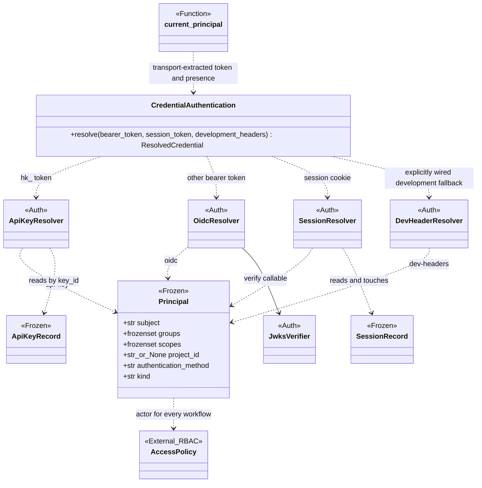
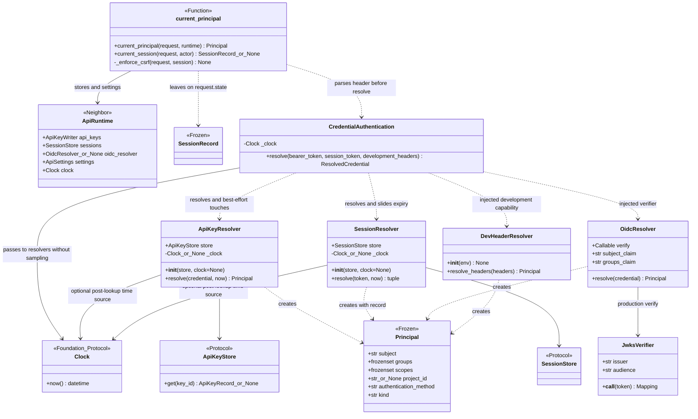
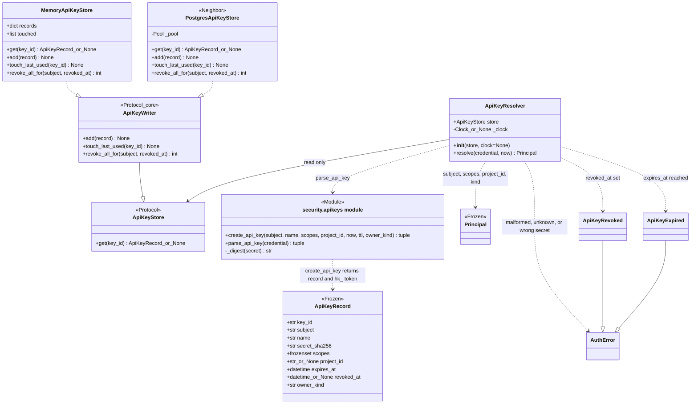
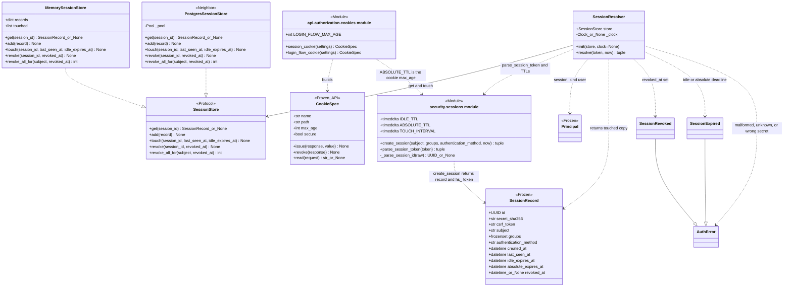
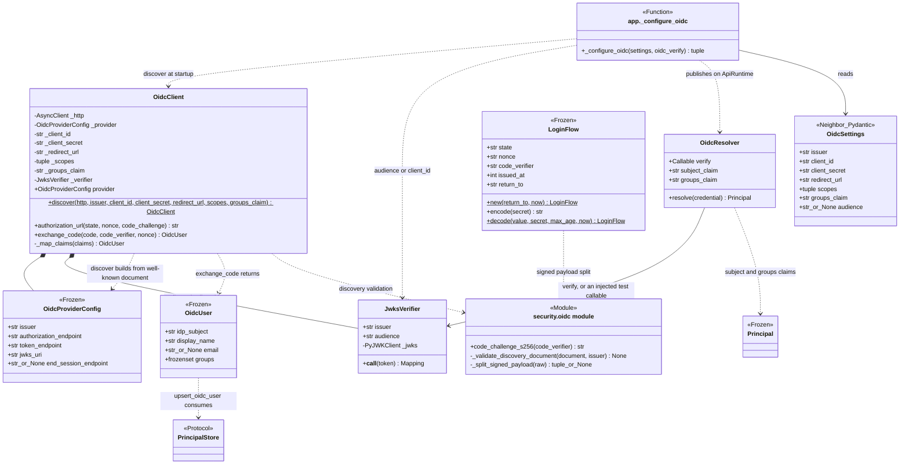
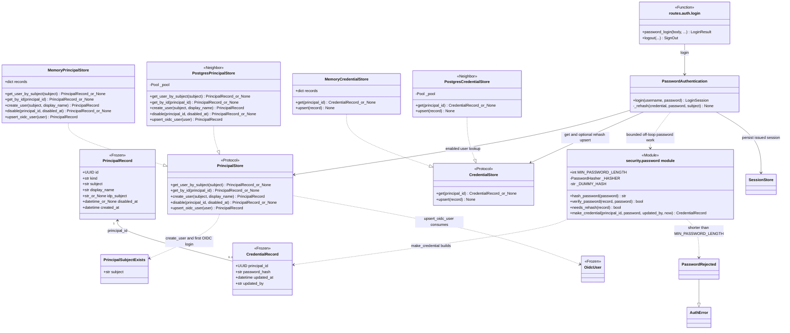
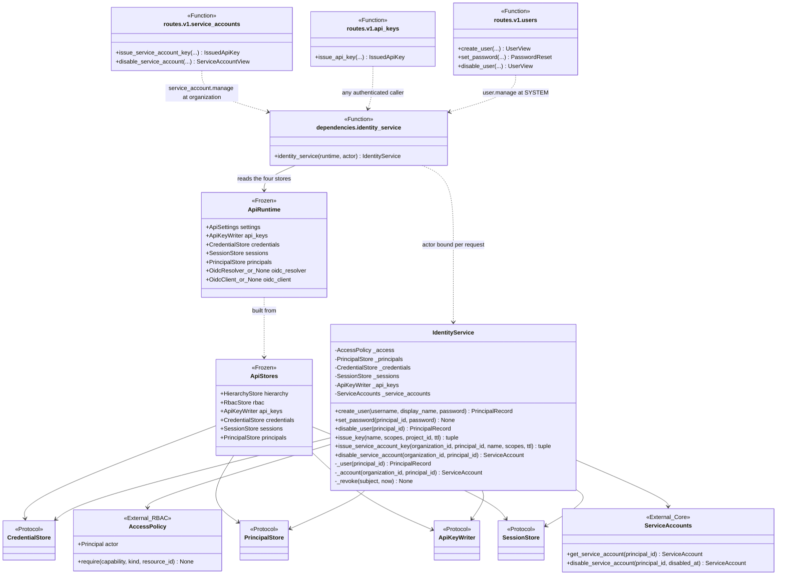
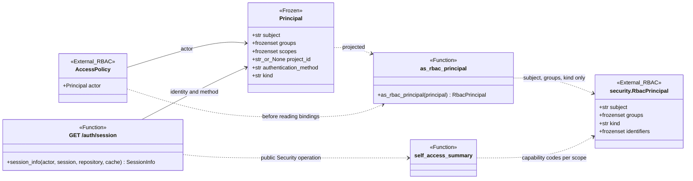
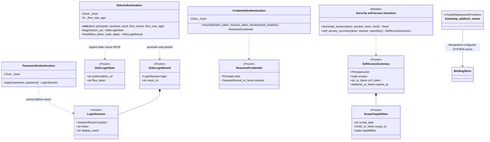
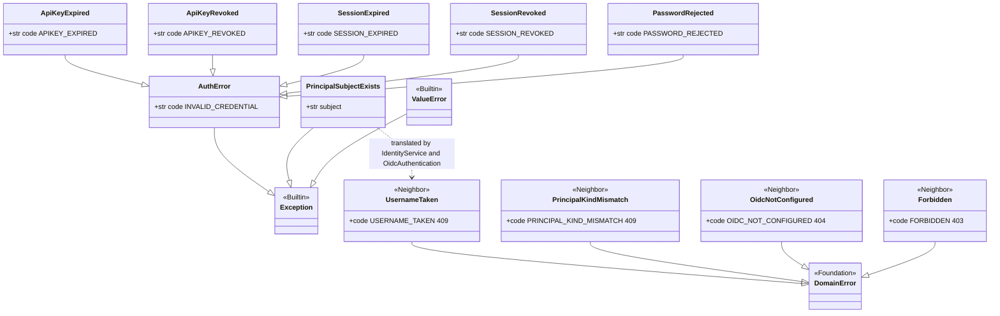

# Authentication — UML class atlas

**Implementation snapshot: 16 September 2026, working tree based on `e71e685`.**
Open [the browser edition](auth-uml.html) for rendered, zoomable diagrams, or
view this file in a Mermaid-capable Markdown viewer.

Authentication turns **whatever credential a request carries into one frozen
`Principal`**, and owns login through persisted session issuance. Four credential paths exist: an `hk_` API key, an
`hs_` session cookie, an OIDC bearer token, and, in development only, asserted
headers. Authentication and RBAC are views of **`core.security`**, which owns
credential formats, resolvers, persistence ports, errors, authentication workflows
and authorized identity administration. PostgreSQL and memory adapters live in
`core.metastore`. The API owns credential extraction, cookies, CSRF, redirects,
serialization and resource lifetime; Security imports no web framework or adapters.

This is one class model presented in focused views. It includes every class and
protocol retained from the authentication model, the module-level functions that mint
and parse credentials, Security's identity and authentication workflows, the four
PostgreSQL and four memory credential adapters, and application collaboration:
the request credential dependency, the cookie specifications, the `/auth`
routes, and the runtime bundle. Repeated boxes denote the same class. The RBAC
engine, `AccessPolicy`, and the route guards belong to the
[RBAC atlas](rbac-uml.html); they appear here only where a `Principal` is
handed to them. Methods show the public operations and important types, with
long parameter lists abbreviated. This is a Python class diagram, not a
database ER diagram or an exhaustive signature reference.

**Currency matters:** the [authentication design](auth.html) describes the
intended request model and lists its known gaps. This atlas follows the
inspected source, including uncommitted changes, and records below where the
code carries a field or a declaration that no consumer reads. A protocol,
record field, or error name alone does not prove that a behavior is enforced.

## Reading the diagrams

- `A --> B`: association/reference, including a held store or dependency.
- `A ..> B`: uses, creates, or returns B; the label states which.
- `A *-- B`: A contains B as part of its object structure.
- `A --|> B`: actual Python inheritance.
- `A ..|> B`: structural conformance to a Python protocol, not inheritance.
- `<<Protocol>>`, `<<Frozen>>`, `<<Module>>`, `<<Neighbor>>`, `<<External>>`,
  and `<<Function>>` identify roles. A `<<Module>>` box lists module-level
  functions and constants that have no class of their own; a `<<Function>>`
  box is a single FastAPI dependency or helper function shown for wiring.
- Frozen dataclasses prevent field reassignment; credential mechanism records are
  frozen with `slots=True`, and stores that change a record store a copy.
- Store protocols are owned by Security; its resolvers and workflows perform the
  reads and writes. Metastore conformance is structural, not declared inheritance.
- Public workflow imports use `core.security`; `_impl` links locate implementations,
  not supported imports. Migration-wide verification remains pending.

## 1. Authentication at a glance

`CredentialAuthentication.resolve` takes a transport-extracted `bearer_token`:
`None` means absent; a present token wins outright, including an empty string that
cannot authenticate. Only an absent bearer permits session resolution and then
the explicitly wired development fallback. The API owns raw header parsing:
`authorization.removeprefix("Bearer ").strip()` for a nonempty header, otherwise
`None`. Thus missing or actually empty headers permit fallback, while whitespace
or `Bearer ` headers produce a present empty token and are refused. Every successful
branch returns the same `Principal`; authorization never sees the credential.

| Responsibility | Owner | Important contract |
| --- | --- | --- |
| Name the authenticated subject | `Principal` | Frozen snapshot taken at resolution: subject, groups, credential restrictions, method, and `kind` (`user` or `service_account`). |
| Resolve an API key | `ApiKeyResolver` with `ApiKeyStore` | Parse `hk_{key_id}_{secret}`; hash and compare even on a miss; report revocation before expiry, both only after the secret matched. |
| Resolve a session | `SessionResolver` with `SessionStore` | Parse `hs_{session_id}_{secret}`; same dummy-digest comparison; revoked before expired; slide the idle deadline at most once per `TOUCH_INTERVAL`, never past the absolute deadline. |
| Resolve a bearer JWT | `OidcResolver` with `JwksVerifier` | Signature, issuer, audience, expiry and required claims are the verifier's; the resolver only maps the subject and groups claims. No store is consulted. |
| Browser login | `OidcAuthentication`, `PasswordAuthentication` | Signed state/nonce/PKCE and identity provisioning, or bounded off-loop password verification with optional rehash; both persist sessions. Routes issue cookies. |
| Provision and revoke identities | `IdentityService` | `user.manage` at SYSTEM for users; `service_account.manage` at the organization for service-account keys. Password reset and disable revoke every session and key the subject holds. |
| Persist credentials | Metastore adapters | One table per store protocol; secrets stored only as SHA-256 or argon2 hashes; subject uniqueness and kind guards are database constraints translated to domain errors. |
| Fail uniformly | `AuthError` hierarchy | Every resolver raises an `AuthError` whose `code` becomes the 401 problem code; provisioning conflicts are separate `DomainError` classes. |

## 2. Principal, resolvers, and the request credential

Sources: [principal.py](../src/huron/core/security/principal.py),
[ApiKeyResolver](../src/huron/core/security/apikeys.py#L141),
[SessionResolver](../src/huron/core/security/sessions.py#L248),
[oidc.py](../src/huron/core/security/oidc.py),
[dev.py](../src/huron/core/security/dev.py),
[credential workflow](../src/huron/core/security/_impl/credential_authentication.py),
[credentials.py](../src/huron/applications/api/authorization/credentials.py).

- `Principal.scopes` and `Principal.project_id` are populated only by
  `ApiKeyResolver` from the key's minting restrictions. No module outside
  credential resolution reads either field: authorization projects the principal down to
  subject, groups and kind before consulting bindings, so an API key's declared
  scope and project restriction are recorded, not enforced.
- `OidcResolver` and `DevHeaderResolver` consult no store. A bearer JWT for a
  principal that has since been disabled still resolves for the token's
  lifetime; disabling revokes sessions and API keys, which are the only
  credentials the service itself issued.
- `SessionResolver.resolve()` returns the principal and the record as it stands
  after this request; `current_session` exposes that record to the routes.
- Both resolver constructors accept an optional Foundation `Clock`; omitted clocks
  use UTC wall time. An explicit `resolve(..., now=...)` overrides the clock.
  Otherwise time is sampled **after awaited lookup and matching-secret verification**,
  not at workflow entry. API-key revocation is checked before this sample; session
  time is sampled before its revocation check. Both report revocation before expiry.
  Session deadline checks, touch throttling and idle-extension arithmetic share that
  same post-lookup instant. `CredentialAuthentication` injects the clock rather than
  passing an early timestamp; rejected credentials cause no last-used/session touch.
- API-key last-used bookkeeping in `CredentialAuthentication` is best-effort: a failure is logged and never
  fails the request. `_enforce_csrf` applies only in the cookie branch and only
  to methods other than GET, HEAD and OPTIONS.
- `DevHeaderResolver` raises `ValueError` from its constructor for any
  environment except `development`; application wiring constructs
  it with that literal, and `ApiSettings` separately refuses `dev-headers`
  outside development.

## 3. API keys: minting, storage, and revocation

Sources: [apikeys.py](../src/huron/core/security/apikeys.py),
[authentication errors](../src/huron/core/security/authentication_errors.py),
[Security ports](../src/huron/core/security/ports.py),
[PostgreSQL API keys](../src/huron/core/metastore/api_keys.py),
[memory API keys](../src/huron/core/metastore/memory_apikeys.py).

`ApiKeyStore` is deliberately a single read; the write path is `ApiKeyWriter`,
declared in `core/security/ports.py` as a protocol that extends it. Both stores satisfy
the writer structurally. `create_api_key()` refuses a TTL that is not positive
or exceeds 400 days, defaults `scopes` to `{"read"}`, and returns the only copy
of the secret alongside a record that holds its SHA-256. The memory store keeps
no `last_used_at`; its `touched` list exists for tests. The Postgres store
translates a foreign-key violation on `project_id` into `ResourceNotFound`, and
its `get()` returns revoked and expired rows unchanged so the resolver can
report them distinctly.

## 4. Sessions, cookies, and CSRF

Sources: [sessions.py](../src/huron/core/security/sessions.py),
[cookies.py](../src/huron/applications/api/authorization/cookies.py),
[credentials.py](../src/huron/applications/api/authorization/credentials.py),
[PostgreSQL sessions](../src/huron/core/metastore/sessions.py),
[memory sessions](../src/huron/core/metastore/memory_sessions.py).

| Rule | Where it lives |
| --- | --- |
| Idle deadline `IDLE_TTL` (12 h) after last activity; absolute deadline `ABSOLUTE_TTL` (7 d) after login. | `create_session()` sets both; `SessionResolver` refuses when either has passed. |
| The idle deadline is persisted at most once per `TOUCH_INTERVAL` (5 min) and is capped at the absolute deadline. | `SessionResolver.resolve()` uses one instant sampled after lookup and secret verification (or explicit `now`); the `sessions` table CHECK backstops the cap. |
| Groups are a login-time snapshot; they refresh at the next login, not mid-session. | `SessionRecord.groups`, copied into every resolved `Principal`. |
| A cookie-authenticated state change must echo `csrf_token` in `X-Huron-CSRF`; bearer callers and safe methods are exempt. | `_enforce_csrf` in the request dependency; the token is returned by login and `GET /auth/session`. |
| Cookies are `HttpOnly`, `SameSite=Lax`, and `Secure` outside development. The session cookie's name is configurable; the login-flow cookie is fixed to `huron_login` under `/auth`. | `CookieSpec` with `session_cookie()` and `login_flow_cookie()`. |
| Revocation is a row update visible on the next request. Logout revokes by id; password reset and disable revoke by subject. | `SessionStore.revoke()` and `revoke_all_for()`. |

A fresh login does not revoke the session the browser previously held; only
logout, an administrative password reset, or a disable ends an earlier session
before its own deadlines. Password login carries no session cookie and therefore
no CSRF check of its own; the design document records both as known gaps and the
code matches that description.

## 5. OIDC: verifier, client, and the pending-login flow

Sources: [oidc.py](../src/huron/core/security/oidc.py),
[OIDC workflow](../src/huron/core/security/_impl/oidc_authentication.py),
[OIDC runtime wiring](../src/huron/applications/api/runtime.py#L173),
[settings.py](../src/huron/applications/api/settings.py),
[app.py](../src/huron/applications/api/app.py),
[routes/auth/endpoints/oidc.py](../src/huron/applications/api/routes/auth/endpoints/oidc.py).

Two paths read one provider. The bearer path is `JwksVerifier` (RS256/ES256
only; `exp`, `iat`, `sub` required; keys cached for five minutes) feeding
`OidcResolver`. The browser path is `OidcClient.discover()` at startup, then
`authorization_url()` with a fresh `LoginFlow` on `/auth/oidc/start`, and
`exchange_code()` on the callback, which verifies the ID token with the client's
own verifier and checks the nonce. `LoginFlow` travels in an HMAC-signed, not
encrypted, cookie under `login_flow_secret`; `decode()` verifies the signature
before parsing, refuses flows older than `max_age` or stamped in the future, and
`__post_init__` refuses a non-local `return_to`. `OidcAuthentication.finish` compares
the callback `state` in constant time.

Application wiring passes `flow_max_age=login_flow_cookie(settings).max_age` into
`OidcAuthentication`, so the signed-flow validator uses the same lifetime as the
issued pending-login cookie. The deployed lifetime is 600 seconds; Security
receives that plain value and does not interpret cookies or deployment settings.

When `create_app` receives an injected `oidc_verify` callable, only
`OidcResolver` is built and the OIDC routes answer `OidcNotConfigured`.
`OidcProviderConfig.end_session_endpoint` is captured from discovery, but no
route or logout path reads it. `OidcClient._map_claims()` tolerates missing
`name`, `email`, and a malformed groups claim; `OidcResolver.resolve()` rejects
a malformed groups claim instead. The two paths therefore treat the same
provider's groups claim differently.

## 6. Principals and admin-provisioned passwords

Sources: [principals.py](../src/huron/core/security/principals.py),
[password.py](../src/huron/core/security/password.py),
[password workflow](../src/huron/core/security/_impl/password_authentication.py),
[PostgreSQL principals](../src/huron/core/metastore/principals.py),
[PostgreSQL credentials](../src/huron/core/metastore/credentials.py),
[memory principals](../src/huron/core/metastore/memory_principals.py),
[memory credentials](../src/huron/core/metastore/memory_password.py),
[routes/auth/endpoints/login.py](../src/huron/applications/api/routes/auth/endpoints/login.py).

- `subject` is globally unique across every principal; `idp_subject` is set
  only for OIDC-created users and equals `subject`. Both are fixed at creation.
  `PrincipalSubjectExists` is a plain `Exception`, not an `AuthError`, because
  it is a provisioning conflict; `IdentityService` and `OidcAuthentication.finish`
  translate it to the 409 `UsernameTaken` domain error.
- `get_user_by_subject()` folds unknown username, disabled user, and service
  account into one `None`. `verify_password()` then runs argon2 against a
  dummy hash on a miss and returns `False`, so response time does not reveal
  which lookup failed. `upsert_oidc_user()` returns a disabled principal; the
  OIDC workflow is what refuses it.
- `_HASHER` uses argon2 at 64 MiB, `t=3`, `p=4`. `needs_rehash()` lets the
  password workflow replace a hash made under weaker parameters after a successful
  verification; hashing runs in a worker thread behind a capacity limiter.
- The Postgres credential store translates the `local_credentials` guard
  trigger into `ResourceNotFound` or `PrincipalKindMismatch`; the Postgres
  principal store translates a `subject` unique violation into
  `PrincipalSubjectExists`. The memory stores enforce the same rules by scan.

## 7. Identity operations and application wiring

Sources: [identity implementation](../src/huron/core/security/_impl/identity.py),
[Security ports](../src/huron/core/security/ports.py),
[runtime.py](../src/huron/applications/api/runtime.py),
[dependencies.py](../src/huron/applications/api/dependencies.py),
[routes/v1/endpoints/users.py](../src/huron/applications/api/routes/v1/endpoints/users.py),
[routes/v1/endpoints/api_keys.py](../src/huron/applications/api/routes/v1/endpoints/api_keys.py),
[routes/v1/endpoints/service_accounts.py](../src/huron/applications/api/routes/v1/endpoints/service_accounts.py).

| Operation | Authority check | Effect |
| --- | --- | --- |
| `create_user` | `user.manage` at SYSTEM | Create the principal, then hash and upsert the credential with the actor's subject as `updated_by`. `PrincipalSubjectExists` becomes `UsernameTaken`. |
| `set_password` | `user.manage` at SYSTEM, target must be a `user` | Upsert the new credential, then revoke every session and API key held by that subject. |
| `disable_user` | `user.manage` at SYSTEM, target must be a `user` | Set `disabled_at`, then revoke every session and API key. No re-enable operation exists. |
| `issue_key` | Any authenticated actor | Mint a key for the calling principal's own subject and kind; keys never escalate. The route requires an `Idempotency-Key` header but does not read it. |
| `issue_service_account_key` | `service_account.manage` at the owning organization | Refuse a disabled account with `Forbidden`; mint with `owner_kind` `service_account`. |
| `disable_service_account` | `service_account.manage` at the owning organization | Disable through `ServiceAccounts`, then revoke the account's API keys unless it was already disabled earlier. |

`IdentityService` is constructed per request by a dependency function. Security's
authentication workflows also write these stores: pre-authentication login is a
reusable operation with explicit credential checks. Routes call public operations
and own transport details. `ApiStores` is the injection
bundle a test replaces; `ApiRuntime` publishes the same stores plus the optional
OIDC resolver and client for the lifetime of the process.

## 8. Handing the principal to authorization

Sources: [access implementation](../src/huron/core/security/_impl/access.py),
[self-access operations](../src/huron/core/security/_impl/self_access.py),
[routes/auth/endpoints/session.py](../src/huron/applications/api/routes/auth/endpoints/session.py).

Authorization reads only `subject`, `groups`, and `kind`. The projection drops
`scopes`, `project_id`, and `authentication_method` before any binding is
consulted, which is why an API key's restrictions never influence a decision.
`GET /auth/session` reports the principal, its authentication method, the
capabilities its bindings grant per scope, and, for a cookie session only, the
CSRF token and absolute expiry. `GET /auth/providers` reports which login
methods the deployment enables without requiring a credential.

## 9. Public authentication workflows and results

Sources: [Security root exports](../src/huron/core/security/__init__.py),
[result values](../src/huron/core/security/types.py),
[password implementation](../src/huron/core/security/_impl/password_authentication.py#L29),
[OIDC implementation](../src/huron/core/security/_impl/oidc_authentication.py#L22),
[credential implementation](../src/huron/core/security/_impl/credential_authentication.py#L26),
[self-access implementation](../src/huron/core/security/_impl/self_access.py),
[trusted bootstrap](../src/huron/core/security/_impl/bootstrap.py).

Password verification and optional best-effort rehash run off the event loop with
a four-token limiter; rehash preserves administrative attribution. OIDC checks
signed flow age, nonce, state and code, refuses disabled users and never auto-links
colliding subjects. Missing provider configuration is refused at construction,
before callback query validation in the API. `terminate_session` admits only the
actor's own session; bearer logout is a no-op. The self summary returns sorted
capability codes (the HTTP field still calls them `effective_roles.roles`).
Bootstrap uses explicitly trusted deployment authority, not a scientist-supplied
identity. These operations accept ports, clocks and plain values, never requests
or deployment settings. The API parses the raw authorization header and retains
safe redirects and cookie/CSRF policy; its OIDC factory binds validator age to the
login-flow cookie's `max_age`. Credential resolution passes its injected clock to
the key/session resolvers for post-lookup checks rather than sampling before awaits.

## 10. Complete authentication error hierarchy

Sources: [authentication errors](../src/huron/core/security/authentication_errors.py),
[sessions](../src/huron/core/security/sessions.py),
[password](../src/huron/core/security/password.py),
[principals](../src/huron/core/security/principals.py),
[Security errors](../src/huron/core/security/errors.py),
[Foundation base](../src/huron/core/foundation/errors.py).

Every `AuthError` answers 401 with its `code` as the problem code; the resolver's
message is the only place the specific cause is stated. Revocation is checked
before expiry for both keys and sessions, so a credential that is both reports
revocation. `PasswordRejected` concerns a password being set, never one being
checked. `ValueError` is raised by `create_api_key()` for an out-of-range TTL
and by `DevHeaderResolver` for a non-development environment; both are
programming or configuration errors rather than credential failures. The
`DomainError` neighbors are declared in `core/security/errors.py` and carry
their own status codes.

## Source and behavioral cross-checks

The implementation snapshot was traced through constructors, fields, protocol
declarations, module functions, and the request dependency. Useful behavioral
entry points are:

- [Session tests](../tests/unit/test_auth_sessions.py),
  [password tests](../tests/unit/test_auth_password.py),
  [principal tests](../tests/unit/test_auth_principals.py), and
  [OIDC tests](../tests/unit/test_auth_oidc.py): resolver rules, dummy-digest
  comparison, touch throttling, hashing policy, subject uniqueness, discovery
  and login-flow encoding.
- [Credential dependency tests](../tests/unit/test_authorization_credentials.py)
  and [cookie tests](../tests/unit/test_authorization_cookies.py): branch order,
  CSRF enforcement, cookie attributes.
- [Login route tests](../tests/unit/test_api_login.py),
  [OIDC route tests](../tests/unit/test_api_oidc.py),
  [user route tests](../tests/unit/test_api_users.py), and
  [API key route tests](../tests/unit/test_api_api_keys.py): session minting,
  callback handling, provisioning authority, and key issuance.
- [Auth store contracts](../tests/contract/test_auth_store.py),
  [API key conflict tests](../tests/unit/test_postgres_api_key_conflicts.py), and
  [credential conflict tests](../tests/unit/test_postgres_credential_conflicts.py):
  adapter behavior and constraint translation.

This document describes inspected implementation; it does not claim that the
application test suites were rerun to create a diagram.
