# Catalog — UML class atlas

**Implementation snapshot: 16 September 2026, working tree based on `e71e685`.**
Open [the browser edition](catalog-uml.html) for rendered, zoomable diagrams, or
view this file in a Mermaid-capable Markdown viewer.

The catalog gives Huron its **stable identities, discoverable hierarchy, immutable
Raw revision records, named releases, descriptive metadata, and governance records**.
Rules and workflows are colocated under domain-owned Core: Catalog owns hierarchy
identity and descriptions; Raw owns revisions, uploads and releases; Security owns
governance; Foundation owns shared values and pure primitives. Metastore and Rawstore
are Core adapters; the API constructs and exposes the public operations.

This is one class model presented in focused views. It includes every class,
protocol, and enum retained from the former catalog model, with their current
owners identified below, the related workflows and ports, and their principal
persistence adapters. Repeated boxes denote
the same class. Neighboring authentication/RBAC classes and application wiring are
shown only at their points of collaboration; their internals and the separate
operator-only `core/integrity` maintenance subsystem are outside this atlas.
Methods show the public operations and important types, with long parameter lists
abbreviated. Private helpers appear where they explain structure. This is a Python
class diagram, not a database ER diagram or an exhaustive signature reference.

**Currency matters:** the [core map](core-map.html) describes the same domain-owned
working tree. Public operation imports come from each owner's root; links to
`_impl` files identify implementation, not supported cross-package imports. The
[catalog design](catalog-search.html) and [roadmap](roadmap.html) also describe
future work; database tables, enums, protocols, or error names alone do not prove
that a workflow is delivered.

## Reading the diagrams

- `A --> B`: association/reference, including ID-based domain relationships.
- `A ..> B`: uses, creates, or returns B; the label states which.
- `A *-- B`: A contains B as part of its object structure.
- `A --|> B`: actual Python inheritance.
- `A ..|> B`: structural conformance to a Python protocol, not inheritance.
- `<<Protocol>>`, `<<Frozen>>`, `<<Enum>>`, and `<<DeclarationOnly>>` identify roles.
- Multiplicities describe the domain relationship, not preloaded object graphs.
  Organization/project/dataset links are stored as IDs, not nested child lists.
- Frozen dataclasses prevent field reassignment; nested lists/dictionaries are not
  necessarily deeply immutable. `Release` is write-once through its workflow but
  its Python dataclass is not frozen.

## 1. Catalog and its collaborating owners at a glance

| Owner | Values, rules and operations in this atlas |
| --- | --- |
| `core.catalog` | Organization, Project, Dataset, EntityRef, PlatformRoot, Window, DescriptionChange; lifecycle/layer vocabulary, hierarchy and generation paths; CatalogCreation and typed collections. |
| `core.raw` | RevisionRef/RevisionRecord, Release, SessionLedger, ExpiryReport, PayloadFile, LedgerEntry, AuditEvent, OutboxEvent; manifest, metadata, documents, ingest transitions, amendments, revision/staging/tag paths; RawRuntime, ingestion, revision reads and Releases. |
| `core.foundation` | Slugged and lexical names, identifiers, canonical JSON/record conversion, Clock, IdempotencyClaim, Replay, RetryTransaction and request fingerprints. |
| `core.security` | Authenticated Principal and narrower RbacPrincipal, AccessPolicy, governance values/workflows, CatalogFacts and BindingFacts; authentication and role rules. |
| `core.metastore` / `core.rawstore` | Concrete persistence and filesystem adapters; no authority decisions. |

Mixed-file symbols have distinct source locations:
[DescriptionChange](../src/huron/core/catalog/types.py#L25) and
[Window](../src/huron/core/catalog/types.py#L35) are Catalog values;
[PayloadFile](../src/huron/core/raw/types.py#L146) and
[SessionLedger](../src/huron/core/raw/types.py#L155) are Raw results;
[IdempotencyClaim](../src/huron/core/foundation/retry.py#L16),
[Replay](../src/huron/core/foundation/retry.py#L25) and
[Clock](../src/huron/core/foundation/clock.py#L11) belong to Foundation.
[CatalogFacts](../src/huron/core/security/facts.py#L14) belongs to Security,
[GenerationStorage](../src/huron/core/catalog/ports.py#L160) to Catalog, and
[RevisionStore](../src/huron/core/raw/ports.py#L216) to Raw.

The permitted direct domain graph is Security → Foundation; Catalog → Security +
Foundation; Raw → Catalog + Security + Foundation + Schema; Integrity → Catalog +
Raw + Foundation + Schema. Metastore may use Catalog, Raw, Security and Foundation;
Rawstore's only Huron dependency is `schema.storage`. This is a package DAG, not a
claim about every internal module. Migration verification is recorded in the [roadmap](roadmap.html#domain-owned-core-migration).

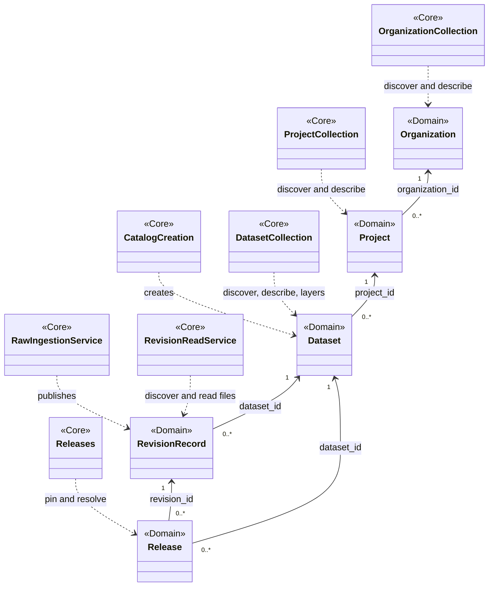

The overview follows a dataset from identity to published revision and release.
`CatalogCreation` also creates organizations and projects. All seven domain entry
classes shown use `AccessPolicy`; the detailed views below expose those references
and the neighboring governance operations.

| Responsibility | Owner | Important contract |
| --- | --- | --- |
| Create stable identities | `CatalogCreation` | Validate slugs/classification/entry layer; authorize parent; claim retry identity; insert record and write generation. Dataset creation creates no revision. |
| Discover and edit descriptions | Typed collections | Current visibility; hidden and absent resources both fail as not found; keyset pagination; immutable slug; version-guarded updates. |
| Pin releases | `core.raw.Releases` | A tag names one registered revision of that dataset; lookup adds no committed-state or payload-read predicate. Creation is write-once and retry-aware. |
| Decide access | `core.security.AccessPolicy` and `rules` | Actor comes from authentication; ancestry comes from server records; bindings are read afresh. Discovery and permission to read bytes are distinct. |
| Administer governance | `Bindings`, `Policies`, `ServiceAccounts` | Each guarded mutation uses the target's scope and authenticated provenance. Policy definitions are opaque stored JSON, not an implemented policy interpreter. |
| Produce Raw revisions | `RawIngestionService` / `IngestService` | Every upload submits its complete files; verify actual transfer, freeze commit evidence, publish storage, then record revision/events/receipt. |
| Serve revision files | `RevisionReadService` / `RevisionService` | Re-resolve the revision and its current Raw-read permission; select payloads from the committed manifest. |
| Persist state and bytes | Metastore / rawstore adapters | PostgreSQL transactions, visibility predicates, uniqueness and CAS; filesystem generation/tag/envelope operations. |

## 2. Identity, revisions, releases, and paths

Sources: [Catalog values](../src/huron/core/catalog/types.py),
[Raw values](../src/huron/core/raw/types.py),
[Catalog lifecycle](../src/huron/core/catalog/lifecycle.py),
[Catalog paths](../src/huron/core/catalog/paths.py),
[Raw paths](../src/huron/core/raw/paths.py),
[Foundation names](../src/huron/core/foundation/names.py).

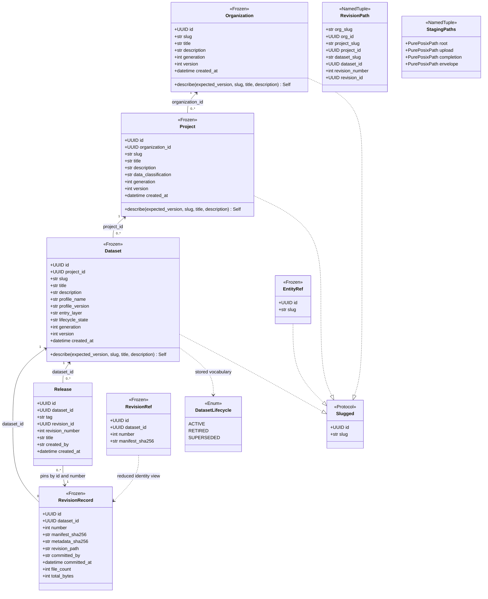

`Organization`, `Project`, and `Dataset` are separate concrete classes, **not**
subclasses of an entity base. Their `describe()` methods share the pure private
`_describe()` function: reject a changed slug, check the expected version even on
a no-op, and return either the original object or a successor with both counters
advanced. Classification and dataset profile/entry-layer configuration are not
descriptive update fields. Creation currently stores profile name/version verbatim.
`DatasetLifecycle` supplies vocabulary; it does not implement retirement or
supersession operations.

Path functions consume `Slugged`, construct immutable identity-bearing paths, and
parse them into `RevisionPath`. `StagingPaths` names the separate transfer,
completion, and candidate-envelope locations; it does not represent a revision.

## 3. Identity creation, discovery, and description services

Sources: [Catalog public exports](../src/huron/core/catalog/__init__.py),
[creation implementation](../src/huron/core/catalog/_impl/creation.py),
[collections implementation](../src/huron/core/catalog/_impl/collections.py),
[generation documents](../src/huron/core/catalog/_impl/documents.py),
[Raw releases](../src/huron/core/raw/_impl/releases.py),
[Catalog retry](../src/huron/core/catalog/retry.py).

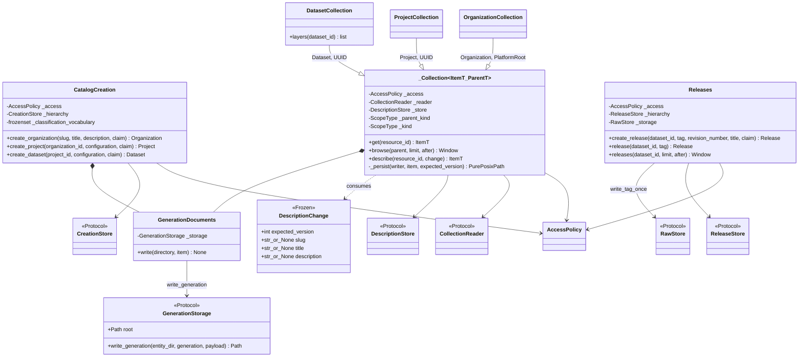

The collection superclass fixes its reader, entity kind, and parent kind at
construction. This is the actual inheritance in the catalog workflow surface;
the other operation classes use composition.

**Write ordering:** creation and descriptions stage the database change, write
canonical generation JSON through `GenerationDocuments`, then commit the database
transaction. Releases similarly insert the release, write its tag document, and
record the retry receipt inside the transaction. A storage failure rolls back the
database work; a later database rollback does not undo already-durable filesystem
writes. These are ordered operations across two stores, not a distributed
transaction. `claimed_result()` handles claim/replay inside the caller's transaction.

## 4. Core-owned persistence interfaces

Sources: [Catalog ports](../src/huron/core/catalog/ports.py),
[Raw ports](../src/huron/core/raw/ports.py),
[Security facts](../src/huron/core/security/facts.py),
[Foundation retry](../src/huron/core/foundation/retry.py).

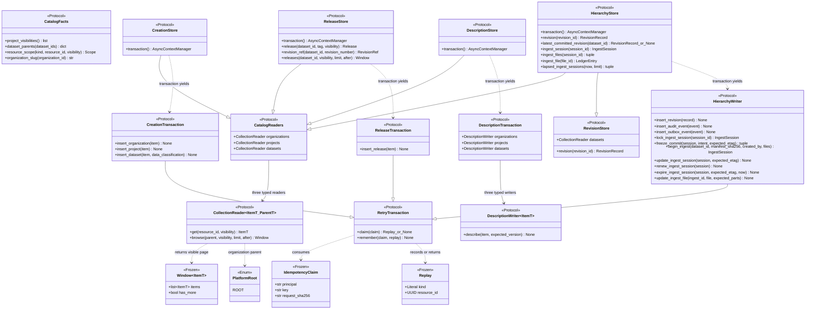

These interfaces belong to their consumers: Catalog owns readers/creation/descriptions,
Raw owns revision/ingest/release persistence, Security owns `CatalogFacts`, and
Foundation owns retry primitives. `HierarchyStore` does not include Catalog mutation,
Security facts or release writes. A concrete adapter can satisfy all these narrow
contracts with one shared transaction writer; application wiring proves conformance.
A Catalog `Window` contains only admitted rows;
`has_more` reflects another visible row, not another hidden row. Hierarchy cursors
use `(slug, UUID)`; release cursors use `(tag,)`.

Claims are scoped by principal and key. Reusing a live key for a different request
digest is an error. `Replay.kind` distinguishes organization, project, dataset,
release, ingest-session, in-progress ingest-commit, and committed-revision receipts.

## 5. Authorization and governance

Sources: [Security exports](../src/huron/core/security/__init__.py),
[access implementation](../src/huron/core/security/_impl/access.py),
[scopes](../src/huron/core/security/scopes.py),
[bindings](../src/huron/core/security/_impl/bindings.py),
[policies](../src/huron/core/security/_impl/policies.py),
[service accounts](../src/huron/core/security/_impl/service_accounts.py),
[identity](../src/huron/core/security/_impl/identity.py),
[Security values](../src/huron/core/security/types.py).

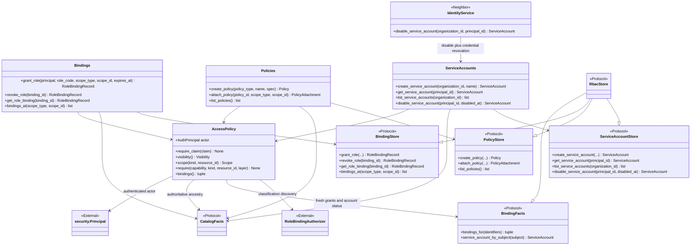

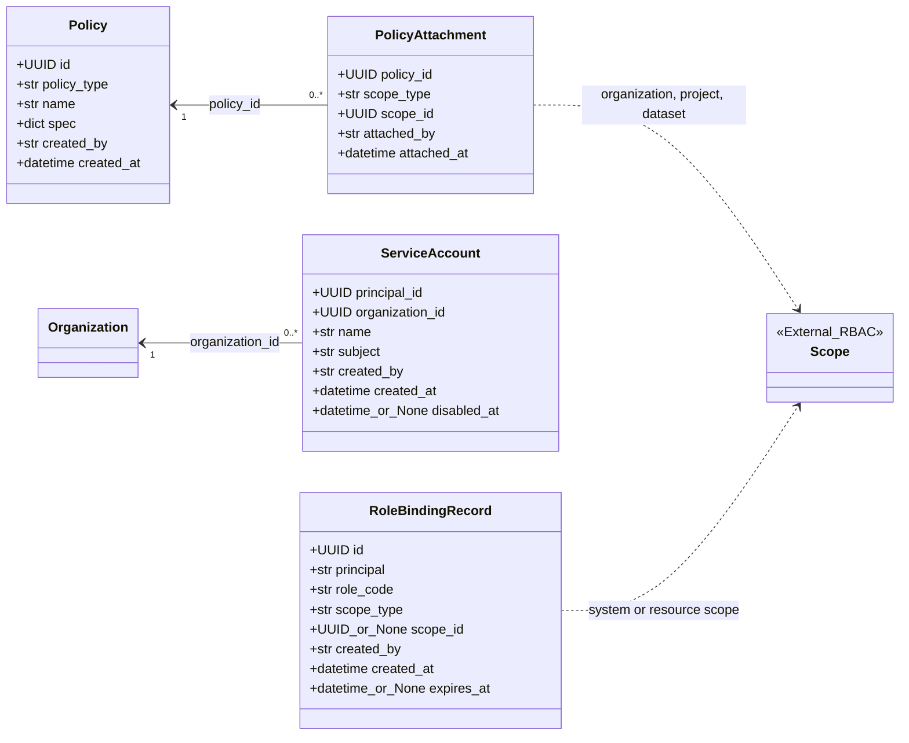

- `Bindings` requires `rbac.binding_manage` at the grant's actual scope. Reading
  and revoking by binding ID resolve that binding before checking its scope.
- Policy definitions are creatable/listable by any authenticated actor.
  Attachment requires `{scope}.policy_attach`; there is no SYSTEM attachment.
  Storage preserves `spec` verbatim; this workflow does not enforce retention,
  quota, or disclosure policy semantics merely because a definition exists.
- Service-account administration requires `service_account.manage` on the owning
  organization. Accounts receive synthesized organization-scoped authority rather
  than human role grants. `ServiceAccounts.disable_service_account()` marks the
  account disabled; `IdentityService` additionally revokes its credentials.
- Workflow methods derive `created_by` and `attached_by` from their bound actor;
  callers do not supply those arguments. Persistence ports receive that provenance.

## 6. Raw ingestion and revision reads

Sources: [Raw public exports](../src/huron/core/raw/__init__.py),
[RawRuntime](../src/huron/core/raw/runtime.py#L21),
[ingestion interface](../src/huron/core/raw/_impl/ingestion.py),
[private ingest mechanics](../src/huron/core/raw/_impl/ingest.py),
[revision interface](../src/huron/core/raw/_impl/revisions.py),
[private reader](../src/huron/core/raw/_impl/reader.py),
[ingest values](../src/huron/core/raw/ingest.py),
[result values](../src/huron/core/raw/types.py).

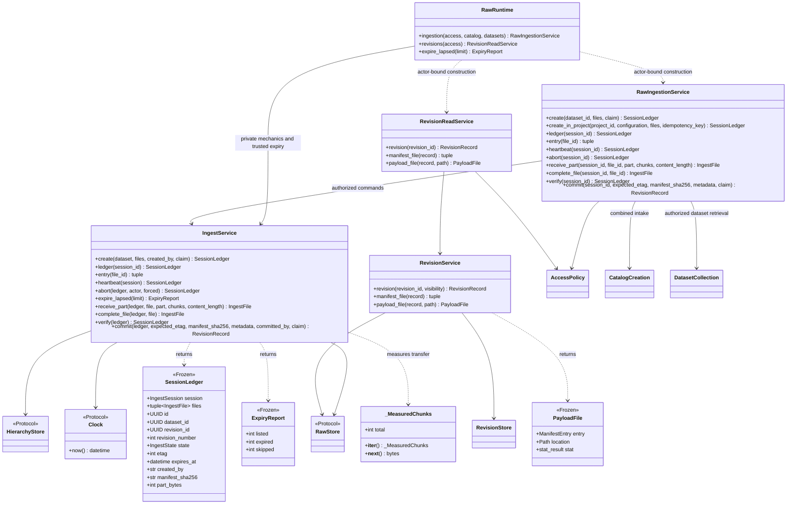

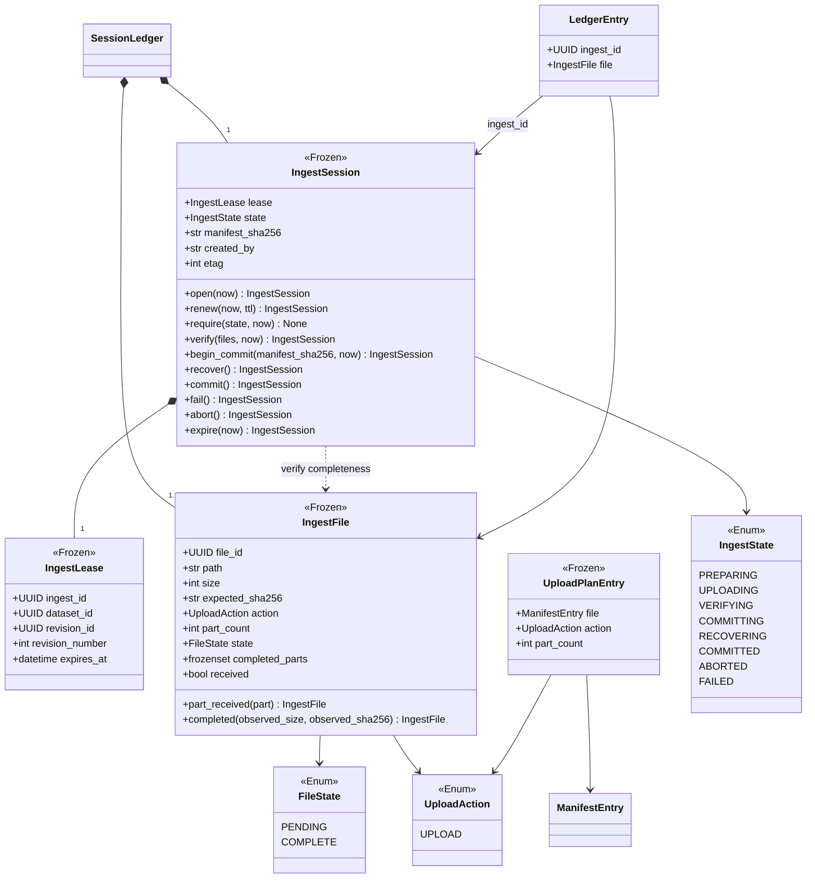

The domain session owns legal transitions and lease checks; it does no I/O.
State transitions return successors and advance the etag; renewal preserves it.
The normal path is PREPARING → UPLOADING → VERIFYING → COMMITTING → COMMITTED.
COMMITTING can re-enter on a retry or be fenced into RECOVERING; RECOVERING can
only finish COMMITTED or FAILED. Abort is restricted to pre-commit states.
Each `IngestFile` proves both part receipt and observed whole-file size/digest.
`compute_upload_plan()` requires every file's complete bytes, including an upload
part for an empty file. There is no parent-manifest diff or carry-forward action.

The actor-bound facade enforces ownership, target discovery, and Raw-write access;
abort and ledger reads have specific owner/project-administrator rules. The
internal `IngestService` is not an alternative authorization entry point.
Revision discovery alone does not grant download access: manifest/payload reads
re-resolve the authoritative revision and require `data.read` on Raw.

## 7. Manifests, metadata, commit evidence, and events

Sources: [Raw manifest](../src/huron/core/raw/manifest.py),
[Raw metadata](../src/huron/core/raw/metadata.py),
[Raw documents](../src/huron/core/raw/documents.py),
[Raw publication values](../src/huron/core/raw/types.py),
[Foundation canonical JSON](../src/huron/core/foundation/canonical.py).

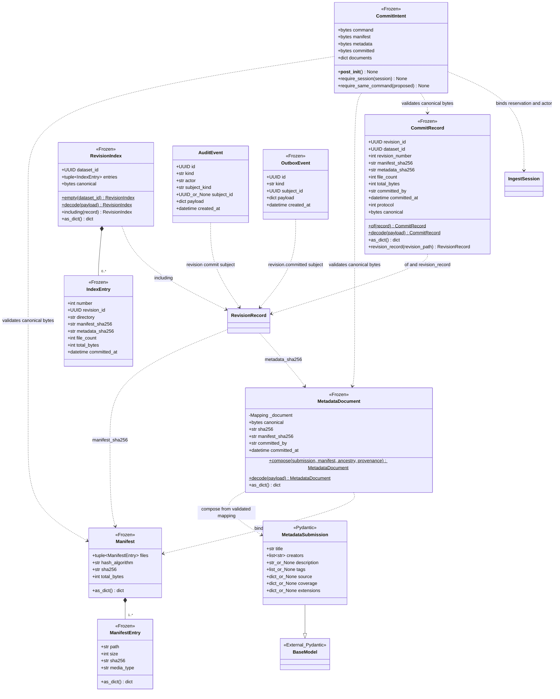

The static marker in the diagram denotes class-level construction methods
(`@classmethod` in Python). `validate_manifest()` is the validation boundary for
manifest entries; their dataclass constructors do not enforce all path/size rules.
The document `compose()`/`decode()` factories validate schemas and canonical bytes.
`CommitIntent.__post_init__()` additionally checks consistency across all evidence.

**Publication responsibilities:**

1. Freeze the canonical command, manifest, metadata, and COMMITTED marker in a
   transaction with the COMMITTING transition and reserved retry receipt.
2. Verify/publish the exact stored envelope through `RawStore`.
3. In a short database transaction, insert `RevisionRecord`, advance the session
   to COMMITTED, insert `AuditEvent` and `OutboxEvent`, and remember the revision
   receipt. Retried commands must agree with the frozen evidence.
4. Update `RevisionIndex` as a best-effort derived navigation aid. `INDEX.json`
   does not make a revision authoritative.

An outbox record is implemented; an operational search projection consumer is
not implied by that record. Likewise, audit/outbox subjects here describe Raw
publication, not a delivered general-purpose scientific lineage graph.

## 8. Layer rules and metadata amendments

Sources: [Catalog layers](../src/huron/core/catalog/layers.py),
[Raw amendments](../src/huron/core/raw/amendments.py).

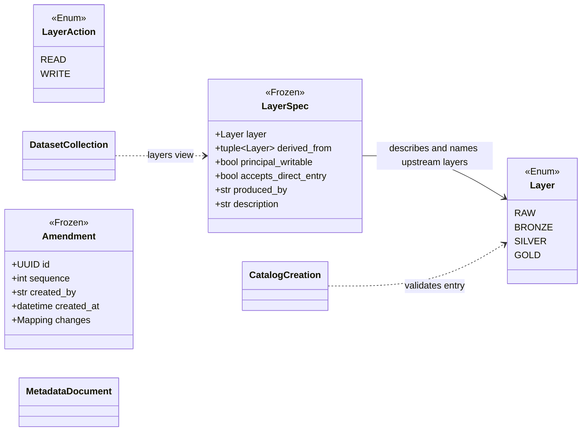

These modules deliberately use **pure functions**, not invented service classes:

| Module | Functions and responsibility |
| --- | --- |
| `layers.py` | `parse_layer`, `parse_entry_layer`, `validate_entry`, `validate_promotion`, `required_capability`, `writable_layers_for_kind`, `ensure_layer_writable`, `entry_layers`: legal layer vocabulary, direct entry, promotion edges, principal-kind write rules, capability names. |
| `amendments.py` | `validate_amendment`, `fold_amendments`: allowed-field/reclassification checks and ordered overlay of changes. Pure mechanics exist; an amendment publication workflow is planned. |
| `raw/manifest.py`, `foundation/canonical.py` | Raw owns `validate_manifest` and `validate_manifest_path`; Foundation owns `canonical_bytes` and `content_identity`. |
| `catalog/paths.py`, `raw/paths.py`, `foundation/names.py` and `identifiers.py` | Catalog hierarchy/generation/cross-layer paths; Raw revision/staging/tag paths; Foundation lexical validation and `uuid7()` identities. |
| `ingest.py` | `compute_upload_plan`, `revision_record`, `revision_committed`: pure plan and record/event construction. |
| `documents.py` | `manifest_bytes`, `decode_manifest`, `revision_from_storage`: validated persistence round trips and reconstruction. |
| `foundation/canonical.py`, `catalog/types.py` | Foundation owns `jsonable` and `jsonable_value`; Catalog owns shared `_describe` invariants. |
| Owned helpers | Catalog `retry.claimed_result`; Foundation [request_sha256](../src/huron/core/foundation/retry.py); Raw [session_claim](../src/huron/core/raw/retry.py); Security scope resolution. |

Raw, Bronze, and Silver are valid entry configurations; Gold always requires
derivation. Declaring a non-Raw entry layer or returning a layer description does
not implement its ingestion, array storage, compute, or publication workflow.

## 9. Persistence adapters and transaction composition

Sources: [Metastore hierarchy](../src/huron/core/metastore/hierarchy.py),
[queries](../src/huron/core/metastore/queries.py),
[ingest](../src/huron/core/metastore/ingest.py),
[RBAC](../src/huron/core/metastore/rbac.py),
[Security fact projections](../src/huron/core/metastore/security_facts.py#L16),
[Rawstore](../src/huron/core/rawstore/store.py).

```mermaid
classDiagram
direction TB
class HierarchyStore {
  <<Protocol>>
}
class HierarchyWriter {
  <<Protocol>>
}
class CollectionReader {
  <<Protocol>>
}
class DescriptionWriter {
  <<Protocol>>
}
class PostgresHierarchyStore {
  -Pool _pool
  -Clock _clock
  +transaction() AsyncIterator
}
class PostgresIngestReader
class _PostgresCollection {
  +get(resource_id, visibility) ItemT
  +browse(parent, visibility, limit, after) Window
}
class _Projection {
  <<Frozen>>
  +str selection
  +Callable decode
  +str kind
}
class _PostgresTransactionWriter
class PostgresIngestWriter
class _PostgresDescriptionWriter {
  +describe(item, expected_version) None
}
class InMemoryHierarchyStore {
  +transaction() AsyncIterator
}
class InMemoryIngestReader
class _MemoryCollection {
  +get(resource_id, visibility) ItemT
  +browse(parent, visibility, limit, after) Window
}
class _TransactionWriter
class InMemoryIngestWriter
class _MemoryDescriptionWriter {
  +describe(item, expected_version) None
}
class TransactionBuffer
class SystemClock {
  +now() datetime
}
class Clock {
  <<Protocol>>
}
PostgresHierarchyStore ..|> HierarchyStore
InMemoryHierarchyStore ..|> HierarchyStore
PostgresHierarchyStore --|> PostgresIngestReader
InMemoryHierarchyStore --|> InMemoryIngestReader
PostgresHierarchyStore --|> SecurityFacts
InMemoryHierarchyStore --|> SecurityFacts
class SecurityFacts {
  +resource_scope(kind, resource_id, visibility) Scope
  +organization_slug(organization_id) str
}
PostgresHierarchyStore *-- "3" _PostgresCollection
InMemoryHierarchyStore *-- "3" _MemoryCollection
_PostgresCollection --> _Projection : fixed SQL and decoder
_PostgresCollection ..|> CollectionReader
_MemoryCollection ..|> CollectionReader
PostgresHierarchyStore ..> _PostgresTransactionWriter : transaction yields
InMemoryHierarchyStore ..> _TransactionWriter : transaction yields
_PostgresTransactionWriter --|> PostgresIngestWriter
_TransactionWriter --|> InMemoryIngestWriter
_PostgresTransactionWriter ..|> HierarchyWriter
_TransactionWriter ..|> HierarchyWriter
_PostgresTransactionWriter *-- "3" _PostgresDescriptionWriter
_TransactionWriter *-- "3" _MemoryDescriptionWriter
_PostgresDescriptionWriter ..|> DescriptionWriter
_MemoryDescriptionWriter ..|> DescriptionWriter
_TransactionWriter --> TransactionBuffer : staged memory writes
PostgresHierarchyStore --> Clock
InMemoryHierarchyStore --> Clock
SystemClock ..|> Clock
```

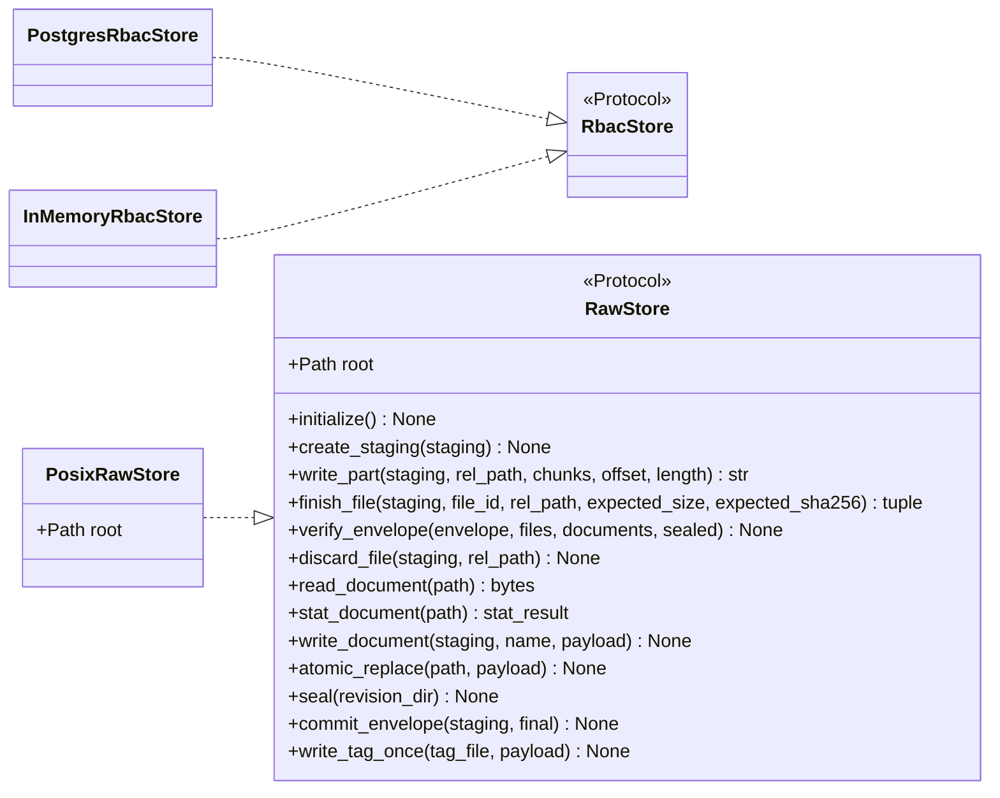

The production hierarchy adapter owns three fixed typed reader objects; its
transaction creates a writer bound to one acquired PostgreSQL connection. That
writer inherits ingest persistence and contains three typed CAS description
writers. `_Projection` contains trusted SQL and its decoder; it is not a search
index. The memory adapter provides an alternate implementation at the same seams,
with staged writes in `TransactionBuffer`. It does not prove database locks or
filesystem durability.

`RawStore` is declared in `core.raw.ports`; Catalog separately consumes
`core.catalog.ports.GenerationStorage`. `PosixRawStore` satisfies both structurally
and imports only `schema.storage` from Huron. It owns byte
I/O, verification, sealing, and durable filesystem publication; it does not decide
whether a scientist may publish into a project. Its internal filesystem helpers
are implementation details of that neighboring package.

## 10. Application construction and lifetime

Sources: [app.py](../src/huron/applications/api/app.py),
[runtime.py](../src/huron/applications/api/runtime.py),
[dependencies.py](../src/huron/applications/api/dependencies.py).

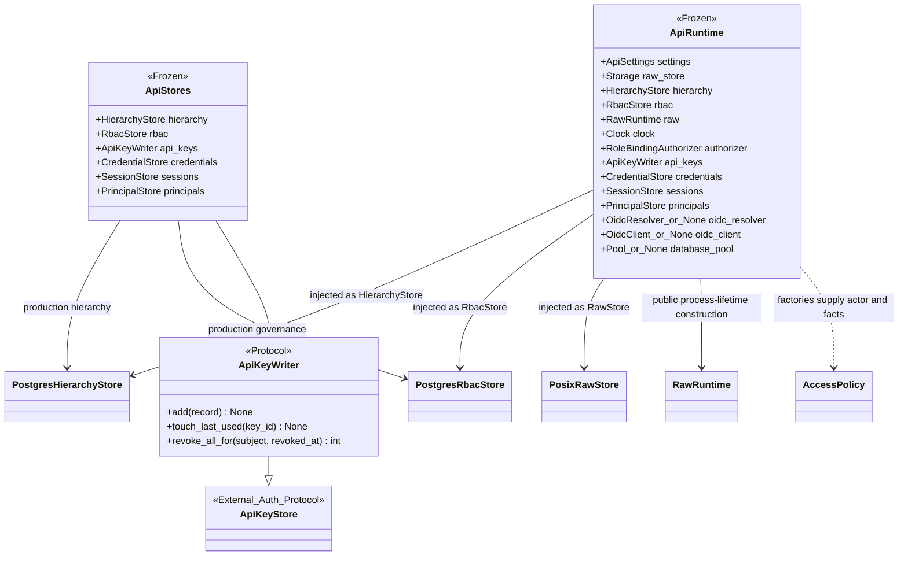

The application lifespan initializes storage, constructs the adapters and internal
operations, publishes `ApiRuntime`, and closes owned resources. Dependency
functions construct actor-bound collections/services using that runtime; the
factories are functions, not classes. Domain packages never import `ApiRuntime`, FastAPI,
`asyncpg`, or `PosixRawStore`; concrete adapters now live inside Core. The
application's `capabilities.Storage` and `capabilities.HierarchyStore` compose
narrow ports for wiring only. `ApiStores` is an injection bundle; it is not a
catalog repository facade and is not itself a stored field of `ApiRuntime`.

## 11. Planned capabilities, not runtime declarations

Search projection, scoped credential vending and job dispatch remain planned
capabilities. Their unused placeholder ports have been retired from runtime source.
Authentication is implemented by Security's credential mechanisms and complete
workflows; see the [authentication atlas](auth-uml.html).

LanceDB search, projection workers, Ray-backed processing, snapshot/product
publication, complete lineage traversal, retention execution, and the schema
registry workflows remain design/roadmap work. No invented `CatalogSearchService`,
`Snapshot`, `Product`, or `LineageService` class appears here merely because the
architecture or database has a corresponding concept.

## 12. Shared and owner-specific error hierarchy

Sources: [Foundation errors](../src/huron/core/foundation/errors.py),
[Raw errors](../src/huron/core/raw/errors.py),
[Catalog errors](../src/huron/core/catalog/errors.py),
[Security errors](../src/huron/core/security/errors.py),
[API-only errors](../src/huron/applications/api/errors.py),
[Catalog layer errors](../src/huron/core/catalog/layers.py).
All leaves below inherit directly from `DomainError`. The panels group names for
readability; the groups are not additional Python base classes. Some errors reserve
contracts for planned operations; their existence does not establish a raise path.

Foundation owns the common base, retry, precondition, not-found and path failures. Raw
owns ingest, manifest, release and amendment failures; Catalog owns identity and reserved
projection, layer, snapshot, product, validation and retention vocabulary; Security owns
governance, identity, grant and input-access failures. `InvalidCursor` and
`DependencyUnavailable` belong to the API. This is the retained cross-owner error
coverage, not a claim that all leaves belong to Catalog.

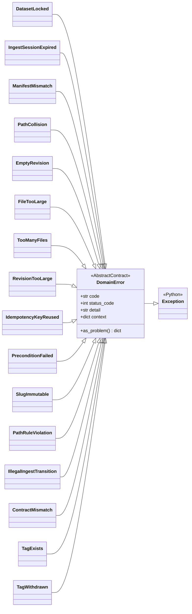

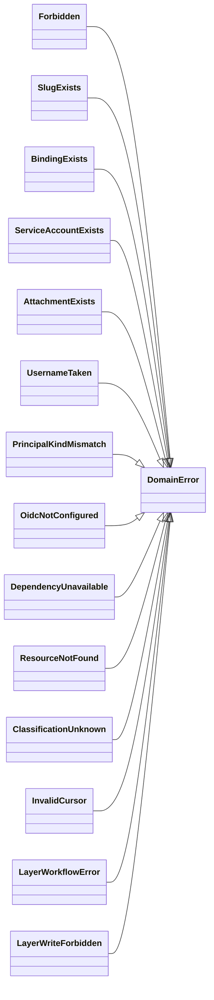

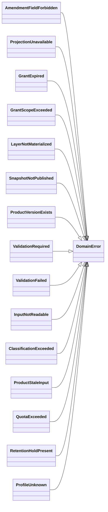

`DomainError` is framework-free but carries status codes and `as_problem()` data
for the transport contract. Direct instantiation is explicitly refused, rather
than enforced through `abc.ABC`. `PathRuleViolation` can choose a more specific
code per instance. API exception handlers serialize these errors to HTTP problems.

## Source and behavioral cross-checks

The implementation snapshot was traced through constructors, fields, inheritance,
protocol declarations, and wiring. Useful behavioral entry points for our next
discussion are:

- [Catalog lifecycle tests](../tests/unit/test_catalog_lifecycle.py) and
  [hierarchy record tests](../tests/unit/test_catalog_hierarchy_records.py):
  creation, discovery, descriptions, and immutable update rules.
- [Creation integration tests](../tests/integration/test_catalog_creation.py),
  [description integration tests](../tests/integration/test_catalog_descriptions.py),
  [release integration tests](../tests/integration/test_catalog_releases.py), and
  [catalog store contracts](../tests/contract/test_catalog_store.py): workflow and
  adapter behavior.
- [Ingest domain tests](../tests/unit/test_catalog_ingest.py),
  [document tests](../tests/unit/test_catalog_documents.py), and
  [core workflow tests](../tests/unit/test_core_workflows.py): transitions,
  evidence, actor-bound operations, and retry behavior.

This document describes inspected implementation; it does not claim that the
application test suites were rerun to create a diagram.
