# Metastore — UML class atlas

**Implementation snapshot: 16 September 2026, working tree based on `e71e685`.**
Open [the browser edition](metastore-uml.html) for rendered, zoomable diagrams, or
view this file in a Mermaid-capable Markdown viewer.

The metastore is Huron's **relational persistence tier**: one PostgreSQL adapter
per capability, each holding an `asyncpg` pool it never closes, plus the in-memory
reference stores the unit suites and contract scenarios run against. It implements
the persistence ports that Catalog, Raw and Security declare, decodes rows into
their canonical owner values, and translates the database
constraints a request can legitimately hit into the same domain errors the
in-memory stores raise. It holds no business rules of its own: visibility,
uniqueness, optimistic concurrency, idempotency, and lease fencing are contracts
it enforces in SQL or in dictionaries on behalf of callers that decide.

This is one class model presented in focused views. It includes every class and
protocol declared in `src/huron/core/metastore/` (29 declarations across 17 Python files,
including the four memory credential adapters and shared Security fact projections;
no enums) together with decoders and query
helpers that explain their structure. The ports these adapters conform to are shown
as `<<Protocol>>` neighbors with their declared members; the records they return
and the values they consume are `<<External>>` boxes without internals, since the
[catalog atlas](catalog-uml.html) documents them. Repeated boxes denote the same
class. Long parameter lists are abbreviated. This is a Python class diagram, not
a database ER diagram: table and constraint names appear only where an adapter
depends on them by name.

**Currency matters:** `huron.core.metastore` is a concrete adapter owner within Core.
Its permitted Huron dependencies are Catalog, Raw, Security and Foundation; domains
never import it. Application wiring creates/closes pools; migrations remain under
`migrations/`. The [core map](core-map.html) follows the same working tree. This
source inventory does not declare migration-wide gates complete.

## Reading the diagrams

- `A --> B`: association/reference, including a held pool, connection, or buffer.
- `A ..> B`: uses, creates, returns, or raises B; the label states which.
- `A *-- B`: A constructs and owns B as part of its object structure.
- `A --|> B`: actual Python inheritance, including the ingest mixin bases.
- `A ..|> B`: structural conformance to a Python protocol, not inheritance.
- `<<Protocol>>`, `<<Frozen>>`, `<<External>>`, `<<Module>>`, and `<<Neighbor>>`
  identify roles. A `<<Module>>` box lists a module's public functions.
- Private names (`_TransactionWriter`, `_Projection`) are real declarations that
  the public stores construct; they are shown because they carry the structure.
- "In-memory" classes are the reference implementations; "Postgres" classes are
  the production adapters. Both satisfy the same port and the same contract
  scenarios.

## 1. The metastore at a glance

```mermaid
classDiagram
direction TB
class PostgresHierarchyStore {
  <<Adapter>>
}
class InMemoryHierarchyStore {
  <<Reference>>
}
class PostgresRbacStore {
  <<Adapter>>
}
class InMemoryRbacStore {
  <<Reference>>
}
class PostgresApiKeyStore {
  <<Adapter>>
}
class PostgresCredentialStore {
  <<Adapter>>
}
class PostgresPrincipalStore {
  <<Adapter>>
}
class PostgresSessionStore {
  <<Adapter>>
}
class PostgresRoleExclusion {
  <<Maintenance>>
}
class PostgresLegacyMaintenance {
  <<Maintenance>>
}
class HierarchyStore {
  <<Protocol>>
}
class RbacStore {
  <<Protocol>>
}
class ApiKeyWriter {
  <<Protocol>>
}
class CredentialStore {
  <<Protocol>>
}
class PrincipalStore {
  <<Protocol>>
}
class SessionStore {
  <<Protocol>>
}
class DatabaseExclusion {
  <<Protocol>>
}
class LegacyMaintenance {
  <<Protocol>>
}
class Pool["asyncpg.Pool"] {
  <<External>>
}
PostgresHierarchyStore ..|> HierarchyStore
InMemoryHierarchyStore ..|> HierarchyStore
PostgresRbacStore ..|> RbacStore
InMemoryRbacStore ..|> RbacStore
PostgresApiKeyStore ..|> ApiKeyWriter
PostgresCredentialStore ..|> CredentialStore
PostgresPrincipalStore ..|> PrincipalStore
PostgresSessionStore ..|> SessionStore
PostgresRoleExclusion ..|> DatabaseExclusion
PostgresLegacyMaintenance ..|> LegacyMaintenance
PostgresHierarchyStore --> Pool : shared
PostgresRbacStore --> Pool : shared
PostgresApiKeyStore --> Pool : shared
PostgresCredentialStore --> Pool : shared
PostgresPrincipalStore --> Pool : shared
PostgresSessionStore --> Pool : shared
PostgresRoleExclusion --> Pool : separate cutover pool
PostgresLegacyMaintenance --> Pool : separate cutover pool
```

The six PostgreSQL API-facing adapters share one pool that the application lifespan opens.
The two maintenance adapters take a separately authenticated cutover pool from
the `lakectl` wiring and are never constructed by the API. Ports on the left half
belong to Raw (`HierarchyStore`), Security (`RbacStore`, `ApiKeyWriter` and credential
stores), and Integrity (`DatabaseExclusion`, `LegacyMaintenance`). Conformance is
structural; Metastore can import owner values and permitted ports but never Integrity.

| Responsibility | Owner | Important contract |
| --- | --- | --- |
| Decode rows | `rows` module | One function per SELECT shape; total over the named columns; no I/O, validation, or error mapping. `jsonb` and array columns become mappings and frozensets here. |
| Discover the hierarchy | `_PostgresCollection`, `_MemoryCollection` | Visibility is evaluated before `LIMIT`; hidden and absent both raise `ResourceNotFound`; keyset cursor is `(slug, id)` in C collation. |
| Write the hierarchy atomically | `_PostgresTransactionWriter`, `_TransactionWriter` | One connection-held transaction or one buffered, lock-serialized block; slug/tag uniqueness and version CAS are translated to `SlugExists`, `TagExists`, `PreconditionFailed`. |
| Guarantee exactly-once writes | The transaction writers' `claim`/`remember` | `(principal, key)` rows with a 24-hour TTL; an unfinished `ingest_commit` replay never expires; a different request digest is `IdempotencyKeyReused`. |
| Keep the ingest ledger | Ingest reader/writer mixins | Session and file edges are fenced on etag, state, and recorded parts; leases only move forward; the sweep's expiry is fenced on the lapsed lease. |
| Store governance | `PostgresRbacStore`, `InMemoryRbacStore` | Grants are validated with `compile_binding` before any write; service accounts insert their principal in the same transaction; policies preserve `spec` verbatim. |
| Store credentials | Four PostgreSQL and four memory adapters in Metastore | Rows keep only digests and timestamps; expiry and revocation are judged by Security. |
| Project authoritative facts | `SecurityFacts` plus hierarchy readers | Narrow Security-owned ancestry and organization-name projections reuse visibility-filtered Catalog readers. |
| Fence and cut over | `PostgresRoleExclusion`, `PostgresLegacyMaintenance` | Operator-only; verifies the database identity, revokes dedicated application roles, and imports verified legacy inventory under schema `0010_independent_raw`. |

## 2. Row decoders and typed projections

Sources: [rows.py](../src/huron/core/metastore/rows.py),
[queries.py](../src/huron/core/metastore/queries.py).

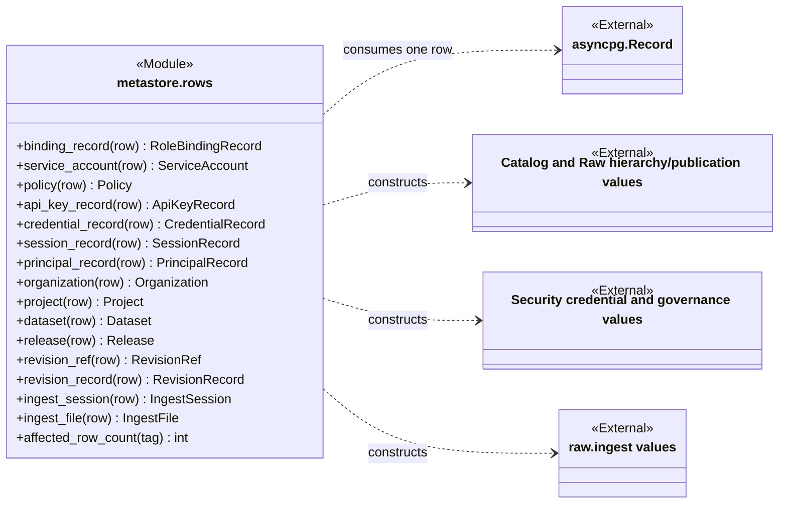

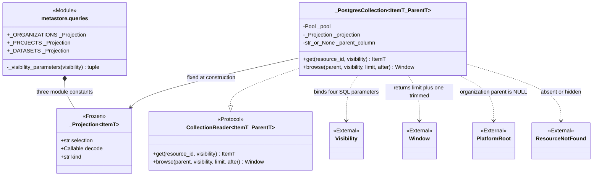

`rows` is the single `asyncpg` boundary. Each decoder names exactly the columns
one store's SELECT aliases; `project` renames `classification_default` to
`data_classification`, `release` reads `revision_number` from a joined
`dataset_revisions` row, `api_key_record` renames `owner_subject` and stringifies
`project_id`, and `dataset` deliberately ignores the row's own `data_classification`
column because no port reads it back. `affected_row_count` parses the command tag
an `execute()` returns, which is how bulk revokes and CAS updates learn whether they
touched a row.

Each `_Projection` is a trusted SELECT whose `WHERE` clause takes the same four
visibility parameters: unrestricted flag, organization ids, project ids, dataset ids.
An organization is visible when named directly or when it owns a visible project or
dataset; a project when named directly or when it owns a visible dataset; a dataset
when its project or itself is named. `_PostgresCollection.get` wraps the projection
as a subquery and adds `WHERE id = $5`; `browse` adds the parent filter and the
`(slug COLLATE "C", id)` keyset cursor and fetches `limit + 1` rows.

## 3. The in-memory hierarchy reference

Sources: [hierarchy.py](../src/huron/core/metastore/hierarchy.py),
[Security fact projection mixin](../src/huron/core/metastore/security_facts.py).

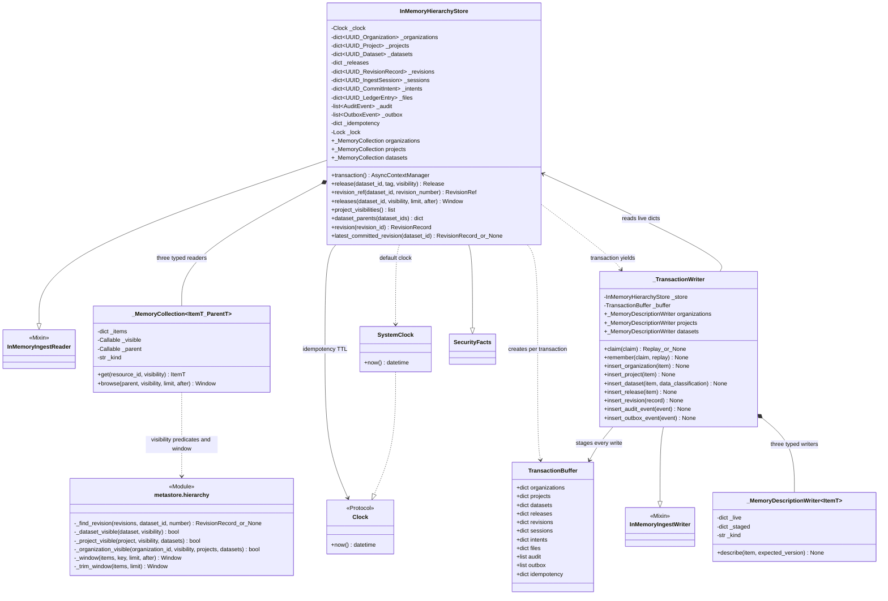

`InMemoryHierarchyStore` is the reference every backend is compared against.
Its `transaction()` takes one `asyncio.Lock` for the whole block, hands out a
`_TransactionWriter` that stages into a fresh `TransactionBuffer`, and applies the
buffer to the live dictionaries in one `await`-free step only if the block exits
without raising. Reads never take the lock. Because the lock covers the entire
transaction, no second transaction can observe a claim whose `remember` has not
yet run, so `claim` needs no extra check for that case.

The staged writers check uniqueness against both the live dictionaries and the
buffer, so two inserts of one slug in one transaction conflict just as they would
across transactions. `insert_dataset` accepts `data_classification` for parity
with Postgres and discards it. `latest_committed_revision` assumes every held
revision is committed, which is true because the in-memory writer never records
another state. `_MemoryCollection` sorts visible children by `(slug, id)` and
bisects on the cursor; `_window` and `_trim_window` produce the same
`limit + 1` semantics in memory and over a fetched page respectively.

## 4. The PostgreSQL hierarchy adapter

Sources: [hierarchy.py](../src/huron/core/metastore/hierarchy.py),
[queries.py](../src/huron/core/metastore/queries.py).

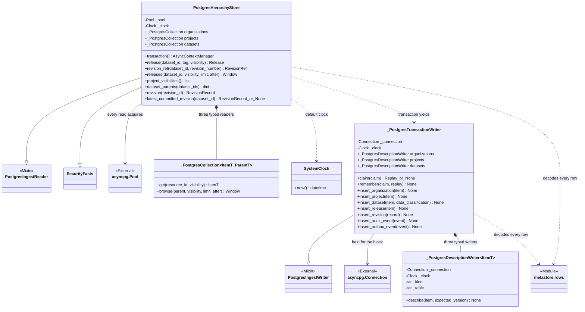

`transaction()` acquires one connection and opens a transaction on it; every
statement the yielded writer runs is issued on that connection, and nothing it
writes is visible elsewhere until the block commits. Reads acquire from the pool
directly and never see a partial transaction.

**Constraint translation.** The insert methods catch `UniqueViolationError` and
`ForeignKeyViolationError` and compare `constraint_name` against names fixed at
module level: `organizations_slug_key`, `projects_organization_id_slug_key`,
`datasets_project_id_slug_key`, `releases_dataset_id_tag_key`, and the composite
`releases_revision_dataset_fk`. A matching name becomes `SlugExists`, `TagExists`,
or `ResourceNotFound`; any other violation is re-raised untranslated.
`_PostgresDescriptionWriter.describe` runs a single `UPDATE ... WHERE id AND version
= expected RETURNING id`, and a missing row is `PreconditionFailed`.

**Idempotency.** `claim` stakes an `INSERT ... ON CONFLICT (principal, key) DO
UPDATE` whose `WHERE` only takes over a row that has expired and is not an
`ingest_commit` replay. Winning returns `None`. Losing reads the live row `FOR
UPDATE`, raises `IdempotencyKeyReused` on a different digest, and otherwise
returns the remembered `Replay`. `remember` stores `{"kind", "id"}` as `jsonb`
with status 201. The 24-hour TTL is an SQL interval literal here and the
`_CLAIM_TTL` constant in memory; the two are not bound together.

## 5. Ingest-ledger mixins

Sources: [ingest.py](../src/huron/core/metastore/ingest.py).

```mermaid
classDiagram
direction TB
class InMemoryIngestWriter {
  <<Mixin>>
  -InMemoryHierarchyStore _store
  -TransactionBuffer _buffer
  +begin_ingest(dataset_id, manifest_sha256, created_by, files) IngestSession
  +lock_ingest_session(session_id) IngestSession
  +freeze_commit(session, intent, expected_etag) tuple
  +update_ingest_session(session, expected_etag) None
  +renew_ingest_session(session) None
  +expire_ingest_session(session, expected_etag, now) None
  +update_ingest_file(ingest_id, file, expected_parts) None
}
class InMemoryIngestReader {
  <<Mixin>>
  -dict _sessions
  -dict _files
  +ingest_session(session_id) IngestSession
  +ingest_files(session_id) tuple
  +ingest_file(file_id) LedgerEntry
  +lapsed_ingest_sessions(now, limit) tuple
}
class PostgresIngestWriter {
  <<Mixin>>
  -Connection _connection
  -Clock _clock
  +begin_ingest(dataset_id, manifest_sha256, created_by, files) IngestSession
  +lock_ingest_session(session_id) IngestSession
  +freeze_commit(session, intent, expected_etag) tuple
  +update_ingest_session(session, expected_etag) None
  +renew_ingest_session(session) None
  +expire_ingest_session(session, expected_etag, now) None
  +update_ingest_file(ingest_id, file, expected_parts) None
  -_insert_ingest_session_row(session, now) None
  -_insert_ingest_file_rows(ingest_id, files) None
}
class PostgresIngestReader {
  <<Mixin>>
  -Pool _pool
  +ingest_session(session_id) IngestSession
  +ingest_files(session_id) tuple
  +ingest_file(file_id) LedgerEntry
  +lapsed_ingest_sessions(now, limit) tuple
}
class IngestModule["metastore.ingest"] {
  <<Module>>
  +latest_revision(revisions, dataset_id) RevisionRecord_or_None
  -_find_open_ingest_session(sessions, dataset_id) IngestSession_or_None
  -_reserve_ingest_session(dataset_id, manifest_sha256, created_by, number, now) IngestSession
  -_reserved_file(file) IngestFile
  -_dataset_row_exists(connection, dataset_id) bool
  -_pg_open_ingest_session(connection, dataset_id) Record_or_None
  -_pg_next_revision_number(connection, dataset_id) int
}
class _TransactionWriter
class InMemoryHierarchyStore
class _PostgresTransactionWriter
class PostgresHierarchyStore
class IngestSession {
  <<External>>
}
class IngestFile {
  <<External>>
}
class CommitIntent {
  <<External>>
}
class CommitRecord {
  <<External>>
}
class LedgerEntry {
  <<External>>
}
_TransactionWriter --|> InMemoryIngestWriter
InMemoryHierarchyStore --|> InMemoryIngestReader
_PostgresTransactionWriter --|> PostgresIngestWriter
PostgresHierarchyStore --|> PostgresIngestReader
InMemoryIngestWriter ..> IngestModule : shared reservation shape
PostgresIngestWriter ..> IngestModule : shared reservation shape
InMemoryIngestWriter ..> IngestSession : reserves and fences
PostgresIngestWriter ..> IngestSession : reserves and fences
PostgresIngestWriter ..> CommitIntent : freezes into ingest_commit_intents
PostgresIngestWriter ..> CommitRecord : decodes committed marker
InMemoryIngestWriter ..> CommitIntent : freezes into buffer intents
InMemoryIngestReader ..> LedgerEntry : returns
PostgresIngestReader ..> LedgerEntry : returns
InMemoryIngestWriter ..> IngestFile : stages ledger rows
PostgresIngestWriter ..> IngestFile : inserts with unnest
```

This module is a size split, not a port: the four mixins supply the ingest half of
the write and read surfaces that `hierarchy.py`'s concrete classes inherit. The
mixins declare the attributes they expect (`_store`, `_buffer`, `_connection`,
`_clock`, `_pool`, `_sessions`, `_files`) as annotations only; the host class sets
them. `ingest.py` imports `hierarchy.py`'s classes solely under `TYPE_CHECKING`,
so the mutual import forms no runtime cycle.

`_reserve_ingest_session` is shared by both writers so a reservation always has
fresh `uuid7` ids, `etag` 1, `PREPARING`, and a lease of exactly `LEASE_TTL`.
`begin_ingest` refuses a missing dataset with `ResourceNotFound` and an open
session with `DatasetLocked` carrying the blocking session's id, state, and
expiry. In Postgres the `one_open_ingest_per_dataset` partial unique index is a
backstop that also maps to `DatasetLocked`. `freeze_commit` returns an existing
frozen intent for an identical retry while the session is `COMMITTING` or
`COMMITTED`, and otherwise requires `VERIFYING` at the expected etag. Every other
edge is one guarded `UPDATE` whose zero-row result is `PreconditionFailed`, except
`renew_ingest_session`, which uses `GREATEST` so a lease never moves backward and
raises `IngestSessionExpired` for a terminal or `RECOVERING` session.

## 6. Port conformance of the hierarchy classes

Sources: [Raw ports](../src/huron/core/raw/ports.py),
[Catalog ports](../src/huron/core/catalog/ports.py),
[Security facts](../src/huron/core/security/facts.py),
[Foundation retry](../src/huron/core/foundation/retry.py),
[hierarchy adapter](../src/huron/core/metastore/hierarchy.py),
[fact implementation](../src/huron/core/metastore/security_facts.py#L16),
[application conformance](../src/huron/applications/api/capabilities.py).

```mermaid
classDiagram
direction TB
class HierarchyStore {
  <<Protocol>>
  +transaction() AsyncContextManager
  +revision(revision_id) RevisionRecord
  +latest_committed_revision(dataset_id) RevisionRecord_or_None
  +ingest_session(session_id) IngestSession
  +ingest_files(session_id) tuple
  +ingest_file(file_id) LedgerEntry
  +lapsed_ingest_sessions(now, limit) tuple
}
class CatalogFacts {
  <<Protocol>>
  +project_visibilities() list
  +dataset_parents(dataset_ids) dict
  +resource_scope(kind, resource_id, visibility) Scope
  +organization_slug(organization_id) str
}
class ReleaseStore {
  <<Protocol>>
  +release(dataset_id, tag, visibility) Release
  +revision_ref(dataset_id, revision_number) RevisionRef
  +releases(dataset_id, visibility, limit, after) Window
}
class CatalogReaders {
  <<Protocol>>
  +CollectionReader organizations
  +CollectionReader projects
  +CollectionReader datasets
}
class CreationStore {
  <<Protocol>>
}
class DescriptionStore {
  <<Protocol>>
}
class HierarchyWriter {
  <<Protocol>>
  +insert_revision(record) None
  +insert_audit_event(event) None
  +insert_outbox_event(event) None
  +begin_ingest(...) IngestSession
  +lock_ingest_session(session_id) IngestSession
  +freeze_commit(session, intent, expected_etag) tuple
  +update_ingest_session(session, expected_etag) None
  +renew_ingest_session(session) None
  +expire_ingest_session(session, expected_etag, now) None
  +update_ingest_file(ingest_id, file, expected_parts) None
}
class CreationTransaction {
  <<Protocol>>
}
class DescriptionTransaction {
  <<Protocol>>
}
class ReleaseTransaction {
  <<Protocol>>
}
class RetryTransaction {
  <<Protocol>>
  +claim(claim) Replay_or_None
  +remember(claim, replay) None
}
class DescriptionWriter~ItemT~ {
  <<Protocol>>
  +describe(item, expected_version) None
}
class PostgresHierarchyStore
class InMemoryHierarchyStore
class _PostgresTransactionWriter
class _TransactionWriter
class _PostgresDescriptionWriter
class _MemoryDescriptionWriter
class RevisionStore {
  <<Protocol>>
  +CollectionReader datasets
  +revision(revision_id) RevisionRecord
}
class SecurityFacts {
  +resource_scope(kind, resource_id, visibility) Scope
  +organization_slug(organization_id) str
}
HierarchyStore --|> RevisionStore
HierarchyStore --|> CatalogReaders
ReleaseStore --|> CatalogReaders
CreationStore --|> CatalogReaders
DescriptionStore --|> CatalogReaders
HierarchyWriter --|> RetryTransaction
CreationTransaction --|> RetryTransaction
ReleaseTransaction --|> RetryTransaction
DescriptionTransaction --> DescriptionWriter : three typed writers
HierarchyStore ..> HierarchyWriter : transaction yields
PostgresHierarchyStore ..|> HierarchyStore
InMemoryHierarchyStore ..|> HierarchyStore
PostgresHierarchyStore ..|> CreationStore
PostgresHierarchyStore ..|> DescriptionStore
InMemoryHierarchyStore ..|> CreationStore
InMemoryHierarchyStore ..|> DescriptionStore
PostgresHierarchyStore ..|> ReleaseStore
InMemoryHierarchyStore ..|> ReleaseStore
PostgresHierarchyStore ..|> CatalogFacts
InMemoryHierarchyStore ..|> CatalogFacts
PostgresHierarchyStore --|> SecurityFacts
InMemoryHierarchyStore --|> SecurityFacts
_PostgresTransactionWriter ..|> HierarchyWriter
_TransactionWriter ..|> HierarchyWriter
_PostgresTransactionWriter ..|> CreationTransaction
_PostgresTransactionWriter ..|> DescriptionTransaction
_PostgresTransactionWriter ..|> ReleaseTransaction
_TransactionWriter ..|> CreationTransaction
_TransactionWriter ..|> DescriptionTransaction
_TransactionWriter ..|> ReleaseTransaction
_PostgresDescriptionWriter ..|> DescriptionWriter
_MemoryDescriptionWriter ..|> DescriptionWriter
```

Both stores satisfy separate Raw, Catalog and Security contracts; Raw's
`HierarchyStore` no longer inherits release or Security facts, and its writer
extends only Foundation's retry contract. The concrete transaction writer still
implements all atomic groups on the same acquired connection or memory buffer.
Application `capabilities.py` composes the ports and checks structural conformance.

`SecurityFacts.resource_scope` uses the existing reader predicates: target discovery
precedes scope construction, and dataset ancestry reads its parent only after target
admission. `organization_slug` serves already-authorized account provisioning.
Project classifications and dataset parents remain on the concrete hierarchy
readers. These projections avoid a Security → Catalog dependency. See the shared
[Security fact contract](../tests/security_fact_contract.py) and
[hierarchy contract](../tests/hierarchy_contract.py).

## 7. Governance persistence

Sources: [Metastore RBAC](../src/huron/core/metastore/rbac.py),
[Security ports](../src/huron/core/security/ports.py),
[Security facts](../src/huron/core/security/facts.py),
[Security governance values](../src/huron/core/security/types.py).

```mermaid
classDiagram
direction TB
class InMemoryRbacStore {
  -dict~UUID_RoleBindingRecord~ _role_bindings
  -dict~UUID_ServiceAccount~ _service_accounts
  -dict~UUID_Policy~ _policies
  -list~PolicyAttachment~ _policy_attachments
  -dict _compiled
  -RLock _lock
  +grant_role(principal, role_code, scope_type, scope_id, created_by, expires_at) RoleBindingRecord
  +revoke_role(binding_id) RoleBindingRecord
  +get_role_binding(binding_id) RoleBindingRecord
  +bindings_for(identifiers) tuple
  +bindings_at(scope_type, scope_id) list
  +create_service_account(organization_id, name, subject, created_by) ServiceAccount
  +get_service_account(principal_id) ServiceAccount
  +service_account_by_subject(subject) ServiceAccount
  +list_service_accounts(organization_id) list
  +disable_service_account(principal_id, disabled_at) ServiceAccount
  +create_policy(policy_type, name, spec, created_by) Policy
  +attach_policy(policy_id, scope_type, scope_id, attached_by) PolicyAttachment
  +list_policies() list
}
class PostgresRbacStore {
  -Pool _pool
  +grant_role(principal, role_code, scope_type, scope_id, created_by, expires_at) RoleBindingRecord
  +revoke_role(binding_id) RoleBindingRecord
  +get_role_binding(binding_id) RoleBindingRecord
  +bindings_for(identifiers) tuple
  +bindings_at(scope_type, scope_id) list
  +create_service_account(organization_id, name, subject, created_by) ServiceAccount
  +get_service_account(principal_id) ServiceAccount
  +service_account_by_subject(subject) ServiceAccount
  +list_service_accounts(organization_id) list
  +disable_service_account(principal_id, disabled_at) ServiceAccount
  +create_policy(policy_type, name, spec, created_by) Policy
  +attach_policy(policy_id, scope_type, scope_id, attached_by) PolicyAttachment
  +list_policies() list
}
class RbacStore {
  <<Protocol>>
}
class BindingFacts {
  <<Protocol>>
  +bindings_for(identifiers) tuple
  +service_account_by_subject(subject) ServiceAccount
}
class BindingStore {
  <<Protocol>>
  +grant_role(...) RoleBindingRecord
  +revoke_role(binding_id) RoleBindingRecord
  +get_role_binding(binding_id) RoleBindingRecord
  +bindings_at(scope_type, scope_id) list
}
class PolicyStore {
  <<Protocol>>
  +create_policy(...) Policy
  +attach_policy(...) PolicyAttachment
  +list_policies() list
}
class ServiceAccountStore {
  <<Protocol>>
  +create_service_account(...) ServiceAccount
  +get_service_account(principal_id) ServiceAccount
  +list_service_accounts(organization_id) list
  +disable_service_account(principal_id, disabled_at) ServiceAccount
}
class RolesModule["security.roles"] {
  <<External>>
  +compile_binding(...) tuple
  +LAYER_SCOPED_CAPABILITIES frozenset
}
class Binding {
  <<External>>
}
class RoleBindingRecord {
  <<External>>
}
class ServiceAccount {
  <<External>>
}
class Policy {
  <<External>>
}
class PolicyAttachment {
  <<External>>
}
RbacStore --|> BindingFacts
RbacStore --|> BindingStore
RbacStore --|> PolicyStore
RbacStore --|> ServiceAccountStore
InMemoryRbacStore ..|> RbacStore
PostgresRbacStore ..|> RbacStore
InMemoryRbacStore ..> RolesModule : validates and compiles each grant
PostgresRbacStore ..> RolesModule : validates before INSERT
InMemoryRbacStore ..> Binding : returns precompiled
PostgresRbacStore ..> Binding : rebuilds from role_capabilities join
InMemoryRbacStore ..> RoleBindingRecord : stores
PostgresRbacStore ..> RoleBindingRecord : stores
InMemoryRbacStore ..> ServiceAccount : stores
PostgresRbacStore ..> ServiceAccount : joins principals
InMemoryRbacStore ..> Policy : stores
PostgresRbacStore ..> Policy : stores spec as jsonb
InMemoryRbacStore ..> PolicyAttachment : stores
PostgresRbacStore ..> PolicyAttachment : stores
```

Both stores run `compile_binding` on every grant before checking for duplicates
or touching a table, so an unknown role, a service-account principal, or an
unbindable scope raises the matching `RoleError` subclass first. The in-memory
store keeps the compiled bindings keyed by binding id and answers `bindings_for`
by lookup. The Postgres store joins `role_bindings` to `role_capabilities`,
filters expiry against the database's `now()`, and rebuilds one control-capability
`Binding` plus one per-layer `Binding` for each `data.read`/`data.write` row, so a
`DENY` effect written outside the API is reproduced faithfully. The
`role_bindings_guard` and `service_accounts_kind_guard` triggers exist for rows
written outside this store; in the request path they never fire.

**Divergences worth knowing.** `PostgresRbacStore.create_service_account` inserts
the `principals` row and the `service_accounts` row in one transaction and maps the
`principals_subject_key` violation to `UsernameTaken`; the in-memory store keeps no
principal rows and cannot raise that error. In-memory `disable_service_account`
mutates the stored `ServiceAccount` in place (the record is not frozen), while
Postgres updates `principals.disabled_at` only for `kind = 'service_account'` and
re-reads. `attach_policy` in Postgres can raise `ScopeNotBindable`, a `RoleError`,
when the CHECK refuses `SYSTEM`; `create_policy` can raise a bare `ValueError` on
the `policy_type` CHECK. Both are unreachable through the API's validated routes.
The in-memory store serializes writes with a `threading.RLock`, not an asyncio
lock, and its `bindings_for` returns expired grants too, leaving expiry to
`decide()`, whereas the Postgres query drops rows expired at database `now()`.
Ordering uses `COLLATE "C"` in SQL and plain `sorted()` in memory so keyset
cursors agree byte for byte.

## 8. Credential and principal stores

Sources: [PostgreSQL API keys](../src/huron/core/metastore/api_keys.py),
[credentials](../src/huron/core/metastore/credentials.py),
[principals](../src/huron/core/metastore/principals.py),
[sessions](../src/huron/core/metastore/sessions.py),
[memory API keys](../src/huron/core/metastore/memory_apikeys.py),
[memory credentials](../src/huron/core/metastore/memory_password.py),
[memory principals](../src/huron/core/metastore/memory_principals.py),
[memory sessions](../src/huron/core/metastore/memory_sessions.py),
[Security ports](../src/huron/core/security/ports.py),
[API-key mechanism](../src/huron/core/security/apikeys.py),
[password mechanism](../src/huron/core/security/password.py),
[principal contract](../src/huron/core/security/principals.py),
[session mechanism](../src/huron/core/security/sessions.py).

```mermaid
classDiagram
direction TB
class PostgresApiKeyStore {
  -Pool _pool
  +get(key_id) ApiKeyRecord_or_None
  +add(record) None
  +touch_last_used(key_id) None
  +revoke_all_for(subject, revoked_at) int
}
class PostgresCredentialStore {
  -Pool _pool
  +get(principal_id) CredentialRecord_or_None
  +upsert(record) None
}
class PostgresPrincipalStore {
  -Pool _pool
  +get_user_by_subject(subject) PrincipalRecord_or_None
  +upsert_oidc_user(user) PrincipalRecord
  +get_by_id(principal_id) PrincipalRecord_or_None
  +create_user(subject, display_name) PrincipalRecord
  +disable(principal_id, disabled_at) PrincipalRecord_or_None
}
class PostgresSessionStore {
  -Pool _pool
  +get(session_id) SessionRecord_or_None
  +add(record) None
  +touch(session_id, last_seen_at, idle_expires_at) None
  +revoke(session_id, revoked_at) None
  +revoke_all_for(subject, revoked_at) int
}
class ApiKeyWriter {
  <<Protocol>>
  +add(record) None
  +touch_last_used(key_id) None
  +revoke_all_for(subject, revoked_at) int
}
class ApiKeyStore {
  <<Protocol>>
  +get(key_id) ApiKeyRecord_or_None
}
class CredentialStore {
  <<Protocol>>
  +get(principal_id) CredentialRecord_or_None
  +upsert(record) None
}
class PrincipalStore {
  <<Protocol>>
  +get_user_by_subject(subject) PrincipalRecord_or_None
  +get_by_id(principal_id) PrincipalRecord_or_None
  +create_user(subject, display_name) PrincipalRecord
  +disable(principal_id, disabled_at) PrincipalRecord_or_None
  +upsert_oidc_user(user) PrincipalRecord
}
class SessionStore {
  <<Protocol>>
  +get(session_id) SessionRecord_or_None
  +add(record) None
  +touch(session_id, last_seen_at, idle_expires_at) None
  +revoke(session_id, revoked_at) None
  +revoke_all_for(subject, revoked_at) int
}
class MemoryApiKeyStore {
  <<Reference>>
}
class MemoryCredentialStore {
  <<Reference>>
}
class MemoryPrincipalStore {
  <<Reference>>
}
class MemorySessionStore {
  <<Reference>>
}
class ApiKeyRecord {
  <<External>>
}
class CredentialRecord {
  <<External>>
}
class PrincipalRecord {
  <<External>>
}
class SessionRecord {
  <<External>>
}
class OidcUser {
  <<External>>
}
ApiKeyWriter --|> ApiKeyStore
PostgresApiKeyStore ..|> ApiKeyWriter
PostgresCredentialStore ..|> CredentialStore
PostgresPrincipalStore ..|> PrincipalStore
PostgresSessionStore ..|> SessionStore
MemoryApiKeyStore ..|> ApiKeyWriter
MemoryCredentialStore ..|> CredentialStore
MemoryPrincipalStore ..|> PrincipalStore
MemorySessionStore ..|> SessionStore
PostgresApiKeyStore ..> ApiKeyRecord : stores and returns
PostgresCredentialStore ..> CredentialRecord : stores and returns
PostgresPrincipalStore ..> PrincipalRecord : stores and returns
PostgresPrincipalStore ..> OidcUser : consumes on login
PostgresSessionStore ..> SessionRecord : stores and returns
```

These four adapters are one statement per method against a primary key or a
partial index, and they judge nothing: revoked keys, expired sessions, and
disabled principals are returned as stored for `ApiKeyResolver`,
`SessionResolver`, and the Security login workflows to refuse. Their memory
counterparts live in this package, with no adapter re-exports through Security.
`ApiKeyStore` and its `ApiKeyWriter` extension both belong to Security.

- `PostgresApiKeyStore.add` maps a foreign-key refusal to `ResourceNotFound` and
  a `key_id` collision to `RuntimeError`, since a 128-bit random handle colliding is
  a bug, not a client error. `revoke_all_for` touches only rows whose `revoked_at`
  is still NULL and reports the count from the command tag.
- `PostgresCredentialStore.upsert` is one `INSERT ... ON CONFLICT DO UPDATE`. The
  `local_credentials_kind_guard` trigger raises the same message for an unknown
  principal and a service account, so the store repeats the lookup to choose
  between `ResourceNotFound` and `PrincipalKindMismatch`.
- `PostgresPrincipalStore.upsert_oidc_user` conflicts on `idp_subject` alone and
  only refreshes `display_name`; a first-ever `idp_subject` that collides with
  another principal's `subject` is refused as `PrincipalSubjectExists`, never
  auto-linked. `get_user_by_subject` folds unknown, disabled, and service-account
  subjects into one `None` so password verification keeps a constant shape.
- `PostgresSessionStore.touch` relies on the caller clamping `idle_expires_at`
  to the absolute expiry that the table's CHECK enforces.

## 9. Maintenance and legacy cutover

Sources: [maintenance.py](../src/huron/core/metastore/maintenance.py),
[legacy.py](../src/huron/core/metastore/legacy.py),
[integrity/ports.py](../src/huron/core/integrity/ports.py).

```mermaid
classDiagram
direction TB
class DatabaseFence {
  <<Protocol>>
  +str database
  +tuple old_roles
  +str new_role
}
class PostgresRoleExclusion {
  -Pool _pool
  +identify() str
  +exclude(fence) None
  +check(fence) None
}
class MaintenanceModule["metastore.maintenance"] {
  <<Module>>
  -_require_identity(connection, fence) None
  -_identifier(value) str
  -_roles(old_roles, new_role) tuple
  -_require_dedicated(connection, role) None
  -_revoke_access(connection, role) None
  -_effective_access(connection, role) bool
}
class PostgresLegacyMaintenance {
  -Pool _pool
  -Callable _now
  +generation_records() tuple
  +revision_paths() tuple
  +lookup(identity) RevisionRecord_or_None
  +resolve(actor, root_id, run_id, revisions) None
}
class LegacyModule["metastore.legacy"] {
  <<Module>>
  -_require_legacy(connection) None
  -_import_revision(connection, record, findings) None
  -_session_outcome(session, revisions) str
  -_findings(connection, root_id, run_id, record, findings, instant) None
  -_audit(connection, actor, root_id, run_id, subject_kind, subject_id, outcome, instant) None
}
class DatabaseExclusion {
  <<Protocol>>
  +identify() str
  +exclude(fence) None
  +check(fence) None
}
class LegacyMaintenance {
  <<Protocol>>
  +generation_records() tuple
  +revision_paths() tuple
  +lookup(identity) RevisionRecord_or_None
  +resolve(actor, root_id, run_id, revisions) None
}
class FenceEvidence {
  <<External>>
}
class RevisionPath {
  <<External>>
}
class RevisionRecord {
  <<External>>
}
class RowsModule["metastore.rows"] {
  <<Module>>
}
PostgresRoleExclusion ..|> DatabaseExclusion
PostgresLegacyMaintenance ..|> LegacyMaintenance
FenceEvidence ..|> DatabaseFence : structural
PostgresRoleExclusion ..> DatabaseFence : consumes
PostgresRoleExclusion ..> MaintenanceModule : role and identity checks
PostgresLegacyMaintenance ..> LegacyModule : import, outcome, audit
PostgresLegacyMaintenance ..> RevisionPath : lookup by full identity
PostgresLegacyMaintenance ..> RevisionRecord : imports and returns
PostgresLegacyMaintenance ..> RowsModule : decodes hierarchy rows
```

These two adapters serve the operator-only `core/integrity` cutover, which the
[catalog atlas](catalog-uml.html) leaves outside its scope. `DatabaseFence` is a
protocol declared here that Integrity's `FenceEvidence` document satisfies
structurally, so the adapter never imports Integrity. Application wiring supplies
`PostgresRoleExclusion` to the public `ControllerAdmission` workflow through an
async context factory and retains pool lifetime ownership.

`PostgresRoleExclusion.identify` reports the primary's
`system_identifier/oid/datname` and refuses a replica. `exclude` verifies that
identity against the fence, requires every role to be dedicated (no superuser,
createdb, createrole, replication, or bypass-RLS attribute; not the session user;
owning no objects), sets `NOLOGIN`, revokes the legacy roles' memberships and
schema privileges, terminates their backends, and then runs `check`. `check`
fails if any fenced role can log in, has a live session, or retains effective
write, create, or security-definer access. Every failure is a `ValueError`; the
adapter refuses owner-role deployments rather than transferring objects.

`PostgresLegacyMaintenance` requires `alembic_version` to be exactly
`0010_independent_raw` on every call. `lookup` requires the full slug-and-id
ancestry to match before trusting a revision identity and refuses colliding
identities. `resolve` runs one transaction that locks open ingest sessions,
imports each verified revision idempotently (`ON CONFLICT (id) DO NOTHING`, then
re-reads and compares), marks revisions with findings `DEGRADED`, records
`reconciliation_findings` and `integrity.cutover` audit rows keyed by
`uuid5(run_id, ...)`, and terminalizes each session as `COMMITTED` only when it was
`COMMITTING` against a finding-free verified final, otherwise `FAILED`.

## 10. Values, clocks, and shared conventions

Sources: [Catalog Window and PlatformRoot](../src/huron/core/catalog/types.py),
[Foundation retry values](../src/huron/core/foundation/retry.py),
[Raw LedgerEntry](../src/huron/core/raw/types.py),
[Foundation Clock](../src/huron/core/foundation/clock.py),
[Security visibility](../src/huron/core/security/rules.py),
[Metastore exports](../src/huron/core/metastore/__init__.py).

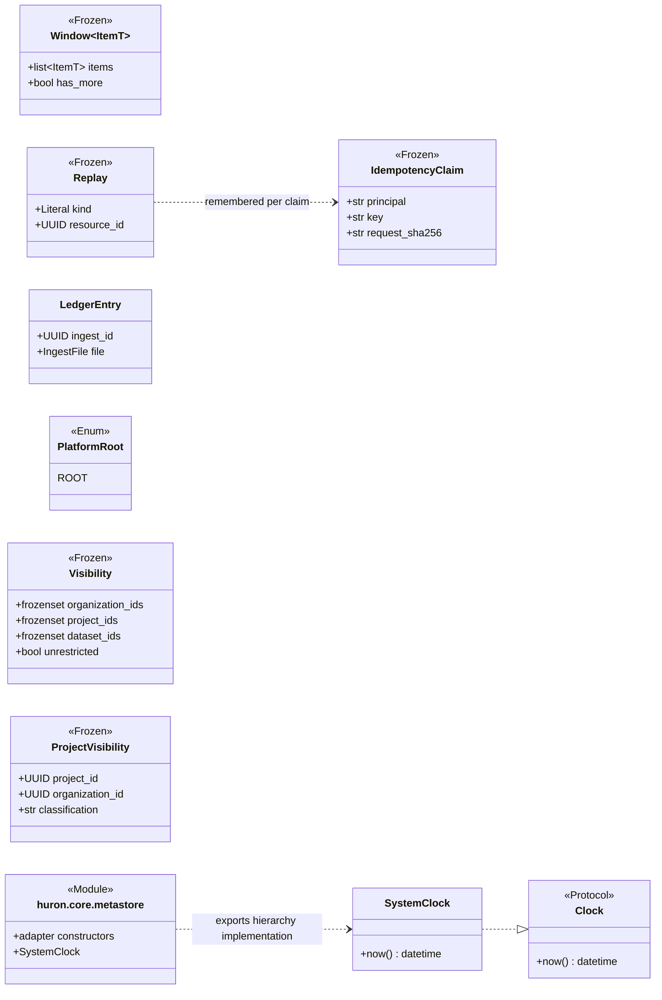

None of these values is declared in Metastore except `SystemClock` in `hierarchy.py`.
Consumers import `Window`/`PlatformRoot` from Catalog, `IdempotencyClaim`/`Replay`
and `Clock` from Foundation, `LedgerEntry`/`AuditEvent` from Raw, and `Visibility`
from Security. The adapter package no longer re-exports those domain values;
its four fields are exactly the four SQL parameters every projection binds.

| Convention | In memory | PostgreSQL |
| --- | --- | --- |
| Transaction | One `asyncio.Lock` for the block; buffer applied on clean exit. | One acquired connection with `connection.transaction()`. |
| Uniqueness | Scan live plus staged records. | Named UNIQUE constraints translated by `constraint_name`. |
| Version CAS | Compare `version` against the live record. | `UPDATE ... WHERE version = $expected RETURNING id`. |
| Ingest fencing | Compare etag, state, lease, and parts in Python. | Guarded `UPDATE`; zero affected rows is a conflict. |
| Idempotency TTL | `_CLAIM_TTL` of 24 hours from the injected clock. | `interval '24 hours'` in SQL from the injected clock. |
| Time | `Clock.now()` for claims and leases; `datetime.now(UTC)` in RBAC. | Same, plus database `now()` for binding expiry and key/session stamps. |
| Cursor order | `sorted()` on `(slug, id)`, `(tag,)`, `(name, id)`. | `ORDER BY ... COLLATE "C"` to match byte order. |

## 11. Application construction

Sources: [app.py](../src/huron/applications/api/app.py),
[runtime.py](../src/huron/applications/api/runtime.py),
[lakectl/wiring.py](../src/huron/applications/lakectl/wiring.py).

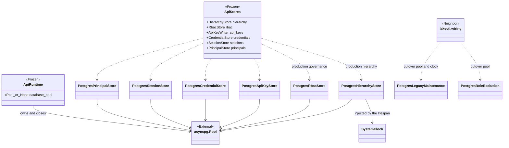

The API lifespan calls `asyncpg.create_pool(settings.database_url)`, constructs
the six adapters over that pool with one `SystemClock`, bundles them as
`ApiStores`, and closes the pool on shutdown. When a caller injects `ApiStores`
no pool is opened; the test suites inject the in-memory hierarchy and RBAC stores
and the Metastore memory credential stores that way. `lakectl` opens its own pool
with maintenance credentials and constructs the cutover adapters. Alembic
migrations live in `migrations/`; applications own pool construction and lifetime.

## 12. Errors the adapters raise

Sources: [Foundation errors](../src/huron/core/foundation/errors.py),
[Catalog errors](../src/huron/core/catalog/errors.py),
[Raw errors](../src/huron/core/raw/errors.py),
[Security errors](../src/huron/core/security/errors.py),
[Security roles](../src/huron/core/security/roles.py),
[Security principals](../src/huron/core/security/principals.py).

```mermaid
classDiagram
direction TB
class DomainError {
  <<External>>
}
class ResourceNotFound
class PreconditionFailed
class IdempotencyKeyReused
class TagExists
class DatasetLocked
class IngestSessionExpired
class SlugExists
class BindingExists
class ServiceAccountExists
class AttachmentExists
class UsernameTaken
class PrincipalKindMismatch
class RoleError {
  <<External>>
}
class ScopeNotBindable
class PrincipalSubjectExists {
  <<External_Auth>>
}
class ValueError {
  <<Builtin>>
}
class RuntimeError {
  <<Builtin>>
}
ResourceNotFound --|> DomainError
PreconditionFailed --|> DomainError
IdempotencyKeyReused --|> DomainError
TagExists --|> DomainError
DatasetLocked --|> DomainError
IngestSessionExpired --|> DomainError
SlugExists --|> DomainError
BindingExists --|> DomainError
ServiceAccountExists --|> DomainError
AttachmentExists --|> DomainError
UsernameTaken --|> DomainError
PrincipalKindMismatch --|> DomainError
ScopeNotBindable --|> RoleError
```

| Raised by | Error | Trigger |
| --- | --- | --- |
| Collections, reads | `ResourceNotFound` | Absent or hidden entity, release, revision, session, file, binding, account, policy; a foreign key refusing a parent. |
| Description writers, ingest edges | `PreconditionFailed` | Version or etag mismatch; a fenced state, lease, or recorded-parts check failing. |
| Transaction `claim` | `IdempotencyKeyReused` | Live claim with a different request digest. |
| Hierarchy inserts | `SlugExists`, `TagExists` | Named UNIQUE constraint or live-plus-staged scan. |
| `begin_ingest` | `DatasetLocked` | Open session for the dataset, or the partial unique index. |
| `renew_ingest_session` | `IngestSessionExpired` | Terminal or `RECOVERING` session. |
| RBAC store | `BindingExists`, `ServiceAccountExists`, `AttachmentExists`, `UsernameTaken` | Duplicate grant, name, attachment, or subject. |
| RBAC store | `RoleError` subclasses from `compile_binding`; `ScopeNotBindable` from the attachment CHECK | Invalid grant; `SYSTEM` attachment. |
| Credential and principal stores | `PrincipalKindMismatch`, `PrincipalSubjectExists` | Password on a service account; subject already held. |
| Maintenance, legacy, policy CHECK, key collision | `ValueError`, `RuntimeError` | Not domain errors: operator-facing refusals and unreachable-by-design failures. |

`DomainError` carries status codes and problem data for the API's exception
handlers. The maintenance adapters deliberately raise plain `ValueError`, since
they are driven by `lakectl`, not by HTTP requests.

## Source and behavioral cross-checks

The implementation snapshot was traced through constructors, fields, inheritance,
protocol declarations, SQL statements, and constraint names. Useful behavioral
entry points are:

- [Hierarchy contract scenarios](../tests/hierarchy_contract.py) run by
  [the in-memory suite](../tests/unit/test_hierarchy_store_memory.py) and
  [the Postgres contract suite](../tests/contract/test_hierarchy_store.py):
  atomicity, uniqueness, optimistic concurrency, idempotency, revision
  resolution, ordering, windowing, and the three visibility rules.
- [Catalog store contracts](../tests/contract/test_catalog_store.py),
  [RBAC store contracts](../tests/contract/test_rbac_store.py), and
  [auth store contracts](../tests/contract/test_auth_store.py): adapter behavior
  against a migrated database.
- [Row decoder tests](../tests/unit/test_stores_rows.py) and
  [port value tests](../tests/unit/test_stores_ports.py): decoding and the
  package's public surface.
- [Postgres RBAC conflicts](../tests/unit/test_postgres_rbac_conflicts.py),
  [API-key conflicts](../tests/unit/test_postgres_api_key_conflicts.py), and
  [credential conflicts](../tests/unit/test_postgres_credential_conflicts.py):
  constraint-name translation with a faked pool.
- [Repository hierarchy tests](../tests/unit/test_repository_hierarchy.py) and
  [repository RBAC tests](../tests/unit/test_repository_rbac.py): core workflows
  driven over the in-memory stores.
- [Maintenance adapter tests](../tests/unit/test_maintenance_adapters.py),
  [legacy verification tests](../tests/unit/test_legacy_verification.py),
  [maintenance ownership contracts](../tests/contract/test_maintenance_ownership.py),
  and [integrity store contracts](../tests/contract/test_integrity_store.py): role
  fencing and cutover import.

This document describes inspected implementation; it does not claim that the
application test suites were rerun to create a diagram.
