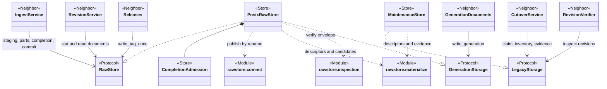
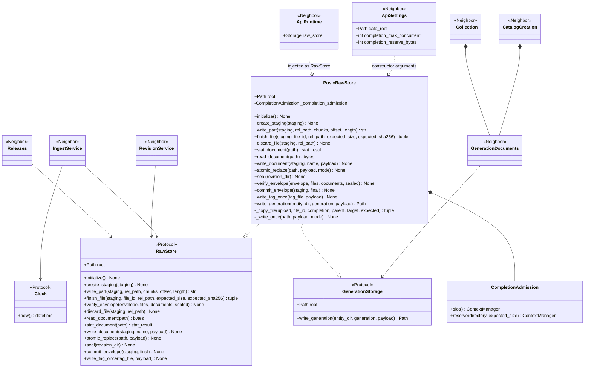
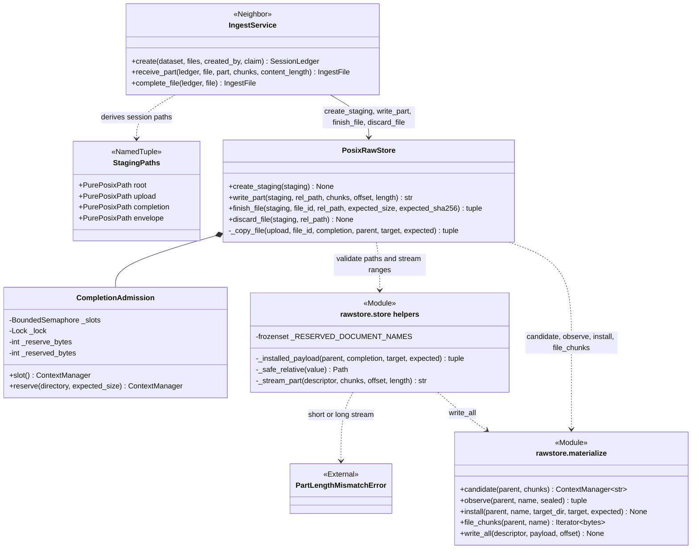
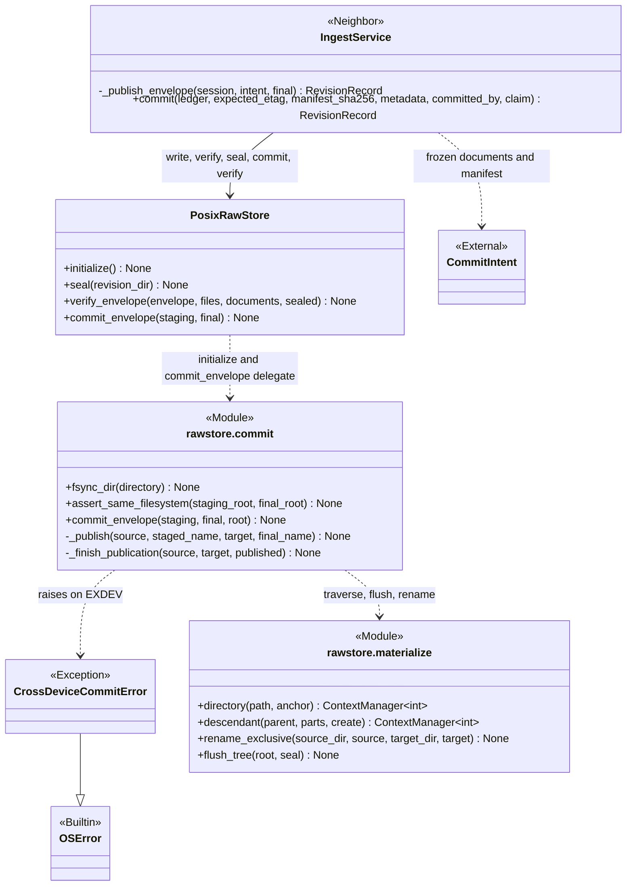
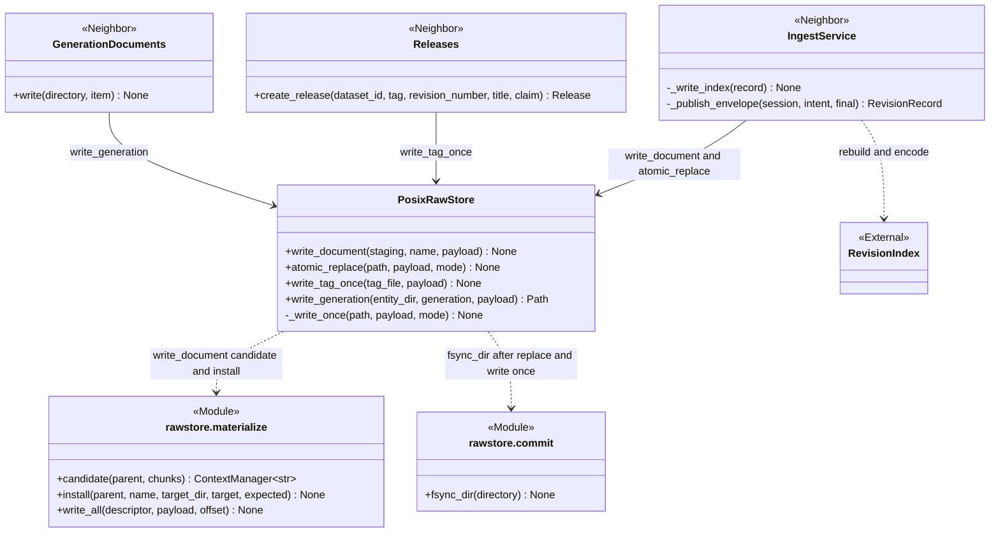
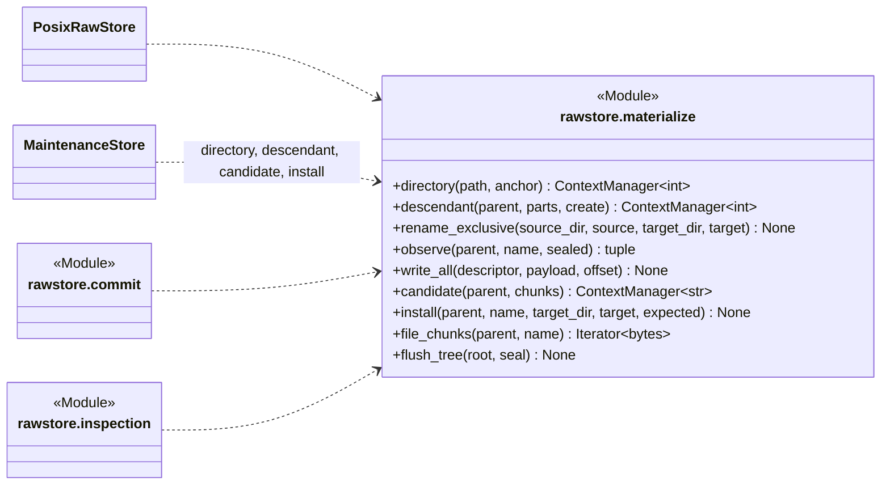
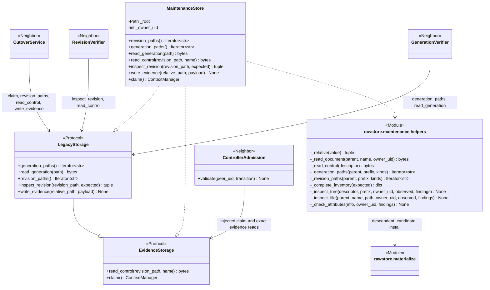
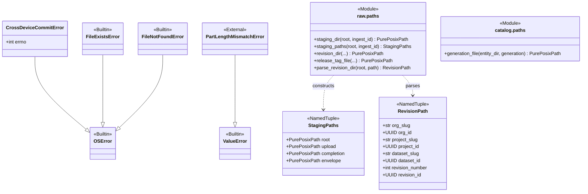

# Rawstore — UML class atlas

**Implementation snapshot: 16 September 2026, working tree based on `e71e685`.**
Open [the browser edition](rawstore-uml.html) for rendered, zoomable diagrams, or
view this file in a Mermaid-capable Markdown viewer.

The rawstore is Huron's **evidence tier on one POSIX filesystem**: it receives
upload parts into private staging, materializes each file as an independent
verified copy, publishes a finished envelope with a single exclusive rename,
seals what it published read-only, writes control documents, generation
documents, and release tags durably, and lets the operator-only maintenance
tooling inspect a root without following links. Its policy lives above it: the
core's ingest, revision, release, and collection services decide *what* to write
and *when*; `core.rawstore` decides *how* a write becomes durable and visible.

This is one class model presented in focused views. It includes every class
declared in `src/huron/core/rawstore/` together with the module-level functions
those classes are composed from, the consumer-owned `RawStore` port in
`core/raw/ports.py`, Catalog's narrow `GenerationStorage`, and Integrity's
`LegacyStorage`/`EvidenceStorage` ports that the two concrete stores satisfy,
plus Catalog/Raw path types and domain
services at their points of collaboration. Repeated boxes denote the same class.
Core service internals, PostgreSQL adapters, and the catalog's document models
are outside this atlas; the [catalog atlas](catalog-uml.html) covers them.
Module boxes list functions with their principal parameters; long parameter
lists are abbreviated. This is a Python structure diagram, not a filesystem
layout specification or an exhaustive signature reference.

**Currency matters:** the inspected package contains no sweeper, retention
worker, reconciler, purge, or trash mechanism. The
[Raw layer design](layer-raw.html) describes those as planned, and the package
does not delete anything except its own upload inputs, unpublished candidates,
and temporary files. `minihuron/rawstore.py` and `minihuron/rawdatastore.py`
are a standalone prototype that nothing under `src/` imports; they are excluded
here. Rawstore is a Core adapter owner; its only Huron dependency is
`schema.storage`. It satisfies consumer ports structurally without importing
domains. This atlas describes the verified migration; its evidence is recorded in the [roadmap](roadmap.html#domain-owned-core-migration).

## Reading the diagrams

- `A --> B`: association/reference, including a held instance or a bound root.
- `A ..> B`: uses, creates, or returns B; the label states which.
- `A *-- B`: A contains B as part of its object structure.
- `A --|> B`: actual Python inheritance.
- `A ..|> B`: structural conformance to a Python protocol, not inheritance.
- `<<Protocol>>`, `<<Module>>`, `<<Frozen>>`, `<<NamedTuple>>`, `<<External>>`,
  and `<<Neighbor>>` identify roles. A `<<Module>>` box lists a module's public
  functions; private helpers appear only where they explain structure.
- Descriptor parameters are integers: every traversal below a held directory
  uses `dir_fd` opens with `O_NOFOLLOW`, never a path string, so a symbolic
  link planted in the tree is refused rather than followed.
- Durability claims describe what the code does before returning: every
  primitive fsyncs the bytes it wrote and then the directory that names them.

## 1. The rawstore at a glance

The overview separates the two concrete stores by consumer. `PosixRawStore` is
the production `RawStore` that the API runtime constructs once and every core
service writes through. `MaintenanceStore` is constructed by the `lakectl`
wiring and controller for the operator-only integrity subsystem and never by the
API. Both are built from the same descriptor-holding primitives in
`materialize`.

| Responsibility | Owner | Important contract |
| --- | --- | --- |
| Claim a private session root | `PosixRawStore.create_staging` | Direct child of `root/.staging`; `upload`, `completion`, and `envelope/payload` created at `0o700`; a second claim on the same name fails at `mkdir`. |
| Receive upload parts | `PosixRawStore.write_part` | Positional writes into `[offset, offset + length)` of an input that may already exist; exact length enforced; file and ancestors flushed before success; the ledger records that durable progress. |
| Materialize verified files | `PosixRawStore.finish_file` with `CompletionAdmission` | A bounded, capacity-reserved copy into a closed `0o444` candidate, installed by exclusive rename; a mismatch installs nothing; a concurrent winner is verified, not replaced. |
| Publish a revision | `commit.commit_envelope` | Requires `COMMITTED`; flushes the tree; one exclusive rename; never overwrites an existing final; a completed commit may be retried. |
| Seal published bytes | `PosixRawStore.seal` / `flush_tree` | Files `0o444`, descendant directories `0o555`, root untouched so it can still be renamed. |
| Write control documents | `write_document`, `write_tag_once`, `write_generation`, `atomic_replace` | Documents and tags are write-once; generation files and `CURRENT.json` are replaced atomically because immutability is guaranteed above this layer. |
| Verify evidence | `inspection.verify_envelope` | Exact inventory, independent owned inodes, frozen document bytes; optional sealed check on descendants only. |
| Inspect and record for maintenance | `MaintenanceStore` | No-follow enumeration, bounded control reads, streamed inspection with finding codes, write-once protocol evidence, and a `flock` claim. |

## 2. The RawStore port and its POSIX implementation

Sources: [Raw ports](../src/huron/core/raw/ports.py),
[Catalog generation port](../src/huron/core/catalog/ports.py),
[store.py](../src/huron/core/rawstore/store.py),
[__init__.py](../src/huron/core/rawstore/__init__.py),
[app.py](../src/huron/applications/api/app.py).

The ports are declared by their consumers, Raw and Catalog, and
Rawstore never imports them; conformance is structural, and the store's own
docstring names the protocol it satisfies. Two shape differences are worth
knowing. The protocol declares `root` as a read-only property while the store
exposes a plain public attribute, and the store's `atomic_replace` accepts an
extra keyword `mode` that the protocol does not declare; both remain compatible
with every current caller.

The application lifespan constructs one `PosixRawStore` from `ApiSettings`, calls
`initialize()` so a cross-device layout fails at startup, and publishes it in
`ApiRuntime`. Raw workflows receive it typed as `RawStore`; Catalog receives
`GenerationStorage`. Blocking workflow calls run
through `asyncify`, because the store is synchronous and blocking. `Clock` is a
Foundation port. The application-owned combined `Storage` capability verifies
that one POSIX object satisfies both consumer interfaces at wiring time.

## 3. Staging, part receipt, and verified completion

Sources: [store.py](../src/huron/core/rawstore/store.py),
[completion.py](../src/huron/core/rawstore/completion.py),
[materialize.py](../src/huron/core/rawstore/materialize.py),
[storage.py](../src/huron/schema/storage.py),
[Raw staging paths](../src/huron/core/raw/paths.py).

**Session root.** `create_staging` accepts only a direct child of `root/.staging`
and creates the session directory with a plain `mkdir` that must succeed, so the
name itself is the ingest's claim. `upload`, `completion`, and `envelope/payload`
are created beneath it at `0o700` and each is fsynced before the call returns.

**Parts.** `write_part` validates `rel_path` through `_safe_relative` (no absolute
paths, no empty, `.`, or `..` components; a leading `payload/` is tolerated but
must not be the whole path), opens the input with `O_CREAT` but without
truncation, refuses anything that is not a regular, singly linked file owned by
the current user, and streams exactly `length` bytes with positional writes.
Nothing is buffered beyond one chunk; each chunk is on disk before the next is
pulled. A stream that runs short or long raises `PartLengthMismatchError`, which
`schema/storage.py` owns and the package re-exports.

**Completion.** `finish_file` first tries `_installed_payload`: if the target
already exists under `envelope/payload` it must observe the declared size and
digest, otherwise the call fails. Only when the target is missing does
`_copy_file` take a `CompletionAdmission` slot, re-check for a concurrent winner,
reserve the expected byte count against `statvfs` free space (raising `ENOSPC`
when the configured reserve cannot be retained), copy the upload input through
`file_chunks` into a closed `0o444` candidate, observe it, and install it by
exclusive rename only when the observation matches. A mismatch returns the
observed pair and installs nothing; the caller decides what that means.
Reservations are per store instance and per process; other processes and held
upload descriptors are not fenced.

**Discard.** `discard_file` unlinks an upload input and fsyncs its directory; a
missing input is success.

## 4. Commit publication

Sources: [commit.py](../src/huron/core/rawstore/commit.py),
[materialize.py](../src/huron/core/rawstore/materialize.py),
[private Raw ingestion](../src/huron/core/raw/_impl/ingest.py).

`commit_envelope` refuses a path that escapes the trusted root, then holds
descriptors for both parents and calls `_publish`. The decision table inside
`_publish` is the whole publication protocol:

| Final exists | Staging exists | `COMMITTED` present | Outcome |
| --- | --- | --- | --- |
| no | yes | no | `ValueError`; nothing published |
| no | yes | yes | flush tree, exclusive rename, fsync both parents, `fchmod 0o555` and fsync final |
| yes | yes | any | `FileExistsError`; an existing revision is never replaced |
| yes | no | in final | retry path: fsync both parents and reseal final |
| yes | no | absent from final | `FileNotFoundError` from the marker check |

The rename is `renameat2(RENAME_NOREPLACE)` on Linux and `renameatx_np` on
macOS, loaded through `ctypes`; any other platform, or a C library without the
call, raises `ENOTSUP`. A device mismatch is detected twice: at startup by
`assert_same_filesystem`, which creates both roots and compares `st_dev`, and
again immediately before the rename. Both report `CrossDeviceCommitError`
carrying `errno.EXDEV`.

**Ordering in the ingest workflow.** `IngestService` writes the frozen intent
documents into the envelope, verifies the staged envelope against the manifest
and documents, seals it, and commits it. If any step fails with `OSError` or
`ValueError` it verifies the final path with `sealed=True` instead, which is how
a crash or a concurrent committer is distinguished from corruption. It then
verifies the final path again and calls `commit_envelope` once more so the retry
branch reseals and flushes. The store does not check evidence on the retry
branch itself; the caller must have verified first, and the ingest workflow does.
Descriptor-based `materialize.flush_tree` owns child-before-parent durability and
sealed-tree checks. `commit.fsync_dir` remains the single-directory primitive.

## 5. Control documents, generations, tags, and the revision index

Sources: [store.py](../src/huron/core/rawstore/store.py),
[Catalog generation documents](../src/huron/core/catalog/_impl/documents.py),
[Raw releases](../src/huron/core/raw/_impl/releases.py),
[private Raw ingestion](../src/huron/core/raw/_impl/ingest.py).

Four write disciplines coexist, chosen by what the record means:

- **Envelope documents** (`write_document`): the name must be a single component
  and not one of `""`, `.`, `..`, or `payload`. The bytes become a closed
  candidate in the session's `completion` directory and are installed at the
  envelope root by exclusive rename; equal existing bytes are a retry, different
  bytes fail. A missing session root is never recreated.
- **Release tags** (`write_tag_once` through `_write_once`): `O_EXCL` create at
  `0o444`, whole payload, fsync file, fsync directory. Retagging fails with
  `FileExistsError`. `_write_once` has no other caller.
- **Generation documents and `CURRENT.json`** (`write_generation` through
  `atomic_replace`): the numbered file is replaced atomically, then the pointer
  is replaced atomically. Immutability of an acknowledged generation is enforced
  by the hierarchy store's version-guarded commit, not by the filesystem; a file
  already present at that number can only be an unacknowledged crashed attempt.
  The two replacements are ordered, not joint. The generation number must lie in
  `1..999_999`.
- **`INDEX.json`** (`atomic_replace` from the ingest workflow): best effort after
  a successful commit; a failure is logged and never fails the commit, because
  the index is derivable from the revision directories.

`atomic_replace` writes to a `.{name}.XXXXXX` temporary beside the target, sets
the mode, fsyncs, closes, `os.replace`s, then fsyncs the directory; on any
earlier failure the temporary is removed and the target is untouched. It is the
one primitive in the package that overwrites, and it uses path strings rather
than held descriptors.

## 6. Inspection and revision reads

Sources: [inspection.py](../src/huron/core/rawstore/inspection.py),
[store.py](../src/huron/core/rawstore/store.py),
[private Raw reader](../src/huron/core/raw/_impl/reader.py),
[private Raw ingestion](../src/huron/core/raw/_impl/ingest.py).

```mermaid
classDiagram
direction TB
class PosixRawStore {
  +verify_envelope(envelope, files, documents, sealed) None
  +read_document(path) bytes
  +stat_document(path) stat_result
}
class inspection["rawstore.inspection"] {
  <<Module>>
  +verify_envelope(envelope, files, documents, sealed, anchor) None
  -_verify_tree(root, prefix, expected, directories, sealed) None
  -_verify_directory(descriptor, path, sealed) None
}
class materialize["rawstore.materialize"] {
  <<Module>>
  +directory(path, anchor) ContextManager~int~
  +descendant(parent, parts, create) ContextManager~int~
  +observe(parent, name, sealed) tuple
}
class RevisionService {
  <<Neighbor>>
  +revision(revision_id, visibility) RevisionRecord
  +manifest_file(record) tuple
  +payload_file(record, path) PayloadFile
}
class IngestService {
  <<Neighbor>>
  +ledger(session_id) SessionLedger
  -_publish_envelope(session, intent, final) RevisionRecord
}
PosixRawStore ..> inspection : delegates with root as anchor
inspection ..> materialize : traverse and observe
RevisionService --> PosixRawStore : stat_document and read_document
IngestService --> PosixRawStore : verify_envelope and read_document
```

`verify_envelope` builds one expected inventory from the manifest entries and the
frozen control documents, derives the set of directories that inventory implies
(always including `payload`), and walks the envelope with held descriptors. At
every level the directory listing must equal the expected names exactly; every
regular file must observe its declared size and digest through a read-only,
no-follow descriptor on a singly linked inode owned by the current user; every
directory must be owned by the current user. With `sealed=True` files must be
read-only and descendant directories `0o555`; the envelope root is never
required to be sealed because publication renames it before `commit_envelope`
seals it. Any disagreement is a `ValueError` naming the offending path but not
its content.

`read_document` and `stat_document` are direct path operations with no
traversal discipline; they serve committed control documents and payload files
whose locations the core services derive from committed manifests and revision
records. The revision reader re-resolves permission and stats the payload before
streaming it; that policy is the core's, not the store's.

## 7. Descriptor discipline shared by both stores

Source: [materialize.py](../src/huron/core/rawstore/materialize.py).

Every function takes or yields file descriptors. `directory` opens a path with
`O_DIRECTORY | O_NOFOLLOW`; when given an `anchor` it instead opens the anchor and
walks each relative component through `descendant`, refusing `..`. `descendant`
duplicates the parent descriptor and steps one component at a time, optionally
creating missing directories privately at `0o700` and fsyncing the parent after
each `mkdir`. `candidate` allocates a `uuid4`-named file with `O_EXCL`, writes all
chunks, seals it `0o444`, fsyncs and closes it, fsyncs the parent, yields the
name, and unlinks whatever remains on exit. `install` renames the candidate
exclusively; on `FileExistsError` it verifies the existing target against the
expected pair and accepts a matching winner. `write_all` loops over short writes
and raises `EIO` on zero progress. `flush_tree` refuses any non-regular or shared
file, optionally seals as it goes, and fsyncs each directory after its children;
the root's mode is left alone.

## 8. Maintenance inspection and the integrity port

Sources: [maintenance.py](../src/huron/core/rawstore/maintenance.py),
[integrity/ports.py](../src/huron/core/integrity/ports.py),
[Integrity controller implementation](../src/huron/core/integrity/_impl/controller.py#L25),
[lakectl/wiring.py](../src/huron/applications/lakectl/wiring.py),
[lakectl/controller.py](../src/huron/applications/lakectl/controller.py).

`MaintenanceStore` is bound to a root and a deployment-assigned owner UID; it is
constructed by `lakectl` wiring and injected into Integrity's cutover and
controller-admission operations. It never interprets catalog
documents and never publishes revisions. `LegacyStorage` is `runtime_checkable`,
and the store satisfies it structurally. `ControllerAdmission` owns epoch,
receipt-admission and restart-exclusion policy; the application owns Podman,
peer authentication, durable state I/O and serialization. `CutoverService` owns
stored-sequence reading/validation; the full legacy scan stays outside the
serialized controller request loop. Activation and general recovery remain planned.

- **Enumeration** walks `organization/*/project/*/dataset/*/raw/revision/*` for
  revisions and each entity's `CURRENT.json` plus `generations/*` for control
  documents, always through held descriptors and in sorted order. A missing
  `generations` directory or pointer surfaces as an error rather than a skipped
  entity.
- **Bounded reads** refuse non-regular files and anything above 64 MiB.
  `read_generation` additionally requires the configured owner, a sealed mode,
  and a single link; `read_control` checks size and kind only, so a corrupt
  document keeps its original bytes for the caller to judge.
- **Inspection** hashes every regular file, records directories as inventory
  entries, and accumulates finding codes: `WRONG_OWNER`, `UNSEALED`,
  `SHARED_INODE`, `UNSAFE_ENTRY`, `ENTRY_IO_ERROR`, and `INVENTORY_MISMATCH`
  when an expected inventory is supplied. Corrupt siblings do not stop the walk.
- **Evidence** is installed under `protocol/` through a candidate in
  `protocol/workspace` and an exclusive rename; conflicting existing bytes fail.
- **Claim** takes `flock(LOCK_EX | LOCK_NB)` on `protocol/.maintenance.lock`,
  refusing a lock inode that is not private, singly linked, and owned by the
  caller. The lock is released by descriptor close or process death, never by a
  timer, and the inode is never unlinked.

## 9. Errors, layout types, and what is not here

Sources: [commit.py](../src/huron/core/rawstore/commit.py),
[storage.py](../src/huron/schema/storage.py),
[Raw paths](../src/huron/core/raw/paths.py),
[Catalog paths](../src/huron/core/catalog/paths.py),
[Foundation names](../src/huron/core/foundation/names.py).

The package declares exactly one exception, `CrossDeviceCommitError`, and
re-exports `PartLengthMismatchError` from `schema/storage.py`. Everything else it
raises is a builtin: `ValueError` for unsafe names, missing `COMMITTED`,
conflicting installed content, and inventory disagreement; `FileExistsError` for
a second tag or an occupied final path; `FileNotFoundError` for missing documents
and session roots; `OSError` with `ENOSPC`, `EIO`, or `ENOTSUP` for capacity,
stalled writes, and unsupported exclusive rename. No rawstore error carries an
HTTP status; the core translates storage failures into catalog domain errors.

The store receives domain layout paths: `core.raw.paths` builds staging, revision
and tag locations, `core.catalog.paths` builds hierarchy/generation/cross-layer
locations, and Foundation owns lexical validation. `parse_revision_dir` is the inverse used when
a stored `revision_path` must be interpreted.

**Declared in design, absent in code:** TTL expiration, holds, purge, the
staging-trash sweeper, the nightly reconciler with budgeted hashing, and
automatic `INDEX`/`CURRENT` repair from
[the Raw layer design](layer-raw.html) have no implementation in `core.rawstore`.
The closest existing capabilities are `MaintenanceStore.inspect_revision`, which
only reports, and the ingest workflow's lapsed-session expiry, which lives in the
core and the metastore rather than in this package.

## Source and behavioral cross-checks

The implementation snapshot was traced through constructors, fields, protocol
declarations, module imports, and call sites in the core, API, and `lakectl`
applications. Useful behavioral entry points for our next discussion are:

- [Store tests](../tests/unit/test_rawstore_store.py),
  [materialize tests](../tests/unit/test_rawstore_materialize.py), and
  [completion admission tests](../tests/unit/test_rawstore_completion_admission.py):
  staging claims, part ranges, safe paths, candidates, exclusive install, slots
  and capacity reservation.
- [Commit tests](../tests/unit/test_rawstore_commit.py) and
  [commit intent contracts](../tests/contract/test_commit_intents.py): the
  publication decision table, cross-device refusal, and retry behavior.
- [Generation tests](../tests/unit/test_rawstore_generation.py) and
  [inspection tests](../tests/unit/test_rawstore_inspection.py): generation and
  pointer replacement, envelope inventory and seal verification.
- [Process-death contracts](../tests/contract/test_ingest_process_death.py) and
  [ingest crash matrix](../tests/unit/test_api_ingest_crash_matrix.py): what
  survives a crash between the store's ordered steps.
- [Maintenance ownership contracts](../tests/contract/test_maintenance_ownership.py),
  [integrity storage tests](../tests/unit/test_integrity_storage.py), and
  [legacy verification tests](../tests/unit/test_legacy_verification.py): the
  `MaintenanceStore` claim, finding codes, and evidence writes.

This document describes inspected implementation; it does not claim that the
application test suites were rerun to create a diagram.
