# RBAC — UML class atlas

**Implementation snapshot: 16 September 2026, working tree based on `e71e685`.**
Open [the browser edition](rbac-uml.html) for rendered, zoomable diagrams, or
view this file in a Mermaid-capable Markdown viewer.

RBAC gives Huron its **deny-by-default authorization**: a pure decision engine over
principals, bindings, and scopes in `core.security.rules`; a closed role vocabulary that
compiles to those bindings; classification-aware discovery; an actor-bound
`AccessPolicy` in `core.security` that authorized operations consult; governance
workflows that grant roles, define policies, and administer service accounts;
and PostgreSQL and in-memory stores that persist the grants.

This is one class model presented in focused views. It includes every class,
protocol, enum, and dataclass retained in Security's `rules.py` and `roles.py`,
its colocated authorization and governance workflows, consumer-owned fact/store
protocols, and the two Metastore RBAC adapters at their public surface. Security
also owns governance records. Catalog's hierarchy values, the
authentication resolvers that produce the actor, and the API route handlers are
neighbors shown only where they collaborate; the [catalog atlas](catalog-uml.html)
and the [authentication design](auth.html) cover their internals. Module-level
functions are drawn as `<<Module>>` boxes so that the decision procedure, which
is a function rather than a class, still appears in the model. Methods show the
public operations and important types, with long parameter lists abbreviated.
This is a Python class diagram, not a database ER diagram or an exhaustive
signature reference.

Authentication and RBAC are two views of one Security owner. Security imports
Foundation only, never Catalog or adapters. `CatalogFacts` projects just the
authoritative facts it needs. Root exports publish workflow construction; `_impl`
links are source navigation, not supported imports. Migration verification is recorded in the [roadmap](roadmap.html#domain-owned-core-migration).

**Currency matters:** the [RBAC design](rbac.html) describes intent that the
inspected source does not yet implement, including raw payload read as a stricter
capability, classification clearance on stored bindings, `DENY` bindings written
through the API, API-key scope narrowing, and the planned P3 integrity authority.
Section 12 lists each gap. A capability name in the vocabulary proves only that a
role may carry it; the enforcement table in section 6 says where it is checked.

## Reading the diagrams

- `A --> B`: association/reference, including ID-based domain relationships.
- `A ..> B`: uses, creates, or returns B; the label states which.
- `A *-- B`: A contains B as part of its object structure.
- `A --|> B`: actual Python inheritance.
- `A ..|> B`: structural conformance to a Python protocol, not inheritance.
- `<<Protocol>>`, `<<Frozen>>`, `<<Enum>>`, `<<Module>>`, `<<External>>`, and
  `<<Neighbor>>` identify roles. `<<Module>>` boxes list module-level functions
  and constants; a `$` suffix marks a classmethod or class-level constant.
- Frozen dataclasses prevent field reassignment. The governance records
  (`RoleBindingRecord`, `ServiceAccount`, `Policy`, `PolicyAttachment`) are
  slotted but not frozen.
- Identifier strings follow `Principal.identifiers`: `user:{subject}`,
  `sa:{subject}`, `group:{name}`. Bindings address one identifier string; the
  engine never compares principal objects.

## 1. RBAC at a glance

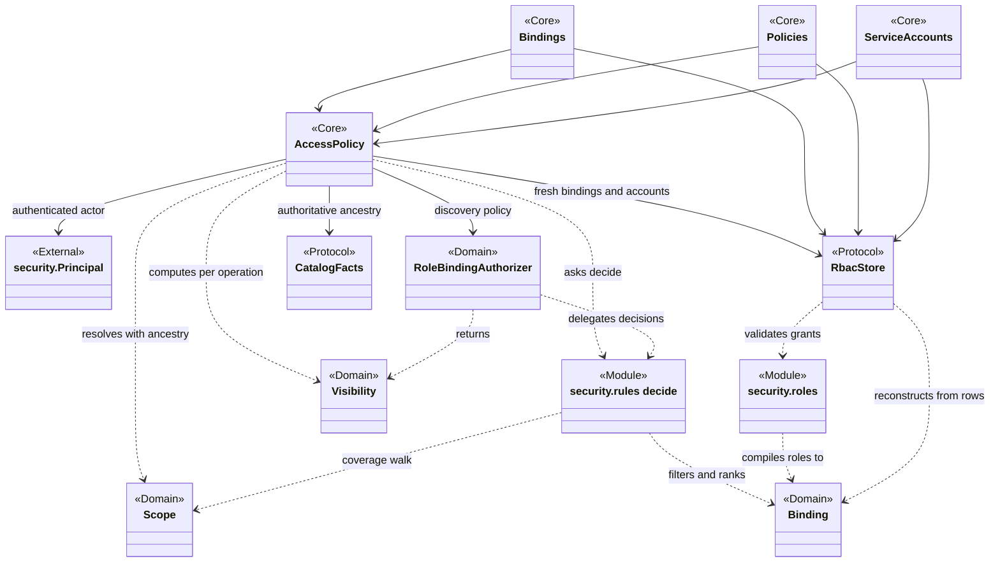

The overview follows one request: authentication produces a `Principal`; the
`AccessPolicy` bound to that actor loads current bindings, resolves the target
resource's scope with its ancestry, and asks the pure engine for a decision.
Roles never reach the engine; they are compiled to plain capability bindings when
a grant is stored and reconstructed from rows when bindings are read. Discovery
is a separate computation over the same bindings that also consults the
classification vocabulary.

| Responsibility | Owner | Important contract |
| --- | --- | --- |
| Decide a capability question | `decide()` in `core.security.rules` | Deny by default. Consider only bindings that match the principal, cover the scope, are unexpired, and name the capability. Any `DENY` wins; otherwise the first `ALLOW` at dataset, project, organization, or system level whose layer restriction admits the layer. |
| Define what a role means | `roles.ROLES` and `compile_binding()` | Five human roles, one control-plane binding plus one binding per layer grant, all `ALLOW`. Service accounts hold no roles. |
| Decide what may be discovered | `RoleBindingAuthorizer.visibility()` | `dataset.discover` at the resource scope, then the owning project's classification must be in the vocabulary and discoverable or cleared. Unknown codes fail closed. |
| Bind an actor to its authority | `AccessPolicy` | Actor from authentication; ancestry from server records; bindings read afresh per operation; not found before forbidden. |
| Turn a decision into a refusal | `access.check()` | Only an explicit `ALLOW` passes; the `Forbidden` message names capability, layer, subject, and scope level. |
| Administer grants and governance records | `Bindings`, `Policies`, `ServiceAccounts` | Each guarded mutation checks the target's own scope, confirms the scope exists, and stamps the authenticated actor as provenance. |
| Persist grants | `InMemoryRbacStore`, `PostgresRbacStore` | Validate through `compile_binding` before any write; duplicate grants refused; expiry filtered at read, inheritance left to the engine. |
| Enforce the layer kind rule | `core/catalog/layers.py` | Catalog and Raw compose layer eligibility with Security capability decisions. Humans may write only raw and bronze, service accounts only silver and gold. |

## 2. Principals, scopes, bindings, and the decision procedure

Sources: [Security rules](../src/huron/core/security/rules.py).

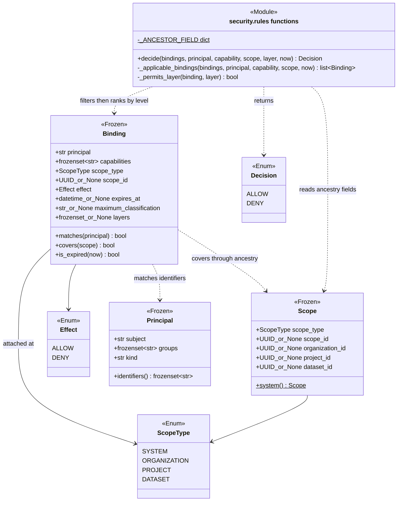

`Principal.identifiers` is the only bridge between an actor and stored grants:
`sa:{subject}` for a service account, `user:{subject}` otherwise, plus one
`group:{name}` per group. `Binding.matches()` tests membership of its `principal`
string in that set.

**Coverage is inheritance.** `Binding.covers()` returns true for a `SYSTEM`
binding unconditionally; otherwise it compares the binding's `scope_id` with the
scope's ancestor field for the binding's level (`organization_id`, `project_id`,
or `dataset_id`) or, at the binding's own level, with `scope_id`. A scope built
without ancestry is therefore not covered by a higher binding, and a non-system
binding with no `scope_id` covers nothing. `is_expired()` treats the boundary
instant as expired.

**The decision procedure** in `decide()`: collect applicable bindings
(match, cover, unexpired, capability named; effect is not a filter); answer
`DENY` if any applicable binding is a `DENY`, before layers are consulted; then
walk `DATASET`, `PROJECT`, `ORGANIZATION`, `SYSTEM` and answer `ALLOW` at the
first `ALLOW` binding whose `layers` admit the requested layer (`None` on either
side lifts the restriction); otherwise `DENY`. The engine never loads bindings and
never touches a clock except through `now`.

## 3. Role vocabulary and compilation

Sources: [roles.py](../src/huron/core/security/roles.py).

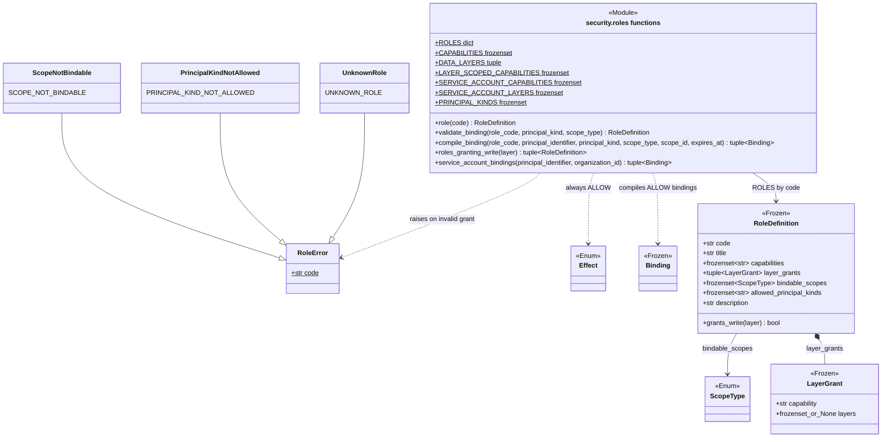

A `RoleDefinition` is vocabulary, not enforcement. `compile_binding()` validates
the grant through `validate_binding()` (role exists; principal kind is known; the
kind is not `service_account`; the role admits the kind; the scope level is
bindable) and then emits one `ALLOW` binding carrying the control-plane
capabilities, if any, followed by one `ALLOW` binding per `LayerGrant` in
definition order. Every produced binding shares principal, scope, and expiry.

| Role | Bindable at | Control-plane capabilities | Layer grants |
| --- | --- | --- | --- |
| `reader` | organization, project, dataset | `dataset.discover` | `data.read` on every layer |
| `developer` | organization, project, dataset | discover, `dataset.create`, `dataset.update`, `release.create` | `data.read` every layer; `data.write` raw and bronze |
| `project_admin` | organization, project | discover, `project.update`, `project.policy_attach`, `dataset.create`, `dataset.update`, `dataset.policy_attach`, `release.create`, `rbac.binding_manage` | `data.read` every layer |
| `organization_admin` | organization | discover, `organization.update`, `organization.policy_attach`, `project.create`, `project.update`, `project.policy_attach`, `dataset.policy_attach`, `service_account.manage`, `rbac.binding_manage` | `data.read` every layer |
| `platform_owner` | system | every control-plane capability including `organization.create`, `organization.delete`, `user.manage` | `data.read` every layer |

All five roles admit only `user` principals. No role carries `data.write` on
silver or gold, and `roles_granting_write()` returns nothing for those layers.
`service_account_bindings()` synthesizes a service account's entire authority as
three never-expiring organization-scope `ALLOW` bindings: dataset create, update,
and discover; `data.read` on silver and gold; `data.write` on silver and gold. That
authority is a property of the principal kind and is never stored as a row.

`CAPABILITIES` holds the seventeen known capability codes. `LAYER_SCOPED_CAPABILITIES`
names the two that carry a `layers` restriction; consumers of the
`role_capabilities` table need it to tell a control-plane row from a layer row,
because `layers = NULL` already means every layer.

## 4. Classification-aware discovery

Sources: [Security rules](../src/huron/core/security/rules.py).

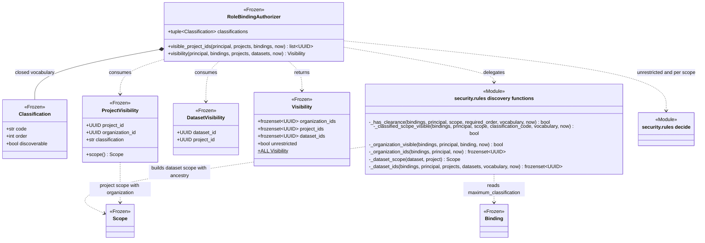

`visibility()` is the only producer of a `Visibility`. `unrestricted` is true
only when `dataset.discover` is allowed at `SYSTEM` scope. `project_ids` is
`visible_project_ids()`: the project's scope must decide `dataset.discover`
`ALLOW`, its classification code must be in the vocabulary, and the level must be
discoverable or cleared. Clearance comes from any unexpired `ALLOW` binding
covering the scope whose `maximum_classification` ranks at or above the
project's, regardless of that binding's capabilities. `organization_ids` holds
each `ORGANIZATION` binding's scope whose own organization scope also decides
`dataset.discover` `ALLOW`; membership there does not admit the organization's
projects. `dataset_ids` evaluates each supplied dataset at its own scope with full
ancestry and its owning project's classification; a dataset whose project is not
in `projects` is skipped.

The vocabulary is closed and configured per deployment (section 10). A project
with an unknown code is never visible. Dataset-scoped discovery never widens to
the project or sibling datasets.

## 5. From authenticated actor to decision

Sources: [public Security exports](../src/huron/core/security/__init__.py),
[access implementation](../src/huron/core/security/_impl/access.py),
[scopes](../src/huron/core/security/scopes.py),
[Security facts](../src/huron/core/security/facts.py#L14),
[authenticated principal](../src/huron/core/security/principal.py).

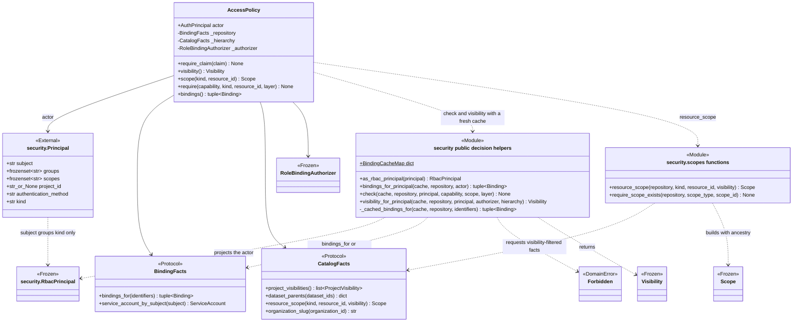

`as_rbac_principal()` keeps only subject, groups, and kind. The API-key
restrictions on `security.Principal` (`scopes`, `project_id`) and the authentication
method are dropped and never influence a decision.

`bindings_for_principal()` chooses by kind: humans and their groups resolve
through stored bindings; a service account gets `service_account_bindings()`
synthesized from its stored account, or no bindings at all if the account is
missing or disabled. Both branches memoize in the caller's `BindingCacheMap`,
keyed by identifier set. `AccessPolicy` passes a fresh empty cache on every call,
so a core operation always reads current authority; the API's request-scoped cache
(section 10) is the only place bindings are reused.

`check()` is the one place a `Decision` becomes an error: anything but `ALLOW`
raises `Forbidden` naming capability, layer, subject, and scope level.

**Not found before forbidden.** The scope functions read the addressed resource
through the caller's `Visibility` before any binding is consulted, so an absent or
undiscoverable id fails as not found. Metastore's `SecurityFacts.resource_scope()`
projects dataset ancestry after reading the target with caller visibility and its
parent with `Visibility.ALL`. Security receives the complete `Scope`, never a
Catalog entity. `require_scope_exists()` serves the governance workflows: it rejects an
inconsistent scope/id pair as a caller bug (`ValueError`) and confirms a
consistent one exists using unrestricted visibility, since the caller's own
authorization has already been checked.

## 6. Core consumers of AccessPolicy and capability enforcement

Sources: [Catalog creation](../src/huron/core/catalog/_impl/creation.py),
[Catalog collections](../src/huron/core/catalog/_impl/collections.py),
[Raw releases](../src/huron/core/raw/_impl/releases.py),
[Raw ingestion](../src/huron/core/raw/_impl/ingestion.py),
[Raw revision reads](../src/huron/core/raw/_impl/revisions.py),
[Security identity](../src/huron/core/security/_impl/identity.py).

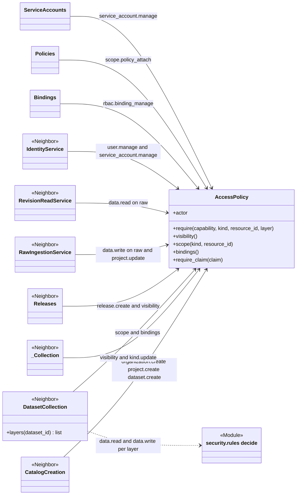

Every core entry class receives an `AccessPolicy` already bound to the
authenticated actor. Operations call `require()` for the capability at the
target's scope, `visibility()` for discovery-filtered reads, `require_claim()`
to tie a retry identity to the same actor, and `actor.subject` as provenance in
place of any caller-supplied label. `DatasetCollection.layers()` is the one
consumer that reads `bindings()` and calls `decide()` directly, to report the
caller's read and write decision for each of the four layers.

| Capability | Enforced where | Status |
| --- | --- | --- |
| `organization.create` | `CatalogCreation` and the system guard | Enforced at `SYSTEM` |
| `organization.update`, `organization.policy_attach` | `_Collection.describe`, `Policies.attach_policy`, organization guards | Enforced |
| `organization.delete` | nowhere | Vocabulary only; no delete workflow or route exists |
| `project.create`, `project.update`, `project.policy_attach` | `CatalogCreation`, `_Collection.describe`, `Policies`, ingest overseer paths, project guards | Enforced |
| `dataset.create`, `dataset.update`, `dataset.policy_attach` | `CatalogCreation`, `_Collection.describe`, `Policies`, dataset guards | Enforced |
| `dataset.discover` | `RoleBindingAuthorizer.visibility()` and every visibility-filtered read | Enforced as discovery, not as a route guard |
| `release.create` | `Releases.create_release` and the dataset guard | Enforced |
| `rbac.binding_manage` | `Bindings` and the binding routes at every scope level | Enforced |
| `service_account.manage` | `ServiceAccounts`, `IdentityService`, organization guard | Enforced |
| `user.manage` | `IdentityService` and the users routes | Enforced at `SYSTEM` |
| `data.write` | `RawIngestionService` and the raw-write guards, layer `raw` only | Enforced for raw; no bronze, silver, or gold write workflow exists |
| `data.read` | `RevisionReadService`, the revision download guard, layer `raw` only | Enforced for raw payload; other layers reported by `layers()` only |

## 7. The layer kind rule at the RBAC seam

Sources: [Catalog layers](../src/huron/core/catalog/layers.py).

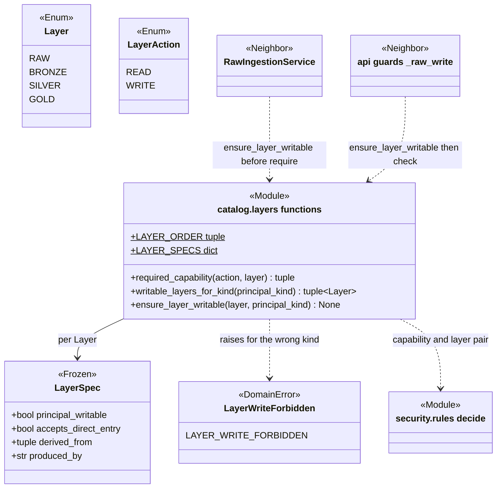

`ensure_layer_writable()` is the kind half of the write rule, checked before and
independently of bindings: a service account may write silver and gold; any other
kind may write only layers marked `principal_writable` (raw and bronze). A
mis-seeded binding therefore cannot let a human commit to silver or gold, and the
binding side agrees, since no role carries those writes. `required_capability()`
returns the `(data.read or data.write, layer code)` pair in the order `decide()`
takes them; the layer is never baked into a capability name. The
[catalog atlas](catalog-uml.html) section 8 covers `LayerSpec` in full.

## 8. Governance administration

Sources: [bindings](../src/huron/core/security/_impl/bindings.py),
[policies](../src/huron/core/security/_impl/policies.py),
[service accounts](../src/huron/core/security/_impl/service_accounts.py),
[Security ports](../src/huron/core/security/ports.py),
[Security values](../src/huron/core/security/types.py),
[identity](../src/huron/core/security/_impl/identity.py).

```mermaid
classDiagram
direction TB
class Bindings {
  -AccessPolicy _access
  -CatalogFacts _hierarchy
  -BindingStore _store
  +grant_role(principal, role_code, scope_type, scope_id, expires_at) RoleBindingRecord
  +revoke_role(binding_id) RoleBindingRecord
  +get_role_binding(binding_id) RoleBindingRecord
  +bindings_at(scope_type, scope_id) list~RoleBindingRecord~
}
class Policies {
  -AccessPolicy _access
  -CatalogFacts _hierarchy
  -PolicyStore _store
  +create_policy(policy_type, name, spec) Policy
  +attach_policy(policy_id, scope_type, scope_id) PolicyAttachment
  +list_policies() list~Policy~
}
class ServiceAccounts {
  -AccessPolicy _access
  -CatalogFacts _hierarchy
  -ServiceAccountStore _store
  +create_service_account(organization_id, name) ServiceAccount
  +get_service_account(principal_id) ServiceAccount
  +list_service_accounts(organization_id) list~ServiceAccount~
  +disable_service_account(principal_id, disabled_at) ServiceAccount
}
class BindingStore {
  <<Protocol>>
  +grant_role(principal, role_code, scope_type, scope_id, created_by, expires_at) RoleBindingRecord
  +revoke_role(binding_id) RoleBindingRecord
  +get_role_binding(binding_id) RoleBindingRecord
  +bindings_at(scope_type, scope_id) list~RoleBindingRecord~
}
class PolicyStore {
  <<Protocol>>
  +create_policy(policy_type, name, spec, created_by) Policy
  +attach_policy(policy_id, scope_type, scope_id, attached_by) PolicyAttachment
  +list_policies() list~Policy~
}
class ServiceAccountStore {
  <<Protocol>>
  +create_service_account(organization_id, name, subject, created_by) ServiceAccount
  +get_service_account(principal_id) ServiceAccount
  +list_service_accounts(organization_id) list~ServiceAccount~
  +disable_service_account(principal_id, disabled_at) ServiceAccount
}
class BindingFacts {
  <<Protocol>>
  +bindings_for(identifiers) tuple~Binding~
  +service_account_by_subject(subject) ServiceAccount
}
class RbacStore {
  <<Protocol>>
}
class AccessPolicy
class CatalogFacts {
  <<Protocol>>
}
class ScopesModule["security.scopes require_scope_exists"] {
  <<Module>>
}
class IdentityService {
  <<Neighbor>>
  +issue_service_account_key(organization_id, principal_id, ...) tuple
  +disable_service_account(organization_id, principal_id) ServiceAccount
}
RbacStore --|> BindingFacts
RbacStore --|> BindingStore
RbacStore --|> PolicyStore
RbacStore --|> ServiceAccountStore
Bindings --> AccessPolicy
Policies --> AccessPolicy
ServiceAccounts --> AccessPolicy
Bindings --> CatalogFacts
Policies --> CatalogFacts
ServiceAccounts --> CatalogFacts
Bindings --> BindingStore
Policies --> PolicyStore
ServiceAccounts --> ServiceAccountStore
Bindings ..> ScopesModule : scope must exist
Policies ..> ScopesModule : scope must exist
ServiceAccounts ..> ScopesModule : organization must exist
IdentityService --> ServiceAccounts : disable then revoke keys
```

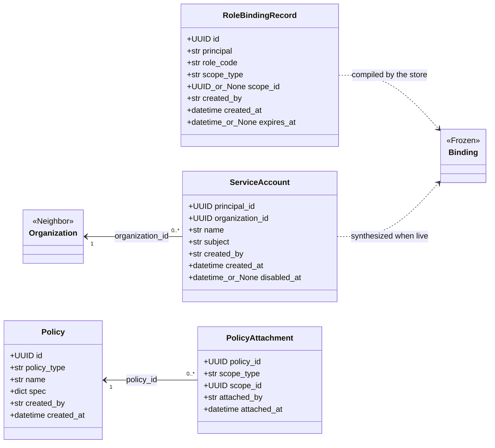

**Guarded-mutation rules, as implemented:**

- `Bindings.grant_role()` and `bindings_at()` require `rbac.binding_manage` at
  the addressed scope, then confirm the scope exists. `revoke_role()` and
  `get_role_binding()` read the binding first and check the capability at the
  binding's own scope, not the caller's intended one. Listing is exact-scope
  and includes expired grants. Grants of any `sa:` principal are refused by
  `validate_binding()` inside the store.
- `Policies.create_policy()` and `list_policies()` are open to any
  authenticated actor, since defining a policy grants nothing.
  `attach_policy()` requires `{scope}.policy_attach` at the target scope,
  derived from the scope type's lowercase name; there is no `SYSTEM`
  attachment. `spec` and `policy_type` are stored verbatim. Nothing in the
  inspected source reads attachments back to enforce retention, quota,
  classification defaults, or schema composition.
- `ServiceAccounts` requires `service_account.manage` on the owning organization
  for every operation; read and disable resolve the account first to learn its
  organization. Creation validates `name` as a slug and derives the immutable
  subject `{organization slug}/{name}`. Disabling is idempotent and does not
  revoke keys; `IdentityService.disable_service_account()` layers key
  revocation on top, skipping it when the account was already disabled earlier.
- Workflows accept no caller `created_by` or `attached_by` argument. They pass the
  authenticated actor's subject to persistence, whose attribution parameters remain.

## 9. Persistence adapters and conformance

Sources: [Metastore RBAC](../src/huron/core/metastore/rbac.py),
[hierarchy](../src/huron/core/metastore/hierarchy.py),
[queries](../src/huron/core/metastore/queries.py),
[Security fact projections](../src/huron/core/metastore/security_facts.py#L16).

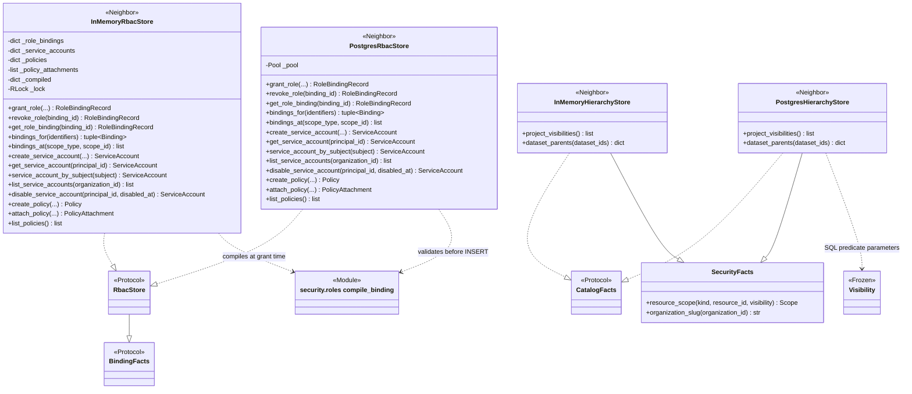

Both stores validate a grant with `compile_binding()` before anything is
written, deriving the principal kind from the identifier prefix (`sa:` is a
service account). The in-memory store keeps the compiled bindings per binding id
so `bindings_for()` is a lookup and a revoke drops exactly its own bindings. The
PostgreSQL store reconstructs bindings by joining `role_bindings` to
`role_capabilities`: one binding for the control-plane rows plus one per
`data.read`/`data.write` row with that row's `layers`, filtering expired rows
against the database clock and reading effect from the row, so a `DENY` row
written outside the API is reproduced faithfully. Duplicate grants,
duplicate service-account names, and repeat attachments surface as the same
domain errors from both stores. The `role_bindings_guard` and
`service_accounts_kind_guard` triggers repeat the validation for rows written
outside the store.

`Visibility` reaches SQL through `_visibility_parameters()` in `queries.py`:
the unrestricted flag and the three id lists are bound as parameters of every
trusted read and browse, so admission happens before pagination rather than as
a post-filter.

## 10. API wiring: guards, request cache, and construction

Sources: [authorization/guards.py](../src/huron/applications/api/authorization/guards.py),
[authorization/decisions.py](../src/huron/applications/api/authorization/decisions.py),
[dependencies.py](../src/huron/applications/api/dependencies.py),
[app.py](../src/huron/applications/api/app.py),
[settings.py](../src/huron/applications/api/settings.py),
[endpoints/roles.py](../src/huron/applications/api/routes/v1/endpoints/roles.py).

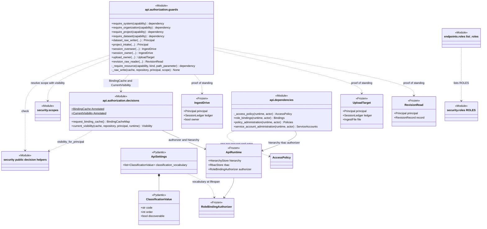

The route guards are closures over a capability. `require_system()` checks at
`SYSTEM` scope; the resource guards resolve the path identifier through the
caller's `CurrentVisibility` first, so an absent or undiscoverable id is not
found before any binding is read, then `check()` the capability at the resolved
scope. The ingest guards add ownership: an overseer is the session's creator or
a holder of `project.update`; driving a session or an upload is the owner alone,
with the raw-write binding re-checked on every call. The proof dataclasses carry
the early guard result. Actor-bound Raw operations still independently re-resolve
current facts and enforce their authorization; guard proofs do not replace that check.

`request_binding_cache()` mints one `BindingCacheMap` per request through
FastAPI's dependency cache; `current_visibility()` computes the caller's
`Visibility` once per request. Neither survives the request. The core
operations constructed by `dependencies.py` receive an `AccessPolicy` built from
the same runtime, and that policy uses a fresh cache on each call. The
`RoleBindingAuthorizer` is built once per process lifespan from
`ApiSettings.classification_vocabulary`, whose validator refuses duplicate
codes, duplicate orders, and an empty vocabulary. The roles endpoint lists
`ROLES` directly; the API's `RoleError` handler renders the three role errors as
422 problems.

## 11. Error hierarchy

Sources: [Security roles](../src/huron/core/security/roles.py),
[Security errors](../src/huron/core/security/errors.py),
[Foundation errors](../src/huron/core/foundation/errors.py),
[Catalog layers](../src/huron/core/catalog/layers.py).

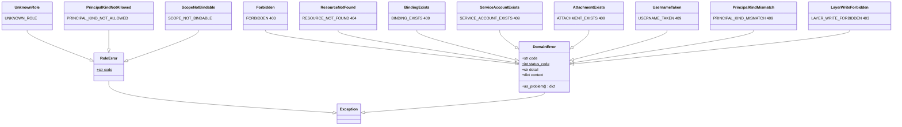

`RoleError` is a separate, framework-free tree whose subclasses fix `code` as a
class variable; the API maps it to 422. `DomainError` carries the transport
contract (`code`, `status_code`, `as_problem()`) and refuses direct
instantiation. `Forbidden` is always a 403: the credential was fine, the
authority was not. `ResourceNotFound` is what the scope functions raise for an
undiscoverable id, which is how not found precedes forbidden. The 409 failures
are the uniqueness rules of the governance stores. `UsernameTaken` and
`PrincipalKindMismatch` belong to identity administration but share the same
subject namespace that service-account subjects occupy.

## 12. Designed or declared, not enforced

Cross-checked against [rbac.html](rbac.html) and the inspected source.

- **Classification clearance is engine-only.** `Binding.maximum_classification`
  is read by discovery, but no production path sets it: `compile_binding()`
  never populates it, the `role_bindings` table stores no conditions, and
  `bindings_for()` does not read any. In practice only classifications
  configured `discoverable: true` are ever visible to anyone without
  unrestricted discovery.
- **`DENY` bindings cannot be created through the API.** Both stores insert
  `ALLOW`. The engine and `PostgresRbacStore.bindings_for()` honor a `DENY`
  row, but only one written outside the store.
- **`organization.delete`** is in the vocabulary and on `platform_owner`; no
  workflow, route, or guard checks it.
- **Bronze, silver, and gold writes** have no workflow. `data.write` is enforced
  only for raw ingest; `data.read` only for raw revision downloads and the
  per-layer report in `DatasetCollection.layers()`.
- **Raw payload read is not a stricter capability.** `reader` holds
  `data.read` on every layer including raw payload, as the design notes.
- **API-key scopes and project restriction** on `security.Principal` are dropped by
  `as_rbac_principal()`; the RBAC tier does not narrow a key below its owner.
- **Policy attachments are stored, not interpreted.** No reader composes
  effective policy, retention, quota, or schema requirements from them.
- **P3 integrity authority** (`integrity.read`, `integrity.maintain`) is absent
  from `CAPABILITIES` and from every role; the [catalog atlas](catalog-uml.html)
  notes the `core/integrity` subsystem separately.
- **Group membership** comes only from the authenticated principal's `groups`;
  there is no group store in Security.

## Source and behavioral cross-checks

The implementation snapshot was traced through constructors, fields, inheritance,
protocol declarations, and wiring. Useful behavioral entry points are:

- [Role model tests](../tests/unit/test_rbac_roles.py) and
  [visibility tests](../tests/unit/test_rbac_visibility.py): compilation,
  invariants on silver/gold writes, discovery and clearance.
- [Authorization decision tests](../tests/unit/test_authorization_decisions.py),
  [guard tests](../tests/unit/test_authorization_guards.py), and
  [credential tests](../tests/unit/test_authorization_credentials.py): the
  request cache, not found before forbidden, ownership, and layer rules.
- [Binding route tests](../tests/unit/test_api_bindings.py),
  [policy route tests](../tests/unit/test_api_policies.py),
  [service-account route tests](../tests/unit/test_api_service_accounts.py),
  [role route tests](../tests/unit/test_api_roles.py), and
  [RBAC route tests](../tests/unit/test_api_rbac.py): governance workflows
  through the API.
- [RBAC store contracts](../tests/contract/test_rbac_store.py),
  [repository RBAC tests](../tests/unit/test_repository_rbac.py), and
  [PostgreSQL conflict tests](../tests/unit/test_postgres_rbac_conflicts.py):
  adapter conformance and uniqueness errors.
- [Layer tests](../tests/unit/test_catalog_layers.py): the kind half of the
  write rule.

This document describes inspected implementation; it does not claim that the
application test suites were rerun to create a diagram.
